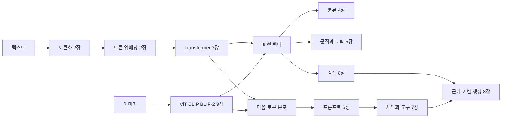

# 챕터를 연결하는 개념 지도와 용어집

[전체 목차](README.md) · [학습 계획](LEARNING_PATH.md)

각 챕터는 독립적인 기능을 다루지만 같은 입력·표현·학습·평가 개념을 공유합니다. 용어를 외울 때는 그 용어가 시스템의 어느 위치에서 무엇을 바꾸는지 함께 연결하세요.

## 전체 흐름

이 도식은 역할을 연결한 개념도입니다. 모든 모델이 하나의 동일한 Transformer에서 표현과 생성 기능을 동시에 제공한다는 뜻은 아닙니다. 실제 과제에서는 서로 다른 encoder, decoder, vision encoder를 조합할 수 있습니다.

## 변화시키는 대상을 기준으로 방법 고르기

| 관찰한 문제 | 먼저 점검할 대상 | 관련 장 | 곧바로 결론 내리면 안 되는 것 |
|---|---|---|---|
| 관련 문서를 못 찾는다 | 문서 분할, 임베딩, 검색 조건, 평가 라벨 | 2·8·10 | 생성 모델이 작아서 그렇다는 결론 |
| 문서는 맞는데 답이 틀리다 | 문맥 구성, 근거 사용, 생성 지시, 출력 검증 | 6·8 | 검색 정확도를 높이면 모두 해결된다는 결론 |
| 답 형식이 들쭉날쭉하다 | 명확한 스키마, 예시, 제약 디코딩, 파싱 | 6 | JSON으로 파싱되면 사실도 맞다는 결론 |
| 짧은 대화에서는 맞는데 길어지면 틀린다 | 메모리 관리, 요약 손실, 컨텍스트 한계 | 3·7 | 영구 기억을 학습했다고 가정하는 것 |
| 분류 accuracy는 높은데 소수 클래스가 빠진다 | 클래스별 confusion, macro F1, 데이터 분포 | 4·11 | 전체 정확도만 보고 개선됐다는 결론 |
| 군집 이름은 그럴듯한데 문서가 섞여 있다 | 임베딩·차원 축소·군집과 이름 생성 단계 분리 | 5 | 이름만 다시 쓰면 군집 품질도 좋아진다는 결론 |
| 특정 도메인의 유사도를 잘 구분하지 못한다 | 학습 쌍, hard negative, 임베딩 평가 | 10 | 모든 문장쌍을 단순히 늘리면 된다는 결론 |
| 특정 스타일이나 지시를 꾸준히 따르지 못한다 | SFT 데이터, 채팅 템플릿, 평가 기준 | 12 | 학습 데이터에 사실을 넣으면 검색 없이 모두 기억한다는 결론 |

## 입력과 표현

| 용어 | 정확히 읽는 방법 | 처음 볼 장 |
|---|---|---|
| 토큰 token | 토크나이저가 사용하는 처리 단위. 단어·부분 단어·문자·바이트와의 관계는 방식마다 다르다. | 2 |
| 어휘 vocabulary | 토크나이저가 ID를 부여한 토큰의 집합. 자연언어 사전과 같지 않다. | 2 |
| 토큰 ID | 임베딩 표 등의 행을 고르는 정수 인덱스. ID 간 숫자 거리는 의미 거리가 아니다. | 2 |
| 정적 임베딩 | 같은 단어나 항목에 고정된 벡터를 사용하는 표현. | 1·2 |
| 문맥 임베딩 | 주변 입력에 따라 달라지는 특정 위치의 표현. | 2·3 |
| 문장 임베딩 | 문장이나 문서 전체를 검색·비교 등에 쓰는 벡터로 나타낸 것. pooling과 학습 목표가 중요하다. | 2·10 |
| pooling | 여러 토큰 표현을 하나로 집계하는 연산. mean pooling에서는 padding 제외가 중요하다. | 2·10 |
| cosine similarity | 두 벡터 방향의 유사성. 그 자체가 보정된 정답 확률은 아니다. | 2·8 |
| multimodal embedding | 서로 다른 모달리티의 항목을 비교할 수 있도록 정렬한 표현. | 9 |

## 구조와 생성

| 용어 | 정확히 읽는 방법 | 관련 장 |
|---|---|---|
| encoder | 입력을 문맥 표현으로 바꾸는 구성. encoder-only 모델은 주로 표현 기반 과제에 쓰인다. | 1·3 |
| decoder | 출력 토큰 예측을 담당하는 구성. decoder-only 생성 모델은 앞 토큰에 조건을 둔다. | 1·3 |
| self-attention | 같은 시퀀스의 위치들이 서로의 정보를 가중합하는 과정. | 3 |
| Q K V | 현재 위치의 조회 표현, 비교 대상의 표현, 가중합할 내용의 표현이라는 역할로 이해한다. | 3 |
| causal mask | 현재 예측에서 미래 위치를 보지 못하게 하는 제한. | 3 |
| attention head | 서로 다른 투영으로 정보를 조합하는 attention 경로. | 3 |
| residual connection | 변환 결과에 입력 경로를 더하는 연결. 깊은 모델의 정보·gradient 흐름을 돕는다. | 3 |
| RoPE | 위치에 따라 Q와 K 등을 회전시켜 상대 위치 관계를 점수에 반영하는 방식. | 3 |
| KV cache | 생성 중 이미 계산한 key와 value를 재사용하는 저장. 모델 지식을 영구 학습한 기억이 아니다. | 3 |
| logits | 확률로 바꾸기 전의 점수. softmax나 다른 처리 후 토큰 선택에 사용한다. | 3·6 |
| greedy decoding | 현재 분포에서 가장 높은 점수의 토큰을 선택하는 방식. | 3·6 |
| top-k top-p | 후보 개수 또는 누적 확률을 기준으로 샘플링 후보를 제한하는 방식. | 6 |
| constrained decoding | 허용 가능한 출력 토큰을 문법 등의 제약으로 제한하는 방법. 내용의 사실성을 자동 보장하지 않는다. | 6 |

## 응용 시스템

| 용어 | 정확히 읽는 방법 | 관련 장 |
|---|---|---|
| zero-shot classification | 해당 과제의 라벨 예제를 직접 학습하지 않고 지시나 라벨 설명 등으로 분류하는 사용 방식. | 4 |
| clustering | 비슷한 항목을 그룹으로 묶기. 그룹이 사람이 생각하는 주제와 자동으로 일치하지는 않는다. | 5 |
| topic representation | 군집의 의미를 키워드·문장 등으로 설명하기. 군집 할당과 다른 단계다. | 5 |
| c-TF-IDF | 토픽 단위로 합친 문서의 단어 빈도와 토픽 전체 정보를 사용해 대표 단어를 찾는 가중 방식. | 5 |
| in-context learning | 프롬프트의 예시를 참고하여 작업을 수행하는 현상과 사용 방식. 보통 가중치 갱신은 없다. | 6 |
| prompt chaining | 복잡한 과제를 여러 프롬프트 호출과 중간 결과 처리로 연결하기. | 6·7 |
| conversation memory | 대화 기록을 저장·선별·요약하여 다음 호출의 문맥에 넣는 시스템 기능. | 7 |
| agent | 모델이 관찰에 따라 다음 행동이나 도구 호출을 선택하는 반복 시스템. | 7 |
| ReAct | 추론과 행동·관찰을 연결하는 접근. 실제 실행에는 도구 규격과 종료 조건이 필요하다. | 7 |
| dense retrieval | 질문과 문서를 밀집 벡터로 비교해 후보를 찾는 검색. | 8 |
| reranker | 검색된 후보를 더 정교하게 다시 평가하고 정렬하는 모델 또는 단계. | 8 |
| RAG | 검색한 자료를 생성 모델의 문맥에 제공하는 구성. 검색과 생성 각각의 평가가 필요하다. | 8 |
| grounding | 답변이 주어진 근거와 연결되도록 하는 것. 출처 문자열을 붙이는 것만으로 달성되지는 않는다. | 8 |
| CLIP | 이미지와 텍스트 표현을 대조 학습으로 정렬하는 접근. 자체적으로 답변 문장을 생성하는 모델이라는 뜻은 아니다. | 9 |
| BLIP-2 | 시각 encoder와 언어 모델 사이를 Q-Former 등으로 연결하는 멀티모달 생성 접근. | 9 |

## 학습과 평가

| 용어 | 정확히 읽는 방법 | 관련 장 |
|---|---|---|
| contrastive learning | 관련된 표현은 가깝게, 비교 대상과는 구별되게 학습하는 계열의 방법. 손실별 데이터 요구가 다르다. | 2·10 |
| hard negative | 겉으로 비슷하지만 목표상 다른 예제. 라벨 오류가 있으면 학습을 해칠 수 있다. | 10 |
| SBERT | 문장 쌍 학습과 pooling 등으로 비교 가능한 문장 표현을 얻는 접근. | 10 |
| TSDAE | 손상된 입력으로부터 원문을 복원하게 하여 문장 표현을 학습하는 접근. | 10 |
| SetFit | 소수의 라벨 예제로 문장 임베딩을 적응시키고 분류기를 학습하는 접근. | 11 |
| MLM | 가려진 토큰을 문맥으로 복원하는 학습 목표. 다음 토큰 예측과 입력 조건이 다르다. | 11 |
| NER | 텍스트에서 이름 등 개체의 구간과 종류를 찾는 과제. subword와 단어 라벨 정렬이 필요하다. | 11 |
| SFT | 입력과 바람직한 출력 쌍으로 생성 모델의 행동을 지도 학습하는 단계. | 12 |
| PEFT | 전체 가중치보다 적은 학습 매개변수로 모델을 적응시키는 방법들의 범주. | 12 |
| LoRA | 원래 가중치를 유지하면서 저랭크 행렬의 곱으로 변화량을 학습한다. | 12 |
| QLoRA | 양자화한 기본 모델과 LoRA 등을 결합해 미세 조정의 메모리 부담을 줄이는 접근. | 12 |
| reward model | 응답 선호도 등을 점수로 평가하도록 학습한 모델. 점수는 진실성의 절대 척도가 아니다. | 12 |
| DPO | 선택된 응답과 거절된 응답의 선호 쌍으로 정책을 직접 최적화하는 접근. | 12 |
| calibration | 예측 확률과 실제 정답 빈도가 얼마나 맞는지에 관한 성질. 높은 분류 성능과 별개다. | 4·12 보충 |
| data leakage | 평가 시 알 수 없어야 할 정보가 학습·설정 선택 등에 들어가는 문제. | 4·10·11·12 |

## 혼동을 줄이는 여섯 문장

1. 토큰화는 문자를 처리 단위로 바꾸고, 임베딩은 단위를 벡터로 바꾼다.
2. attention은 이미 주어진 문맥 안의 정보를 결합하고, 검색은 문맥 밖의 자료를 가져온다.
3. 군집은 문서를 묶고, 토픽 표현은 그 묶음을 설명한다.
4. 프롬프트와 RAG는 일반적인 사용에서 문맥을 바꾸고, 미세 조정은 가중치를 바꾼다.
5. 형식 검증은 출력 구조를 확인하고, 근거 검증은 내용의 뒷받침을 확인한다.
6. 학습 손실은 최적화 목표이고, 사용자가 원하는 품질은 별도의 평가로 확인해야 한다.
