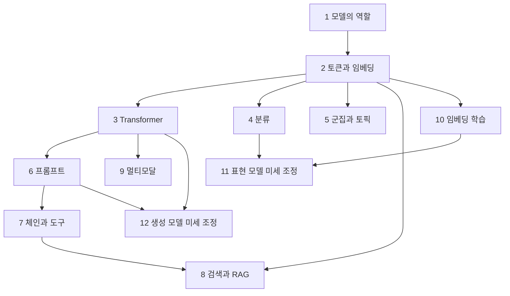

# 학습 방법과 12주 계획

[전체 목차](README.md) · [선수지식](PREREQUISITES.md) · [개념 지도](CONCEPTS.md)

이 과정의 목표는 용어를 외우는 데서 멈추지 않고, 문제를 보고 표현 모델·생성 모델·검색·미세 조정 중 적절한 방법을 고른 뒤 결과를 검증할 수 있게 되는 것입니다. 아래 시간은 개인 학습 계획을 위한 예시입니다. 각 장의 강의안은 교사와 학습자가 함께하는 별도 수업 흐름을 제공합니다.

## 한 챕터를 공부하는 순서

### 먼저 예측하고 나중에 실행하기

학습 노트를 읽기 전에 학습 목표를 질문으로 바꿔 적습니다. 예를 들어 “임베딩을 이해한다”를 “문장이 길어져도 왜 한 개의 고정 길이 벡터로 검색할 수 있는가?”로 바꾸세요. 문단을 읽은 뒤 답을 수정하면, 이해한 내용과 익숙해진 용어를 구분하기 쉽습니다.

시각화의 슬라이더를 움직이기 전에 “어떤 값이 커지고 어떤 값이 작아질지”를 예측합니다. 실습 코드는 먼저 실행하고 끝내지 말고 입력 하나를 바꿔 봅니다. 예상과 관찰이 어긋난 지점이 가장 좋은 질문입니다.

### 설명 가능한 단위로 쪼개기

각 원문 절마다 다음 네 문장으로 설명해 보세요.

1. 이 방법은 어떤 문제를 해결한다.
2. 입력은 무엇이며 출력은 무엇이다.
3. 계산이나 데이터 처리는 이 순서로 진행된다.
4. 이런 조건에서는 실패하거나 다른 방법이 더 적합하다.

수식은 기호를 읽는 것보다 변수의 모양과 의미를 연결하는 것이 먼저입니다. attention 식을 외우기 전에 Q·K·V가 각각 몇 개의 벡터이고 어떤 곱셈이 가능한지 설명합니다. 평가 지표는 높을수록 좋다는 말보다 분모와 평가 대상이 무엇인지 설명합니다.

### 회상과 검산

문제를 풀 때는 먼저 노트를 닫습니다. 개념 문제는 자신의 예제로, 계산 문제는 중간 숫자로, 설계 문제는 선택 근거와 실패 가능성으로 답합니다. 답을 확인한 뒤 틀린 이유를 “몰랐음 / 용어 혼동 / 계산 오류 / 조건 누락”으로 기록합니다. 다음 학습에서는 그 항목만 짧게 다시 풉니다.

## 12주 기본 과정

주당 두 번, 회당 90~120분을 출발점으로 삼을 수 있습니다. 처음 접하는 내용이 많으면 한 장을 두 주로 나누어도 됩니다.

| 주 | 장 | 첫 학습에서 할 일 | 두 번째 학습에서 할 일 | 통과 기준 |
|---|---|---|---|---|
| 1 | 1장 언어 모델 입문 | BoW→임베딩→Transformer 흐름과 모델 유형 | 생성 과정 실습, 적용 문제 분류 | 표현 모델과 생성 모델의 입출력을 예로 구분 |
| 2 | 2장 토큰과 임베딩 | 토큰화 방식, 정적·문맥·문장 임베딩 | 토큰 분할과 코사인 유사도 실험 | 토큰 수·벡터 차원·문서 길이를 혼동하지 않음 |
| 3 | 3장 트랜스포머 | forward pass, attention, causal mask | QKV 손계산, 캐시·샘플링 변화 | 한 토큰 생성의 데이터 흐름을 도식으로 재현 |
| 4 | 4장 텍스트 분류 | 전용 모델·임베딩 분류·생성 분류 비교 | confusion matrix와 오답 분석 | 라벨 유무와 비용 조건으로 방법 선택 |
| 5 | 5장 군집과 토픽 | UMAP·HDBSCAN·c-TF-IDF 역할 | 군집과 토픽 명명의 차이 실험 | 군집 품질과 토픽 설명 품질을 구분 |
| 6 | 6장 프롬프트 | 지시·문맥·예시·형식·분해 | 출력 검증과 샘플링 비교 | 좋은 형식과 사실 정확성이 별개임을 설명 |
| 7 | 7장 생성 도구 | 체인·메모리·도구 사용·ReAct | 상태 전이와 도구 실패 처리 | 에이전트의 종료 조건과 관찰을 설계 |
| 8 | 8장 검색과 RAG | chunking→검색→재정렬→생성 | 검색 지표 계산, 근거 적합성 평가 | 검색 실패와 생성 실패를 나눠 진단 |
| 9 | 9장 멀티모달 | ViT·CLIP·BLIP-2 역할 | 이미지-텍스트 정렬 실험 | 공동 임베딩과 이미지 조건부 생성을 구분 |
| 10 | 10장 임베딩 학습 | 대조 학습과 손실함수 | 양성·음성 쌍과 도메인 적응 | 데이터 쌍이 의미 공간을 어떻게 바꾸는지 설명 |
| 11 | 11장 표현 모델 학습 | BERT 분류·SetFit·MLM·NER | freezing과 토큰 라벨 정렬 | 문장 분류와 토큰 분류의 학습 대상을 구분 |
| 12 | 12장 생성 모델 학습 | SFT·LoRA·QLoRA·선호 학습 | 저랭크 갱신과 DPO 원리 | 원하는 변화에 맞는 데이터와 평가 설계 |

## 서로 연결해서 읽기

RAG를 먼저 만들고 싶다면 1→2→3의 기본 개념을 익힌 뒤 6→8로 진행하고, 7장에서 대화 상태와 도구 사용을 보충합니다. 분류·검색 품질을 개선하려면 4·8의 평가를 먼저 이해하고 10·11장의 학습 방법으로 넘어갑니다. 12장의 튜닝을 배우기 전에 6장에서 프롬프트만으로 해결되는지 확인하는 사고 실험을 해 보세요.

## 마지막 통합 과제

개인 공부 노트를 대상으로 질문에 근거를 제시하는 작은 학습 도우미를 설계합니다. 실제 서비스를 배포할 필요는 없습니다. 다음 산출물만으로 설계의 타당성을 설명할 수 있어야 합니다.

- 원문을 어떻게 나눌지와 그 이유, 검색할 질문 예시 10개.
- 질문별 적합 문서 라벨과 Recall@k·MRR 중 선택한 검색 지표.
- 검색 결과가 부족할 때의 응답 규칙과 출처 표시 형식.
- 분류 모델이나 토픽 모델을 넣는다면 어느 단계에 왜 필요한지.
- 임베딩 튜닝과 생성 모델 튜닝 중 어느 것이 필요한지 판단할 관찰 자료.
- 데이터 분리 원칙, 예상 실패 사례, 개선 전후 비교 방법.

정답은 특정 도구 조합이 아닙니다. 관찰한 실패가 선택한 개선 방법과 이어지는지가 평가 기준입니다.

## 챕터 전용 챗에서 질문하는 방법

“이 장을 설명해줘”보다 다음 형식으로 질문하면 현재 이해 수준에 맞는 설명을 받기 좋습니다.

> 8장 재정렬을 공부 중입니다. 첫 검색도 유사도를 계산하는데 왜 다시 점수를 매겨야 하는지 모르겠습니다. dual encoder와 cross encoder가 입력을 처리하는 차이를 3문서 예제로 설명하고, 제가 이해했는지 확인하는 질문을 하나씩 해주세요.

코드 질문에는 실행 명령, 바꾼 입력, 실제 출력, 예상했던 결과를 함께 제시합니다. 강의를 받을 때는 해당 장 `lecture.md` 순서대로 진행하되, 문제의 해설을 보기 전에 먼저 답해 달라고 요청할 수 있습니다.
