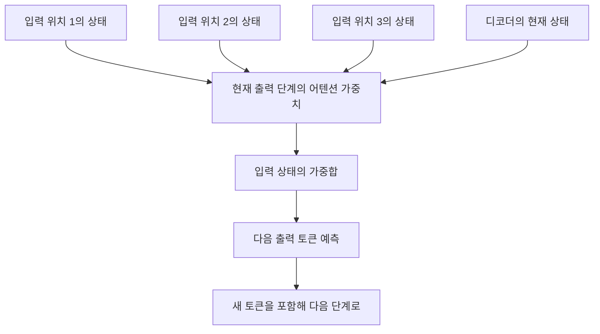
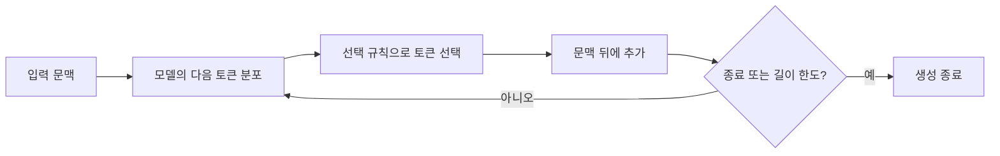
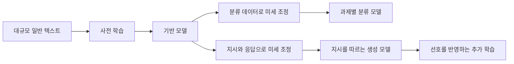

[전체 목차](../../README.md) · [학습 노트](study.md) · [강의안](lecture.md) · [시각 실험](visuals.html) · [실습 안내](lab-guide.md) · [복습 문제](quiz.md)

PART I · 언어 모델 이해하기

# 1장 언어 모델 입문

단어를 세는 간단한 방법에서 출발해, 문맥을 표현하는 모델과 문장을 생성하는 모델이 어떻게 연결되는지 배웁니다.

주 교재: Jay Alammar · Maarten Grootendorst, Hands-On Large Language Models, 2024년 초판, Chapter 1. PDF 물리 페이지 23–66. 이 문서의 모든 “PDF 쪽”은 파일의 첫 페이지를 1로 센 번호입니다.

## 학습 목표와 공부 방법

이 장은 모델 이름을 암기하는 목록이 아니라, 앞으로의 열한 장을 읽기 위한 개념 지도입니다. 끝까지 공부한 뒤에는 텍스트가 왜 숫자로 바뀌어야 하는지, 단어별 빈도만으로 무엇을 놓치는지, 임베딩에 문맥을 반영하는 것이 왜 중요한지 설명할 수 있어야 합니다. 또한 인코더와 디코더의 정보 흐름, 사전 학습과 미세 조정의 차이, API와 로컬 실행의 선택 기준을 연결하여 작은 언어 AI 시스템을 설계할 수 있어야 합니다.

선수 지식은 Python의 문자열·리스트·딕셔너리, 확률이 0과 1 사이의 값이라는 사실, 벡터가 순서 있는 숫자 목록이라는 정도면 충분합니다. 신경망 미분이나 행렬 곱을 아직 몰라도 이 장을 읽을 수 있습니다. 다만 “모델이 이해한다”는 표현을 인간과 동일한 의식이나 지식 체계가 있다는 뜻으로 해석하지 마세요. 여기서는 입력을 처리해 특정 과제에 유용한 표현이나 출력을 만들어낸다는 기능적 의미로 사용합니다.

권장 순서는 학습 노트를 읽으며 직접 예제를 계산하고, 시각 실험에서 변수를 바꾸어 예측을 확인하고, CPU 실습을 실행한 뒤 복습 문제를 푸는 것입니다. 원문 그림은 복사하지 않고 그 그림이 설명하는 관계를 한국어 문장과 새 도식으로 재구성했습니다. 색과 좌표가 있는 교육용 예제는 실제 모델의 관측값이 아닙니다. 책에 실린 2024년 실행 환경·모델 사례는 당시 사례로 읽고, 실행을 검증한 부분은 별도 실습 파일의 결과로 확인하세요.

**장 전체의 중심 질문**

“이 시스템은 텍스트를 어떤 숫자로 바꾸고, 그 숫자를 어떤 목표로 학습하고, 최종적으로 무엇을 출력하는가?” 이 세 가지를 물으면 모델 이름이 달라져도 구조를 비교할 수 있습니다.

### 원문 절과 연결되는 목차

- [언어 AI란 무엇인가](#language-ai)
- [언어 AI의 최근 역사](#history)
- [Bag-of-Words](#bow)
- [밀집 벡터 임베딩](#dense)
- [임베딩의 종류](#embedding-types)
- [RNN과 어텐션](#rnn-attention)
- [트랜스포머](#transformer)
- [인코더 전용 모델](#encoder)
- [디코더 전용 모델](#decoder)
- [생성형 AI가 확산된 시기](#generative-year)
- [“대규모”의 유동적 의미](#large-definition)
- [사전 학습과 미세 조정](#training)
- [대표적인 응용](#applications)
- [책임 있는 개발과 사용](#responsibility)
- [제한된 자원으로 학습하기](#resources)
- [모델과 상호작용하는 방법](#interfaces)
- [비공개 모델](#private-models)
- [공개 모델](#open-models)
- [프레임워크](#frameworks)
- [첫 텍스트 생성](#first-generation)
- [종합 정리와 다음 장](#summary)

## 1. 언어 AI란 무엇인가

원문: What Is Language AI? · PDF 24–25쪽. 장 도입은 23–24쪽.

인공지능은 사람이 지능적이라고 여기는 작업을 컴퓨터가 수행하도록 만드는 과학과 공학입니다. 이 범주는 넓습니다. 게임 속 인물이 조건문을 따라 움직이는 것도 일상적으로 AI라고 부르지만, 그렇다고 그 프로그램이 언어를 이해하거나 새로운 문장을 생성하는 것은 아닙니다. 따라서 “AI를 쓴다”는 말만으로는 시스템의 실제 능력이나 구현 방식을 알 수 없습니다. 어떤 입력에 대해 어떤 출력을 만드는지를 구체화해야 합니다.

언어 AI는 사람의 언어를 처리·표현·생성하는 기술에 집중하는 분야입니다. 자연어 처리, 즉 NLP라는 이름과 상당 부분 겹칩니다. 문장이 긍정적인지 분류하기, 두 질문의 의미가 같은지 비교하기, 관련 문서를 찾기, 외국어로 번역하기, 긴 문서를 요약하기가 모두 언어 AI의 과제입니다. 답변을 글로 만드는 챗봇은 이 중 하나입니다. 검색 시스템이 문서의 순위를 정하기만 하더라도 언어를 다룬다는 점에서 이 분야에 속합니다.

책이 “Language AI”라는 넓은 표현을 쓰는 이유는 유용한 시스템이 단일 LLM으로만 구성되지 않기 때문입니다. 예를 들어 사내 규정 질의응답은 질문을 받아 관련 규정을 찾는 검색기, 찾은 문서를 답변에 포함시키는 구성 단계, 설명을 작성하는 생성 모델, 출처를 확인하는 절차로 나눌 수 있습니다. 검색기에는 작은 임베딩 모델이 적합할 수 있고, 단순한 키워드 검색도 보조 역할을 할 수 있습니다. 생성 모델의 이름만 공부하면 이 연결 구조를 놓치게 됩니다.

입력과 출력을 기준으로 문제를 분류해 봅시다. “배송이 늦어 화가 난다”를 입력하고 “불만”이라는 라벨을 내놓으면 분류입니다. 같은 문장과 의미가 비슷한 문의를 찾아 나열하면 검색입니다. 여러 문의를 묶어 “배송 지연”이라는 주제를 발견하면 군집화와 주제 표현입니다. 그 문의에 대한 사과문을 작성하면 생성입니다. 하나의 문장으로 시작했어도 목표가 다르면 필요한 표현·데이터·평가 기준이 달라집니다.

생성 결과가 유창하다는 것과 과제의 정답이라는 것은 별개입니다. 분류 시스템은 잘못된 라벨을 낼 수 있고, 생성 시스템은 매끄러운 문장으로 틀린 사실을 말할 수 있습니다. “언어를 잘한다”는 일반적인 인상을 실제 과제의 성능으로 바꾸려면 정답 데이터, 사람의 평가 기준, 오류 사례를 준비해야 합니다. 이 관점은 이후 분류·검색·RAG·미세 조정 장 전체에 반복해서 적용됩니다.

**생각해 보기**

검색 결과를 한 문장도 새로 쓰지 않고 반환하는 시스템은 생성형 AI가 아닐 수 있지만 언어 AI일 수 있습니다. 반대로 생성형 모델을 사용해 “긍정/부정” 중 하나만 출력하도록 하면 그 시스템의 업무상 목적은 분류입니다. 모델의 구조와 시스템이 수행하는 과제를 별도로 설명하는 습관을 들이세요.

## 2. 역사를 읽는 기준은 이전 방법의 한계다

원문: A Recent History of Language AI · PDF 25–50쪽. Figure 1-1, 1-2.

이 장의 역사 서술을 “이전 기술이 폐기되고 다음 기술이 등장했다”는 직선으로 읽으면 안 됩니다. 새 방법은 기존 방법이 잘 표현하지 못하는 정보를 보완합니다. 단어의 빈도는 어떤 어휘가 등장했는지 보여주지만 의미가 비슷한 단어의 관계를 직접 알지 못합니다. 단어 임베딩은 그런 관계를 학습하지만 같은 단어가 문맥에 따라 달라지는 문제를 남깁니다. 순환 신경망은 순서를 반영하지만 긴 입력을 압축하고 순차적으로 처리하는 부담이 있습니다. 어텐션과 트랜스포머는 입력의 관계를 더 직접적으로 다루는 길을 엽니다.

*새 도식 1. 원문 Figure 1-1의 발전 흐름을 추가로 표현하는 정보 중심으로 재구성했습니다. 왼쪽 방법도 오른쪽 시스템의 구성 요소로 남을 수 있습니다.*

책이 고르는 대표 이정표는 Bag-of-Words, 2013년 word2vec, 2014년경 신경망 번역에서의 어텐션, 2017년 트랜스포머, 2018년 BERT와 초기 GPT, 이후의 대규모 생성 모델과 대화형 제품입니다. 이것은 분야의 모든 연구를 빠짐없이 나열한 연표가 아닙니다. 특히 최초 발명 시점과 널리 쓰이기 시작한 시점은 다를 수 있습니다. 학습할 때는 연도보다 “입력·표현·학습 목표·출력” 네 항목을 비교하는 편이 오래 남습니다.

원문 Figure 1-2는 텍스트 입력에서 다양한 언어 과제로 갈 수 있음을 보여줍니다. 이때 분류·군집화·검색·생성은 같은 높이의 경쟁 제품이 아니라 서로 결합할 수 있는 기능입니다. 예를 들어 군집화로 고객 불만 유형을 발견하고, 분류기로 새 문의에 유형을 붙이고, 검색기로 유사 해결 사례를 찾고, 생성기로 응답 초안을 작성할 수 있습니다. 작은 구성 요소를 연결한다는 관점이 “최대한 큰 모델 하나”만 고르는 접근보다 문제를 더 명확하게 만듭니다.

이후 절마다 질문을 하나씩 이어가세요. 단어를 숫자로 바꿨는데 의미가 없다면 무엇을 더 학습해야 할까요? 의미를 담았는데 문맥이 없다면 무엇을 입력에 추가해야 할까요? 문맥을 담았는데 긴 문장에서 정보가 사라진다면 무엇을 다시 참조해야 할까요? 계산이 느리다면 어떤 의존 관계를 줄여야 할까요? 다음 기술은 앞선 질문에 대한 설계상의 응답으로 이해할 수 있습니다.

## 3. Bag-of-Words로 문장을 숫자로 바꾸기

원문: Representing Language as a Bag-of-Words · PDF 26–28쪽. Figure 1-3–1-5.

컴퓨터의 분류기나 거리 계산기는 일반적으로 “고양이”라는 문자열 자체의 의미를 알지 못합니다. 먼저 문장을 숫자의 묶음으로 바꿔야 합니다. Bag-of-Words, 줄여서 BoW는 문서 안에 각 단어가 몇 번 나오는지 세는 방식입니다. “가방”이라는 비유는 순서가 중요하지 않다는 뜻입니다. 가방에 같은 물건이 같은 개수로 들어 있다면 넣은 순서가 달라도 같은 내용으로 취급합니다.

절차는 세 단계입니다. 첫째, 문서를 토큰으로 나눕니다. 토큰은 여기서는 띄어쓰기로 나눈 단어라고 가정합니다. 둘째, 전체 문서에서 서로 다른 토큰을 모아 어휘 목록을 만듭니다. 셋째, 어휘의 순서를 고정한 뒤 각 문서에서 토큰별 출현 횟수를 세어 그 순서대로 나열합니다. 토큰화 방법과 어휘 순서가 바뀌면 벡터도 바뀌므로, 학습할 때와 사용할 때 동일한 규칙을 적용해야 합니다.

**직접 계산하는 예제 · 이 자료에서 만든 문장**

A = “고양이 가 강아지 를 쫓는다”, B = “강아지 가 고양이 를 쫓는다”, C = “고양이 고양이 잠잔다”라고 합시다. 조사 앞에 공백을 둔 것은 형태소 분석 없이 계산하기 위한 교육용 표기입니다.

| 문서 | 고양이 | 가 | 강아지 | 를 | 쫓는다 | 잠잔다 |
| --- | --- | --- | --- | --- | --- | --- |
| A | 1 | 1 | 1 | 1 | 1 | 0 |
| B | 1 | 1 | 1 | 1 | 1 | 0 |
| C | 2 | 0 | 0 | 0 | 0 | 1 |

A와 B는 누가 누구를 쫓는지가 다르지만 벡터는 같습니다. C의 첫 좌표가 2인 이유는 단어가 “중요해서”가 아니라 두 번 등장했기 때문입니다. 좌표의 뜻은 사람이 정한 어휘 목록에 의해 명확하게 해석됩니다.

어휘의 크기를 V라고 하면 각 문서는 V차원 벡터가 됩니다. 문서가 짧고 어휘가 수만 개라면 대부분의 좌표는 0입니다. 이런 벡터를 희소 벡터라고 합니다. 문서를 N개 모으면 N×V의 문서-단어 행렬을 만들 수 있습니다. 예를 들어 문서가 3개이고 위 어휘가 6개라면 행렬의 크기는 3×6입니다. “희소하다”는 것은 의미가 빈약하다는 평가가 아니라 0인 원소가 많다는 수학적 성질입니다.

BoW는 순서를 버리고, 동의어를 서로 다른 좌표로 처리하며, 문맥에 따른 의미 변화를 직접 표현하지 못합니다. “자동차”와 “승용차”가 비슷해도 다른 단어라면 다른 칸에 들어갑니다. 반대로 “좋다”와 “좋지 않다”는 어휘가 겹쳐 잘못 비슷하게 볼 수 있습니다. 긴 문서는 단어 수 자체가 커지므로, 문서 길이와 실제 주제의 관련성을 구분하려면 정규화나 다른 가중치가 필요할 수 있습니다. 이런 한계를 인지하는 것이 다음 절의 출발점입니다.

그렇다고 BoW가 쓸모없는 것은 아닙니다. 어떤 단어가 결과에 기여했는지 설명하기 쉽고, 계산이 비교적 가벼우며, 특정 키워드의 존재가 중요한 문제에 잘 맞습니다. 책의 5장에서는 임베딩 기반 군집화와 단어 통계 기반 주제 표현을 결합합니다. 의미를 찾는 단계와 그 의미를 사람이 읽을 단어로 설명하는 단계에 서로 다른 도구를 쓸 수 있다는 뜻입니다.

그림 읽기: Figure 1-3은 토큰화, 1-4는 전체 어휘 구축, 1-5는 출현 횟수를 벡터로 바꾸는 과정을 보여줍니다. 세 그림의 핵심은 “문서마다 별도의 좌표계를 만들지 않고 같은 어휘 순서를 공유한다”는 점입니다. 서로 다른 어휘 순서로 만든 두 벡터를 그대로 비교하면 숫자 계산이 가능해도 해석은 잘못됩니다.

공백 토큰화는 이 장의 입문 예제입니다. 중국어처럼 단어 사이 공백이 항상 있는 것이 아닌 언어나 한국어의 조사·어미 문제에는 충분하지 않습니다. “학교”, “학교에”, “학교에서”가 무조건 서로 무관한 단어인지도 생각해야 합니다. 2장은 바로 이 입력 분할 규칙을 확장합니다. 지금은 토큰이 늘 사람이 생각하는 단어 하나와 일치하지 않는다는 사실을 기억하면 됩니다.

## 4. 밀집 임베딩은 단어 사이의 관계를 학습한다

원문: Better Representations with Dense Vector Embeddings · PDF 28–31쪽. Figure 1-6–1-9.

BoW가 단어마다 서로 독립된 칸을 부여한다면, 밀집 임베딩은 비교적 작은 고정 길이의 숫자 묶음에 단어의 사용 관계를 담습니다. word2vec은 비슷한 문맥에 등장하는 단어가 비슷한 벡터를 갖도록 학습하는 대표적인 방법입니다. “강아지가 밥을 먹는다”, “고양이가 밥을 먹는다”처럼 단어가 비슷한 이웃을 자주 만나면, 둘이 문장에서 수행하는 역할도 일부 유사하다는 단서를 얻을 수 있습니다.

이 관계는 사람이 단어마다 “귀여움 0.8, 동물 0.9” 같은 값을 입력해서 생기는 것이 아닙니다. 먼저 어휘의 각 단어에 무작위 벡터를 할당합니다. 그다음 실제 문장에서 가까이 나타난 단어 쌍과 그렇지 않은 쌍을 구분하는 등의 목표로 수많은 예제를 처리합니다. 예측이 틀렸을 때 벡터와 다른 가중치를 조정하면서 단어 관계가 숫자에 반영됩니다. 책의 Figure 1-7은 이웃 단어 예측을 통해 임베딩이 갱신되는 직관을 보여줍니다. 구체적인 학습 변형과 손실은 2장에서 더 깊게 다룹니다.

신경망의 파라미터는 계산에 사용되는 학습 가능한 숫자입니다. 입력에 따라 출력이 달라지는 것은 고정된 파라미터에 다른 입력을 넣기 때문일 수 있고, 학습 중 파라미터 자체를 바꾸는 것과는 구분해야 합니다. Figure 1-6의 연결선은 이런 가중치 계산을 직관적으로 나타냅니다. 실제 신경망에는 가중 합뿐 아니라 비선형 연산 등이 포함되므로, 연결선이 많다는 이유만으로 모델의 기능을 모두 설명할 수는 없습니다.

어휘가 V개이고 임베딩 차원이 d라면 단어 임베딩 표는 V×d 크기입니다. 한 단어를 찾으면 길이 d인 벡터 하나를 꺼냅니다. 예를 들어 어휘가 10,000개이고 d=50이면 표에 500,000개의 숫자가 있습니다. 문장마다 10,000차원의 단어 빈도 벡터를 만드는 것과, 단어 하나마다 50차원의 학습된 벡터를 갖는 것은 서로 다른 설계입니다. 단어 임베딩을 가지고 있다고 해서 문장 전체의 벡터가 저절로 정해지는 것도 아닙니다.

보충 계산: cos(u, v) = (u · v) / (‖u‖ × ‖v‖)
u · v = Σ uᵢvᵢ, ‖u‖ = √(Σ uᵢ²), u와 v는 같은 d차원의 0이 아닌 벡터

코사인 유사도는 벡터의 방향이 얼마나 비슷한지 측정합니다. 교육용 벡터 u=(1,0), v=(0.8,0.6)은 길이가 각각 1이므로 유사도는 0.8입니다. w=(0,1)과 u의 유사도는 0입니다. 이 계산에서 “방향이 가깝다”와 “문장 의미가 비슷하다”를 연결하는 것은 임베딩을 어떻게 학습했는지에 달려 있습니다. 무작위 벡터에도 코사인을 계산할 수 있지만 그 값이 언어 의미를 나타내지는 않습니다. 영벡터는 분모가 0이라 통상적인 코사인 유사도가 정의되지 않습니다.

책의 “아기”와 “사과” 예제는 임베딩을 이해하기 위한 비유입니다. 실제 학습된 한 차원을 “인간성”, 다른 차원을 “신생아성”이라고 이름 붙일 수 있다고 생각하면 오해입니다. 의미는 대개 여러 차원에 분산되어 표현되고, 좌표를 회전해도 관계가 유지될 수 있습니다. 시각 실험에 나오는 두 축도 교사가 만든 설명용 좌표일 뿐, 실제 모델에서 찾아낸 해석 가능한 의미 축이 아닙니다.

Figure 1-9처럼 고차원 임베딩을 2차원으로 줄이면 비슷한 단어가 가까워 보일 수 있습니다. 그러나 투영이나 차원 축소 과정에서 정보가 손실될 수 있으므로, 화면에서 가까운 점이 원래 공간에서도 모든 관점에서 가까운 것은 아닙니다. 시각화는 관계를 탐색하는 도구이고, 정량 비교는 원래 임베딩과 적절한 거리 척도로 수행해야 합니다. 이 주제는 5장의 차원 축소와 군집 해석으로 이어집니다.

그림 읽기: Figure 1-6은 학습 가능한 연결, 1-7은 이웃 단어 예측과 갱신, 1-8은 여러 숫자로 의미를 표현한다는 비유, 1-9는 의미상 가까운 단어의 기하학적 관계를 설명합니다. “밀집”은 숫자가 대체로 0이 아니며 작은 공간을 공유한다는 성질이지, 모든 문장에 대해 의미가 완벽히 보존된다는 보증이 아닙니다.

## 5. 임베딩은 무엇을 하나의 벡터로 만들었는지 구분해야 한다

원문: Types of Embeddings · PDF 31–32쪽. Figure 1-10.

“임베딩을 만들었다”는 문장에는 중요한 정보가 빠져 있습니다. 단어 하나를 벡터로 만들었나요, 문장 하나를 만들었나요, 긴 문서 하나를 만들었나요? 어떤 단위를 대표하는 벡터인지에 따라 입력 수와 출력 모양이 달라집니다. 단어 수준 임베딩은 토큰별 의미 단서를 제공하고, 문장 수준 임베딩은 문장 간 유사도 계산이나 검색에 쓰기 편하며, 문서 수준 임베딩은 문서 전체를 하나의 표현으로 압축합니다.

| 표현 단위 | 입력 예 | 출력 모양 예 | 물어볼 것 |
| --- | --- | --- | --- |
| 정적 단어 임베딩 | “bank”라는 어휘 항목 | d차원 벡터 1개 | 문맥이 달라도 같은가 |
| 문맥별 토큰 표현 | 토큰 T개인 문장 | T×d 행렬 | 각 위치가 무엇을 참고했는가 |
| 문장 임베딩 | 질문 1개 | d차원 벡터 1개 | 어떤 목표로 문장 의미를 학습했는가 |
| 문서 BoW | 문서 1개 | V차원 빈도 벡터 1개 | 좌표가 어떤 어휘에 대응하는가 |

책은 BoW처럼 숫자로 표현하는 방법까지 넓은 의미의 임베딩/표현으로 다룹니다. 실제 기술 문서에서는 “임베딩”을 학습된 밀집 벡터라는 좁은 의미로 쓰기도 합니다. 따라서 단어만 보고 구현을 가정하지 말고 희소/밀집, 학습됨/직접 계산됨, 정적/문맥별, 토큰/문장이라는 속성을 함께 확인하세요. 같은 이름 아래 다른 수학적 대상이 있을 수 있습니다.

문장 안에 단어가 다섯 개 있다고 다섯 단어 벡터를 단순히 이어 붙이는 것이 표준 문장 임베딩인 것은 아닙니다. 이어 붙이면 문장 길이에 따라 차원이 달라지고 단어 순서에 민감한 문제가 생깁니다. 평균을 내어 하나로 압축하는 방법도 가능하지만 부정·순서·중요도 정보를 잃을 수 있습니다. 더 좋은 문장 임베딩은 문장 간 의미 관계를 잘 보존하도록 별도의 학습 목표를 사용할 수 있습니다. 10장은 그런 모델을 만드는 방법을 설명합니다.

예를 들어 “비밀번호를 바꾸고 싶어요”와 “계정 암호 변경 방법”을 검색에서 가깝게 만들고 싶다면, 문장을 대표하는 벡터 두 개를 비교할 수 있어야 합니다. 토큰별 벡터만 얻고 이들을 어떻게 하나로 모을지 정하지 않았다면 검색 시스템은 아직 완성되지 않았습니다. 반대로 개체명 인식처럼 각 단어가 사람 이름인지 조직 이름인지 판별할 때는 하나의 문장 벡터보다 토큰별 표현이 필요합니다. 표현의 단위는 과제의 출력 단위와 연결됩니다.

Figure 1-10의 논지는 입력 단위에 따라 여러 종류의 임베딩이 가능하다는 것입니다. 표현의 길이가 같다고 의미 비교가 항상 가능한 것은 아닙니다. 서로 다른 모델이 만든 두 벡터는 좌표계와 학습 목표가 다르므로, 차원만 맞춘 채 직접 코사인을 계산하는 것은 의미가 없을 수 있습니다.

## 6. RNN과 어텐션으로 문맥을 다루기

원문: Encoding and Decoding Context with Attention · PDF 32–37쪽. Figure 1-11–1-15.

정적 단어 임베딩은 어휘 항목 하나에 하나의 벡터를 연결합니다. 따라서 “river bank”의 bank와 “bank account”의 bank가 같은 벡터로 시작할 수 있습니다. 한국어로는 “배를 타다”, “배를 먹다”, “배가 아프다”를 생각하면 됩니다. 단어의 실제 의미를 알려면 주변 말을 봐야 합니다. 여기서 필요한 것은 단어 자체의 표현에 문장 속 위치와 이웃 정보를 결합하는 문맥 표현입니다.

순환 신경망, RNN은 앞서 처리한 정보를 숨은 상태에 저장하고 다음 입력과 결합하면서 순서를 따라 진행합니다. 숨은 상태를 h, 현재 입력을 x라고 쓰면 직관적으로 `hₜ = f(hₜ₋₁, xₜ)`입니다. 여기서 t는 문장의 시간/위치 순서이고, f는 학습되는 갱신 함수입니다. “나는”, “어제”, “사과를”, “먹었다”를 차례로 읽으면 각 단계의 상태에는 현재까지 읽은 정보가 반영됩니다. 이 식은 보충 설명이며, 이 장에서는 f의 미분보다 앞 단계와 뒤 단계의 의존 관계가 중요합니다.

번역에서는 입력 문장을 읽는 인코더와 출력 문장을 쓰는 디코더를 구분할 수 있습니다. 인코더는 입력의 정보를 숫자로 압축하고 디코더는 그 정보를 바탕으로 번역문을 생성합니다. 원문의 예에서는 영어 “I love llamas”가 네덜란드어 “Ik hou van lama’s”로 번역됩니다. 입력과 출력의 단어 수가 같을 필요는 없습니다. 어떤 언어의 한 단어가 다른 언어에서 여러 단어로 번역될 수 있으므로, 위치를 일대일로 기계적으로 대응시키는 것만으로는 충분하지 않습니다.

초기의 기본 구성은 인코더의 마지막 숨은 상태 하나를 디코더에 넘기는 방식으로 이해할 수 있습니다. 문제는 문장이 길어질수록 많은 정보를 하나의 고정 길이 벡터에 보관해야 한다는 것입니다. 이것은 물리적으로 저장 용량만의 문제가 아니라, 디코더가 필요한 특정 단어와 관계를 그 압축 표현에서 다시 찾아내기 어려워지는 학습 문제입니다. “마지막 벡터 하나만 전달”이라는 병목을 완화하는 것이 어텐션의 중요한 역할입니다.

어텐션이 있으면 디코더는 입력의 모든 위치에 해당하는 숨은 상태를 참조할 수 있습니다. 출력 토큰을 하나 생성할 때마다, 현재 상황과 관련 있는 입력 위치에 높은 가중치를 줍니다. 번역 중 “lama’s”를 생성하려는 단계에서는 입력의 “llamas” 관련 표현에 더 큰 비중을 줄 수 있습니다. 그다음 출력 단어를 만들 때는 비중이 달라질 수 있습니다. 하나의 문장 전체에 영원히 고정된 중요도 표가 있는 것이 아닙니다.

**숫자로 보는 보충 예제.** 입력 상태 세 개가 `h₁=(1,0)`, `h₂=(0,1)`, `h₃=(1,1)`이고, 현재 출력 단계에서 가중치가 `α=(0.1,0.2,0.7)`이라고 합시다. 가중합 문맥 벡터는 `c=0.1h₁+0.2h₂+0.7h₃=(0.8,0.9)`입니다. 가중치가 음수가 아니고 합이 1이므로 세 벡터의 가중 평균이라고 볼 수 있습니다. 실제 가중치는 학습된 계산에서 나오지만, 여기서는 가중치가 바뀌면 참조하는 정보의 배합이 달라진다는 사실을 보려는 예제입니다. 시각 실험과 CPU 실습에서 같은 계산을 확인할 수 있습니다.

*새 도식 2. 디코더가 필요할 때 입력 전체의 표현을 다시 참조하는 구조입니다. 원문 Figure 1-14, 1-15의 논지를 재구성했습니다.*

출력 생성은 자기회귀적입니다. 이미 만든 토큰을 다음 토큰 생성의 조건으로 사용합니다. 원문 Figure 1-12에서 이전 출력이 다음 입력으로 돌아가는 화살표가 바로 이 관계입니다. 다만 “인코더도 반드시 생성 과정과 똑같은 의미의 자기회귀 모델이다”라고 일반화하지 마세요. 여기서 인코더는 입력 순서를 따라 상태를 갱신하고, 디코더는 이전 출력에 조건부로 다음 출력을 생성한다는 서로 다른 역할을 수행합니다.

어텐션은 RNN의 정보 접근을 개선하지만 RNN의 순차 상태 갱신까지 없애지는 않습니다. 다음 인코더 상태를 계산하려면 이전 상태가 필요하다는 구조적 의존이 남습니다. 원문 Figure 1-11은 두 RNN의 번역 역할, 1-13은 단어 임베딩이 문맥 상태로 축적되는 과정, 1-14와 1-15는 관련 입력을 다시 참조하는 개선을 보여줍니다. 다음 절은 “입력 관계를 어텐션으로 직접 계산하고, RNN의 순환을 제거할 수 있을까?”라는 질문으로 넘어갑니다.

## 7. 트랜스포머는 관계 계산의 중심을 어텐션으로 옮긴다

원문: Attention Is All You Need · PDF 37–42쪽. Figure 1-16–1-20.

2017년 제안된 원형 트랜스포머는 인코더와 디코더로 구성되지만, RNN의 순환 상태 갱신에 의존하지 않습니다. 입력 토큰들 사이의 관계를 어텐션으로 계산합니다. 이 변화는 학습할 때 여러 위치의 계산을 행렬 연산으로 함께 처리하기 좋게 만들었습니다. “어텐션만 있으면 된다”는 논문 제목을 모델 안에 어텐션 연산 하나만 있다는 뜻으로 받아들이면 안 됩니다. 피드포워드 신경망, 위치 정보, 정규화 등 다른 구성 요소도 필요하며, 책의 3장에서 더 자세히 배웁니다.

셀프 어텐션의 “셀프”는 같은 시퀀스 안의 위치끼리 서로 참조한다는 뜻입니다. “동물은 길을 건너지 못했다. 그것이 너무 피곤했기 때문이다”라는 문장에서 “그것”의 표현을 만들 때 앞 문장의 동물과 관련된 정보를 함께 고려하는 식입니다. 인코더의 양방향 셀프 어텐션에서는 입력으로 주어진 문장의 앞과 뒤 위치를 모두 참고할 수 있습니다. 미래의 실제 사건을 안다는 뜻이 아니라, 이미 주어진 입력 텍스트 전체를 본다는 뜻입니다.

인코더 블록의 큰 흐름은 셀프 어텐션으로 토큰 간 정보를 섞고, 피드포워드 신경망으로 각 위치의 표현을 변환하는 것입니다. 이러한 블록을 여러 층 쌓으면 각 위치의 표현을 반복해서 갱신할 수 있습니다. 토큰 개수가 T이고 각 표현의 차원이 d라면, 입력과 출력의 큰 모양을 T×d 행렬로 생각하면 됩니다. 각 층이 문장을 한 단어로 줄이는 것이 아니라, 위치별 표현을 풍부하게 만들어 다음 층에 넘깁니다.

원형 디코더는 세 가지 큰 기능을 구분합니다. 먼저 이전 출력 토큰들 사이의 관계를 계산하는 마스크된 셀프 어텐션이 있습니다. 다음으로 인코더의 출력에 주의를 기울이는 교차 어텐션이 있습니다. 마지막으로 각 위치의 표현을 변환하는 피드포워드 신경망이 있습니다. 교차 어텐션은 서로 다른 시퀀스, 즉 출력 쪽의 현재 표현과 입력 쪽의 표현 사이의 정보 연결입니다. 생성 모델을 모두 원형 인코더-디코더 구조로 상상하면 이후 GPT 구조를 잘못 이해하게 됩니다.

**미래 정보 차단이 필요한 이유.** “나는 사과를 먹었다”의 다음 토큰 예측을 학습한다고 합시다. “나는” 다음에 “사과를”을 맞히는 자리에서 정답인 “사과를”이나 그 뒤의 토큰을 이미 볼 수 있다면 쉬운 편법이 생깁니다. 실제 사용 시에는 미래 토큰이 아직 없으므로 학습과 사용의 조건이 달라집니다. 인과 마스크는 위치 i에서 i보다 뒤의 위치를 참조하지 못하게 막습니다. 일반적인 이동된 입력/목표 배열에서는 자기 위치까지는 볼 수 있지만, 그 위치의 목표는 다음 토큰입니다. “대각선을 허용하면 정답 유출”이라고 단정하면 입력과 목표의 한 칸 이동을 놓친 것입니다.

| 현재 입력 위치 | 위치 1 참고 | 위치 2 참고 | 위치 3 참고 | 위치 4 참고 |
| --- | --- | --- | --- | --- |
| 1 | 가능 | 차단 | 차단 | 차단 |
| 2 | 가능 | 가능 | 차단 | 차단 |
| 3 | 가능 | 가능 | 가능 | 차단 |
| 4 | 가능 | 가능 | 가능 | 가능 |

이 표는 학습 과정에서 허용되는 정보 흐름입니다. 특정 칸이 허용된다고 항상 높은 가중치를 받는 것은 아닙니다. 허용 여부는 마스크가 결정하고, 허용된 위치들 사이의 상대적 비중은 어텐션 계산이 결정합니다. 원문 Figure 1-20의 하삼각 구조도 이 구분으로 읽어야 합니다. 색의 강도를 보여주는 실제 가중치와 미래를 차단하는 구조는 서로 다른 요소입니다.

학습의 병렬성과 생성의 순차성도 구분해야 합니다. 학습 시 정답 시퀀스가 주어져 있으면, 인과 마스크를 적용한 채 여러 위치의 다음 토큰 예측을 한 번에 계산할 수 있습니다. 하지만 일반적인 자기회귀 생성에서는 다음 입력에 방금 선택한 토큰을 포함해야 하므로, 토큰을 하나 고른 뒤 다음 단계를 진행합니다. “트랜스포머는 병렬적이므로 답변 전체를 한 번에 생성한다”는 설명은 부정확합니다.

원문 Figure 1-16은 인코더/디코더 블록의 적층, 1-17은 인코더 내부, 1-18은 한 시퀀스 내부의 양방향 참조, 1-19는 디코더에서 인코더 출력을 참조하는 추가 층, 1-20은 미래 토큰 차단을 보여줍니다. 이 그림들의 역할을 한 문장씩 말할 수 있다면, 3장에서 쿼리·키·값과 행렬 연산을 배울 준비가 된 것입니다.

## 8. 인코더 전용 모델은 문맥을 담은 표현을 만든다

원문: Representation Models: Encoder-Only Models · PDF 42–45쪽. Figure 1-21–1-23.

BERT는 2018년 등장한 인코더 전용 모델의 대표입니다. 원형 트랜스포머에서 입력을 표현하는 인코더를 활용하고, 번역문을 이어 쓰는 디코더 구성은 두지 않습니다. 문장 전체가 이미 입력으로 주어졌을 때 각 토큰을 그 문맥 속에서 표현하는 데 적합합니다. 단어마다 고정된 벡터 하나만 쓰는 방식과 달리, 같은 단어라도 주변 문장에 따라 최종 표현이 달라질 수 있습니다.

BERT의 대표적인 사전 학습 목표는 마스크 언어 모델링입니다. 예를 들어 “나는 아침에 [MASK]를 마셨다”에서 가려진 토큰을 주변 문맥으로 예측합니다. 앞부분만 보는 다음 토큰 예측과 달리, 가려진 위치의 양쪽에 있는 정보를 사용할 수 있습니다. 모델은 많은 가림 문제를 풀면서 문법, 문맥, 단어 관계에 도움이 되는 내부 표현을 학습합니다. 문제의 정답을 원래 텍스트에서 자동으로 만들 수 있다는 점이 대규모 학습을 가능하게 합니다.

원문은 BERT-base를 12개 인코더 블록을 쌓은 구조로 소개합니다. 입력에 추가하는 `[CLS]` 토큰은 전체 입력을 요약하는 표현으로 활용할 수 있으며, 분류용 출력층과 연결해 학습할 수 있습니다. 하지만 `[CLS]`라는 이름만으로 어떤 문장에서도 최적의 의미 유사도 임베딩이 보장되지는 않습니다. 분류에 유용하도록 학습한 표현과 문장 간 거리 비교에 유용하도록 학습한 표현은 목적이 다를 수 있습니다. 이후 4장과 10장에서 이 차이를 구체화합니다.

사전 학습된 BERT를 고객 리뷰 분류에 사용한다고 합시다. 문장을 입력해 표현을 얻고, 그 위에 긍정/부정을 예측하는 작은 분류층을 붙입니다. 리뷰 정답 라벨로 학습하면서 분류층과 BERT의 일부 또는 전체 파라미터를 조정하면 미세 조정입니다. 반면 BERT를 고정하고 표현만 추출해 별도의 분류기를 학습할 수도 있습니다. 이때 임베딩을 계산하는 과정 자체가 모델을 다시 학습시키는 것은 아닙니다.

이것이 전이 학습의 직관입니다. 많은 일반 텍스트로 배운 언어 표현을 좁은 과제에 가져와 사용합니다. 처음부터 모든 것을 배우는 것보다 필요한 데이터와 계산을 줄일 가능성이 큽니다. 그러나 어떤 분야에서나 무조건 좋은 성능을 얻는 것은 아닙니다. 학습한 문장과 사용하려는 문장의 언어·도메인·표현 방식이 다르면 추가 조정과 평가가 필요할 수 있습니다. 사전 학습은 유용한 출발점이지 과제 성능의 인증서가 아닙니다.

원문 Figure 1-21은 인코더 적층과 `[CLS]` 표현, 1-22는 가려진 토큰을 예측하는 학습, 1-23은 사전 학습 뒤 특정 과제로 미세 조정하는 흐름을 연결합니다. “대표 과제는 분류”라고 해서 인코더 전용 모델이 분류만 할 수 있다는 뜻은 아닙니다. 임베딩 기반 군집화와 검색 등에도 사용됩니다. 책은 이런 모델을 표현 모델이라는 기능 중심 이름으로 부릅니다.

## 9. 디코더 전용 모델은 다음 토큰을 이어서 생성한다

원문: Generative Models: Decoder-Only Models · PDF 45–49쪽. Figure 1-24–1-27.

GPT 계열의 기본 구조는 디코더 전용 트랜스포머입니다. 원형 번역용 디코더와 비교하면, 별도 인코더의 출력에 주의를 기울이는 교차 어텐션 부분을 제거한 구조로 생각할 수 있습니다. 프롬프트와 이미 생성한 토큰이 하나의 시퀀스를 이루고, 마스크된 셀프 어텐션으로 그 시퀀스의 앞부분에 조건부로 다음 토큰을 예측합니다. “디코더”라는 이름 때문에 반드시 별도의 인코더가 먼저 있어야 한다고 생각할 필요는 없습니다.

확률적으로는 길이 T인 토큰 시퀀스 x₁…xT의 확률을 `P(x₁…xT)=∏ₜ P(xₜ | x₁…xₜ₋₁)`처럼 분해합니다. 각 항은 지금까지의 문맥이 주어졌을 때 다음 토큰의 확률입니다. 실제로는 제한된 문맥 창, 모델 구조, 종료 토큰 등이 적용됩니다. 이것은 이 장의 자기회귀 개념을 명확히 하기 위한 보충 수식입니다. 모델이 한 번에 “완성된 답변이라는 물체”를 꺼내는 대신, 조건부 예측을 반복한다는 점이 핵심입니다.

**가상 숫자 예.** “오늘 날씨가” 다음 후보가 “좋다” 0.6, “흐리다” 0.3, “춥다” 0.1이라면, 가장 높은 확률을 고르는 탐욕적 선택은 “좋다”입니다. 선택한 토큰을 문맥에 붙인 뒤 그다음 후보의 확률을 다시 계산합니다. 두 번째 단계는 첫 번째 단계의 확률표를 재사용하는 것이 아닙니다. 또한 최고 확률 토큰이라는 말은 사실로 맞을 확률이 0.6이라는 뜻이 아닙니다. 이 분포는 학습 목표에 따라 다음 토큰을 예측하는 분포입니다.

책은 GPT-1의 117M, GPT-2의 최대 1.5B, GPT-3의 175B 파라미터를 예로 들며 규모 확대를 설명합니다. M은 백만, B는 십억이므로 117M은 약 1억 1,700만 개, 175B는 약 1,750억 개의 숫자입니다. 파라미터를 사람의 지식 한 조각과 일대일로 대응시키지 마세요. 능력은 파라미터 수뿐 아니라 데이터, 학습 방식, 구조, 사용 과제, 추론 설정과 함께 결정됩니다. Figure 1-25는 역사적 규모 변화를 보여주는 그림이지 모든 모델의 성능 순위를 보장하는 공식이 아닙니다.

> **원문과 구분한 사실 교정.** PDF 45쪽은 GPT-1 학습 데이터에 Common Crawl도 함께 언급하지만, GPT-1의 원 논문은 사전 학습 데이터로 BooksCorpus를 명시합니다. 이 자료에서는 GPT-1을 BooksCorpus 기반 사전 학습 사례로 설명합니다. 근거: [Radford 외, 2018, §4.1](https://cdn.openai.com/research-covers/language-unsupervised/language_understanding_paper.pdf).

기본 언어 모델은 자연스럽게 이어질 텍스트를 예측하도록 학습합니다. 질문을 넣었다고 항상 친절한 답을 할 이유는 없습니다. 질문 목록이 이어지는 텍스트를 예상하면 새 질문을 덧붙일 수도 있습니다. 지시-응답 예제 등으로 미세 조정하면 사용자의 요청에 답하는 행동을 더 잘 보이도록 만들 수 있습니다. 책은 이런 모델을 instruct 또는 chat 모델로 소개합니다. 구조가 완전히 새로운 생성 원리로 바뀌었다기보다, 어떤 연속 텍스트를 바람직하게 만들도록 학습했는지가 달라지는 것입니다.

문맥 창은 모델이 한 번의 처리에서 다룰 수 있는 토큰 범위입니다. 단순한 디코더 전용 생성 상황에서는 프롬프트, 대화 형식용 특수 토큰, 이전 대화, 새 출력이 예산을 함께 사용합니다. 문맥 한도가 4,096토큰이고 입력이 3,600토큰이면 단순 계산으로 남는 공간은 496토큰입니다. 여기에 시스템별 예약 공간이나 형식 토큰이 있으면 실제 여유는 더 작을 수 있습니다. 문자 수나 단어 수를 토큰 수와 동일시하지 마세요.

*새 도식 3. 원문 Figure 1-26, 1-27의 완성과 문맥 증가를 결합했습니다. 루프 한 번마다 다음 토큰을 예측하며 문맥 예산을 사용합니다.*

표현 모델과 생성 모델의 차이는 주요 목적을 설명하는 유용한 구분입니다. 생성 모델 내부에도 임베딩과 문맥 표현이 있고, 생성 모델에 라벨을 쓰게 하여 분류할 수도 있습니다. 반대로 BERT의 마스크 예측은 토큰을 맞히는 계산을 하지만 일반적인 대화 생성용 설계와는 다릅니다. 그러므로 “인코더는 벡터만 있고 디코더는 벡터가 없다” 또는 “GPT는 분류할 수 없다”는 결론은 잘못입니다.

## 10. 생성형 AI의 확산을 모델과 제품으로 나누어 읽기

원문: The Year of Generative AI · PDF 49–50쪽. Figure 1-28.

책은 2023년을 생성형 AI의 확산이 두드러진 시기로 회고합니다. 중요한 구분은 제품 이름과 모델 이름입니다. 대화 화면, 사용자 계정, 파일 처리, 도구 연결을 포함한 제품이 있고, 그 안에서 언어 계산을 담당하는 모델이 있습니다. 제품의 기능 변화가 항상 모델 구조의 변화와 일치하지 않으며, 같은 제품이 여러 모델을 제공할 수도 있습니다. 반대로 같은 모델이 API, 로컬 프로그램, 다른 사용자 인터페이스에서 쓰일 수 있습니다.

Figure 1-28에는 당시 비공개 모델 쪽에 GPT-4, Bard, PaLM 2, Claude 2, Grok, Gemini가, 공개 모델 쪽에 Llama, MPT, Falcon, Llama 2, Qwen, Mistral, Yi, Mixtral, Phi-2, DeciLM, Command R 같은 사례가 배치되어 있습니다. 그림의 목적은 이 이름을 전부 순서대로 암기시키는 것이 아니라, 여러 조직과 공개 방식이 동시에 발전했다는 점을 보여주는 것입니다. 책의 시점에 맞춘 일부 사례의 모음이며 현재 제품 구성이나 우열을 나타내는 목록으로 사용하지 않습니다.

기반 모델, foundation model이라는 표현은 넓은 데이터로 먼저 학습되어 다양한 과제에 적용될 수 있는 모델이라는 성격을 강조합니다. 공개 배포 여부와는 별개의 축입니다. 책의 문맥에서 공개된 기반 모델을 주로 소개하더라도, “기반 모델은 반드시 공개 가중치를 가진 모델”이라고 정의하면 범위가 불필요하게 좁아집니다. 기반/미세 조정은 학습 이력의 구분이고, 공개/비공개는 접근 권한과 배포 방식의 구분입니다.

이 절은 Mamba와 RWKV처럼 트랜스포머 외의 구조적 방향도 언급합니다. 첫 장에서 이 구조의 세부 수식을 외울 필요는 없습니다. 중요한 메시지는 “LLM이라는 기능 범주가 특정 아키텍처 하나의 동의어는 아니다”라는 점입니다. 문맥 길이, 추론 속도, 자원 효율 같은 요구가 달라지면 모델 구조도 연구 대상이 됩니다. 이 책을 공부하는 동안에는 주로 트랜스포머 기반 사례를 다루지만, 기본 개념을 특정 제품에 묶어 두지 않는 것이 좋습니다.

## 11. “대규모 언어 모델”의 경계는 고정된 숫자가 아니다

원문: The Moving Definition of a “Large Language Model” · PDF 50–51쪽.

어떤 모델이 크다고 말하려면 비교 기준이 필요합니다. 과거에는 매우 큰 것으로 여겨진 모델이 이후에는 작은 모델로 분류될 수 있습니다. 크기를 파라미터 수로만 정의하면, 더 적은 파라미터로 비슷한 과제를 수행하는 모델을 어떻게 부를지도 애매해집니다. 생성 능력으로만 정의하면 언어를 훌륭하게 표현하는 인코더 모델을 배제하게 됩니다. 책은 이런 모호함을 인정하고 폭넓게 언어 모델을 다룹니다.

이 책에서 다루는 대상에는 10억 개 미만의 파라미터를 가진 비생성 모델도 들어갑니다. 따라서 이후 장에서 작은 임베딩 모델이 나온다고 “LLM 책의 주제에서 벗어났다”고 생각하지 마세요. 분류, 군집화, 검색을 위한 표현 모델이 전체 언어 AI 시스템에서 핵심 역할을 할 수 있기 때문입니다. 실무 문제를 해결할 때 필요한 것은 크기라는 호칭의 자격 심사보다 실제 기능과 제약의 확인입니다.

구체적으로 모델을 설명할 때는 다섯 가지를 적어보면 좋습니다. 파라미터 수, 입력과 출력의 종류, 학습 목표, 접근 방법, 목표 과제의 평가 결과입니다. “큰 모델”이라는 말은 첫 번째 속성 일부만 알려 줍니다. 예를 들어 같은 파라미터 수의 모델도 하나는 문장 임베딩을 만들고 다른 하나는 긴 응답을 생성할 수 있습니다. 출력 길이와 처리량이 다르면 운영 비용도 단순히 크기에 비례한다고 말할 수 없습니다.

보충 예제로, 수백만 건의 짧은 문서를 매일 분류해야 한다면 작은 표현 모델과 분류기가 좋은 출발점일 수 있습니다. 반대로 라벨이 자주 바뀌고 자연어 설명이 필요한 과제라면 생성 모델 기반 방식이 편리할 수 있습니다. 이는 미리 정한 승자가 아니라 평가해 볼 가설입니다. 같은 입력 모음과 과제 지표로 비교해 최종 선택을 해야 한다는 학습 태도를 이 장에서 익힙니다.

## 12. 사전 학습과 미세 조정은 목표와 비용이 다르다

원문: The Training Paradigm of Large Language Models · PDF 51–53쪽. Figure 1-29, 1-30.

전통적인 지도 학습을 단순화하면, 특정 과제의 입력과 정답을 준비하고 그 정답을 맞히도록 모델을 학습합니다. 스팸 여부를 예측하고 싶다면 메일과 스팸 라벨을 모으는 식입니다. 원문 Figure 1-29는 이 흐름을 한 단계로 표현합니다. 실제 전통적 시스템에도 전처리와 여러 학습 단계가 있을 수 있으므로, 이 비교는 모든 과거 기계학습을 엄밀하게 한 단계로 분류하는 정의가 아닙니다. 사전 학습된 표현을 대규모로 재사용하는 관점을 강조하기 위한 도식입니다.

언어 모델의 사전 학습은 대규모 텍스트에서 반복적인 예측 문제를 해결하는 과정입니다. 생성 모델에서는 다음 토큰 예측이 대표적이고, BERT 계열에서는 가린 토큰 예측이 대표적입니다. “사전 학습은 항상 다음 단어 예측”이라고 말하면 이 장 앞부분의 BERT 설명과 충돌합니다. 정답이 사람이 새로 작성한 라벨이 아니라 원래 문장의 일부에서 만들어진다는 점 때문에 자기 지도 학습이라는 관점으로도 이해할 수 있습니다.

사전 학습으로 얻은 모델은 문법과 문맥 패턴에 대한 유용한 표현을 형성할 수 있지만, 특정 사용자 요청에 알맞은 형식을 항상 지키도록 학습된 것은 아닐 수 있습니다. 미세 조정에서는 기존 파라미터를 출발점으로 삼아 더 좁은 과제나 원하는 행동에 맞게 추가 학습합니다. 리뷰와 감성 라벨을 학습하면 분류에 적응시키는 것이고, 지시와 좋은 답변을 학습하면 지시 따르기 행동을 강화하는 것입니다. 이후에는 선호를 반영하는 추가 단계도 가능하며, 12장이 이를 다룹니다.

*새 도식 4. 원문 Figure 1-30을 목표의 차이에 따라 확장했습니다. 모든 모델이 반드시 모든 경로를 거치는 것은 아닙니다.*

책은 Llama 2의 2조 토큰 학습 데이터를 규모의 사례로 듭니다. 이 수치는 해당 모델 계열의 역사적 사례이지, 좋은 언어 모델을 만들려면 반드시 그 토큰 수가 필요하다는 규칙이 아닙니다. 토큰 수, 데이터의 중복과 품질, 학습 반복 수, 모델 크기가 함께 작용합니다. 한 기관이 큰 비용을 들여 사전 학습한 결과를 다른 사용자가 재활용할 수 있다는 것이 공개 사전 학습 모델의 중요한 가치입니다.

추론과 학습을 혼동하지 않는 것도 중요합니다. 프롬프트에 예시 세 개를 넣어 답변을 유도하는 것은 일반적으로 현재 문맥을 바꾸는 추론 사용법입니다. 미세 조정은 손실과 최적화 절차로 파라미터를 갱신하는 학습입니다. 문맥을 제거하면 예시의 영향은 사라질 수 있지만, 학습된 파라미터의 변화는 저장된 모델에 남습니다. 이 차이는 6장의 인컨텍스트 학습과 12장의 미세 조정을 비교할 때 결정적입니다.

책은 사전 학습을 거친 뒤 미세 조정된 모델도 넓게 사전 학습된 모델이라고 부릅니다. 따라서 “pretrained model”이 반드시 “아무 미세 조정도 하지 않은 base model”의 뜻은 아닙니다. 모델 이름이나 설명에서 base, instruct, chat, embedding, task-specific 같은 표현을 함께 읽어야 합니다. 모델을 내려받았다는 사실만으로 적절한 학습 이력을 추측해서는 안 됩니다.

## 13. 응용 과제를 표현과 생성의 조합으로 설계하기

원문: Large Language Model Applications: What Makes Them So Useful? · PDF 53–55쪽.

책은 다섯 가지 유형의 응용으로 지금까지의 개념을 연결합니다. 첫째는 리뷰의 긍정/부정 분류입니다. 표현 모델 위에 분류기를 붙이거나, 생성 모델에게 라벨을 출력하게 할 수 있습니다. 두 방법 모두 가능하지만 데이터 준비, 출력 형식의 안정성, 호출 비용, 처리 속도, 평가 방식이 다릅니다. 목표 라벨이 정해져 있다면 지도 분류라는 문제 구조를 먼저 인식해야 합니다.

둘째는 고객 문의에서 자주 나타나는 주제를 찾는 작업입니다. 미리 정한 정답 라벨이 없다면 유사한 문서끼리 묶는 군집화가 유용합니다. 표현 모델로 유사한 문서를 모으고, 통계나 생성 모델로 그 묶음에 이름을 붙일 수 있습니다. 원문은 비지도 분류라는 표현도 사용하지만, 여기서는 고정 라벨을 예측하는 지도 분류와 구분하기 위해 군집화라고 부릅니다. 생성된 주제 이름이 보기 좋다는 것과 군집이 실제 업무상 의미 있게 구성되었다는 것은 따로 평가해야 합니다.

셋째는 관련 문서를 검색하고 확인하는 작업입니다. 문서와 질문을 비교 가능한 벡터 공간으로 표현하면 의미 기반 검색을 만들 수 있습니다. 검색 결과는 생성 모델이 참고할 외부 정보가 될 수 있습니다. 다만 임베딩만 있다고 문서 수집, 분할, 색인, 검색 품질 평가가 모두 해결되는 것은 아닙니다. 원문은 맞춤형 임베딩 모델을 언급하며 12장을 가리키는 부분이 있지만, 실제 이 책에서 텍스트 임베딩 모델 생성·미세 조정의 중심 장은 10장입니다. 학습 연결은 실제 목차에 맞춰 8장과 10장으로 잡습니다.

넷째는 도구와 문서를 사용할 수 있는 챗봇입니다. 프롬프트로 작업과 출력 형식을 전달하고, 검색으로 관련 정보를 넣고, 필요한 경우 외부 도구의 결과를 다시 문맥에 포함합니다. 이러한 구성 요소가 합쳐져 사용자의 요청을 처리합니다. 입력으로 주어진 문서의 내용이 시스템의 실행 지시와 동일한 권한을 가진다고 생각하면 안 됩니다. 문서의 문장과 사용자의 요청을 구분하는 것은 유용한 시스템 설계의 기본입니다.

다섯째는 냉장고 사진을 보고 재료를 파악한 뒤 요리 제안을 작성하는 멀티모달 과제입니다. 텍스트 이외의 입력이 들어오므로 시각 정보를 모델의 표현 공간과 연결해야 합니다. 사진을 이해하는 부분과 설명 문장을 생성하는 부분의 오류를 나누어 생각할 수 있습니다. 재료를 잘못 인식한 것인지, 인식 결과를 바탕으로 부적절한 조합을 추천한 것인지 구분하면 평가와 개선이 쉬워집니다. 이 연결을 9장이 다룹니다.

| 업무 목적 | 주요 입력과 출력 | 대표 구성 | 이 책의 연결 |
| --- | --- | --- | --- |
| 감성 분류 | 리뷰 → 라벨 | 표현 모델+분류기 또는 생성 모델 | 4장, 11장 |
| 주제 발견 | 많은 문의 → 묶음과 이름 | 임베딩+군집+주제 표현 | 5장 |
| 문서 검색 | 질문 → 관련 문서 | 임베딩·검색·재순위화 | 8장, 10장 |
| 문서 기반 답변 | 질문+자료 → 근거 있는 답변 | 검색+프롬프트+생성 | 6–8장 |
| 이미지 기반 설명 | 이미지+질문 → 텍스트 | 시각 표현과 언어 모델 연결 | 9장 |

**응용 설계 연습.** 회사의 문의 처리 시스템을 만든다면 먼저 최종 목적을 “빠르고 정확한 담당 부서 배정”과 “응답 초안 작성”으로 나누어 보세요. 첫 목적의 정답은 부서 라벨이고, 둘째의 정답은 단일 문장이 아니라 사실성·어조·완결성 기준일 수 있습니다. 두 목표를 한 점수로 뭉치지 않고 구성 요소별로 평가하면 어떤 부분을 작은 모델로 처리하고 어떤 부분에 생성 모델이 필요한지 판단할 수 있습니다.

## 14. 책임 있는 개발은 과제의 품질 조건에 들어간다

원문: Responsible LLM Development and Usage · PDF 55–56쪽.

언어 모델의 영향은 성능 점수만으로 설명되지 않습니다. 책은 편향과 공정성, 투명성과 책임, 해로운 콘텐츠, 지식재산, 규제를 중요한 고려 사항으로 제시합니다. 이 절은 특정 국가의 현재 법률 해설이 아니라 모델을 사용하는 사람이 어떤 질문을 놓치면 안 되는지 설명하는 입문 부분입니다. 각 분야의 현행 규정이나 권리 관계를 이 노트의 짧은 문장으로 판정하지 않습니다.

편향은 학습 데이터의 패턴이 특정 집단이나 표현 방식에 불리하게 작용할 수 있다는 문제입니다. 예를 들어 고객 분류기가 특정 방언이나 외국어 표현이 섞인 문의를 반복해서 낮은 우선순위로 분류한다면 전체 정확도만 높아도 문제는 남습니다. 구체적인 사용 대상과 오류 비용을 정하고, 관련 집단이나 입력 유형별로 결과를 점검해야 합니다. 학습 데이터가 공개되지 않으면 편향이 없다고 가정할 수 없고, 공개되었다고 자동으로 편향이 제거되는 것도 아닙니다.

투명성과 책임은 사용자가 언제 모델과 상호작용하는지, 누가 오류를 확인하고 수정하는지의 문제입니다. 자동 작성된 답변을 사람이 검토할지, 문제가 발견되었을 때 수정 경로가 있는지, 실제 권한을 가진 업무 판단과 초안 생성을 어떻게 구분할지 설계해야 합니다. 사람이 검토한다는 한 문장만으로 충분한 것은 아닙니다. 검토자가 필요한 자료와 시간을 갖고 있는지까지 생각해야 작동하는 절차가 됩니다.

생성 모델은 그럴듯한 문장을 작성하지만 사실에 근거한 답만 생성하도록 수학적으로 보장되지는 않습니다. 잘못된 내용이 확신에 찬 문체로 나올 수 있다는 점이 핵심입니다. 사실 검증이 필요한 작업에서는 출처와 원문 확인, 답할 근거가 없을 때의 처리, 오류를 추적할 수 있는 기록 등을 과제 요구에 맞게 준비합니다. “말투가 차분하다”, “문장이 길다”는 특징을 정확성의 근거로 사용하면 안 됩니다.

지식재산 문제는 학습 자료와 출력의 권리 관계를 포함합니다. 공개된 모델을 사용할 수 있다는 권한과 그 모델이 생성한 모든 결과를 어떤 조건에서도 자유롭게 배포할 수 있다는 주장은 별개입니다. 책은 학습 자료와 출력의 유사성, 권리 귀속의 불명확성을 질문으로 제시합니다. 실제 배포에서는 모델·데이터·코드의 라이선스와 사용 조건을 각각 확인해야 한다는 정도가 이 장의 학습 포인트입니다.

규제에 관해서는 책이 당시 유럽 AI Act를 사례로 들며 사회적 영향이 큰 기술의 개발·배포에 규칙이 생긴다는 사실을 설명합니다. 이 노트는 시행 시점이나 현재 의무를 단정하지 않습니다. 공부할 때는 “누가 어떤 상황에서 영향을 받는가, 오류가 나면 누가 조치하는가, 어떤 정보를 외부로 보내는가”를 구체화하세요. 이것이 단순한 모델 선택을 실제 서비스 설계로 연결하는 질문입니다.

## 15. 자원이 제한되어도 핵심 원리는 실험할 수 있다

원문: Limited Resources Are All You Need · PDF 56–57쪽. 관련 각주 PDF 66쪽.

GPU는 많은 수치 연산을 병렬로 수행해 모델의 학습과 추론을 빠르게 만들 수 있습니다. VRAM은 GPU가 사용할 수 있는 메모리이며, 모델 가중치와 계산 중 데이터가 들어갑니다. 모델이 느린 것과 메모리에 아예 들어가지 않는 것은 다른 문제입니다. 더 오래 기다린다고 메모리 부족이 항상 해결되지는 않습니다. 모델 크기, 수치 정밀도, 문맥 길이, 배치 크기, 실행 방식에 따라 요구량이 달라집니다.

보충 계산으로 가중치 저장량의 단순 하한을 구해 봅시다. 파라미터가 P개이고 각 파라미터를 b바이트로 저장하면 대략 P×b바이트가 필요합니다. 38억 개를 2바이트씩 저장하면 76억 바이트, 십진 단위로 약 7.6GB입니다. 이것은 실행 중의 전체 메모리가 아닙니다. 토큰 처리 중의 활성값, 키·값 캐시, 런타임, 학습 시 기울기와 최적화 상태 등은 별도입니다. 따라서 이 계산만으로 “8GB 장치에서 반드시 실행 가능”이라고 결론 내리지 마세요.

양자화는 더 적은 비트로 값을 표현해 저장량과 일부 계산 부담을 줄이는 방법입니다. 다만 모든 값을 정확히 같은 방식으로 줄이는 단순 압축과는 다를 수 있고, 실행 형식과 커널 지원도 필요합니다. 정밀도를 낮추면 품질과 속도에 어떤 영향이 있는지 실제 과제로 확인해야 합니다. 이 장은 개념을 소개하는 수준이며, 구체적인 양자화 모델 로딩과 미세 조정은 7장과 12장으로 이어집니다.

책은 Llama 2 계열의 사전 학습 비용 규모를 보여주려고 3,311,616 GPU 시간과 시간당 1.50달러라는 가정을 사용합니다. 곱하면 4,967,424달러로 약 500만 달러입니다. 이는 책의 단순화된 가정에 따른 계산이며 현재 대여 가격도, 인력·데이터·운영을 모두 포함한 총비용도 아닙니다. 원문의 “500만 달러 초과”라는 표현을 엄밀한 산술 결과로 반복하기보다, 대규모 사전 학습과 개인 실험의 비용 차이를 설명하는 근사 사례로 이해해야 합니다.

책이 제안하는 접근은 모든 독자가 거대한 모델을 처음부터 학습할 필요는 없다는 것입니다. 사전 학습 모델을 재사용하고, 작은 모델이나 압축된 모델을 활용하며, 필요한 경우 온라인 실행 환경을 사용합니다. 책에서 언급한 Colab T4 16GB는 집필 당시 실행 환경의 예이며, 지금도 무료로 동일한 장치를 받을 수 있다는 보장이 아닙니다. 이 챕터의 별도 실습은 GPU와 API 없이 표준 Python으로 핵심 계산을 재현하도록 설계했습니다.

## 16. 모델과 상호작용하는 방법을 분리해서 보기

원문: Interfacing with Large Language Models · PDF 57–61쪽.

사용자가 보는 채팅 화면, 프로그램이 호출하는 API, 모델 계산을 수행하는 실행 엔진, 저장된 가중치는 서로 다른 층입니다. 채팅 화면이 편리하다고 내부 모델의 가중치를 받을 수 있는 것은 아닙니다. 반대로 가중치를 내려받았다고 즉시 편리한 대화 프로그램이 완성되는 것도 아닙니다. 이 구분을 하면 “모델을 쓴다”는 말에서 실제로 내가 관리해야 하는 부분이 무엇인지 알 수 있습니다.

큰 갈래는 제공자가 운영하는 모델을 API로 호출하는 방법과, 공개된 가중치를 내려받아 직접 실행하는 방법입니다. 둘은 사용자의 하드웨어, 데이터 흐름, 비용 방식, 수정 가능성, 운영 책임에서 차이가 납니다. 공개 가중치를 누군가 대신 호스팅하여 API로 제공할 수도 있으므로, API라는 인터페이스 자체가 곧 비공개 모델이라는 뜻은 아닙니다. 원문은 입문을 위해 대표적인 조합 두 개를 비교합니다.

| 질문 | 제공자 API를 사용하는 경우 | 가중치를 직접 실행하는 경우 |
| --- | --- | --- |
| 계산 장비는 누가 운영하는가 | 제공자 | 사용자 또는 사용자가 선택한 운영 주체 |
| 로컬 GPU가 꼭 필요한가 | API 호출 자체에는 필요하지 않음 | 선택한 모델과 실행 방식에 따라 다름 |
| 입력 데이터가 어디로 가는가 | API 서비스 경계로 전송 | 구성에 따라 로컬에 유지 가능 |
| 모델 내부를 바꿀 수 있는가 | 제공 기능과 계약에 따름 | 가중치 접근과 라이선스 범위에서 가능 |
| 비용을 무엇으로 계산하는가 | 사용량·서비스 조건 등 | 장비·운영·유지 비용 등 |
| 운영 장애는 누가 다루는가 | 서비스와 사용자가 역할 분담 | 사용자의 책임 범위가 커짐 |

이 표에는 우승자가 없습니다. 작은 연구 실험에서 구현 시간을 줄이는 선택과, 민감한 내부 문서를 처리하는 장기 운영 시스템의 선택은 달라질 수 있습니다. 실제 과제 입력으로 품질을 비교하고, 데이터 흐름과 비용을 확인한 뒤 결정해야 합니다. 다음 세 절은 이 선택에 필요한 용어를 세분화합니다.

## 17. 비공개 모델은 실행을 서비스에 맡기는 방식으로 접근한다

원문: Proprietary, Private Models · PDF 57–58쪽. Figure 1-31.

책에서 비공개 모델은 가중치와 내부 구현 정보를 공개하지 않고 조직이 서비스 형태로 제공하는 대표적인 모델을 가리킵니다. 프로그램은 API 요청에 입력과 설정을 넣고 결과를 받습니다. 사용자 컴퓨터에서 직접 신경망의 모든 계산을 수행하지 않으므로, 강력한 로컬 GPU 없이도 모델을 활용할 수 있습니다. 제공자가 배포와 운영을 담당한다는 점은 시작 장벽을 낮춥니다.

API는 정해진 규칙에 따라 프로그램끼리 요청과 응답을 주고받는 인터페이스입니다. 식당에 주문을 넣고 음식을 받는 비유가 도움이 되지만, 비유의 한계도 있습니다. 제공자는 입력을 처리하기 위해 그 데이터에 접근할 수 있는 서비스 경계를 형성하며, 사용자는 요청 형식·인증·사용량·오류 처리를 관리해야 합니다. “내가 GPU를 관리하지 않는다”와 “아무 설정이나 책임도 없다”는 같은 뜻이 아닙니다.

원문은 비공개 모델의 성능과 상업적 지원을 장점으로 소개합니다. 이는 책 집필 시점의 관찰이며, 모든 비공개 모델이 모든 공개 모델보다 낫다는 법칙은 아닙니다. 성능은 한국어 질의, 특정 전문 용어, 구조화된 출력, 비용 제약 등 실제 조건에 따라 평가해야 합니다. 특정 서비스가 제공하는 미세 조정 기능과 사용자가 가중치를 내려받아 직접 학습하는 것도 구분해야 합니다. 원문의 “직접 미세 조정할 수 없다”는 말은 후자의 제어권 제한으로 이해하는 편이 정확합니다.

사용량에 따른 비용, 네트워크와 서비스 가용성, 데이터 처리 조건이 선택에 영향을 줍니다. 민감한 정보를 외부에 보낼 수 있는지 판단하려면 모델의 명칭보다 실제 데이터 경계와 계약 조건을 알아야 합니다. Figure 1-31의 핵심은 사용자가 API를 사이에 두고 결과를 얻으며, 모델 자체의 내부 자산을 직접 다루지 않는다는 점입니다.

## 18. 공개 가중치와 오픈 소스를 같은 말로 단정하지 않기

원문: Open Models · PDF 59–60쪽. Figure 1-32.

공개 모델은 사용자가 가중치 등을 내려받아 실행할 수 있는 모델을 말하는 넓은 표현입니다. 책은 Command R, Mistral, Phi, Llama 계열을 당시 사례로 들지만, 각 계열의 모든 배포물에 같은 조건이 적용된다고 가정해서는 안 됩니다. 공개되는 범위에는 가중치, 추론 코드, 학습 코드, 데이터 설명, 원본 데이터 등 여러 요소가 있고, 모두 공개되는 경우만 있는 것은 아닙니다.

가중치를 직접 다루면 인터넷 연결 없이 실행하도록 구성하거나, 특정 환경에 최적화하거나, 허용된 범위에서 미세 조정할 수 있습니다. 데이터가 외부 서비스로 나가지 않게 설계할 수도 있습니다. 그러나 모델이 로컬에 있다는 이유만으로 주변 소프트웨어의 네트워크 호출이나 저장 정책까지 자동으로 결정되는 것은 아닙니다. 실제 실행 구성과 데이터 흐름을 함께 확인해야 합니다.

> **원문과 구분한 용어 교정.** PDF 59쪽 주석에는 허용적 상업 라이선스와 상업 이용 불가를 연결하는 혼동되는 문장이 있습니다. 공개 가중치가 곧 무제한 사용을 의미하지는 않지만, OSI의 오픈 소스 정의는 사업을 포함한 특정 사용 분야를 금지하지 않는 것을 요구합니다. “상업 사용 금지 모델”과 “상업 사용을 허용하는 오픈 소스 라이선스”를 구분하세요. 근거: [OSI Open Source Definition, 항목 6](https://opensource.org/osd).

책은 로컬 모델의 통제권과 투명성을 장점으로 설명합니다. 여기서 “모든 학습 데이터와 내부 의사결정까지 완전히 알 수 있다”는 결론은 과도합니다. 가중치가 공개되어도 데이터가 비공개일 수 있고, 신경망이 어떤 입력에서 왜 특정 출력을 내는지 완전하게 설명하기는 어렵습니다. 실행 과정을 직접 관리할 수 있다는 운영상 통제와, 학습의 모든 배경을 안다는 투명성을 구별해야 합니다.

단점은 필요한 하드웨어와 운영 지식입니다. 모델 파일 형식, 토크나이저, 수치 정밀도, 장치 배치, 메모리, 생성 설정 등이 맞아야 합니다. 그래도 이런 과정을 직접 다루면 토큰화부터 출력 선택까지의 구조를 배울 수 있습니다. Figure 1-32가 전달하는 것은 “사용자가 모델 실행에 직접 접근한다”는 점이며, 원문 저자들이 공개 모델을 선호하는 이유도 이러한 실험과 학습의 자유에 있습니다.

## 19. 프레임워크 이름보다 맡은 역할을 먼저 보자

원문: Open Source Frameworks · PDF 60–61쪽.

모델 가중치 파일은 숫자의 집합입니다. 이를 읽고 입력을 처리하고 연산을 수행하고 출력을 디코딩하는 소프트웨어가 있어야 실제로 사용할 수 있습니다. 책은 Hugging Face Transformers, llama.cpp, LangChain 등을 언급합니다. 이들을 모두 같은 종류의 실행 엔진으로 뭉뚱그리기보다는 역할을 나누어 이해하면 혼동이 줄어듭니다. 모델을 로딩하고 추론하는 층, 여러 호출과 도구를 연결하는 층, 사용자가 대화하는 화면은 각각 다릅니다.

Transformers는 여러 모델과 토크나이저를 공통된 형태로 다루는 데 사용됩니다. llama.cpp는 특정 모델 형식과 실행 환경에서 추론을 수행하는 도구의 사례입니다. LangChain은 모델 호출을 프롬프트·검색·도구 등의 흐름과 연결하는 응용 구성 도구로 생각하면 좋습니다. 이 구분은 책의 프레임워크 목록을 이해하기 위한 역할 수준의 설명이며, 각 도구의 현재 전체 기능이나 최신 API를 정리하는 문서는 아닙니다.

텍스트 생성 웹 인터페이스, KoboldCpp, LM Studio와 같은 이름은 책에서 로컬 모델을 대화형 화면으로 쓰는 사례로 소개됩니다. 인터페이스가 좋아도 모델의 문맥 창이나 학습 데이터의 한계가 사라지지는 않습니다. 반대로 코드 중심 실행은 화면이 단순해도 어떤 모델을 로드했고 어떤 입력과 설정을 사용했는지 기록하기 쉽다는 학습상 이점이 있습니다.

새 프레임워크를 만났을 때는 다섯 가지를 찾아보세요. 모델의 식별자는 어디에 쓰는가, 토크나이저는 누가 관리하는가, 입력 텍스트는 어떤 형태로 전달하는가, 생성 길이와 선택 규칙은 어디서 정하는가, 결과는 어떤 자료 구조로 돌아오는가입니다. 이 구조를 알면 라이브러리 이름이 바뀌어도 공통 원리를 따라갈 수 있습니다. 책이 수많은 도구를 모두 나열하기보다 일부 대표 도구로 직관을 만들려는 이유입니다.

## 20. 첫 텍스트 생성 예제를 코드의 역할로 이해하기

원문: Generating Your First Text · PDF 61–64쪽. 본 절의 실제 모델 예제는 이 자료 제작 과정에서 실행하지 않았습니다.

원문은 Hugging Face Hub에서 모델과 토크나이저를 찾고, Phi-3-mini의 instruct 변형을 실행하는 예제로 마무리합니다. 모델 식별자는 `microsoft/Phi-3-mini-4k-instruct`입니다. 식별자에는 조직, 모델 계열, 변형이 함께 담겨 있지만, 이름만으로 모든 조건을 추측해서는 안 됩니다. 모델 카드에서 입력 형식, 권장 환경, 라이선스, 알려진 제약을 확인하는 습관이 필요합니다. 책에 적힌 Hub 모델 수는 2024년 당시의 규모 예시이며 현재 개수로 받아들이지 않습니다.

첫 단계에서 생성 모델과 토크나이저를 함께 로드합니다. 토크나이저는 문자열을 모델이 사용하는 토큰 ID로 바꾸고, 출력 ID를 다시 문자열로 해석합니다. 생성 모델은 토큰 ID로부터 다음 토큰의 점수나 확률을 계산합니다. 서로 다른 모델의 토크나이저를 임의로 섞으면 같은 숫자 ID가 다른 토큰을 가리키거나 특수 토큰 처리가 달라질 수 있습니다. 따라서 모델과 맞는 토크나이저를 사용해야 합니다.

원문 코드에서 `AutoModelForCausalLM`은 인과적 언어 모델링용 생성 모델 클래스를 선택하는 역할이고, `AutoTokenizer`는 해당 모델의 토크나이저를 가져오는 역할입니다. `from_pretrained`는 사전 학습된 파일을 로드하는 호출이며, 지금부터 모델을 처음부터 학습한다는 의미가 아닙니다. `device_map="cuda"`는 원문이 NVIDIA GPU 사용을 가정한다는 신호입니다. `torch_dtype="auto"`는 적절한 수치 자료형을 구성에서 선택하도록 하는 원문 설정입니다.

`trust_remote_code=True`는 모델 저장소의 사용자 정의 코드를 신뢰하여 실행하도록 허용하는 옵션입니다. 모든 모델에서 무조건 필요한 상용구처럼 복사하는 대신, 사용하려는 라이브러리 버전과 모델 구현에 필요한지 확인해야 합니다. 이 노트에서는 해당 코드를 내려받아 실행하지 않았습니다. 재현할 때는 책의 환경과 현재 모델 카드 안내를 대조하고, 사용한 버전과 모델 리비전을 기록하는 것이 결과 해석에 도움이 됩니다. 공식 참고: [Phi-3-mini-4k-instruct 모델 카드](https://huggingface.co/microsoft/Phi-3-mini-4k-instruct).

다음 단계의 `pipeline("text-generation", ...)`은 토큰화, 모델 호출, 생성, 문자열 변환을 하나의 사용하기 쉬운 흐름으로 감쌉니다. 간결한 호출 하나가 모델 하나의 수학 연산과 같은 뜻은 아닙니다. 내부에는 여러 단계가 있습니다. 처음에는 파이프라인을 사용해 전체 동작을 파악하고, 2장과 3장에서 개별 단계를 다시 펼쳐 보는 것이 이 책의 학습 흐름입니다.

| 원문 설정 | 의미 | 흔한 오해 |
| --- | --- | --- |
| `return_full_text=False` | 반환값에서 입력 프롬프트를 제외하도록 요청 | 모델이 프롬프트를 보지 않는다는 뜻은 아님 |
| `max_new_tokens=500` | 새로 생성하는 토큰 수의 상한 | 반드시 정확히 500개를 생성한다는 뜻은 아님 |
| `do_sample=False` | 원문의 기본 설정에서는 다음 토큰을 탐욕적으로 선택 | 사실성을 보장하거나 모든 환경의 비트 단위 재현성을 보장하지 않음 |
| `messages=[{"role":"user",...}]` | 대화의 역할과 내용을 구조화한 입력 | 딕셔너리 자체가 모델의 최종 숫자 입력은 아님 |

메시지의 `role`은 발화 주체를, `content`는 실제 내용을 나타냅니다. 모델에 들어가기 전에는 대화 템플릿에 따라 역할 구분자와 특수 토큰을 포함한 시퀀스로 변환됩니다. 단순히 문자열을 이어 붙이는 것과 모델이 기대하는 대화 형식을 적용하는 것이 다를 수 있습니다. 같은 요청이라도 base 모델과 instruct 모델, 대화 템플릿의 차이에 따라 결과가 달라질 수 있습니다.

원문은 닭에 관한 농담을 요청한 뒤 생성된 문자열을 출력합니다. 학습의 목적은 특정 농담을 암기하거나 똑같은 문장을 받는 것이 아닙니다. 입력 메시지에서 출력 문자열까지 경로를 설명할 수 있어야 합니다. “정확히 어떤 토큰화 결과가 입력되었고, 몇 개의 새 토큰을 허용했고, 어떤 선택 규칙을 썼는가?”라는 질문이 단순히 “잘 나왔다”보다 재현과 이해에 도움이 됩니다.

실제로 사용하면 결과에 여러 단계의 문제가 생길 수 있습니다. 모델 다운로드 실패는 네트워크나 접근 권한 문제일 수 있고, 메모리 부족은 장치·자료형·문맥 길이 문제일 수 있습니다. 기대한 답변이 아닌 이어 쓰기가 나오면 모델 변형이나 대화 템플릿을 확인할 수 있습니다. 출력이 너무 짧으면 종료 토큰과 길이 설정을 살펴야 합니다. 원인을 모델의 “지능 부족” 하나로 뭉뚱그리지 말고 입력·실행·생성·출력 해석 단계로 나누어 진단하세요.

이 장에 함께 제공한 `lab.py`는 Phi-3를 가장한 프로그램이 아닙니다. BoW, 가중합 어텐션, 다음 토큰 분포와 생성 루프를 작은 수치 예제로 직접 계산합니다. 실제 모델의 능력을 평가하지 않으며, 외부 데이터를 전송하거나 가중치를 내려받지 않습니다. 개념 실습과 실제 모델 실행을 구분하면 작은 계산에서 배운 원리를 큰 모델의 파이프라인으로 연결할 수 있습니다.

## 21. 종합 정리와 다음 장으로의 연결

원문: Summary · PDF 64–65쪽. 참고문헌·각주 PDF 65–66쪽.

이 장을 하나의 흐름으로 다시 설명해 봅시다. 텍스트를 수치로 표현하려면 토큰화와 벡터화가 필요합니다. BoW는 단어 빈도를 직접 표현하지만 순서와 의미 관계를 제한적으로 다룹니다. 단어 임베딩은 학습된 밀집 공간에서 사용 관계를 표현합니다. 정적 단어 표현의 문맥 한계를 개선하려고 순차 모델과 문맥 표현을 사용하며, 어텐션은 필요한 입력 위치의 정보를 선택적으로 결합합니다. 트랜스포머는 이를 중심으로 입력 간 관계를 계산하는 구조입니다.

인코더 전용 표현 모델은 입력의 문맥 표현을 만드는 데 집중하고, 디코더 전용 생성 모델은 앞선 문맥에 조건부로 다음 토큰을 생성하는 데 집중합니다. 이 차이는 주요 목적의 구분이지 할 수 있는 과제를 완전히 분리하는 금지선이 아닙니다. 표현 모델과 생성 모델을 함께 사용하면 분류, 군집화, 검색, 문서 기반 답변, 멀티모달 응용을 만들 수 있습니다.

모델의 유용성은 학습과 접근 방식에서도 결정됩니다. 사전 학습은 넓은 텍스트에서 유용한 패턴을 배우고, 미세 조정은 특정 과제나 행동에 맞게 파라미터를 조정합니다. 공개 모델은 직접 실행과 수정의 통제권을 넓혀 주지만 하드웨어와 운영 지식이 필요합니다. 서비스 API는 운영 부담을 줄이지만 서비스 조건과 데이터 흐름을 고려해야 합니다. 모델 크기나 공개 여부 하나만으로 품질과 적합성을 결정하지 않습니다.

스스로 설명할 수 있는지 확인하려면 다음 일곱 문장을 완성하세요. “BoW의 같은 벡터가 다른 문장을 나타낼 수 있는 이유는…”, “임베딩 차원에 사람이 읽을 이름이 꼭 붙지 않는 이유는…”, “어텐션이 고정 길이 문맥 병목을 완화하는 방법은…”, “학습을 병렬로 하면서 생성은 순차로 하는 이유는…”, “BERT와 GPT의 학습 목표 차이는…”, “프롬프트 예시 추가와 미세 조정의 차이는…”, “가중치 메모리 계산만으로 전체 VRAM을 알 수 없는 이유는…”. 막히는 문장을 해당 절로 돌아가 설명하고, 복습 문제로 확인하세요.

2장에서는 토큰을 어떻게 나누고 토큰·문장 임베딩을 어떻게 얻는지 세부적으로 다룹니다. 3장에서는 모델 내부의 전방 계산, 다음 토큰 선택, 어텐션과 캐시 등 생성의 작동 과정을 펼칩니다. 따라서 이 장에서 아직 모든 내부 수식을 이해하지 못해도 괜찮습니다. 대신 각 구성 요소가 해결하려는 문제와 입력·출력의 단위를 분명하게 잡아 두는 것이 다음 장의 계산을 이해하는 데 더 중요합니다.

### 원문 그림과 참고문헌을 공부하는 방법

원문의 그림 1-1부터 1-32까지는 각 절의 설명에 연결해 두었습니다. 원문에는 이 장의 번호가 붙은 별도 표가 없습니다. 이 노트의 비교표와 새 도식은 교육용 보충 자료입니다. 원문 그림을 볼 때는 먼저 화살표가 정보의 흐름인지 시간 순서인지, 색이 표현 모델과 생성 모델의 구분인지 가중치 크기인지 확인하세요. 시각적 모양만 기억하는 대신 같은 구조를 자기 문장으로 다시 그리면 이해 여부를 확인할 수 있습니다.

참고문헌은 분야의 출발점을 제공하는 역할을 합니다. 언어 AI 정의에는 McCarthy, 텍스트 분류와 BoW의 배경에는 Sebastiani, word2vec에는 Mikolov 외, 신경망 번역 어텐션에는 Bahdanau 외, 트랜스포머에는 Vaswani 외, BERT에는 Devlin 외가 연결됩니다. GPT 계열·Mamba·RWKV·Llama 2·Phi-3의 논문은 각 구조와 사례의 1차 출처입니다. 지금 모든 논문을 읽어야 하는 것은 아니지만, 숫자와 구현이 의심되면 원 논문의 학습 설정과 공식 모델 카드로 돌아가는 습관을 갖추세요.

### 이 자료에서 보충하거나 바로잡은 사항

- 코사인 유사도, 어텐션 가중합, 다음 토큰 확률 분해, 가중치 메모리 산술은 원문의 직관을 계산으로 연결한 보충 예제입니다.
- GPT-1 학습 데이터는 원 논문에 따라 BooksCorpus로 설명했습니다. 공개 모델 라이선스의 용어 혼동은 OSI 정의와 대조했습니다.
- 맞춤형 임베딩 학습의 연결 장은 실제 목차의 10장으로 바로잡았습니다. 사전 학습 GPU 시간 비용은 주어진 수치로 재계산했습니다.
- 특정 모델의 현재 우열, 현재 서비스 요금, 현재 무료 GPU 제공 여부, 현행 법적 의무를 이 문서에서 단정하지 않습니다.
- 실행 확인은 별도 표준 Python 개념 실습에 해당합니다. 원문의 GPU 기반 Phi-3 실행 결과를 재현했다고 주장하지 않습니다.

[전체 목차](../../README.md) · [학습 노트](study.md) · [강의안](lecture.md) · [시각 실험](visuals.html) · [실습 안내](lab-guide.md) · [복습 문제](quiz.md)
