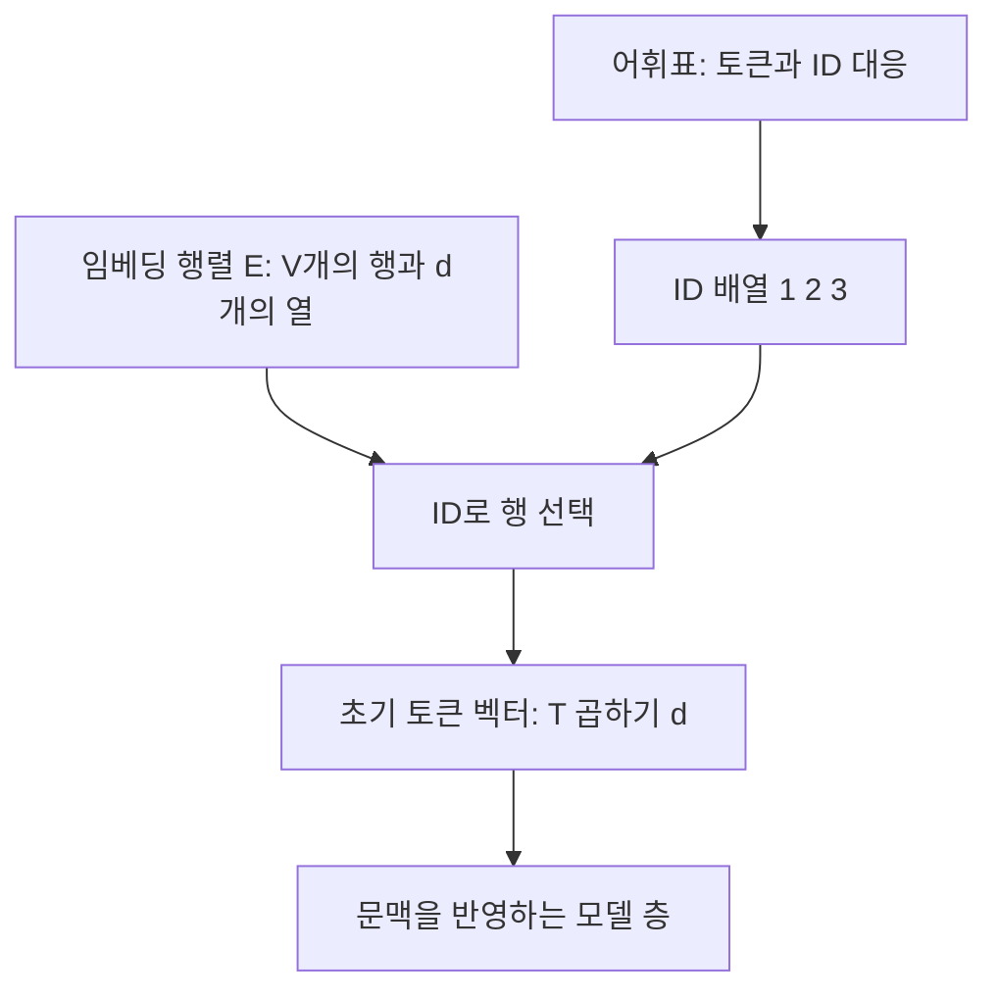
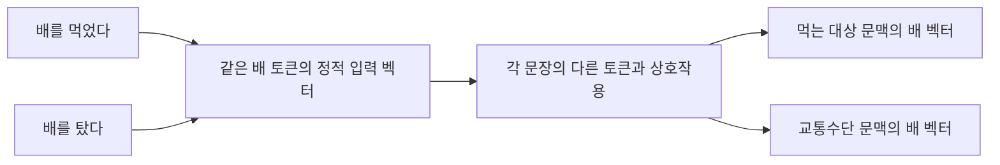
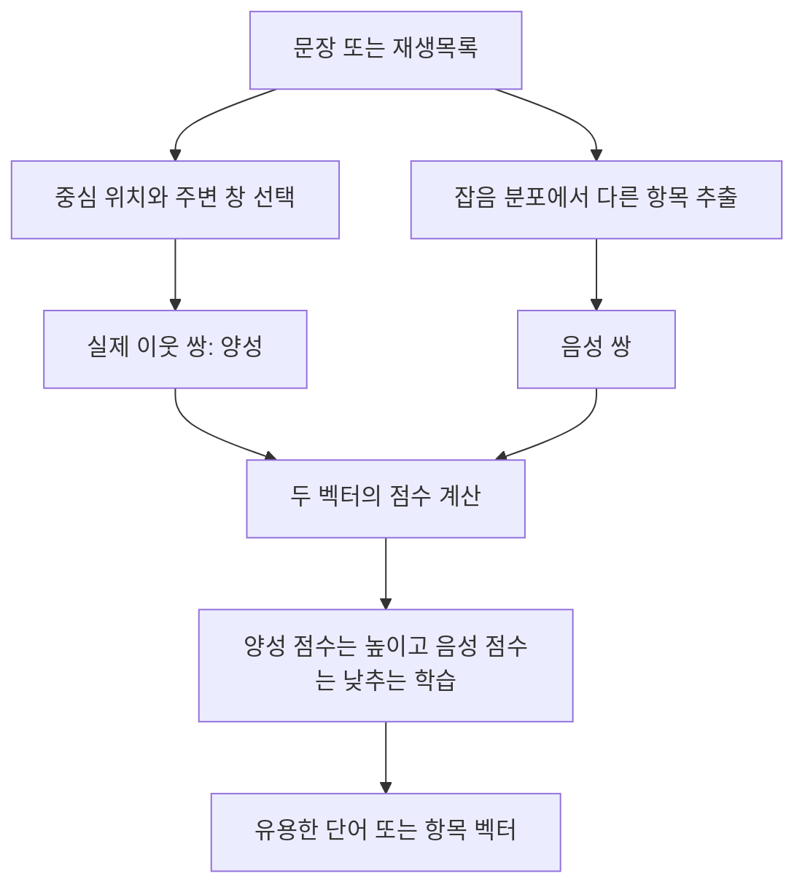

# 2장 토큰과 임베딩

[전체 목차](../../README.md) · [학습 노트](study.md) · [강의안](lecture.md) · [강의 대본](lecture-script.md) · [시각 실험](visuals.html) · [실습 안내](lab-guide.md) · [복습 문제](quiz.md)

**원문:** Jay Alammar, Maarten Grootendorst, *Hands-On Large Language Models*, 2024, Chapter 2, “Tokens and Embeddings”. 이 노트의 쪽수는 제공된 PDF의 **물리 페이지 67–115쪽**을 뜻한다. 인쇄본 쪽수와 다르다. 원문의 개념과 예제는 재구성해 설명하고, 수식·한국어 예시·손계산·디버깅 조언은 학습을 위한 보충으로 구분한다. 특정 모델에 관한 수치와 출력 예시는 책의 당시 조건이며 오늘 실행한 결과라는 뜻이 아니다.

이 장의 질문은 하나다. **컴퓨터는 문장과 노래처럼 서로 다른 대상을 어떻게 계산 가능한 표현으로 바꾸는가?** 토크나이저는 문자를 작은 단위와 번호로 바꾸고, 임베딩은 그 번호에 벡터를 연결한다. 언어 모델은 벡터에 문맥을 반영한다. 학습 목표를 잘 정하면 단어의 벡터뿐 아니라 문장, 문서, 노래의 벡터도 유용한 관계를 담게 된다. 이 연결을 이해하면 다음 장의 Transformer와 이후의 분류·검색·추천이 하나의 흐름으로 보인다.

## 학습 목표와 선수지식

이 장을 마친 뒤에는 다음을 설명하고 실행할 수 있어야 한다.

- 텍스트 → 토큰 → 토큰 ID → 정적 임베딩 → 문맥 임베딩의 각 단계에서 입력과 출력이 무엇인지 말한다.
- 단어·서브워드·문자·바이트 단위의 장단점을 희귀어, 한국어, 이모지, 코드의 사례로 비교한다.
- 토크나이저의 알고리즘, 설계 매개변수, 학습 데이터가 결과를 어떻게 바꾸는지 구분한다.
- `[B, T, d]` 모양의 모델 출력을 읽고, `[B, d]` 문장 임베딩과 혼동하지 않는다.
- 코사인 유사도, 마스크를 적용한 평균 풀링, skip-gram 쌍 생성과 음성 샘플링을 손으로 계산한다.
- 재생목록을 토큰 시퀀스로 바꾸어 작은 노래 임베딩 모델을 학습시키고, 그 결과가 보여주는 것과 보여주지 않는 것을 설명한다.

Python의 리스트·딕셔너리·반복문을 알고 있으면 실습을 따라갈 수 있다. 벡터는 우선 “일정한 길이의 실수 목록”으로 이해하면 된다. 내적은 같은 위치의 값을 곱해 더하는 계산이다. 신경망의 미분을 이미 알 필요는 없으며, 업데이트 식은 실제 숫자로 확인한다.

## 상세 목차

1. [토큰화의 역할](#sec-01)
2. [모델에 들어가는 실제 입력](#sec-02)
3. [LLM을 내려받아 실행하는 원문 예제](#sec-03)
4. [텍스트가 나뉘는 기준](#sec-04)
5. [단어·서브워드·문자·바이트](#sec-05)
6. [실제 토크나이저 비교](#sec-06)
7. [토크나이저 설계 속성](#sec-07)
8. [토큰 임베딩의 역할](#sec-08)
9. [어휘와 임베딩 행렬](#sec-09)
10. [문맥화된 토큰 임베딩](#sec-10)
11. [문장·문서 임베딩](#sec-11)
12. [LLM 바깥의 단어 임베딩](#sec-12)
13. [사전 학습 단어 벡터 이용](#sec-13)
14. [Word2vec과 대조 학습](#sec-14)
15. [추천 시스템의 임베딩](#sec-15)
16. [노래 추천을 관계 문제로 바꾸기](#sec-16)
17. [노래 임베딩 학습 절차](#sec-17)
18. [통합 정리와 다음 장 연결](#sec-18)

<a id="sec-01" name="sec-01"></a>
## 1. 토큰화의 역할

**원문 절:** LLM Tokenization · **PDF 67–69쪽**, Figure 2-1, Figure 2-2.

사용자에게 언어 모델은 글을 받아 글을 돌려주는 도구처럼 보인다. 그러나 모델 안의 주요 계산은 문자 자체가 아니라 수치 배열을 대상으로 한다. 이 간극을 메우는 첫 단계가 토큰화다. **토큰(token)**은 모델이 입력과 출력을 처리할 때 사용하는 한 단위다. 그 단위는 완전한 단어일 수도 있고 단어의 일부, 구두점, 공백의 묶음, 바이트 조각일 수도 있다. 따라서 “토큰 = 영어 단어”라는 등식은 처음부터 버려야 한다.

토큰화가 중요한 이유는 숫자로 바꿔야 하기 때문만은 아니다. **무엇을 한 번의 예측 단위로 볼 것인가**를 결정하기 때문이다. `playing`을 하나의 토큰으로 처리하면 모델은 그 단어 전체를 한 번에 고를 수 있다. `play`와 `ing`으로 나누면 두 번의 선택으로 표현한다. 글자 일곱 개로 나누면 더 많은 선택이 필요하다. 작은 단위는 다양한 표현을 조합하기 쉽지만 길이가 늘고, 큰 단위는 자주 나오는 표현을 짧게 담지만 어휘가 커진다.

채팅 화면에서 응답이 조금씩 나타나는 모습은 이 생성 과정을 직관적으로 보여준다. 다만 화면의 한 번의 갱신이 반드시 모델의 토큰 하나와 일치하지는 않는다. 인터페이스가 여러 토큰을 묶어서 전송할 수도 있기 때문이다. 학습할 핵심은 일반적인 자기회귀 생성 모델이 이미 주어진 토큰들을 조건으로 **다음 토큰을 순차적으로 선택**한다는 것이다. 입력 프롬프트 역시 출력과 같은 토큰 체계를 거친다.

원문 Figure 2-1은 토큰과 임베딩이 서로 다른 단계라는 사실을, Figure 2-2는 사용자 관점의 입력·출력을 보여준다. 아래 도식에서는 그 사이를 펼쳐본다.


**생각해보기:** 같은 내용을 한국어와 영어로 썼을 때 글자 수가 비슷해도 토큰 수는 같을까? 아니다. 문자 체계뿐 아니라 해당 토크나이저가 어떤 언어의 패턴을 어휘에 많이 담았는지에 따라 달라진다. 뒤에서 다룰 데이터 영역의 차이가 실제 입력 길이와 비용으로 이어진다.

<a id="sec-02" name="sec-02"></a>
## 2. 모델에 들어가는 실제 입력

**원문 절:** How Tokenizers Prepare the Inputs to the Language Model · **PDF 68–69쪽**, Figure 2-3. 관련 입력 구조는 **PDF 71쪽**, Figure 2-4.

토크나이저는 두 일을 연결한다. 먼저 문자열을 어떤 조각으로 표현할지 정하고, 각 조각을 어휘표의 정수 ID로 바꾼다. 예를 들어 교육용 어휘표가 `hello → 4`, `world → 9`, `! → 2`라면 `hello world!`는 `[4, 9, 2]`처럼 표현될 수 있다. 이 번호는 **이름표**다. 9번 토큰이 4번보다 크거나, 4번과 2번이 더 비슷한 의미라는 뜻이 아니다.

이 구분이 중요하다. 토큰 ID들을 그대로 수치 특징처럼 써서 평균을 내면 의미 있는 문장 표현이 되지 않는다. ID의 크기는 대개 어휘표를 만든 과정의 산물이다. 토큰 간 관계를 학습하는 역할은 이후 임베딩 벡터가 담당한다. 학생에게 비유하면 학번이 토큰 ID이고, 여러 과목의 성향을 나타내는 좌표가 임베딩이다. 학번이 연속이라는 이유로 성향이 비슷하지 않다. 다만 임베딩의 각 차원을 실제 과목처럼 명확히 이름 붙일 수 있는 것은 아니라는 점에서 비유에는 한계가 있다.

모델 입력에는 토큰 ID 외에 **attention mask** 같은 정보가 함께 들어갈 수 있다. 길이가 다른 문장을 한 배치로 묶으면 짧은 문장의 끝에 패딩을 붙이기도 한다. 이때 마스크는 실제 내용과 패딩을 구별한다. 모델마다 토큰 유형 ID나 위치 관련 정보의 사용도 다르다. 원문은 처음 설명에서 `input_ids`에 집중하지만, 실전에서는 토크나이저가 반환한 입력 딕셔너리 전체의 의미를 알아두어야 한다.

원문의 색상 토큰 그림을 볼 때는 “색 하나가 의미 하나”라고 읽지 않는다. 색은 경계가 어디인지 보여줄 뿐이다. `apologizing`이 여러 조각으로 나뉘더라도 그 조각 각각에 독립적인 사전 의미가 반드시 있는 것은 아니다. 토크나이저는 대개 언어학자가 정의한 형태소 분석기와 동일하지 않다. 자주 나타나는 문자열과 설계 규칙을 이용해 효율적인 표현 단위를 정한다.

**보충 예제:** 토큰이 `['<s>', 'play', 'ing']`이고 ID가 `[1, 8, 13]`이라고 하자. `'<s>'`는 화면에 보일 문장의 일부가 아니라 시작 위치를 알려주는 특수 토큰일 수 있다. `len(input_ids)`에는 이러한 토큰도 포함되므로, 사람이 센 단어 수만으로 텐서 길이를 예상하면 쉽게 틀린다.

<a id="sec-03" name="sec-03"></a>
## 3. LLM을 내려받아 실행하는 원문 예제

**원문 절:** Downloading and Running an LLM · **PDF 69–74쪽**, Figure 2-4.

책은 `microsoft/Phi-3-mini-4k-instruct`와 그 토크나이저를 불러와 짧은 사과 이메일을 생성한다. 학습해야 할 것은 이메일의 문구가 아니라 실행 경로다. `AutoTokenizer`가 문자열을 정수 텐서로 만들고, `AutoModelForCausalLM`로 불러온 생성 모델이 그 텐서를 받아 새 ID를 만든다. 마지막에 토크나이저의 `decode`가 사람이 읽는 문자열로 복원한다.

원문 예제의 핵심 동작을 의사 코드로 적으면 다음과 같다. 이 코드는 **실행된 실습 결과가 아니라 원문의 처리 흐름 설명**이다.

```text
모델과 동일한 체크포인트의 토크나이저 준비
프롬프트를 토큰 ID 배열로 인코딩
ID 배열과 필요한 마스크를 모델 장치로 이동
최대 20개의 새 토큰을 생성
생성된 ID를 문자열로 디코딩
```

`return_tensors="pt"`는 결과를 PyTorch 텐서로 받겠다는 의미다. 텍스트 한 개를 넣어도 바깥에 배치 차원이 있으므로 입력 모양은 보통 `[1, T]`다. `input_ids[0]`은 그 첫 문장의 ID 배열을 꺼낸다. 원문의 `.to("cuda")`는 데이터를 NVIDIA GPU 장치로 옮긴다. 모델과 입력이 서로 다른 장치에 있으면 계산할 수 없으므로 장치 배치도 코드의 일부다.

`max_new_tokens=20`은 원래 입력 길이를 제외하고 **새로 생성할 토큰 수의 상한**을 설정한다. 20개의 단어를 쓴다는 뜻이 아니다. 종료 토큰이 먼저 선택되면 더 일찍 끝날 수도 있다. 원문의 출력은 새 텍스트만이 아니라 입력 프롬프트와 새 토큰이 함께 들어 있는 배열을 디코딩한 결과다. 따라서 생성한 부분만 확인하려면 decoder-only 예제에서는 입력 토큰 길이 이후를 잘라 비교하는 것이 도움이 된다.

원문은 첫 토큰 `<s>`와 끝의 `<|assistant|>`를 포함한 ID 배열을 보여준다. 시작 토큰과 대화 역할 토큰은 평범한 단어와 다른 구조적 의미를 지닌다. 그러나 역할 문자열을 임의로 붙이면 모든 채팅 모델에서 올바른 형식이 된다고 일반화하면 안 된다. **각 체크포인트가 학습한 채팅 템플릿**과 특수 토큰 규약에 맞춰 입력해야 한다.

출력에서 `Sub`와 `ject`가 서로 다른 ID로 생성된 뒤 `Subject`로 합쳐지는 부분은 특히 좋은 관찰 지점이다. 모델은 완성된 영어 단어만 골라내는 것이 아니다. 여러 부분 토큰을 이어서 익숙한 단어를 구성한다. 토크나이저가 특정 부분을 독립 토큰으로 갖고 있다는 사실과 모델이 그 다음에 적절한 부분을 고를 수 있다는 능력은 서로 다른 사실이다.

공백 표기를 읽을 때도 주의한다. 일부 토크나이저는 단어 앞의 공백을 토큰의 일부로 가지고, 일부는 조각의 연결 관계를 별도 표기한다. 토큰을 하나씩 `decode`했을 때 보이는 표시는 구현에 따라 달라질 수 있다. **전체 배열을 디코딩한 문자열**과 **각 토큰의 내부 표기**를 함께 비교해야 정확하다. `##`, `▁`, 바이트 표시를 모든 모델의 공통 문법으로 외우지 않는다.

실제 모델 실행은 다운로드 용량, 라이브러리 버전, 하드웨어에 영향을 받는다. 이 장에서 제공하는 [lab.py](lab.py)는 그런 준비 없이 원리를 확인하도록 만든 표준 라이브러리 실습이다. 원문 Phi-3 모델을 이 자료 제작 과정에서 실행한 것은 아니다.

<a id="sec-04" name="sec-04"></a>
## 4. 텍스트가 나뉘는 기준

**원문 절:** How Does the Tokenizer Break Down Text? · **PDF 74–75쪽**, Figure 2-5.

같은 문자열이 모델마다 다르게 나뉘는 데는 세 층의 원인이 있다. 첫째는 **알고리즘**이다. BPE와 WordPiece처럼 어휘를 만들고 분할을 결정하는 방법이 다를 수 있다. 둘째는 **설계 매개변수**다. 어휘 크기, 특수 토큰, 정규화와 대소문자 처리를 정한다. 셋째는 **토크나이저 학습 데이터**다. 같은 알고리즘과 같은 어휘 크기라도 영어 뉴스, 프로그램 코드, 한국어 대화로 학습하면 자주 등장하는 조각이 달라진다.

토크나이저 학습과 언어 모델 학습을 구분해야 한다. 토크나이저 학습은 어떤 문자열 조각을 어휘에 담을지 정하는 과정이다. 언어 모델 학습은 그 ID들의 시퀀스에서 표현과 예측을 잘하도록 벡터와 가중치를 조정하는 과정이다. 언어 모델이 똑똑해졌다고 토크나이저의 어휘가 자동으로 바뀌는 것은 아니다. 보통 이미 정해진 어휘와 ID 대응을 고정한 상태로 모델을 학습한다.

**보충: 작은 BPE를 손으로 이해하기.** `low`가 3번, `lower`가 2번 나오는 말뭉치를 생각하자. 처음에 글자로 분리하면 `l o w`, `l o w e r`가 된다. 인접 쌍의 빈도를 세면 `l+o`, `o+w`가 각각 여러 번 등장한다. 빈도가 가장 높은 쌍 중 하나를 합쳐 `lo` 또는 `ow` 같은 새 기호를 만들고, 다시 빈도를 세어 반복한다. 자주 같이 붙는 문자열을 하나의 단위로 압축해가는 셈이다. 실제 BPE에는 단어 경계, 사전 분할, 바이트 처리와 동률 처리 규칙 등이 있으므로 이 장의 작은 구현은 특정 제품의 토크나이저 재현이 아니다.

학습이 끝난 토크나이저를 새 문장에 적용할 때는 저장된 어휘와 규칙을 사용한다. 새 입력을 볼 때마다 어휘를 다시 학습하면 같은 문자열의 ID 체계가 달라질 수 있고, 모델이 학습한 임베딩과 연결이 깨진다. 따라서 입력 처리에서는 **일관성**이 중요하다.

Figure 2-5는 출력 방향에서도 같은 토크나이저가 필요함을 강조한다. 모델이 출력하는 것은 “이 다음에는 622번을 고르자”와 같은 ID 선택이다. 그것을 어떤 글자로 표시할지는 해당 어휘가 정한다. 입력 때 A 모델의 토크나이저를 쓰고 출력 때 B 모델의 토크나이저를 쓰는 것은 같은 번호판을 다른 사전으로 해석하는 것과 비슷하다.

<a id="sec-05" name="sec-05"></a>
## 5. 단어·서브워드·문자·바이트 비교

**원문 절:** Word Versus Subword Versus Character Versus Byte Tokens · **PDF 75–78쪽**, Figure 2-6.

### 5.1 단어 토큰

단어 단위는 처음 이해하기 쉽다. 문장을 단어로 나누어 단어마다 번호를 붙인다. 그러나 어휘를 만든 뒤 등장한 새 단어를 처리하기 어렵고, 활용형과 파생형이 각각 별도 항목이 될 수 있다. `apology`, `apologize`, `apologetic`을 모두 독립적인 토큰으로 저장하면 공유 부분을 표현하는 효율이 낮아진다. 한국어에서 조사와 어미가 결합한 모든 표면형을 그대로 어휘에 넣으려 하면 이 문제가 더 두드러질 수 있다.

어휘에 없는 단어를 `[UNK]` 하나로 바꾸면 다양한 미지의 단어가 같은 표현으로 합쳐진다. 예를 들어 새로운 회사 이름과 새로운 약품 이름이 모두 같은 ID가 되면 그 입력만으로 둘을 구별할 수 없다. 단어 토큰화가 틀린 방법이라는 뜻은 아니다. 뒤의 노래 추천에서는 곡 ID 하나를 단어처럼 취급하는 것이 자연스럽다. 대상의 의미 있는 단위와 사용 목적에 따라 선택한다.

### 5.2 서브워드 토큰

서브워드는 완전한 단어와 단어 조각을 함께 사용한다. 자주 등장하는 단어는 하나로, 덜 흔한 단어는 여러 조각으로 표현할 수 있다. 공유되는 어근과 접미사, 코드의 흔한 문자열을 재사용하여 제한된 어휘로 많은 문자열을 표현한다. 특정 조각이 사람의 형태소와 겹칠 수는 있지만, 항상 문법적으로 의미 있는 경계만 찾는 것은 아니다.

서브워드가 미지의 단어를 표현할 수 있다는 주장에는 조건이 있다. 더 작은 문자나 바이트로 내려가는 경로가 충분히 있어야 한다. 필요한 문자가 기본 어휘에 없고 바이트 fallback도 없다면 여전히 unknown 토큰이 나타날 수 있다. 따라서 “서브워드면 어떤 문자열도 무손실 처리”라고 외우면 뒤의 BERT·T5 사례를 설명할 수 없다.

### 5.3 문자 토큰

문자 단위는 알려진 문자들로 이루어진 새 단어를 표현하기 쉽다. 어휘를 단어 단위보다 작게 유지할 수도 있다. 대신 `play`를 네 번의 선택으로 표현하는 것처럼 시퀀스 길이가 늘어난다. 모델은 문장 간 관계뿐 아니라 철자와 단어 구성도 더 세밀한 단계에서 배워야 한다. 같은 컨텍스트 토큰 수를 가진 모델이라면 담을 수 있는 원문 길이가 줄어들 수 있다.

원문은 서브워드가 평균적으로 여러 글자를 담는 예를 들어, 제한된 컨텍스트에서 서브워드가 문자보다 더 많은 텍스트를 담을 수 있음을 설명한다. 이는 직관적 예시이며 모든 언어에서 “정확히 세 배”라는 법칙이 아니다. 실제 비율은 문체·언어·토크나이저·특수 토큰에 따라 달라진다. 실무에서는 대상 데이터로 직접 토큰 수 분포를 측정해야 한다.

### 5.4 바이트 토큰

바이트는 텍스트를 컴퓨터에 저장할 때의 단위다. UTF-8에서는 ASCII 영문자 하나가 한 바이트인 경우가 많지만, 한글 음절과 여러 이모지는 여러 바이트를 사용한다. 예를 들어 `A`는 UTF-8에서 한 바이트, `가`는 세 바이트다. 따라서 “문자 하나”와 “바이트 하나”는 같은 개념이 아니다. 이 자료의 [시각 실험](visuals.html)은 직접 문자열을 바꾸며 두 길이를 비교하게 한다.

바이트 기반 표현은 유한한 기본 바이트 집합으로 다양한 Unicode 문자열을 담을 수 있다는 장점이 있다. 반면 비ASCII 문자에서 시퀀스가 길어질 수 있고, 여러 바이트를 합쳐야 하나의 읽을 수 있는 문자가 된다. 바이트 한 조각만 따로 디코딩하면 `�`처럼 보이더라도 원래 문자열 전체가 소실되었다는 뜻은 아니다. 전체 바이트 시퀀스가 있으면 원래 문자를 복원할 수 있다.

원문은 CANINE과 ByT5 같은 연구를 일반적인 서브워드 토크나이저를 거치지 않는 접근의 예로 소개한다. 이때 “tokenization-free”는 아무 수치 단위도 없다는 뜻이 아니다. 문자나 바이트 수준의 입력 표현은 여전히 존재한다. 또한 **바이트를 기본 재료로 쓰는 서브워드 방식**과 **모든 바이트를 각각 처리하는 방식**을 구분해야 한다. GPT-2류의 바이트 기반 BPE는 병합된 서브워드를 쓰므로 모든 입력을 한 바이트씩만 모델에 넣는 방식이 아니다.

| 단위 | 얻는 점 | 치르는 점 | 이 장에서의 관찰 질문 |
|---|---|---|---|
| 단어 | 친숙한 단위, 알려진 단어를 짧게 표현 | 새 단어와 활용형, 큰 어휘 | `[UNK]`가 어떤 정보를 합쳐버리는가? |
| 서브워드 | 빈번한 문자열 압축과 조합 가능성 | 경계가 직관과 다르고 설계에 영향받음 | 같은 단어가 몇 조각으로 나뉘는가? |
| 문자 | 작은 구성 요소로 새 표현 조합 | 긴 시퀀스, 철자 수준의 모델링 | 토큰 제한 안에 얼마나 많은 문장이 들어가는가? |
| 바이트 | 문자 인코딩을 일관된 작은 기본 집합으로 표현 | 한 문자가 여러 토큰일 수 있음 | 개별 조각과 전체 디코딩이 어떻게 다른가? |

**보충: 길이의 네 가지 의미.** 화면에서 보이는 글자 수, Unicode 코드 포인트 수, UTF-8 바이트 수, 모델 토큰 수는 모두 다를 수 있다. 결합 문자나 여러 코드 포인트로 이루어진 이모지까지 고려하면 “글자 수” 자체도 정의해야 한다. 실습의 문자 단위는 Unicode 코드 포인트 기준이며, 화면상 글자 묶음 전체를 완벽히 세는 구현은 아니다.

<a id="sec-06" name="sec-06"></a>
## 6. 실제로 학습된 토크나이저 비교

**원문 절:** Comparing Trained LLM Tokenizers · **PDF 78–91쪽**. 원문의 비교 출력과 90–91쪽 종합표를 개념 중심으로 재구성했다.

비교의 목적은 토큰 수가 가장 적은 모델을 우승자로 정하는 것이 아니다. 대문자, 영어 외 문자, 이모지, 코드 키워드, 탭·공백·줄바꿈, 숫자, 특수 토큰이 어떻게 다뤄지는지 보고 **어떤 정보가 보존되거나 사라지는지** 이해하는 것이다. 토큰 수 감소는 계산 효율에 도움을 줄 수 있지만, 특정 작업의 정확도를 자동으로 보장하지는 않는다.

원문 테스트 문자열에는 대문자 단어, 코드와 산술 표현, 비영어 문자와 이모지가 등장한다. 제공된 PDF에서는 일부 문자가 텍스트 추출뿐 아니라 화면 렌더링에서도 비어 보이므로, 이 자료는 손실된 문자 자체를 추측해서 복원하지 않는다. 대신 저자가 확인하려 한 범주와 각 모델의 처리 특성을 설명한다. 아래 수치는 **원문에 제시된 당시 어휘 크기**다.

| 모델·토크나이저 | 원문의 방식·어휘 크기 | 핵심 관찰 |
|---|---|---|
| BERT base uncased | WordPiece, 30,522 | 소문자화, `##` 연결 조각, 일부 문자의 `[UNK]`, 줄바꿈 정보 손실 |
| BERT base cased | WordPiece, 28,996 | 대소문자 유지, 전부 대문자인 단어는 많은 조각으로 나뉠 수 있음 |
| GPT-2 | BPE, 50,257 | 대소문자·줄바꿈 보존, 바이트 조각을 합쳐 문자 복원 |
| Flan-T5 | SentencePiece 구현 계열, 32,100 | 원문 예제에서 줄바꿈·공백 구분의 축약과 `<unk>` 관찰 |
| GPT-4 | BPE, 10만여 개 | 공백 묶음과 코드 키워드가 효율적으로 표현됨 |
| StarCoder2 | BPE, 49,152 | 코드 문맥 구조, 공백 묶음, 숫자를 자릿수 단위로 표현 |
| Galactica | BPE, 50,000 | 과학 문서의 인용·작업 표지, 공백·탭 묶음 |
| Phi-3와 Llama 2 계열 | BPE, 기본 32,000 규모 | Phi-3는 Llama 2 토크나이저를 재사용하며 대화용 특수 토큰을 추가 |

### 원문에 등장하는 특수 토큰을 역할별로 읽기

다음 이름들은 책의 비교 대상에서 제시된 당시 표기다. 이름이 비슷해도 ID와 처리 규약은 체크포인트마다 다를 수 있다.

| 비교 대상 | 원문에 제시된 주요 표기 | 목적 |
|---|---|---|
| BERT | `[UNK]`, `[SEP]`, `[PAD]`, `[CLS]`, `[MASK]` | 미지 항목, 경계, 패딩, 분류 위치, 가린 위치 |
| GPT-2 | `<\|endoftext\|>` | 텍스트 종료 또는 경계 역할 |
| Flan-T5 | `<unk>`, `<pad>`, 출력의 `</s>` | 미지 항목, 패딩, 시퀀스 끝 |
| GPT-4 | `<\|endoftext\|>`, `<\|fim_prefix\|>`, `<\|fim_middle\|>`, `<\|fim_suffix\|>` | 종료 및 중간 채우기용 구획 |
| StarCoder2 | `<\|endoftext\|>`, `<fim_prefix>`, `<fim_middle>`, `<fim_suffix>`, `<fim_pad>` | 코드 완성과 중간 채우기 |
| StarCoder2의 구조 | `<filename>`, `<reponame>`, `<gh_stars>` | 파일·저장소·부가 정보 구분 |
| Galactica | `<s>`, `<pad>`, `</s>`, `<unk>`, `[START_REF]`, `[END_REF]`, `<work>` | 일반 경계·인용·작업 구획 |
| Phi-3 | `<\|endoftext\|>`, `<\|user\|>`, `<\|assistant\|>`, `<\|system\|>` | 종료와 대화 역할 |

원문은 BERT를 2018년, GPT-2를 2019년, Flan-T5를 2022년, GPT-4를 2023년, StarCoder2를 2024년 사례로 비교한다. 이는 토크나이저 설계가 새 사용 사례에 대응하는 흐름을 보여주는 시간표이며, 최신 모델의 순위를 뜻하지 않는다. 책에서 선택한 StarCoder2는 150억 파라미터 모델로 소개된다. Galactica는 인용뿐 아니라 수학·아미노산·DNA 서열 같은 과학 자료의 구조에도 관심을 둔 예다.

### 6.1 BERT uncased와 cased

BERT uncased는 입력을 소문자화한다. 덕분에 `Apple`, `apple`, `APPLE`의 중복을 줄일 수 있지만, 고유명사나 강조처럼 대소문자에 실린 구분이 사라질 수 있다. `capitalization`은 원문에서 `capital`과 `##ization`으로 나뉜다. `##`는 뒤의 조각이 앞 토큰에 이어붙는 부분임을 나타내는 WordPiece 표기다. 일반 문자열 안에 원래 두 개의 `#`가 있었다는 뜻이 아니다.

BERT cased는 대소문자를 보존한다. 원문에서 `CAPITALIZATION`은 여덟 조각으로 표현된다. 정보가 더 보존되지만 토큰 수가 늘 수 있다는 구체적인 사례다. 같은 WordPiece라는 이유로 두 토크나이저가 동일하게 동작하지 않는다. 어휘와 정규화 정책이 다르기 때문이다.

원문 예제의 `[UNK]`는 해당 어휘가 일부 이모지·중국어 입력을 표현하지 못하는 경우를 보여준다. 모든 BERT 계열 모델이 중국어를 처리하지 못한다는 뜻은 아니다. 다국어 모델이나 중국어용 체크포인트는 다른 어휘를 사용할 수 있다. 한 체크포인트의 관찰 결과를 아키텍처 전체의 한계로 확대하지 않는다.

BERT의 주요 특수 토큰은 역할을 나누어 기억한다. `[CLS]`는 문장 수준 분류에 사용할 수 있는 위치이고, `[SEP]`는 끝이나 두 텍스트 사이를 구분한다. `[MASK]`는 사전 학습에서 가린 위치를 표시한다. `[PAD]`는 배치 길이를 맞출 때 빈 자리를 채우며, `[UNK]`는 표현하지 못한 항목이다. `[CLS]`가 있다는 사실만으로 그 벡터가 모든 검색 작업에서 좋은 문장 임베딩이 되는 것은 아니다.

### 6.2 GPT-2와 바이트 조각

GPT-2 비교에서 중요한 변화는 줄바꿈과 대소문자를 표현한다는 점이다. 코드나 대화 로그에서는 줄바꿈이 단순 장식이 아닐 수 있다. 파이썬의 들여쓰기, 채팅 발화 경계, 문서의 구조를 전달한다. 같은 영문 텍스트도 전처리에서 이 정보를 없애면 모델은 그 정보에 접근할 수 없다.

원문에서는 하나의 이모지를 여러 토큰으로 나눈 뒤, 각 토큰을 개별 디코딩하면 대체 문자처럼 표시되지만 전체 ID를 디코딩하면 원래 문자를 복원하는 예를 든다. 이는 `[UNK]`와 다르다. `[UNK]`는 서로 다른 미지의 입력이 하나로 합쳐질 수 있는 정보 손실이고, 불완전한 바이트 조각의 표시 문제는 필요한 조각을 모으면 해결될 수 있다.

공백 네 개를 여러 토큰으로 표현하면 모델은 그 수를 여러 번의 선택에 걸쳐 맞춰야 한다. 공백 네 개를 하나의 토큰으로 만들면 흔한 들여쓰기 단위를 한 번에 고를 수 있다. 코드 토크나이저의 변화가 중요한 이유다. 그러나 공백 토큰 하나만으로 문법 이해가 생기는 것은 아니며, 학습 데이터와 모델 능력도 필요하다.

### 6.3 Flan-T5와 SentencePiece

원문은 Flan-T5의 토크나이저를 SentencePiece라고 소개한다. 여기서 용어를 정리해야 한다. **SentencePiece는 구현·도구 체계이며 BPE나 Unigram과 같은 알고리즘을 지원**한다. 따라서 “BPE, WordPiece, SentencePiece는 완전히 같은 수준의 알고리즘 세 개”라고 단순 분류하면 혼동하기 쉽다. 모델의 실제 설정을 볼 때는 도구 이름과 내부 분할 모델을 함께 확인한다. [공식 토크나이저 설명](https://huggingface.co/docs/transformers/tokenizer_summary)

책의 출력에서는 줄바꿈과 연속 공백의 구분이 유지되지 않고 일부 문자에 `<unk>`가 나온다. 이 관찰을 “SentencePiece를 쓰면 반드시 공백이 사라진다”로 일반화하면 안 된다. 정규화 규칙과 학습한 어휘에 따라 달라진다. 여기서 얻어야 할 교훈은 모델 입력으로 바꾸기 전에 어떤 정보를 정규화하는지 확인하라는 것이다.

### 6.4 GPT-4와 코드 지향 표현

책의 GPT-4 예제는 GPT-2보다 일부 단어를 적은 조각으로 표현하고, `elif` 같은 코드 키워드와 여러 공백을 하나의 토큰으로 담는다. 책은 당시 비교한 어휘에 83칸까지의 다양한 길이의 공백 묶음이 있다고 설명한다. 이 수치는 책의 특정 토크나이저 관찰이며 이후 모든 GPT 계열에 대한 보편 규칙은 아니다. 이 수치 자체보다, 자주 쓰이는 구조를 어휘에 넣으면 **컨텍스트 사용량과 예측 부담이 달라진다**는 원리를 기억한다.

원문은 fill-in-the-middle용 특수 토큰도 소개한다. 앞의 텍스트만 보고 끝을 잇는 방식과 달리, 앞부분과 뒷부분을 함께 주고 중간을 채우도록 데이터를 구성할 수 있다. 특수 토큰은 어느 부분이 앞·뒤·생성할 중간인지 구별하는 데 사용된다. 이러한 이름이 어휘에 존재한다는 사실과 특정 서비스가 그 입력 방식을 제공한다는 사실은 별개다.

### 6.5 StarCoder2

StarCoder2는 코드 생성용 데이터와 구조를 고려한 토크나이저의 예다. `<filename>`, `<reponame>` 같은 표지는 여러 파일의 내용을 하나의 입력에 넣을 때 파일과 저장소 경계를 구별하게 한다. 함수 호출이 다른 파일의 정의와 관련될 수 있으므로 이 구조는 단순한 자연어 문장 구분 이상의 의미를 갖는다. `<gh_stars>`처럼 데이터의 부가 정보를 표시하는 토큰도 원문에 등장한다.

숫자를 개별 자릿수로 나누는 것도 중요한 관찰이다. 870은 하나의 토큰이고 871은 두 토큰인 체계에서는 인접한 숫자라도 구조가 불규칙할 수 있다. 자릿수 단위로 나누면 자리 구조가 일정해지는 장점이 있지만 시퀀스는 길어진다. 책은 수 표현과 수학에 도움이 될 수 있다는 가설을 설명한다. 이것을 “자릿수 토큰화만 하면 산술이 정확해진다”는 보장으로 바꾸지 않는다.

### 6.6 Galactica

Galactica는 과학 문서의 특성을 반영한 예다. 인용을 감싸는 `[START_REF]`, `[END_REF]`, 작업 과정을 표시하는 `<work>`, 수학이나 생물학적 서열을 위한 구분 등이 소개된다. 모델이 어떤 영역의 구조를 다루길 원하는지에 따라 일반 문장 이상의 표지를 넣을 수 있음을 보여준다.

코드와 공백에 관한 특성도 있다. 원문 비교에서는 공백뿐 아니라 연속 탭을 하나로 묶는 경우가 나온다. 같은 BPE라고 해도 이 차이가 생긴다는 사실은 다시 데이터와 어휘 설계의 중요성을 보여준다. 특수 토큰을 추가하는 것만으로 그 의미를 모델이 이해하는 것은 아니다. 그 표지가 들어 있는 학습 예제를 통해 사용법을 배워야 한다.

### 6.7 Phi-3와 Llama 2

책은 Phi-3가 Llama 2 토크나이저를 바탕으로 대화용 특수 토큰을 추가했다고 설명한다. `<|user|>`, `<|assistant|>`, `<|system|>`은 발화자의 역할을 구분하는 예다. 채팅에서는 글의 내용뿐 아니라 누가 말했는지, 어느 답변을 이어 써야 하는지도 입력 구조의 일부다.

표의 32,000은 기본 어휘 규모로 읽어야 한다. 특수 토큰을 추가한 실제 토크나이저의 길이와 모델 임베딩 행 수가 언제나 정확히 32,000이라고 가정하지 않는다. 실제 체크포인트에서는 어휘, 추가 토큰, 예약 행 등의 설정을 확인한다. 또한 사용자가 텍스트 안에 역할 토큰처럼 보이는 문자열을 적었다고 그 메시지가 실제 시스템 권한을 얻는 것은 아니다. 토큰 표현과 애플리케이션의 메시지 권한은 서로 다른 계층이다.

<a id="sec-07" name="sec-07"></a>
## 7. 토크나이저를 설계하는 세 가지 축

**원문 절:** Tokenizer Properties · **PDF 91–94쪽**.

첫 축은 **방법**이다. 어떤 알고리즘으로 어휘를 만들고 입력을 분할할지 정한다. 두 번째는 **매개변수와 정책**이다. 어휘 크기, 특수 토큰, 대소문자, 정규화 등을 선택한다. 세 번째는 **대상 데이터 영역**이다. 영어 일반 문서와 다국어 문서, 코드와 과학 문서는 빈번한 패턴이 다르다. 이 세 축은 서로 영향을 주므로 하나만 보고 토크나이저의 성질을 예측하기 어렵다.

어휘를 크게 하면 많은 문자열을 짧게 담을 가능성이 커지지만, 어휘 항목마다 필요한 임베딩과 출력 표현의 규모도 늘 수 있다. 어휘를 작게 하면 조합은 유연해지지만 입력 시퀀스가 길어진다. 따라서 좋은 어휘 크기는 무조건 최대치가 아니라 메모리, 처리량, 언어별 효율, 학습 데이터의 분포를 함께 고려한 선택이다. 뒤의 임베딩 행렬 계산에서 이 비용을 숫자로 확인한다.

특수 토큰은 모델이 구분해야 하는 구조를 표현한다. 문장 시작과 끝, 패딩, 미지의 항목, 분류 위치, 마스크 위치는 흔한 사례다. 도메인에 따라 인용·파일 경계·대화 역할도 추가한다. 다만 특수 토큰의 ID가 등록되었다는 사실과, 모델이 그 토큰이 등장하는 상황에서 올바르게 행동하도록 학습되었다는 사실은 구분한다. 어휘에 새 항목을 넣었다면 해당 임베딩의 초기화와 후속 학습까지 고려해야 한다.

대소문자 처리는 정보 보존과 어휘 효율 사이의 선택이다. 모든 글자를 소문자로 바꾸면 흔한 단어가 더 일관되게 집계되지만, 사람 이름과 약어를 구분하는 신호를 잃을 수 있다. 코드에서는 `User`와 `user`가 다른 식별자일 수 있어 의미가 더 직접적으로 달라진다. “정규화는 항상 좋은 전처리”라는 고정 관념 대신 작업에 필요한 구분이 무엇인지 먼저 묻는다.

원문 마지막 코드 예시는 파이썬 들여쓰기 네 칸을 각각 표현할 때와 묶어 표현할 때를 대비한다. 색상 차이의 본질은 압축률뿐 아니라 모델의 결정 단위다. 자주 등장하는 구조를 하나로 표현하면 모델이 구조를 유지하기 쉬워질 수 있다. 반대로 낯선 언어나 분야의 문자열이 잘게 쪼개지는 토크나이저는 같은 토큰 제한에서 더 적은 정보를 보게 될 수 있다.

**보충: 토크나이저 점검 실험 설계.** 대표 문장 20개만으로도 출발할 수 있다. 한국어·영어·숫자·코드·이모지·도메인 용어를 포함하고, 각 문장의 원문 길이, 토큰 수, unknown 발생, 인코딩 후 복원 결과를 기록한다. 그 뒤 가장 짧은 결과만 고르지 말고, 필요한 구분이 사라지는지와 실제 모델 작업의 성능을 함께 평가한다. 토크나이저만의 점수로 모델 전체를 선택할 수는 없다.

<a id="sec-08" name="sec-08"></a>
## 8. 토큰 임베딩은 무엇을 더하는가

**원문 절:** Token Embeddings · **PDF 94–95쪽**.

토큰화가 끝나면 문장은 ID의 배열이 된다. 그러나 ID만으로는 단어 사이의 관계를 계산하기 어렵다. `cat`이 17번이고 `dog`가 942번이라고 해서 번호 차이 925가 동물 간 거리인 것은 아니다. **임베딩(embedding)**은 각 대상을 일정한 차원의 벡터와 연결하여, 학습 과정에서 필요한 관계를 수치 공간에 표현하게 하는 방법이다.

예를 들어 교육용 3차원 벡터가 `cat=[0.8, 0.2, -0.1]`, `dog=[0.7, 0.3, 0.0]`이라면 두 표현의 차이나 방향을 계산할 수 있다. 하지만 처음부터 사람이 “첫 차원은 동물성”이라고 정해서 넣는 방식이 일반적인 신경망 임베딩은 아니다. 보통 무작위 초기값에서 시작하고 학습 목표를 잘 수행하도록 전체 모델과 함께 값이 바뀐다. 그 결과 어떤 관계가 가까운 방향이나 유사한 패턴으로 나타나는 것이다.

“임베딩에 의미가 들어 있다”는 표현도 조심스럽게 이해한다. 벡터 안에 사전 정의가 읽기 좋게 저장되어 있다는 뜻이 아니다. 학습 데이터와 목표에 유용한 규칙성이 분산되어 담긴다. 어떤 유사도를 쓸지, 어떤 데이터를 학습했는지, 어떤 층의 표현을 꺼내는지에 따라 관계가 달라진다. 같은 차원의 벡터라도 서로 다른 모델에서 나온 벡터를 바로 비교하면 안 된다. 좌표계 자체가 다를 수 있기 때문이다.

원문은 많은 영어 텍스트로 학습하면 영어 패턴을, 사실을 포함한 자료로 학습하면 일부 사실을 생성하는 능력도 배울 수 있다고 설명한다. 그러나 **언어적으로 자연스러운 표현과 사실 확인은 별개**다. 그럴듯한 답변을 만든다는 이유로 데이터베이스처럼 모든 사실을 정확히 보관했다고 생각하면 안 된다. 원문의 95쪽 주석은 이 차이 때문에 검색과 생성을 결합한 RAG가 중요해졌다고 연결한다. 검색·출처 확인을 다루는 8장으로 이어지는 지점이다.

한 문장을 요약하면, 토큰 ID는 **어떤 항목인가**, 임베딩은 **그 항목을 계산에서 어떻게 표현할 것인가**의 문제다. 이 둘을 분리해 생각하면 모델과 토크나이저를 함께 보관해야 하는 이유도 자연스럽게 이해된다.

<a id="sec-09" name="sec-09"></a>
## 9. 어휘표와 임베딩 행렬의 연결

**원문 절:** A Language Model Holds Embeddings for the Vocabulary of Its Tokenizer · **PDF 95–96쪽**, Figure 2-7.

토크나이저 어휘 크기를 `V`, 임베딩 차원을 `d`라고 하자. 가장 기본적인 입력 임베딩 행렬은 `E ∈ R^(V×d)`로 쓸 수 있다. **한 행이 한 토큰 ID에 대응**하고, 그 행에는 `d`개의 실수가 들어 있다. ID 배열이 `[3, 8, 3]`이면 행렬의 3번, 8번, 3번 행을 순서대로 꺼낸다. 이것이 임베딩 lookup이다.

| 토큰 ID | 교육용 토큰 | 임베딩 행의 예 |
|---:|---|---|
| 0 | `[PAD]` | `[0.0, 0.0, 0.0]` |
| 1 | `나` | `[0.4, -0.1, 0.7]` |
| 2 | `배` | `[0.2, 0.6, -0.3]` |
| 3 | `먹다` | `[0.8, 0.1, 0.2]` |

위 숫자는 원리를 설명하기 위한 가상 값이다. 실제 모델의 패딩 벡터가 항상 0이라는 주장도 아니다. 이 작은 표에서 `['나','배','먹다']`를 ID `[1,2,3]`으로 바꿨다면, 모델에 들어갈 초기 벡터 배열은 표의 세 행을 쌓은 `[3,3]` 배열이다. 입력이 두 문장인 배치라면 전체 모양은 `[2,T,3]`가 될 수 있다.



**손계산:** `V=32,000`, `d=384`면 `32,000×384=12,288,000`개의 수가 필요하다. 각 값을 4바이트로 저장하면 약 49.15MB다. 이는 임베딩 행렬 하나의 단순 저장량이며, 모델의 전체 메모리나 학습 메모리와는 다르다. 다른 층의 가중치, 중간 활성값, 옵티마이저 상태 등이 추가된다. 어휘를 두 배로 늘리면 이 행렬의 항목 수도 두 배가 된다.

무작위 초기화 상태에서는 토큰 관계를 잘 나타내지 못한다. 학습 예제에서 모델이 틀리면 손실을 줄이는 방향으로 임베딩과 다른 가중치가 업데이트된다. 많은 예제를 거치며 유용한 수치 표현이 형성된다. 학습이 완료된 모델을 내려받으면 이 행렬도 모델 파라미터의 일부로 함께 받는다. 따라서 임베딩은 보통 토크나이저 안의 문자열 사전 자체와 동일한 파일·개념이 아니다.

토크나이저를 함부로 바꿀 수 없는 이유는 **행의 의미가 깨지기 때문**이다. 원래 100번이 `cat`인데 다른 토크나이저의 100번이 `river`라면 모델은 엉뚱한 벡터를 읽는다. 두 토크나이저의 어휘 크기가 같아도 이 문제가 사라지지 않는다. 호환성을 판단하려면 ID와 문자열의 대응, 특수 토큰, 전처리, 모델 설정을 봐야 한다.

토큰을 추가하는 상황도 같은 관점에서 이해한다. 어휘만 늘리고 모델의 행렬에 새 행을 준비하지 않으면 인덱스 범위를 넘길 수 있다. 새 행을 만들었다 해도 그 값은 아직 학습한 의미를 갖지 않을 수 있다. 그래서 단순한 사전 수정이 아니라 초기화와 후속 학습을 포함하는 모델 변경으로 다룬다.

<a id="sec-10" name="sec-10"></a>
## 10. 문맥화된 토큰 임베딩

**원문 절:** Creating Contextualized Word Embeddings with Language Models · **PDF 96–100쪽**, Figure 2-8, Figure 2-9.

정적 입력 임베딩은 같은 ID에 같은 행을 연결한다. 따라서 `배를 먹었다`와 `배를 탔다`에서 `배`가 같은 토큰 ID라면 시작 벡터도 같다. 그러나 우리가 원하는 최종 표현은 두 문맥을 구별해야 한다. 언어 모델은 다른 위치의 토큰과 상호작용하는 여러 층을 거치며, 각 위치의 표현을 **해당 문장 속 의미와 역할을 반영하는 벡터**로 바꾼다. 이것이 문맥화된 토큰 임베딩이다.

“단어마다 벡터 하나”에서 “등장 위치마다 문맥을 반영한 벡터 하나”로 관점이 바뀐다고 생각하자. 같은 단어라도 문장이 다르면 출력 벡터가 달라질 수 있고, 같은 문장 안에서 반복되어도 위치와 주변 문맥에 따라 달라질 수 있다. 여러 의미를 구별하는 데 유용하지만, 모든 모델이 모든 중의성을 완벽하게 해결한다는 뜻은 아니다. 학습 데이터와 모델의 한계가 있다.



문맥 표현은 개체명 인식, 분류, 추출 요약 등에 쓰인다. 개체명 인식은 각 위치가 사람·장소·기관 등의 개체인지 판단하는 작업이다. 추출 요약은 새 문장을 만드는 방식과 달리 원문 중 중요한 문장이나 부분을 골라낸다. 이런 작업에서는 해당 단어가 주변 내용과 어떤 관계인지 반영하는 벡터가 유용하다. 원문은 이미지 생성에서도 텍스트 조건을 표현하는 데 문맥 벡터가 활용될 수 있음을 연결한다. 모든 이미지 생성 시스템이 동일한 텍스트 인코더를 쓰는 것은 아니다.

원문 DeBERTa 예제는 `Hello world`를 넣은 뒤 `[1,4,384]` 형태의 출력을 보여준다. 각 축을 정확히 읽어보자.

| 축 | 원문 예제 값 | 의미 |
|---|---:|---|
| 배치 `B` | 1 | 한 번에 처리한 입력 텍스트 수 |
| 토큰 위치 `T` | 4 | `[CLS]`, `Hello`, `world`, `[SEP]` |
| 표현 차원 `d` | 384 | 위치마다 생성한 벡터의 길이 |

두 단어인데 토큰 위치가 네 개인 이유는 특수 토큰 때문이다. `output[0]`은 첫 문장의 네 벡터를, `output[0,1]`은 그중 두 번째 위치의 벡터를 의미한다고 이해할 수 있다. 모델 출력이 `[1,4,384]`라고 해서 문장 임베딩이 네 개인 것도, 384개 단어를 생성한 것도 아니다. **축마다 무엇을 세는지**를 먼저 써보는 습관이 디버깅에 매우 중요하다.

**원문 코드 점검:** 제공된 PDF 97쪽의 토크나이저 이름은 `microsoft/deberta-base`, 모델 이름은 `microsoft/deberta-v3-xsmall`로 서로 다르게 적혀 있다. 서로 다른 체크포인트를 그대로 섞어 쓰는 예로 받아들이지 않는다. 재현할 때는 모델과 같은 체크포인트의 토크나이저를 우선 사용하고, ID 대응과 특수 토큰을 확인해야 한다. [DeBERTa-v3-xsmall 공식 모델 카드](https://huggingface.co/microsoft/deberta-v3-xsmall)

또한 책의 `[1,4,384]`는 책에 제시된 출력이다. 수정한 코드·라이브러리 버전에서 토큰 경계까지 똑같다고 가정하지 말고 `input_ids`, 각 토큰 표기와 실제 `last_hidden_state.shape`를 직접 확인한다. 이 자료에서는 해당 모델을 다운로드하여 실행하지 않았다. [실습 안내](lab-guide.md)에서는 안전한 점검 순서를 별도로 제시한다.

Figure 2-8은 언어 모델을 통과한 뒤 문맥이 반영된 벡터를, Figure 2-9는 문자열에서 토큰 ID·입력 임베딩·문맥 출력까지의 전체 경로를 보여준다. 다음 장에서 Transformer를 공부할 때는 이 경로 중 **초기 벡터가 어떻게 문맥 벡터로 바뀌는지**를 확대해서 본다고 이해하면 된다.

<a id="sec-11" name="sec-11"></a>
## 11. 문장과 문서 전체의 임베딩

**원문 절:** Text Embeddings (for Sentences and Whole Documents) · **PDF 100–102쪽**, Figure 2-10.

검색이나 문서 분류에서는 매 토큰의 벡터보다 문장·문단 전체를 대표하는 벡터 하나가 필요할 때가 많다. 예를 들어 질의 하나와 후보 문서 수천 개를 각각 벡터로 만든 뒤, 질의와 가까운 문서를 찾을 수 있다. 텍스트 임베딩 모델은 길이가 다른 입력을 받아 **고정된 차원의 표현**으로 바꾸는 데 쓰인다.

원문은 여러 토큰 벡터의 평균을 내는 방법을 대표적인 출발점으로 소개한다. 토큰 벡터를 `h₁,...,hT`라 하면 단순 평균은 `z=(h₁+...+hT)/T`다. 하지만 패딩이 있는 배치에서는 패딩 위치를 포함하면 안 된다. 실제 내용 위치의 마스크를 `mᵢ∈{0,1}`라 하면 다음처럼 쓸 수 있다.

```text
z = (Σ mᵢ hᵢ) / (Σ mᵢ)
hᵢ: i번째 위치의 d차원 벡터
mᵢ: 포함할 위치면 1, 제외할 위치면 0
z: d차원 문장 벡터
```

**손계산:** 실제 토큰 벡터가 `[2,0]`, `[0,2]`이고 패딩 벡터가 `[10,10]`이라고 하자. 마스크 `[1,1,0]`을 적용하면 평균은 `[1,1]`이다. 세 위치를 무조건 평균 내면 `[4,4]`가 되어 패딩의 영향을 받는다. 이것은 패딩 벡터가 원래 10이라는 주장이 아니라, 마스크 누락의 효과를 드러내기 위한 가상 예다. 특수 토큰을 포함할지는 모델의 학습·풀링 설계에 따라 결정하며 모든 모델에 하나의 규칙을 강요하지 않는다.

평균 풀링을 했다는 사실만으로 좋은 의미 검색 벡터가 보장되지는 않는다. 문장 유사도나 검색 목적에 맞게 학습된 모델이 필요하다. 단순 평균은 정보를 합치는 연산이고, **어떤 관계가 가까워야 하는지**를 정하는 것은 학습 목표와 데이터다. 이 장은 사용법을 소개하고, 10장에서 문장 임베딩 모델의 학습을 본격적으로 다룬다.

원문의 `sentence-transformers/all-mpnet-base-v2` 예제는 짧은 리뷰를 하나의 768차원 벡터로 바꾸고, 결과 모양이 `(768,)`임을 확인한다. 단일 문자열을 받았기 때문에 배치 축 없이 벡터 하나를 돌려주는 인터페이스라는 점도 눈여겨본다. 여러 문자열의 리스트를 넣으면 일반적으로 각 문장에 해당하는 벡터들이 반환되므로 모양을 다시 확인해야 한다. 차원 수는 모델이 정하는 값이며 글자 수가 늘었다고 벡터 차원이 늘어나지는 않는다.

### 보충: 코사인 유사도를 정확히 읽기

두 벡터 `u`, `v`의 코사인 유사도는 방향의 비슷함을 비교한다.

```text
cos(u,v) = (u·v) / (||u|| ||v||)
u·v = Σ uⱼvⱼ
||u|| = sqrt(Σ uⱼ²)
```

`u=[1,0]`, `v=[1,1]`이면 내적은 1, 길이는 각각 1과 √2이므로 유사도는 약 0.707이다. `w=[2,0]`은 길이가 달라도 `u`와 방향이 같아 유사도가 1이다. 따라서 코사인 유사도는 벡터 크기보다 방향에 집중한다. 영벡터에는 분모가 0이 되므로 별도 처리가 필요하다.

점수 0.8을 “뜻이 80% 같다” 또는 “정답 확률 80%”로 읽으면 안 된다. 같은 모델·데이터·과제 안에서 후보를 비교하는 수치다. 모델마다 점수 분포가 달라 임계값도 검증해야 한다. 부정문, 숫자, 고유명사 하나가 바뀌었을 때 의미상 중요한 차이를 놓칠 수 있으므로, 유사한 방향을 곧바로 사실상 동등함으로 취급하지 않는다.

문서 전체를 벡터 하나로 만든다는 설명도 입력 길이 제한을 없애지는 않는다. 모델이 처리할 수 있는 최대 길이를 넘으면 일부가 잘리거나 여러 조각으로 나누어야 한다. 긴 문서의 여러 주제를 벡터 하나로 평균 내면 세부 정보가 희석될 수도 있다. 이후 검색·RAG 장에서 청킹과 검색 단위를 선택하는 이유가 여기에 있다.

<a id="sec-12" name="sec-12"></a>
## 12. LLM 바깥에서도 유용한 임베딩

**원문 절:** Word Embeddings Beyond LLMs · **PDF 102–103쪽**.

임베딩을 생성형 LLM 전용 기능으로 생각하지 말자. LLM 이전에도 Word2vec, GloVe, fastText 같은 단어 표현 방법이 널리 쓰였다. 오늘의 문맥 언어 모델은 같은 단어의 다양한 쓰임을 더 세밀하게 표현하지만, 정적 임베딩도 작은 계산 비용으로 관계를 표현하고 다른 시스템의 입력으로 활용할 수 있다.

이 장에서 Word2vec을 보는 목적은 역사 지식을 외우는 데 있지 않다. **사람이 관계의 정답을 일일이 달지 않아도, 관측한 시퀀스에서 학습 문제를 만들 수 있다**는 원리를 이해하는 데 있다. 문장에서 가까이 나온 단어, 재생목록에서 함께 등장한 노래, 검색 세션에서 함께 소비된 항목처럼 여러 도메인에 같은 구조가 존재한다.

정적 벡터와 문맥 벡터의 차이를 다시 정리하자. 정적 단어 벡터는 단어 유형 하나에 벡터 하나를 대응시킨다. 문맥 벡터는 문장 속 특정 위치의 쓰임을 표현한다. 문장 벡터는 여러 토큰을 포함한 텍스트 전체를 대표한다. 세 가지 모두 임베딩이지만 **표현 대상의 단위**가 다르다. 어떤 것이 필요할지는 작업에 따라 결정한다.

| 표현 | 벡터 하나가 대표하는 대상 | 같은 단어가 다른 문맥에 있을 때 | 대표적 활용 |
|---|---|---|---|
| 정적 토큰·단어 임베딩 | 어휘의 한 항목 | lookup 벡터는 같음 | 모델 입력, 단어 유사도, 항목 추천 |
| 문맥 토큰 임베딩 | 문장 안의 한 위치 | 달라질 수 있음 | 개체명 인식, 위치별 분류 |
| 문장·문서 임베딩 | 텍스트 한 단위 전체 | 전체 내용에 따라 달라짐 | 검색, 군집화, 분류 |

원문은 추천 시스템과 로봇공학 등 다른 영역까지 임베딩 개념을 확장한다. 이 확장의 핵심은 대상이 반드시 글자일 필요가 없다는 것이다. 다만 유용한 벡터를 얻으려면 어떤 관계를 학습할지, 관측 데이터가 무엇을 반영하는지를 정해야 한다. 대상을 숫자로 바꿨다는 사실만으로 의미 있는 공간이 자동으로 생기지 않는다.

<a id="sec-13" name="sec-13"></a>
## 13. 사전 학습 단어 벡터를 이용하기

**원문 절:** Using pretrained Word Embeddings · **PDF 103쪽**.

원문은 Gensim을 통해 `glove-wiki-gigaword-50`을 불러오고, `king` 벡터와 가까운 단어들을 조회한다. 이 예제에서 실제로 내려받는 것은 **GloVe 벡터**다. 다음 절이 Word2vec의 학습 원리를 다룬다고 해서 이 모델도 Word2vec으로 학습되었다고 혼동하지 않는다. 서로 다른 학습 방법으로 얻은 벡터도 비슷한 인터페이스로 조회하고 비교할 수 있다.

모델 이름의 `50`은 벡터 차원이다. 각 단어가 50개의 실수로 표현된다. 원문에서는 `prince`, `queen`, `emperor`, `kingdom` 등과 가까운 결과가 나온다. 이것은 해당 데이터에서 왕실·통치와 관련된 분포적 관계가 학습되었음을 보여주는 예다. “가까운 단어는 모두 동의어”라는 뜻은 아니다. 왕과 왕국은 같은 뜻이 아니지만 자주 관련된 문맥에 등장한다.

벡터 자체를 질의로 주면 원래 단어가 유사도 1 부근으로 결과에 포함될 수도 있다. 책의 목록에도 `king` 자신이 나타난다. 이것은 이상한 추천이 아니라 검색 인터페이스와 자기 유사도의 결과다. 실제 추천을 만들 때는 질의 항목 자체를 제외하는 정책이 필요하다. 부동소수점 오차로 이론적 상한 1을 아주 조금 넘는 출력이 보일 수도 있는데, 그 미세한 차이에 의미를 부여하지 않는다.

정적 단어 벡터는 어휘에 없는 새 이름이나 복합 표현에 취약할 수 있다. 또 한 단어의 여러 의미가 한 벡터에 섞여 있을 수 있다. 그래서 `bank`의 금융기관 의미와 강둑 의미를 문맥 없이 완전히 구분하기 어렵다. 단어 유사도 탐색은 공간의 대략적인 성질을 보는 출발점이며, 특정 문장에서의 해석이나 실제 응용 성능을 대신하지 않는다.

원문 GloVe 다운로드와 조회는 이 자료 제작 중 실행하지 않았다. 제공한 CPU 실습은 별도의 작은 가상 데이터에서 벡터를 직접 학습한다. 두 결과를 나란히 볼 때는 학습 규모와 목적이 크게 다르다는 점을 기억한다.

<a id="sec-14" name="sec-14"></a>
## 14. Word2vec과 대조 학습의 핵심

**원문 절:** The Word2vec Algorithm and Contrastive Training · **PDF 103–108쪽**, Figure 2-11부터 Figure 2-16.

### 14.1 텍스트에서 학습 쌍 만들기

원문은 문장을 따라 창을 움직이며 중심 단어와 주변 단어를 쌍으로 만드는 과정을 설명한다. 창 크기 2는 중심의 왼쪽 두 단어와 오른쪽 두 단어를 이웃으로 본다는 의미다. 문장 중앙에서는 최대 네 개의 양성 쌍을 만들 수 있고, 문장 양끝에서는 이웃이 적다. 이렇게 중심 단어에서 주변 단어를 예측하도록 학습 예제를 만드는 접근을 **skip-gram**이라고 부른다.

교육용 문장 `작은 고양이가 따뜻한 방에서 잔다`를 공백 기준 다섯 단위로 나누었다고 하자. 중심이 `따뜻한`, 창 크기가 2라면 `(따뜻한,작은)`, `(따뜻한,고양이가)`, `(따뜻한,방에서)`, `(따뜻한,잔다)`라는 네 쌍을 만들 수 있다. 이는 형태소 분석 결과가 아니라 쌍 생성만 보여주려는 예다. 창을 한 칸 옮기면 다른 중심에 대한 쌍들이 생긴다.

Figure 2-11은 창을 움직이는 모습을, Figure 2-12는 그 결과인 양성 쌍들을 보여준다. 원문 데이터에 이미 정답 라벨이 붙어 있었던 것이 아니다. **시퀀스의 가까운 위치라는 관측 사실을 학습 신호로 바꾼다.** 이 점이 자기지도 학습의 중요한 직관이다.



### 14.2 왜 음성 예제가 필요한가

양성 쌍만 주고 “이웃인가?”를 물으면 모델은 모든 쌍에 1을 출력해도 높은 점수를 얻는다. 관계를 구별하도록 학습시키려면 실제 이웃과 대비할 예제가 필요하다. **음성 샘플링(negative sampling)**은 다른 단어를 뽑아 중심 단어와 짝지은 뒤, 그 쌍을 잡음 예제로 취급하는 방법이다. 원문 Figure 2-13은 이런 음성 쌍을, Figure 2-14는 skip-gram과 음성 샘플링의 결합을 보여준다.

여기서 음성은 도덕적 평가가 아니라 분류 라벨이다. “이 둘은 세계 어디에서도 관련이 없다”는 선언도 아니다. 무작위로 뽑은 단어가 실제로 관계가 있을 수 있고, 어떤 문맥에서는 이웃일 수도 있다. 학습은 관측된 쌍과 잡음으로 뽑은 쌍을 통계적으로 구별하는 방향으로 진행된다. 실제 관련 항목을 음성으로 뽑는 false negative는 뒤의 대조 학습에서도 중요한 문제다.

원문은 잡음과 관측 데이터를 구별하는 아이디어를 noise-contrastive estimation과 연결한다. 이 관계를 이해하되, 여러 대조 학습 목적함수와 음성 샘플링을 모두 완전히 같은 수학식이라고 간주하지 않는다. 이 장에서는 **무엇을 가까운 관계로 정의하고 무엇과 구별하도록 하는가**가 벡터 공간을 만든다는 공통 직관을 먼저 잡는다.

### 14.3 두 벡터로 관계 점수 만들기

**보충 수학:** skip-gram with negative sampling을 이해하기 위해 중심용 벡터 `u`와 문맥용 벡터 `v`를 두자. 두 벡터의 내적 `s=u·v`를 계산하고 sigmoid를 적용하면 0과 1 사이의 값 `p=1/(1+exp(-s))`를 얻는다. 양성 라벨 `y=1`, 음성 라벨 `y=0`에 대해 이진 교차 엔트로피를 사용할 수 있다.

```text
s = u·v
p = sigmoid(s)
L = -[ y log(p) + (1-y) log(1-p) ]
∂L/∂s = p-y
```

이 `p`를 전체 단어 어휘에 대한 확률 분포와 혼동하지 않는다. 여러 후보에 대한 값의 합이 1이 되도록 정규화한 softmax 출력이 아니다. 학습한 잡음 대비 판별 점수로 해석해야 한다. 학습 데이터와 음성 샘플링 방식에 영향을 받으므로 실제 세계에서 “이웃일 확률”을 잘 보정한 값이라고 보장할 수도 없다.

### 14.4 숫자로 보는 한 번의 업데이트

중심 벡터가 `u=[1,0]`, 문맥 벡터가 `v=[0,1]`이면 내적은 0이고 `p=0.5`다. 양성 쌍이라면 `p-y=-0.5`다. 학습률을 `η=0.1`로 놓고 두 벡터를 **업데이트 이전 값**으로 동시에 계산하면 다음과 같다.

```text
u_new = u - η(p-y)v = [1, 0.05]
v_new = v - η(p-y)u = [0.05, 1]
u_new · v_new = 0.10
sigmoid(0.10) ≈ 0.525
```

양성 쌍의 점수가 실제로 올라갔다. 같은 초기값에 음성 라벨을 주면 부호가 반대가 되어 내적이 약 -0.10으로 내려간다. 이것이 “가까이 당긴다”는 설명의 작은 수치적 실체다. 실제 공간의 기하학은 두 행렬과 여러 예제가 함께 결정하므로 모든 좌표가 단순한 거리 그림처럼 움직이는 것은 아니지만, 손실이 어떤 방향을 요구하는지는 알 수 있다.

구현할 때 `u`를 먼저 바꾼 뒤 그 바뀐 `u`로 `v`를 업데이트하면 위에서 유도한 동시 경사 업데이트와 달라진다. 그래서 실습은 업데이트 전에 원래 두 벡터를 복사해둔다. 이 작은 차이는 코드를 따라 쓰는 것과 계산 원리를 이해하는 것의 차이를 보여준다.

### 14.5 행렬 학습과 최종 표현

원문 Figure 2-15는 어휘별 무작위 초기 벡터를, Figure 2-16은 쌍을 구별하는 학습이 벡터를 수정하는 과정을 보여준다. 실제 skip-gram 구현에서는 중심 역할과 문맥 역할을 위한 두 벡터 집합을 둘 수 있다. 학습 후 어떤 벡터 집합을 최종 표현으로 사용할지도 구현 선택의 일부다. 이 자료의 실습은 중심용 행렬을 추천용 임베딩으로 사용한다고 명시한다.

큰 말뭉치에서는 이런 쌍을 매우 많이 만들 수 있다. 학습 전에 소문자화 여부, 구두점 처리, 어휘에 남길 최소 빈도를 정하는 일도 필요하다. 이 선택은 토크나이저 절과 별개가 아니다. 단어의 단위를 어떻게 정했는지가 곧 학습 예제의 의미를 정한다.

Word2vec 전체를 skip-gram 하나로만 이해하지도 말자. CBOW처럼 주변 문맥을 모아 중심 단어를 예측하는 방식도 있다. 이 장의 이론 설명은 skip-gram 중심이다. 뒤의 원문 노래 예제와 연결할 때는 라이브러리의 실제 설정이 무엇인지 확인해야 한다.

### 14.6 다른 문제로 확장되는 이유

언어가 아닌 대상이라도 관측된 관계 쌍을 만들 수 있으면 같은 아이디어를 적용할 수 있다. 이미지와 그것을 설명하는 문장, 질의와 관련 문서, 함께 재생되는 노래 등이 예다. 다만 **관계의 정의가 바뀌면 임베딩이 담는 의미도 바뀐다.** 같은 장르, 같은 사용자 취향, 같은 사용 상황은 서로 다른 관계다. 데이터가 무엇을 알려주는지 명확히 해야 결과를 제대로 해석할 수 있다.

<a id="sec-15" name="sec-15"></a>
## 15. 추천 시스템에서 임베딩을 쓰는 이유

**원문 절:** Embeddings for Recommendation Systems · **PDF 108쪽**.

추천 시스템은 사용자가 좋아할 만한 항목을 찾는 문제다. 모든 노래 쌍에 사람이 유사도 라벨을 붙이기는 어렵지만, 사용자가 만든 재생목록에는 함께 소비되는 패턴이 있다. 임베딩은 이런 관계를 낮은 차원의 공간에 압축하여 가까운 항목을 빠르게 찾는 데 쓰일 수 있다.

이때 중요한 질문은 “노래의 무엇을 입력으로 사용하는가?”다. 원문의 예제는 음성 신호나 가사, 곡의 설명문을 분석하지 않는다. **재생목록에 등장하는 곡 ID들의 배열**을 학습한다. 그래서 곡 제목을 `song_001`로 바꾸어도 ID 대응과 시퀀스가 같다면 본질적인 학습 정보는 같다. 제목과 아티스트는 결과를 사람이 읽을 수 있게 표시할 때 사용한다.

관측된 공동 출현에는 음악적 유사성뿐 아니라 방송사의 편성, 시대, 인기도, 청취 상황, 사용자 집단 등이 섞여 있다. 같은 재생목록에 나온다고 해서 반드시 음향적으로 비슷한 것은 아니다. 반대로 서로 다른 장르라도 특정 상황에서 함께 소비될 수 있다. **임베딩은 데이터가 정의한 관계를 배운다**는 원리가 여기서 다시 중요해진다.

<a id="sec-16" name="sec-16"></a>
## 16. 노래 추천을 관계 문제로 바꾸기

**원문 절:** Recommending Songs by Embeddings · **PDF 108–110쪽**, Figure 2-17.

문장과 재생목록을 다음처럼 대응시킨다.

| 언어 데이터 | 노래 추천 데이터 |
|---|---|
| 단어 또는 토큰 | 곡 ID |
| 문장 | 재생목록 |
| 가까운 위치의 단어 | 재생목록에서 가까운 위치의 곡 |
| 단어 임베딩 | 곡 임베딩 |
| 비슷한 문맥의 단어 검색 | 비슷한 소비 문맥의 곡 추천 |

원문은 Cornell University의 Shuo Chen이 수집한 미국의 여러 라디오 방송국 재생목록 데이터로 만든 예를 보여준다. Michael Jackson의 `Billie Jean`을 기준으로 Prince, Madonna와 다른 Michael Jackson 곡들이 나타나고, 2Pac의 `California Love`를 기준으로 랩·힙합 계열 곡들이 나타난다. 이 예들은 학습한 공간에서 사람이 이해할 수 있는 관계가 드러났다는 **정성적 관찰**이다. 이 자료가 동일한 모델을 실행해서 같은 결과를 얻었다는 뜻은 아니다.

여기서 “추천이 그럴듯하다”와 “추천 성능이 검증됐다”를 구별한다. 예쁜 예시 두 개는 전체 사용자의 만족도를 보장하지 않는다. 실제 평가에는 학습에 쓰지 않은 재생목록, 향후 소비 항목, 사용자별 분리, 인기 항목만 고르는 기준선 등과 비교가 필요하다. 원문은 개념과 구현을 보여주는 데 집중하며, 대규모 서비스의 평가 설계 전체를 다루는 장은 아니다.

개인화도 자동으로 생기지 않는다. 한 곡과 가까운 곡을 찾는 시스템은 **항목 간 유사도 추천**이다. 특정 사용자의 최근 청취, 선호, 제외 목록을 결합하려면 추가 단계가 필요하다. 사용자의 여러 곡 벡터를 평균 내는 것은 출발점이 될 수 있지만, 여러 취향을 하나로 섞으면 의미가 흐려질 수 있다. 이 점은 문서 전체를 하나의 벡터로 평균내는 문제와 닮았다.

**보충 설계 질문:** 집중용 재생목록과 운동용 재생목록이 섞인 데이터에서 “비슷한 노래”는 어떤 의미가 될까? 장르가 아니라 사용 상황이 중심이 될 수도 있다. 추천이 실패했을 때 벡터 차원만 늘리기 전에, 학습 쌍이 원하는 관계를 실제로 반영하는지 점검해야 한다.

<a id="sec-17" name="sec-17"></a>
## 17. 노래 임베딩 모델 학습의 실제 흐름

**원문 절:** Training a Song Embedding Model · **PDF 110–113쪽**.

### 17.1 데이터 준비

원문은 재생목록 파일과 곡 메타데이터 파일을 읽는다. 재생목록 파일의 앞 두 줄은 메타데이터라 제외하고, 각 줄을 공백으로 나누어 곡 ID 리스트를 만든다. 곡이 하나뿐인 목록은 이웃 쌍을 만들기 어려워 제거한다. 메타데이터에는 ID·제목·아티스트를 담고 ID를 조회 키로 쓴다.

이 전처리는 사소한 부속 코드가 아니다. 헤더를 곡 ID로 잘못 읽으면 가짜 항목이 어휘에 들어간다. 탭으로 구분된 제목·아티스트를 공백으로 나누면 이름이 깨질 수 있다. 곡 ID를 어떤 곳에서는 정수, 어떤 곳에서는 문자열로 쓰면 조회가 실패한다. 데이터 타입과 경계 조건을 일관되게 다루는 일이 추천 결과의 정확성과 직결된다.

실습을 재현할 때는 URL이 살아 있는지, 파일 형식이 그대로인지, 데이터 이용 조건이 무엇인지 확인한다. 이 자료의 기본 실습은 외부 파일을 내려받지 않고 **직접 만든 가상 노래와 재생목록**만 사용한다. 따라서 네트워크 없이 계산 원리를 확인할 수 있다.

### 17.2 원문 학습 매개변수 읽기

책은 Gensim `Word2Vec`에 재생목록을 주고 다음 설정을 사용한다. 학습 시간은 책의 당시 환경에서의 예이며 현재 환경의 보장이 아니다.

| 설정 | 원문 값 | 이해할 점 |
|---|---:|---|
| `vector_size` | 32 | 곡 하나를 나타내는 벡터의 차원 |
| `window` | 20 | 주변 문맥을 보는 최대 거리 설정 |
| `negative` | 50 | 잡음 예제 수에 관련된 설정 |
| `min_count` | 1 | 한 번 등장한 곡도 어휘에 남김 |
| `workers` | 4 | 학습에 사용할 작업 스레드 수 |

**중요한 보충:** Gensim 문서에서 `sg`의 기본값은 0이며, 0은 CBOW, 1은 skip-gram이다. 원문 생성자에는 `sg`가 명시되지 않는다. 따라서 책 앞부분의 skip-gram 설명과 이 생성자 호출을 무조건 같은 학습 방식으로 읽으면 안 된다. skip-gram을 의도해 재현하려면 `sg=1`을 명시한다. [Gensim Word2Vec 공식 문서](https://radimrehurek.com/gensim/models/word2vec.html)

큰 `window`는 더 넓은 공동 소비 문맥을 보게 한다. 작은 `window`는 가까운 재생 순서 관계에 더 집중한다. 재생목록의 순서가 임의인지 실제 재생 순서인지에 따라서도 해석이 달라진다. `min_count=1`은 희귀 곡도 추천 대상에 남겨주지만, 관측이 적어 벡터가 불안정할 수 있다. 차원 수를 늘린다고 부족한 관측 정보가 생기는 것은 아니다.

### 17.3 가까운 곡 조회와 메타데이터 연결

학습 후에는 곡 ID의 벡터와 다른 곡 벡터의 유사도를 비교해 상위 후보를 찾는다. 원문은 Metallica의 `Fade To Black`과 가까운 결과로 하드록·헤비메탈 곡들을 보여준다. 출력 목록의 첫 열은 곡 ID이고, 두 번째 열은 유사도다. 유사도를 사용자 만족 확률로 해석하지 않는다.

메타데이터를 붙일 때는 **행 위치와 ID 라벨을 구분**해야 한다. 원문 코드는 일부 조회에서 `iloc`를 쓰는데, `iloc`는 순서상의 정수 위치를 위한 접근이다. ID를 인덱스로 설정했다면 ID 라벨로 조회하는 `loc`가 의도에 맞는다. 예를 들어 ID가 `'2172'`인 곡은 2,172번째 행과 같다는 보장이 없다. 원문 예제의 우연한 정렬 상태에 의존하지 않는 것이 중요하다.

```python
# 실제 모델 실행 결과가 아닌, 조회 의도를 보여주는 보충 코드
similar = model.wv.most_similar(positive=[str(song_id)], topn=5)
similar_ids = [item_id for item_id, score in similar]
# songs_df의 인덱스도 문자열 ID로 일관되게 준비했다는 전제
recommendations = songs_df.loc[similar_ids, ["title", "artist"]]
```

여기서 ID·점수를 혼합한 배열로 바꾸면 타입이 모두 문자열로 강제될 수 있으므로, 단순한 튜플 리스트에서 ID와 점수를 명시적으로 분리하는 편이 읽기 쉽다. 추천 순서와 메타데이터의 순서도 유지되는지 확인한다.

### 17.4 원문 예제에서 한 단계 더 나아가는 점검

관측하지 못한 새 노래는 학습된 ID 벡터가 없을 수 있다. 이를 cold start 문제로 본다. 곡의 제목·가사·오디오 특징이나 인기 기반 추천 같은 별도 경로를 붙일 수 있지만, 이는 원문의 ID 임베딩만으로 해결한 결과는 아니다. 제목이 멋진 벡터를 자동으로 만들지는 않는다.

평가 데이터를 나눌 때는 같은 재생목록의 거의 동일한 복사본이 학습과 평가에 동시에 들어가지 않도록 한다. 같은 곡이 양쪽에 있을 수 있다는 사실 자체와, 평가할 공동 출현 관계가 학습에 누출되는 문제를 구별한다. 추천 목표가 새로운 곡 탐색인지 다음 곡 예측인지, 사용자가 좋아할 곡의 재발견인지에 따라 평가 설계가 달라진다.

또한 인기도가 강한 데이터에서는 유명 곡이 많은 목록에 나타나 유사도가 높아질 수 있다. 추천이 장르를 배운 것인지 단순 인기 패턴을 이용한 것인지 비교해야 한다. 사람에게 그럴듯한 사례를 보여주는 것과 통계적으로 검증하는 일은 둘 다 필요하다.

<a id="sec-18" name="sec-18"></a>
## 18. 통합 정리와 다음 장 연결

**원문 절:** Summary · **PDF 113–115쪽**.

이 장의 앞부분은 입력 단위를 정하는 문제, 뒷부분은 관계를 학습하는 문제였다. 토크나이저는 어떤 문자열이 어떤 ID 배열이 될지 결정한다. 임베딩 행렬은 ID를 벡터로 바꾼다. 언어 모델은 여러 토큰의 상호작용을 통해 문맥 벡터를 만든다. 문장 임베딩 모델은 텍스트 전체를 비교할 수 있는 고정 길이 표현을 만든다. Word2vec과 노래 추천은 대상이 단어가 아니어도 관계를 학습하는 원리가 적용됨을 보여준다.

| 질문 | 이 장의 답 | 자주 생기는 오해 |
|---|---|---|
| 모델은 글을 어떤 단위로 보는가? | 학습된 토크나이저의 토큰과 ID | 토큰은 항상 단어다 |
| ID만으로 의미를 계산하는가? | ID에 연결된 학습 벡터를 사용한다 | 번호가 비슷하면 뜻도 비슷하다 |
| 같은 단어는 언제 같은 벡터인가? | 정적 lookup에서는 같은 ID에 같은 벡터 | 모델을 통과해도 언제나 같다 |
| 문장을 벡터 하나로 만들면 충분한가? | 목적에 맞는 학습과 풀링·길이 처리가 필요하다 | 아무 토큰 벡터나 평균내면 최고의 검색 모델이다 |
| Word2vec의 학습 라벨은 어디서 오는가? | 관측된 주변 쌍과 잡음 쌍에서 만든다 | 사람이 모든 단어 유사도를 매긴다 |
| 노래 임베딩은 무엇을 학습하는가? | 이 예제에서는 재생목록의 공동 출현 | 노래 소리를 듣고 장르를 이해했다 |

### 직접 설명할 수 있어야 하는 다섯 장면

1. `Hello world`가 두 단어인데 네 토큰 위치를 갖는 출력을 보고 특수 토큰과 배치 축을 설명한다.
2. 개별 토큰 디코딩의 `�`와 `[UNK]`의 차이를 설명한다.
3. 패딩을 포함한 평균과 마스크 평균을 숫자로 비교한다.
4. 양성 쌍의 경사 업데이트에서 왜 내적이 증가하는지 손으로 계산한다.
5. 노래 ID 조회에서 정수 행 위치와 문자열 라벨을 구별한다.

[실습](lab-guide.md)은 작은 BPE 병합, 임베딩 lookup과 평균 풀링, skip-gram 쌍 생성, 음성 샘플링과 실제 경사 업데이트, 가상 노래 추천을 한 흐름으로 실행한다. 출력은 교육용 데이터에서 직접 계산한 값이며 실제 LLM의 응답이나 서비스 수준의 추천 성능이 아니다. [복습 문제](quiz.md)에서는 계산뿐 아니라 토크나이저 선택과 평가 설계까지 연습한다.

3장에서는 `T×d` 형태의 초기 토큰 벡터가 모델 안에서 어떻게 변하는지 본다. Attention, 위치 정보, 여러 층의 계산과 생성 과정은 모두 이 장의 “벡터 시퀀스”에서 출발한다. 4·5·8장은 벡터를 분류·군집화·검색에 이용하고, 9·10장은 서로 다른 대상의 관계를 대조 학습으로 정교하게 만드는 방향으로 이어진다.

## 원문 그림과 예제 찾아보기

| 원문 항목 | PDF 쪽 | 이 노트에서 읽을 핵심 |
|---|---:|---|
| Figure 2-1 | 67 | 토큰과 임베딩의 두 단계 |
| Figure 2-2 | 68 | 사용자 관점의 입력·출력 |
| Figure 2-3 | 69 | 토큰 경계와 색상 구분 |
| Figure 2-4 | 71 | 문자열 대신 ID 배열을 받는 모델 |
| Figure 2-5 | 75 | 출력 ID를 다시 문자열로 바꾸기 |
| Figure 2-6 | 77 | 네 가지 토큰 단위 |
| 토크나이저 종합 비교표 | 90–91 | 정보 보존·분할·특수 토큰의 차이 |
| Figure 2-7 | 96 | 어휘와 임베딩 행렬의 대응 |
| Figure 2-8 | 97 | 문맥을 반영한 위치별 벡터 |
| Figure 2-9 | 100 | 토큰화부터 문맥 출력까지 |
| Figure 2-10 | 101 | 텍스트 전체를 벡터 하나로 |
| Figure 2-11 | 104 | 슬라이딩 윈도우 |
| Figure 2-12 | 105 | 양성 이웃 쌍 |
| Figure 2-13 | 105 | 잡음에서 만든 음성 쌍 |
| Figure 2-14 | 106 | skip-gram과 음성 샘플링 |
| Figure 2-15 | 107 | 무작위 벡터 초기화 |
| Figure 2-16 | 107 | 쌍을 구분하며 벡터를 업데이트 |
| Figure 2-17 | 109 | 재생목록을 시퀀스로 표현 |

## 참고 자료와 보충의 범위

주된 내용은 제공된 책 2장에 근거한다. 손계산·한국어 예시·평가 설계·오류 점검은 이를 이해하기 위한 보충이다. 아래 공식 자료는 구현 용어와 코드 주의점을 확인하는 데 사용했다(확인일 2026-10-20).

- [Hugging Face 토크나이저 설명](https://huggingface.co/docs/transformers/tokenizer_summary): SentencePiece와 분할 알고리즘의 관계.
- [Microsoft DeBERTa-v3-xsmall 모델 카드](https://huggingface.co/microsoft/deberta-v3-xsmall): 체크포인트 확인.
- [Gensim Word2Vec 문서](https://radimrehurek.com/gensim/models/word2vec.html): `sg`와 학습 매개변수 확인.

[전체 목차](../../README.md) · [강의안](lecture.md) · [강의 대본](lecture-script.md) · [시각 실험](visuals.html) · [실습 안내](lab-guide.md) · [복습 문제](quiz.md)
