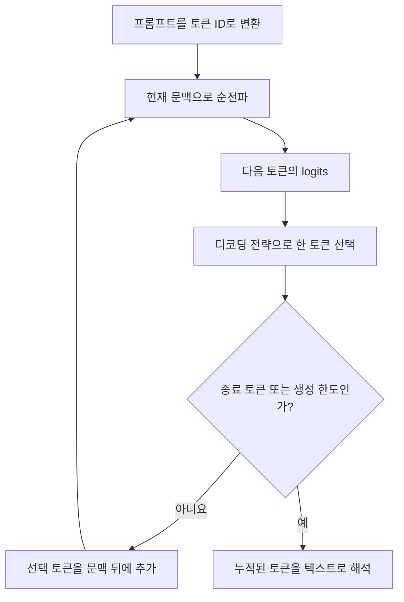
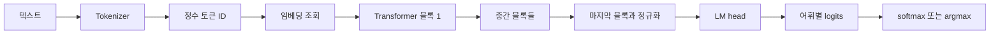
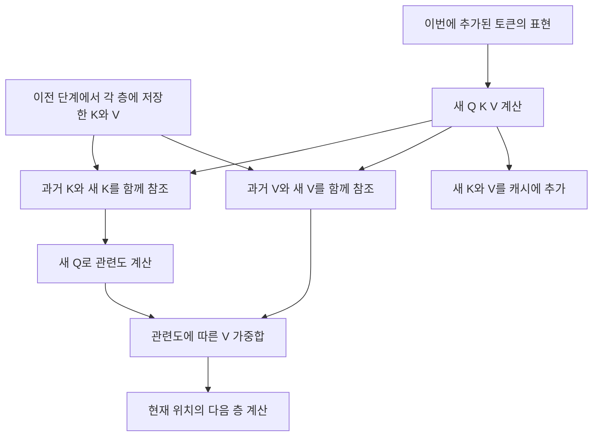
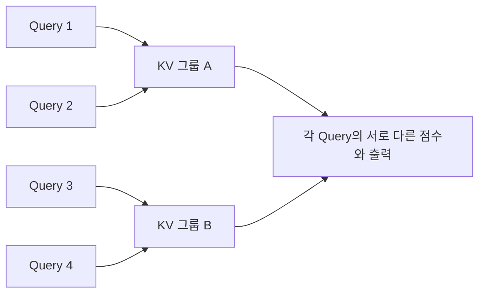
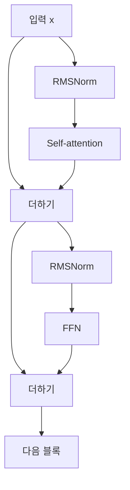

# 3장 트랜스포머 내부 구조

[전체 목차](../../README.md) · [학습 노트](study.md) · [강의안](lecture.md) · [강의 대본](lecture-script.md) · [시각화](visuals.html) · [실습 안내](lab-guide.md) · [복습 문제](quiz.md)

> 원문: Jay Alammar·Maarten Grootendorst, *Hands-On Large Language Models* (2024), Chapter 3 “Looking Inside Large Language Models”. 이 자료의 쪽수는 제공된 PDF의 **물리 페이지**다. 장 본문은 PDF 116–158쪽이며 159쪽은 다음 부의 구분 페이지다. 원문 내용을 한국어로 재구성하고, 계산을 돕는 수식·작은 예제·주의점을 보충했다. 아래의 교육용 수치는 실제 모델에서 관측한 어텐션이나 성능이 아니다.

이 장의 핵심 질문은 “텍스트가 모델 안에서 어떤 계산을 거쳐 다음 토큰이 되는가?”다. 답을 한 문장으로 쓰면, 토큰 ID가 벡터가 되고, 여러 Transformer 블록이 문맥을 반영해 벡터를 바꾸며, 마지막 위치의 벡터를 어휘 전체의 점수로 변환한 뒤 그중 한 토큰을 선택한다. 새 토큰이 입력에 붙으면 이 과정이 다시 시작된다. 어텐션, KV 캐시, 위치 인코딩, 정규화는 이 흐름의 서로 다른 부분을 담당한다.

## 학습 목표와 준비

이 장을 마치면 다음을 직접 설명하거나 계산할 수 있어야 한다.

1. 입력 길이, 모델 차원, 어휘 크기를 구분하고 각 단계의 텐서 모양을 적는다.
2. logits, softmax 확률, greedy 선택, 확률적 샘플링의 차이를 설명한다.
3. causal self-attention에서 Q·K·V를 만들고 한 위치의 가중합을 손으로 계산한다.
4. 입력의 병렬 처리와 자동 회귀 생성의 순차성이 모순되지 않는 이유를 설명한다.
5. KV 캐시가 재사용하는 것과 여전히 계산해야 하는 것을 구분한다.
6. local attention, MQA/GQA, FlashAttention이 각각 줄이는 비용을 비교한다.
7. residual connection, normalization, FFN, RoPE가 전체 계산에서 어디에 놓이는지 그린다.

선수지식은 2장의 토큰 ID와 임베딩, 벡터 내적, 행렬 곱의 기본 모양이다. 행렬 곱이 익숙하지 않다면 “행은 토큰 위치, 열은 특징”이라는 약속부터 잡자. `n×d` 배열은 n개 토큰을 각각 d개의 숫자로 나타낸 것이다. 이 장의 수식은 학습을 위한 보충이며, 미분을 몰라도 순전파를 따라갈 수 있다.

| 기호 | 의미 | 작은 예 | 원문 Phi-3 출력에 등장하는 예 |
|---|---|---:|---:|
| B | 한 번에 처리하는 입력 묶음 수 | 1 | 1 |
| n 또는 T | 현재 입력 토큰 수 | 3 | 6 |
| d 또는 d_model | 토큰 벡터의 특징 수 | 4 | 3,072 |
| V | 어휘에 있는 토큰 종류 수 | 8 | 32,064 |
| L | Transformer 블록 수 | 2 | 32 |
| Hq, Hkv | query head 수, key/value head 수 | 2, 2 | 구조 설정에 따라 결정 |
| d_h | 한 head의 벡터 차원 | 2 | Hq와 d_model의 관계를 확인 |

**추천 순서:** 이 노트를 한 번 읽고 → 시각화에서 값을 바꾸고 → `lab.py`를 실행하고 → 복습 문제를 푼다. 수업 형태로 공부하려면 [강의안](lecture.md)과 [대본](lecture-script.md)을 함께 사용한다.

## 상세 목차

- [1. Transformer 모델 개요](#sec-01)
- [2. 학습된 LLM의 입력과 출력](#sec-02)
- [3. 순전파의 구성 요소](#sec-03)
- [4. 분포에서 한 토큰을 고르기](#sec-04)
- [5. 병렬 처리와 문맥 길이](#sec-05)
- [6. KV 캐시로 생성 가속하기](#sec-06)
- [7. Transformer 블록 내부](#sec-07)
  - [FFN의 역할](#ffn), [어텐션의 직관](#attention-intuition), [Q·K·V 계산](#qkv), [여러 head](#multihead)
- [8. 아키텍처 개선을 읽는 관점](#sec-08)
- [9. 더 효율적인 어텐션](#sec-09)
  - [Local/sparse](#local), [MQA/GQA](#gqa), [FlashAttention](#flash)
- [10. 세부 블록 구조의 변화](#sec-10)
- [11. 위치 정보와 RoPE](#sec-11)
- [12. 다른 아키텍처 실험과 응용](#sec-12)
- [13. 전체 연결과 학습 점검](#sec-13)
- [원문 그림별 학습 연결](#figure-map)

<a id="sec-01" name="sec-01"></a>
## 1. Transformer 모델 개요

**원문 대응:** An Overview of Transformer Models, PDF 116–117쪽.

이 장은 주로 **텍스트를 생성하는 decoder-only Transformer**를 다룬다. Transformer라는 말은 더 넓은 구조 계열을 가리킨다. BERT처럼 문장 표현을 만드는 encoder-only 모델도 있고, 입력을 인코딩한 뒤 별도 decoder가 출력을 만드는 encoder-decoder 모델도 있다. 따라서 여기서 설명하는 “이전 토큰만 본다”, “한 토큰씩 생성한다”는 성질을 모든 Transformer에 무조건 적용하면 안 된다.

모델의 내부를 보는 데에는 세 층의 관점이 필요하다. 제품 관점에서는 프롬프트를 넣으면 답변이 나온다. 알고리즘 관점에서는 다음 토큰 분포를 반복해서 계산한다. 텐서 관점에서는 정수 ID가 벡터로 바뀌고, 행렬 곱과 비선형 연산을 거쳐 어휘 크기의 점수 벡터가 나온다. 이 셋은 서로 경쟁하는 설명이 아니라 같은 시스템을 다른 확대 배율로 보는 설명이다.

원문은 `microsoft/Phi-3-mini-4k-instruct`를 불러오고 Hugging Face의 텍스트 생성 pipeline을 준비한다. 모델뿐 아니라 해당 모델의 tokenizer를 함께 준비하며, CUDA 장치와 자동 dtype을 설정하고 `max_new_tokens=50`, `do_sample=False`로 생성 예제를 시작한다. 이 설정은 책이 작성된 2024년 환경의 예제다. 이 자료의 기본 실습에서는 대형 모델을 다운로드하지 않고 같은 원리의 작은 계산을 수행한다.

여기서 `instruct`라는 이름도 중요하다. 사전 학습된 다음 토큰 예측 모델과, 사용자의 지시에 맞춰 응답하도록 추가 학습한 모델은 출력 행동이 다를 수 있다. 내부에서 다음 토큰 점수를 내는 방식은 유지되지만, 어떤 문맥에서 어떤 응답이 적절한지를 학습한 분포가 다르다. “채팅처럼 대답한다”는 제품 행동과 “다음 토큰을 예측한다”는 내부 계산은 동시에 참이다.

<a id="sec-02" name="sec-02"></a>
## 2. 학습된 LLM의 입력과 출력

**원문 대응:** The Inputs and Outputs of a Trained Transformer LLM, PDF 117–121쪽. 그림 3-1, 3-2, 3-3.

### 답변 전체가 한 번에 만들어지지는 않는다

사용자는 이메일 한 통을 요청하지만 일반적인 자동 회귀 생성 루프는 답변 전체를 한 번에 출력하지 않는다. 현재까지의 토큰을 입력으로 받아 다음 토큰 후보의 점수를 계산하고, 한 토큰을 선택하고, 그 토큰을 입력 뒤에 붙인다. 그다음에는 더 길어진 문맥으로 다시 다음 토큰을 고른다. 앞서 생성한 내용이 뒤의 생성에 영향을 주므로 이를 **자동 회귀(autoregressive)**라고 부른다.

가령 현재 문맥이 “오늘의 날씨는”이라고 하자. 실제 토큰화는 모델마다 다르지만, 교육용으로 다음 선택이 “맑”, 다음이 “습니다”, 다음이 마침표라고 생각할 수 있다. 두 번째 선택은 최초 프롬프트뿐 아니라 이미 선택된 “맑”도 조건으로 사용한다. 첫 선택이 “흐”였다면 뒤에 이어질 분포도 달라진다. 같은 최초 질문에서도 샘플링에 따라 다른 문장이 나오는 이유가 여기에 있다.



이 도식은 논리적인 흐름이다. 뒤에서 배우는 KV 캐시를 쓰면 매번 최초 프롬프트 전체를 다시 계산하지 않아도 된다. “새 문맥을 조건으로 삼는다”와 “그 문맥의 모든 계산을 다시 수행한다”는 서로 다른 주장임을 기억하자.

### 순전파와 생성 루프를 구별한다

**순전파(forward pass)**는 주어진 입력이 신경망 연산을 한 번 통과하는 과정이다. **생성(generation)**은 순전파와 토큰 선택을 여러 번 묶어 실행하는 절차다. 학습 때에는 순전파 뒤에 손실 계산과 역전파, 가중치 갱신이 이어질 수 있지만, 이 장의 생성 예제에서는 모델 가중치를 바꾸지 않는다. 모델이 이전 답변을 입력으로 다시 본다는 이유만으로 학습이 일어나는 것은 아니다.

원문의 이메일 예제는 정원에서 생긴 사고에 대해 Sarah에게 사과문을 쓰도록 요청한다. 생성된 이메일이 중간에서 끊기는 것은 그 순간 모델이 문법을 잊어서가 아니라 `max_new_tokens=50`이라는 한도에 도달했기 때문이다. **새로 생성할 토큰 수 제한**과 **문맥 창 전체의 크기**는 다르다. 프롬프트가 길면 생성에 쓸 수 있는 여유가 줄 수 있고, 명시한 생성 한도보다 먼저 종료 토큰을 선택할 수도 있다.

### 수식으로 확인하는 조건부 생성

보충 수식으로 생성 토큰을 y₁, …, yₘ, 프롬프트를 x라고 쓰면 다음과 같다.

```text
P(y₁, …, yₘ | x)
= P(y₁ | x) × P(y₂ | x, y₁) × … × P(yₘ | x, y₁, …, yₘ₋₁)
```

이 식은 문장 전체의 확률을 다음 토큰 조건부 확률의 곱으로 나눈 것이다. 중요한 점은 모델이 “문장 전체를 보지 못하니 문장 관계를 배울 수 없다”가 아니라, 지금까지의 문맥에 조건을 걸어 다음 선택을 한다는 점이다. 반대로 각 단계에서 가장 높은 확률을 고르는 것이 전체 문장 확률의 최대화를 보장하는 것도 아니다. 첫 번째 선택이 이후 가능한 경로를 바꾸기 때문이다.

<a id="sec-03" name="sec-03"></a>
## 3. 순전파의 구성 요소

**원문 대응:** The Components of the Forward Pass, PDF 121–124쪽. 그림 3-4, 3-5, 3-6.

### Tokenizer, 임베딩, 블록 스택, LM head

원문은 tokenizer, Transformer 블록의 스택, language modeling head를 세 큰 구성 요소로 소개한다. 이를 계산 단위로 한 단계 더 펼치면 다음과 같다.



Tokenizer는 텍스트 조각을 어휘의 정수 ID로 바꾸는 규칙과 어휘를 가진다. 임베딩 행렬은 모델의 학습된 파라미터이며, ID를 사용해 해당 행을 조회한다. 따라서 “토크나이저가 임베딩을 만들어 준다”라는 표현은 역할을 섞은 것이다. 토크나이저의 어휘와 임베딩 행렬의 행 번호가 맞아야 하므로 모델과 tokenizer의 짝이 중요하다.

예를 들어 어휘 크기가 8이고 모델 차원이 4라면 임베딩 행렬 E는 `8×4`다. 토큰 ID가 `[2, 5, 1]`이면 E의 2번, 5번, 1번 행을 가져와 `3×4` 입력을 만든다. 같은 토큰 ID는 임베딩 조회 단계에서 같은 벡터를 가져온다. 하지만 그 후 블록들을 통과하면 위치와 주변 문맥의 영향으로 같은 토큰의 최종 벡터가 달라진다. 이것이 정적 토큰 임베딩과 문맥화된 표현의 차이다.

### 원문의 모델 구조를 읽는 방법

원문에 출력된 Phi-3 구조는 어휘 크기 32,064, 임베딩 차원 3,072, 32개 decoder 블록을 보여 준다. 임베딩 행렬 모양은 `32064×3072`이고 마지막 LM head는 3,072차원 입력을 32,064개 점수로 보낸다. 그림 3-5의 50,000개 어휘는 구조를 보여 주는 별도 도식 예시이며 실제 출력에 등장한 Phi-3의 어휘 크기와 혼동하지 않아야 한다.

블록 안의 `qkv_proj`는 Q·K·V를 한 번의 선형 투영으로 묶어 계산하는 구현이다. 표시된 출력 폭 9,216은 3,072의 세 배다. 뒤에서 head별로 나누더라도 논리적으로는 query, key, value라는 세 역할을 만든다. `o_proj`는 head들의 결과를 다시 모델 차원에 연결한다. `gate_up_proj`와 `down_proj`, `SiLU`는 FFN의 게이트와 확장·축소 구조를 보여 준다. 출력 차원 16,384는 두 분기 8,192를 묶은 것으로 읽을 수 있으며, 중간 폭과 모델 폭이 꼭 같아야 하는 것은 아니다.

`ModuleList`에 32개 블록이 있다고 해서 같은 파라미터를 32번 재사용한다는 뜻은 아니다. 일반적인 스택에서는 각 층이 자신의 가중치를 갖는다. 각 층이 같은 종류의 연산을 하지만, 앞 층의 출력에 서로 다른 변환을 적용한다. 블록 개수는 깊이, 임베딩 차원은 각 위치 표현의 폭으로 생각하면 좋다.

### LM head는 우선 logits를 만든다

보충 설명으로 선형 LM head를 다음처럼 쓸 수 있다. h는 마지막 위치의 d차원 벡터이고 W는 `d×V` 가중치다.

```text
z = hW + b           # z의 크기: V, 값은 logits
pᵢ = exp(zᵢ) / Σⱼ exp(zⱼ)   # 확률이 필요할 때 softmax 적용
```

원문은 이해를 돕기 위해 LM head의 결과를 “확률 점수”로 설명하지만, 예제의 `model.lm_head(...)`가 직접 반환하는 선형 출력은 **정규화되지 않은 logits**다. 음수가 될 수도 있고 합이 1일 필요도 없다. softmax를 거친 뒤에야 확률 분포로 해석할 수 있다. 다만 softmax는 순위를 보존하므로 최고 점수의 ID만 필요하면 logits에 바로 `argmax`를 적용할 수 있다.

모든 Transformer가 LM head를 쓰는 것은 아니다. 문장 전체에 “긍정/부정” 라벨을 주는 sequence classification head, 각 토큰에 인물명·장소명 같은 라벨을 주는 token classification head도 가능하다. 아래쪽 블록이 표현을 만들고, 위쪽 head가 그 표현을 어떤 과제의 출력으로 바꿀지 결정한다. 이것이 다음 4장 분류와 연결되는 지점이다.

<a id="sec-04" name="sec-04"></a>
## 4. 분포에서 한 토큰을 고르기

**원문 대응:** Choosing a Single Token from the Probability Distribution (Sampling/Decoding), PDF 124–126쪽. 그림 3-7.

### 모델의 점수와 선택 정책은 다른 단계다

모델이 “Dear 40%, Hello 30%, Hi 20%, 기타 10%”라는 분포를 만들었다고 하자. **Greedy decoding**은 가장 높은 40% 후보를 항상 고른다. **Sampling**은 분포에 따라 난수를 뽑기 때문에 같은 분포에서도 다른 후보가 나올 수 있다. 40%라는 수치는 “답이 40% 정확하다”가 아니라 이 문맥에서 그 토큰에 할당된 모델 확률이다.

낮은 확률의 토큰을 고르는 것이 항상 나쁜 선택도 아니다. 여러 자연스러운 표현이 경쟁하는 상황에서는 두 번째 후보도 적절할 수 있다. 하지만 무작위성을 늘리는 것만으로 사실성이 보장되는 것은 아니다. 정확한 형식이 중요한 과제와 다양성이 중요한 과제는 다른 디코딩 설정을 요구한다. 원문이 greedy가 많은 생성 과제에서 최선은 아닐 수 있다고 설명하는 이유를 “greedy는 항상 틀리다”로 과장하지 말자.

온도 T는 6장에서 더 깊이 다룬다. 여기서는 logits를 T로 나누고 softmax한다는 정도를 연결해 두면 충분하다. T가 작으면 큰 점수에 확률이 더 집중되고, T가 크면 분포가 평평해진다. 수학적 식은 T>0일 때 정의된다. `temperature=0`을 greedy로 취급하는 인터페이스도 있지만 모든 라이브러리가 0을 허용하는 것은 아니다. 책 예제의 `do_sample=False`처럼 선택 정책을 명시하는 것이 의미를 더 정확히 보여 준다.

### 손으로 보는 logits와 확률

보충 예제에서 logits가 `[2, 1, 0]`이면 `exp` 값은 약 `[7.389, 2.718, 1]`이고, 합으로 나누면 확률은 약 `[0.665, 0.245, 0.090]`이다. Greedy는 첫 후보를 선택한다. Sampling에서는 첫 후보가 약 66.5%의 확률로 선택된다. 한 번 선택한 결과만으로 실제 확률을 역추론할 수 없고, 수십 번 표본에서도 이론 비율과 차이가 생길 수 있다.

큰 logits에 그대로 지수함수를 적용하면 수치가 넘칠 수 있다. 실제 계산에서는 모든 값에서 최댓값을 빼고 지수함수를 적용한다. `[1002,1001,1000]`과 `[2,1,0]`은 같은 softmax 분포를 만든다. **공통 상수를 빼는 것은 확률을 바꾸지 않고 수치 안정성을 높인다.** 제공한 실습도 이 방법을 사용한다.

### 원문의 Paris 예제를 텐서로 읽기

원문은 프랑스의 수도를 묻는 짧은 문맥을 토큰화한 뒤 모델 본체와 LM head를 차례로 호출한다. 해당 tokenizer와 예제에서 입력은 6개 토큰이 되어 본체 출력이 `[1,6,3072]`, LM head 출력이 `[1,6,32064]`가 된다. 여기서 6은 단어 수에 관한 일반 법칙이 아니라 그 예제와 tokenizer의 결과다.

`[0,-1]`은 배치의 첫 입력과 시퀀스의 마지막 위치를 선택한다. 그 결과 `32064`개의 어휘 점수만 남는다. `argmax`가 돌려주는 것은 텍스트가 아니라 **토큰 ID**이므로 tokenizer로 디코딩해야 사람이 읽는 문자열이 된다. 원문 결과가 Paris인 것은 책의 학습된 모델 출력이다. 이 자료의 무작위 작은 모델은 수도 지식을 학습하지 않았으므로 같은 답을 낼 것이라고 기대해서는 안 된다.

또 하나의 자주 생기는 오해가 있다. 마지막 위치의 출력은 “마지막 입력 토큰이 무엇인가”를 재분류하는 것이 아니라, 그 위치까지를 문맥으로 사용해 **다음 토큰**을 예측하는 데 쓰인다. 학습에서는 이런 예측을 여러 위치에서 동시에 평가할 수 있지만, 생성 중 다음 한 토큰을 고를 때에는 마지막 위치의 점수가 필요하다.

<a id="sec-05" name="sec-05"></a>
## 5. 병렬 처리와 문맥 길이

**원문 대응:** Parallel Token Processing and Context Size, PDF 127–129쪽. 그림 3-8, 3-9.

### 위치마다 흐르는 벡터, 층마다 섞이는 문맥

Transformer에서는 입력의 여러 토큰 위치를 행렬의 여러 행으로 표현한다. 각 위치는 d차원 벡터를 갖고 블록을 지나며 다른 d차원 벡터가 된다. FFN 같은 위치별 연산은 여러 행에 한꺼번에 적용할 수 있다. 어텐션에서는 위치 사이의 정보가 섞인다. 원문의 “각 토큰의 계산 흐름”이라는 비유는 유용하지만, 각 흐름이 끝까지 완전히 독립적이라는 뜻은 아니다.

예를 들어 “그 고양이는 졸려서 누웠다”의 마지막 표현을 만들 때 앞의 고양이와 졸림에 관련된 정보가 필요할 수 있다. 이전 위치의 최종 LM head 결과를 모두 답변에 사용하지 않더라도, 그 위치들의 중간 K·V 표현은 현재 위치의 계산에 기여한다. “마지막 벡터만 쓰니 이전 위치는 계산할 필요가 없다”는 결론이 나오지 않는 이유다.

### 병렬 입력 처리와 순차 출력 생성

프롬프트 전체가 이미 알려져 있으면 그 토큰들의 투영과 어텐션을 한 번의 행렬 연산 묶음으로 처리할 수 있다. 학습 때에도 정답 시퀀스가 이미 있으므로 causal mask를 적용해 여러 위치의 다음 토큰 예측을 한꺼번에 계산할 수 있다. 반면 새 답변의 미래 토큰은 아직 정해지지 않았으므로 일반적인 자동 회귀 생성에서는 앞 토큰을 고른 뒤 다음 단계로 넘어간다.

```text
입력 프롬프트 처리: 이미 존재하는 n개 토큰을 함께 계산할 수 있음
출력 생성: y₁ 선택 → y₁을 조건으로 y₂ 선택 → y₃ 선택 → …
```

이를 “Transformer는 병렬이니 전체 답변을 단번에 만든다” 혹은 “한 토큰씩 생성하니 모든 연산이 직렬이다”로 단순화하면 둘 다 틀린다. 한 생성 단계 안에서도 행렬 연산과 여러 head는 병렬 계산의 여지가 있다. 어떤 축에서 병렬이고 어떤 의존성 때문에 순차적인지를 구분해야 한다.

### 문맥 길이는 무엇을 제한하는가

문맥 길이(context length)는 모델이 한 번에 다루도록 설정되거나 지원되는 토큰 범위다. 책의 4K 예시는 약 4천 토큰 수준의 문맥을 생각하게 한다. 정확한 한도는 모델 설정으로 확인해야 하고, 토큰은 문자나 단어와 같지 않다. 입력·대화 이력·도구 출력·생성된 답변 등이 모두 같은 문맥 예산을 사용할 수 있다.

문맥 길이를 늘리면 모델의 토큰 벡터 차원 d가 자동으로 늘어나는 것은 아니다. 행 수 n이 늘어난다. `n×d` 표현 행렬과 KV 캐시는 길이에 따라 커지고, 기본 dense attention의 모든 위치쌍 점수는 `n×n`이 되어 더 빠르게 늘어난다. “긴 문맥을 지원한다”와 “그 전체에서 중요한 정보를 항상 잘 찾아낸다”도 다르다. 처리 가능한 길이와 실제 과제의 사용 능력은 별도로 평가해야 한다.

원문의 그림 3-9는 입력과 출력 벡터의 폭이 유지된다는 점을 강조한다. 같은 폭 덕분에 여러 블록을 쌓고 residual을 더할 수 있다. 다만 블록 내부의 FFN 중간 폭이나 head별 차원은 달라질 수 있으므로 “모든 중간 텐서 모양이 동일하다”는 뜻은 아니다.

<a id="sec-06" name="sec-06"></a>
## 6. KV 캐시로 생성 가속하기

**원문 대응:** Speeding Up Generation by Caching Keys and Values, PDF 129–132쪽. 그림 3-10.

### 왜 앞의 계산을 재사용할 수 있는가

자동 회귀 decoder에서 이전 위치는 causal mask 때문에 미래 토큰을 볼 수 없다. 동일한 가중치와 위치 설정으로 평가할 때, 문장 뒤에 토큰이 하나 더 붙어도 기존 위치의 표현은 바뀔 필요가 없다. 따라서 각 층의 과거 위치에서 계산한 **key와 value**를 저장해 두고 다음 단계에서 재사용할 수 있다. 이것이 KV 캐시다.

첫 프롬프트 처리를 흔히 prefill, 이후 한 토큰씩 진행하는 과정을 decode라고 구분한다. Prefill에서는 프롬프트 토큰들의 K·V를 각 층에 마련한다. Decode에서는 새 토큰의 Q·K·V만 계산하고, 새 K·V를 캐시에 추가한다. 새 Q는 기존 K들과도 비교하므로 긴 과거를 읽는 어텐션 자체가 사라지는 것은 아니다.



Q를 과거 위치별로 계속 저장하지 않아도 되는 이유는 지금 필요한 출력이 새 위치의 출력이기 때문이다. 현재 위치의 query와 과거의 key·value가 필요하다. 과거 위치의 query로 과거 출력을 다시 계산할 필요는 없다. 구현에 따라 다른 상태를 추가 저장할 수는 있지만 KV 캐시의 핵심은 각 층의 K와 V다.

### 캐시가 줄이는 계산과 줄이지 않는 계산

| 항목 | 캐시 없이 전체 재계산 | KV 캐시 사용 |
|---|---|---|
| 이전 토큰의 Q·K·V 투영 | 생성 단계마다 반복 | 기존 K·V 재사용 |
| 이전 토큰의 FFN | 일반적인 단순 구현은 반복 | 현재 위치만 계산 |
| 새 위치의 Q와 과거 K 비교 | 필요 | 여전히 필요 |
| 과거 K·V 저장 메모리 | 별도 지속 캐시는 불필요 | 문맥 길이에 따라 증가 |
| 모델 가중치 | 동일한 가중치 사용 | 가중치가 학습되거나 압축되는 것은 아님 |

이 표는 “메모리를 더 써서 중복 계산을 줄인다”는 절충을 보여 준다. 캐시가 있으니 입력 길이가 더 이상 성능에 영향을 주지 않는다고 생각하면 안 된다. 현재 query가 읽을 과거 K·V가 많아지고, 배치와 동시 요청이 커지면 캐시의 메모리 용량과 이동 비용이 중요해진다.

### 원문의 속도 비교를 정확히 읽기

원문은 Colab의 T4 GPU에서 100개 토큰을 생성하는 예제로 캐시를 켰을 때 약 4.5초, 껐을 때 약 21.8초라고 보고한다. 이는 그 모델·환경·측정 방법에서 관측한 결과이며 모든 모델에서 같은 시간이 나오거나 항상 같은 배율로 빨라진다는 의미가 아니다. 원문은 Jupyter의 `%%timeit`을 사용한다. 일반 Python 파일에서는 이 문법이 그대로 실행되지 않는다.

실제 비교 실험에서는 프롬프트, 생성 토큰 수, 종료 조건, dtype, 장치, 디코딩 정책을 맞추어야 한다. GPU 연산이 비동기라는 점도 시간 측정에 영향을 준다. 제공한 표준 라이브러리 실습은 **캐시와 전체 재계산의 수치 결과가 같은지**와 **투영 대상 위치 수가 얼마나 줄어드는지**를 검증하며, GPU 속도 벤치마크를 흉내 내지 않는다.

출력 스트리밍도 연결해서 이해하자. 스트리밍은 완성된 답변을 모두 기다렸다가 보여 주는 대신 생성된 토큰을 순서대로 전달한다. 체감 대기 시간을 줄일 수 있지만 같은 모델의 연산량을 반드시 줄이는 기법은 아니다. 첫 토큰이 보이기까지의 지연과 이후 토큰 사이의 지연을 구분하면 prefill과 decode의 차이도 더 분명해진다.

### 캐시 메모리를 계산해 보기

보충식으로 K와 V의 원소당 바이트 수가 같다면 대략적인 캐시 메모리는 다음과 같다.

```text
KV bytes = 2 × B × L × T × Hkv × d_h × bytes_per_element
           ↑ K와 V 두 종류
```

배치 1, 층 32, 문맥 4,096, KV head 32, head 차원 128, 원소당 2바이트라면 2 GiB다. KV head를 8개로 줄이면 0.5 GiB, 1개면 0.0625 GiB다. 이는 오직 K·V 텐서의 이론 크기로, 모델 가중치·중간 버퍼·메모리 할당 여유·다른 요청은 포함하지 않는다. 9절의 GQA를 공부할 때 이 식으로 다시 돌아오자.

<a id="sec-07" name="sec-07"></a>
## 7. Transformer 블록 내부

**원문 대응:** Inside the Transformer Block, PDF 132–143쪽. 그림 3-11부터 3-21까지.

큰 구조를 이해했다면 이제 블록 하나를 확대하자. 원문은 블록의 두 핵심 구성 요소로 self-attention과 feedforward neural network를 제시한다. Attention은 다른 위치의 정보와 상호작용하는 경로이고, FFN은 그 결과를 위치별로 비선형 변환하는 경로다. 여러 블록이 이어져 같은 종류의 처리를 반복하지만 층마다 입력 표현과 가중치가 다르다.

<a id="ffn" name="ffn"></a>
### 7.1 FFN은 무엇을 하는가

원문은 영화 제목의 앞부분을 주면 나머지를 이어 쓰는 예제로, 학습 데이터에서 얻은 정보가 FFN을 포함한 모델 파라미터에 반영된다는 직관을 제공한다. FFN은 보통 각 위치의 벡터에 같은 함수를 적용한다. 단순한 형태는 다음과 같다.

```text
FFN(x) = activation(xW₁ + b₁)W₂ + b₂
x: d차원
W₁: d × d_ff     # 특징 공간을 넓힘
W₂: d_ff × d     # 모델 차원으로 되돌림
```

중간 차원을 넓히는 것은 표현을 더 많은 특징 조합으로 변환할 여지를 준다. 비선형 함수가 없으면 두 선형 변환을 하나로 합칠 수 있으므로, 단순히 행렬 두 개를 놓는 것만으로 복잡한 변환 능력이 생기지는 않는다. ReLU, SiLU, 게이트 구조 등이 등장하는 이유다.

“FFN이 정보를 저장한다”는 비유는 관계를 잡는 데 유용하지만, FFN을 명확한 문서 레코드가 들어 있는 데이터베이스로 생각하면 곤란하다. 하나의 사실이 한 칸에 독립적으로 저장된다는 보장이 없고, 정보와 행동 패턴은 여러 파라미터와 층에 분산되어 있다. 원문도 암기뿐 아니라 관측 사이의 보간과 새로운 입력에 대한 일반화를 강조한다. 주어진 입력에서 어떤 표현을 활성화할지는 attention을 통한 문맥 처리와도 함께 결정된다.

FFN이 위치별로 적용된다는 것은 “문맥을 전혀 쓰지 않는다”와 다르다. FFN에 들어오는 x 자체가 앞선 attention과 이전 층을 거쳐 이미 문맥을 반영할 수 있다. 정확한 표현은 “FFN 단계의 직접적인 연산은 위치별이지만, 그 입력에는 문맥 정보가 들어 있을 수 있다”다.

원문의 주석은 기본 언어 모델과 지시 학습된 대화 모델의 행동을 다시 구별한다. 영화 제목 앞부분을 넣었을 때 기본 모델은 제목을 이어 쓸 수 있지만, 채팅 모델은 영화 설명을 할 수 있다. 이런 차이를 FFN 구조 하나로만 설명할 수는 없다. 입력 형식과 지시·선호 학습으로 형성된 출력 행동도 보아야 한다.

<a id="attention-intuition" name="attention-intuition"></a>
### 7.2 Attention은 문맥에서 필요한 정보를 모은다

“민수가 고양이에게 먹이를 주었다. 그것은 배가 고팠다.”라는 문장을 생각해 보자. “그것”이라는 토큰의 사전 임베딩만으로는 무엇을 가리키는지 충분히 표현하기 어렵다. 이전의 고양이 관련 표현이 현재 위치에 섞이면 다음 표현을 예측하는 데 도움을 줄 수 있다. 원문의 개·다람쥐, Sarah·고양이 예제가 보여 주는 논지도 이와 같다.

다만 한 attention head가 언제나 문법적 대명사 지시를 정확히 결정하거나, 가장 큰 attention 값이 모델 판단의 완전한 설명이라는 보장은 없다. 그림은 계산의 직관을 보여 주는 단순화다. 실제 모델에서는 여러 층, 여러 head, residual과 FFN이 함께 작용한다. “관련도”는 사람의 의미 유사도 점수와 완전히 같은 개념이 아니라 학습된 투영 공간에서 계산되는 가중치다.

Attention의 기본 절차는 두 단계다. 첫째, 현재 위치가 각 허용 위치에서 얼마나 정보를 가져올지 점수를 매긴다. 둘째, 그 점수로 각 위치의 정보를 가중합한다. 점수의 합을 1로 만들면 어떤 정보에 어느 정도의 비중을 주었는지 해석하기 편하다. 하지만 weighted sum의 각 좌표 값 자체가 확률인 것은 아니다.

<a id="qkv" name="qkv"></a>
### 7.3 Q·K·V를 만드는 이유

입력 X가 `n×d`이고 한 head의 key/query 차원이 d_k, value 차원이 d_v라면 다음처럼 쓴다.

```text
Q = XW_Q     W_Q: d × d_k,   Q: n × d_k
K = XW_K     W_K: d × d_k,   K: n × d_k
V = XW_V     W_V: d × d_v,   V: n × d_v
```

W_Q, W_K, W_V는 학습되는 가중치다. Q·K·V는 주어진 입력에 따라 달라지는 중간 결과다. **가중치 행렬과 중간 activation 행렬을 혼동하지 말자.** KV 캐시는 W_K와 W_V를 새로 저장한다는 뜻이 아니라, 과거 토큰에 대해 계산한 K와 V를 보관한다는 뜻이다.

Query는 “현재 위치에서 어떤 정보를 필요로 하는가”, key는 “각 위치가 어떤 조회 단서로 대응하는가”, value는 “실제로 가져올 정보가 무엇인가”라는 비유로 시작할 수 있다. 도서관에서 검색어·목록표·책 내용으로 나누어 생각해도 좋다. 다만 실제로 사람이 읽을 수 있는 질문이나 태그를 만드는 것은 아니며, 모두 학습된 숫자 벡터다.

왜 key와 value를 따로 만드는가? 어떤 위치를 참고할지 결정하는 특징과, 그 위치에서 받아 올 내용의 특징은 같을 필요가 없기 때문이다. 이름을 찾아 사람을 식별하는 단서와, 그 사람의 현재 상태를 전달하는 내용이 다를 수 있는 것과 비슷하다. Query와 key의 차원이 같아야 내적할 수 있지만 value의 차원은 원리상 달라도 된다.

### 7.4 관련도 점수와 causal mask

현재 위치 i의 query를 qᵢ라고 하면 각 key kⱼ와 내적해 점수를 만든다. 표준 scaled dot-product attention의 보충식은 다음과 같다.

```text
sᵢⱼ = (qᵢ · kⱼ) / √d_k + Mᵢⱼ
Mᵢⱼ = 0          if j ≤ i
     = -∞         if j > i
αᵢⱼ = softmax(sᵢ, 전체 허용 위치 중 j)
```

`√d_k`로 나누는 것은 차원이 커질 때 점수 크기가 커져 softmax가 지나치게 뾰족해지는 문제를 완화하는 표준 스케일링이다. 모든 벡터가 어떤 분포를 따른다는 가정 없이 단순히 “차원이 두 배면 점수는 항상 두 배”라고 말할 수는 없다. 정확한 통계적 설명은 성분의 분산 같은 조건을 둔다. 여기서는 점수의 규모를 다루는 장치로 이해하면 충분하다.

Causal mask는 아직 볼 수 없는 미래 위치에 매우 작은 값을 주어 확률이 0이 되게 한다. 일반적인 causal self-attention은 **현재 위치 자신도 포함**한다. “이전 토큰만 본다”라는 구어적 설명을 문자 그대로 받아들여 자기 위치까지 제거하면 표준 마스크와 달라진다. 첫 토큰이 자기 자신을 참고할 수 있는지 생각해 보면 차이가 보인다.

```text
행: 출력할 현재 위치, 열: 참고 가능한 key 위치
          0  1  2  3
위치 0    ✓  ×  ×  ×
위치 1    ✓  ✓  ×  ×
위치 2    ✓  ✓  ✓  ×
위치 3    ✓  ✓  ✓  ✓
```

BERT의 양방향 attention은 일반적으로 양쪽 문맥을 참조할 수 있다. 같은 X에서 Q·K·V를 만든다는 “self”의 의미와, 미래를 차단한다는 “causal”의 의미는 별개다. Self-attention이라고 항상 왼쪽만 보는 것이 아니다.

### 7.5 정보를 결합하는 단계

관련도 가중치 α를 얻으면 value를 그 비중으로 합친다.

```text
oᵢ = Σⱼ αᵢⱼ vⱼ
전체 행렬 표기: Attention(Q,K,V) = softmax(QKᵀ/√d_k + M)V
```

행렬 모양으로 확인하면 QKᵀ는 `n×n`, softmax 결과도 `n×n`, 여기에 `n×d_v`인 V를 곱하면 `n×d_v`가 된다. 따라서 한 위치의 여러 가중치는 여러 토큰 ID를 직접 합치는 것이 아니라 **그 위치들의 value 벡터**를 합친다. 결과는 현재 위치의 새로운 특징 벡터다.

제공 실습의 숫자를 직접 따라가 보자. Query가 `[1,0]`, 세 key가 `[0,1]`, `[2,0]`, `[1,1]`이면 스케일된 점수는 약 `[0,1.4142,0.7071]`이다. Softmax를 적용한 가중치는 약 `[0.1400,0.5760,0.2840]`이다. Value가 각각 `[1,0]`, `[0,2]`, `[2,1]`이면 출력은 다음과 같다.

```text
0.1400 × [1,0] + 0.5760 × [0,2] + 0.2840 × [2,1]
≈ [0.7080, 1.4359]
```

가장 높은 가중치를 가진 두 번째 value만 복사하는 것이 아니다. 다른 value의 기여도 남아 있다. Attention의 가중치 분포와 그 결과인 출력 벡터를 따로 그려 보면 이 차이가 잘 드러난다. [시각화](visuals.html)의 첫 실험에서 query를 바꾸고 출력 벡터가 어떻게 이동하는지 확인하자.

<a id="multihead" name="multihead"></a>
### 7.6 여러 attention head를 사용하는 이유

한 가지 조회 기준만 있으면 표현할 수 있는 관계가 제한된다. Multi-head attention은 서로 다른 학습된 투영으로 여러 attention 계산을 병렬로 수행한다. 어떤 head는 근접 문맥에 더 반응할 수 있고, 어떤 head는 멀리 떨어진 관계에 민감할 수 있다. 하지만 “1번 head는 문법, 2번 head는 의미”처럼 역할이 사전에 고정되어 있다는 뜻은 아니다.

일반적인 형태에서는 각 head의 결과를 이어 붙이고 출력 투영을 적용한다.

```text
head_h = Attention(Q_h, K_h, V_h)
MultiHead(X) = Concat(head_1, …, head_H) W_O
```

예를 들어 모델 차원이 8이고 head가 2개라면 각 head를 4차원으로 두어 결과를 합쳤을 때 다시 8차원이 되게 할 수 있다. 이때 각 head의 query가 반드시 원래 입력 벡터의 서로 겹치지 않는 4개 좌표만 본다고 생각하면 안 된다. 투영 행렬은 원래 d차원 전체를 사용해 각 head의 표현을 만들 수 있다. “나눈다”는 도식은 투영된 결과를 head별로 나눈다는 뜻으로 읽어야 한다.

여러 head의 목적은 단순히 같은 계산을 복제해 평균내는 것이 아니라, 서로 다른 투영 공간에서 관계를 표현할 수 있게 하는 것이다. 층을 여러 개 쌓는 것과 head를 여러 개 두는 것도 다르다. 층은 순서대로 표현을 변환하고, head는 한 층 안에서 병렬로 여러 관계를 계산한다.

<a id="sec-08" name="sec-08"></a>
## 8. 아키텍처 개선을 읽는 관점

**원문 대응:** Recent Improvements to the Transformer Architecture, PDF 143쪽.

원문은 기본 아이디어가 유지되는 동시에 학습 데이터, 학습 과정, learning rate, 모델 구조가 계속 바뀌어 왔다고 설명한다. 이 절부터의 “최근”은 책이 쓰인 2024년을 기준으로 한다. 기술의 이름을 유행 순서로 외우기보다, **어떤 비용을 줄이며 어떤 계산 관계를 유지하거나 바꾸는가**를 묻는 것이 좋다.

아래 세 질문이 유용하다. 첫째, 모델이 참조하는 토큰의 범위를 바꾸는가? 둘째, 여러 head가 공유하는 정보를 바꾸는가? 셋째, 수학적 계산은 같게 유지하면서 하드웨어에서 실행하는 방식을 바꾸는가? Local attention은 첫 질문, MQA/GQA는 둘째, FlashAttention은 셋째와 밀접하다. 모두 “어텐션 최적화”라고 묶이지만 서로 같은 대체품이 아니다.

또한 GPU의 병목은 언제나 한 가지가 아니다. 문맥 길이, 배치, prefill인지 decode인지, FFN 폭, 하드웨어와 구현에 따라 계산량과 메모리 이동의 비중이 달라진다. 원문은 attention이 비용이 큰 구성 요소라는 점을 강조한다. 이를 “어떤 조건에서도 전체 실행 시간의 대부분이 attention이다”라는 보편적 법칙으로 바꾸지 않는 것이 정확하다.

<a id="sec-09" name="sec-09"></a>
## 9. 더 효율적인 어텐션

**원문 대응:** More Efficient Attention, PDF 144–150쪽. 그림 3-22부터 3-28까지.

<a id="local" name="local"></a>
### 9.1 Local attention과 sparse attention

Dense causal attention에서는 현재 위치가 이전의 모든 허용 위치를 볼 수 있다. 길이 n의 전체 시퀀스를 처리하면 점수 행렬의 규모는 대략 n²에 비례한다. Local 또는 sliding-window attention은 최근 w개 같은 제한된 범위만 참고하게 해 계산과 메모리를 줄인다. 전체 시퀀스에서 참조 연결 수를 세면 대략 n×w가 되므로 w가 n보다 훨씬 작을 때 이점이 있다.

하지만 멀리 떨어진 정보를 한 층에서 직접 볼 수 없다는 비용을 치른다. 문서 맨 앞의 인물 설정을 뒤에서 참고해야 하는 경우 단순한 좁은 창만으로는 어려울 수 있다. 여러 층을 거치며 간접적으로 더 먼 정보가 전해질 수도 있지만, 이는 먼 위치를 직접 보는 것과 같은 조건이 아니다. 정확한 도달 범위는 층 수와 연결 패턴에 따라 달라진다.

Sparse attention은 “일부 연결만 남긴다”는 더 넓은 범주다. 지역 창뿐 아니라 띄엄띄엄 떨어진 위치, 특정 전역 토큰, 여러 패턴을 조합할 수 있다. 원문은 GPT-3에서 full attention과 sparse attention을 블록 사이에 섞는 예를 설명한다. 이때 **블록마다 어떤 마스크를 사용하는지**가 중요하다. 한 종류의 창을 모든 층에 강제하는 경우와 구별해야 한다.

그림 3-23, 3-24는 마스크 그림을 읽는 방법도 가르친다. 행이 현재 처리 위치이고, 그 행의 색칠된 열이 참조 가능한 위치다. 이런 허용 마스크를 실제 attention 가중치의 크기와 혼동하면 안 된다. 허용된 칸이라도 softmax 결과가 거의 0일 수 있다. 허용되지 않은 칸은 계산상 차단된다.

<a id="gqa" name="gqa"></a>
### 9.2 Multi-head, multi-query, grouped-query

원문의 MHA·MQA·GQA 비교는 **KV head의 공유 정도**를 바꾸는 이야기다. Query head는 여러 개를 유지하고, key와 value를 얼마나 공유할지 선택한다.

| 방식 | Query head | KV head | 무엇을 공유하는가 | 주된 절충 |
|---|---:|---:|---|---|
| MHA | H | H | 각 query head에 자체 K·V | 표현의 자유도가 크지만 KV 비용이 큼 |
| GQA | H | G, 보통 1 < G < H | 한 그룹의 여러 query가 K·V 공유 | 메모리 효율과 모델 품질의 절충 |
| MQA | H | 1 | 모든 query head가 하나의 K·V 집합 공유 | KV 메모리를 크게 줄이지만 공유 제약이 큼 |

예를 들어 query head가 8개일 때 MHA는 KV head도 8개다. GQA에서 KV head를 2개 두면 query 네 개씩 한 KV 그룹을 공유할 수 있다. MQA는 query 여덟 개가 모두 같은 K·V 집합을 참조한다. Query가 서로 다르기 때문에 같은 K·V를 사용해도 attention 가중치와 출력은 head마다 다를 수 있다.



이 도식은 query head 4개, KV head 2개의 교육용 GQA 예다. “Query들이 같은 결과를 공유한다”가 아니라 “조회 대상 K·V 표현을 공유한다”가 핵심이다. 가중치를 학습한 뒤 구조를 임의로 바꾸고 K·V 몇 개를 지우기만 하면 같은 품질이 유지된다는 뜻도 아니다. 공유 구조는 학습과 모델 설계의 일부다.

KV 캐시 공식에서 Hkv가 줄어드는 만큼 이론 메모리도 줄어든다. 다만 query head 수가 그대로라면 query별 attention 계산이 완전히 사라지는 것은 아니다. GQA가 모든 연산량을 KV head 비율만큼 줄인다고 단정해서는 안 된다. 특히 autoregressive decode에서 캐시를 읽는 비용을 줄이는 효과를 이해하면 이 기법의 의도가 더 선명해진다.

원문은 MQA의 강한 공유 제약을 완화하면서 효율을 얻는 선택으로 GQA를 소개하고 Llama 계열의 사례를 언급한다. 모델 계열 이름만 보고 모든 크기·버전의 세부 설정이 같다고 가정하지 말고, 실제 모델 설정의 query head와 KV head 수를 확인하는 습관을 들이자.

<a id="flash" name="flash"></a>
### 9.3 FlashAttention은 어떤 의미에서 빠른가

FlashAttention은 GPU의 메모리 계층과 데이터 이동을 고려해 attention을 효율적으로 실행하는 방법이다. 원문은 SRAM과 HBM 사이에서 어떤 값을 얼마나 이동하는지 최적화한다는 점을 강조한다. 계산 장치가 빠르더라도 큰 중간 행렬을 느린 메모리에 기록하고 다시 읽는 비용이 크면 전체 실행이 지연될 수 있다.

핵심 직관은 큰 attention 점수·확률 행렬 전체를 외부 메모리에 보관하는 대신, 계산을 작은 블록으로 나누고 필요한 통계를 유지하면서 결과를 구하는 것이다. 이때 수학적으로 같은 dense attention을 계산하도록 설계된다. 부동소수점의 계산 순서 때문에 아주 작은 수치 차이는 생길 수 있지만, “일부 토큰을 생략하는 sparse approximation”과는 개념적으로 다르다.

FlashAttention을 적용했다고 모든 위치쌍 계산의 수가 선형이 되는 것도 아니다. 표준 dense attention의 길이에 따른 계산 규모와, 메모리 사용·이동을 줄이는 효과를 나누어 보아야 한다. FlashAttention-2는 원문에서 병렬성과 작업 분할을 더 개선한 후속 방법으로 함께 언급된다. 이 자료는 특정 GPU에서의 배율이나 현재 라이브러리 지원 여부를 보장하지 않는다.

| 방법 | 주로 바꾸는 것 | 그대로 남는 것 | 주의할 오해 |
|---|---|---|---|
| Local/sparse | 허용 위치쌍 | 허용 범위 안의 점수·가중합 | 모든 먼 문맥을 직접 볼 수 있는 것은 아님 |
| MQA/GQA | head 간 K·V 공유 | 여러 query와 head별 출력 | 모든 query가 같은 답을 내는 것은 아님 |
| FlashAttention | 계산·메모리 이동 방식 | 해당 attention의 수학적 목표 | sparse attention과 같은 뜻이 아님 |
| KV 캐시 | 이전 단계 결과 재사용 | 새 query의 과거 조회 | 모델 가중치를 업데이트하는 것이 아님 |

이 방법들은 여러 조합으로 쓰일 수 있다. 이름 하나를 골라 나머지를 모두 버리는 선택지라고 생각하기보다, 참조 구조·head 구조·커널 실행·생성 상태 관리라는 서로 다른 층위로 정리하자.

<a id="sec-10" name="sec-10"></a>
## 10. 세부 블록 구조의 변화

**원문 대응:** The Transformer Block, PDF 150–152쪽. 그림 3-29, 3-30.

### Residual connection과 normalization

단순 도식에서는 attention과 FFN만 보였지만 실제 블록에는 residual connection과 normalization이 들어간다. Residual connection은 하위 모듈의 결과를 기존 표현에 더해 다음 표현을 만든다. x와 F(x)의 차원이 같아야 `x + F(x)`를 할 수 있다. 정보와 기울기가 여러 층을 통과할 경로를 제공하며, 각 하위 모듈이 기존 표현에 대한 수정량을 만들도록 볼 수 있다.

원문의 원형 블록은 각 하위층 처리 후 더하고 정규화하는 post-norm 구조를 보여 준다. 2024년형 블록 예시는 하위층에 들어가기 전에 정규화하는 pre-norm 구조다. 단순화한 식은 다음과 같다.

```text
Post-norm 예:
  y = Norm(x + Attention(x))
  z = Norm(y + FFN(y))

Pre-norm 예:
  y = x + Attention(Norm(x))
  z = y + FFN(Norm(y))
```

Norm의 위치는 단순한 표시 순서가 아니다. 함수의 입력과 residual 경로의 값이 달라지므로 계산 구조가 바뀐다. 원문은 pre-normalization이 학습 효율에 도움이 된다는 연구를 언급하지만, 특정 구조가 모든 깊이와 설정에서 무조건 최선이라는 뜻은 아니다. 학습의 안정성, 초기화, 최종 정규화 등 주변 설계와 함께 보아야 한다.



이 도식은 pre-norm의 잔차 경로를 명시한 학습용 재구성이다. Attention 내부에는 GQA와 RoPE 같은 구체적 선택이 들어갈 수 있다. 각 화살표의 벡터 폭을 d로 유지하면 왜 덧셈이 가능한지 이해하기 쉽다.

### LayerNorm과 RMSNorm

LayerNorm은 보통 한 토큰 벡터의 특징 축에서 평균을 빼고 분산으로 규모를 맞춘 뒤 학습 가능한 크기·이동을 적용한다. RMSNorm은 평균을 빼지 않고 제곱 평균의 제곱근을 기준으로 규모를 맞추는 단순한 형태다. 대표적인 보충식은 다음과 같다.

```text
LayerNorm(x) = γ ⊙ (x − mean(x)) / sqrt(var(x) + ε) + β
RMSNorm(x)   = γ ⊙ x / sqrt(mean(x²) + ε)
```

γ는 특징별 학습 가능한 크기, β는 이동, ε는 분모가 0에 가까워지는 것을 막는 작은 상수, ⊙는 원소별 곱이다. 구체적인 bias와 파라미터 선택은 구현에 따라 확인한다. RMSNorm을 적용하면 평균이 반드시 0이 된다는 설명은 틀리다. 예를 들어 `[1,1]`은 이상적인 ε=0, γ=1에서 그대로 `[1,1]`이어서 평균이 1이다.

정규화는 토큰의 확률을 만드는 softmax와도 다르다. Norm은 특징 벡터의 규모를 다루고, softmax는 한 집합의 점수를 합이 1인 분포로 바꾼다. 이름에 “정규화”가 공통으로 들어가도 대상과 목적을 구별해야 한다.

### ReLU에서 SwiGLU 같은 게이트로

원문은 초기 Transformer의 ReLU 대신 SwiGLU와 같은 활성화·게이트 구조가 쓰이는 변화를 언급한다. 간단한 ReLU FFN은 하나의 확장 경로에 비선형 함수를 적용하고 축소한다. SwiGLU 형태에서는 두 투영 중 하나가 다른 하나의 정보 흐름을 부드럽게 조절한다.

```text
SwiGLU형 FFN(x) = (SiLU(xW_gate) ⊙ (xW_up)) W_down
SiLU(t) = t × sigmoid(t)
```

“게이트”는 모든 정보를 0 또는 1로 잘라내는 딱딱한 스위치라고만 생각하지 말자. 이 식에서는 연속적인 값으로 다른 경로를 조절한다. 원문의 Phi-3 구조에서 `gate_up_proj`, `SiLU`, `down_proj`가 보이는 이유가 이 연결에 있다. 이 장의 작은 실습은 계산 추적을 쉽게 하려고 ReLU FFN을 사용한다. 따라서 그 실습을 Phi-3의 정확한 구조 복제라고 부르지 않는다.

<a id="sec-11" name="sec-11"></a>
## 11. 위치 정보와 RoPE

**원문 대응:** Positional Embeddings (RoPE), PDF 153–156쪽. 그림 3-31, 3-32, 3-33.

### 순서를 알려 주어야 하는 이유

“개가 사람을 쫓는다”와 “사람이 개를 쫓는다”는 등장하는 낱말이 비슷해도 의미가 다르다. Attention이 토큰 사이의 관계를 계산하려면 내용뿐 아니라 위치에 관한 정보도 필요하다. 위치 정보를 넣지 않은 attention의 계산은 입력의 순서에 대해 제한된 대칭성을 가지므로, 원하는 순서 구조를 충분히 표현하도록 위치 신호를 설계한다. Causal mask도 방향 정보를 주지만 그것만으로 모든 상대 거리 정보를 명확하게 전달한다고 생각해서는 안 된다.

초기 Transformer의 위치 인코딩은 정해진 삼각함수 값으로 만든 벡터를 입력 임베딩에 더하는 방식이었다. 다른 모델은 각 위치에 학습되는 임베딩을 둘 수 있다. 원문은 이를 절대 위치 방법의 예로 소개한다. “정적인 방법”과 “학습되는 방법”은 값을 정하는 방식의 차이고, 절대 위치와 상대 위치는 위치를 표현하는 관점의 차이이므로 서로 다른 구분축이다.

### Packing과 문서 경계

문맥 창이 4천 토큰인데 한 문서가 열 토큰이라면 나머지를 전부 padding으로 채우는 것은 낭비가 크다. Packing은 여러 짧은 문서를 한 학습 시퀀스에 배치해 빈 공간을 줄인다. 원문의 그림 3-31은 여러 문서를 문맥 칸에 채우는 장면을 보여 준다.

Packing에는 위치 번호와 문서 경계라는 두 문제가 있다. 새로운 문서가 긴 배열의 중간에서 시작했을 때 그 문서 내부의 위치를 어떻게 해석할 것인가? 앞 문서의 내용을 뒤 문서가 참조해도 되는가? 두 질문을 분리해서 설계해야 한다. **RoPE가 자동으로 문서 경계를 감지하거나 문서 간 attention을 차단하지는 않는다.** 의도한 학습 방식에 따라 별도의 attention mask와 위치 ID 정책이 필요하다. 위치 번호를 0으로 다시 시작해도 마스크가 열려 있으면 앞 문서를 볼 수 있다.

이를 교실로 비유하면, 새 시험지를 첫 문제부터 번호 매기는 것과 옆 사람의 시험지를 보지 못하게 가리는 것은 서로 다른 일이다. 원문이 packing을 위치 방식의 실용적 고려 사항으로 제시한다는 점은 유지하되, 위치 인코딩이 모든 경계 처리를 대신한다고 이해하지 않아야 한다.

### RoPE는 Q와 K를 회전시킨다

RoPE는 rotary positional embeddings의 약자다. 대표적인 적용에서는 query와 key의 좌표를 두 개씩 묶고, 토큰 위치에 따라 각 쌍을 회전시킨 뒤 내적한다. 입력 벡터에 위치 벡터를 단순히 더하는 방식과 적용 위치가 다르다. 원문의 그림 3-32와 3-33은 **attention의 관련도 계산 직전 Q·K에 위치 정보를 적용한다**는 점을 보여 준다.

두 좌표 `(a,b)`를 각도 θ로 회전하면 다음과 같다.

```text
[a′]   [ cos θ  −sin θ ] [a]
[b′] = [ sin θ   cos θ ] [b]
```

토큰 위치 m에 따라 각도를 `m×ω`로 잡는다. 고차원에서는 좌표 쌍마다 서로 다른 주파수 ω를 사용한다. 이 회전은 벡터의 길이를 보존하지만 두 위치의 Q와 K 사이 내적은 상대 회전각에 영향을 받는다. 표준 RoPE 설명에서 value는 같은 방식으로 회전시키지 않는다. 변형 연구가 있을 수 있으나 여기서는 책에서 설명한 Q·K 적용을 다룬다.

보충 수식에서 R(m)을 위치 m에 대한 회전으로 쓰면 다음 관계가 성립한다.

```text
(R(m)q)ᵀ (R(n)k) = qᵀ R(n−m) k
```

각 벡터에는 자신의 절대 위치 m, n을 사용했지만 두 벡터의 내적에는 차이 n−m이 나타난다. 둘의 위치를 함께 10만큼 옮겨도 차이가 같으면 이 부분의 점수는 유지된다. 이것이 회전을 통해 상대 위치 정보를 담는 핵심 직관이다. 다만 토큰 내용 q, k와 다른 문맥이 달라지면 전체 attention 결과도 달라질 수 있으므로 “문서 어디로 옮겨도 모델 출력이 항상 같다”로 확대해서는 안 된다.

### 숫자로 확인하고 오해를 피하기

2차원 q=`[1,2]`, k=`[3,-1]`, 위치 m=2, n=5, 단위 주파수 1 radian을 쓰면 양쪽을 회전한 뒤 내적한 값과 k만 상대 위치 3만큼 회전해 내적한 값이 같다. 제공 실습은 이 값이 약 `-0.002152440181`임을 계산하며, m과 n을 모두 10씩 이동해도 같은 값이 나오는지 확인한다. 이는 의미를 학습한 벡터가 아니라 회전의 대수적 성질을 보는 예제다.

RoPE를 쓴다고 문맥을 무제한 늘려도 품질이 유지되는 것은 아니다. 학습 중 경험한 위치 범위, 주파수 설정, 확장 방법, 데이터 분포, attention의 비용이 모두 관련된다. 이 장의 목표는 “긴 문맥의 만능 해결책”을 외우는 것이 아니라 위치 정보가 계산의 어디에서 어떤 모양으로 들어가는지 이해하는 것이다.

<a id="sec-12" name="sec-12"></a>
## 12. 다른 아키텍처 실험과 응용

**원문 대응:** Other Architectural Experiments and Improvements, PDF 156쪽.

원문은 Transformer가 언어 모델에만 쓰이지 않는다고 짚는다. 시각 분야에서는 이미지의 패치나 시각 특징을 토큰과 비슷한 단위로 다루고, 로보틱스에서는 관측과 행동의 관계를 모델링하며, 시계열에서는 시간 순서의 관측값을 다룰 수 있다. “토큰”을 글자 조각으로만 제한해서 생각하지 않으면 attention 기반 구조의 일반성이 보인다.

그렇다고 텍스트 모델에 이미지 숫자를 그대로 넣으면 좋은 시각 모델이 되는 것은 아니다. 입력을 나누는 방식, 위치와 시간의 표현, 학습 목적, 출력 head, 데이터의 규모와 성질이 과제에 맞아야 한다. 이 장에서 배운 **표현 → 문맥 상호작용 → 과제 출력**의 틀은 유지되지만 각 부분의 구현은 달라질 수 있다. 9장의 멀티모달 모델에서 이 연결이 더 구체화된다.

원문은 Transformer 전반의 survey, 시각 Transformer 연구, Open X-Embodiment/RT-X, 시계열 Transformer survey를 추가 읽기로 언급한다. 여기서는 그 연구들의 성능 수치나 결론까지 원문에 있는 것처럼 확대하지 않는다. 이 절의 핵심 학습 항목은 구조 개선의 연구 방향이 계속 이어지고 있으며, 언어 바깥에서도 attention·표현·위치의 설계를 조정한다는 것이다.

아키텍처 소개를 읽을 때 다음 질문을 던지면 유행어를 비교 가능한 구조로 바꿀 수 있다. 입력 단위는 무엇인가? 위치 정보는 무엇을 뜻하는가? 어떤 위치들이 서로 볼 수 있는가? 파라미터나 K·V를 공유하는가? 출력 head는 무엇을 예측하는가? 학습 시의 목적과 추론 때의 사용법은 어떻게 연결되는가? 이 질문들은 새로운 논문을 읽을 때에도 재사용할 수 있다.

<a id="sec-13" name="sec-13"></a>
## 13. 전체 연결과 학습 점검

**원문 대응:** Summary, PDF 157–158쪽.

3장을 다 이해했다면 한 토큰의 여행을 다음 순서로 설명할 수 있다. 텍스트가 토큰 ID로 바뀐다. ID로 조회한 임베딩은 위치 정보를 사용하는 여러 블록을 통과한다. 각 블록의 attention은 허용된 문맥에서 정보를 섞고 FFN은 위치별 특징을 변환한다. Residual과 normalization은 그 계산을 둘러싼 구조를 이룬다. 마지막 위치의 최종 표현이 LM head를 지나 어휘별 logits가 되고, 디코딩 전략이 한 토큰을 선택한다. 선택된 토큰은 다음 단계의 문맥이 된다.

이 과정에서 중요한 두 종류의 “기억”을 구분하자. 모델 파라미터는 학습 과정에서 형성된 변환과 패턴을 담는다. KV 캐시는 특정 입력을 처리하면서 생긴 중간 결과다. 둘 다 어떤 정보를 유지하지만 수명, 생성 시점, 내용이 다르다. 대화 기록을 프롬프트에 다시 넣는 기능도 별도의 시스템 설계다. 세 가지를 모두 “모델이 기억한다”라고만 부르면 문제를 진단하기 어렵다.

| 설명할 수 있어야 하는 질문 | 답의 핵심 |
|---|---|
| 왜 마지막 위치의 점수만 고르는가? | 현재 문맥 뒤의 다음 토큰을 예측하기 위해서 |
| 왜 앞 토큰을 계산하는가? | 각 층의 문맥 정보가 마지막 위치의 계산에 쓰이기 때문 |
| 왜 생성은 한 토큰씩 이어지는가? | 이전에 선택한 토큰이 이후 분포의 조건이 되기 때문 |
| KV 캐시는 왜 정확도를 희생하지 않고 쓸 수 있는가? | causal 구조와 같은 설정에서는 과거 표현을 다시 계산할 필요가 없기 때문 |
| GQA와 FlashAttention은 왜 다른가? | head 공유 구조 변경과 실행 방식 최적화라는 다른 문제를 다루기 때문 |
| RoPE는 어디에 적용되는가? | 대표적 구조에서 attention 점수 계산 직전 Q와 K |
| 왜 다음 장에 분류가 나오는가? | 문맥 표현 위에 다른 head와 과제 설계를 얹을 수 있기 때문 |

**완료 기준:** 도움 없이 계산 흐름을 그릴 수 있고, `n`, `d`, `V`를 바꾸어 텐서 모양을 적을 수 있으며, 캐시와 RoPE 실습의 검증 결과를 자신의 말로 해석할 수 있으면 다음 장으로 넘어가자. 개념 이름만 익숙하고 흐름을 설명하기 어렵다면 [복습 문제](quiz.md)의 1·4·8·14번을 먼저 풀어 보는 것이 좋다.

<a id="figure-map" name="figure-map"></a>
## 원문 그림별 학습 연결

아래는 원문 그림의 핵심 논지가 이 노트 어디에서 설명되는지 확인하기 위한 표다. 그림을 복제한 것이 아니라 학습 범위의 연결을 기록했다. 원문 3장에는 별도 번호가 붙은 표가 없으며, 이 노트의 비교표와 수치 예제는 학습을 위해 새로 만들었다.

| 원문 그림 | PDF 쪽 | 그림에서 확인할 핵심 | 이 노트의 설명 |
|---|---:|---|---|
| 3-1 | 118 | 사용자가 보는 텍스트 입력과 생성 결과 | [입력과 출력](#sec-02) |
| 3-2 | 119 | 한 번에 한 토큰을 생성하는 단계 | [자동 회귀](#sec-02) |
| 3-3 | 120 | 출력 토큰을 다음 입력에 붙이는 루프 | [생성 루프](#sec-02) |
| 3-4 | 121 | Tokenizer, 블록 스택, LM head | [순전파 구성](#sec-03) |
| 3-5 | 122 | 어휘와 대응 임베딩 행렬 | [임베딩 조회](#sec-03) |
| 3-6 | 123 | 모든 어휘 후보에 대한 출력 점수 | [Logits와 확률](#sec-03) |
| 3-7 | 125 | 점수와 디코딩 정책의 관계 | [토큰 선택](#sec-04) |
| 3-8 | 127 | 입력 토큰별 병렬 계산 흐름 | [병렬 처리](#sec-05) |
| 3-9 | 128 | 위치별 입력·출력의 모델 차원 | [문맥 길이와 차원](#sec-05) |
| 3-10 | 130 | 이전 위치를 재계산하지 않는 캐시 | [KV 캐시](#sec-06) |
| 3-11 | 132 | 블록이 순서대로 표현을 전달 | [블록 내부](#sec-07) |
| 3-12 | 133 | Self-attention과 FFN이라는 두 구성 | [블록 내부](#sec-07) |
| 3-13 | 134 | FFN과 학습된 패턴의 직관 | [FFN](#ffn) |
| 3-14 | 136 | 이전 문맥으로 현재 표현을 보강 | [어텐션 직관](#attention-intuition) |
| 3-15 | 137 | 현재 위치의 입력과 문맥화된 출력 | [어텐션 직관](#attention-intuition) |
| 3-16 | 137 | 관련도 점수와 정보 결합의 두 단계 | [Q·K·V 계산](#qkv) |
| 3-17 | 138 | 병렬 head와 결과 결합 | [Multi-head](#multihead) |
| 3-18 | 140 | 입력과 세 투영 행렬의 출발 상태 | [Q·K·V 계산](#qkv) |
| 3-19 | 141 | 투영으로 생성한 Q·K·V | [Q·K·V 계산](#qkv) |
| 3-20 | 142 | 현재 query와 key로 관련도 계산 | [관련도 점수](#qkv) |
| 3-21 | 143 | 가중치와 value를 곱해 합산 | [정보 결합](#qkv) |
| 3-22 | 144 | 참고하는 이전 위치를 제한 | [Local attention](#local) |
| 3-23 | 145 | Dense와 sparse 연결 패턴 비교 | [Sparse attention](#local) |
| 3-24 | 146 | 현재 위치와 허용 참조 위치의 색 해석 | [마스크 읽기](#local) |
| 3-25 | 147 | MHA·GQA·MQA의 공유 구조 | [GQA 비교](#gqa) |
| 3-26 | 148 | MHA에서 head별 별도 Q·K·V | [GQA 비교](#gqa) |
| 3-27 | 149 | MQA에서 K·V 전체 공유 | [GQA 비교](#gqa) |
| 3-28 | 150 | GQA에서 그룹별 K·V 공유 | [GQA 비교](#gqa) |
| 3-29 | 151 | 원형 블록의 residual과 normalization | [블록 세부 구조](#sec-10) |
| 3-30 | 152 | Pre-norm, RMSNorm, GQA, RoPE의 배치 | [블록 세부 구조](#sec-10) |
| 3-31 | 154 | 짧은 문서를 문맥에 packing | [문서 경계](#sec-11) |
| 3-32 | 155 | 위치 정보를 attention 단계에 적용 | [RoPE](#sec-11) |
| 3-33 | 156 | Q·K의 위치 변환 후 관련도 계산 | [RoPE](#sec-11) |

## 원문 실습과 이 자료의 실습 범위

원문의 세 실습 흐름은 ① Phi-3 모델과 tokenizer를 불러와 텍스트 생성하기, ② 모델 본체와 LM head를 분리 호출해 shape와 최고 점수 토큰 확인하기, ③ `use_cache`를 바꾸어 생성 시간을 비교하기다. 각각 위 1–4절, 3–5절, 6절에 연결되어 있다. 이 원문 GPU 실습은 이 자료 제작 과정에서 실행하지 않았다.

제공한 [lab.py](lab.py)는 표준 Python만으로 한 head의 attention, logits의 softmax와 샘플링, 2층 작은 causal Transformer의 전체 재계산·KV 캐시 동치, 캐시 메모리, RoPE의 상대 위치 성질을 실제 계산한다. 파라미터는 고정 난수로 만들며 언어 데이터로 학습하지 않는다. 따라서 출력 token ID의 패턴을 자연어 품질로 해석해서는 안 된다. 자세한 단계와 확장 경로는 [실습 안내](lab-guide.md)에 정리했다.

[전체 목차](../../README.md) · [강의안](lecture.md) · [강의 대본](lecture-script.md) · [시각화](visuals.html) · [실습 안내](lab-guide.md) · [복습 문제](quiz.md)
