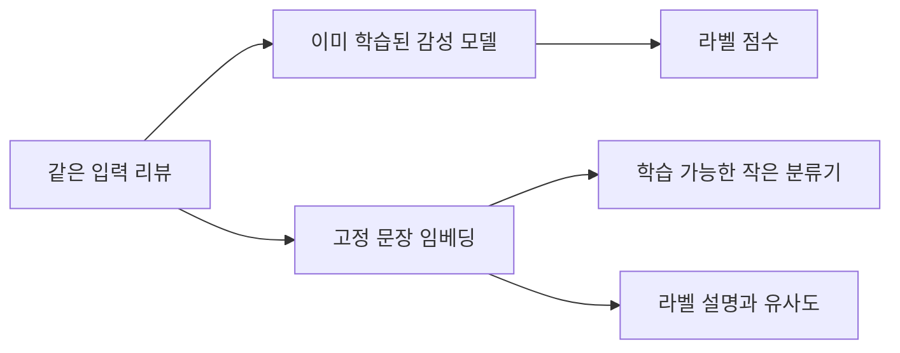

# 4장 텍스트 분류 강의안

[전체 목차](../../README.md) · [학습 노트](study.md) · [강의 대본](lecture-script.md) · [시각화](visuals.html) · [실습 안내](lab-guide.md) · [복습 문제](quiz.md)

**수업 시간:** 85분. 아래 시간에는 설명, 손계산, 질문, 실습과 토론이 포함된다. 대본을 읽는 데 걸리는 시간을 뜻하지 않는다. **원문:** 4장, 제공 PDF 160–191쪽.

**수업의 중심 질문:** 같은 리뷰를 분류하더라도 무엇을 학습하고, 어떤 출력을 받고, 어떻게 정답과 비교하는가?

## 수업 전 준비

교사는 [학습 노트](study.md)의 원문 대응 목차와 [실제 실행 결과](lab-output.txt)를 확인한다. 학습자는 Python 3로 [lab.py](lab.py)를 실행할 수 있으면 좋고, 설치가 어려우면 저장된 결과를 읽어도 활동에 참여할 수 있다. [시각화](visuals.html)는 로컬 브라우저에서 연다. GitHub는 HTML의 조작 기능을 실행하지 않으므로 파일을 내려받아 열어야 한다.

판서에는 세 개의 공간을 확보한다. 왼쪽은 다섯 경로의 지도, 가운데는 혼동 행렬과 식, 오른쪽은 오류 사례다. 생성 모델의 답변을 시연할 필요는 없다. 이 수업에서 사용하는 생성 출력 예시는 사람이 만든 문자열이라고 설명한다.

학습자는 다음 세 문장에 먼저 직관적인 라벨을 붙인다.

1. “설정은 평범하지만 마지막 장면이 모든 것을 바꿔 놓았다.”
2. “배우들은 훌륭하다. 이 지루한 각본을 견딘 것만으로도.”
3. “영상은 아름답고 음악은 괜찮다. 전체적으로 추천할지는 모르겠다.”

첫 문장은 대체로 긍정으로 해석할 수 있고 두 번째는 풍자를 포함한 부정으로 볼 수 있다. 세 번째는 기준이 없으면 의견이 갈릴 수 있다. 정답을 강요하지 말고 라벨 규칙의 필요성을 드러낸다. 세 문장은 수업용 새 예시다.

## 85분 진행표

| 시간 | 주제 | 교사 행동 | 학습자 산출물 | 원문 연결 |
|---|---|---|---|---|
| 0–7분 | 문제와 라벨 정의 | 위 리뷰를 제시하고 판단 근거 비교 | 애매한 라벨 기준 1개 | PDF 160–163 |
| 7–15분 | 표현 모델의 두 경로와 선택 | 직접 분류·임베딩 분류를 판서 | 각 경로의 학습 부분 표시 | PDF 163–166 |
| 15–27분 | 작업 특화 모델과 평가 | 세 클래스→두 클래스, 혼동 행렬 손계산 | P·R·F1 계산표 | PDF 166–171 |
| 27–40분 | 고정 임베딩과 지도학습 | 배열 크기와 로지스틱 회귀 설명, 실습 1 | 특징과 가중치 변화 구별 | PDF 171–175 |
| 40–52분 | 제로샷과 코사인 | 벡터 실험, 라벨 설명 변경 토론 | 코사인 손계산과 한계 | PDF 176–180 |
| 52–64분 | 생성 분류, T5와 Flan-T5 | 학습 단계와 출력 검증 판서 | 안전한 출력 매핑 규칙 | PDF 180–185 |
| 64–74분 | API 방식과 평가 해석 | 비용·재시도·오염 논점 토론 | 비교 실험 기록 항목 | PDF 186–190 |
| 74–85분 | 통합 과제와 출구 질문 | 방법 선택 활동과 해설 | 5문장 설계안 | PDF 190–191 |

## 0–7분: 예측 전에 과제를 정의하기

**판서:** `입력 단위 → 라벨 정의 → 평가 데이터 → 방법 선택`.

리뷰 하나당 라벨 하나라는 점을 확인한다. 감성 분석과 개체명 인식이 모두 텍스트를 다루더라도 출력 구조가 다르다고 설명한다. 원문의 `0=부정`, `1=긍정`, train 8,530·validation 1,066·test 1,066을 제시한다.

**질문:** “미라벨 리뷰 10만 개를 제로샷으로 분류하면 정확도는 어떻게 알 수 있나요?”

**기대 답:** 예측만으로는 알 수 없다. 정답이 있는 별도 평가 표본이 필요하다. 모델의 자신감이나 긍정 예측 비율은 정확도가 아니다.

**교사 보충:** 책의 비교 흐름과 실제 평가 설계를 구분한다. 프롬프트·임계값을 선택할 때 validation을 사용하고 test는 마지막 평가에 남긴다. 모델 가중치를 바꾸지 않아도 test를 보고 선택을 반복하면 결과에 영향을 준다.

## 7–15분: 어떤 부분을 가져다 쓰는가

**판서용 도식:**



세 경로 중 첫 경로는 이번 데이터로 학습하지 않고 추론만 한다. 두 번째는 임베딩 모델은 그대로 두고 작은 분류기만 학습한다. 세 번째는 라벨 설명을 정하지만 정답 문서 예제로 분류기를 맞추지 않는다.

**활동:** 학습되는 부분에는 별표, 동결 부분에는 밑줄을 표시하게 한다.

**기대 답:** 작은 분류기만 별표를 받는다. 라벨 설명을 고르는 작업은 파라미터 학습과 다르지만 시스템 선택에는 영향을 준다.

**모델 선택 설명:** 언어·도메인·출력 라벨·속도·메모리를 적는다. 책의 트윗 감성 RoBERTa를 영화 리뷰에 쓰는 것은 도메인 전이 시험이며, BERT base라는 이름만으로 감성 출력층이 준비되지는 않는다고 강조한다. Figure 4-3–4-5를 이 설명과 연결한다.

## 15–27분: 점수에서 라벨로, 라벨에서 지표로

**사례 1:** `(부정 .20, 중립 .70, 긍정 .10)`에서 중립을 무시하고 둘만 비교한다. 결과는 부정이지만 “모델이 강하게 부정을 확신했다”는 해석은 잘못이다.

**사례 2:** `TP=3, FP=1, FN=2, TN=4`를 판서한다. 학습자에게 행·열의 의미를 먼저 적게 하고 다음 값을 계산하게 한다.

| 값 | 풀이 | 결과 |
|---|---|---:|
| 긍정 precision | 3/(3+1) | .750 |
| 긍정 recall | 3/(3+2) | .600 |
| accuracy | (3+4)/10 | .700 |
| 긍정 F1 | 6/(6+1+2) | .667 |
| 부정 F1 | 8/(8+2+1) | .727 |
| macro F1 | (.667+.727)/2 | .697 |

**질문:** “Positive는 정답이라는 뜻인가요?”

**기대 답:** 아니다. 관심 클래스를 뜻한다. True/False가 맞고 틀림을 나타낸다.

**시각 실험:** [시각화](visuals.html)의 첫 실험에서 임계값을 0.50→0.80→1.00으로 바꾼다. precision은 모든 임계값 구간에서 무조건 단조 증가한다고 가르치지 않는다. 실제 표본에서 FP·TP가 함께 변할 수 있음을 숫자로 보게 한다. 임계값 1.00에서는 긍정 예측이 없으므로 precision 분모 0 표시 정책을 설명한다.

**필수 교정:** weighted F1은 support 비중을, macro F1은 클래스 동등 비중을 쓴다. 원문의 test는 533 대 533이라 두 평균이 같다. 부정 90·긍정 10을 모두 부정으로 예측했을 때 accuracy .900, macro F1 .474를 제시한다.

## 27–40분: 임베딩은 고정하고 경계만 학습하기

**판서:** `X: 8530×768`, `y: 8530`, `w: 768`, `b: 1`.

문서 수와 좌표 수를 뒤집지 않게 한다. `z=w·x+b`, `p=1/(1+exp(-z))`를 적는다. `x=(.8,.6), w=(2,-1), b=-.2`에서 `z=.8`, `p≈.690`을 계산한다. 이 손계산의 두 차원은 실제 MPNet 임베딩이 아니라 원리를 위한 예시임을 말한다.

**실습 1:** 저장소 루트에서 다음 명령을 실행한다.

```bash
python3 chapters/ch04/lab.py
```

출력 1과 2를 읽는다. 손으로 정한 긍정·부정 단어 비율은 변하지 않고 가중치만 학습된다. 초기 loss .693147이 기본 실행에서 .285866으로 줄어드는지 확인한다. 이 loss에는 L2 정규화가 포함되어 있으며 실제 원문 모델의 loss가 아니다.

**활동:** `good`과 `not good`의 특징을 비교한다. `good but boring`과 `boring but good`도 비교한다.

**기대 답:** 앞의 쌍은 둘 다 `(1,0)`, 뒤의 쌍은 둘 다 `(.5,.5)`다. 표현에서 사라진 정보는 뒤의 결정 규칙이 되살릴 수 없다. 분류기의 파라미터를 더 오래 학습하는 것만으로 해결하기 어렵다.

**평가 해설:** 원문의 0.85 F1은 과제 라벨을 사용한 작은 분류기 학습의 결과다. 0.80 작업 특화 모델과 비교할 때 지도 신호 조건이 다름을 표시한다.

## 40–52분: 라벨의 뜻도 벡터로 만들기

**판서:** `문서 N×d`, `라벨 K×d`, `유사도 N×K`, `행별 argmax`.

문서가 1,066개, 라벨이 2개이면 유사도 표의 크기는 `1066×2`다. 열 순서와 정수 라벨 매핑을 연결한다. 후보 순서를 바꾸고 라벨 매핑을 그대로 둔 오류를 짧게 시연한다.

**손계산:** `x=(.8,.6)`, 긍정 `(1,0)`, 부정 `(0,1)`이면 유사도 .8/.6으로 긍정이다. `x=(8,6)`에서도 결과가 같음을 계산한다.

**시각 실험:** 둘째 패널에서 문서 길이만 변경하고 두 유사도가 그대로인지 확인한다. 방향 45°에서 동점을 확인한다. 라벨 설명 좌표 A→B를 바꾸며 대표점 변화가 예측을 바꿀 수 있음을 관찰한다.

**질문:** “유사도 .8은 긍정일 확률 80%인가요?”

**기대 답:** 아니다. 같은 공간에서 계산한 방향 유사도이며 확률 보정 여부는 별도 문제다.

**확장 활동:** 학생이 고객 문의용 라벨 설명 두 개를 쓴다. “환불/배송”처럼 한 단어인 버전과 대상·내용을 구체화한 버전을 비교한다. 더 길거나 구체적이면 반드시 성능이 좋아지는 것은 아니며 validation으로 확인해야 한다고 해설한다. NLI 방식도 제로샷 분류의 다른 경로임을 언급한다.

## 52–64분: 생성 모델의 라벨은 검증해야 한다

**판서:** `지시+리뷰 → 생성 문자열 → 허용 집합 검사 → 라벨 또는 실패`.

T5가 여러 과제를 텍스트 입출력으로 통일한다는 발상을 설명한다. Figure 4-19의 encoder와 decoder, Figure 4-20의 span corruption, Figure 4-21의 여러 과제 학습을 순서대로 연결한다. 그림의 12층을 모든 T5 크기의 상수로 외우지 않도록 한다. Flan-T5는 지시 학습을 통해 다양한 요청에 반응하는 모델이라는 위치를 정한다.

**활동:** 다음 출력에 정수 라벨을 붙이게 한다: `negative`, ` Positive `, `0`, `mixed`, `negative.`, `2`.

**기대 답:** 이 수업의 계약에서는 공백 제거·소문자 변환 후 `negative/positive/0/1`만 허용한다. 나머지는 보류다. 마침표를 허용할 수도 있지만 그 규칙을 먼저 정하고 모든 모델에 일관되게 적용해야 한다.

**실습 2:** 출력 4를 읽고 “유효 응답 정확도 1.000”과 “전체 요청 중 올바른 자동 처리 .625”가 동시에 참인 이유를 설명한다. 형식 실패를 조용히 버리면 분모가 달라진다.

## 64–74분: API 분류를 평가하는 조건

Figure 4-22의 지시-응답 시범과 Figure 4-23의 선호 순위 데이터를 비교한다. 선호 학습의 상세 절차는 12장으로 넘기고, 라벨 예제를 현재 넣지 않았다는 사실과 사전학습이 없었다는 주장을 구분한다.

원문의 API 예시는 2024년 모델과 인터페이스다. 현재 가격이나 제공 상태로 해석하지 않는다. 이 강의에서는 원격 호출하지 않는다. 요청 비용, 실패·재시도, 호출 제한, 원본 응답 보관을 시스템 요소로 소개한다. exponential backoff는 대기 시간을 늘리되 상한과 재시도 횟수를 정하는 방식으로 설명한다.

**토론 질문:** “원문 API 결과 .91이 가장 높으므로 최선이라고 결론 내리면 무엇을 놓치나요?”

**기대 답:** 학습 데이터 중복 가능성, 다른 비용·지연 조건, 클래스별 오류, 평가 분할, 출력 실패, 공개 벤치마크와 실제 업무의 차이를 놓친다.

## 74–85분: 통합 설계와 출구 질문

**설계 과제:** 한국어 고객 리뷰 20,000개, 사람 라벨 500개, 후보 라벨 긍정·부정·중립, 매일 새 리뷰 3,000개, 새 라벨을 추가할 가능성이 있다고 하자. 다섯 경로 중 시작 방법 하나와 비교 방법 하나를 고르고, 다음 다섯 문장으로 발표한다.

1. 어떤 데이터와 언어 모델을 사용할지.
2. 무엇을 학습하고 무엇을 동결할지.
3. 어떤 분할에서 선택하고 어떤 분할에서 평가할지.
4. 어떤 지표와 실패율을 볼지.
5. 가장 걱정되는 오류 유형을 어떻게 확인할지.

**해설 기준:** 특정 모델 이름이 정답은 아니다. 언어·라벨 일치, 주어진 라벨의 효율적 활용, 누출 없는 평가, 클래스별 지표, 형식·보류 정책을 일관되게 설명하는지를 평가한다. 후보 라벨이 존재하는 제로샷과 후보 구조 자체를 찾는 5장 군집화의 차이로 마무리한다.

**출구 질문:**

- “고정 임베딩 + 학습 분류기”는 왜 제로샷이 아닌가?
- macro와 weighted F1은 언제 같아지는가?
- 생성 문자열을 모두 정수로 바꿀 수 있다면 출력 검증이 끝난 것인가?

**기대 답:** 과제 라벨로 분류기를 학습했기 때문이다. 클래스 support가 같으면 두 평균이 같다. 정수 변환 후에도 허용 라벨 범위를 검사해야 한다.

## 과제와 채점

[복습 문제](quiz.md)에서 1–10번은 개인 풀이, 11–16번은 설계와 디버깅 과제로 사용한다. 학생은 먼저 답을 적고 접힌 해설을 열어 자신의 이유와 비교한다. 정답만 맞힌 경우보다 분모·차원·학습 범위를 설명한 경우에 더 높은 점수를 준다.

[전체 목차](../../README.md) · [학습 노트](study.md) · [강의 대본](lecture-script.md) · [시각화](visuals.html) · [실습 안내](lab-guide.md) · [복습 문제](quiz.md)
