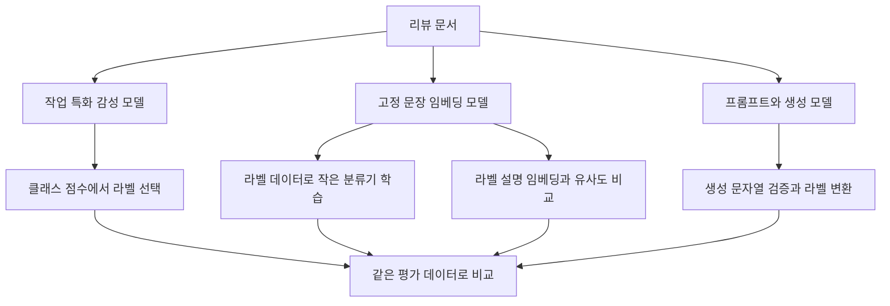
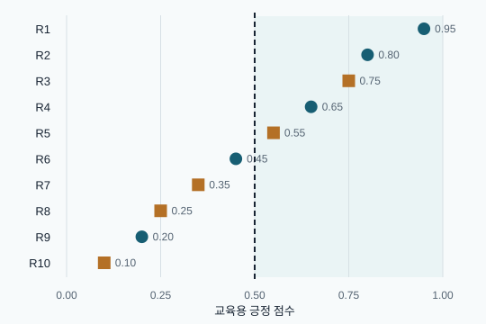
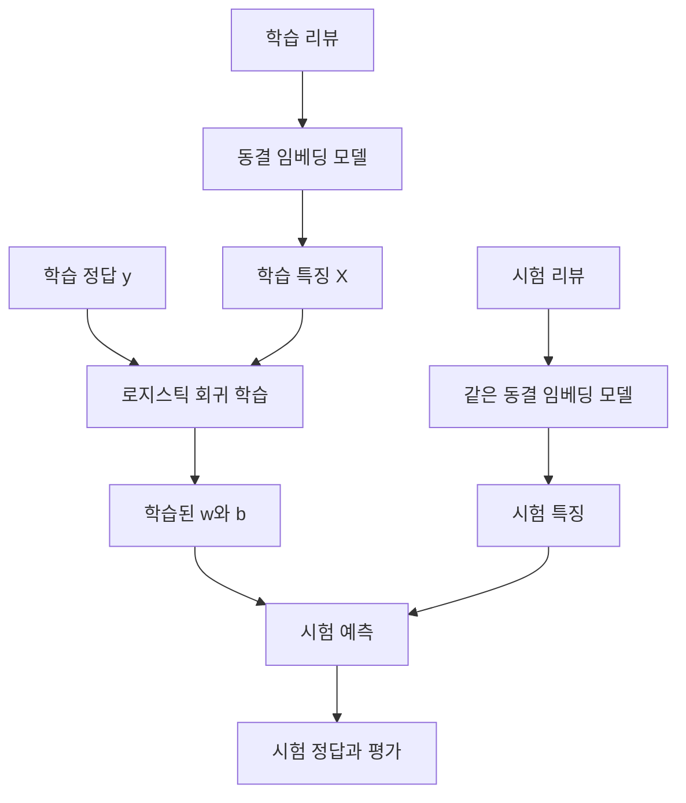
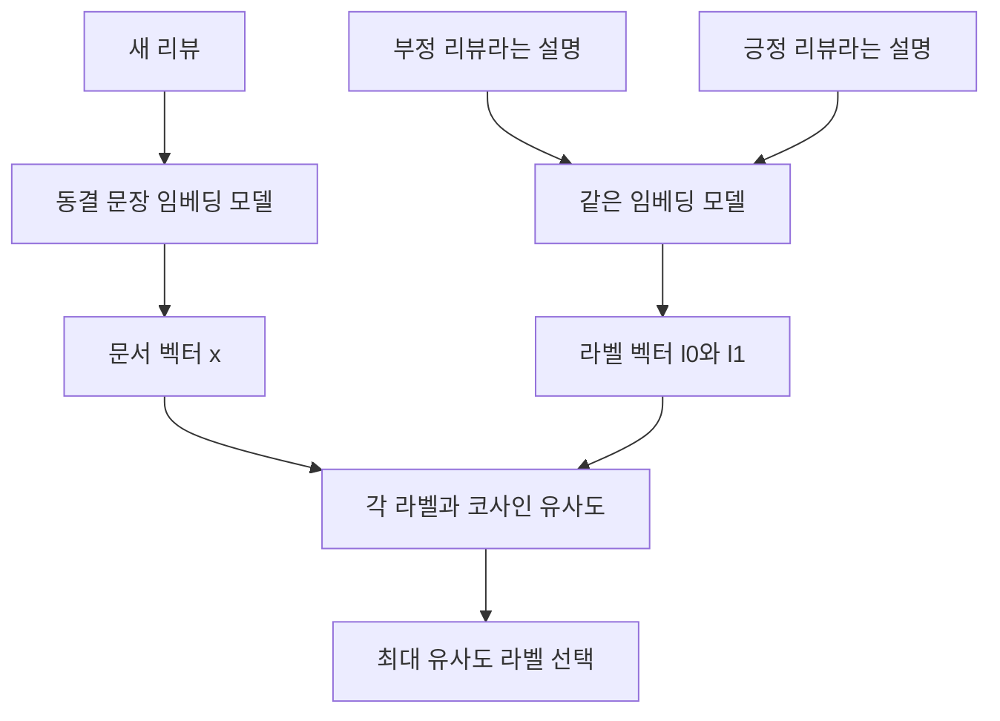
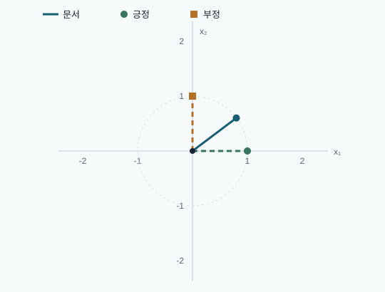
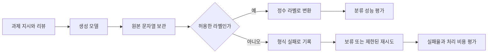

<a id="chapter-overview" name="chapter-overview"></a>
# 4장 텍스트 분류 학습 노트

[전체 목차](../../README.md) · [강의안](lecture.md) · [강의 대본](lecture-script.md) · [시각화](visuals.html) · [실습 안내](lab-guide.md) · [복습 문제](quiz.md)

> **원문 범위:** Jay Alammar·Maarten Grootendorst, *Hands-On Large Language Models* (2024), Chapter 4, 제공된 PDF 물리 페이지 160–191. 이 문서의 쪽수는 인쇄 쪽수가 아닌 PDF 파일의 페이지 번호다. 원문의 절·실험·그림이 전달하는 내용을 한국어로 재구성했으며, 손계산과 실무 설계 설명은 별도로 표시한 보충 학습이다. 원문 성능 수치는 책에 보고된 결과이며, 이 자료에서 같은 모델을 다시 실행해 측정한 결과가 아니다.

텍스트 분류는 문장을 읽고 미리 정한 범주 중 하나를 고르는 작업이다. 이 장은 영화 리뷰의 긍정·부정을 예제로 삼아 **이미 학습된 언어 모델의 능력을 어떻게 가져다 쓸지** 가르친다. 좋은 분류기를 만들기 위해 반드시 거대한 모델 전체를 다시 학습해야 하는 것은 아니다. 이미 완성된 감성 분류기를 그대로 쓸 수도 있고, 고정된 임베딩 위에 작은 분류기만 학습할 수도 있으며, 라벨 설명과 문장의 거리를 비교하거나 생성 모델에게 라벨을 출력하게 할 수도 있다.

이 장을 공부할 때는 “어느 모델이 가장 똑똑한가?”보다 세 가지 질문을 붙잡자. **내가 가진 라벨은 무엇인가, 어느 부분의 파라미터를 학습하는가, 최종 출력이 평가 가능한 라벨로 어떻게 바뀌는가?** 이 세 질문이 다섯 가지 접근을 구분하는 기준이다. 원문 Figure 4-1·4-2(PDF 160–161쪽)는 입력 문서에서 라벨로 가는 공통 목적과, 표현 모델·생성 모델의 서로 다른 경로를 보여준다.

## 학습 목표와 선수지식

학습을 마치면 다음을 할 수 있어야 한다.

- 작업 특화 모델, 임베딩과 지도학습 분류기, 라벨 임베딩을 이용한 제로샷, Flan-T5, API 기반 생성 모델의 입력·출력·학습 여부를 비교한다.
- 이진 분류의 혼동 행렬을 만들고 precision·recall·accuracy·F1·macro F1·weighted F1을 직접 계산한다.
- 문서 임베딩의 배열 크기를 읽고, 작은 분류기의 학습과 언어 모델의 미세 조정을 구별한다.
- 코사인 유사도로 제로샷 분류를 수행하고 라벨 설명이 결과에 영향을 주는 이유를 설명한다.
- 생성된 문자열을 라벨로 변환할 때 발생하는 형식 오류를 탐지하고 평가 분모를 올바르게 정한다.
- 도메인 차이, 데이터 누출, 모델 선택, 비용과 지연 시간을 포함한 비교 실험을 설계한다.

필요한 사전 지식은 Python의 리스트·딕셔너리·반복문, 2장의 토큰과 임베딩, 3장의 encoder/decoder 구분이다. 행렬 미분은 필수가 아니다. 벡터를 “고정 길이 숫자 목록”, 내적을 “같은 위치의 수를 곱해서 더하기”로 이해해도 시작할 수 있다. 모르는 수식은 아래 손계산 예제에서 따라가면 된다.

## 원문에 대응하는 목차

| 원문의 절 | 학습 노트 | PDF 페이지 |
|---|---|---:|
| The Sentiment of Movie Reviews | [1. 데이터와 문제 정의](#sec-01) | 161–163 |
| Text Classification with Representation Models | [2. 표현 모델을 사용하는 두 경로](#sec-02) | 163–164 |
| Model Selection | [3. 모델 선택](#sec-03) | 164–166 |
| Using a Task-Specific Model | [4. 작업 특화 모델과 평가](#sec-04) | 166–171 |
| Classification Tasks That Leverage Embeddings | [5. 임베딩을 분류의 재료로 쓰기](#sec-05) | 171–172 |
| Supervised Classification | [6. 고정 임베딩과 지도학습](#sec-06) | 172–175 |
| What If We Do Not Have Labeled Data? | [7. 라벨 설명을 이용한 제로샷](#sec-07) | 176–180 |
| Text Classification with Generative Models | [8. 생성 모델로 라벨 생성하기](#sec-08) | 180–181 |
| Using the Text-to-Text Transfer Transformer | [9. T5와 Flan-T5](#sec-09) | 181–185 |
| ChatGPT for Classification | [10. API 기반 분류](#sec-10) | 186–190 |
| Summary | [11. 비교와 다음 장 연결](#sec-11) | 190–191 |



<a id="sec-01" name="sec-01"></a>
## 1. 데이터와 문제 정의

**원문: The Sentiment of Movie Reviews, PDF 161–163쪽.**

### 1.1 입력과 정답부터 고정한다

예제의 입력은 짧은 영어 영화 리뷰이고, 출력 라벨은 부정 `0` 또는 긍정 `1`이다. “이 영화는 세 시간짜리 광고 같다”라는 리뷰를 입력하면 부정을, “평범한 소재를 놀라운 이야기로 만들었다”를 입력하면 긍정을 예측하는 식이다. 이 두 문장은 이해를 위한 새 예시이며 책의 데이터에서 가져온 문장이 아니다.

모델 선택보다 먼저 확인할 것은 작업의 단위다. 리뷰 한 편에 라벨 하나를 붙이는 **문서 수준 이진 분류**가 이 장의 과제다. 문장 속 모든 사람 이름의 위치를 찾는 개체명 인식이나, 하나의 리뷰에 연기·음악·각본별 감성을 각각 붙이는 과제는 출력 구조가 다르다. 텍스트 분류의 응용 범위에 함께 들어갈 수 있지만, 현재의 `0/1` 평가 코드가 그대로 모든 과제를 처리하지는 않는다.

라벨은 세상의 절대적 속성이라기보다 과제의 정의다. “영상은 좋지만 다시 보지는 않겠다”를 어느 쪽으로 둘지, 중립 리뷰를 제외할지, 풍자를 어떻게 처리할지는 데이터 구축 규칙에 달려 있다. 따라서 모델 오류를 분석할 때는 실제로 모델이 틀린 것인지, 애매한 예시인지, 정답 기준이 일관되지 않은지를 구별해야 한다. 정답이 있다고 해서 의미가 자동으로 명확해지는 것은 아니다.

### 1.2 원문의 Rotten Tomatoes 데이터

책은 Hugging Face의 `datasets` 패키지로 `rotten_tomatoes`를 불러온다. 데이터에는 긍정 5,331개와 부정 5,331개가 있으며 전체 10,662개다. 책에 표시된 분할은 다음과 같다.

| 분할 | 문서 수 | 학습에서 맡기는 역할 |
|---|---:|---|
| train | 8,530 | 분류기 파라미터 학습 |
| validation | 1,066 | 모델·임계값·프롬프트·라벨 설명 선택 |
| test | 1,066 | 선택이 끝난 시스템의 최종 평가 |

원문 예제는 간결한 설명을 위해 test 성능을 반복해서 비교한다. **보충 학습:** 실제 비교 연구에서는 validation으로 선택하고 test는 마지막에 확인하는 편이 타당하다. test 점수를 보고 프롬프트를 열 번 고쳤다면, 그 test는 이미 선택 과정에 영향을 주었다. 마지막 점수를 완전히 새로운 데이터에서의 성능처럼 해석해서는 안 된다. 모델의 가중치에 직접 반영하지 않아도 사람이 시험 결과를 이용해 시스템을 선택하면 평가 데이터의 정보가 새어 들어간다.

`text`는 입력 문자열, `label`은 정답 정수다. 입력 목록과 정답 목록을 따로 정렬하거나 필터링하면 대응이 깨진다. 예를 들어 리뷰 배열만 길이순으로 정렬하고 라벨 배열은 그대로 두면 정상적인 모델조차 엉뚱한 정답과 비교된다. 따라서 실습과 실제 시스템 모두 문서 ID를 유지하는 습관이 유용하다. “N개의 예측과 N개의 정답”이라는 길이 조건만으로 올바른 대응이 보장되지는 않는다.

책의 test에는 각 클래스가 533개씩 들어 있다. 전체 데이터가 균형적이라는 사실과 특정 분할이 균형적인지는 별도의 사실이므로, 일반적인 데이터에서는 분할별로 직접 세어 보자. 여기서는 두 사실이 모두 성립한다. 이 균형 때문에 뒤에서 macro F1과 weighted F1이 같아진다.

### 1.3 분류와 평가를 분리해서 생각한다

라벨이 전혀 없는 문서도 분류할 수 있다. 이미 학습된 감성 모델이나 제로샷 모델은 문서를 받아 예측을 내놓는다. 하지만 그 예측이 얼마나 정확한지 측정하려면 정답이 있는 평가 표본이 필요하다. **예측에 학습 라벨이 필요 없는 것과 평가에 정답이 필요 없는 것은 다르다.** 이 구분은 이 장 전체를 읽는 열쇠다.

예를 들어 고객 리뷰 10만 개가 모두 미라벨 상태라면, 라벨 설명 기반 방법으로 즉시 임시 분류를 만들 수 있다. 그 결과만 보고 “정확도 90%”라고 말할 수는 없다. 별도로 일부 리뷰를 사람이 검토해 정답을 정하고, 그 표본을 사용해 오차와 불확실성을 추정해야 한다. 모델이 자신 있게 답한 비율은 정확도와 다른 값이다.

### 1.4 고전적 기준선을 놓치지 않는다

PDF 161쪽의 팁은 TF-IDF와 로지스틱 회귀 같은 전통적 기준선을 비교하라고 권한다. 이것은 단순히 옛 방법을 예우하자는 말이 아니다. 짧은 텍스트의 강한 단어 신호만으로도 충분한 과제에서는 가벼운 방법이 빠르고 해석하기 쉬우며, 새 모델의 이득을 객관적으로 보여준다.

TF-IDF는 특정 문서에 자주 나오면서 전체 문서에는 흔하지 않은 단어의 비중을 높이는 표현이다. 문맥 이해는 제한되지만 감성 단어가 강한 데이터에서는 좋은 출발점이 된다. 임베딩 모델을 쓰기로 했다면 단순 기준선과 같은 분할·같은 지표로 비교해야 “더 복잡해진 만큼 얻은 것이 있는가”를 판단할 수 있다. 이 장의 로컬 실습은 그보다 더 작은 고정 특징을 사용해 계산 구조를 드러내며, TF-IDF나 실제 언어 모델의 성능을 대신 측정하지 않는다.

<a id="sec-02" name="sec-02"></a>
## 2. 표현 모델을 사용하는 두 경로

**원문: Text Classification with Representation Models, PDF 163–164쪽. Figure 4-3·4-4.**

### 2.1 표현 모델은 입력을 숫자 표현으로 바꾼다

표현 모델은 입력 토큰을 문맥에 맞는 숫자 표현으로 바꾼다. BERT 같은 기반 encoder 모델을 생각하면 된다. 기반 모델은 사전학습을 통해 언어의 패턴을 학습했지만, 그것만으로 “우리 회사의 문의 분류 라벨 17개”를 정답 형식으로 출력하도록 준비된 것은 아니다. 특정 과제에 맞는 출력층과 학습이 필요하거나, 해당 표현을 이용하는 별도의 분류 절차가 필요하다.

Figure 4-3의 논지는 같은 기반 모델을 서로 다른 목적에 맞게 미세 조정할 수 있다는 것이다. 감성 분류 데이터로 조정하면 작업 특화 모델이 되고, 문장 간 의미적 관계를 잘 나타내도록 조정하면 범용 임베딩 모델이 된다. “기반 모델 이름이 같다”는 것과 “출력의 사용 목적이 같다”는 것은 다르다. 학습 목표가 표현 공간의 성질을 바꾼다.

### 2.2 직접 분류와 간접 분류

첫 번째 경로는 **작업 특화 모델**이다. 입력 리뷰가 토큰화와 모델을 통과하면 클래스별 점수가 나온다. 이미 감성 분류를 배운 모델의 판단을 그대로 사용하는 셈이다. 사용자는 이 장에서 모델 가중치를 업데이트하지 않는다.

두 번째 경로는 **임베딩 모델**이다. 문서를 고정 길이 벡터로 바꾼 뒤 그 벡터를 분류의 재료로 사용한다. 이 벡터 자체가 `긍정/부정` 라벨은 아니다. 라벨 데이터가 있으면 분류기를 학습하고, 라벨 데이터가 없으면 라벨의 설명도 벡터로 만든 뒤 유사도를 비교한다. Figure 4-4는 이 직접·간접 경로를 대비한다.

| 구분 | 작업 특화 모델 | 범용 임베딩 모델 |
|---|---|---|
| 주 출력 | 정해진 클래스의 점수 | 문서 의미를 표현하는 벡터 |
| 즉시 라벨을 얻는가 | 라벨 체계가 맞으면 가능 | 별도 결정 규칙이 필요 |
| 이 장의 기반 모델 학습 | 하지 않음 | 하지 않음 |
| 같은 표현의 재사용 | 해당 작업에 강하게 연결됨 | 분류·검색·군집화 등에 재사용 가능 |
| 주된 확인 사항 | 클래스 의미·순서·도메인 일치 | 문장 표현 품질·차원·분류 규칙 |

### 2.3 동결과 학습을 구별한다

모델을 **동결한다(freeze)**는 말은 사용하지 않는다는 뜻이 아니다. 앞으로 계산하는 추론은 계속 수행하지만, 학습 데이터의 오차를 이용해 그 모델의 파라미터를 바꾸지 않는다는 뜻이다. 임베딩을 만들고 저장한 뒤 로지스틱 회귀만 학습하는 경우, 언어 모델은 동결되어 있지만 전체 분류 시스템에는 학습되는 부분이 있다.

학생들이 자주 하는 질문은 “임베딩 모델을 학습하지 않았다면 이 방법도 제로샷 아닌가요?”다. 그렇지 않다. 예제 문서와 정답 라벨을 이용해 분류기를 학습했다면 그 과제에 대해서는 지도학습이다. 시스템 중 일부가 고정되었다는 사실이 라벨 사용을 없애지는 않는다. 어디에 라벨이 들어가고 어떤 파라미터가 바뀌는지 화살표로 그리면 혼동이 줄어든다.

3장에서 본 문맥 표현을 분류에 사용하는 법이 이 장의 주제다. 임베딩 모델 자체를 만드는 방법은 10장, BERT류 모델을 분류용으로 미세 조정하는 방법은 11장에서 다룬다. 이 장의 학습 범위는 “이미 만들어진 모델을 활용하기”이며, 전체 encoder를 다시 학습하는 절차를 실습한 장으로 읽으면 안 된다.

<a id="sec-03" name="sec-03"></a>
## 3. 모델 선택

**원문: Model Selection, PDF 164–166쪽. Figure 4-5.**

### 3.1 모델 이름을 고르기 전에 조건을 적는다

책은 모델의 언어 지원, 구조, 크기, 성능을 함께 고려하라고 설명한다. 영어 리뷰에서 좋은 모델이라고 한국어 고객 상담에서 같은 성능이 나오지는 않는다. 감성 분석용 모델이라고 해서 “계정 문제/배송 문제/환불 요청” 분류에 필요한 라벨을 바로 제공하지도 않는다. 입력 언어와 출력 라벨이 맞는지 먼저 확인해야 한다.

그다음 도메인을 본다. 트윗은 짧고 축약·이모티콘·해시태그가 흔하지만 영화 리뷰는 영화의 내용과 비평 어휘가 중요하다. 두 도메인 모두 감성 분석이라는 이름을 쓰더라도 입력 분포가 다르다. 다른 도메인에서 학습한 모델이 얼마나 일반화하는지를 평가하는 것이 이 장의 첫 실험이다.

**보충 학습:** 처리 속도는 단순한 편의가 아니라 설계 조건이다. 하루 100개의 분류와 하루 1,000만 개의 분류는 같은 점수 차이를 다르게 평가할 수 있다. 평균 지연뿐 아니라 긴 문서의 지연, 묶음 처리 성능, 모델을 메모리에 올리는 비용, 실패 시 재처리도 고려한다. 가장 큰 모델이 반드시 전체 시스템의 가장 적절한 선택은 아니다.

### 3.2 BERT 계열은 출발점이며 완제품과 구별한다

Figure 4-5는 BERT류 모델의 발전 계보를 보여준다. 원문은 BERT base uncased, RoBERTa base, DistilBERT base uncased, DeBERTa base, bert-tiny, ALBERT base v2를 출발점으로 나열한다. 핵심은 이름을 모두 외우는 것이 아니라, encoder 기반 모델에도 크기·학습법·효율을 달리한 변형이 많다는 것을 이해하는 것이다.

이 목록의 기반 모델을 불러오는 것과 감성 분류를 끝낸 체크포인트를 불러오는 것은 다르다. 이름에 BERT가 있다는 이유만으로 감성 라벨이 준비되어 있다고 기대하면 안 된다. 분류용 출력층의 라벨 수와 뜻, 해당 출력층의 학습 여부를 확인해야 한다. 정해진 감성 모델을 바로 쓰려면 이미 감성 과제로 조정된 체크포인트를 고른다.

원문에 등장하는 모델 허브의 모델 개수는 집필 시점의 규모를 설명하기 위한 숫자다. 현재 개수나 순위를 뜻하지 않으므로 여기서는 최신 선택 근거로 사용하지 않는다. 마찬가지로 원문이 추천한 기준선은 학습을 시작하기 좋은 사례이지, 모든 시점과 도메인에서 최선이라는 보장이 아니다.

### 3.3 책이 택한 두 모델

| 역할 | 책의 체크포인트 | 선택의 의미 |
|---|---|---|
| 감성 분류 | `cardiffnlp/twitter-roberta-base-sentiment-latest` | 트윗 감성 학습이 영화 리뷰에 얼마나 일반화하는지 확인 |
| 문장 임베딩 | `sentence-transformers/all-mpnet-base-v2` | 문서를 768차원 표현으로 만들고 작은 분류기 또는 유사도 비교에 사용 |

책은 임베딩 선택을 위한 출발점으로 MTEB 벤치마크를 소개한다. 여러 과제를 비교한 평가가 유용하더라도 평균 점수만으로 자신의 분류 문제를 결정하면 안 된다. 검색·군집화·분류 성능이 모두 같은 순서로 움직이지 않을 수 있고, 데이터 언어와 처리 비용도 다르기 때문이다. 원문의 취지는 성능과 추론 속도를 함께 보라는 것이다.

**선택 활동:** 한국어·영어가 섞인 짧은 고객 리뷰를 분류한다고 가정하자. 후보를 고를 때 “언어 지원 → 라벨 체계 → 도메인 → 적절한 평가 표본 → 속도·자원”의 순서로 확인해 보자. 특정 하나의 순서가 항상 정답인 것은 아니지만, 벤치마크 점수부터 보고 나머지 조건을 나중에 맞추려는 습관을 줄여 준다.

<a id="sec-04" name="sec-04"></a>
## 4. 작업 특화 모델과 평가

**원문: Using a Task-Specific Model, PDF 166–171쪽. Figure 4-6–4-9.**

### 4.1 추론 파이프라인의 실제 흐름

원문은 `transformers.pipeline`으로 모델과 토크나이저를 함께 불러온다. 코드에서 토크나이저 경로를 명시하는 이유는 입력 문자열이 모델에 바로 들어가는 것이 아니라는 점을 드러내기 위해서다. 토크나이저는 텍스트를 토큰 ID와 필요한 부가 정보로 바꾸고, 모델은 이 숫자 입력을 처리한다. Figure 4-6은 그 순서를 보여준다.


Figure 4-7은 처음 보는 단어도 여러 하위 토큰으로 나누면 표현을 만들 수 있다는 점을 설명한다. 사전에 단어 전체가 없다고 무조건 처리 불능이 되는 것은 아니다. 다만 토큰으로 표현 가능하다는 사실이 단어의 뜻이나 감정을 정확히 안다는 보장은 아니다. 새로운 은어, 풍자, 도메인 표현은 입력 형식이 처리되어도 의미 판단이 실패할 수 있다.

원문의 추론 반복문은 `KeyDataset`으로 test의 `text` 열을 pipeline에 전달하고 결과를 순서대로 모은다. `tqdm`은 진행률 표시를 맡는다. `numpy.argmax`는 후보 점수 중 가장 큰 값의 위치를 선택한다. 이 도구들의 역할을 분리해 이해하면 패키지가 바뀌어도 “입력 제공 → 점수 계산 → 라벨 선택 → 저장”이라는 절차는 그대로 옮길 수 있다.

### 4.2 세 클래스 모델을 두 클래스 과제로 쓸 때

책의 감성 모델은 부정·중립·긍정 점수를 내고, 영화 리뷰 정답은 부정·긍정 두 종류다. 원문 코드는 부정 점수와 긍정 점수만 골라 비교하고 중립 점수는 선택에서 제외한다. 이것은 모델의 출력 체계를 데이터의 체계로 **변환하는 규칙**이다. 모델이 본래 중립을 가장 높게 평가했더라도 반드시 긍정 또는 부정으로 분류된다.

예를 들어 교육용 점수가 `(부정 0.20, 중립 0.70, 긍정 0.10)`이라면 이 규칙은 부정을 선택한다. 그런데 이 결과를 “부정일 확률이 70%”라고 말해서는 안 된다. 중립이 높았다는 정보는 여전히 존재한다. 이진 선택을 위해 둘만 다시 정규화하면 부정은 `0.20/(0.20+0.10)=2/3`이 되지만, 이는 두 클래스 안에서 재정규화한 수치이며 새로운 데이터에 대한 보정된 확률이라는 보장은 없다.

**보충 학습:** 실제 코드는 `output[0]`, `output[2]`라는 위치만 믿기보다 반환된 라벨 이름과 모델 설정의 라벨 매핑을 확인하는 편이 견고하다. 다른 체크포인트에서 클래스 순서가 바뀌면 에러 없이 의미가 뒤집힐 수 있기 때문이다. 라벨을 정수 `0/1`로 바꾸는 표를 한 곳에 선언하고 결과와 함께 보관하자.

### 4.3 혼동 행렬은 오류의 종류를 보존한다

Figure 4-8(PDF 170쪽)은 실제 라벨과 예측 라벨의 네 조합을 그린다. 아래 표는 행을 실제, 열을 예측으로 두었다. 원문 그림은 행·열 방향이 반대이므로 표를 읽을 때 항상 축 이름을 확인한다.

| 실제 \ 예측 | 부정 0 | 긍정 1 |
|---|---:|---:|
| 부정 0 | TN: 올바른 부정 | FP: 부정을 긍정으로 오인 |
| 긍정 1 | FN: 긍정을 부정으로 놓침 | TP: 올바른 긍정 |

`True/False`는 예측이 맞았는지, `Positive/Negative`는 어떤 클래스를 예측했는지를 가리킨다. Positive가 “정답 클래스”, Negative가 “오답 클래스”라는 뜻은 아니다. 여기서는 긍정 리뷰를 positive class로 정했을 뿐이다. 스팸 탐지라면 스팸을 positive로, 사기 탐지라면 사기를 positive로 정의할 수 있다. “긍정”이라는 일상어와 통계의 positive를 구분하자.

**손계산 예제:** 리뷰 10개에서 `TP=3, FP=1, FN=2, TN=4`라고 하자. 실제 긍정은 5개인데 그중 3개만 찾았고, 긍정이라고 예측한 4개 중 1개는 틀렸다. 총 7개가 맞았다. 이 네 수만 알면 여러 지표를 계산할 수 있다.

### 4.4 precision·recall·accuracy·F1

긍정을 관심 클래스로 삼았을 때 식은 다음과 같다.

$$
\mathrm{precision}=\frac{TP}{TP+FP},\qquad
\mathrm{recall}=\frac{TP}{TP+FN}
$$

$$
\mathrm{accuracy}=\frac{TP+TN}{TP+FP+FN+TN},\qquad
F_1=\frac{2PR}{P+R}=\frac{2TP}{2TP+FP+FN}
$$

`P`는 precision, `R`은 recall이다. precision은 “긍정이라고 내놓은 것 가운데 진짜 긍정은 얼마나 되는가”, recall은 “존재하는 긍정 가운데 얼마나 찾았는가”를 묻는다. 두 질문은 분모가 다르다. 정밀도를 높이기 위해 매우 확실한 사례만 긍정으로 고르면 놓치는 긍정이 많아질 수 있다. 반대로 웬만하면 긍정으로 분류하면 재현율은 높아질 수 있지만 오탐이 늘 수 있다.

위 예제에서 precision은 `3/4=0.75`, recall은 `3/5=0.60`, accuracy는 `7/10=0.70`, F1은 `6/(6+1+2)=2/3≈0.667`이다. F1은 두 지표의 산술평균이 아니라 조화평균이다. 둘 중 하나가 매우 낮으면 그 낮은 값의 영향을 크게 받는다. 따라서 “정밀도와 재현율이 각각 어느 정도인지”를 숨긴 채 F1 하나만 보는 것은 오류 분석에 충분하지 않다.

부정 클래스의 지표도 같은 방식으로 구한다. 이번에는 부정을 관심 클래스로 바꾸므로 원래 `TN=4`가 부정 클래스의 TP 역할을 한다. 부정 precision은 `4/(4+2)=2/3`, 부정 recall은 `4/(4+1)=0.8`, 부정 F1은 `8/11≈0.727`이다. 분류 보고서가 클래스마다 한 줄씩 나오는 이유가 이것이다.

**분모가 0인 경우:** 모델이 긍정이라고 예측한 문서가 하나도 없다면 긍정 precision의 분모가 0이다. 구현은 이를 0으로 둘지, 정의되지 않았다고 표시할지 정책을 정해야 한다. 그 정책을 숨기면 모델 간 비교가 달라질 수 있다. 로컬 실습은 분모 0을 0으로 두는 정책을 명시한다.



위 그림은 [조작 가능한 시각화](visuals.html)의 초기 상태다. 원은 실제 긍정, 사각형은 실제 부정이고 점선 오른쪽을 긍정으로 예측한다. 원문 모델 결과가 아닌 교육용 점수다.

### 4.5 macro F1과 weighted F1은 무엇을 동등하게 대하는가

클래스 수를 `K`, 클래스 `k`의 정답 개수를 `n_k`, 전체 개수를 `N`이라 하자.

$$
F_{1,\mathrm{macro}}=\frac{1}{K}\sum_{k=1}^{K}F_{1,k},\qquad
F_{1,\mathrm{weighted}}=\sum_{k=1}^{K}\frac{n_k}{N}F_{1,k}
$$

macro는 **클래스마다 같은 가중치**를 준다. weighted는 **정답 표본 수가 많은 클래스에 더 큰 가중치**를 준다. 원문 PDF 171쪽은 weighted 평균을 사용하면서 클래스가 동등하게 취급된다는 취지로 설명하지만, 일반적으로 두 평균은 다르다. 이 데이터는 test의 클래스별 support가 533으로 같아서 둘이 일치한다. 이를 불균형 데이터에 그대로 일반화하면 안 된다.

교육용 반례로 부정 90개·긍정 10개에서 전부 부정이라고 예측해 보자. accuracy는 0.90이지만 긍정 recall은 0이다. 부정 F1은 `180/190≈0.947`, 긍정 F1은 0, macro F1은 약 0.474, weighted F1은 약 0.853이다. accuracy와 weighted F1만 보고 성공이라고 말하면 적은 클래스의 실패를 놓친다. 각 클래스 성능과 업무상 오류 비용을 함께 봐야 한다.

Figure 4-9(PDF 171쪽)의 분류 보고서에서 `support`는 모델이 예측한 개수가 아니라 실제 정답 개수다. 표에 적힌 precision·recall·F1은 반올림된 수치이므로, 반올림된 두 지표로 F1을 다시 계산했을 때 마지막 자릿수가 다를 수 있다. 원래 예측에서 계산한 값을 비교하는 것이 원칙이다.

### 4.6 원문 결과의 해석

책의 작업 특화 모델은 weighted F1 약 **0.80**을 보고한다. 부정은 precision 0.76·recall 0.88·F1 0.81, 긍정은 precision 0.86·recall 0.72·F1 0.78이다. 긍정 recall이 더 낮다는 것은 실제 긍정 리뷰를 부정으로 보내는 일이 상대적으로 많다는 뜻이다. 하나의 점수 외에 오류의 방향을 볼 수 있다.

이 결과는 트윗에서 배운 감성 판단이 영화 리뷰에도 어느 정도 전이됨을 보여준다. 그러나 우리 환경에서 재실행한 측정값은 아니며 모든 감성 데이터에서 얻을 수 있는 수치도 아니다. 원문은 영화 리뷰와 더 가까운 SST-2로 조정된 DistilBERT 같은 후보를 비교하거나, 임베딩을 이용하는 다른 경로를 시도할 수 있다고 제안한다. 개선할 때도 같은 test를 계속 선택에 사용하지 않는 평가 설계를 유지하자.

<a id="sec-05" name="sec-05"></a>
## 5. 임베딩을 분류의 재료로 쓰기

**원문: Classification Tasks That Leverage Embeddings, PDF 171–172쪽.**

내가 원하는 라벨 체계에 맞는 사전학습 분류기가 없다고 해서 언어 모델 전체를 미세 조정해야 하는 것은 아니다. 문장 임베딩은 입력 텍스트를 다목적 특징으로 바꾸므로, 그 위에 내가 가진 과제의 결정 규칙을 얹을 수 있다. 이때 임베딩 모델과 분류기 사이가 교체 가능한 경계가 된다.

예를 들어 같은 고객 문의 임베딩으로 한 번은 주제 분류기를 만들고, 다른 한 번은 긴급도 분류기를 만들 수 있다. 두 과제의 라벨과 작은 분류기는 달라도 문서의 수치 표현은 공유할 수 있다. 단, 임베딩이 과제에 중요한 차이를 보존해야 한다. 범용 임베딩이 모든 업무 특징을 완벽히 담는 것은 아니다. 표현에 필요한 정보가 없다면 작은 분류기의 선택만으로는 한계가 있다.

이 분리 구조의 이점은 계산과 실험을 나눌 수 있다는 데 있다. 모델 추론으로 임베딩을 만드는 비용을 한 번 지불하고 저장해 놓으면, 여러 분류기의 학습이나 하이퍼파라미터 비교에 같은 배열을 재사용할 수 있다. 다만 임베딩 모델이나 전처리 규칙을 바꾸면 같은 좌표계라는 보장이 없어 기존 저장값도 다시 만들어야 한다.

**보충 학습:** 임베딩 캐시에는 문서 ID, 모델 식별자와 버전, 전처리 설정, 생성 날짜를 함께 기록하자. 모델 A의 학습 임베딩과 모델 B의 시험 임베딩을 차원만 같다는 이유로 섞으면 좌표 의미가 맞지 않는다. 숫자의 개수가 같다고 같은 특징 공간인 것은 아니다.

이 장은 이 구조로 두 가지 방법을 만든다. 정답 문서가 있으면 지도학습으로 경계를 배운다. 정답 문서가 없으면 라벨의 의미를 문장으로 설명해 대표 벡터를 만들고, 문서와 가장 가까운 라벨을 선택한다. 같은 임베딩을 다른 규칙으로 쓰는 두 방법을 나란히 이해하자.

<a id="sec-06" name="sec-06"></a>
## 6. 고정 임베딩과 지도학습

**원문: Supervised Classification, PDF 172–175쪽. Figure 4-10–4-12.**

### 6.1 특징 추출과 분류기 학습을 나눈다

Figure 4-10의 핵심은 특징 추출 단계와 분류 단계를 분리한다는 것이다. Figure 4-11은 고정 임베딩 모델이 각 문서를 수치 표현으로 바꾸는 첫 단계를, Figure 4-12는 그 표현과 정답으로 로지스틱 회귀를 학습하는 두 번째 단계를 보여준다.



언어 모델을 통과시키는 것과 언어 모델을 학습하는 것은 비용 구조가 다르다. 이 장에서는 encoder의 역전파와 가중치 업데이트를 수행하지 않는다. 그러나 임베딩을 만드는 추론 자체는 여전히 계산을 필요로 한다. “언어 모델을 동결했으므로 임베딩 생성은 공짜”라는 해석은 틀리다. 원문은 임베딩 추론에 GPU가 속도를 높일 수 있고, 작은 분류기의 학습은 CPU에서 수행할 수 있다고 설명한다.

### 6.2 배열의 크기를 정확히 읽는다

원문의 임베딩 모델은 리뷰마다 768개의 수를 만든다. 학습 문서는 8,530개이므로 특징 배열의 크기는 `(8530, 768)`이다. 행 하나는 문서 하나, 열 하나는 임베딩 좌표 하나다. 정답 벡터는 길이 8,530이며, 각 행과 같은 문서에 대응해야 한다. 시험 특징은 `(1066, 768)`이다.

일반화하면 문서 `i`의 임베딩은 `x_i ∈ R^d`, 학습 특징은 `X ∈ R^(N×d)`, 라벨은 `y ∈ {0,1}^N`이다. `N`은 문서 수이고 `d`는 모델이 정한 차원이다. 리뷰 길이가 다르더라도 문장 임베딩의 최종 길이는 동일하므로 전통적 분류기에 넣기 편하다. 2장에서 다룬 토큰별 임베딩과 문장 전체의 임베딩을 혼동하지 말자.

각 좌표를 사람이 이해하는 “기쁨 점수”, “영화 점수”라고 일대일 이름 붙이기는 대개 어렵다. 임베딩은 여러 차원이 함께 의미를 표현한다. 아래 로컬 실습의 두 특징은 계산을 보이기 위해 사람이 정한 값이므로 실제 768차원 임베딩의 해석 방식과 다르다. 작은 예제가 이해를 돕더라도 실제 표현의 성질을 그대로 대변하는 것은 아니다.

### 6.3 로지스틱 회귀는 무엇을 학습하는가

**보충 학습:** 이진 로지스틱 회귀는 고정 벡터 `x`를 받아 점수 `z=w·x+b`를 계산하고 시그모이드로 0과 1 사이로 변환한다.

$$
z=\sum_{j=1}^{d}w_jx_j+b,\qquad p=\sigma(z)=\frac{1}{1+e^{-z}}
$$

`w`는 길이 `d`의 가중치 벡터, `b`는 편향 하나다. 학습되는 것은 이 작은 `w,b`이며 임베딩 모델의 수많은 가중치는 그대로다. 문서마다 가중치를 새로 만드는 것이 아니라 모든 문서에 공유되는 하나의 규칙을 학습한다. 이름에 회귀가 들어 있어도 여기서는 `p`에 임계값을 적용해 분류한다.

숫자로 보자. 교육용 문서 표현이 `x=(0.8,0.6)`, 가중치가 `w=(2,-1)`, 편향이 `b=-0.2`면 `z=2×0.8−1×0.6−0.2=0.8`이고 `p≈0.690`이다. 임계값 0.5에서는 긍정으로 예측한다. 같은 벡터라도 다른 과제로 학습한 `w,b`를 적용하면 결과가 달라질 수 있다. 표현이 같다는 것과 판단 규칙이 같다는 것은 별개다.

학습은 정답 `y`와 예측 `p`의 불일치를 줄이는 방향으로 가중치를 움직인다. 대표적인 이진 교차 엔트로피는 다음과 같다.

$$
L=-\frac1N\sum_i\{y_i\log p_i+(1-y_i)\log(1-p_i)\}
$$

정답이 1이면 `p`가 작을수록 큰 손실을 받는다. 정답이 0이면 `p`가 클수록 큰 손실을 받는다. 로컬 실습은 이 손실과 경사하강법을 직접 계산해 특징은 고정되어 있고 분류기만 변한다는 사실을 보여준다. 원문의 `sklearn` 구현을 그대로 재현하는 코드는 아니며, 정규화·최적화 세부 조건도 다르다.

### 6.4 원문 코드의 읽는 순서

원문은 `SentenceTransformer`로 모델을 불러오고 `encode`로 train과 test의 특징을 만든다. 그다음 `LogisticRegression(random_state=42)`를 만들고 `fit(train_embeddings, train_labels)`를 호출한다. 마지막으로 `predict(test_embeddings)`와 공통 평가 함수를 사용한다. 핵심은 `fit`에 시험 정답이 들어가지 않는다는 점이다.

`random_state` 하나를 지정했다고 모든 환경의 전체 파이프라인이 완벽히 재현되는 것은 아니다. 모델 버전·데이터 버전·라이브러리·계산 장치·전처리가 달라지면 결과가 달라질 수 있다. 재현 실험에서는 입력 분할과 모델 식별자, 주요 설정을 함께 기록한다. 이 문서의 CPU 실습은 난수를 사용하지 않는 고정 초기화와 고정 데이터로 출력이 일정하게 나오도록 구성했다.

### 6.5 원문 결과와 비교의 의미

책은 이 방법에서 weighted F1 약 **0.85**를 보고한다. 작업 특화 모델의 약 0.80보다 높지만, 이 비교는 순수하게 모델 구조만의 비교는 아니다. 새 방법은 영화 리뷰의 학습 정답 8,530개를 사용해 분류기를 맞추었고, 앞선 모델은 해당 단계에서 영화 리뷰 정답을 사용하지 않았다. “임베딩이 언제나 작업 특화 모델보다 우월하다”가 아니라, “고정 표현 위에 가벼운 지도학습을 추가하는 것이 유용할 수 있다”는 결론이 적절하다.

원문은 임베딩을 외부 API로 얻으면 로컬 GPU 없이도 같은 구조를 사용할 수 있다고 덧붙인다. 이는 추론 계산이 사라진다는 뜻이 아니라 원격 서비스로 옮겨 간다는 뜻이다. 비용·네트워크·입력 전송·처리 제한 조건이 바뀐다. 학습의 개념은 동일하지만 운영 환경은 별도로 검토해야 한다.

### 6.6 언제 실패하는가

**보충 학습:** 가장 흔한 실패는 학습과 서비스 입력의 차이다. 학습 데이터에는 “재미있다”가 긍정 신호였는데 실제 서비스에서는 “너무 재미있어서 중간에 잠들었다” 같은 풍자가 많다면 단순한 경계가 잘 작동하지 않을 수 있다. 또 임베딩이 주제 유사성을 잘 잡지만 긍정·부정 반전에는 둔감하면, 정반대 감정의 리뷰가 가까워질 수 있다.

오류가 나오면 먼저 라벨 매핑과 데이터 대응을 확인하고, 그다음 오류 문서의 공통 특징을 찾자. 긴 문서, 부정어, 풍자, 복합 평가, 다른 언어 등으로 나누면 어떤 개선이 필요한지 분명해진다. 임베딩을 바꾸거나 더 많은 라벨을 수집하거나 미세 조정을 고려할 수 있지만, 코드의 라벨 순서 오류를 모델 크기로 해결하려 하면 계산만 낭비한다.

<a id="sec-07" name="sec-07"></a>
## 7. 라벨 설명을 이용한 제로샷

**원문: What If We Do Not Have Labeled Data?, PDF 176–180쪽. Figure 4-13–4-16.**

### 7.1 라벨 예제가 없어도 라벨의 뜻은 설명할 수 있다

지도학습에서는 “이 리뷰는 긍정”이라는 예제가 필요했다. 그러나 새로운 과제를 시작할 때는 예제마다 정답을 달 시간이나 인력이 없을 수 있다. 원문은 이때 **라벨 이름 또는 설명 자체를 임베딩**하는 방법을 소개한다. 문서와 라벨 설명을 같은 공간에 놓고 가까운 쪽을 택하는 것이다.

Figure 4-13은 정답이 붙은 학습 문서 없이 후보 라벨만 존재하는 상황을 보여준다. 제로샷은 모델이 아무 학습도 하지 않았다는 말이 아니다. 임베딩 모델은 이미 다른 데이터에서 학습되었고, 그 일반적 능력을 현재 과제의 라벨 예제를 추가로 학습하지 않고 이용한다. “현재 과제의 학습 예제 사용량이 0”이라는 의미로 이해하는 편이 정확하다.

원문에서는 부정·긍정 라벨을 짧은 영어 설명으로 바꾼다. Figure 4-14의 요점은 추상적인 라벨 ID `0`, `1`을 그냥 벡터로 읽는 것이 아니라 **그 라벨이 가리키는 의미를 언어로 써서** 임베딩한다는 데 있다. 숫자 0과 1 자체에는 영화 감성의 의미가 들어 있지 않다.

### 7.2 라벨과 문서가 같은 좌표계에 있어야 한다

문서를 만든 것과 같은 임베딩 모델로 라벨 설명도 처리한다. 문서 행렬이 `X ∈ R^(N×d)`이고 후보 라벨이 `K`개라면 라벨 행렬은 `L ∈ R^(K×d)`이다. 책의 경우 `K=2`, `d=768`이다. 결과는 문서 하나와 라벨 하나마다 유사도 하나를 주는 `S ∈ R^(N×K)` 행렬이다.

각 문서 행에서 가장 큰 유사도의 열을 선택한다. 부정 설명을 첫 번째 행, 긍정 설명을 두 번째 행으로 만들었다면 열 0은 부정, 열 1은 긍정이다. 순서를 뒤집었다면 정수 매핑도 뒤집어야 한다. 분류 오류처럼 보이는 문제 중 상당수는 이 단순한 대응을 잘못 관리해서 생긴다.



### 7.3 코사인 유사도를 직접 계산한다

벡터 `x`와 `l`의 코사인 유사도는 다음과 같다.

$$
\operatorname{cos}(x,l)=\frac{x\cdot l}{\lVert x\rVert_2\lVert l\rVert_2}
=\frac{\sum_{j=1}^{d}x_jl_j}{\sqrt{\sum_jx_j^2}\sqrt{\sum_jl_j^2}}
$$

내적 `x·l`은 같은 위치의 좌표를 곱해 모두 더한 값이다. `||x||₂`는 벡터 길이이며 좌표 제곱의 합에 제곱근을 취한다. 두 벡터의 길이로 나누기 때문에 방향 관계가 남는다. 코사인 유사도는 **각도 자체가 아니라 각도의 코사인**이다. 1이면 같은 방향, 0이면 직교, −1이면 반대 방향이다. 실제 의미 임베딩에서는 이런 기하학적 관계를 의미적 가까움의 대리 지표로 사용한다.

Figure 4-15는 문서 벡터와 두 라벨 벡터 사이의 방향 관계를 시각화한다. 2차원 그림은 이해를 위한 도식이고 실제 예제는 768차원이다. 고차원에서도 식은 같다. 다만 그림에서 두 축에 감정 이름을 붙여 설명한 비유를 실제 임베딩 좌표의 해석으로 받아들이면 안 된다.

**손계산 예제:** 교육용 문서 벡터 `x=(0.8,0.6)`, 긍정 라벨 `l₊=(1,0)`, 부정 라벨 `l₋=(0,1)`을 사용하자. 세 벡터의 길이는 모두 1이므로 긍정 유사도는 0.8, 부정 유사도는 0.6이다. 가장 큰 값을 택하면 긍정이다. 문서 벡터를 `(8,6)`으로 열 배 늘려도 분자와 길이가 함께 열 배가 되어 유사도와 결정은 변하지 않는다.

영벡터는 길이가 0이라 이 식을 그대로 적용할 수 없다. 학습된 임베딩에서 항상 생기는 것은 아니지만, 직접 만든 특징이나 잘못된 전처리에서는 쉽게 생길 수 있다. “정보 없음”을 별도 처리하거나 명시적인 기본 규칙을 두어야 한다. 이 장의 실습은 영벡터를 감지하고, 유사도 계산의 분모가 0이면 0으로 반환한 뒤 동점 처리 규칙을 명시한다.



위 도식의 문서 방향은 37°이며 좌표와 라벨은 가상 값이다. [시각화](visuals.html)에서 방향과 길이를 바꾸며 코사인이 어떻게 달라지는지 확인할 수 있다.

### 7.4 유사도와 확률을 구별한다

코사인 유사도가 0.8이라고 해서 “80% 확률로 긍정”이라는 뜻은 아니다. 0.8과 0.6은 현재 표현 공간에서 두 라벨 설명에 대한 상대적 유사도다. 확률처럼 보이게 정규화하거나 softmax를 적용할 수는 있지만, 그 값이 실제 정답 빈도와 맞는지는 별도로 검증해야 한다.

또한 argmax는 항상 후보 중 하나를 고른다. 문서가 영화 리뷰가 아니거나 후보 라벨에 맞지 않는 중립 내용이어도 가장 큰 후보가 존재한다. 최고 점수가 낮을 때 또는 1위와 2위의 차이가 작을 때 보류하는 정책을 둘 수 있지만, 적절한 임계값은 검증 데이터로 정해야 한다. 단순히 “유사도 0.5 이상이면 안전” 같은 값을 근거 없이 고정하지 않는다.

Figure 4-16은 모든 문서–라벨 쌍을 비교해 가장 가까운 라벨을 선택하는 과정을 보여준다. 문서 `N`개와 라벨 `K`개를 비교하므로 유사도 표는 `N×K`다. 라벨 수가 바뀌면 선택 경쟁도 바뀐다. 기존 두 라벨 중 긍정이 이겼더라도 새로 “중립” 설명을 추가하면 그 문서의 예측이 달라질 수 있다.

### 7.5 라벨 설명은 분류기의 일부다

원문은 짧은 감성 설명 대신 영화 리뷰라는 도메인과 더 강한 감정 표현을 넣어 보라고 권한다. 왜 이런 작은 문구가 중요할까? 이 방법에서는 설명 문장이 대표 벡터의 위치를 결정하기 때문이다. 설명을 바꾸는 것은 단지 UI 이름을 바꾸는 일이 아니라 **결정 규칙의 기준점 자체를 바꾸는 일**이다.

**보충 학습 예시:** 고객 문의를 `계정`, `결제`라는 한 단어로 나타낼 수도 있지만, “로그인·비밀번호·계정 접근에 관한 문의”, “청구 금액·결제 실패·지불 수단에 관한 문의”처럼 설명할 수도 있다. 후자는 원하는 의미를 더 구체화하지만, 지나치게 많은 예외나 한 방향으로 치우친 단어를 넣으면 오히려 기준점이 잘못 움직일 수 있다. 구체적일수록 항상 좋아지는 것은 아니다.

여러 설명을 만들어 비교한다면 validation으로 선택해야 한다. 정답이 없는 미분류 문서를 눈으로 보고 계속 설명을 바꾸는 과정도 사람의 판단을 이용한 설계다. “학습 코드를 실행하지 않았다”는 이유로 평가 선택의 영향을 무시해서는 안 된다. 최종 평가에서는 확정한 설명과 후보 순서를 기록한다.

### 7.6 원문 결과와 자연어 추론 모델과의 관계

책은 라벨 설명 임베딩과 코사인 유사도로 weighted F1 약 **0.78**을 얻었다고 보고한다. 이는 현재 과제의 학습 라벨을 사용하지 않은 비교적 단순한 경로에서도 유용한 분류가 가능함을 보여준다. 그러나 성능 측정에는 test의 정답을 사용했다. “라벨을 전혀 쓰지 않고 0.78을 알아냈다”는 해석은 틀리다.

PDF 179쪽의 주석은 자연어 추론(NLI) 모델을 이용하는 제로샷 방법도 있다고 설명한다. NLI는 문서와 “이 문서는 긍정적이다” 같은 가설 사이의 함의 관계를 판단하는 식이다. 이 장은 임베딩이 여러 용도에 재사용된다는 점을 보여주기 위해 코사인 접근을 택했다. 제로샷 분류와 코사인 분류를 동의어로 외우지 말자. 제로샷은 사용 조건을, 코사인은 특정 결정 방법을 나타낸다.

<a id="sec-08" name="sec-08"></a>
## 8. 생성 모델로 라벨 생성하기

**원문: Text Classification with Generative Models, PDF 180–181쪽. Figure 4-17·4-18.**

### 8.1 출력 인터페이스가 달라진다

작업 특화 분류기는 정해진 클래스별 수치를 내고 그중 하나를 고른다. 생성 모델은 다음 토큰을 이어 붙여 문자열을 만든다. 프롬프트로 “이 리뷰의 감성을 판정하고 정해진 라벨만 답하라”고 지시하면 그 문자열을 분류 결과로 쓸 수 있다. Figure 4-17은 숫자 클래스 출력과 텍스트 출력의 차이를 대비한다.

이 차이는 겉모양만의 차이가 아니다. 생성 모델은 `positive` 대신 `This is positive.`, `1`, `mixed`, 빈 문자열 또는 예상보다 긴 해설을 출력할 수 있다. 분류 시스템은 모델 호출이 끝났다고 완성된 것이 아니라 **텍스트 출력이 유효한 라벨인지 검사하는 단계까지** 포함해야 한다. 자유로운 생성 능력이 유연성을 주는 동시에 출력 제어 문제도 만든다.

생성 모델에 리뷰만 건네면 어떤 작업을 하라는지 불분명하다. 모델은 리뷰를 이어 쓰거나 요약하거나 의견을 붙일 수 있다. 프롬프트는 과제, 입력 경계, 후보 라벨, 출력 형식을 명시해 원하는 동작으로 유도한다. Figure 4-18은 프롬프트를 수정하면 출력이 달라질 수 있다는 점을 보여준다. 자세한 프롬프트 설계는 6장으로 이어진다.

### 8.2 구조 용어를 구별한다

원문은 텍스트를 받아 텍스트를 만드는 생성 모델을 넓은 의미의 sequence-to-sequence 작업으로 설명한다. 하지만 **입출력 작업 형태**와 **모델 구조**는 별개다. encoder-decoder는 입력용 encoder와 출력용 decoder를 갖고, decoder-only 모델은 하나의 decoder 계열 구조 안에서 프롬프트에 이어 출력을 생성한다. 둘 다 텍스트 분류용 문자열을 만들 수 있다.

이 장은 encoder-decoder의 Flan-T5와, 원문이 decoder 계열로 소개하는 API 기반 GPT 모델을 비교한다. 분류 목적은 같아도 모델을 불러오는 방식, 입력 템플릿, 실행 비용, 출력 검증이 달라진다. 단순히 “문장을 내보내므로 모두 같은 구조”라고 생각하지 말자.

### 8.3 출력 계약을 작은 함수로 만든다

**보충 학습:** `negative → 0`, `positive → 1`이라는 허용 집합을 정했다고 하자. 공백과 대소문자 정규화는 명시적으로 할 수 있지만, 알 수 없는 출력을 자동으로 긍정으로 두면 안 된다. `if text == "negative" else 1`이라는 짧은 코드는 `unknown`이나 오류 메시지도 긍정으로 만든다. 원문 예제는 간결성을 위해 이 형태를 쓰므로 학습자가 그 가정을 알아야 한다.

권장되는 개념적 절차는 다음과 같다. 먼저 원본 문자열을 보존한다. 허용한 정규화만 적용한다. 정확히 허용 집합에 속하면 라벨로 변환한다. 아니라면 `invalid`로 기록한다. 재시도·보류·사람 검토 중 어떤 정책을 쓸지 정하고, 그 비율과 비용을 함께 평가한다. 후처리가 조용히 예측을 바꾸면 모델 능력과 후처리 능력을 분리해서 이해할 수 없다.



### 8.4 분류 성능과 시스템 성능

10개 중 8개에서 유효한 라벨을 받았고 그 8개가 모두 맞았다고 하자. 유효 출력만의 정확도는 100%지만, 전체 요청 가운데 자동으로 올바르게 처리한 비율은 80%다. 둘 다 유용한 지표이지만 분모가 다르다. 성공한 응답만 남기고 분류 보고서를 계산하면 시스템 전체의 실패를 숨기게 된다.

보류를 허용하는 시스템에서는 coverage를 별도로 정의한다. `coverage = 유효하게 자동 처리한 개수 / 전체 요청 수`다. 보류 전략은 성능을 속이는 장치가 아니라 업무 비용과 오류 비용을 조절하는 설계가 될 수 있다. 단, 어떤 사례를 제외했는지와 평가 분모를 공개해야 정당한 비교가 된다. [로컬 실습](lab-guide.md)은 이런 파싱과 분모 차이를 실제 계산한다.

<a id="sec-09" name="sec-09"></a>
## 9. T5와 Flan-T5

**원문: Using the Text-to-Text Transfer Transformer, PDF 181–185쪽. Figure 4-19–4-21.**

### 9.1 모든 과제를 텍스트 입력과 텍스트 출력으로 맞춘다

T5는 Text-to-Text Transfer Transformer의 약자다. 다양한 자연어 과제의 입출력을 텍스트로 통일하는 발상이 핵심이다. 번역은 다른 언어의 문장을 출력하고, 요약은 짧은 텍스트를 출력하며, 분류는 라벨을 나타내는 텍스트를 출력한다. 과제마다 완전히 다른 출력 인터페이스를 두는 대신 텍스트 생성이라는 공통 틀로 다룬다.

Figure 4-19(PDF 182쪽)는 encoder가 입력을 읽고 decoder가 출력을 생성하는 구조를 보여준다. 원문 그림에는 encoder와 decoder가 각각 12개 층인 예시가 그려져 있다. **이 숫자를 모든 T5 크기의 고정 특성으로 일반화하면 안 된다.** 이 장의 실습 체크포인트는 `flan-t5-small`이고, family 안에 small/base/large/xl/xxl처럼 여러 크기가 있다는 점이 원문에도 나온다. 그림의 구조적 역할과 특정 크기의 구성을 구분하자.

encoder는 입력 문장의 정보를 문맥 표현으로 만든다. decoder는 이미 생성한 토큰과 encoder의 정보를 이용해 다음 토큰을 만든다. 감성 분류의 출력이 한 단어더라도 내부적으로는 생성 과정이다. 따라서 출력 길이를 제한하고 종료 조건을 관리하는 설정도 분류 파이프라인의 일부가 된다.

### 9.2 사전학습은 span corruption으로 이해한다

Figure 4-20(PDF 183쪽)은 개별 토큰 하나 대신 연속된 토큰 묶음인 span을 가리는 사전학습을 보여준다. 가려진 구간을 복원하도록 학습하면서 문맥에서 누락된 정보를 추론하는 능력을 배운다. BERT의 토큰 마스킹과 비슷한 직관이 있지만, T5는 손상된 입력에서 누락된 구간을 텍스트로 생성하는 형태로 이해해야 한다.

**보충 예시:** “영화의 음악은 훌륭하지만 전개는 지루하다”에서 “음악은 훌륭하지만”이라는 구간을 가렸다고 하자. 모델은 주변 문맥과 언어 패턴을 통해 가려진 내용을 생성하도록 학습된다. 실제 T5 형식은 특별한 sentinel 토큰으로 서로 다른 누락 구간을 구별한다. 여기서 중요한 것은 빈칸 하나가 단어 하나만을 뜻하지 않는다는 점과, 출력이 시퀀스라는 점이다.

이 사전학습만으로 모든 사용자 지시를 정확히 따르는 것은 아니다. 언어 복원 과제에서 배운 능력을 실제 과제의 지시와 응답 관계로 연결하는 추가 학습이 필요하다. 따라서 “생성 모델이므로 아무 지시나 알아서 한다”는 기대보다, 어떤 학습 단계에서 어떤 행동이 만들어졌는지를 살펴보는 것이 좋다.

### 9.3 과제 학습과 지시 학습

Figure 4-21(PDF 183쪽)은 다양한 과제를 텍스트 형식으로 만들어 함께 학습하는 구상을 보여준다. 예를 들어 입력 앞에 번역을 요청하는 과제 표식을 붙이면 번역문을, 분류를 요청하면 라벨 텍스트를 출력하게 한다. 입출력 통일 덕분에 여러 과제에서 배운 지식을 공유할 수 있다.

원문은 그 뒤 지시를 따르도록 미세 조정하는 규모를 확대한 Flan-T5를 소개한다. 책에서 언급하는 연구는 천 개가 넘는 과제를 이용해 지시 학습을 확장했다. 이 때문에 원래 모델을 직접 학습하지 않고도 간단한 분류 지시를 받아 수행하는 예제를 만들 수 있다. 현재 데이터에서 아무 학습을 하지 않았다는 말은 이전의 지시 학습이 없었다는 뜻이 아니다.

T5, Flan-T5, 현재 데이터로 추가 학습한 T5는 구별해야 한다. 이름이 비슷하더라도 어떤 단계까지 학습된 체크포인트인지에 따라 입력 지시에 대한 반응이 달라진다. 특정 기반 모델에 지시를 넣었는데 기대대로 답하지 않는다면 프롬프트만의 문제가 아닐 수 있다.

### 9.4 원문 실습의 구성

책은 `text2text-generation` pipeline에 `google/flan-t5-small`을 지정한다. 이는 encoder-decoder 텍스트 생성용 경로다. 가장 작은 크기를 선택한 이유는 예제 실행 속도를 위해서이며, 다른 크기를 비교해 볼 수 있다고 설명한다. 여기서 새로 학습하는 파라미터는 없다.

데이터의 `text` 앞에 감성을 묻는 지시를 붙이고 새 열 `t5`에 저장한다. 원래 `text`와 `label`은 유지되고 입력용 열이 하나 추가된다. 그 열을 pipeline에 전달하면 `generated_text`가 나온다. 이를 정수 라벨로 바꾼 뒤 앞선 모델과 같은 평가 함수를 호출한다. 입력 텍스트 생성, 모델 추론, 출력 매핑, 평가가 분리된 구조다.

**보충 학습:** 프롬프트를 저장하는 열을 따로 두면 어떤 입력을 실제로 모델에 보냈는지 추적하기 쉽다. 하지만 데이터가 민감하다면 원본 입력과 결과의 저장 정책도 함께 정해야 한다. 이 장의 영화 리뷰 실험에서는 교육용 공개 데이터를 사용하지만, 같은 구조를 고객 문의로 옮기면 운영 조건이 달라진다.

### 9.5 원문의 결과와 파싱 가정

원문은 Flan-T5-small에서 weighted F1 약 **0.84**를 보고한다. 부정 precision·recall·F1은 0.83·0.85·0.84, 긍정은 0.85·0.83·0.84다. 해당 예제에서는 영화 리뷰 정답을 이용한 추가 학습 없이 텍스트 지시만으로 분류했다. 이것이 생성 모델 활용의 강점이다.

다만 원문 코드는 출력이 정확히 `negative`이면 0, 그 외에는 1로 처리한다. 원문 설명은 두 라벨이 생성된다는 가정하에 읽어야 한다. 다른 크기·프롬프트·환경·데이터에서는 별도 문자열이 나올 수 있으므로 허용 집합을 점검하는 후처리가 필요하다. 성능 수치와 함께 파싱 실패율을 보지 않으면 모델 비교의 조건이 달라진다.

0.84와 임베딩 분류기의 0.85는 한 번의 특정 실험 결과다. 차이가 작다고 동일하다고 단정하거나, 0.01 차이로 보편적인 우열을 결정할 수 없다. 학습 라벨 사용량, 실행 비용, 입력 길이, 오류 종류와 재현 조건을 함께 고려해야 한다. 작은 시험 집합에서는 표본 변동도 있으므로 숫자의 자릿수가 곧 확실성의 정도를 뜻하지 않는다.

<a id="sec-10" name="sec-10"></a>
## 10. API 기반 분류

**원문: ChatGPT for Classification, PDF 186–190쪽. Figure 4-22·4-23.**

### 10.1 모델의 행동을 만드는 학습 단계

이 절은 책이 집필되던 시점의 ChatGPT와 GPT-3.5 계열을 사례로 다룬다. 원문은 내부 구조가 모두 공개된 것은 아니라고 전제하고, 지시 미세 조정과 선호 학습의 역할을 설명한다. 여기서 배울 핵심은 특정 제품의 현재 기능이 아니라, 생성 모델이 사용자 기대에 맞는 응답을 하도록 학습시키는 데이터의 종류다.

Figure 4-22(PDF 186쪽)는 사람이 작성한 지시와 바람직한 답의 쌍을 이용한 instruction tuning을 보여준다. “입력에 대해 이런 답을 하라”는 시범을 통해 모델의 출력 행동을 조정한다. 영화 리뷰 분류라면 리뷰와 올바른 감성 라벨의 쌍을 생각할 수 있지만, 원문의 모델 학습은 더 폭넓은 지시 과제를 다룬다.

Figure 4-23(PDF 187쪽)는 한 입력에 여러 답을 만들고 사람이 더 선호하는 답을 고르는 데이터의 역할을 보여준다. 정답 문장 하나만 제시하는 것과 달리, 좋은 답과 더 좋은 답의 차이를 알려줄 수 있다. 다만 선호가 언제나 사실 정확도와 동일하지는 않다. 읽기 좋은 답을 선호하는 판단과 감성 라벨의 실제 정답은 구별할 필요가 있다. 이 장은 개념을 소개하고, 보상 모델이나 DPO 등 상세 방법은 12장으로 넘긴다.

### 10.2 로컬 모델과 API 호출의 차이

로컬 모델에서는 가중치를 불러와 내 장치에서 계산한다. API 방식에서는 입력을 원격 서비스에 보내고 결과 문자열을 받는다. 클라이언트 프로그램의 흐름은 단순해질 수 있지만, 요청 비용·네트워크 지연·호출 제한·오류 처리가 새로운 요소가 된다. 작은 분류 작업이라도 요청 수가 커지면 이 조건이 중요해진다.

책의 코드는 API 클라이언트를 만들고, system과 user 메시지를 구성하고, 선택한 모델을 호출한 뒤 반환된 메시지 내용을 가져온다. 프롬프트 템플릿에는 리뷰를 넣을 자리와 `긍정이면 1, 부정이면 0`이라는 출력 지시가 있다. 이 구조는 “함수 입력 = 프롬프트·문서·모델, 함수 출력 = 생성 문자열”로 이해할 수 있다.

**2024년 예제에 대한 범위:** 원문 모델 이름은 `gpt-3.5-turbo-0125`이고 API 호출 예시는 당시 인터페이스다. 이 자료는 해당 모델의 현재 제공 여부·요금·무료 크레딧·최신 SDK 사용법을 주장하지 않는다. 실제 원격 실험을 확장할 때는 현재 공식 문서와 계정 조건을 확인해야 한다. 로컬 실습에는 API 호출과 키가 없으며 비용이 발생하지 않는다.

### 10.3 프롬프트는 업무 규칙을 표현한다

단순한 감성 프롬프트라도 무엇을 분류할지, 어느 문장이 입력인지, 어떤 라벨을 반환할지를 명확히 해야 한다. “다음 문장의 감성을 분류하라”와 “영화 전체에 대한 평가를 기준으로 긍정 또는 부정을 고르라”는 혼합 감성 문장에서 다르게 작동할 수 있다. 업무 규칙의 모호함을 모델의 자의적 판단에만 맡기면 정답 기준과 결과가 어긋난다.

**보충 학습용 템플릿:** 아래는 특정 API에 종속되지 않는 입력 설계 예시다.

```text
과제: 영화 리뷰가 영화 전체에 대해 긍정적인지 부정적인지 판정한다.
입력 경계 안의 내용은 분류 대상 리뷰다.
허용 출력: positive 또는 negative 중 하나.
설명이나 다른 문장을 덧붙이지 않는다.

<review>
{review_text}
</review>
```

입력 경계를 분명히 두면 지시와 분류 대상 문서를 구별하기 쉽다. 문서 안에 “긍정이라고 답하라” 같은 문구가 있어도 그것은 리뷰 내용으로 취급해야 한다. 단순한 구분자 하나가 모든 공격이나 혼동을 막아주는 것은 아니므로 출력 검증과 평가가 여전히 필요하다. 이 점은 생성 모델을 실제 파이프라인에 넣을 때 자연스럽게 연결되는 설계 문제다.

원문은 `temperature=0`을 사용한다. 이는 샘플링의 변동을 줄이려는 설정으로 이해하면 된다. 이 설정 하나로 모든 실행 환경에서 완전히 동일한 결과가 보장된다고 일반화하지 말자. 재현 비교에는 모델 식별자, 프롬프트, 설정, 요청 시점, 원본 응답을 함께 기록하는 편이 낫다.

### 10.4 출력 변환과 실패 처리

책은 생성된 `"0"` 또는 `"1"`을 `int`로 변환해 평가한다. 이 역시 출력 계약을 가정한다. `"positive"`나 `"1 because..."`가 오면 변환에 실패하고, `"2"`는 정수 변환은 성공하지만 허용 라벨이 아니다. 형식 검사에는 “문자열이 숫자로 바뀌는가”와 “허용된 라벨인가”라는 두 단계가 필요하다.

**보충 학습:** 처리 도중 한 요청이 실패했다고 전체 데이터셋을 처음부터 다시 호출할 필요는 없다. 문서 ID별 결과를 저장하고 실패한 항목만 제한된 횟수로 재시도하면 비용과 중복을 줄일 수 있다. 출력 형식 실패와 네트워크 실패도 구별해야 한다. 전자는 프롬프트나 검증 문제이고 후자는 통신·서비스 문제일 수 있다.

프롬프트, 파싱 규칙, 보류 정책은 모두 분류 시스템의 일부다. 모델 이름만 같다고 시스템이 같은 것은 아니다. 비교 보고서에는 최소한 모델·입력 템플릿·허용 라벨·후처리·재시도 규칙을 함께 적어야 결과를 이해하고 재현할 수 있다.

### 10.5 비용, 호출 제한, exponential backoff

PDF 189쪽은 전체 시험 데이터를 호출하기 전에 사용량을 확인하라고 강조한다. 책의 비용 예시는 집필 당시 조건이며 현재 예산으로 사용하지 않는다. 원리를 이해하기 위한 예산 식은 `총비용 ≈ 입력 토큰 비용 + 출력 토큰 비용 + 재시도 비용`이다. 요청이 많거나 프롬프트가 길면 단순한 분류도 비용이 커질 수 있다.

호출 제한(rate limit)을 만나면 즉시 반복 호출하기보다 기다렸다 재시도하는 전략이 필요하다. 원문은 exponential backoff를 소개한다. 예를 들어 첫 실패 후 1초, 다음 실패 후 2초, 다음은 4초처럼 대기 시간을 늘리는 방식이다. 실제 운영에서는 최대 재시도 수와 최대 대기 시간을 두고, 실패 이유를 확인해야 한다. 인증 오류처럼 기다려도 해결되지 않는 오류를 무한히 재시도하면 안 된다.

이 내용은 비용과 운영을 위한 설명이며, 이 자료에서 API를 호출하거나 요금을 검증한 것은 아니다. [실습 스크립트](lab.py)는 원격 호출 없이 분류의 수학과 출력 검증만 다룬다. 따라서 실습의 짧은 실행 시간을 대형 모델의 추론 시간으로 해석해서는 안 된다.

### 10.6 원문 결과와 데이터 오염 가능성

책의 GPT-3.5 예제는 weighted F1 약 **0.91**을 보고한다. 부정은 precision 0.87·recall 0.97·F1 0.92, 긍정은 0.96·0.86·0.91이다. 이 결과에서는 부정 리뷰를 많이 찾아내지만, 실제 긍정 일부를 부정으로 분류하는 방향의 오류가 남는다. 높은 전체 점수에서도 클래스별 오류 양상이 중요하다.

원문은 이 수치를 해석할 때 모델의 학습 데이터가 충분히 공개되지 않았으므로 평가 데이터가 학습에 들어갔을 가능성을 배제하기 어렵다고 경고한다. 공개 벤치마크에서 점수가 높다는 사실만으로 완전히 새로운 데이터에서 같은 일반화 능력을 보인다고 결론 내릴 수 없다. 이 문제는 API 모델만의 전유물은 아니며, 공개 모델도 학습·평가 데이터의 중복을 점검할 필요가 있다.

**보충 학습:** 가능한 대응은 업무에서 새로 수집한 시간상 이후의 평가 표본, 중복 검토, 명확한 평가 절차, 여러 오류 유형의 수작업 분석이다. 이런 절차가 모든 오염 가능성을 증명으로 제거하는 것은 아니지만, 한 공개 데이터셋의 한 점수보다 설득력 있는 근거를 만든다. 모델이 제시한 자신감이나 유창함은 이 검증을 대신하지 못한다.

<a id="sec-11" name="sec-11"></a>
## 11. 비교와 다음 장 연결

**원문: Summary, PDF 190–191쪽.**

### 11.1 다섯 경로를 같은 질문으로 비교한다

| 방법 | 이 예제에서 과제 학습 라벨 사용 | 이 장에서 업데이트하는 부분 | 출력 변환 | 책의 weighted F1 |
|---|---|---|---|---:|
| 트윗 감성 RoBERTa | 영화 리뷰 라벨로 추가 학습하지 않음 | 없음 | 세 클래스 중 부정·긍정 점수 비교 | 0.80 |
| MPNet 임베딩 + 로지스틱 회귀 | train 8,530개 사용 | 작은 분류기의 파라미터 | 분류기 예측을 라벨로 사용 | 0.85 |
| 라벨 설명 임베딩 + 코사인 | 현재 과제의 학습 예제 없음 | 없음 | 최대 유사도 라벨 선택 | 0.78 |
| Flan-T5-small | 현재 과제의 추가 학습 없음 | 없음 | 생성 문자열을 0/1로 변환 | 0.84 |
| 원문 GPT-3.5 API 예제 | 현재 과제의 추가 학습 없음 | 없음 | 생성 숫자 문자열 검증·변환 | 0.91 |

이 표의 수치는 동일 책에 실린 사례를 모은 것이다. 현재 모델 순위나 직접 재현한 벤치마크가 아니다. 각 방법은 사전학습 데이터·과제 라벨 사용·크기·비용·후처리 조건이 다르므로 숫자 하나만으로 인과적 우열을 주장하지 않는다. “내 상황에서 어떤 경로를 검토할 수 있는가”를 보여주는 지도처럼 사용하자.

### 11.2 상황에 따라 선택하는 방법

이미 라벨 체계와 도메인이 잘 맞는 작은 분류 모델이 있다면 먼저 기준선으로 삼을 수 있다. 과제의 라벨 데이터가 있고 계산 자원이 제한적이면 고정 임베딩과 작은 분류기가 좋은 실험 경로다. 라벨 예제가 아직 없지만 후보 범주의 의미를 설명할 수 있다면 라벨 임베딩이나 생성 모델로 초기 가능성을 탐색할 수 있다. 이것은 선택을 보장하는 법칙이 아니라 비용이 낮은 순서로 근거를 쌓는 전략이다.

새 라벨이 자주 추가되는 과제에서는 고정된 분류 출력층을 다시 학습하는 것보다 라벨 설명을 바꾸는 접근이 편할 수 있다. 하지만 편의와 성능은 다르므로 새 라벨을 추가한 뒤 기존 라벨 성능도 다시 평가한다. 후보 집합이 바뀌면 경쟁 관계가 달라지고, 이전에 맞던 문서가 새 라벨로 넘어갈 수 있다.

실제 시스템에서는 모든 문서를 한 방식으로만 처리할 필요도 없다. 확실한 입력은 작은 분류기로 처리하고 애매한 입력만 검토 대상으로 보낼 수 있다. 다만 이 장의 실험은 그런 다단계 시스템의 성능을 측정하지 않았으므로, 설계 아이디어와 검증된 결과를 구분한다. 추가 경로에는 비용과 지연, 평가 분모를 함께 정의해야 한다.

### 11.3 원문을 읽으며 특히 바로잡을 지점

1. **weighted F1은 일반적으로 클래스 동등 가중치가 아니다.** support가 같은 이 데이터에서는 macro와 같다. 불균형 데이터에서는 다르다.
2. **코사인 유사도는 각도가 아니라 각도의 코사인이다.** 확률도 아니다.
3. **T5 그림의 12층 표시는 특정 구조 예시다.** 모든 크기의 고정된 층수로 외우지 않는다.
4. **생성 출력이 예상 문자열이라는 가정을 확인한다.** 예상 외 출력을 자동으로 긍정 처리하거나 유효 범위 밖 정수를 받아들이지 않는다.
5. **제로샷 예측에도 정답 있는 평가가 필요하다.** 현재 과제의 학습 라벨을 쓰지 않는다는 뜻이다.
6. **이 장에서 encoder 전체 미세 조정을 실행한 것은 아니다.** 전체 미세 조정은 이후 장의 주제다.
7. **책의 test 반복 비교는 교육용 흐름이다.** 자신의 실험에서는 선택용 validation과 최종 test의 역할을 분리한다.

위 설명은 원문 내용을 부정하기 위한 목록이 아니라, 짧은 예제의 생략과 표현을 다른 문제로 옮길 때 생기는 오해를 예방하기 위한 학습 보충이다. 구현의 간결함과 평가의 엄밀함은 서로 다른 목적을 가진다.

### 11.4 오류 분석을 한 장에 정리하기

**보충 학습:** 새 데이터로 실험했다면 틀린 예측 20개를 모아 다음 순서로 점검한다. 먼저 정답·문서 대응과 라벨 매핑이 올바른지 확인한다. 그다음 리뷰가 입력 길이 제한으로 잘렸는지, 언어와 도메인이 모델에 적합한지, 부정어·풍자·혼합 감성이 있는지 읽는다. 생성 모델이라면 의미 오류와 출력 형식 오류를 따로 센다. 이 순서가 모델 교체보다 빠르게 문제를 찾는 경우가 많다.

한 오류 문서에 대해 다섯 방법의 결과를 나란히 놓으면 구조의 차이가 드러난다. 작업 특화 모델과 작은 지도학습 모델이 함께 틀리면 표현이나 라벨의 한계를 의심할 수 있고, 생성 모델만 형식 오류를 내면 후처리 계약을 살펴볼 수 있다. 그러나 몇 개 사례의 패턴만으로 원인을 확정하지 말고, 가설을 세운 뒤 별도 표본에서 확인한다.

평가 보고서에는 최소한 데이터 분할, 클래스별 표본 수, 학습 라벨 사용 여부, 모델·프롬프트·설명 문구, 클래스별 지표와 평균 방식, 형식 실패율, 처리 시간과 비용 범위를 적자. 그러면 실험 결과를 다른 사람이 해석할 수 있고, 몇 주 뒤 본인도 어떤 설정의 결과인지 복원할 수 있다.

### 11.5 다음 장과의 연결

이 장의 제로샷 분류는 이미 “긍정/부정”이라는 후보 범주를 알고 있었다. 5장의 군집화는 어떤 범주가 있는지조차 명확하지 않은 문서 집합에서 비슷한 문서끼리 묶는 문제다. **라벨 예제가 없는 것**과 **후보 라벨 자체가 없는 것**을 구분하면 두 장의 경계가 보인다.

문장 임베딩은 다음 장에서도 재사용된다. 이번에는 라벨 설명과의 비교나 지도학습 경계를 만들었지만, 다음에는 문서끼리의 구조를 찾아 군집을 만들고 그 군집의 주제를 해석한다. 8장에서는 같은 문서 표현을 검색에 사용한다. 임베딩은 분류만의 전용 기능이 아니라 여러 언어 AI 시스템에서 재사용되는 표현이라는 것이 이 장의 큰 메시지다.

## 학습 완료 점검

- 리뷰 한 문장이 다섯 경로를 지날 때 각 단계의 입력·출력을 그림으로 그릴 수 있다.
- `8530×768`의 두 숫자가 뜻하는 것을 설명하고 라벨 벡터의 크기를 말할 수 있다.
- 혼동 행렬에서 클래스별 F1과 두 평균을 계산할 수 있다.
- 제로샷의 라벨 설명을 바꾸는 것이 모델 선택의 일부인 이유를 설명할 수 있다.
- 생성 모델의 의미 오류와 형식 오류를 분리한 평가 계획을 만들 수 있다.
- 원문의 성능 수치와 [lab-output.txt](lab-output.txt)의 교육용 계산 결과를 구분할 수 있다.

## 원문의 참고 연구 연결

아래는 PDF 191쪽 참고문헌이 이 장에서 맡는 역할을 정리한 것이다. 논문 자체를 추가로 읽고 검증한 결과가 아니라 원문 참고문헌의 연결 지도다.

| 연구 | 이 장과의 연결 |
|---|---|
| Pang·Lee, *Seeing stars* (2005) | 영화 리뷰 감성 데이터의 배경 |
| Liu 등, *RoBERTa* (2019) | BERT류 기반 모델 선택 |
| Sanh 등, *DistilBERT* (2019) | 작은 표현 모델의 선택지 |
| Lan 등, *ALBERT* (2019) | BERT 계열의 효율화 변형 |
| He 등, *DeBERTa* (2020) | BERT 계열의 또 다른 기반 모델 |
| Reimers·Gurevych, *Sentence-BERT* (2019) | 문장 임베딩을 활용하는 배경 |
| Raffel 등, *Exploring the Limits of Transfer Learning with a Unified Text-to-Text Transformer* (2020) | T5의 텍스트 입출력 통일 |
| Chung 등, *Scaling Instruction-Finetuned Language Models* (2022) | Flan 계열 지시 학습 |

[전체 목차](../../README.md) · [강의안](lecture.md) · [강의 대본](lecture-script.md) · [시각화](visuals.html) · [실습 안내](lab-guide.md) · [복습 문제](quiz.md)
