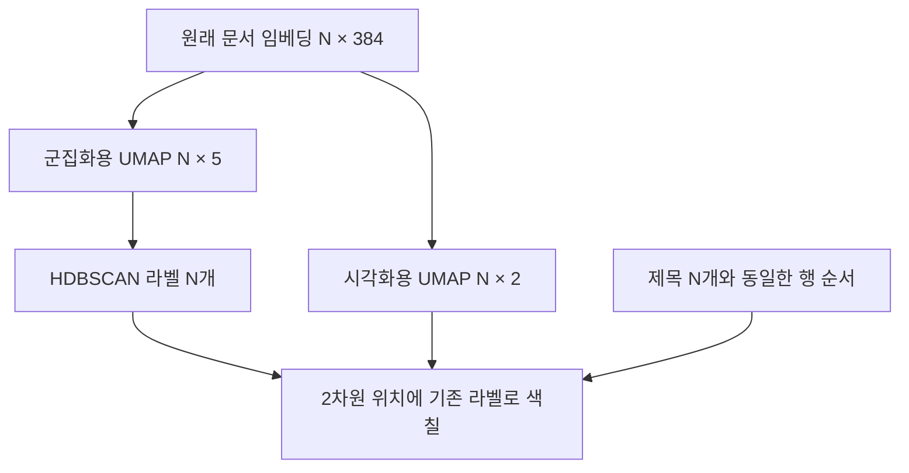
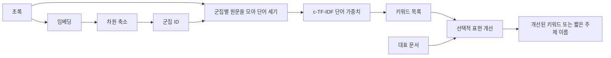
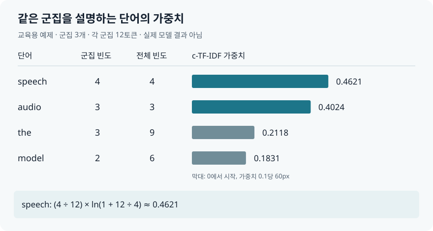
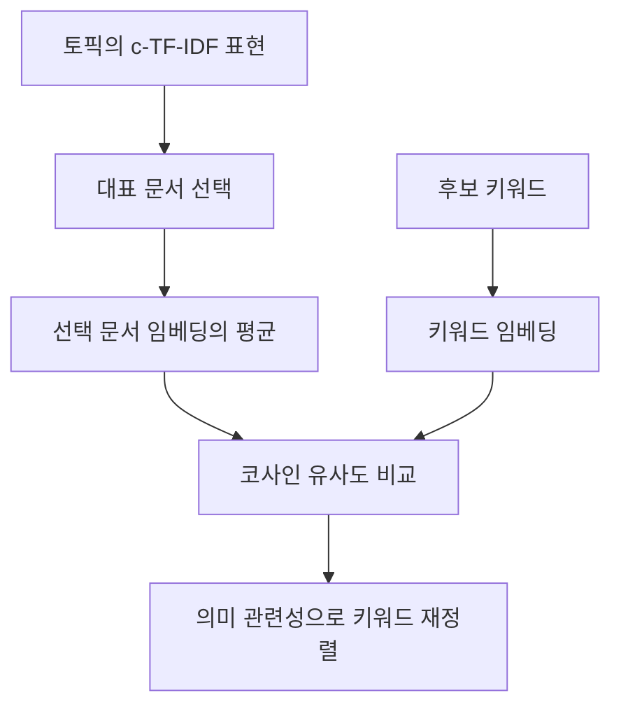

# 5장 텍스트 군집화와 토픽 모델링

[전체 목차](../../README.md) · [학습 노트](study.md) · [강의안](lecture.md) · [강의 대본](lecture-script.md) · [시각화](visuals.html) · [실습](lab-guide.md) · [문제와 해설](quiz.md)

이 장에서는 정답 라벨이 없는 문서 집합에서 비슷한 문서를 찾고, 그 묶음을 사람이 이해할 수 있는 주제로 설명하는 방법을 배운다. 핵심은 **군집의 구성과 군집의 설명을 분리하는 것**이다. 의미 임베딩으로 문서를 묶고, 단어 통계로 빠르게 설명한 다음, 필요에 따라 임베딩 모델이나 생성 모델로 설명을 다듬는다. 하나의 거대한 모델에 모든 일을 맡기는 대신 각 단계의 강점을 조합한다.

**원문:** Jay Alammar·Maarten Grootendorst, *Hands-On Large Language Models*, 2024년 초판, Chapter 5, PDF 물리 페이지 192–235. 이 자료의 모든 쪽수는 PDF 뷰어에 표시되는 물리 페이지다. 영문 절 제목은 원문 대응을 위한 것이며 본문은 독자적인 한국어 해설이다. `보충 설명`과 `교육용 예제`는 원문을 이해하기 위해 추가한 내용이다. 책의 모델·데이터·출력은 2024년 예제이며 현재 서비스 지원 여부나 최신 성능을 뜻하지 않는다.

## 학습 목표와 선수지식

공부를 마치면 다음을 설명하고 직접 계산할 수 있어야 한다.

- 분류, 군집화, 토픽 모델링이 각각 어떤 질문에 답하는지 구분한다.
- 문서 임베딩 → 차원 축소 → 밀도 기반 군집화의 입력·출력과 선택 이유를 설명한다.
- UMAP의 5차원 결과와 2차원 그림을 혼동하지 않고, 이상치와 토픽 번호를 올바르게 해석한다.
- 군집별 단어 빈도에서 c-TF-IDF를 계산하고 높은 가중치의 의미와 한계를 설명한다.
- KeyBERTInspired, MMR, 생성 모델의 역할 차이를 알고 같은 군집을 여러 관점으로 표현한다.
- 군집 구조와 토픽 이름의 품질을 따로 평가하고, 원문 문서를 근거로 결과를 검토한다.

선수지식은 2장의 문장 임베딩과 코사인 유사도, 4장의 텍스트 분류다. 임베딩은 문서를 고정 길이 실수 벡터로 나타낸 것, 코사인 유사도는 두 벡터의 방향이 얼마나 비슷한지 나타낸 값으로 기억하면 출발할 수 있다. Python의 리스트·딕셔너리와 행렬의 행/열 구분을 알면 실습을 따라갈 수 있다. UMAP이나 HDBSCAN을 처음 접해도 된다.

## 원문 대응 목차

| 원문 절 | 학습 노트 | PDF 쪽 |
|---|---|---:|
| 도입: Text Clustering and Topic Modeling | [문제 설정](#intro) | 192–193 |
| ArXiv’s Articles: Computation and Language | [데이터 이해](#sec-01) | 193–194 |
| A Common Pipeline for Text Clustering | [세 단계 파이프라인](#sec-02) | 194–195 |
| Embedding Documents | [문서 임베딩](#sec-03) | 195–196 |
| Reducing the Dimensionality of Embeddings | [차원 축소](#sec-04) | 196–199 |
| Cluster the Reduced Embeddings | [밀도 기반 군집화](#sec-05) | 199–201 |
| Inspecting the Clusters | [군집 검토](#sec-06) | 201–204 |
| From Text Clustering to Topic Modeling | [군집에서 토픽으로](#sec-07) | 204–206 |
| BERTopic: A Modular Topic Modeling Framework | [BERTopic와 c-TF-IDF](#sec-08) | 206–220 |
| Adding a Special Lego Block | [표현 개선과 MMR](#sec-09) | 220–228 |
| The Text Generation Lego Block | [생성 모델의 토픽 이름](#sec-10) | 228–233 |
| Summary | [통합 정리와 다음 장](#sec-11) | 233–235 |

<a id="intro" name="intro"></a>
## 1. 무엇을 알아내려는가

원문 PDF 192–193쪽, Figure 5-1과 5-2.

고객 문의 10만 건이 있다고 하자. 각 문의를 이미 정해진 `환불`, `배송`, `계정`에 배정한다면 분류 문제다. 반면 어떤 종류의 문의가 존재하는지조차 잘 모른다면, 먼저 비슷한 내용을 모아볼 수 있다. 이것이 텍스트 군집화다. 이후 각 묶음의 문서를 읽고 “배송 지연에 대한 불만”, “인증 메일 미수신” 같은 설명을 붙이면 토픽 모델링의 목적에 가까워진다.

군집화는 단순히 정답 라벨을 만드는 전처리만이 아니다. 데이터의 큰 구조를 탐색하고, 흔한 유형과 드문 유형을 나누고, 라벨링할 문서의 대표 표본을 고르는 데 쓸 수 있다. 이미 분류 라벨이 있다면, 같은 군집 안에서 혼자 다른 라벨을 가진 문서를 찾아 오표기를 의심할 수도 있다. 다만 “이웃과 다르다”는 사실만으로 오표기라고 확정해서는 안 된다. 드문 예외가 실제로 존재할 수 있으므로 사람이 문맥을 확인해야 한다.

| 구분 | 입력에 필요한 정보 | 출력 | 좋은 결과를 판단하는 질문 |
|---|---|---|---|
| 지도 분류 | 문서, 미리 정의한 범주, 보통 학습 라벨 | 범주 또는 범주별 점수 | 정답 범주를 얼마나 잘 맞혔는가? |
| 텍스트 군집화 | 문서와 유사도 표현 | 문서별 군집 ID, 경우에 따라 이상치 | 같은 군집 문서가 의미 있는 공통점을 갖는가? |
| 토픽 모델링 | 문서 집합 | 주제별 키워드·라벨·문서 관계 | 사람이 집합의 주제를 이해할 수 있는가? |

원문의 Figure 5-1은 정리되지 않은 문서가 유사성에 따라 묶이는 과정을, Figure 5-2는 그 묶음에 키워드와 대표 이름이 붙는 과정을 구분한다. **그룹 번호는 토픽의 뜻이 아니다.** `topic=7`은 식별자이고, “신경망 기계 번역”은 해석이다. 같은 문서 묶음을 유지한 채 라벨만 더 명확하게 바꿀 수 있다.

이 장은 encoder-only 모델의 임베딩, 전통적인 bag-of-words 통계, decoder 계열 또는 text-to-text 생성 모델을 함께 사용한다. 생성 모델만이 언어 AI의 유일한 부품은 아니다. 빠른 통계로 후보를 좁힌 뒤 비싼 의미 판단을 적용하는 구조가 비용과 설명 가능성을 모두 개선할 수 있다.

<a id="sec-01" name="sec-01"></a>
## 2. 데이터의 범위를 먼저 이해한다

원문 절: **ArXiv’s Articles: Computation and Language**, PDF 193–194쪽.

책의 분석 대상은 arXiv의 cs.CL, 즉 Computation and Language 영역 논문 초록이다. 책이 사용한 데이터는 1991년부터 2024년까지의 초록 **44,949개**를 담는다. 논문 제목은 결과를 탐색할 때 표시하고, 초록은 의미 임베딩과 군집화의 주요 입력으로 사용한다. 원문은 연도도 언급하지만 이 장에 제시된 초기 추출 코드에서는 `Abstracts`와 `Titles` 두 필드를 실제로 꺼낸다. 동적 토픽 분석을 추가하려면 연도 필드와 결측치를 따로 확인해야 한다.

책의 데이터셋 식별자는 `maartengr/arxiv_nlp`이고 학습 분할 이름은 `train`이다. 여기서 `train`이라는 이름은 데이터셋의 저장 방식이다. 지도학습용 정답 라벨로 분류기를 학습한다는 뜻이 아니다. 비지도 분석에 전체 초록을 사용할 수 있다.

```python
# 책의 2024년 예제를 이해하기 위한 구조 설명. 이 자료에서 다운로드 실행하지 않음.
dataset = load_dataset("maartengr/arxiv_nlp")["train"]
abstracts = dataset["Abstracts"]
titles = dataset["Titles"]
```

초록과 제목의 **행 정렬**이 중요하다. `abstracts[i]`와 `titles[i]`는 반드시 같은 논문이어야 한다. 초록의 결측 행을 제거하면서 제목 배열을 그대로 두면, 군집은 잘 계산되어도 화면에는 다른 논문의 제목이 표시된다. 따라서 실무에서는 ID, 초록, 제목, 연도 등을 한 표에 두고 같은 행 연산으로 정리한 뒤 배열을 만든다.

보충 설명: 데이터가 특정 연구 분야와 시기에 한정되어 있으므로 토픽은 “세상 모든 언어 연구의 객관적 분류 체계”가 아니라 **이 표본에서 이 표현과 설정으로 드러난 구조**다. 같은 모델도 고객 문의나 한국어 법률 문서에 적용하면 다른 군집을 만든다. 누락된 시기, 중복 초록, 문서 길이의 차이, 언어 혼합 여부를 확인하는 것은 모델 선택보다 앞서는 분석 작업이다.

공부할 때는 데이터 크기만 외우지 말고 세 가지를 질문한다. “한 행이 무엇인가?”, “모델이 실제로 읽는 텍스트는 무엇인가?”, “화면에 보이는 메타데이터가 그 행과 연결되어 있는가?” 이 질문에 답하면 이후의 임베딩 행렬과 시각화의 해석이 명확해진다.

<a id="sec-02" name="sec-02"></a>
## 3. 군집화의 세 단계 파이프라인

원문 절: **A Common Pipeline for Text Clustering**, PDF 194–195쪽.

문장끼리의 유사성을 알고 싶어도 일반적인 군집 알고리즘은 문장을 직접 읽지 못한다. 먼저 숫자 공간으로 옮긴다. 그다음 높은 차원에서 거리나 밀도를 판단하기 어려운 문제를 완화하기 위해 차원을 줄인다. 마지막으로 줄어든 공간에서 가까이 모인 문서들을 찾는다.


**행의 수 N은 모든 단계에서 유지된다.** 차원 축소는 문서 수를 44,949개에서 5개로 줄이는 작업이 아니다. 문서마다 갖는 384개의 좌표를 5개로 줄인다. 군집화의 출력은 문서마다 하나씩 붙은 군집 ID이므로 길이 N의 배열이다. 이 모양을 이해하면 대부분의 코드 연결 오류를 빨리 찾을 수 있다.

세 단계는 각각 다른 종류의 선택을 한다. 임베딩 모델은 무엇을 의미상 비슷하다고 보는지 결정한다. 차원 축소는 그 유사 관계의 어떤 부분을 저차원 공간에 보존할지 결정한다. 군집 알고리즘은 어떤 공간 구조를 하나의 묶음으로 인정할지 결정한다. 결과가 좋지 않을 때 무조건 마지막 알고리즘의 숫자만 바꾸면 근본 문제를 놓칠 수 있다.

예를 들어 “은행 대출”과 “강둑 침식”에서 영어 `bank`가 같은 표면형으로 등장해도 좋은 문맥 임베딩은 이를 구분할 수 있다. 그러나 임베딩이 잘못되었다면 UMAP은 잘못된 이웃 관계를 압축하고, 군집화는 잘못된 구조를 충실히 묶을 수 있다. 반대로 임베딩이 적절해도 차원 축소 설정이 너무 공격적이면 다른 주제가 섞일 수 있다.

이 파이프라인이 모든 문제에서 필수인 것은 아니다. 원문은 널리 쓰이는 한 가지 조합을 설명한다. 보충 설명으로, 데이터 크기·차원·선택한 군집법에 따라 원래 임베딩을 직접 군집화하거나 PCA로 줄일 수도 있다. 핵심은 세 단계가 해결하려는 문제와 입력·출력 계약을 이해하는 것이다.

<a id="sec-03" name="sec-03"></a>
## 4. 문서 임베딩은 군집화의 의미 기준이다

원문 절: **Embedding Documents**, PDF 195–196쪽, Figure 5-3.

각 초록은 하나의 벡터가 된다. 원문의 임베딩 모델은 `thenlper/gte-small`이며 결과 모양은 `(44949, 384)`이다. 384개 값 중 어느 하나가 반드시 “감성”, “번역”, “의료”처럼 사람이 이름 붙일 수 있는 단일 개념을 뜻하는 것은 아니다. 여러 성분이 함께 문서의 의미적 관계를 표현한다. 이 벡터들을 군집 알고리즘이 사용할 특징으로 본다.

원문은 모델을 고를 때 MTEB의 **군집화 과제 성능**과 모델 크기·속도를 함께 고려한다. 이전 장의 `sentence-transformers/all-mpnet-base-v2` 대신 작은 `gte-small`을 사용한 이유도 그 당시의 성능과 계산 비용의 균형 때문이다. 여기서 학습할 원칙은 “늘 이 모델을 고른다”가 아니라 “내가 하려는 과제에 맞는 평가를 보고 자원 제약도 고려한다”다. 책의 상대 성능 서술은 당시 비교이며 현재 순위를 의미하지 않는다.

```python
# 입력과 출력의 역할을 보여주는 책의 API 형태
embedding_model = SentenceTransformer("thenlper/gte-small")
embeddings = embedding_model.encode(abstracts, show_progress_bar=True)
# embeddings.shape == (문서 수, 임베딩 차원)
```

코사인 유사도는 두 벡터의 내적을 각 벡터의 길이로 나눈 값이다.

$$\operatorname{cos}(u,v)=\frac{\sum_{j=1}^{D}u_jv_j}{\sqrt{\sum_j u_j^2}\sqrt{\sum_j v_j^2}}$$

여기서 `u`, `v`는 각각 길이 D의 문서 벡터다. 분모로 크기를 나누므로 방향을 비교한다. 교육용 숫자 예제로 `u=(1,0)`, `v=(2,0)`의 유사도는 1이다. `w=(0,1)`은 `u`와 직각이므로 0이다. 실제 임베딩의 유사도는 학습 모델의 특성에 의존하며 0.9라는 값 자체를 “90% 같은 주제”라고 읽어서는 안 된다.

보충 설명: 문서 입력이 길면 모델의 입력 길이 제한 때문에 일부 텍스트가 잘릴 수 있다. 제목만 임베딩할지, 초록 전체를 넣을지, 장문을 나누어 처리할지는 군집 의미에 영향을 준다. 같은 수의 벡터 성분이 나왔다고 모든 문서 정보를 완벽히 담았다고 생각해서는 안 된다. 이 장의 작은 CPU 실습은 실제 임베딩 모델을 실행하지 않으며, 공간과 단어 통계의 역할을 분리해 관찰하기 위해 교육용 좌표를 사용한다.

확인 질문: Figure 5-3에서 한 문서가 여러 색의 숫자로 바뀐다. 그 숫자는 단어 출현 횟수인가? 이 단계에서는 아니다. 학습된 모델의 밀집 표현이다. 나중에 c-TF-IDF 단계에서 다시 단어 출현 횟수가 등장하므로 두 표현을 구분해야 한다.

<a id="sec-04" name="sec-04"></a>
## 5. 차원 축소는 단순히 열 몇 개를 버리는 일이 아니다

원문 절: **Reducing the Dimensionality of Embeddings**, PDF 196–199쪽, Figure 5-4와 5-5.

384차원 공간의 데이터를 사람이 직접 그려볼 수 없다는 문제와, 그 공간에서 군집의 밀도를 안정적으로 판단하기 어렵다는 문제는 서로 관련 있지만 다르다. 여기서는 우선 **군집화를 돕기 위해** 차원을 줄인다. Figure 5-4는 높은 차원의 관계를 낮은 차원으로 옮기는 압축을 보여주고, Figure 5-5는 그 결과를 군집화의 입력으로 전달한다.

보충 설명: 흔히 말하는 차원의 저주는 차원이 높아질수록 가능한 공간이 넓어지고 데이터가 상대적으로 성기게 분포하며, 거리의 대비가 약해지는 현상과 관련된다. “차원이 높으면 모든 군집법이 반드시 실패한다”는 뜻은 아니다. 의미 임베딩은 구조를 갖지만, 밀도 기반 기법에 더 적합한 공간으로 옮기는 과정이 도움이 될 수 있다.

PCA는 분산을 많이 설명하는 선형 방향을 찾는 방법이고, UMAP은 이웃 관계를 바탕으로 비선형 구조를 저차원에 배치하는 방법이다. 원문은 비선형 관계를 다루기 위해 UMAP을 택한다. 책에서 전체 구조의 보존을 언급하더라도, 어떤 축소 기법도 원래 공간의 모든 거리와 전역 구조를 그대로 보존하지는 못한다. 특히 UMAP 그림의 멀리 떨어진 섬 사이 거리를 정확한 의미 차이의 눈금으로 읽으면 안 된다.

| 요소 | 원문 값 | 이해할 의미 |
|---|---|---|
| `n_components` | `5` | 문서별 출력 좌표 수, 군집화를 위한 차원 |
| `min_dist` | `0.0` | 저차원에서 점들이 조밀하게 모이는 것을 허용 |
| `metric` | `"cosine"` | 입력 임베딩의 이웃 관계를 코사인 거리로 판단 |
| `random_state` | `42` | 확률적 처리의 재현성을 위한 난수 시드 |

`min_dist=0`은 “모든 가까운 문서가 반드시 동일 좌표가 된다”거나 “두 점 사이 거리가 항상 0이다”라는 뜻이 아니다. 저차원 배치에서 매우 조밀한 묶음을 허용하는 설정이다. 또한 HDBSCAN의 군집 최소 크기와는 다른 매개변수다. UMAP은 공간을 만들고 HDBSCAN은 그 공간을 묶는다.

책은 군집화 목적에서 대략 5–10차원을 실용적인 출발점으로 설명한다. 이는 이 책의 경험적 지침이며 모든 데이터에서 보장되는 최적값은 아니다. 차원을 너무 줄이면 별개의 주제를 구분하는 정보가 없어질 수 있고, 너무 높게 유지하면 밀도 추정의 어려움이 남을 수 있다. 결과를 볼 때는 토픽의 개수뿐 아니라 문서의 일관성과 이상치 비율도 함께 확인한다.

`random_state=42`를 고정하면 실험을 비교하기 편해진다. 원문은 시드 고정 시 UMAP의 병렬 처리 이점이 제한되어 학습이 느려질 수 있음을 설명한다. 보충 설명으로, 시드는 같은 환경에서의 재현성을 돕는 것이지 패키지 버전·운영체제·모델 파일이 달라도 비트 단위로 같은 결과가 난다는 보증은 아니다. 실험 기록에는 모델 이름, 라이브러리 버전, 데이터 버전도 남긴다.

가장 중요한 연결은 다음과 같다. **군집화는 5차원 좌표로 하고, 그림은 따로 만든 2차원 좌표로 그린다.** 그림에서 보기 예쁜 공간을 만들겠다는 목적과 알고리즘에 적합한 특징을 만들겠다는 목적을 구분한다.

<a id="sec-05" name="sec-05"></a>
## 6. HDBSCAN은 군집 수와 이상치를 데이터에서 찾는다

원문 절: **Cluster the Reduced Embeddings**, PDF 199–201쪽, Figure 5-6과 5-7.

k-means는 사용할 군집 수 `k`를 미리 정한다. 그리고 일반적인 사용에서는 모든 점을 어떤 중심에 배정한다. 그런데 논문 초록 집합에 어떤 세부 주제가 몇 개 존재하는지 사전에 알기 어렵다. 아주 특이한 논문을 억지로 흔한 주제에 넣고 싶지도 않다. 이 이유로 책은 밀도 기반 HDBSCAN을 택한다.

HDBSCAN은 DBSCAN의 계층적 확장이다. 가까운 점들이 충분히 조밀하게 연결되는 구조를 찾고, 여러 밀도 수준에서 나타나는 계층을 이용해 군집을 선택한다. 이 장은 내부 알고리즘을 모두 유도하기보다 “군집 수를 사전에 정하지 않아도 된다”, “어떤 군집에도 속하지 않는 점을 남길 수 있다”는 성질을 활용한다. Figure 5-7의 서로 다른 군집 그림은 알고리즘 선택이 결과의 모습과 해석을 바꾼다는 점을 보여준다.

```python
# 원문에서 사용한 핵심 설정
hdbscan_model = HDBSCAN(
    min_cluster_size=50,
    metric="euclidean",
    cluster_selection_method="eom",
).fit(reduced_embeddings)
clusters = hdbscan_model.labels_
```

`min_cluster_size=50`은 인정할 군집의 최소 규모를 정하는 핵심 설정이다. 더 작은 값을 주면 작은 주제를 발견할 가능성이 커지지만, 의미 없는 작은 파편이 늘 수도 있다. 값을 키우면 작은 주제들이 합쳐지거나 이상치로 남을 수 있다. 따라서 “작게 하면 언제나 정확해진다”가 아니다. 탐색하려는 주제의 세분화 수준과 문서 수에 맞게 선택한다.

`metric="euclidean"`은 여기서 이미 만들어진 저차원 좌표의 거리를 잰다는 뜻이다. UMAP의 입력 공간에서 코사인 거리를 사용한 것과 모순되지 않는다. 서로 다른 단계가 서로 다른 공간을 다룬다. `cluster_selection_method="eom"`은 계층에서 군집을 선택하는 방식이며, 원문에서는 Excess of Mass 방식의 설정 이름으로 등장한다. 이 자료의 CPU 실습에서 사용하는 간단한 DBSCAN은 이 계층 선택 절차를 재현하지 않는다.

라벨 `-1`은 어떤 군집으로도 배정되지 않은 문서다. 다른 모든 이상치끼리 서로 비슷하다는 뜻은 아니다. “미배정 문서 상자”를 하나의 일관된 주제로 오해해서는 안 된다. 독특한 논문, 여러 주제가 섞인 문서, 정보가 부족한 문서, 임베딩이 부적절한 문서 등이 함께 들어갈 수 있다.

### 원문의 156을 어떻게 읽어야 할까

책은 `len(set(clusters))`의 결과를 156으로 제시한다. 이 계산에는 `-1`이 존재할 경우 그것도 하나의 고유 값으로 포함된다. 뒤의 토픽 표에는 `0`부터 `154`까지의 일반 토픽과 `-1`이 나온다. 따라서 이 예제는 **일반 토픽 155개와 이상치 라벨 1개, 합계 고유 라벨 156개**로 읽는 것이 정확하다. 일반 토픽 수는 다음처럼 별도로 센다.

```python
n_topics = len(set(clusters) - {-1})
outlier_count = sum(label == -1 for label in clusters)
```

이 작은 구분은 보고서에서 중요하다. “주제가 156개 발견되었다”와 “유효 토픽 155개이며 미배정 문서가 별도로 있다”는 데이터의 해석이 다르다. 군집화 결과를 요약할 때는 일반 토픽 수, 크기 분포, 미배정 문서 수와 비율을 함께 기록한다.

<a id="sec-06" name="sec-06"></a>
## 7. 군집 번호를 해석하기 전에 문서를 읽는다

원문 절: **Inspecting the Clusters**, PDF 201–204쪽, Figure 5-8.

책은 군집 0에 속한 문서 몇 개를 살펴본다. 예시 초록들은 영어에서 미국 수어로의 번역, 수어의 언어학적·동작적 특징, 수어 번역 시스템의 한계를 다룬다. 여러 문서에서 공통점이 반복되므로 “수어 번역과 관련된 묶음 같다”는 해석을 얻는다. 단 한 문서만 보고 군집 이름을 정하면 그 문서만의 특수한 세부 내용이 전체 주제처럼 과장될 수 있다.

원문의 설명은 몇 문서를 살펴본다고 말하고 실제 코드는 조건에 맞는 인덱스의 `[:3]`, 즉 **앞의 세 문서**를 선택한다. 무작위 표본 추출 코드는 아니다. 보충 설명으로, 학습용 첫 확인에는 충분할 수 있지만 체계적인 평가는 대표 문서, 임의 표본, 경계 문서, 다른 시기의 문서를 섞어 읽는 편이 좋다. 정렬된 데이터에서 앞의 세 행만 읽으면 특정 시기나 하위 주제에 치우칠 수 있다.

문서를 모두 읽기 어려우므로 2차원 시각화를 만든다. 원문은 원래의 384차원 임베딩에서 별도 UMAP을 실행하고 `n_components=2`로 설정한다. 두 좌표는 그림의 x/y 위치이며, 앞서 계산한 군집 ID를 색으로 붙인다. **2차원 그림을 만든 뒤 새로 군집화하는 코드가 아니다.**



그림을 해석할 때 주의할 점이 세 가지 있다. 첫째, 차원 축소는 정보를 잃으므로 겹쳐 보이는 점들이 원래 임베딩에서도 가깝다고 단정할 수 없다. 둘째, 다른 색의 군집이 크게 떨어졌다고 해서 그 거리의 크기가 정확한 의미 차이에 비례하지 않는다. 셋째, 많은 군집에 제한된 색상표를 사용하면 같은 색이 반복되므로 “초록 점은 전부 같은 군집”이라고 읽을 수 없다. 원문의 Figure 5-8도 색이 순환된다는 점을 설명한다.

원문 코드에서는 중간에 `to_plot`, `outliers`라는 이름으로 표를 만들고 뒤의 그리기 코드에서는 `clusters_df`, `outliers_df`라는 이름을 사용한다. 노트북을 옮겨 실행할 때는 이 이름을 일치시켜야 한다. 다음처럼 역할별 이름을 통일하면 오류와 혼동을 줄일 수 있다.

```python
# 코드 연결을 설명하는 수정 예시: 5차원과 2차원 변수도 구분한다.
cluster_coords = umap_for_cluster.fit_transform(embeddings)
labels = clusterer.fit_predict(cluster_coords)
plot_coords = umap_for_plot.fit_transform(embeddings)
# 데이터 프레임 작성 후
clusters_df = df[df["cluster"] != -1]
outliers_df = df[df["cluster"] == -1]
```

여기서는 `cluster` 열을 정수로 유지했다. 문자열로 저장했다면 비교값도 `"-1"`이어야 한다. 정수 `-1`과 문자열 `"-1"`의 혼용 때문에 이상치가 필터링되지 않는 경우가 흔하다. 이 장의 시각화에는 군집 수와 미배정 수를 따로 표시하여 이런 의미를 눈으로 확인할 수 있게 했다.

보충 설명: 좋은 군집 검토 기록에는 “대표적인 세 문서의 공통점”, “맞지 않는 반례 한 개”, “어떤 경계를 기준으로 이웃 주제와 나눴는가”가 포함된다. 예를 들어 음성 인식과 수어 번역은 모두 인간 언어 처리이지만 입력 양식과 연구 문제가 다르다. 사람이 어떤 수준의 주제를 원하는지에 따라 둘을 구분하거나 더 큰 언어 기술 주제 아래 묶을 수 있다. 군집화 결과를 정답 분류 체계처럼 취급하지 않는 이유다.

<a id="sec-07" name="sec-07"></a>
## 8. 군집을 토픽으로 설명하기

원문 절: **From Text Clustering to Topic Modeling**, PDF 204–206쪽, Figure 5-9와 5-10.

우리가 수어 논문들을 읽고 공통 주제를 찾아 이름 붙인 일을 자동화하고 싶다. 전통적인 토픽 모델링은 하나의 짧은 이름 대신 여러 키워드로 주제를 표현하는 경우가 많다. 예를 들어 `sign`, `language`, `translation` 같은 단어 묶음을 보여주고 사람이 “수어 번역”이라고 이해한다. Figure 5-9는 토픽이 키워드만으로도, 더 풍부한 형태로도 표현될 수 있다는 점을 보여준다.

LDA 같은 고전적인 접근은 각 토픽을 어휘에 대한 확률분포로 표현한다. Figure 5-10처럼 주제마다 어떤 단어가 더 높은 관련성을 갖는지 본다. 보충 설명으로, LDA는 문서가 여러 토픽의 혼합일 수 있다는 생성적 가정을 사용한다. 따라서 “문서 하나를 군집 하나에 넣는 BERTopic의 기본 경로”와 LDA를 동일한 알고리즘으로 보면 안 된다. 이 장은 토픽 모델링 전체를 군집화와 같다고 정의하는 것이 아니라, **군집화를 바탕으로 토픽을 발견하는 방법 하나**를 설명한다.

고전적 bag-of-words는 단어 수를 세므로 빠르고 해석하기 쉽다. 그러나 순서, 문맥, 동음이의어의 의미를 직접 모델링하지 않는다. 앞의 임베딩 기반 군집화는 문맥을 반영한 의미 공간을 활용한다. BERTopic은 이 둘 중 하나를 완전히 버리지 않고, 문서의 묶음은 임베딩으로 만들고 묶음의 설명은 단어 통계로 빠르게 얻는다.

| 관찰 대상 | 질문 | 사용할 수 있는 표현 |
|---|---|---|
| 문서 간 관계 | 어떤 문서들이 의미상 비슷한가? | 문서 임베딩과 거리 |
| 군집 내 어휘 | 이 군집을 설명하는 단어는 무엇인가? | 군집별 단어 빈도와 c-TF-IDF |
| 사람이 읽는 이름 | 이 자료들을 한 문장으로 어떻게 부를까? | 대표 키워드·문서에 근거한 생성 라벨 |

토픽이라는 말이 같은 장에서도 여러 형태로 등장하므로, 보고할 때는 “토픽 ID”, “키워드 표현”, “생성 라벨”을 구분한다. 예를 들어 ID 12의 키워드가 `clinical`, `patient`, `ehr`이며 생성 라벨이 “임상 기록의 자연어 처리”일 수 있다. 세 표현은 같은 객체의 서로 다른 속성이다.

<a id="sec-08" name="sec-08"></a>
## 9. BERTopic의 두 부분과 c-TF-IDF

원문 절: **BERTopic: A Modular Topic Modeling Framework**, PDF 206–220쪽.

### 9.1 문서를 묶는 모델과 설명하는 모델을 분리한다

Figure 5-11은 앞서 배운 임베딩 → 축소 → 군집화 세 단계를 그대로 사용한다. Figure 5-12부터 5-16은 그 뒤에 단어 세기와 가중치 계산을 붙인다. 핵심은 모델 이름에 `BERT`가 들어 있다고 해서 반드시 특정 BERT 모델 한 개만 사용해야 하는 것이 아니라는 점이다. 이 장에서 실제로 선택한 문서 임베딩은 `gte-small`이며, 다른 임베딩이나 군집 방법으로 교체할 수 있다.



이 분리가 중요한 이유는 두 부분의 변경 비용이 다르기 때문이다. 군집의 문서 구성은 이미 만족스러운데 키워드에 `the`나 비슷한 단어가 너무 많다면, 처음부터 전체 임베딩과 군집화를 다시 실행할 이유가 없다. 표현 단계만 다시 계산하거나 개선할 수 있다. 반대로 군집 안에 서로 관계없는 문서들이 뒤섞여 있다면 멋진 이름을 붙이는 것으로 문제를 해결할 수 없다.

### 9.2 문서별 빈도를 군집별 빈도로 바꾼다

일반 bag-of-words는 문서×어휘 행렬이다. 행은 문서, 열은 단어이고 값은 출현 횟수다. Figure 5-12는 이 계수 과정을 보여준다. 하지만 우리는 문서 하나가 아니라 **군집 전체**를 설명하고 싶다. 따라서 같은 군집에 속한 문서들의 단어 수를 합한다. Figure 5-13의 c-TF에서 `c`는 class, 이 문맥에서는 군집을 뜻한다. 사람이 준 지도 분류 정답이 있어야 한다는 뜻이 아니다.

군집 c에서 단어 x가 나온 횟수를 `f(x,c)`라고 하자. 군집의 전체 단어 수가 `L_c = Σ_x f(x,c)`이면 정규화한 군집 내 빈도는 다음과 같다.

$$\operatorname{cTF}(x,c)=\frac{f(x,c)}{L_c}$$

큰 군집이 단순히 문서 수가 많다는 이유로 모든 단어에서 큰 값을 갖지 않도록 군집 전체 길이로 나눈다. 이때 한 행의 cTF 값들을 모두 더하면 1이다. 원문 Figure 5-15의 정규화 표기를 해석할 때 필요한 단계다. 빈도 자체와 정규화한 빈도를 구분해야 크기가 다른 군집을 비교할 수 있다.

### 9.3 전체적으로 흔한 단어의 힘을 줄인다

어떤 군집에서 많이 등장한 단어가 반드시 그 군집을 잘 설명하는 것은 아니다. 거의 모든 논문에 `model`이나 `the`가 많다면 그 단어는 특정 토픽을 구별하는 데 덜 유용하다. Figure 5-14와 5-15가 이 문제를 위한 가중치를 보여준다.

군집 수를 C, 단어 x의 전체 출현 횟수를 `F_x = Σ_c f(x,c)`, 군집당 평균 단어 수를 `A = (Σ_c L_c)/C`라고 두면 이 장에서 설명하는 기본 가중치는 다음과 같다.

$$\operatorname{IDF}(x)=\log\left(1+\frac{A}{F_x}\right)$$

$$w(x,c)=\operatorname{cTF}(x,c)\operatorname{IDF}(x)$$

`log`는 자연로그로 계산한다. `+1`은 로그의 인자 내부에 있다. `log(A/F_x)+1`과 다르다. 또한 `F_x`는 그 단어를 포함하는 **문서의 수가 아니라 전체 출현 횟수**다. 일반 문서 TF-IDF에서 자주 보는 문서 빈도 공식을 그대로 끼워 넣지 않는다. 이 정의에서 A는 군집별 총 단어 수의 평균이다. 단어 하나의 평균 빈도와 혼동하지 않는다.

교육용 예제로 세 토픽의 총 단어 수가 각각 12라고 하자. 각 토픽에 `model`이 2번, `the`가 3번 있고, 음성 토픽에만 `speech`가 4번 있다고 하자. 이때 A는 12다.

| 단어 | 음성 토픽 빈도 | 전체 빈도 F | cTF | IDF | 음성 토픽 가중치 |
|---|---:|---:|---:|---:|---:|
| `speech` | 4 | 4 | 4/12 | ln(1+12/4)=1.3863 | 0.4621 |
| `model` | 2 | 6 | 2/12 | ln(1+12/6)=1.0986 | 0.1831 |
| `the` | 3 | 9 | 3/12 | ln(1+12/9)=0.8473 | 0.2118 |



`speech`는 해당 토픽에 자주 나오면서 전체로는 상대적으로 덜 흔해 높은 점수를 받는다. 흥미롭게도 `the`의 가중치가 `model`보다 여전히 높다. 이 사실이 **c-TF-IDF가 모든 불용어를 마법처럼 제거하지는 않는다**는 점을 보여준다. 군집 내 빈도도 곱해지기 때문이다. 실제 원문의 토픽 0 키워드에도 `the`가 남는다. 이후 표현 개선 블록이 필요한 이유다.

c-TF-IDF 값은 단어를 정렬하는 가중치다. 합이 반드시 1인 확률분포가 아니며 “이 단어가 주제를 맞힐 확률”도 아니다. 원문에서 단어에 대한 분포라고 설명하는 부분은 주제별 어휘 가중치 패턴으로 읽어야 한다. 확률처럼 표시하려면 별도의 정규화와 해석이 필요하다.

보충 설명: 실제 구현에는 불용어 처리, n-gram, 빈도 조정 등 다양한 선택지가 있을 수 있다. 이 자료의 실습은 위의 기본 공식을 투명하게 계산한다. 패키지의 모든 선택적 모드를 흉내내지는 않는다. 어휘 전처리를 바꾸면 빈도와 총 길이가 모두 달라지므로 c-TF-IDF 결과도 바뀐다는 점을 관찰하면 된다.

### 9.4 모듈성은 교체할 수 있는 경계를 뜻한다

Figure 5-17은 임베딩, 차원 축소, 군집화, 단어 추출, 가중치 모델을 교체 가능한 블록으로 그린다. HDBSCAN의 이상치가 분석 목적에 맞지 않으면 k-means 같은 방법을 쓸 수 있다. 다만 모든 문서를 배정했다는 사실이 모든 배정이 타당하다는 뜻은 아니다. 미배정이 사라지는 대신 애매한 문서가 가장 덜 나쁜 군집에 강제로 들어갈 수 있다.

원문의 모듈성 상자에는 guided, (semi-)supervised, hierarchical, dynamic, multimodal, multi-aspect, online/incremental, zero-shot 토픽 모델링이 열거된다. 이 장에서 각각의 상세 알고리즘을 구현하지는 않지만 용어의 역할은 알아두자.

| 변형 | 핵심적으로 추가되는 관점 | 해석할 때의 질문 |
|---|---|---|
| Guided | 관심 주제를 씨앗 정보 등으로 반영 | 탐색이 얼마나 유도되었는가? |
| (Semi-)supervised | 일부 또는 전체 라벨 정보를 활용 | 주어진 라벨 밖의 구조도 볼 수 있는가? |
| Hierarchical | 주제의 상하위 관계 | 큰 주제를 어떤 하위 주제로 나눌 것인가? |
| Dynamic | 시간에 따른 주제 변화 | 주제의 빈도·표현이 언제 어떻게 변하는가? |
| Multimodal | 텍스트 외 양식도 포함 | 서로 다른 입력의 의미를 어떻게 연결하는가? |
| Multi-aspect | 한 토픽에 여러 표현을 유지 | 키워드·이름·다른 설명이 일치하는가? |
| Online/incremental | 새 데이터를 순차 반영 | 과거 주제와 새 주제의 대응을 어떻게 관리하는가? |
| Zero-shot | 미리 제시한 관심 주제와 연결 | 사전 주제와 무관한 문서를 어떻게 처리하는가? |

보충 표의 질문들은 실제 적용 시 생각할 관점이다. 이 장에서 모든 변형의 실행이나 품질이 검증되었다는 뜻은 아니다. “모듈이 있으니 아무 조합이나 의미가 있다”는 결론도 피한다. 각 블록의 입력·출력 형태와 학습 목적이 맞아야 한다.

### 9.5 책의 BERTopic 실행과 결과 읽기

책은 기존 임베딩과 UMAP/HDBSCAN 객체를 BERTopic에 전달하고 `.fit(abstracts, embeddings)`를 호출한다. 임베딩을 이미 만들어 두었으면 재사용하여 동일한 표현에서 설정을 비교할 수 있다. `verbose=True`는 진행 정보를 보여주는 설정이다. 핵심 흐름은 다음과 같다.

```python
# 2024년 원문의 조합을 이해하는 예시. 실제 패키지 실행은 이 자료에서 미수행.
topic_model = BERTopic(
    embedding_model=embedding_model,
    umap_model=umap_model,
    hdbscan_model=hdbscan_model,
    verbose=True,
).fit(abstracts, embeddings)
```

`get_topic_info()`의 `Topic`은 ID, `Count`는 배정 문서 수, `Name`은 키워드를 이어 붙인 빠른 요약이다. 책의 예에는 `-1`에 14,520개 문서가 있고, 일반 토픽 0에는 2,290개가 있다. 전체 44,949개 기준 미배정 비율은 약 32.3%다. 이 수치는 책의 한 실행 결과이며 알고리즘의 일반적인 이상치 비율이 아니다. 무시할 크기가 아니므로 목적에 따라 미배정 문서도 검토해야 한다.

원문은 이상치를 없애려면 이상치 배정을 하지 않는 다른 군집법을 쓰거나 `reduce_outliers()`로 재배정할 수 있다고 소개한다. 보충 설명으로, 재배정은 어떤 기준과 임계값으로 문서를 기존 토픽에 넣을지 결정하는 후속 작업이다. 미배정 수를 0으로 만드는 것만 목표로 삼으면 토픽의 일관성이 떨어질 수 있다. 재배정 전후 문서를 표본 검토하고 결과를 비교해야 한다.

`get_topic(0)`은 `speech`, `asr`, `recognition`, `acoustic` 등과 각 가중치를 반환한다. 여기서 ASR은 automatic speech recognition의 약어이므로 “자동 음성 인식”이라는 주제가 떠오른다. 숫자가 큰 키워드가 상위에 있지만 한 단어만 보고 확정하지 말고 대표 문서를 함께 읽는다. 군집화 단계의 군집 0은 수어 관련 문서였지만 BERTopic의 토픽 0은 음성 인식이다. 후속 처리에서 번호가 재정렬될 수 있으므로 서로 다른 결과 객체의 같은 번호를 같은 주제라고 가정하지 않는다.

`find_topics("topic modeling")`은 검색 구문과 가까운 토픽들을 찾는다. 책의 결과에서는 토픽 22가 약 0.95 유사도로 첫 번째다. 이는 검색 쿼리와의 임베딩 유사도이며 95% 정확도나 95% 정답 확률이 아니다. 결과에 `-1`도 나타나므로 검색 결과가 항상 해석 가능한 정상 토픽으로만 구성된다고 가정하지 않는다.

책은 `get_topic(22)`에서 `topic`, `topics`, `lda`, `latent`, `dirichlet` 같은 단어를 확인하고, BERTopic 논문 제목의 행 인덱스를 찾아 `topic_model.topics_[index]`가 22인지 확인한다. 이 검증은 알고리즘을 이해하는 좋은 방식이다. “그럴듯한 단어가 나왔다”에서 멈추지 않고, 해당 주제에 속해야 할 구체적인 문서가 실제로 들어가는지 확인한다. 다만 논문 한 편이 올바르게 들어간 사실로 전체 토픽 품질이 검증된 것은 아니다.

### 9.6 BERTopic 결과를 시각적으로 탐색한다

`visualize_documents()`는 문서별 위치와 토픽을 인터랙티브하게 보여준다. 원문은 `titles`를 표시 텍스트로 전달하고, 이미 만든 2차원 `reduced_embeddings`를 사용한다. `hide_annotations=True`는 복잡한 그림의 주석을 숨기고, `width=1200`은 출력 크기를 조절한다. Figure 5-18처럼 제목과 토픽을 함께 보면 숫자 점군이 실제 논문 집합으로 연결된다. 범례에서 특정 토픽만 골라 보는 행동은 전체 윤곽에서 세부 문서로 내려가는 탐색을 돕는다.

추가로 소개한 세 그림은 서로 다른 질문에 답한다. `visualize_barchart()`는 토픽별 상위 키워드와 가중치를 비교한다. `visualize_heatmap(n_clusters=30)`은 토픽 사이 유사성을 보기 쉽게 묶어 보여준다. 여기의 `n_clusters`를 앞서 만든 문서 토픽 수를 무조건 30으로 다시 학습한다는 뜻으로 읽지 않는다. `visualize_hierarchy()`는 토픽 간 잠재적인 계층 구조를 살펴보게 한다. 계층도는 사람이 정한 엄밀한 분야 분류 체계와 동일하지 않으므로 이름과 문서를 함께 확인한다.

분석 보고서에는 한 장의 예쁜 지도만 넣기보다 지도, 대표 키워드, 대표 문서, 반례를 연결하는 편이 좋다. 그래야 저차원 투영의 왜곡이나 생성된 설명의 과장을 독자가 점검할 수 있다.

<a id="sec-09" name="sec-09"></a>
## 10. 표현 개선 블록으로 키워드를 다듬는다

원문 절: **Adding a Special Lego Block**, PDF 220–228쪽, Figure 5-19부터 5-22.

### 10.1 빠른 후보 생성과 정교한 재정렬

c-TF-IDF는 의미 있는 출발점을 빠르게 만든다. 하지만 단어 순서나 의미적 관계를 직접 고려하지 않는 bag-of-words의 한계를 갖는다. “좋은 후보를 빠르게 많이 찾고, 그 후보를 더 정교한 기준으로 정렬한다”는 방식으로 이를 개선할 수 있다. Figure 5-19는 최초 가중치 목록의 순서를 바꾸는 과정을 보여주고, Figure 5-20은 이 표현 블록이 c-TF-IDF 다음에 붙는 구조를 보여준다.

원문은 이 블록을 representation model이라고 부른다. 1장 등에서 말한 “표현용 언어 모델”과 문맥이 다르다는 점에 주의한다. 여기서는 BERTopic의 **토픽 표현을 만드는 인터페이스/부품**을 뜻하므로 임베딩 기반 방식뿐 아니라 MMR, 생성 모델도 들어갈 수 있다. Figure 5-21은 다양한 블록을 교체하거나 이어 붙일 수 있다는 점을 강조한다.

계산 비용 측면에서도 유리하다. 문서가 백만 개이고 토픽이 100개라면 비싼 설명 작업을 문서마다 하기보다 토픽마다 수행한다. 단, 토픽 표현 블록 내부에서 대표 문서나 키워드를 임베딩하는 추가 계산은 여전히 존재한다. “토픽 수만큼 호출한다”는 것은 전체 문서 생성 호출을 피하는 구조적 이점이지 모든 내부 연산이 정확히 100번뿐이라는 뜻은 아니다.

원문은 비교를 위해 기존 `topic_representations_`를 `deepcopy`로 저장한다. 단순 대입으로 같은 객체를 참조하면 후속 갱신이 원본 비교 자료까지 바꿀 수 있기 때문이다. 이후 `get_topic(topic_id)`의 상위 다섯 단어를 꺼내 기존 표현과 새 표현을 나란히 보여준다. 좋은 실험 설계의 원칙은 **군집 구성을 고정한 채 표현 방법만 바꿔 비교하는 것**이다.

### 10.2 KeyBERTInspired의 의미 재정렬

원문의 하위 주제: **KeyBERTInspired**, PDF 223–225쪽.

KeyBERT는 문서 임베딩과 키워드 임베딩의 코사인 유사도로 문서를 잘 대표하는 키워드를 찾는 접근이다. BERTopic의 KeyBERTInspired는 이 생각을 토픽 단위로 적용한다. 절차를 차례로 풀면 다음과 같다.

1. c-TF-IDF 기반으로 토픽을 대표할 문서들을 고른다. 단순히 군집의 맨 앞 문서를 사용하는 것과 다르다.
2. 선택한 대표 문서들을 임베딩하고 평균하여 토픽의 의미 벡터를 만든다.
3. 후보 키워드도 같은 의미 공간으로 임베딩한다.
4. 토픽 벡터와 후보 키워드 벡터의 코사인 유사도로 단어를 재정렬한다.



이 도식은 Figure 5-22의 핵심을 독립적으로 다시 설명한 것이다. 문서 빈도 기반 대표성으로 문서를 고르고, 그 문서의 의미 임베딩으로 키워드를 평가한다. 두 종류의 표현을 번갈아 사용하는 이유가 있다. 첫 단계는 빠르게 신뢰할 만한 요약 표본을 만들고, 마지막 단계는 단어의 의미를 고려한다.

원문의 코드는 `KeyBERTInspired()`를 만든 뒤 `update_topics(abstracts, representation_model=...)`로 토픽 표현을 갱신한다. 차원 축소와 군집화를 다시 할 필요가 없다. 군집에 속한 문서 목록을 유지하면서 화면에 보이는 단어만 달라질 수 있다.

하지만 의미 모델의 취향이 항상 도메인 전문가의 취향과 같지는 않다. 원문 예에서는 기계 번역의 중요한 약어 `nmt`가 빠지고 `translation`, `translating`, `translate` 계열 표현이 강조된다. 일반적으로 읽기는 쉬워졌지만 전문가에게 중요한 신경망 기계 번역의 정보가 줄 수 있다. 임베딩이 약어를 충분히 표현하지 못하거나 일반적인 단어들을 더 가깝게 평가할 수 있기 때문이다.

이 결과에서 배울 점은 “재정렬 후 키워드는 언제나 더 정확하다”가 아니다. 불용어가 줄었는지, 약어가 보존되었는지, 거의 같은 단어의 반복이 생겼는지, 원문 대표 문서와 일치하는지를 따로 본다. 이 중 반복 문제를 직접 겨냥하는 것이 MMR이다.

### 10.3 MMR은 관련성과 새로움을 함께 평가한다

원문의 하위 주제: **Maximal marginal relevance**, PDF 226–228쪽.

`summarization`, `summary`, `summaries`를 모두 보여주면 주제가 요약이라는 점은 잘 드러나지만 제한된 키워드 자리를 비슷한 표현이 차지한다. 그 대신 `extractive`, `document`, `rouge` 등을 함께 보여주면 요약 방식과 평가의 측면을 더 풍부하게 전달할 수 있다. MMR은 이런 중복을 줄이면서 주제와의 관련성을 유지하려는 선택 기법이다.

후보 키워드 집합을 K, 이미 선택한 단어 집합을 S, 토픽 벡터를 t, 다양성 비중을 d라고 하자. 다음 식은 이 장의 아이디어를 계산 가능하게 적은 보충 설명이다.

$$\operatorname{score}(k)=(1-d)\operatorname{cos}(k,t)-d\max_{s\in S}\operatorname{cos}(k,s)$$

첫 항은 주제 관련성이다. 두 번째 항은 이미 뽑은 단어 중 가장 비슷한 단어와의 중복 벌점이다. 첫 단어는 보통 토픽과 가장 관련 있는 후보를 선택하고, 그 뒤 남은 후보들의 점수를 매번 다시 계산한다. 최대 유사도를 쓰는 이유는 이미 선택한 **하나의 단어와만 심하게 겹쳐도** 새 정보가 적다고 볼 수 있기 때문이다.

예를 들어 후보 A의 주제 관련성이 0.95이고 선택된 단어와의 최대 유사도가 0.98, 후보 B는 각각 0.80과 0.30이라고 하자. d=0.2이면 A의 점수는 `0.8×0.95−0.2×0.98=0.564`, B는 `0.8×0.80−0.2×0.30=0.580`이다. B의 주제 관련성이 조금 낮아도 중복이 훨씬 적어서 선택될 수 있다. d=0이면 관련성만 본다. d를 지나치게 크게 하면 덜 관련된 단어가 다양하다는 이유로 선택될 수 있으므로 결과를 확인해야 한다.

원문 예의 설정은 `MaximalMarginalRelevance(diversity=0.2)`다. 30개 정도의 후보에서 10개처럼 더 작고 다양한 집합을 고르는 상황을 설명한다. MMR은 새로운 단어를 창작하지 않고 후보를 선택한다. 처음 후보에 중요한 도메인 단어가 없으면 MMR만으로 되찾을 수 없다. 또한 여기서 바뀌는 것은 문서 군집 자체가 아니라 토픽의 키워드 목록이다.

원문의 결과 표에서 음성 토픽은 `speech`, `asr`, `error`, `model`, `training` 등을 보여주고, 요약 토픽은 요약 계열 단어의 반복을 줄이고 다른 측면을 포함한다. 이것이 보기에 다양해졌다는 관찰은 가능하지만, 추가된 모든 단어가 항상 좋은 설명이라는 결론은 문서를 확인한 뒤 내려야 한다.

| 방법 | 판단에 쓰는 주요 정보 | 직접 해결하려는 문제 | 남는 한계 |
|---|---|---|---|
| c-TF-IDF | 군집 내 빈도와 전체 빈도 | 빠르고 구별되는 키워드 출발점 | 문맥·중복·불용어 문제 |
| KeyBERTInspired | 대표 문서와 후보의 의미 임베딩 | 의미 관련성 강화 | 약어 손실, 유사 단어 반복 |
| MMR | 관련성과 선택된 단어와의 유사성 | 키워드 중복 감소 | 후보 누락, 과도한 다양성 |
| 생성 라벨 | 키워드와 대표 문서, 프롬프트 | 사람이 읽을 짧은 이름 | 과장·모호함·근거 밖의 내용 |

<a id="sec-10" name="sec-10"></a>
## 11. 생성 모델은 토픽에 읽기 쉬운 이름을 붙인다

원문 절: **The Text Generation Lego Block**, PDF 228–233쪽, Figure 5-23과 5-24.

### 11.1 문서마다 생성하지 말고 토픽의 근거를 요약한다

생성 모델을 이용해 백만 개 문서마다 주제를 묻게 되면 호출 수와 입력 토큰 수가 매우 커진다. 이미 군집이 있다면 토픽마다 대표 문서 몇 개와 키워드를 넣고 짧은 주제 이름을 요청할 수 있다. Figure 5-23은 이 두 종류의 근거를 프롬프트로 전달하는 구조다.

`[DOCUMENTS]`는 해당 토픽을 대표하는 문서 부분으로, 원문은 보통 네 개 정도를 설명한다. 선택 기준은 토픽의 c-TF-IDF 벡터와 문서의 c-TF-IDF 벡터 사이 코사인 유사도다. `[KEYWORDS]`에는 앞 단계의 키워드 표현이 들어간다. c-TF-IDF 결과를 바로 쓸 수도 있고 다른 표현 블록으로 개선한 키워드를 사용할 수도 있다.


생성 결과는 문서를 새로 군집화하는 출력이 아니라 **기존 군집을 설명하는 메타데이터**다. 이름이 달라져도 문서 배정은 그대로일 수 있다. 계산 횟수가 문서 수 N보다 훨씬 작은 토픽 수 C에 비례하는 점이 장점이다. 다만 실제 비용에는 토픽마다 넣는 문서 길이, 재시도, 생성 길이도 영향을 준다.

보충 설명: 대표 문서 네 개가 군집 전체의 모든 하위 주제를 담는다는 보장은 없다. 생성 모델이 그 네 개의 특징을 전체 군집의 특징처럼 이름에 넣을 수 있다. 예를 들어 음성 인식 전반의 토픽인데 대표 문서들이 우연히 저자원 언어에 집중하면 “저자원 음성 인식”이라는 너무 좁은 라벨이 나올 수 있다. 다른 표본도 읽어 이름의 범위를 검증한다.

### 11.2 Flan-T5 예제에서 배울 점

원문은 `google/flan-t5-small`을 `text2text-generation` 파이프라인으로 사용하고, BERTopic의 `TextGeneration` 표현 블록에 프롬프트를 전달한다. “여기 문서와 키워드가 있다. 어떤 주제인가?”라는 입력을 출력 이름으로 변환한다. 이 모델은 encoder-decoder text-to-text 계열이다. 모든 생성 예제를 decoder-only 구조라고 일괄 부르지 않는다.

원문 설정 `doc_length=50`, `tokenizer="whitespace"`는 대표 문서 길이를 공백 분리 기준으로 제한하는 방식이다. 이것을 실제 모델 토크나이저의 50개 서브워드 토큰 제한과 동일하게 읽으면 안 된다. 공백 기준 단어 수와 모델 입력 토큰 수는 다르며, 대표 문서를 너무 짧게 자르면 중요한 분야 정보가 빠질 수 있다.

책의 결과에는 요약 주제에 대한 “Summarization”처럼 적절해 보이는 이름도 있고, 의료·임상·생의학 관련 키워드를 너무 넓은 “Science/Tech”로 부르는 경우도 있다. 학습 포인트는 문법적으로 자연스러운 이름과 분석적으로 유용한 이름이 다르다는 점이다. “Science/Tech”는 틀렸다고 단정하기보다 구별력이 부족한 라벨이다. 모든 연구 토픽에 붙일 수 있는 이름은 군집의 특징을 충분히 설명하지 못한다.

### 11.3 GPT-3.5 예제와 출력 형식

원문은 같은 작업에 GPT-3.5를 사용하고 `topic: <짧은 이름>` 형태를 요청한다. `OpenAI` 표현 블록에 클라이언트, 모델 이름, `chat=True`, 프롬프트, `exponential_backoff=True` 등을 넣는다. 지수 백오프는 일시적인 호출 실패에 대해 재시도 간격을 늘리는 방식이다. 모델의 의미 정확도를 보장하는 옵션은 아니다.

이 자료는 2024년 코드의 설계 의도를 설명하며 해당 모델/API의 현재 사용 가능성이나 라이브러리 호환성을 검증하지 않았다. 실제 모델 실행으로 확장할 때는 사용할 버전의 공식 문서와 모델 접근 조건을 확인한다. API 키를 소스나 Markdown에 직접 적어 Git에 올리지 않는다. 이 장의 기본 실습과 시각화는 API 키나 네트워크를 요구하지 않는다.

책의 비교에서는 GPT-3.5 라벨이 작은 Flan-T5의 결과보다 구체적으로 보인다. 하지만 그 표만으로 “더 큰 모델이면 늘 더 정확한 토픽 이름”이라는 일반 법칙을 만들 수는 없다. 특정 키워드와 대표 문서, 특정 프롬프트에서 얻은 결과다. 긴 이름이 구체적으로 보이는 만큼 대표 문서 일부의 세부 사항을 과하게 반영할 가능성도 따로 확인한다.

### 11.4 키워드와 생성 이름을 함께 보존한다

원문은 생성 이름을 얻더라도 기존 키워드를 버리지 말고, KeyBERTInspired·MMR·생성 이름 등 여러 표현을 함께 활용하라고 권한다. 이유는 서로 다른 표현이 서로 다른 오류를 드러내기 때문이다. 생성 이름이 너무 포괄적이면 키워드가 빠진 차이를 보여주고, 키워드가 약어투성이면 자연어 이름이 읽기를 돕는다.

보충용 평가표는 다음과 같다. 항목마다 좋은 예와 반례를 문서에서 찾아 적는다.

| 평가 관점 | 확인 질문 | 실패 예 |
|---|---|---|
| 근거성 | 이름의 핵심 명사가 대표 문서와 키워드로 뒷받침되는가? | 문서에 없는 기술을 이름에 넣음 |
| 범위 | 군집 전체보다 지나치게 좁거나 넓지 않은가? | 모든 NLP 주제를 “AI 연구”라 부름 |
| 구별력 | 이웃 토픽과 다른 점이 드러나는가? | 의료 NLP와 일반 NLP에 같은 이름 |
| 간결성 | 범위를 유지하면서 읽기 쉬운가? | 대표 문서 제목을 길게 합침 |
| 일관성 | 같은 유형 토픽에 비슷한 문체와 추상도를 쓰는가? | 어떤 것은 방법, 어떤 것은 데이터셋명만 표시 |

좋은 이름을 얻는다고 군집 구조가 더 좋아진 것은 아니다. 이 장의 분석은 군집 품질, 키워드 품질, 라벨 품질을 분리해야 한다. 생성 모델이 사실을 추가하거나 군집을 과하게 해석하면 사람이 그 의미를 원문에서 찾는 데 시간을 낭비할 수 있다. 라벨은 탐색을 위한 안내판이고 근거는 실제 문서다.

### 11.5 읽기 좋은 문서 지도

원문 마지막은 `visualize_document_datamap()`을 사용하여 상위 20개 토픽을 지도처럼 보여준다. 기존의 2차원 임베딩, 제목, 생성된 토픽 이름을 결합하고 글자 크기·줄바꿈 폭을 조정한다. `use_medoids=True`는 군집의 대표 위치를 활용해 레이블을 배치하는 선택과 관련된다. 보충 설명으로, medoid는 중심을 대표하는 실제 관측점이고 평균 좌표인 centroid와 다르다.

Figure 5-24가 보기 좋은 이유는 점의 분포만 아니라 이름을 함께 보여주기 때문이다. 하지만 아름다운 지도도 차원 축소의 정보 손실을 없애지는 못한다. 생성 라벨, 2차원 위치, 실제 문서라는 세 층을 연결해서 탐색할 때 유용하다. 그림 하나를 알고리즘의 정확도 증거로 제시하지 않는다.

<a id="sec-11" name="sec-11"></a>
## 12. 전체 흐름을 다시 연결한다

원문 절: **Summary**, PDF 233–235쪽.

이 장의 출발점은 정답이 없는 문서 집합이었다. 의미 임베딩은 문서를 비교할 공간을 만들고, 차원 축소는 군집화에 사용할 더 작은 표현을 만든다. HDBSCAN은 조밀한 집합을 찾아 문서를 묶고 애매한 문서를 미배정으로 남길 수 있다. 이 결과를 사람이 읽으려면 군집별 원문과 키워드가 필요하다.

BERTopic은 같은 군집의 문서를 모아 단어를 세고 c-TF-IDF로 가중치를 준다. 빠른 단어 통계가 출발점을 제공하고, KeyBERTInspired는 의미 관련성을 반영하며, MMR은 중복을 줄인다. 생성 모델은 대표 문서와 키워드를 근거로 짧은 이름을 만든다. 표현 블록을 교체해도 문서 군집 구성을 유지할 수 있다는 모듈성이 이 조합을 실용적으로 만든다.

### 결과를 점검하는 다섯 질문

1. **공간:** 임베딩 모델이 내가 원하는 의미 유사성을 표현하는가? 문서 길이와 언어가 맞는가?
2. **군집:** 큰 주제와 세부 주제가 적절하게 나뉘는가? `-1`의 규모와 내용은 무엇인가?
3. **키워드:** 군집을 구별하는가? 불용어·동의어 반복·약어 손실은 없는가?
4. **이름:** 문서를 뒷받침하는 근거가 있는가? 범위가 지나치게 넓거나 좁지 않은가?
5. **그림:** 2차원 투영의 한계와 색상 반복을 알고 읽는가? 실제 문서로 내려가 확인할 수 있는가?

보충 설명: 정답 라벨이 없다고 평가도 없다는 뜻은 아니다. 대표 문서의 일관성, 다른 표본에서의 안정성, 사용자가 원하는 세분화 수준, 이름의 근거성을 점검할 수 있다. 다만 이 장은 자동 평가 지표를 광범위하게 비교하거나 “토픽 수가 많을수록 좋은 모델”이라는 규칙을 제공하지 않는다. 최종 목적이 문서 탐색인지, 라벨링 보조인지, 연구 동향 분석인지에 따라 좋은 결과의 기준이 달라진다.

다음 6장은 프롬프트 엔지니어링을 다룬다. 이 장의 생성 라벨 프롬프트는 작은 응용 사례다. 어떤 근거를 넣고 어떤 출력 형식을 요구하느냐에 따라 답변이 달라진다는 문제를 다음 장에서 더 체계적으로 배우게 된다.

## 원문 그림과 표에서 가져가야 할 논점

아래 표는 원문을 다시 볼 때 빠르게 연결하기 위한 것이다. 원문 그림을 복제한 표가 아니라 학습 논점의 색인이다. 책의 결과 표에는 별도의 표 번호가 없어 페이지와 내용을 함께 표시했다.

| 원문 자료 | PDF 쪽 | 기억할 논점 |
|---|---:|---|
| Figure 5-1, 5-2 | 192–193 | 비슷한 문서 묶기와 그 묶음의 뜻 설명하기 |
| Figure 5-3 | 195 | 문서를 의미 벡터로 변환 |
| Figure 5-4, 5-5 | 197 | 차원 축소는 관계를 압축하며 군집화의 전단계 |
| Figure 5-6, 5-7 | 199–200 | 공간에서 집합 찾기, 알고리즘에 따라 모양·이상치가 달라짐 |
| Figure 5-8 | 204 | 2차원 투영과 군집 색상, 이상치의 해석 |
| Figure 5-9, 5-10 | 205–206 | 토픽 표현과 어휘별 관련성 |
| Figure 5-11, 5-12 | 207 | 군집 생성과 문서별 단어 계수 |
| Figure 5-13 | 208 | 군집 단위로 단어 빈도 집계 |
| Figure 5-14, 5-15, 5-16 | 209–210 | IDF, 정규화된 cTF, 두 부분으로 나뉜 전체 파이프라인 |
| Figure 5-17 | 211 | 모듈 교체가 가능한 구조 |
| 토픽 개요·키워드 출력 | 215–218 | ID, Count, Name, 가중치와 검색 유사도 구분 |
| Figure 5-18 | 219 | 문서 제목과 토픽을 연결하는 탐색 |
| Figure 5-19, 5-20, 5-21 | 220–222 | 초기 표현 위에 개선 블록을 추가 |
| Figure 5-22 | 224 | 대표 문서 평균 임베딩과 후보 키워드 비교 |
| KeyBERTInspired·MMR 비교 표 | 225, 227 | 약어 손실과 중복 감소의 실제 모습 |
| Figure 5-23 | 228 | 대표 문서와 키워드로 생성 이름의 근거 제공 |
| Flan-T5·GPT-3.5 비교 표 | 230–232 | 이름의 구체성과 근거 범위를 검토 |
| Figure 5-24 | 233 | 생성 이름을 붙인 상위 토픽 지도 |

## 참고와 학습 경로

이 노트의 근거는 제공된 책의 5장이다. 원문 말미의 참고문헌은 PCA(Hotelling, 1933), UMAP(McInnes·Healy·Melville, 2018), HDBSCAN(McInnes·Healy·Astels, 2017), DBSCAN(Ester 외, 1996), LDA(Blei·Ng·Jordan, 2003), BERTopic(Grootendorst, 2022), KeyBERT(Grootendorst, 2020)를 소개한다. 여기서는 그 문헌을 새로 검증하거나 전문을 요약한 것이 아니라 책이 연결한 배경을 안내한다.

권장 학습 순서는 이 노트의 1–8절 → [시각화](visuals.html) → 9–11절 → [실습 안내](lab-guide.md) → [문제와 해설](quiz.md)이다. 다른 사람에게 설명하려면 [강의안](lecture.md)과 [대본](lecture-script.md)을 함께 사용한다. 원문 실제 모델 실행으로 확장하는 작업과 이 자료의 CPU 개념 실습은 구분되어 있다.

[전체 목차](../../README.md) · [학습 노트](study.md) · [강의안](lecture.md) · [강의 대본](lecture-script.md) · [시각화](visuals.html) · [실습](lab-guide.md) · [문제와 해설](quiz.md)
