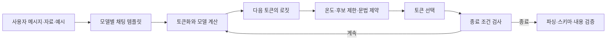
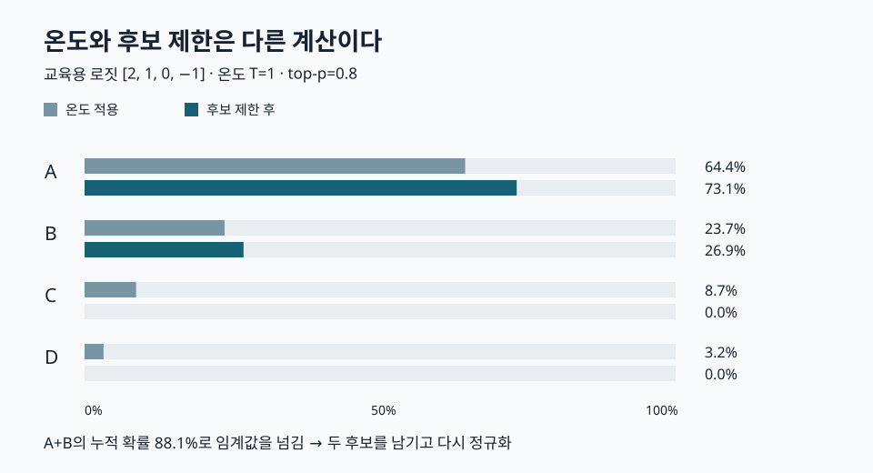
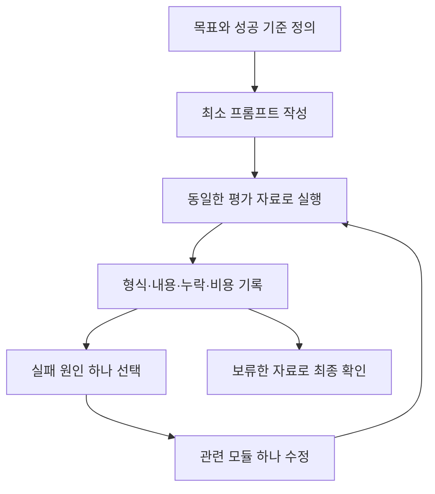
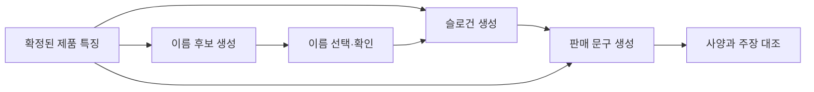
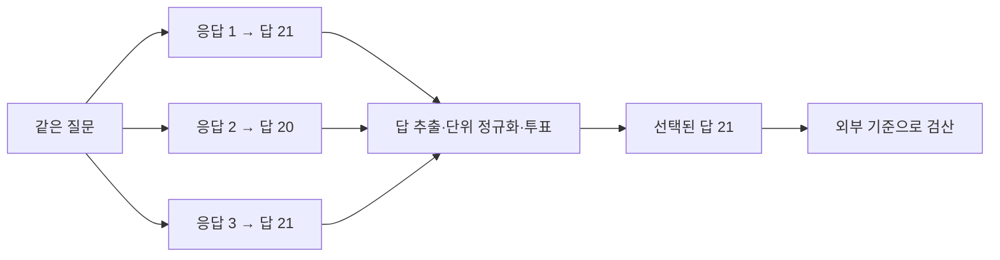
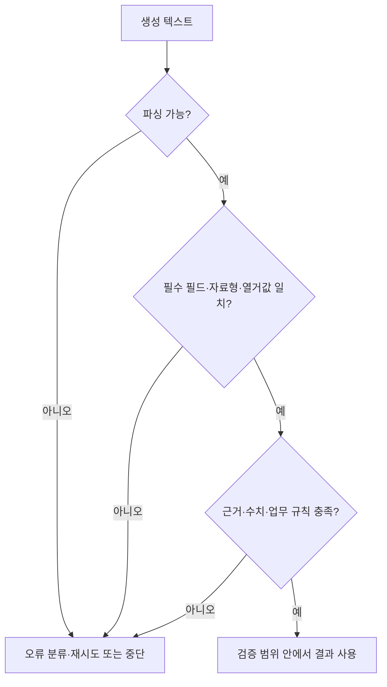

# 6장 프롬프트 엔지니어링 학습 노트

[전체 목차](../../README.md) · [학습 노트](study.md) · [강의안](lecture.md) · [강의 대본](lecture-script.md) · [시각화](visuals.html) · [실습 안내](lab-guide.md) · [복습 문제](quiz.md)

> **원문**: Jay Alammar·Maarten Grootendorst, *Hands-On Large Language Models*, 2024, Chapter 6, “Prompt Engineering”, PDF 물리 페이지 236–279. 이 문서의 쪽수는 인쇄 쪽수가 아닌 첨부 PDF의 페이지 번호다. 원문의 모든 절을 대응시키고, 개념을 한국어 수업용으로 다시 설명했다. “보충” 표시는 이해·검증을 돕는 별도 설명이다. 책에 등장하는 모델·라이브러리 예제는 2024년 맥락이며, 이 자료에서 실행한 것은 별도 표준 Python 실습이다.

## 학습 목표와 선수지식

이 장을 공부하고 나면 하나의 프롬프트를 지시·자료·출력 형식으로 분해하고, 문제에 맞는 예시를 설계할 수 있어야 한다. 또한 temperature와 top-p가 서로 다른 계산이라는 것을 숫자로 설명하고, 한 번의 생성으로 해결할지 여러 호출을 연결할지 판단할 수 있어야 한다. 마지막 목표는 “그럴듯한 답”, “파싱되는 답”, “요구된 형식의 답”, “사실에 맞는 답”을 각각 검사하는 것이다.

선수지식은 Python의 리스트·딕셔너리, 확률의 합이 1이라는 성질, JSON의 기본 구조다. 2장의 토큰화와 3장의 다음 토큰 예측을 복습하면 좋다. 모델이 문장을 한 번에 완성하는 것처럼 보여도 실제 생성 과정은 현재까지의 문맥을 조건으로 다음 토큰을 고르는 반복이다. 이 장의 프롬프트와 디코딩은 그 반복에 들어가는 **조건**과 **선택 규칙**을 바꾸는 방법이다. 모델의 가중치를 학습시키는 방법은 12장에서 다룬다.

## 읽기 순서

1. [생성 모델 사용하기](#sec-01): [모델 선택](#sec-02), [로딩과 채팅 템플릿](#sec-03), [출력 제어](#sec-04)
2. [프롬프트의 기초](#sec-05): [기본 재료](#sec-06), [지시 기반 프롬프팅](#sec-07)
3. [고급 설계](#sec-08): [모듈 조립과 반복 실험](#sec-09), [문맥 내 학습](#sec-10), [프롬프트 연결](#sec-11)
4. [추론을 돕는 생성 절차](#sec-12): [Chain-of-Thought](#sec-13), [Self-Consistency](#sec-14), [Tree-of-Thought](#sec-15)
5. [출력 검증](#sec-16): [형식 예시](#sec-17), [문법 제약](#sec-18)
6. [통합 정리와 다음 장](#sec-19), [그림·표 안내](#figure-map), [보충 실험 설계](#experiment)

<a id="sec-01" name="sec-01"></a>
## 1. 생성 모델을 사용한다는 것

**원문 절**: Using Text Generation Models · PDF 236–244

앞선 장에서 표현 모델은 문서를 벡터로 바꾸거나 분류에 필요한 표현을 제공했다. 생성 모델은 입력에 이어질 토큰을 생성한다. 동일한 생성 모델을 분류, 요약, 이름 만들기, 코드 작성에 이용할 수 있는 이유는 수행할 과제를 입력 문장으로 지정할 수 있기 때문이다. 이 유연함 때문에 입력을 설계하는 일이 소프트웨어의 중요한 일부가 된다.

생성 시스템을 이해할 때 세 층을 나누자. 첫째는 **모델 층**이다. 모델 구조와 학습 데이터, instruction tuning의 여부가 기본 능력을 결정한다. 둘째는 **입력 층**이다. 어떤 역할의 메시지를 어떤 순서로 주고, 어떤 자료와 예시를 붙일지가 여기에 속한다. 셋째는 **출력 선택 층**이다. 다음 토큰 분포에서 가장 큰 확률을 선택할지, 확률에 따라 표본을 뽑을지, 문법상 불가능한 후보를 제거할지 결정한다.

이 세 층을 혼동하면 실험 결과를 설명할 수 없다. 프롬프트를 바꾸고 모델을 교체하고 temperature도 함께 바꾼 뒤 답이 좋아졌다고 해 보자. 모델의 능력 덕분인지, 지시가 명확해졌기 때문인지, 우연히 좋은 표본이 나온 것인지 구분하기 어렵다. 따라서 처음에는 모델과 디코딩을 고정한 상태에서 프롬프트를 비교하는 편이 원인을 이해하기 쉽다. 이후 무작위성 설정을 별도로 실험할 수 있다.



**직접 만든 도식 1.** 그림의 후보 처리 순서는 개념적 구조이며, 실제 라이브러리의 처리 순서는 설정과 구현에 따라 확인해야 한다. 같은 텍스트라도 템플릿과 토크나이저가 다르면 모델이 받는 토큰열이 달라진다는 점에 주목하자.

<a id="sec-02" name="sec-02"></a>
### 1.1 모델 선택

**원문 절**: Choosing a Text Generation Model · PDF 236–237 · 관련 그림 6-1

책은 외부 제공자의 비공개 모델과 가중치를 이용할 수 있는 공개 모델을 구분한다. 외부 서비스는 운영 부담이 줄 수 있고, 로컬 모델은 실험과 내부 구조 접근의 자유가 커질 수 있다. 그러나 비용, 이용 조건, 배포 가능 여부, 데이터 처리 요구를 모두 고려해야 한다. “가중치가 공개되어 있다”는 사실만으로 어떤 목적에도 제한 없이 사용할 수 있다고 결론내리면 안 된다. 이 구분은 특정 제품의 우열을 영구적으로 정하는 기준이 아니라 실험 환경을 선택하는 출발점이다.

그림 6-1은 LLaMA, StableLM, Falcon, Llama 2, Mistral 등 원문 당시의 기반 모델 계열과 여러 파라미터 크기를 보여 준다. 그림을 읽는 핵심은 제품명을 암기하는 것이 아니다. 하나의 기반 모델에도 크기가 다른 버전이 있고, 그 기반에서 목적에 맞게 조정한 모델이 많이 파생된다는 구조를 이해하는 것이다. “같은 계열”과 “같은 모델”은 다르며, base와 instruct 버전도 입력에 반응하는 방식이 다를 수 있다.

책은 실습을 위해 3.8B 파라미터의 Phi-3-mini를 선택한다. 작은 모델에서 시작하면 로딩과 생성 실험을 반복하는 부담이 낮고, 프롬프트가 실제로 무엇을 바꾸는지 관찰하기 쉽다는 이유다. 모델이 작다고 모든 과제를 잘 해결한다는 뜻은 아니다. 복잡한 지시를 따르지 못한다면 프롬프트의 문제인지 모델 능력의 한계인지 둘 다 검토해야 한다.

**보충 — 메모리 숫자를 읽는 법.** 3.8B 파라미터를 각 2바이트로 저장하면 가중치만 약 7.6GB의 십진 바이트가 필요하다. 실제 실행에는 KV 캐시, 활성값, 연산용 버퍼, 실행 환경의 추가 메모리가 필요하다. 따라서 원문의 약 8GB VRAM 수준에 관한 안내를 모든 환경에서의 성공 보장으로 읽으면 안 된다. 양자화, 문맥 길이, 배치 크기, offloading에 따라 필요한 메모리가 달라진다. 이 장에서는 모델을 새로 다운로드하거나 GPU 추론을 수행하지 않는다.

학습용 선택 기준은 다음처럼 질문으로 정리할 수 있다. 이 모델은 대화 지시를 따르도록 학습되어 있는가? 내 자료의 언어를 처리하는가? 필요한 문맥과 출력 길이를 수용하는가? 내가 반복 실험할 수 있는 자원 안에서 실행되는가? 정답이 있는 작은 평가 자료에서 품질을 확인했는가? 큰 모델의 명성보다 실제 과제에서 관찰한 결과를 우선하면 선택 이유를 설명하기 쉬워진다.

<a id="sec-03" name="sec-03"></a>
### 1.2 로딩과 채팅 템플릿

**원문 절**: Loading a Text Generation Model · PDF 237–239 · 관련 그림 6-2

원문은 `AutoModelForCausalLM`, `AutoTokenizer`, `pipeline`을 사용한다. 모델은 다음 토큰의 점수를 계산하고, 토크나이저는 문자열과 토큰 ID 사이를 변환한다. 파이프라인은 입력 준비와 생성 결과 정리를 묶는다. 세 객체의 책임을 나누어 이해하면 “왜 모델만 로드해서는 안 되나요?”라는 질문에 답할 수 있다. 모델이 학습할 때 사용한 어휘와 특수 토큰 규칙에 맞춰 입력을 구성해야 하기 때문이다.

책에 등장하는 모델 식별자는 `microsoft/Phi-3-mini-4k-instruct`다. 원문 코드는 `device_map="cuda"`, `torch_dtype="auto"`, `trust_remote_code=True`로 모델을 로드한다. 여기서 CUDA 지정은 해당 실행 환경을 전제로 하고, 자동 dtype은 모델과 라이브러리가 선택하는 자료형에 영향을 받는다. `trust_remote_code`는 단순한 성능 옵션이 아니라 저장소의 사용자 정의 코드를 허용하는 옵션이다. 이러한 원문 설정을 자신의 환경에 무조건 복사하는 대신 그 역할을 이해하는 것이 먼저다.

| 원문의 구성 | 하는 일 | 공부할 때 확인할 점 |
|---|---|---|
| `AutoModelForCausalLM` | 문맥에 이어질 토큰을 예측하는 모델 로딩 | encoder용 모델과 역할이 다르다 |
| `AutoTokenizer` | 텍스트와 토큰 ID 변환, 대화 형식 정보 제공 | 모델에 맞는 토크나이저를 쓴다 |
| `pipeline("text-generation")` | 전처리·생성·후처리 연결 | 편의 기능 아래의 입력 형식도 확인한다 |
| `return_full_text=False` | 결과에서 원래 프롬프트를 제외하도록 설정 | 모델의 능력이나 길이를 바꾸는 옵션이 아니다 |
| `max_new_tokens=500` | 새로 생성하는 토큰 수의 상한 | 입력 길이·종료 토큰과 별개다 |
| `do_sample=False` | 원문 실습의 샘플링을 끔 | 다른 생성 전략을 추가하지 않은 원문 설정에서는 탐욕적 선택 |

우리는 대화 입력을 보통 `{"role": "user", "content": "..."}` 같은 자료 구조로 만든다. 하지만 모델이 Python 딕셔너리를 직접 읽는 것은 아니다. 채팅 템플릿이 역할과 메시지 경계를 특수 토큰을 포함한 문자열 또는 토큰열로 바꾼다. 원문 Phi-3 템플릿에는 `<|user|>`, `<|assistant|>`, `<|end|>` 등의 표지가 등장한다. 사용자와 assistant 구간을 나누고, 메시지의 끝과 다음 응답의 시작을 알려 주기 위한 것이다.

그림 6-2는 바로 이 입력 틀을 설명한다. 동일한 문장을 넣어도 역할 경계를 없애면 모델에게 주어진 패턴이 달라진다. 몇 개의 대화 예시를 제공할 때 특히 중요하다. 사용자의 질문과 정답 예시가 모두 user 발화에 뒤섞여 있으면, 모델은 어디까지가 설명이고 어디부터가 답의 예시인지 불명확하게 받을 수 있다. 올바른 역할 배열과 모델에 맞는 템플릿은 프롬프트 설계의 기반이다.

원문은 `apply_chat_template(..., tokenize=False)`로 템플릿이 적용된 텍스트를 출력해 관찰한다. 이것은 “모델이 추론한 답”을 보는 과정이 아니라 “실제로 전송할 입력”을 확인하는 과정이다. 모델마다 특수 토큰 규칙이 다르므로 한 모델의 토큰 표지를 다른 모델에 붙이는 습관은 피하자. 출력 시작 프롬프트나 종료 표지에 관한 세부 동작도 모델·라이브러리 버전의 설정에 달려 있다.

**확인 질문.** 사용자가 보낸 본문 안에 `assistant:`라는 일반 문자열이 들어 있다면 그것이 반드시 실제 assistant 역할로 바뀌는가? 아니다. 역할을 표현하는 자료 구조, 채팅 템플릿, 실제 특수 토큰 처리 규칙을 구분해야 한다. 문서에 적힌 지시문은 분석 대상 자료일 수도 있다는 사실도 같은 맥락에서 중요하다.

<a id="sec-04" name="sec-04"></a>
### 1.3 출력 제어와 다음 토큰의 선택

**원문 절**: Controlling Model Output · PDF 240–244 · 관련 그림 6-3, 6-4, 6-5 및 표 6-1

모델은 다음 토큰 후보마다 점수를 계산한다. 예를 들어 “나는 …을 운전한다”라는 문맥에서 자동차와 트럭은 코끼리보다 높은 점수를 받을 수 있다. 원문 그림 6-3은 이러한 후보 분포를 보여 준다. 생성은 점수를 계산하는 단계와 그중 하나를 고르는 단계로 나뉜다. 이때 **문맥에서 자주 이어질 법함**과 **현실에서 사실임**은 다른 개념이다. 선택 규칙을 바꿔도 모델에 없던 증거가 생기지는 않는다.

#### 탐욕적 선택과 샘플링

탐욕적 선택은 매 단계에서 가장 높은 점수의 토큰을 택한다. 샘플링은 확률에 비례하여 토큰을 뽑는다. 주사위에 서로 다른 크기의 면을 배정한다고 상상해 보자. 크기가 큰 면이 자주 나오지만 작은 면도 나올 수 있다. 샘플링을 켜면 같은 입력에서도 다른 문장이 나올 수 있으나, 매번 반드시 다른 문장이 나온다는 뜻은 아니다. 특히 분포가 매우 뾰족하면 같은 답이 반복될 수 있다.

원문에서는 `do_sample=False`로 비교를 시작하고, temperature나 top-p를 이용한 무작위 선택을 관찰할 때 `do_sample=True`로 바꾼다. 실제 실험에서는 샘플링 설정만 아니라 프롬프트, 모델 버전, seed, 입력 길이, 종료 조건도 기록해야 한다. 탐욕적 선택은 결과 변동을 줄이는 데 유용하지만 전체 소프트웨어·하드웨어 환경을 넘어서 완전히 같은 결과를 보장하는 선언은 아니다.

#### Temperature는 점수 차이를 조정한다

**보충 수식.** 어휘 크기를 $V$, 다음 토큰 로짓을 $z\in\mathbb{R}^{V}$, 온도를 양수 $T$라 하면 다음처럼 확률을 계산한다.

$$
p_i(T)=\frac{\exp(z_i/T)}{\sum_{j=1}^{V}\exp(z_j/T)}\qquad(T>0)
$$

로짓은 아직 합이 1인 확률이 아니다. softmax가 이를 확률로 바꾼다. $T<1$이면 점수 차이가 확대되어 높은 점수에 확률이 집중된다. $T>1$이면 점수 차이가 축소되어 분포가 평평해진다. 양수 온도는 로짓의 순서 자체를 바꾸지 않는다. 높은 온도에서 낮은 순위 토큰이 **선택될 가능성**이 커지는 것이지, 모든 토큰의 우열이 뒤집히는 것은 아니다.

가상의 네 토큰 A, B, C, D의 로짓을 `[2, 1, 0, -1]`로 두자. $T=1$일 때 확률은 약 `[0.644, 0.237, 0.087, 0.032]`다. $T=0.5$이면 약 `[0.865, 0.117, 0.016, 0.002]`, $T=2$이면 약 `[0.455, 0.276, 0.167, 0.102]`가 된다. A는 계속 가장 유력하지만, 온도가 높아질수록 다른 후보가 선택될 여지가 커진다. 그림 6-4가 표현하는 변화가 이것이다.

책은 온도 0을 가장 높은 확률의 토큰을 고르는 직관으로 설명한다. 수식에 0을 그대로 대입할 수는 없다. $T\to0^+$일 때 최대 로짓에 확률이 모인다는 극한 해석이며, 소프트웨어에서 `temperature=0`을 허용할지 또는 greedy 모드로 처리할지는 인터페이스에 달려 있다. 이 자료의 CPU 실습은 $T>0$만 받으며 탐욕적 선택을 별도 개념으로 다룬다.

“온도가 높으면 창의적이다”는 실무적 표현에는 한계가 있다. 온도가 높으면 후보 선택이 다양해지는 것은 맞지만, 새롭고 유용하며 일관된 아이디어라는 의미의 창의성이 자동 보장되지는 않는다. 터무니없는 정보나 문법적으로 어색한 연결도 다양성에 포함된다. 업무의 성공 기준은 다양성과 별도로 평가해야 한다.

#### Top-p는 누적 확률로 후보 집합을 만든다

Top-p, 즉 nucleus sampling은 후보를 확률이 큰 순으로 정렬하고, 누적 확률이 지정한 $p$ 이상이 되는 최소 접두 집합을 남긴다. 위의 $T=1$ 분포에서 $p=0.8$이면 A만 남겨서는 0.644로 부족하다. A와 B를 합치면 약 0.881이므로 이 두 토큰을 남긴다. 임계값을 **넘게 만드는 마지막 토큰도 포함**한다. 남은 확률을 다시 합이 1이 되도록 정규화하면 약 `[0.731, 0.269, 0, 0]`가 된다.

여기서 자주 하는 실수는 “0.8보다 큰 개별 확률만 선택한다”고 생각하는 것이다. top-p는 개별 확률의 하한이 아니다. 또 확률이 모두 양수이고 $p=1$이면 전체 후보를 남기므로 사실상 nucleus에 의한 제거가 없다. 그러나 다른 top-k나 문법 제약까지 해제되는 것은 아니다. 그림 6-5는 p를 줄이면 고려할 후보 집합이 대체로 작아지는 모습을 보여 준다.

같은 p에서도 후보 수는 문맥에 따라 달라진다. 첫 토큰의 확률이 0.95라면 p=0.9로 한 개만 남는다. 여러 토큰의 확률이 비슷하면 더 많은 토큰이 필요하다. 따라서 top-p는 모델이 특정 답에 확신하는 듯한 분포와 불확실한 분포에 적응하는 후보 제한 방식이라고 볼 수 있다. 다만 그 분포의 뾰족함이 실제 정답 확신도와 일치한다고 단정해서는 안 된다.

#### Top-k는 후보 개수를 제한한다

Top-k는 가장 높은 확률을 가진 k개 후보만 남긴다. `k=2`면 각 후보의 확률 크기와 무관하게 상위 두 개를 고려한다. 반면 top-p는 정해진 확률 질량을 확보하기 위해 후보 수를 바꾼다. 둘을 동시에 사용하면 적용 순서와 재정규화에 따라 최종 분포가 영향을 받으므로 구현을 확인해야 한다. 이 장의 [실습](lab-guide.md)은 설명을 위해 **온도 → top-k → 재정규화 → top-p → 재정규화** 순서를 명시적으로 고정한다.

| 조절 장치 | 바뀌는 대상 | 직접 보장하지 않는 것 |
|---|---|---|
| 프롬프트 | 모델이 조건으로 삼는 입력 | 정답, 형식의 강제 준수 |
| Temperature | 후보 간 확률 집중도 | 사실성, 높은 창의성 |
| Top-p | 누적 확률 기준 후보 범위 | 후보의 고정 개수 |
| Top-k | 순위 기준 후보 개수 | 항상 충분한 다양성 |
| 최대 새 토큰 수 | 생성 길이 상한 | 문장·JSON의 완결성 |
| 문법 제약 | 다음에 허용되는 토큰 집합 | 내용의 사실성 |



[직접 조작하기](visuals.html#sampling) · [Markdown 시각화 안내](visuals.md)

#### 원문 표 6-1을 해석하는 법

책은 brainstorming에는 높은 온도와 높은 top-p, 이메일에는 낮은 온도와 낮은 top-p, 창작에는 높은 온도와 낮은 top-p, 번역에는 낮은 온도와 높은 top-p를 예로 든다. 이 표의 목적은 두 조절 축이 다르다는 것을 보여 주는 것이다. “번역은 항상 이 설정이 최선” 같은 범용 규칙으로 받아들이면 안 된다. 서로 다른 모델의 확률 분포, 입력 난도, 번역 충실도 기준에 따라 결과는 달라진다.

높은 온도·낮은 top-p는 후보를 좁혀 놓은 상태에서 그 후보 사이의 확률 차이를 줄이는 조합으로 이해할 수 있다. 단, 온도로 분포가 변한 다음 top-p를 적용하면 후보 개수도 변할 수 있으므로 두 효과가 완전히 독립적인 것은 아니다. 실험의 첫 단계에서는 한 번에 한 조절 장치를 바꾸고 최종 분포를 직접 보는 편이 좋다. [시각화의 첫 실험](visuals.html#sampling)에서 원래 확률과 최종 확률을 함께 확인하자.

<a id="sec-05" name="sec-05"></a>
## 2. 프롬프트 엔지니어링의 기초

**원문 절**: Intro to Prompt Engineering · PDF 244–250

프롬프트 엔지니어링은 모델이 유용한 응답을 내도록 입력을 설계하고 시험하는 과정이다. 한 번 잘 쓰는 문장 기술로 끝나지 않는다. 원하는 결과를 정의하고, 입력 구성 요소를 바꾸고, 결과를 관찰하고, 실패 원인을 좁히는 반복 실험에 가깝다. 원문이 완벽한 하나의 프롬프트를 기대하기 어렵다고 설명하는 이유도 과제와 모델, 입력 자료에 따라 효과가 달라지기 때문이다.

이 과정을 소프트웨어 요구사항 정의와 연결해 보자. 동료에게 “보고서를 잘 써 줘”라고 말하면 길이, 대상 독자, 포함할 근거, 제외할 범위가 모두 불명확하다. 모델에게도 마찬가지로 해석의 여지가 생긴다. 먼저 “좋은 답”이 무엇인지 써야 한다. 길이와 형식처럼 기계적으로 확인할 수 있는 기준도 있고, 사실 충실성이나 설명의 적절성처럼 자료 비교와 판단이 필요한 기준도 있다.

프롬프트는 평가에도 쓰일 수 있다. 예를 들어 생성한 요약이 원문에 없는 주장을 포함하는지 검토하도록 모델에 별도의 지시를 줄 수 있다. 다만 평가 프롬프트 역시 모델의 한계와 오류를 공유한다. 단순 계산이나 형식처럼 프로그램이 확실하게 검사할 수 있는 부분까지 모두 모델의 판단에 맡길 이유는 없다. 뒤의 출력 검증 절에서 이 역할 분담을 더 자세히 설명한다.

<a id="sec-06" name="sec-06"></a>
### 2.1 프롬프트의 기본 재료

**원문 절**: The Basic Ingredients of a Prompt · PDF 244–247 · 관련 그림 6-6, 6-7, 6-8

가장 단순한 프롬프트는 문장의 앞부분이다. 모델에게 별도의 과제를 지정하지 않으면 그 문장을 이어 쓸 수 있다. 그림 6-6은 이 완성 방식의 기본 형태다. 그러나 우리는 단순한 이어 쓰기보다 감정 분류나 요약 같은 과제 수행을 원할 때가 많다. 이때 **지시 instruction**와 **자료 data**를 명시해야 한다. 지시는 무엇을 할지, 자료는 무엇에 대해 할지를 알려 준다.

예를 들어 “다음 리뷰의 감정을 positive 또는 negative로 분류하라”는 지시이고, “배송은 느렸지만 제품은 매우 만족스럽다”는 자료다. 둘을 합친다고 모든 모호함이 없어지지는 않는다. 혼합 감정을 어떻게 처리할지, 어느 측면을 중시할지, neutral을 허용할지 같은 기준이 남는다. 따라서 오류가 났을 때 지시의 표현만 다듬기 전에 과제 자체의 정의가 명확한지 확인해야 한다.

그림 6-7이 지시와 자료를 구분한다면, 그림 6-8은 **출력 지시자 output indicator**를 더한다. `Text:`로 자료의 시작을 표시하고 `Sentiment:`로 출력이 들어갈 위치를 표시하는 식이다. 이는 모델이 긴 설명을 쓰는 대신 특정 범주명으로 이어 쓰도록 유도한다. 하지만 문자열 표지는 확률적인 유도이지 프로그램적인 강제는 아니다. 모델이 `Sentiment: positive, because...`처럼 설명을 붙일 수도 있다.

```text
작업: 상품 리뷰의 전체 평가를 positive 또는 negative 중 하나로 분류한다.
기준: 배송과 상품이 충돌하면 상품 품질에 대한 최종 평가를 우선한다.
출력: 라벨 한 개만 쓴다.

리뷰:
<review>
배송은 느렸지만 제품은 매우 만족스럽다.
</review>

라벨:
```

**보충 예제.** 이 자료의 예시는 원문의 문장을 번역한 것이 아니라 동일한 원리를 보여 주기 위한 새 예제다. 여기서는 평가 기준을 명시했기 때문에 같은 입력에서 무엇을 정답으로 삼는지 설명할 수 있다. XML처럼 보이는 구분자는 자료 경계를 읽기 쉽게 하려는 표식이다. 태그를 붙였다고 입력 안의 악성 지시나 충돌이 자동으로 해결되는 것은 아니다.

프롬프트를 구성 요소로 생각하면 실패를 수정하기 쉽다. 분류 라벨은 맞는데 설명이 길다면 출력 형식과 출력 지시자를 살핀다. 문서 전체가 아닌 첫 문장만 요약한다면 대상 범위와 문맥 길이를 살핀다. 자료에 없는 정보를 추가한다면 근거 범위와 검증 절차를 살핀다. 모든 문제를 “더 똑똑하게 답해 줘”라는 한 문장으로 해결하려 하지 말자.

<a id="sec-07" name="sec-07"></a>
### 2.2 지시 기반 프롬프팅

**원문 절**: Instruction-Based Prompting · PDF 247–250 · 관련 그림 6-9, 6-10

지시 기반 프롬프팅은 모델에게 특정 작업을 수행하라고 요청한다. 그림 6-9에는 분류, 검색, 요약, 코드 생성, 개체명 인식이 등장한다. 이들은 모두 텍스트 입력과 출력으로 표현할 수 있지만 요구하는 답과 평가 방식은 다르다. 분류는 정해진 범주와 기준이 필요하고, 요약은 원문 보존과 압축 정도가 중요하며, 개체명 인식은 어떤 문자열을 어떤 종류의 엔터티로 인정할지 정해야 한다.

그림 6-10은 동일한 과제라도 지시의 위치와 구성 방식이 달라질 수 있음을 보여 준다. 요약 지시를 자료 앞에 둘 수도, 자료를 보여 준 후 길이 제한과 함께 둘 수도 있다. 개체명 인식에서는 조직·사람·장소 같은 범주 정의와 “동사와 형용사는 개체가 아니다” 같은 제외 기준을 추가한다. 이 그림을 통해 배울 점은 문장 자체의 멋보다 **분류 경계와 제외 조건**이 성능을 좌우할 수 있다는 것이다.

원문이 제시하는 개선 원칙은 구체성, 환각에 대한 대처, 지시의 위치다. 세 원칙을 각각 적용해 보자.

**구체성.** “상품을 소개해 줘”는 대상 독자, 길이, 어조, 근거가 비어 있다. “제공한 사양만 사용해 처음 구매하는 사람을 위한 두 문장의 설명을 쓰고, 두 번째 문장에 설치 공간 조건을 넣어라”는 검토할 기준이 생긴다. 단, 기준을 많이 붙이는 것과 좋은 기준을 붙이는 것은 다르다. 서로 충돌하거나 실제 입력에 없는 내용을 강요하는 제약은 오류를 늘릴 수 있다.

**환각 대처.** 책은 답을 모르면 모른다고 말하도록 지시하는 방법을 소개한다. 이는 유용한 출발점이지만 모델이 자신의 지식 경계를 항상 정확히 판정한다는 뜻은 아니다. 업무 자료를 요약한다면 “제공 자료에서 근거를 찾을 수 없으면 `근거 없음`으로 표시하라”처럼 확인할 범위를 정하고, 실제로 원문과 대조하는 검증을 더하는 편이 낫다. 모른다고 말하라는 문장은 사실 검증기를 대신하지 않는다.

**순서.** 책은 긴 문맥의 중간 정보가 덜 활용되는 현상을 근거로 중요한 지시를 앞이나 끝에 배치하는 방식을 설명한다. 이 경향을 모든 모델과 모든 길이에 통하는 절대 법칙으로 읽지 말자. 실제 자료에서 지시 위치를 바꾸어 시험하는 것이 중요하다. 앞에는 전체 목적을, 끝에는 출력 제약을 둬도 좋지만, 내용이 충돌하거나 같은 규칙을 과도하게 반복하면 또 다른 혼란이 생길 수 있다.

| 작업 | 지시에 포함할 핵심 | 결과 확인 방법 |
|---|---|---|
| 분류 | 허용 라벨, 경계 사례 기준, 출력 형태 | 라벨 집합 검사와 정답 비교 |
| 요약 | 독자, 길이, 보존할 핵심, 원문 밖 정보 처리 | 원문 대조와 내용 누락 점검 |
| 검색 보조 | 질문 목적, 필요한 자료 유형, 사용할 문서 범위 | 실제 검색 결과와 관련성 확인 |
| 코드 생성 | 입력·출력 계약, 예외 조건, 환경 | 실행 및 의미 있는 테스트 |
| 개체명 인식 | 범주 정의, 제외 기준, 위치·문자열 형식 | 원문 span과 라벨 확인 |

**잠깐 확인.** “답은 짧게, 중요한 내용을 모두 포함해 30페이지로 작성하라”는 지시에는 어느 정도 충돌이 있다. 모델의 출력을 탓하기 전에 사람이 길이와 범위의 우선순위를 정해야 한다. 프롬프트 엔지니어링은 모호한 요구를 모델에게 떠넘기는 기술이 아니라, 요구를 확인 가능한 형태로 만드는 일이다.

<a id="sec-08" name="sec-08"></a>
## 3. 고급 프롬프트 설계

**원문 절**: Advanced Prompt Engineering · PDF 250–260

간단한 과제는 지시·자료·출력 형식으로 시작할 수 있다. 그러나 실제 업무에는 독자 수준, 금지할 추론, 여러 산출물, 서로 연결된 중간 결과가 추가된다. 이때는 프롬프트를 무작정 길게 만들기보다 **한 번의 입력 내부를 설계하는 문제**와 **여러 호출 사이의 작업 흐름을 설계하는 문제**를 나누는 것이 좋다. 원문은 전자에서 모듈 구성과 예시를, 후자에서 prompt chaining을 소개한다.

고급이라는 말이 복잡한 프롬프트를 항상 쓰라는 뜻은 아니다. 짧은 지시로 충분히 잘 처리되는 과제에 여러 역할과 불필요한 예시를 붙이면 입력 비용만 늘고 실패 원인을 찾기 어려워질 수 있다. 추가하는 구성 요소마다 “어떤 실패를 줄이기 위해 필요한가?”를 설명할 수 있어야 한다. 원문의 반복 실험 관점은 이러한 최소 필요 구성을 찾는 데 유용하다.

<a id="sec-09" name="sec-09"></a>
### 3.1 프롬프트의 복잡성과 모듈화

**원문 절**: The Potential Complexity of a Prompt · PDF 251–254 · 관련 그림 6-11, 6-12

원문이 정리한 대표 구성 요소는 persona, instruction, context, format, audience, tone, data의 일곱 가지다. 이들은 겹치는 부분이 있으나 서로 다른 질문에 답한다. Persona는 어떤 역할로 설명할지, instruction은 무엇을 수행할지, context는 왜 그 작업을 하는지, format은 결과를 어떻게 배열할지, audience는 누가 읽는지, tone은 어떤 말투를 쓸지, data는 실제 처리할 대상이 무엇인지를 지정한다.

| 구성 요소 | 답해야 하는 질문 | 한국어 논문 요약 예시 |
|---|---|---|
| Persona | 어떤 관점과 역할인가? | 초보 연구원에게 방법을 설명하는 튜터 |
| Instruction | 정확히 무엇을 하는가? | 문제·방법·결과·한계를 요약한다 |
| Context | 요약의 사용 목적은 무엇인가? | 스터디에서 방법의 차이를 토론한다 |
| Format | 어떤 구조로 내보내는가? | 네 개의 제목과 각 두 문장 |
| Audience | 독자의 배경은 무엇인가? | Python은 알지만 논문 분야는 처음인 사람 |
| Tone | 어떤 표현과 어조를 쓰는가? | 과장 없이 명확하고 교육적으로 |
| Data | 어느 자료를 처리하는가? | 제공된 초록과 실험 표 |

그림 6-11은 이런 모듈을 한 프롬프트 안에 쌓은 예시다. 중요한 것은 역할 문장 자체가 전문 지식이나 사실성을 부여하지 않는다는 점이다. “전문가처럼 답하라”는 말은 문체와 설명 방식에 영향을 줄 수 있지만, 전문가 검증을 통과했다는 뜻이 아니다. Audience 역시 내용의 난도를 조절할 뿐 틀린 설명을 옳게 만들지 않는다. 각 모듈의 효과가 무엇인지 분리해서 이해해야 한다.

그림 6-12는 구성 요소를 더하고 빼거나 순서를 바꾸며 결과를 관찰하는 반복 과정을 보여 준다. 원문의 코드도 각 요소를 문자열 변수로 만들고 이어 붙인다. 이 방식의 장점은 하나의 문장을 고치는 것보다 변경 위치가 명확하다는 데 있다. 실험에서 format만 바꾸면 출력 구조에 대한 영향을, audience만 바꾸면 설명 수준에 대한 영향을 비교하기 쉽다.

**보충 실험 설계.** 같은 입력 세 개만으로 모든 프롬프트를 비교하면 우연히 그 입력에 맞는 문구를 고를 수 있다. 평범한 사례, 경계 사례, 누락 정보가 있는 사례, 자료 안에 지시처럼 보이는 문장이 있는 사례를 포함한 작은 평가 묶음을 준비하자. 변경 전후를 같은 자료로 비교하되, 최종 확인용 자료는 설계 중에 지나치게 자주 들여다보지 않는다. 이는 프롬프트에도 일반화 평가가 필요하다는 뜻이다.



**직접 만든 도식 2.** 원문의 모듈 반복 실험을 평가 절차와 연결한 보충 도식이다. 수정 횟수가 많다고 품질이 자동으로 좋아지는 것은 아니다. 개선을 비교할 기준이 있어야 한다.

원문은 감정적인 자극 문구도 연구된 프롬프트 구성 방식의 예로 언급한다. 예컨대 작업이 사용자에게 중요하다고 강조하는 식이다. 이 사실을 “특정 감정 문구를 쓰면 모든 모델에서 성능이 상승한다”는 규칙으로 외우지 말자. 모델의 학습과 과제에 따라 반응이 달라진다는 것이 같은 절의 핵심이다. 먼저 자료, 기준, 형식을 명확히 하고, 추가 문구의 효과는 별도 실험으로 확인하는 편이 설명 가능하다.

문자열을 연결할 때도 실수가 생길 수 있다. 요소 사이의 줄바꿈이 없으면 지시와 자료가 이어져 뜻이 변할 수 있고, 변수 이름이 같아 앞선 내용을 덮어쓸 수도 있다. 최종 프롬프트를 출력하여 사람이 읽는 간단한 점검이 유용하다. 모델 호출 전에 발견할 수 있는 오류를 모델 출력 단계까지 미루지 말자.

<a id="sec-10" name="sec-10"></a>
### 3.2 문맥 내 학습과 예시 제공

**원문 절**: In-Context Learning: Providing Examples · PDF 255–257 · 관련 그림 6-13

지시가 해야 할 일을 설명한다면 예시는 해야 할 일을 보여 준다. **In-context learning**은 입력 문맥에 예시를 포함하여 현재 과제를 수행하도록 유도하는 방식이다. 이 장에서의 학습은 프롬프트를 읽고 패턴을 활용한다는 의미이며, 예시를 넣는 순간 모델 파라미터가 gradient descent로 갱신된다는 뜻은 아니다. 가중치 미세 조정과 구별해야 한다.

예시가 없으면 zero-shot, 하나면 one-shot, 소수의 여러 예시가 있으면 few-shot이라고 부른다. “shot”은 현재 풀어야 할 질문이 아니라 시범으로 제공한 입력·정답 쌍을 센다. 예시 두 개와 실제 질문 한 개를 넣었다면 이 자료에서는 two-shot에 해당하는 few-shot으로 설명한다. 설명만 길게 썼다고 자동으로 few-shot이 되는 것은 아니다.

그림 6-13의 실제 도식은 감정 분류를 zero-shot, one-shot, few-shot으로 비교한다. 예시가 늘면 중립·긍정·부정의 경계와 출력 라벨 형태를 함께 보여 줄 수 있다. 원문의 그림 캡션은 복잡한 프롬프트 구성이라는 표현을 사용하지만, 도식에서 관찰할 핵심은 예시 수의 차이다. 본문과 도식을 함께 읽는 습관이 필요한 부분이다.

원문 코드는 가상의 단어를 문장에 넣는 과제를 사용한다. 먼저 새로운 명사의 의미와 이를 사용한 문장 예시를 user–assistant 쌍으로 제공한다. 그 다음 새로운 동사의 의미를 user 메시지로 주고 문장을 완성하게 한다. 이 예제가 보여 주는 것은 모델이 실제 사전에 있는 단어를 검색하는 것이 아니라, **제공된 정의와 예시의 형식을 활용할 수 있다**는 점이다. 결과가 그럴듯하더라도 그 가상 단어가 현실에 존재한다고 해석해서는 안 된다.

```text
[시범 입력]
리뷰: 가격은 평범하고 기능도 예상한 정도다.
[시범 출력]
neutral

[시범 입력]
리뷰: 사용하기 쉽고 다시 사고 싶다.
[시범 출력]
positive

[실제 입력]
리뷰: 기능은 좋지만 일주일 만에 고장 나서 추천하지 않는다.
[실제 출력]
```

**보충 예제.** 이 예시는 형식만 보면 도움이 되지만 부정 사례가 없고 혼합 감정의 판정 기준도 불충분하다. 예시를 늘릴 때는 개수만 증가시키기보다 빠져 있는 유형을 보완해야 한다. 실제 정답을 negative로 기대한다면 최종 권고를 중시한다는 기준과 해당 사례를 포함하면 더 명확해진다. 반대로 과제의 정의가 제품 기능 자체의 감정을 묻는다면 정답 기준이 달라질 수 있다.

예시의 품질에는 라벨의 일관성, 입력과 출력의 대응, 실제 문제와의 유사성, 범주 분포가 포함된다. 예시마다 출력 형식이 다르면 모델은 어느 형식을 따라야 할지 혼동할 수 있다. 긴 예시가 많으면 입력 예산을 소비하여 정작 처리할 자료가 잘리거나 출력 공간이 부족해질 수 있다. “예시는 많을수록 좋다” 대신 “필요한 패턴을 정확히 보여 주는가?”를 질문하자.

문맥 내 학습은 여전히 유도 방식이다. 모델이 예시를 잘못 일반화하거나, 입력의 일부를 무시하거나, 샘플링으로 예상 밖의 답을 낼 수 있다. 원문도 one-shot과 few-shot을 전체 설계의 한 조각으로 취급한다. 출력 제약이 엄격한 시스템에서는 예시를 제공하면서도 파싱과 라벨 검사를 별도로 두어야 한다.

<a id="sec-11" name="sec-11"></a>
### 3.3 프롬프트 연결과 중간 결과

**원문 절**: Chain Prompting: Breaking up the Problem · PDF 257–260 · 관련 그림 6-14

Prompt chaining은 앞선 호출의 출력을 다음 호출의 입력으로 사용하는 방식이다. 하나의 큰 프롬프트 안에서 여러 지시를 나열하는 것과 다르다. 여러 단계 사이에 자료를 전달하고, 각 단계의 목표와 생성 설정을 따로 지정할 수 있다. 이로써 복잡한 작업을 작은 문제로 나누고 중간 결과를 검사할 수 있다.

원문의 그림 6-14는 제품 특징에서 이름을 만들고, 그 이름과 특징으로 슬로건을 만들고, 이들을 이용해 판매 문구를 만드는 흐름을 보여 준다. 이어지는 코드 예시는 이름과 슬로건을 첫 호출에서 함께 만들고 판매 문구를 두 번째 호출에서 만든다. 따라서 그림의 개념적 세 단계와 코드의 실제 두 호출을 구분해서 읽어야 한다. 핵심은 호출 수를 정확히 세 단계로 고정하는 것이 아니라 의존하는 결과를 전달하는 구조다.



**직접 만든 도식 3.** 원문의 chain 구조에 검증 단계를 더한 보충 예제다. 검증 단계는 별도의 LLM일 필요가 없으며, 확정된 사양과 문자열·수치 비교로 처리할 수도 있다.

각 단계는 다른 출력 길이와 무작위성을 사용할 수 있다. 이름 후보는 짧고 다양하게, 판매 문구는 조금 길고 일관되게 생성할 수 있다. 앞선 출력이 적절하지 않으면 다음 단계를 실행하기 전에 수정하거나 중단할 수도 있다. 이러한 중간 검사 지점이 하나의 긴 응답과 비교했을 때 중요한 장점이다.

하지만 오류도 전달된다. 이름 생성 단계에서 제품 기능을 임의로 추가하고 이를 다음 단계에 넘기면, 판매 문구는 그 잘못된 기능을 확정 사실처럼 확장할 수 있다. 그러므로 중간 결과와 원래 자료를 구별하고, 필요한 원본 제약을 다음 단계에도 전달해야 한다. 앞선 출력만 재사용하면 자료의 근거와 조건이 점차 사라지는 정보 손실이 생길 수 있다.

책은 응답 검증, 병렬 프롬프트 후 통합, 이야기 쓰기에도 chaining을 적용한다. 병렬 예로 여러 조리법을 만들고 최종 단계에서 장보기 목록을 합칠 수 있다. 이때 같은 재료의 중복과 단위 변환은 일반 코드가 더 정확히 처리할 수 있는 부분이다. 이야기는 개요, 인물, 사건 구조, 대사의 순서로 나눌 수 있으나 인물의 설정과 사건의 일관성을 유지할 공통 자료가 필요하다.

**보충 — 호출 비용과 실패 처리.** 순차 호출은 앞 단계가 끝나야 다음 단계가 시작되므로 지연이 누적된다. 독립적인 일부 작업은 병렬 실행할 수 있지만 전체 생성 토큰과 호출량은 여전히 비용에 영향을 준다. 단계가 실패했을 때 어디부터 다시 실행할지, 중간 결과를 저장할지, 검증 실패를 어떻게 사용자에게 드러낼지까지 생각해야 한다. 이는 다음 장의 체인·메모리·도구 활용으로 이어진다.

<a id="sec-12" name="sec-12"></a>
## 4. 생성 모델의 추론을 돕는 절차

**원문 절**: Reasoning with Generative Models · PDF 260–270

원문은 즉각적인 반응을 system 1, 천천히 검토하는 사고를 system 2에 비유하여 추론을 설명한다. 이 비유는 생성에 중간 계산과 검토 단계를 넣는 이유를 직관적으로 보여 준다. 그러나 LLM의 내부 과정이 사람의 심리 과정과 동일하다고 입증하는 설명은 아니다. 책 역시 추론과 닮은 출력 행동을 다루고 있다는 점을 강조한다.

이 장에서 우리가 관찰할 대상은 **검증 가능한 문제 해결 성능**이다. 모델이 긴 설명을 했다는 사실만으로 더 깊이 이해했다고 결론내리지 않는다. 같은 답을 즉시 냈을 때와 중간 계산을 포함했을 때의 정확도, 오류 유형, 비용을 비교할 수 있다. “생각을 많이 하라”는 문구보다 어떤 중간 결과를 만들고 무엇으로 검증할지 설계하는 것이 중요하다.

뒤의 세 방법은 서로 다른 위치에 추가 계산을 투입한다. Chain-of-Thought는 한 답변 안의 중간 설명에, self-consistency는 여러 완성된 답변의 비교에, tree-of-thought는 중간 상태에서 갈라지는 후보의 탐색과 평가에 계산을 쓴다. 모두 출력이 길어질 수 있지만 비용이 증가하는 구조가 같지는 않다.

<a id="sec-13" name="sec-13"></a>
### 4.1 Chain-of-Thought와 단계별 풀이

**원문 절**: Chain-of-Thought: Think Before Answering · PDF 261–265 · 관련 그림 6-15, 6-16

Chain-of-Thought, 이하 CoT는 답만 제시하는 대신 중간 풀이의 예시를 제공하여 단계가 드러나는 응답을 유도하는 접근이다. 원문의 그림 6-15와 테니스공 예시는 먼저 곱셈으로 추가 수량을 구하고, 처음 수량에 더하는 계산을 보여 준다. 다음 질문에서는 사과의 초기 수량, 사용량, 추가 구입량을 순서대로 반영한다. 이처럼 중간 결과를 텍스트로 남기면 후속 토큰은 이미 생성된 중간 결과를 문맥으로 사용할 수 있다.

**보충 손계산.** 창고에 연필 14자루가 있고 3상자를 추가로 받았으며 상자마다 4자루가 들어 있다고 하자. 5자루를 나누어 준 뒤의 수량은 $14+3\times4-5=21$이다. 풀이를 점검하려면 “추가된 12자루”, “나누기 전 26자루”, “나눈 뒤 21자루”를 각각 확인할 수 있다. 단순히 정답 21만 받는 것보다 오류가 곱셈에서 났는지 뺄셈에서 났는지 찾기 쉽다.

여기서 주의할 것은 설명의 그럴듯함과 계산의 타당성을 별개로 평가해야 한다는 점이다. 모델은 올바른 문장 형식으로 잘못된 중간 계산을 쓸 수 있고, 결론에 맞춰 그럴듯한 이유를 만들 수도 있다. 따라서 사용자에게 보여 주는 풀이를 모델 내부 과정의 완전하고 충실한 기록으로 간주하면 안 된다. 학습 자료에서는 결과와 **검증 가능한 핵심 계산**을 확인하면 충분하다.

원문은 예시 없이 단계별 풀이를 요청하는 zero-shot CoT도 소개한다. 그림 6-16은 단순한 질문 뒤에 단계적으로 풀어 보라는 지시를 붙이는 방식이다. 이는 풀이 예시를 준비하기 어려운 경우의 간단한 출발점이다. 특정 영어 문장이 유일한 비밀번호라는 뜻은 아니며, 책에서도 표현을 다양하게 바꿀 수 있다고 설명한다.

이 자료에서 실제 학습에 쓸 요청은 다음처럼 검증할 내용을 지정한다.

```text
연필 수량 문제를 풀어라.
최종 수량, 사용한 식, 단위, 계산을 확인한 짧은 검산을 제시하라.
문제에 없는 사실은 추가하지 말고, 정보가 부족하면 부족한 항목을 표시하라.
```

원문의 CoT 역사와 원리를 공부하는 것과 모든 모델에게 길고 상세한 내부 사고를 공개하라고 요구하는 것은 다르다. 실제 학습과 평가에서는 짧은 풀이, 핵심 가정, 검산 가능한 결과가 유용하다. 내부 추론을 별도로 처리하는 모델의 인터페이스에 동일한 문구를 적용했을 때 어떤 효과가 나는지는 이 장의 실습에서 측정하지 않았다.

중간 단계가 늘면 계산에 사용할 생성 토큰도 늘어난다. 이것이 복잡한 과제에 도움이 될 수 있지만, 불필요한 단계는 지연과 장황함을 늘리고 오류가 생길 위치도 추가한다. 매우 간단한 분류 과제라면 짧은 라벨만 내보내는 편이 적절할 수 있다. CoT는 모든 과제에 무조건 붙이는 양식이 아니라 필요에 따라 평가할 전략이다.

<a id="sec-14" name="sec-14"></a>
### 4.2 Self-Consistency와 다수결

**원문 절**: Self-Consistency: Sampling Outputs · PDF 265–266 · 관련 그림 6-17

샘플링을 허용하면 같은 질문에서도 서로 다른 답과 풀이가 나올 수 있다. Self-consistency는 여러 응답을 생성하고, 각 응답의 최종 답을 추출한 뒤 가장 많이 등장한 답을 선택한다. 그림 6-17은 다양한 풀이 경로가 마지막 답의 투표로 모이는 구조다. 풀이 문장이 서로 비슷한지를 투표하는 것이 아니라 **최종 답이 무엇인지**를 비교한다.

예를 들어 다섯 응답의 답이 `21`, `21자루`, `20`, `21`, `22`라고 하자. 단순 문자열 비교를 하면 `21자루`를 다른 값으로 셀 수 있다. 먼저 단위와 숫자 표현을 정규화하여 `[21,21,20,21,22]`로 만들면 21이 3표를 얻는다. 질문의 정답 형식이 복잡할수록 추출과 동치 판정이 어려워진다. 자유 서술 답변을 위한 다수결에는 별도의 비교 기준이 필요하다.



**직접 만든 도식 4.** 마지막 검산은 다수결의 결과를 사실로 착각하지 않기 위해 추가했다. 다수가 틀리는 경우도 있다.

**보충 수식과 한계.** 각 응답이 독립적으로 정답일 확률이 $q$이고 정답과 하나의 오답만 있는 이진 문제를 가정하자. 홀수 $n$번의 과반수 정답 확률은 다음과 같다.

$$
P(\text{과반 정답})=\sum_{k=(n+1)/2}^{n}\binom{n}{k}q^k(1-q)^{n-k}.
$$

$q=0.7$, $n=3$이면 $3\times0.7^2\times0.3+0.7^3=0.784$다. 이는 **가정하에서의 확률 계산**이며 실제 LLM의 성능 측정이 아니다. 동일 모델의 응답은 같은 학습 편향과 잘못된 전제를 공유하므로 오차가 강하게 상관될 수 있다. 모든 응답이 항상 같이 맞고 같이 틀리는 극단에서는 표본 수를 늘려도 정확도는 q에 머문다. q가 0.5보다 작은 독립 이진 가정에서는 다수결이 오히려 오답을 강화할 수도 있다.

원문은 여러 번 호출하므로 비용과 속도 부담이 생긴다고 설명한다. 순차로 n번 호출하면 지연이 대략 호출 수에 비례해 늘 수 있다. 병렬 실행을 한다면 벽시계 시간은 줄일 수 있지만 전체 계산량과 사용량이 사라지는 것은 아니다. 생성 길이와 병렬 처리 한도도 실제 지연에 영향을 준다. 따라서 “정확히 n배 느리다”는 표현은 순차 실행의 단순화로 이해하자.

Self-consistency가 의미 있으려면 후보 사이에 다양성이 있어야 한다. 탐욕적 생성으로 같은 답을 다섯 번 복사하면 새로운 근거가 생기지 않는다. 반대로 온도를 지나치게 높여 무의미한 응답만 늘리면 투표가 개선되지 않는다. 대표 입력에서 샘플 수와 설정을 바꿔 정확도·비용을 함께 비교해야 한다. [시각화의 다수결 실험](visuals.html#voting)은 독립과 완전 상관이라는 두 가정의 차이를 보여 준다.

<a id="sec-15" name="sec-15"></a>
### 4.3 Tree-of-Thought와 중간 상태 탐색

**원문 절**: Tree-of-Thought: Exploring Intermediate Steps · PDF 266–270 · 관련 그림 6-18

Tree-of-Thought, 이하 ToT는 문제를 여러 단계의 상태로 나누고 각 단계에서 여러 후보를 만든 다음 평가하여 유망한 경로를 이어 가는 방식이다. CoT가 한 경로를 따라가는 모습이라면, self-consistency는 여러 경로를 끝까지 만든 뒤 답을 모은다. ToT는 **중간 단계에서 평가하고 일부 경로를 버린다**는 차이가 있다. 그림 6-18의 가지치기가 이 차이를 보여 준다.

작은 예로 제한된 분량의 이야기를 설계한다고 하자. 첫 단계에서 갈등 설정 세 개를 만들고, 다음 단계에서 각 갈등을 해결할 사건을 제안할 수 있다. 이야기의 주제와 분량에 맞지 않는 후보를 일찍 제외하면 나중에 대사를 전부 쓴 뒤 폐기하는 낭비를 줄일 수 있다. 하지만 “유망한가?”를 평가하는 기준이 잘못되면 최종적으로 좋은 아이디어가 일찍 버려질 수 있다.

탐색 구조를 구현하려면 최소한 상태, 후보 생성, 평가, 보존 규칙, 종료 조건을 정의해야 한다. 상태는 현재까지 해결한 부분이고, 후보 생성은 다음 가능한 전개를 만들며, 평가는 제약 충족 가능성을 판단한다. 보존 규칙은 상위 몇 개를 남길지, 종료 조건은 언제 답을 수용하거나 실패를 선언할지를 정한다. 이 구조가 없으면 단지 긴 문장으로 여러 의견을 나열한 것과 실제 탐색을 구분하기 어렵다.

**보충 비용 계산.** 각 상태에서 b개씩 후보를 만들고 깊이 d까지 모두 확장하면 노드 수는 대략 $1+b+\cdots+b^d$가 된다. b=3, d=4면 121개 상태다. 각 상태마다 생성과 평가 호출까지 필요하면 비용은 더 커질 수 있다. 가지치기와 beam width 제한을 두는 이유는 좋은 답을 빨리 찾기 위한 것뿐 아니라 탐색량을 제어하기 위해서다. 숫자는 교육용 예시이며 책의 실측치가 아니다.

원문은 여러 전문가가 한 단계씩 의견을 내고 잘못된 의견을 제거하는 대화를 한 번의 프롬프트 안에서 흉내 내는 방법도 소개한다. 이것은 사용하기 쉬운 **ToT를 모방하는 프롬프팅**이다. 그러나 한 모델이 출력한 전문가 세 명은 독립적인 실제 전문가 세 명이 아니며, 외부 프로그램이 관리하는 탐색 트리와 동일하지도 않다. 이름만 다르게 붙인 대화가 실제 검증과 다양성을 보장하지 않는다.

이 자료의 실습은 작은 숫자 상태를 확장하고 목표와의 거리로 후보를 평가하는 실제 beam search를 구현한다. 후보 생성과 점수는 일반 Python 함수이며 LLM을 쓰지 않는다. 그 목적은 어떤 후보가 생성되고 무엇이 잘렸는지 직접 관찰하는 것이다. 이를 실제 ToT로 확장하려면 후보 생성·평가의 일부를 모델 호출로 교체하고, 최종 답은 별도 검증기로 검사해야 한다. 단순한 거리 점수도 잘못된 경로를 선호할 수 있다는 점을 실습에서 확인한다.

<a id="sec-16" name="sec-16"></a>
## 5. 출력 검증

**원문 절**: Output Verification · PDF 270–278

사용자가 직접 읽는 글과 프로그램이 받아 처리하는 결과는 실패의 영향이 다를 수 있다. 문장 끝에 설명이 한 줄 붙어도 사람이 읽을 때는 괜찮지만, JSON 객체만 기대하는 파서는 오류를 낼 수 있다. 형식은 맞는데 허용되지 않은 라벨을 내보내면 이후 분기 로직이 잘못 동작할 수도 있다. 따라서 생성 결과를 사용하기 전에 어떤 계약을 만족해야 하는지 정해야 한다.

원문은 검증의 이유를 구조, 유효한 값, 윤리적 요구, 정확도로 구분한다. **구조 structured output**는 JSON처럼 지정된 형태인지 묻는다. **값의 유효성 valid output**은 두 가지 선택지 중 하나를 요구했을 때 세 번째 선택지가 나오지 않았는지 묻는다. **윤리적 요구 ethics**는 개인정보, 편향, 비하적 표현 등 과제에서 정한 제약을 검토하는 것이다. **정확도 accuracy**는 내용이 사실에 맞고 일관적인지 확인하는 것이다.

한 검사를 통과했다고 다른 검사도 통과한 것은 아니다. 예를 들어 answer 키의 값으로 잘못된 지식을 넣은 JSON도 문법적으로는 파싱될 수 있다. label 키에 unknown이라는 값을 넣은 객체는 문법상 JSON이어도 positive와 negative만 허용한 분류 계약에는 맞지 않는다. age 키에 숫자처럼 보이는 문자열을 넣으면 정수를 요구한 스키마에서 실패할 수 있다. 형식·스키마·내용을 나누면 실패 메시지도 구체적이 된다.



**직접 만든 도식 5.** 모든 검사가 완전한 진실 판정기는 아니다. 어떤 검사를 통과했는지와 무엇을 검사하지 않았는지를 결과와 함께 기록하는 구조다.

책은 출력을 제어하는 큰 방법으로 예시 제공, 문법 기반 제어, 미세 조정을 제시한다. 예시는 모델에게 기대 형식을 보여 주고, 문법은 토큰 선택 과정에서 허용 범위를 제한하며, 미세 조정은 기대 출력이 담긴 데이터로 모델을 학습시킨다. 이 장은 앞의 두 방법을 다루고, 미세 조정은 12장으로 넘긴다. 세 방법은 서로 배타적이지 않다. 미세 조정한 모델에도 문법 제약과 사후 검증을 적용할 수 있다.

**보충 — 검증 실패와 복구.** 실패했다고 무한정 다시 생성하면 비용이 커지고 문제 원인이 가려진다. 실패 원인을 파싱 오류, 누락 필드, 허용값 위반, 근거 부족 등으로 분류하고 횟수가 제한된 복구 절차를 정하는 편이 좋다. 원래 입력과 실패한 출력, 파서 오류를 함께 기록하면 프롬프트와 시스템을 개선하는 자료가 된다. 복구 후에도 검증을 다시 수행해야 한다.

<a id="sec-17" name="sec-17"></a>
### 5.1 형식의 예시 제공

**원문 절**: Providing Examples · PDF 272–273

원문은 RPG 게임 캐릭터를 JSON으로 생성하는 예를 든다. 단지 JSON으로 캐릭터를 만들어 달라고 하면 모델은 어떤 필드를 얼마나 많이 만들지 스스로 정한다. 필드가 늘어나 출력이 길어지고, 토큰 상한에 도달하면 객체가 끝나기 전에 생성이 중단될 수 있다. 원문의 첫 출력은 이렇게 잘린 형태이며 유효한 JSON이 아니다.

여기서 중요한 점은 오류 원인을 “모델이 JSON을 전혀 모른다”로 단정할 수 없다는 것이다. 모델이 유효한 구조를 작성하기 시작했어도 출력 길이 제한 때문에 마무리하지 못했을 수 있다. 반대로 토큰 상한만 늘려도 불필요한 필드와 잘못된 자료형이 계속 생길 수 있다. 길이 예산과 출력 계약을 함께 다뤄야 한다.

책은 description, name, armor, weapon으로 제한한 짧은 형식 예시를 제공한다. 모델이 만들 수 있는 출력 공간을 설명 차원에서 좁히는 것이다. 예시에서 어떤 키가 필요하고 어떤 종류의 값이 들어가는지 드러나므로 일관성을 높일 수 있다. 다만 값 자리의 설명이 문자열로 들어간 예시는 실제 값의 범위와 자료형을 엄밀하게 검증하는 스키마와 다르다.

**보충 예제.** 다음은 고객 문의 분류 결과의 형식 계약이다. 예시 자체와 규칙을 함께 읽어야 한다.

```json
{"label": "billing", "priority": 2, "evidence": "중복 결제 확인 요청"}
```

```text
label은 billing, delivery, product 중 하나다.
priority는 1에서 3 사이의 정수다.
evidence는 입력에서 직접 가져온 근거 구절이다.
추가 키, 코드 블록, 설명 문장을 넣지 않는다.
```

이 예시를 주어도 모델이 priority 값을 정수 대신 문자열로 출력하거나 존재하지 않는 근거를 쓸 수 있다. 따라서 사후 검사에서는 JSON을 파싱한 후 타입과 범위를 확인하고, evidence가 실제 입력에 존재하는지도 확인한다. 하나의 JSON 예시를 넣은 효과와 강제 스키마를 적용한 효과를 구분해서 실험해야 한다.

출력 형식 예시는 내용 예시와 겹칠 수 있지만 목적이 다르다. 앞의 문맥 내 학습은 가상 단어를 사용하는 법이나 감정의 경계를 보여 주는 데 초점이 있었다. 여기서는 키 이름, 중첩 구조, 자료형, 불필요한 문장 배제를 보여 주는 데 초점이 있다. 실제 설계에서는 내용과 형식이 모두 일관된 예시를 선택하면 한 번에 두 가지를 전달할 수 있다.

<a id="sec-18" name="sec-18"></a>
### 5.2 문법과 제약 샘플링

**원문 절**: Grammar: Constrained Sampling · PDF 274–278 · 관련 그림 6-19, 6-20, 6-21

예시 제공은 모델이 따를 만한 패턴을 만든다. **제약 샘플링 constrained sampling**은 그보다 생성 과정에 직접 개입한다. 현재까지의 출력 접두사가 있을 때, 문법상 이어질 수 없는 토큰을 후보에서 제거하고 허용되는 토큰만 선택하게 한다. 예를 들어 출력이 세 가지 라벨 중 하나여야 한다면 다른 문자열로 갈 수 있는 전개를 막는다.

원문은 관련 도구로 Guidance, Guardrails, LMQL을 언급한다. 이들 이름이 등장했다고 세 도구가 모두 동일한 방식으로 동작한다고 받아들이면 안 된다. 원문은 여러 종류의 제어를 연속해서 설명한다. 그림 6-19는 모델이 생성한 결과를 다시 모델에 전달해 규칙 준수를 확인하는 **사후 검토**다. 그림 6-20은 이미 아는 구조를 프로그램이 만들고 모르는 값 부분만 모델이 채우게 하는 **부분 생성**이다. 그림 6-21은 생성 시점의 후보를 제한하는 **샘플링 제약**이다.

| 방법 | 개입 시점 | 강점 | 남는 문제 |
|---|---|---|---|
| 예시와 자연어 지시 | 생성 전 | 쉽고 다양한 형식에 적용 가능 | 모델이 어길 수 있다 |
| 모델의 자기 검토 | 생성 후 | 의미·일관성 검토에 활용 가능 | 검토 모델도 틀릴 수 있다 |
| 코드로 뼈대 구성 | 생성 전후 | 확정된 키와 구조를 프로그램이 통제 | 값 검증과 escaping이 필요하다 |
| 문법 기반 후보 제한 | 매 생성 단계 | 허용된 구조 밖 전개를 제거 | 의미·사실·완결성은 별도 문제다 |
| 파서·스키마 검증 | 생성 후 | 정해진 계약 위반을 명확하게 감지 | 계약 자체가 올바른지, 사실인지 별도 확인 |

#### 허용 마스크와 확률의 재정규화

**보충 수식.** 현재 출력 접두사를 $s$라 하고 허용되는 다음 토큰의 집합을 $A(s)$라 하자. 원래 후보 확률이 $p_i$일 때 제약된 확률은 다음처럼 표현할 수 있다.

$$
\tilde p_i=\frac{p_i\,\mathbf{1}[i\in A(s)]}{\sum_{j\in A(s)}p_j}.
$$

허용되지 않은 후보는 0이 되고, 남은 후보의 합이 1이 되도록 다시 정규화한다. 예를 들어 positive, neutral, negative, banana의 가상 확률이 `[0.4,0.2,0.1,0.3]`이고 앞의 세 라벨만 허용하면 최종 확률은 약 `[0.571,0.286,0.143,0]`다. banana가 아무리 그럴듯한 토큰이라도 해당 계약에서는 선택되지 않는다. 반면 positive가 정답인지는 이 마스크만으로 알 수 없다.

이때 라벨 하나가 반드시 토큰 하나인 것은 아니다. 그림 6-21은 개념을 간단히 보여 주지만 실제 토크나이저에서는 negative가 여러 토큰으로 나뉠 수 있다. 접두사 ne 다음에는 negative와 neutral의 완성을 모두 고려할 수 있으며, 다음 토큰이 여러 글자를 담을 수도 있다. 실제 제약 디코더는 토큰 문자열을 문법 상태에 맞춰 검사해야 한다.

[문법 시각화](visuals.html#grammar)는 이 원리를 문자 단위 trie로 단순화한다. ne까지 입력하면 다음 문자 g 또는 u가 가능하고, neg 이후에는 a가 가능하다. negative가 완성되면 종료가 허용된다. 문자 단위 교육용 모형이므로 실제 LLM의 서브워드 토큰 제약 구현과 같다고 주장하지 않는다. 어떤 접두사가 허용된 완성 문자열로 이어질 수 있는지 보는 것이 목적이다.

#### 원문 GGUF와 llama-cpp-python 실습의 의미

원문은 같은 Phi-3 모델 계열을 `llama-cpp-python`으로 불러오고, GGUF 형식을 사용하여 JSON 문법을 적용한다. GGUF는 모델을 담는 파일 형식이며 압축·양자화 모델에 자주 쓰이지만, GGUF라는 확장자만으로 항상 저비트 양자화라고 할 수는 없다. 실제 원문 파일 패턴은 `*fp16.gguf`로 FP16 파일을 가리킨다. 모델 형식과 수치 정밀도를 구분해서 읽어야 한다.

새 모델을 로드하기 전에 원문은 기존 모델·토크나이저·파이프라인 변수를 삭제하고 garbage collection과 CUDA 캐시 비우기를 수행한다. 실행 중인 객체가 계속 참조되고 있으면 캐시만 비운다고 가중치 메모리가 모두 사라지는 것은 아니다. 노트북을 재시작하는 방법도 안내한다. 이 내용은 메모리 부족 오류를 모델 품질 문제와 구분하게 해 준다.

원문 설정의 `n_gpu_layers=-1`은 해당 예제에서 모든 레이어를 GPU로 실행하도록 요청하는 의미이며, `n_ctx=2048`은 실행 문맥 크기를 지정한다. 저장소 식별자는 `microsoft/Phi-3-mini-4k-instruct-gguf`다. 실제 실행 가능 여부는 설치한 라이브러리의 GPU backend와 메모리 여유, 파일 가용성에 달려 있다. 책의 모델 이름에 4k가 있어도 이 호출에서 2048을 지정했다는 점을 확인하자.

원문은 `create_chat_completion`에 `response_format={"type":"json_object"}`를 전달해 JSON 구조를 제약하고, 마지막에 `json.loads`로 실제 파싱을 시도한다. 이것은 단지 예쁘게 보이는 출력 예시를 눈으로 확인하는 것보다 강한 검사다. `json.dumps(..., indent=4)`는 파싱한 객체를 읽기 좋게 다시 출력하는 단계이며 사실 검증은 아니다. JSON 객체 문법과 내가 요구한 정확한 키·타입 스키마는 다를 수 있으므로 별도 확인이 필요하다.

문법을 사용해도 출력 토큰 예산이 너무 작으면 완성되기 전에 중단될 수 있다. 문법상 가능한 접두사를 계속 만들었다는 사실과 최종 객체가 완결되었다는 사실은 다르다. 종료 이유를 확인하고 파싱을 다시 수행해야 한다. 허용 후보가 비는 경우를 어떻게 처리할지도 구현에서 정의해야 한다. 이 자료의 실습은 빈 허용 후보를 조용히 무시하지 않고 오류로 보고하도록 설계한다.

**핵심 정리.** 구조를 아는 부분은 프로그램으로 만들고, 명시적인 규칙은 파서와 검사기로 확인하며, 모델이 필요한 부분에 생성 능력을 사용하자. 자연어의 의미와 근거는 문법만으로 해결할 수 없으므로 별도의 대조가 필요하다. 이 역할 분담을 익히면 프롬프트 문구를 강하게 만드는 것 외에도 해결책을 선택할 수 있다.

<a id="sec-19" name="sec-19"></a>
## 6. 장 전체 정리와 다음 장 연결

**원문 절**: Summary · PDF 278–279

이 장의 출발점은 생성 모델의 입력과 출력을 다루는 법이다. 모델과 토크나이저를 맞추고, 채팅 템플릿으로 역할 경계를 구성하며, 디코딩 설정으로 다음 토큰 선택을 제어했다. 그 다음 지시·자료·출력 지시자를 바탕으로 프롬프트를 만들고, 역할·문맥·형식·독자·말투를 필요에 따라 추가했다. 예시는 원하는 행동과 출력의 패턴을 보여 주며, chaining은 여러 호출 사이에서 복잡한 작업을 나눈다.

추론 관련 방법의 차이는 한 문장씩 설명할 수 있어야 한다. CoT는 중간 풀이를 포함하도록 유도한다. Self-consistency는 여러 답변에서 최종 답을 모아 투표한다. ToT는 중간 상태에서 후보를 확장하고 평가하며 일부를 제거한다. 한 번의 프롬프트에서 전문가 대화를 흉내 내는 것은 실제 독립 전문가 검토나 프로그램이 관리하는 탐색과 구분해야 한다.

출력 단계에서는 형식 예시, 부분 생성, 문법 기반 제약, 사후 검증을 함께 살폈다. JSON으로 파싱된다는 사실은 필요한 필드가 맞거나 내용이 정확하다는 뜻이 아니다. 다음 장은 이러한 설계를 체인, 메모리, 에이전트와 도구로 확장한다. 이 장에서 호출 사이의 자료 전달과 검증 책임을 명확히 해 두면 다음 장의 시스템 구성을 이해하기 쉬워진다.

| 지금 해결하려는 문제 | 먼저 시도할 접근 | 함께 확인할 것 |
|---|---|---|
| 과제를 잘못 이해한다 | 지시·자료·판정 기준을 분리 | 과제 정의 자체의 모호함 |
| 스타일과 길이가 제각각이다 | format·audience·tone 지정 | 실제 길이와 누락 |
| 출력 패턴을 이해하지 못한다 | 일관된 one/few-shot 예시 | 예시 편향과 문맥 예산 |
| 한 번에 너무 많은 일을 시킨다 | 단계별 chaining | 오류 전파와 중간 계약 |
| 계산 문제가 자주 틀린다 | 핵심 계산·검산 또는 계산 도구 | 실제 연산 결과 |
| 샘플마다 답이 달라진다 | self-consistency를 평가 | 오류 상관과 호출 비용 |
| 후보 경로가 많은 문제다 | 명시적인 탐색과 평가 | 가지치기 기준의 품질 |
| 기계가 읽을 구조가 필요하다 | 문법·스키마·파싱 | 완결성과 의미 유효성 |

<a id="experiment" name="experiment"></a>
## 보충 수업 실험과 복습 방법

다음은 원문의 원리를 자신의 과제에 적용하는 실험 설계다. 실제 모델을 실행한 성능 보고가 아니며, 프롬프트 변경 효과를 측정하는 방법을 설명한다.

**첫째, 작은 과제를 정한다.** 예를 들어 고객 문의를 결제·배송·제품으로 분류한다. 하나의 문의에 두 문제가 함께 있을 때 어느 쪽을 우선할지 정의한다. 정답이 애초에 불명확하면 모델의 성능 차이를 해석하기 어렵다. 모호한 사례를 어려운 문제로만 취급하지 말고 사람이 합의한 판정 기준을 먼저 만든다.

**둘째, 기준 프롬프트를 만든다.** 지시와 자료, 출력 라벨만 넣어 시작한다. 모델과 생성 설정을 기록한다. 실패 사례를 살펴 형식 위반과 내용 오류를 따로 센다. 형식이 잘못된 출력을 평가에서 그냥 제거하면 실제 시스템 품질을 과장할 수 있으므로 실패로 따로 기록한다.

**셋째, 하나의 변경을 시험한다.** 범주 정의를 추가한 버전, 예시를 추가한 버전, 출력 계약을 추가한 버전을 구분한다. 정확도뿐 아니라 파싱 성공률, 평균 출력 길이, 평균 지연, 오류 유형도 비교한다. 동일 입력에 여러 번 생성했다면 반복 수와 seed 조건을 기록한다. 한 번의 인상적인 결과만 골라 보여 주는 방식은 피한다.

**넷째, 검증 구조를 붙인다.** 출력 라벨이 허용 집합에 있는지 확인하고, 필수 필드와 자료형을 검사한다. 입력에 없는 사실을 추가하지 말아야 하는 과제라면 근거 구절을 입력과 대조한다. 오류가 나면 어떤 정보가 부족했는지 구체적으로 기록한다. 문법 성공과 내용 성공이 서로 다른 비율로 나타나는지 관찰하자.

**다섯째, 적용 범위를 설명한다.** 정해진 자료 묶음에서 개선이 나타났다고 다른 언어·도메인·길이에서도 개선된다고 단정하지 않는다. 실패가 많은 유형을 따로 모아 추가 평가한다. 모델이나 토크나이저 버전을 바꾸면 프롬프트와 템플릿의 동작도 다시 확인한다. 프롬프트는 관리할 입력 계약이기 때문이다.

공부할 때는 [시각화](visuals.html)로 변화 방향을 예측하고, [실습](lab-guide.md)에서 수치를 확인한 뒤, [복습 문제](quiz.md)를 풀어 보자. 질문에 틀렸다면 정의만 다시 읽기보다 어느 단계의 개념을 혼동했는지 찾아야 한다. 온도와 top-p의 차이는 확률 집중도와 후보 집합을 혼동한 것일 수 있고, JSON 검증 오류는 문법과 스키마를 혼동한 것일 수 있다.

<a id="figure-map" name="figure-map"></a>
## 원문 그림과 표의 학습 연결

그림을 복제하는 대신 각 그림이 전달하는 원리를 본문의 설명과 새 도식에 연결했다. 아래 번호는 원문 번호이며 페이지는 PDF 물리 페이지다.

| 원문 항목 | PDF | 공부할 논점 | 이 노트의 위치 |
|---|---:|---|---|
| Figure 6-1 | 237 | 기반 모델 계열과 여러 크기 | [모델 선택](#sec-02) |
| Figure 6-2 | 239 | Phi-3의 역할·종료 템플릿 | [로딩과 템플릿](#sec-03) |
| Figure 6-3 | 240 | 다음 토큰 후보의 확률 | [출력 제어](#sec-04) |
| Figure 6-4 | 241 | 온도에 따른 분포 변화 | [출력 제어](#sec-04) |
| Figure 6-5 | 242 | top-p가 남기는 후보 범위 | [출력 제어](#sec-04) |
| Table 6-1 | 243–244 | 온도와 top-p 조합의 용도 예시 | [출력 제어](#sec-04) |
| Figure 6-6 | 245 | 기본적인 텍스트 완성 | [기본 재료](#sec-06) |
| Figure 6-7 | 246 | 지시와 자료 구분 | [기본 재료](#sec-06) |
| Figure 6-8 | 247 | 출력 지시자 추가 | [기본 재료](#sec-06) |
| Figure 6-9 | 248 | 지시 기반 과제들의 종류 | [지시 기반 프롬프팅](#sec-07) |
| Figure 6-10 | 249 | 과제별 지시 위치·범주·제외 기준 | [지시 기반 프롬프팅](#sec-07) |
| Figure 6-11 | 253 | 일곱 모듈로 구성한 프롬프트 | [모듈화](#sec-09) |
| Figure 6-12 | 253 | 모듈 변경의 반복 실험 | [모듈화](#sec-09) |
| Figure 6-13 | 255 | zero/one/few-shot 비교 | [문맥 내 학습](#sec-10) |
| Figure 6-14 | 258 | 이름·슬로건·판매 문구 연결 | [프롬프트 연결](#sec-11) |
| Figure 6-15 | 262 | 풀이 예시를 이용한 CoT | [CoT](#sec-13) |
| Figure 6-16 | 264 | 예시 없이 단계별 풀이 요청 | [CoT](#sec-13) |
| Figure 6-17 | 266 | 여러 경로의 최종 답 투표 | [Self-consistency](#sec-14) |
| Figure 6-18 | 268 | 중간 상태 평가와 가지치기 | [ToT](#sec-15) |
| Figure 6-19 | 274 | 모델을 통한 사후 규칙 검사 | [문법 제약](#sec-18) |
| Figure 6-20 | 274 | 알려진 구조와 생성할 값 분리 | [문법 제약](#sec-18) |
| Figure 6-21 | 275 | 허용 라벨로 토큰 선택 제한 | [문법 제약](#sec-18) |

## 원문 각주를 따라 읽기

원문의 PDF 279쪽은 긴 문맥의 위치 효과(Liu 등), 감정 자극 프롬프트(Li 등), few-shot 학습(Brown 등), 빠른 사고와 느린 사고(Kahneman), CoT(Wei 등), zero-shot 추론(Kojima 등), 프롬프트 최적화(Yang 등), self-consistency(Wang 등), tree-of-thought(Yao 등), 전문가 대화형 프롬프트 관련 자료를 연결한다. 이 노트의 설명은 첨부된 책의 해당 절을 근거로 하며, 각 논문의 모든 실험 조건이나 결과를 재검증했다는 의미는 아니다. 연구 결과를 자신의 과제에 적용하려면 해당 원문 연구의 모델·자료·평가 조건을 추가로 확인해야 한다.

[전체 목차](../../README.md) · [강의안](lecture.md) · [강의 대본](lecture-script.md) · [시각화](visuals.html) · [실습 안내](lab-guide.md) · [복습 문제](quiz.md)
