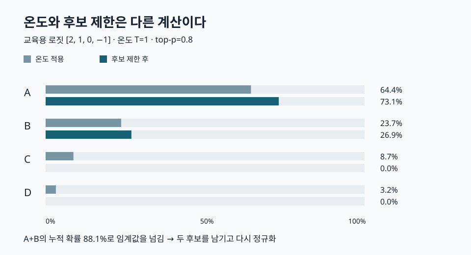

# 6장 시각화 안내

[전체 목차](../../README.md) · [학습 노트](study.md) · [강의안](lecture.md) · [강의 대본](lecture-script.md) · [시각화 실행 파일](visuals.html) · [실습 안내](lab-guide.md) · [복습 문제](quiz.md)

GitHub에서는 아래 SVG와 [학습 노트의 Mermaid 도식](study.md)을 바로 읽을 수 있다. 조작 실험은 저장소를 내려받은 뒤 [visuals.html](visuals.html)을 일반 브라우저에서 열어 사용한다. GitHub의 파일 보기 화면은 HTML의 스크립트를 실행하지 않는다. 인터넷 연결이나 모델 호출은 필요 없다.

## 토큰 선택 확률

네 토큰의 가상 로짓은 2, 1, 0, −1이다. 온도 1에서 A와 B의 누적 확률은 약 0.881이다. top-p 0.8을 채우려면 A와 B를 모두 남기고, 합이 1이 되도록 다시 정규화한다. 최종 확률은 A 약 0.731, B 약 0.269다. 이 값은 실제 LLM의 예측이 아닌 수학 실험이다.

조작할 때는 온도를 먼저 바꾸어 회색 막대의 분포를 관찰한 뒤, top-p나 top-k를 바꾸어 최종 청록 막대가 어떻게 달라지는지 비교한다. top-k=1일 때 온도의 영향이 최종 결과에서 사라지는 이유를 설명해 보자.

## 세 가지 조작 실험

| 실험 | 바꾸는 값 | 관찰하는 결과 | 유의할 가정 |
|---|---|---|---|
| [토큰 선택](visuals.html#sampling) | 온도, top-p, top-k | 후보별 확률 막대·후보 집합·엔트로피 | 가상 로짓, 명시한 후보 처리 순서 |
| [다수결](visuals.html#voting) | 단일 정확도, 홀수 반복 수, 오류 관계 | 단일·다수결 정답 확률 막대 | 독립 이진 판단 또는 완전 상관 |
| [문법 접두사](visuals.html#grammar) | 문자열 접두사와 다음 문자 | 가능한 완성 라벨·허용 문자·종료 여부 | 문자 단위 trie, 실제 서브워드 토큰 아님 |

각 조작 실험의 계산·이벤트 연결을 확인했고, 현재 HTML과 SHA256이 일치하는 통합 브라우저 검증 기록에서 기본 화면·입력 조작·390px 너비 화면을 확인했다. JavaScript 실행 오류와 문서의 가로 넘침은 발견되지 않았다. 위 SVG도 이미지로 렌더링해 글자와 막대 배치를 확인했다.

원리 출처: *Hands-On Large Language Models*, Chapter 6, PDF 물리 페이지 240–244, 265–266, 274–278. 도식과 가상 수치 실험은 별도 제작했다.

[전체 목차](../../README.md) · [학습 노트](study.md) · [강의안](lecture.md) · [강의 대본](lecture-script.md) · [시각화 실행 파일](visuals.html) · [실습 안내](lab-guide.md) · [복습 문제](quiz.md)
