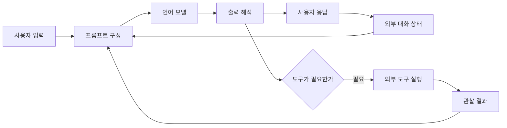
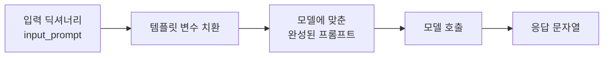
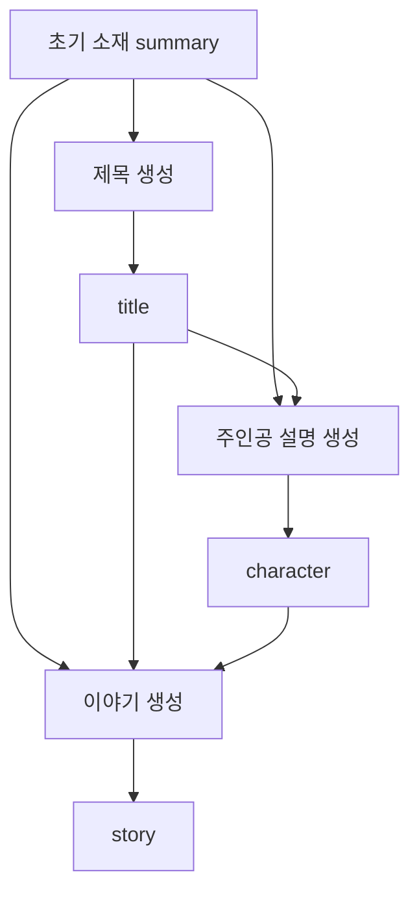
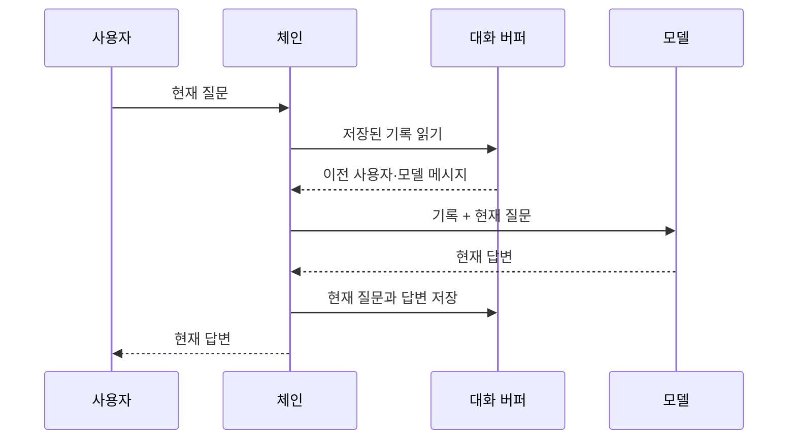
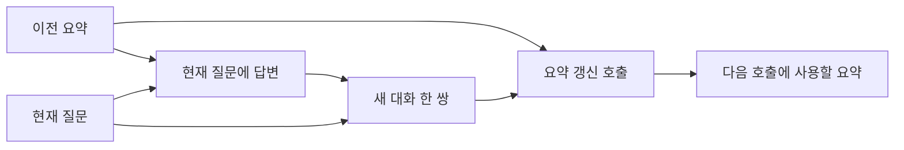
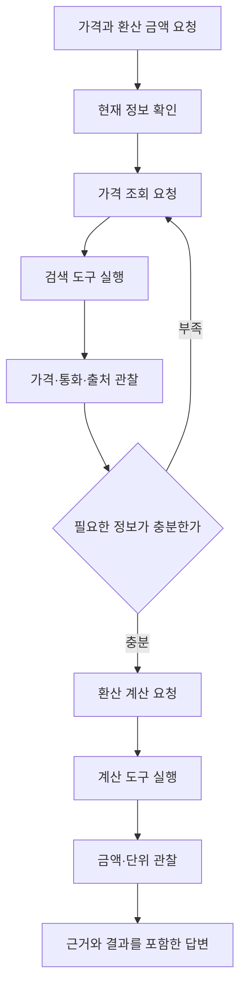

# 7장 고급 텍스트 생성 기법과 도구

[전체 목차](../../README.md) · [학습 노트](study.md) · [강의안](lecture.md) · [강의 대본](lecture-script.md) · [시각화](visuals.html) · [실습](lab-guide.md) · [복습 문제](quiz.md)

원문: Jay Alammar·Maarten Grootendorst, *Hands-On Large Language Models*, Chapter 7, 2024년판. 이 문서의 쪽수는 **제공된 PDF의 물리 페이지 280–315쪽**이며 인쇄본 페이지와 다를 수 있다. 원문 설명을 한국어 강의식으로 재구성했으며, 직접 만든 예제·수식·설계 활동에는 ‘보충’을 표시한다. 본문의 LangChain 클래스와 모델 이름은 책의 2024년 예제를 해설하기 위한 것이다. 최신 패키지와의 호환성을 검증한 설치 안내로 읽지 않는다.

## 이 장에서 해결하는 문제

좋은 프롬프트를 한 번 보내는 것만으로 모든 제품을 만들 수는 없다. 사용자는 앞서 한 말을 다시 묻고, 여러 단계의 결과가 서로 일치하기를 원하며, 모델이 학습할 당시 없던 정보나 정확한 계산 결과를 요청한다. 이 장은 모델의 가중치를 바꾸지 않고 **모델 주변에 처리 구조를 만드는 방법**을 다룬다. 모델을 불러오는 입출력 계층, 여러 처리를 잇는 체인, 과거 정보를 입력에 넣는 메모리, 관찰 결과에 따라 다음 행동을 고르는 에이전트가 그 구성 요소다.

핵심 질문은 “모델이 얼마나 똑똑한가?”에서 “어떤 정보를 어떤 형식으로 언제 제공하며, 누가 실제 행동을 실행하는가?”로 확장된다. 단순히 라이브러리 클래스 이름을 암기하면 비슷한 코드만 복사하게 된다. 각 단계에서 **데이터가 들어오고 나가는 경계**를 설명할 수 있으면 프레임워크가 바뀌어도 같은 원리를 적용할 수 있다.

### 학습 목표와 선수지식

이 장을 마치면 다음을 설명하고 직접 확인할 수 있어야 한다.

1. 모델 파일 형식과 수치 정밀도를 구분하고, 양자화가 줄이는 메모리를 추정한다.
2. 프롬프트 템플릿의 변수와 채팅 역할 구분자를 구분한다.
3. 여러 단계의 체인에서 입력·출력 키가 어떻게 누적되는지 추적한다.
4. 전체 버퍼, 최근 대화 창, 대화 요약의 비용과 정보 손실을 비교한다.
5. 메모리가 모델의 가중치 변경이나 학습과 같은 말이 아님을 설명한다.
6. ReAct의 행동 요청과 실제 도구 실행, 관찰 결과를 구별한다.
7. 에이전트의 그럴듯한 출력과 근거 있는 정답을 분리해서 평가한다.

선수지식은 Python의 함수·딕셔너리·문자열 서식, 2장의 토큰, 3장의 컨텍스트 길이, 6장의 프롬프트 설계다. 복잡한 미분이나 모델 학습 경험은 필요 없다. 실습은 표준 Python만 사용하며, 실제 LLM을 호출하는 대신 체인과 상태 전달을 눈으로 확인할 수 있도록 작은 결정적 규칙을 사용한다.

## 상세 목차

- [모듈 조합의 전체 그림](#overview)
- [1. 모델 입출력과 양자화 모델](#sec-01)
- [2. 체인이 추가하는 구조](#sec-02)
- [3. 단일 체인과 프롬프트 템플릿](#sec-03)
- [4. 여러 프롬프트를 잇는 체인](#sec-04)
- [5. 대화 메모리의 의미](#sec-05)
- [6. 전체 대화 버퍼](#sec-06)
- [7. 최근 대화만 남기는 창](#sec-07)
- [8. 대화 요약 메모리](#sec-08)
- [9. 에이전트의 구성 요소](#sec-09)
- [10. ReAct의 순환 구조](#sec-10)
- [11. LangChain ReAct 예제 해설](#sec-11)
- [12. 종합 정리와 다음 장 연결](#sec-12)
- [원문 그림·표 안내](#figures)
- [실무 설계로 연결하는 보충 수업](#design)

<a id="overview" name="overview"></a>
## 모듈 조합의 전체 그림

**원문 범위: PDF 280–281쪽, Figure 7-1.**

6장은 입력 문장을 잘 설계해 모델의 출력을 개선했다. 7장은 그 입력 문장을 만드는 과정 자체를 프로그램으로 조직한다. 같은 사용자 질문이라도 템플릿을 적용했는지, 대화 기록을 넣었는지, 검색 결과를 제공했는지에 따라 모델이 실제로 읽는 입력은 달라진다. 모델 호출 한 번을 전체 시스템으로 착각하지 않는 것이 첫 번째 학습 목표다.

원문의 Figure 7-1은 LangChain을 여러 기능을 연결하는 모듈식 프레임워크로 보여 준다. 여기서 ‘모듈식’이란 각 기능이 독립적인 책임과 입출력을 갖는다는 뜻이다. 모델 로더는 추론을 가능하게 하고, 템플릿은 모델이 읽을 입력을 구성하며, 메모리는 필요한 과거를 가져오고, 체인은 처리 순서를 조직한다. 에이전트는 여기에 다음 행동을 선택하는 루프를 더한다. 검색 모듈도 전체 그림에 등장하지만 검색과 RAG의 구체적인 설계는 다음 8장의 중심 내용이다.



이 그림은 학습용 재구성이다. 모든 프로그램이 모든 화살표를 사용해야 하는 것은 아니다. 번역처럼 입력과 출력이 단순한 작업은 템플릿과 모델만으로 충분할 수 있다. 오래 이어지는 학습 도우미에는 메모리가 필요할 수 있고, 자료 조회와 계산을 번갈아 수행하는 작업에는 도구와 반복 구조가 필요할 수 있다. 구성 요소가 많다는 이유만으로 품질이 높아지지는 않는다. 각각이 해결하는 실패를 명확히 해야 한다.

책은 LangChain을 중심으로 예제를 소개하며 DSPy와 Haystack도 다른 프레임워크의 예로 언급한다. 여기서 익혀야 할 것은 특정 프레임워크의 우열이 아니라 추상화의 역할이다. 모델의 공급자를 바꾸어도 입력을 포맷하고 결과를 다음 단계로 넘기는 문제는 남는다. 다만 통일된 호출 인터페이스가 모델의 실제 행동이나 지원 기능까지 동일하게 만드는 것은 아니다.

<a id="sec-01" name="sec-01"></a>
## 1. 모델 입출력과 양자화 모델

**원문 절: Model I/O: Loading Quantized Models with LangChain. PDF 281–284쪽, Figure 7-2.**

### 모델을 사용하려면 무엇을 준비해야 하는가

모델 입출력은 “문자열을 넣으면 문자열이 나온다”보다 넓은 문제다. 어떤 모델 파일을 읽는지, 어떤 추론 엔진을 사용하는지, 문장을 어떤 토큰 형식으로 바꾸는지, 출력은 어디에서 종료하는지까지 맞아야 한다. 책은 이전 장에서 사용한 Phi-3를 GGUF 형식으로 불러오고, `llama-cpp-python`과 LangChain의 `LlamaCpp`를 연결한다.

GGUF는 모델 가중치와 관련 메타데이터를 담는 파일 형식이다. **GGUF라는 확장자 자체가 4비트나 8비트라는 뜻은 아니다.** 같은 모델 계열에 여러 정밀도의 GGUF 파일이 있을 수 있다. 장의 도입부는 압축된 모델을 설명하지만 실제 사용 파일이 어떤 정밀도인지 판단하려면 파일명과 메타데이터를 확인해야 한다. 모델 이름, 파일 형식, 양자화 수준은 서로 다른 축이다.

원문 PDF 283쪽에는 주의할 점이 있다. 앞 문단은 “16비트 대신 8비트를 사용한다”고 설명하지만 바로 뒤 다운로드 경로와 `model_path`는 `Phi-3-mini-4k-instruct-fp16.gguf`를 가리킨다. FP16은 16비트 부동소수점이므로, **인쇄된 코드 그대로는 8비트 파일을 선택한 예제가 아니다.** 학습할 때 이 차이를 넘기면 예상 메모리와 실제 메모리가 맞지 않는 이유를 엉뚱하게 찾게 된다. 이 문서는 원문 이미지에서 해당 불일치를 확인했다.

### 양자화의 직관과 정확한 범위

실수를 무한한 정밀도로 저장할 수는 없다. 저장 가능한 값들의 집합 중 하나로 원래 값을 근사해야 한다. 원문의 Figure 7-2는 원주율을 표현하는 비트 수를 줄이면 세부 정밀도가 사라지는 모습을 보여 준다. 시간을 “14시 16분 12초”에서 “14시 16분”으로 말하는 비유도 같은 직관을 제공한다. 필요한 핵심은 남기고 덜 중요한 세부를 버려 표현 비용을 줄이는 것이다.

그러나 비유에는 한계가 있다. 어떤 가중치의 작은 변화가 실제 모델 출력에 미치는 영향은 균일하지 않다. 시계의 초를 버리는 것처럼 모든 숫자를 단순히 잘라도 같은 품질이 유지되는 것은 아니다. 실제 양자화 방식은 스케일, 그룹, 이상치 처리, 저장 형식 등을 고려한다. 자세한 학습·양자화 기법은 12장에서 다루므로 여기서는 저장량과 오차의 관계를 먼저 이해한다.

**보충 손계산.** 가중치 개수를 (P), 가중치당 저장 비트를 (b)라고 하면 순수 가중치 데이터의 이상적인 크기는 다음과 같다.

$$
M_{\text{weights}} \approx \frac{P\times b}{8}\;\text{bytes}
$$

예를 들어 가상의 40억 개 가중치를 16비트로 저장하면 (4\times10^9\times16/8=8\times10^9$바이트, 즉 십진 단위 약 8 GB다. 8비트면 약 4 GB, 4비트면 약 2 GB다. 이것은 **전체 실행 메모리가 아니라 가중치만의 근사치**다. 실제 실행에는 양자화 부가정보, 활성값, KV 캐시, 작업 버퍼, 엔진 오버헤드가 더해진다. 따라서 “4비트 파일이 2 GB니까 2 GB 장치에서 충분하다”는 결론은 나오지 않는다.

모델이 작아지면 메모리 전송량과 하드웨어 활용 측면에서 유리할 수 있다. 하지만 더 낮은 비트가 항상 더 빠르다는 보장은 없다. 해당 하드웨어와 엔진이 그 연산을 얼마나 잘 지원하는지, 압축 해제 비용이 어떤지에 따라 달라진다. 원문의 “빠르고 가벼워진다”는 설명은 이러한 효율 개선의 동기를 말하는 것이며 모든 설정의 성능 보증은 아니다.

책은 4비트 이상이 압축과 성능의 타협점이 될 수 있다는 당시의 경험칙을 제시한다. 이 경험칙을 영구적인 법칙으로 외우기보다, 동일한 작업과 데이터에서 정밀도별 품질을 비교해야 한다. 작은 고정밀 모델과 큰 저정밀 모델 중 무엇이 나은지도 작업에 따라 달라진다.

### 원문 로딩 설정을 읽는 법

| 원문 설정 | 설정의 역할 | 잘못 읽기 쉬운 점 |
|---|---|---|
| `model_path` | 로컬 모델 파일 위치 | 모델 이름을 썼다고 파일이 자동으로 준비되는 것은 아니다 |
| `n_gpu_layers=-1` | 해당 엔진 설정에서 가능한 모든 레이어의 GPU 사용을 요청 | GPU 지원 빌드나 장치 메모리가 자동으로 생기지는 않는다 |
| `max_tokens=500` | 생성 출력 길이 상한 | 전체 입력과 출력의 컨텍스트 한도와 같은 값이 아니다 |
| `n_ctx=2048` | 실행 시 사용할 컨텍스트 크기 설정 | 모델 이름의 ‘4k’가 이 값을 무조건 덮어쓰는 것은 아니다 |
| `seed=42` | 난수 사용에 관한 재현성 설정 | 하드웨어·엔진·연산 차이를 넘는 절대적 동일 출력을 보장하지 않는다 |
| `verbose=False` | 상세 로그 표시 제어 | 모델의 추론 품질이나 기억 능력을 조절하지 않는다 |

책의 첫 `invoke` 호출은 빈 문자열을 반환한다. 이 사례는 적절한 채팅 템플릿이 필요하다는 다음 절의 동기다. 다만 실제 디버깅에서 빈 문자열이 나오면 템플릿만을 원인으로 단정해서는 안 된다. 종료 토큰, 생성 길이, 프롬프트와 모델의 호환성, 파일 경로, 실행 엔진 로그도 확인해야 한다. “책에서 빈 출력이 템플릿 문제였다”와 “모든 빈 출력의 원인이 템플릿이다”는 다르다.

책은 로컬 장치가 없을 때 외부 채팅 API를 연결하는 대안도 보여 준다. 여기서 모델 입출력 계층은 로컬 호출과 원격 호출의 차이를 숨겨 체인 구성을 단순하게 해 준다. 하지만 원격 호출의 인증, 네트워크, 비용, 데이터 전달 범위는 여전히 시스템 설계의 일부다. 이 학습 자료의 기본 실습은 이런 외부 호출 없이 실행된다.

<a id="sec-02" name="sec-02"></a>
## 2. 체인이 추가하는 구조

**원문 절: Chains: Extending the Capabilities of LLMs. PDF 284–285쪽, Figure 7-3.**

체인은 하나의 처리가 만든 결과를 다음 처리의 입력에 연결하는 구조다. ‘체인’이라는 이름 때문에 반드시 여러 개의 LLM을 직렬로 호출해야 한다고 생각하기 쉽지만, 원문의 가장 단순한 체인은 **프롬프트 템플릿 하나와 LLM 하나**다. 토큰화, 문자열 구성, 출력 파싱, 외부 데이터 삽입처럼 모델 외부의 처리도 체인의 구성 요소가 될 수 있다.

함수 관점으로 보면 입력 (x)에 템플릿 함수 (f)를 적용하고 모델 함수 (g)를 적용하는 (g(f(x)))다. 단, 실제 시스템에서는 각 단계의 입출력이 문자열 하나가 아니라 이름 있는 필드를 가진 구조일 수 있다. 이 점이 중요하다. 사람이 보기에는 “앞 단계 결과를 뒤에 넣는다”로 간단하지만, 프로그램은 **어느 키의 값을 어느 변수에 넣는지** 알아야 한다.

원문의 Figure 7-3은 모듈과 모델을 잇는 연결 자체를 강조한다. 모듈이 메모리라면 과거 대화가 들어오고, 템플릿이라면 입력 형식이 바뀐다. 두 경우 모두 모델의 가중치를 수정하지 않는다. 출력이 개선된다면 모델이 새로 학습했기 때문이 아니라 더 적합한 입력과 절차를 사용했기 때문이다.

체인은 재사용과 관찰 가능성도 높인다. 반복되는 형식을 한곳에서 관리하면 수정 누락을 줄일 수 있다. 중간 결과가 보이면 실패가 어디에서 시작됐는지 찾을 수 있다. 반대로 모든 처리를 하나의 긴 프롬프트로만 표현하면 어느 요구사항이 잘못 적용됐는지 분리하기 어려울 수 있다.

**보충 주의점.** 체인이라는 추상화는 오류를 없애지 않는다. 앞 단계가 틀린 값을 만들면 다음 단계는 그 값을 확정 사실처럼 사용할 수 있다. 따라서 각 단계의 경계에는 출력 형식 검증, 필수 키 검사, 실패 처리 규칙이 필요하다. 체인의 좋은 설계는 단계 수가 많은 설계가 아니라 각 단계가 좁고 명확한 책임을 갖는 설계다.

<a id="sec-03" name="sec-03"></a>
## 3. 단일 체인과 프롬프트 템플릿

**원문 절: A Single Link in the Chain: Prompt Template. PDF 285–289쪽, Figures 7-4–7-6.**

### 템플릿에는 두 종류의 형식이 있다

첫째는 모델이 대화의 역할을 구분하도록 하는 **채팅 직렬화 형식**이다. 둘째는 사용자의 작업 요구를 반복해서 쓰기 위한 **업무 프롬프트 형식**이다. 원문은 Phi-3가 기대하는 역할 구분자를 설명하면서 템플릿의 필요성을 보여 주고, 제품 종류만 바꿔 사업 이름을 짓는 예로 업무 템플릿을 확장한다.

역할 구분자는 단순한 장식 문자열이 아니다. 모델이 학습 과정에서 접한 대화 형식을 추론 입력에서도 맞추기 위해 사용한다. 원문 예제는 `<s>`, `<|user|>`, `<|assistant|>`, `<|end|>`를 사용한다. 각각 프롬프트 시작, 사용자 메시지 시작, 어시스턴트 출력 시작, 메시지 끝을 구분하는 표지로 설명된다. 다른 모델이나 API에서도 이 문자열들을 그대로 쓰면 된다는 뜻은 아니다.

```text
[채팅 형식의 시작]
[사용자 역할] {input_prompt} [사용자 메시지의 끝]
[어시스턴트 역할: 여기부터 생성]
```

위 구조에서 `{input_prompt}`는 호출할 때 바꾸는 데이터이고, 역할 구분자는 모델에 맞춰 선택한 고정 구조다. 원문 Figure 7-5의 요점은 모델이 “누가 말했고 어디부터 이어 써야 하는지”를 알 수 있도록 경계를 제시한다는 것이다. 템플릿을 사용하면 사용자가 매번 이 경계를 손으로 붙일 필요가 없다.

### `PromptTemplate`과 변수의 관계

원문에서 `PromptTemplate`은 템플릿 문자열과 `input_variables`를 받는다. `input_variables=["input_prompt"]`는 템플릿을 완성하려면 그 이름의 값이 필요하다는 선언이다. 호출할 때는 `{"input_prompt": "질문"}` 같은 매핑을 넘긴다. 변수 이름이 `question`인데 템플릿에는 `{input_prompt}`가 남아 있으면 내용이 자동으로 맞춰지지 않는다.

책은 `basic_chain = prompt | llm`로 두 단계를 연결한다. 여기의 `|`는 프레임워크가 정의한 연결 연산이다. 일반적인 Python 함수에 같은 기호를 썼다고 모두 체인이 되는 것은 아니다. 모델이 먼저 실행된 뒤 템플릿을 붙이는 것이 아니라, 사용자 값으로 템플릿을 완성한 뒤 모델을 호출한다.



**보충 예제.** 교재를 설명하는 반복 업무를 생각해 보자. “대상은 `{audience}`, 설명할 개념은 `{concept}`, 예시는 `{domain}`에서 선택하라”는 템플릿을 만들면 세 값을 바꾸어 여러 수업에 쓸 수 있다. `audience="Python 초급자"`, `concept="대화 메모리"`, `domain="학습 상담"`을 넣은 결과를 먼저 출력해 보면 모델 호출 전 단계의 오류를 쉽게 찾을 수 있다. 특히 중괄호가 많은 JSON이나 코드 예제를 템플릿에 넣을 때는 변수 치환 규칙과 문자 그대로의 중괄호를 구별해야 한다.

원문 설명에는 `system_prompt`라는 표현이 나오지만 실제로 제시된 단일 체인 템플릿에는 `input_prompt`만 선언되어 있다. 따라서 이 코드가 별도 시스템 역할 메시지를 실제로 구성한다고 읽으면 안 된다. 설명에 등장하는 개념과 코드에 구현된 변수를 대조하는 습관이 필요하다.

### 채팅 API가 템플릿을 처리하는 경우

원문은 일부 채팅 API가 내부 역할 형식을 처리하므로 같은 수준의 수동 템플릿이 필요하지 않을 수 있다고 설명한다. 이때 사용자는 역할이 명시된 메시지 목록을 전달하고 API가 모델에 맞는 형식으로 처리할 수 있다. 반대로 원시 텍스트 완성 인터페이스에서는 템플릿을 직접 구성해야 할 수 있다. 사용하는 인터페이스의 계약을 확인해야 한다.

중복 적용도 문제다. 이미 채팅 형식을 적용한 문자열을 다시 채팅 템플릿에 넣으면 역할 표지가 중첩되어 모델이 이상한 입력을 받게 될 수 있다. 디버깅할 때 최종 입력을 확인하는 이유가 여기에 있다. “내가 작성한 질문은 자연스럽다”는 확인만으로는 충분하지 않다. 모델이 읽는 실제 입력에는 도구 설명, 히스토리, 구분자 등 더 많은 요소가 들어갈 수 있다.

책의 단일 체인은 1+1에 자연스러운 응답을 얻는 데 성공한다. 출력 문장이 책과 다르더라도 반드시 오류는 아니다. 생성은 샘플링이나 모델·환경에 따라 달라질 수 있다. 검사할 대상은 문장 하나의 완벽한 일치보다 형식이 올바르게 구성됐는지, 질문을 이해하고 필요한 답을 제공했는지다. 이 장의 CPU 실습은 생성 변동을 제거한 규칙형 처리로 데이터 흐름을 먼저 확인한다.

<a id="sec-04" name="sec-04"></a>
## 4. 여러 프롬프트를 잇는 체인

**원문 절: A Chain with Multiple Prompts. PDF 289–293쪽, Figures 7-7–7-8.**

### 복잡한 요청을 왜 나누는가

원문은 이야기 생성 요청을 제목, 주인공 설명, 이야기 본문으로 나눈다. 하나의 긴 요청으로 세 요소를 한 번에 생성할 수도 있다. 여러 단계로 나누는 이유는 각 단계의 목표를 명확히 하고, 앞서 만든 결과를 다음 단계의 조건으로 제공하며, 중간 산출물을 따로 다룰 수 있게 하기 위해서다.

특히 제목을 화면 상단에 보여 주거나 주인공 설명만 수정하는 제품에서는 중간 결과가 이름 있는 값으로 남는 것이 중요하다. 하나의 거대한 응답 문자열에서 제목 위치를 다시 추측하는 것보다 `title` 키를 읽는 방식이 안정적이다. 그러나 여러 호출은 지연과 비용을 늘릴 수 있으므로, 분해가 가져오는 통제 가능성이 그 비용보다 가치 있는지 판단해야 한다.

### 상태가 단계마다 늘어나는 모습을 추적하자

원문의 첫 입력 `summary`는 완성된 이야기의 사후 요약이 아니라 사용자가 제공한 초기 이야기 소재다. 그 이름만 보고 최종 요약 단계라고 오해하지 말자. 첫 단계는 소재를 받아 `title`을 만들고, 둘째 단계는 소재와 제목으로 `character`를 만들고, 셋째 단계는 셋을 모두 사용해 `story`를 만든다.

| 단계 | 읽는 필드 | 새로 쓰는 필드 | 다음 단계에 유지할 값 |
|---|---|---|---|
| 제목 생성 | `summary` | `title` | `summary`, `title` |
| 주인공 생성 | `summary`, `title` | `character` | 앞선 값과 `character` |
| 이야기 생성 | `summary`, `title`, `character` | `story` | 최종 결과에 필요한 모든 값 |



Figure 7-7은 앞 단계 출력이 뒤 단계 입력이 된다는 일반 원리를, Figure 7-8은 이야기 예제의 구체적 의존 관계를 보여 준다. 여기에는 단순한 일렬 흐름뿐 아니라 **이전 입력을 계속 유지해서 여러 뒤 단계에 공급하는 흐름**이 있다. 체인을 만들 때 이 구분을 놓치면 제목 문자열만 다음 단계로 넘어가 초기 소재가 사라지는 문제가 생긴다.

원문 `LLMChain`의 `output_key`는 결과를 `title`, `character`, `story` 같은 이름으로 저장하도록 한다. `title | character | story`라는 표현은 이러한 데이터 계약을 전제로 한다. 파이프 기호 자체가 모든 중간 필드를 자동으로 합쳐 준다고 일반화하면 안 된다. 실제 사용 객체가 입력을 보존하는지, 결과를 새 매핑으로 만드는지, 문자열만 반환하는지 확인해야 한다.

### 중간 검증이 체인의 가치를 만든다

**보충 설계.** 이야기 생성 앞 단계가 “두 문장으로 주인공을 설명하라”는 요청을 무시하고 여섯 문장을 반환했다면 어떻게 할까? 그대로 다음 단계에 넣을 수도 있지만, 형식 검사를 통해 재요청하거나 정규화할 수도 있다. 제목이 비었는지, 주인공 이름이 일관적인지, 최대 길이를 넘었는지 같은 검사는 모델 없이도 일부 처리할 수 있다.

다만 검증은 목적에 맞아야 한다. 제목이 창의적인지, 이야기가 감동적인지는 단순 길이 검사만으로 판단하기 어렵다. 기계적으로 확인 가능한 형식과 사람의 판단이 필요한 품질을 구별하면 검증이 지나치게 복잡해지는 것을 막을 수 있다. 또한 앞 단계에서 잘못된 사실을 생성했다면 뒤 단계가 그 오류를 더 유창하게 포장할 수 있다. 중간 결과를 저장하는 것은 재사용뿐 아니라 오류 추적을 위한 것이다.

순차 호출의 지연은 대략 각 단계 지연의 합이다. 세 단계가 각각 1초, 2초, 3초라면 의존 관계가 완전히 순차일 때 총 6초가 든다. 모델 호출 간 네트워크나 큐 대기까지 있으면 더 길어진다. 제목과 주인공이 서로 독립적인 설계라면 병렬 처리를 생각할 수 있지만, 원문 예제에서는 주인공 생성이 제목을 사용하므로 의존성을 바꾸지 않는 한 동시에 실행할 수 없다.

이 장의 실습에서는 실제 이야기를 생성하지 않고 정해진 규칙으로 제목·인물·줄거리를 구성한다. 목적은 결과의 문학성을 평가하는 것이 아니라 `summary → title → character → story`의 상태 전달과 필수 키 검사를 직접 보는 것이다. 규칙을 LLM 호출로 교체해도 주변 데이터 계약이 필요하다는 점을 익힌다.

<a id="sec-05" name="sec-05"></a>
## 5. 대화 메모리의 의미

**원문 절: Memory: Helping LLMs to Remember Conversations. PDF 293–295쪽, Figure 7-9.**

### ‘기억한다’는 말을 시스템 수준에서 해석하기

모델에 “내 이름은 민아야”라고 말한 뒤 별도의 호출에서 “내 이름이 뭐야?”라고 묻는다고 하자. 두 번째 입력에 앞 대화가 없다면 일반적인 독립 추론 호출은 그 이름을 알 수 없다. 모델이 첫 번째 답변을 생성했다고 해서 가중치에 이름을 저장하거나 다음 호출의 입력을 자동으로 보존한 것은 아니다.

원문은 이를 모델의 stateless 성질로 설명한다. 여기서 문맥은 **별도로 실행한 기본 호출 사이에 대화 상태를 전달하지 않는 예제**다. 실제 제품은 서버, 세션 객체, 파일, 데이터베이스 등에서 대화 상태를 관리할 수 있다. 그러므로 “모든 서비스가 매번 모든 대화를 잊는다”는 뜻이 아니라, 상태를 이어 주는 책임이 시스템에 있다는 뜻이다.

Figure 7-9의 기억 있는 대화와 없는 대화 비교는 바로 이 차이를 보여 준다. 기억을 구현하는 기본 방법은 과거에 필요한 정보를 다시 입력에 넣는 것이다. 사람은 오래전에 본 것을 회상한다고 느끼지만, 프로그램에서는 현재 호출에 넣을 데이터를 구성하는 과정일 수 있다. 이 차이를 알면 개인정보가 어디에 저장되고 어떤 호출에 전달되는지도 더 명확히 설계할 수 있다.

### 메모리, 가중치, KV 캐시를 구별하자

**보충 비교.** 대화 메모리는 프로그램이 관리하는 과거 정보다. 모델 가중치는 학습을 통해 조정된 일반적인 패턴이다. KV 캐시는 모델 추론에서 이미 처리한 토큰의 키·값 표현을 재사용하는 계산 최적화다. 세 가지 모두 ‘저장된 것’이지만 역할, 수명, 위치가 다르다.

대화 기록을 파일로 저장하면 프로그램을 다시 켠 뒤에도 복원할 수 있지만, 새 호출에 그 정보를 제공하는 코드는 여전히 필요하다. 반대로 메모리 객체가 프로세스 안에만 있으면 앱을 재시작했을 때 사라질 수 있다. 책의 예제가 다루는 것은 주로 실행 중 대화 상태를 프롬프트에 주입하는 구조이며, 장기 저장·사용자별 격리까지 자동으로 완성됐다는 뜻은 아니다.

컨텍스트 한도도 중요하다. 질문, 지시문, 도구 설명, 과거 대화, 생성 출력이 모두 일정 예산을 공유한다. 과거 대화를 많이 넣을수록 모델이 사용할 단서가 늘 수 있지만, 무한히 넣을 수는 없고 처리 비용도 늘어난다. 또한 기록이 입력에 있다는 사실이 모델이 관련 정보를 정확히 찾아 사용한다는 보장은 아니다.

이제 세 가지 전략을 비교한다. 전체 버퍼는 원문을 유지하고, 최근 대화 창은 오래된 기록을 버리며, 요약은 기록을 압축한다. 각각 원문 충실도, 길이, 처리 비용이라는 다른 지점에서 타협한다. “기억 기능을 켠다”는 하나의 선택보다 “무엇을 어떤 표현으로 언제까지 남긴다”는 구체적인 설계가 필요하다.

<a id="sec-06" name="sec-06"></a>
## 6. 전체 대화 버퍼

**원문 절: Conversation Buffer. PDF 295–297쪽, Figures 7-10–7-11.**

### 호출 전에는 읽고 호출 후에는 기록한다

전체 버퍼는 지금까지의 사용자 메시지와 모델 응답을 보존해 다음 호출에 함께 넣는다. 원문에서는 템플릿에 `chat_history` 변수를 추가하고, `ConversationBufferMemory(memory_key="chat_history")`가 그 이름으로 기록을 제공하도록 한다. 템플릿 변수 이름과 메모리 출력 이름이 맞아야 한다.

메모리의 수명 주기를 생각하면 출력 구조를 읽기 쉬워진다. 첫 호출 전에는 기록이 비어 있다. 템플릿에 빈 기록과 현재 질문을 넣어 답변을 생성한다. 호출이 끝나면 현재 질문과 답변 한 쌍을 저장한다. 두 번째 호출을 시작할 때 첫 번째 쌍을 읽어서 입력에 추가한다. 결과 객체의 `chat_history`가 현재 답변까지 포함하는지 이전 대화만 나타내는지는 이 시점을 확인해야 한다.



Figure 7-10은 기록을 입력 앞에 붙이는 직관을, Figure 7-11은 메모리가 체인의 별도 구성 요소로 결합되는 구조를 보여 준다. 핵심은 기록이 모델의 바깥에 존재하고 매 호출 때 필요한 내용을 주입한다는 점이다. 모델은 기억 장치를 직접 읽는 것이 아니라 구성된 입력을 읽는다.

### 이 전략의 장점과 비용

전체 버퍼의 장점은 표현을 의도적으로 압축하거나 버리지 않는다는 것이다. 사용자가 정확히 어떤 문장을 썼는지, 앞 답변이 무엇이었는지 다시 확인할 수 있다. 단, 컨텍스트 안에 실제로 포함된 범위에서만 그렇다. 전체 기록이 저장되어 있어도 입력 길이를 넘겨 일부가 빠지면 모델은 빠진 부분을 보지 못한다.

길이가 늘면 매 호출의 입력 처리량도 늘어난다. **보충 계산.** 한 대화 쌍이 평균 (u)토큰이고, 현재 질문과 고정 지시문의 길이를 별도 항으로 놓자. (t)번째 응답 전에 과거 기록은 대략 ((t-1)u)토큰이다. 총 (n)번 호출에서 과거 기록으로 반복 처리하는 양은 다음과 같다.

$$
u\sum_{t=1}^{n}(t-1)=u\frac{n(n-1)}{2}
$$

대화 쌍을 한 번 저장하는 데 드는 공간은 선형으로 늘지만, 매번 모든 과거를 다시 보내면 누적 입력량은 이 단순 모형에서 제곱에 비례해 늘어난다. 실제 API의 캐시, 엔진 최적화, 토큰 가격 등은 별도 요인이다. 식의 의미는 오래된 대화가 반복해서 입력된다는 구조를 이해하는 데 있다.

### 학습 도우미 예제로 점검하기

사용자가 “나는 벡터 내적은 알지만 행렬 곱은 아직 익숙하지 않다”고 말한 뒤 여러 질문을 했다고 하자. 전체 버퍼에는 그 학습 상태가 그대로 남는다. 하지만 모델이 항상 거기에 주의를 기울인다는 보장은 없다. 답변을 평가할 때는 기록의 포함 여부와 기록의 올바른 활용 여부를 나누어 확인해야 한다.

또한 사용자별 기록이 섞이지 않도록 저장 키를 분리해야 한다. 원문 예제는 하나의 메모리 객체에 한 대화를 이어 가므로 여러 사용자의 세션 관리까지 보여 주지는 않는다. 학습용 코드가 잘 작동한다고 바로 공용 서비스의 메모리 계층이 완성됐다고 판단하지 않는 것이 좋다.

전체 버퍼는 짧은 대화, 정확한 문장 재확인, 단순한 디버깅에 적합한 출발점이다. 대화가 길어질 때 필요한 것은 무조건 더 큰 컨텍스트를 고르는 일만이 아니다. 오래된 기록 중 무엇이 실제로 필요한지 구별하는 전략이 다음 절부터 등장한다.

<a id="sec-07" name="sec-07"></a>
## 7. 최근 대화만 남기는 창

**원문 절: Windowed Conversation Buffer. PDF 297–300쪽.**

### 보존 범위를 명시적으로 제한하기

최근 대화 창은 마지막 (k)개의 대화 단위만 다음 입력에 넣는다. 원문은 `ConversationBufferWindowMemory(k=2, memory_key="chat_history")`를 사용한다. 설명의 ‘대화’는 예제에서 사용자 메시지와 모델 답변으로 이루어진 상호작용을 가리킨다. 라이브러리 버전이나 구현에 따라 메시지 수와 턴 수의 정의가 다를 수 있으므로, 실제로 무엇이 잘리는지는 기록을 출력해 확인해야 한다.

이 방식은 오래된 정보를 선택적으로 압축하지 않고 통째로 제외한다. 따라서 최근 대화의 원문 표현은 남지만 오래된 중요한 사실이 사라질 수 있다. 장점은 정책이 단순하고 요약을 위한 추가 모델 호출이 없다는 것이다. 단점은 오래된 정보의 중요도를 알지 못한다는 것이다.

원문의 예제를 시간순으로 읽어 보자. 첫 대화에서 이름과 나이를 알려 준다. 둘째 대화에서는 산술 질문을 한다. 셋째 대화에서 이름을 물으면 호출 직전의 최근 두 대화에는 첫 소개가 아직 있으므로 이름을 답할 수 있다. 이후 넷째 대화에서 나이를 물을 때는 첫 소개가 창 밖으로 나간다. 셋째 답변이 이름은 다시 언급했으므로 이름은 최근 기록에 남을 수 있지만, 나이는 되풀이되지 않았으므로 사라진다.

| 호출 | 현재 질문 | 호출 직전 창에 들어오는 과거 쌍 | 관찰 |
|---|---|---|---|
| 1 | 이름·나이 소개와 첫 질문 | 없음 | 사실이 처음 제시됨 |
| 2 | 다른 산술 질문 | 1번 | 소개를 볼 수 있음 |
| 3 | 이름 질문 | 1번, 2번 | 이름을 답변에 다시 기록할 수 있음 |
| 4 | 나이 질문 | 2번, 3번 | 소개는 제외되고 나이는 알 수 없을 수 있음 |

이 표는 매우 중요한 오해를 해결한다. **오래된 원문 메시지가 지워졌다고 그 메시지의 모든 정보가 지워진 것은 아니다.** 정보가 최근 답변에 반복되면 새 기록을 통해 살아남는다. 반대로 오래된 정보가 중요해도 최근에 반복되지 않으면 사라진다. 창은 의미가 아니라 위치로 선택한다.

### 창 크기와 토큰 예산은 다르다

최근 두 대화만 남긴다고 항상 짧아지는 것은 아니다. 한 대화에 사용자가 긴 문서를 붙여 넣고 모델이 긴 분석을 반환하면 두 쌍만으로도 컨텍스트를 넘길 수 있다. (k)는 대화 개수 제한이지 토큰 제한이 아니다. 따라서 최근 창을 사용해도 실제 토큰 수를 세는 검사가 필요하다.

**보충 예산식.** 컨텍스트 한도를 (C), 지시문·현재 질문·도구 설명의 길이를 (F), 출력 예약량을 (O)라 하면, 과거 기록에 쓸 수 있는 예산은 대략 (B=C-F-O)다. (C=2048), (F=448), (O=500)이면 (B=1100)토큰이다. 최근 두 대화가 각각 700토큰이라면 (1400>1100)이므로 창 정책만으로는 들어가지 않는다. 이 숫자들은 교육용 가정이며 실제 모델의 토큰화 결과를 대신하지 않는다.

최근 창은 마지막 작업 맥락이 가장 중요한 짧은 수정 대화에 잘 맞는다. 예를 들어 코드 한 부분을 조금씩 수정하는 상황에서는 최근 오류와 수정 지시가 중요할 수 있다. 반면 사용자의 장기 목표나 초반에 합의한 제약을 오래 유지해야 한다면 창만으로는 부족할 수 있다. 이런 경우 구조화된 핵심 사실 저장이나 요약을 함께 고려할 수 있으며, 이는 원문의 기본 전략을 확장하는 보충 설계다.

<a id="sec-08" name="sec-08"></a>
## 8. 대화 요약 메모리

**원문 절: Conversation Summary. PDF 300–306쪽, Figures 7-12–7-13, Table 7-1.**

### 삭제 대신 압축하기

요약 메모리는 오래된 대화를 단순히 버리는 대신 핵심 내용을 짧은 표현으로 재구성한다. 원문은 `ConversationSummaryMemory`에 별도의 요약 프롬프트와 LLM을 전달한다. 같은 모델이 응답과 요약을 맡을 수도 있고, 요약에는 다른 모델을 사용할 수도 있다. 요약 모델의 선택 역시 품질과 비용의 절충이다.

원문의 요약 템플릿은 두 변수를 입력받는다. `summary`는 지금까지의 요약이고, `new_lines`는 새로 추가된 대화다. 이를 사용해 업데이트된 요약을 만든다. 따라서 개념적으로는 다음 갱신식으로 표현할 수 있다.

$$
S_t = \operatorname{Summarize}(S_{t-1}, U_t, A_t)
$$

(S_t)는 (t)번째 대화 뒤의 요약, (U_t)는 사용자 메시지, (A_t)는 모델 응답이다. 이 식은 언어 모델 학습식이 아니라 애플리케이션 상태 갱신을 나타낸다. 다음 응답은 이전 요약 (S_{t-1})과 현재 질문을 읽고, 현재 응답이 나온 뒤 새 요약 (S_t)를 만든다고 생각하면 호출 순서가 명확해진다.

Figure 7-12는 요약 모델이 과거 대화를 압축하는 역할을, Figure 7-13은 요약이 응답 체인으로 다시 들어가는 전체 구조를 보여 준다. 매 상호작용마다 요약을 갱신하는 원문 예제에서는 응답 호출과 요약 호출이 발생한다. 요약 호출이 추가되므로 단일 응답에 비해 처리 시간이 늘 수 있다. 다만 다른 설계에서는 몇 턴마다 갱신하거나 긴 기록이 생겼을 때 갱신할 수도 있다. 이는 원문과 구분되는 확장 방식이다.



### 핵심은 남을 수 있지만 원문은 복구되지 않는다

요약은 무손실 압축이 아니다. “처음에 1+1을 물었다”는 요약이 남아 있으면 질문의 주제는 알 수 있지만, 원래 사용자가 어떤 표현과 문장부호로 질문했는지는 복구하기 어렵다. 원문 예제도 첫 질문을 묻자 모델이 요약 문맥에서 내용을 추론해 답하는 모습을 보여 준다. 정확한 인용문이 필요한 시스템이라면 요약만으로는 충분하지 않다.

수치, 부정, 조건, 시간 순서, 출처 구분은 특히 중요하다. “커피를 마시지 않는다”가 “커피를 마신다”로 바뀌거나, “시험은 금요일이었으나 월요일로 변경됐다”가 “시험은 금요일”로 남으면 이후 답변 전체가 틀릴 수 있다. 요약 품질을 문장이 매끄러운지로만 평가하지 말고 필요한 사실과 제약이 보존됐는지 검사해야 한다.

또한 반복 요약은 앞선 오류를 다음 요약의 입력으로 삼는다. 어떤 정보가 한 번 빠지면 원본 대화에 다시 접근하지 않는 이상 뒤 단계에서 복원할 수 없다. 이것을 단순히 “긴 대화를 모두 기억한다”고 표현하면 과장이다. 요약은 전체 기간의 일부 의미를 유지할 수 있지만 모든 세부사항을 보장하지 않는다.

### 원문 예제에서 발견할 수 있는 오류 전파

PDF 302–303쪽의 예제에서 요약에는 사용자의 이름이 들어 있는데도 모델 응답은 이름을 언급하면서 동시에 “세션 밖 개인 정보는 유지하지 않는다”는 식의 말을 덧붙인다. 다음 요약은 그 모델의 말을 대화 내용으로 다시 저장한다. 이 문장을 시스템의 실제 저장 정책에 대한 증거로 읽으면 안 된다. 그것은 **모델이 생성한 응답 텍스트**이며 실제 프로그램 상태와 다를 수 있다.

이 사례는 요약에 들어가는 내용의 출처를 구분해야 하는 이유를 보여 준다. 사용자가 직접 밝힌 이름과 모델이 임의로 말한 시스템 정책은 신뢰 근거가 다르다. 요약이 두 내용을 모두 같은 수준의 사실로 적으면 잘못된 진술이 이후 답변에 계속 영향을 줄 수 있다. 학습 자료의 실습은 이러한 문제를 줄이기 위해 명시적인 사용자 사실만 추출하는 작은 규칙을 사용하지만, 이는 일반적인 자연어 요약 모델의 능력을 구현한 것이 아니다.

### Table 7-1을 정확히 읽기

| 전략 | 남기는 표현 | 주요 장점 | 중요한 손실·비용 | 적합한 출발 상황 |
|---|---|---|---|---|
| 전체 버퍼 | 선택된 전체 원문 대화 | 구현이 단순하고 원문을 다시 볼 수 있음 | 입력 증가, 컨텍스트 초과, 관련 정보 찾기 어려움 | 짧은 대화와 원문 확인 |
| 최근 창 | 최근 (k)개 대화의 원문 | 추가 요약 호출 없이 길이 증가를 제한 | 오래된 정보 소실, 개별 긴 턴은 여전히 큼 | 최근 작업에 집중하는 대화 |
| 요약 | 핵심을 재서술한 압축 표현 | 오래된 주요 사실을 짧게 유지할 수 있음 | 요약 호출, 오류·누락, 원문 표현 손실 | 긴 대화의 주요 맥락 유지 |

원문 표는 각 방식의 장단점을 대비한다. 전체 버퍼는 큰 컨텍스트 모델이 필요할 수 있고, 요약은 긴 대화에 유리하다는 것이 핵심이다. 다만 짧은 대화에서는 작은 컨텍스트에서도 전체 버퍼를 쓸 수 있으므로 “전체 버퍼는 무조건 큰 컨텍스트에서만 가능하다”는 절대 명제로 외우지 않는다. 요약도 길이 제한을 설계하지 않으면 계속 커질 수 있다.

**보충 비용 예제.** 총 8턴에서 턴당 평균 100토큰의 대화가 쌓인다고 가정하자. 전체 버퍼의 누적 과거 입력은 (100\times(0+1+\dots+7)=2800)토큰이다. 최근 2턴 창은 (100\times(0+1+2+2+2+2+2+2)=1300)토큰이다. 요약이 매번 80토큰으로 유지된다면 주 응답 호출이 읽는 과거 요약은 (80\times7=560)토큰이지만, 여기에 요약 호출의 입력과 출력 비용을 추가해야 한다. 560만 보고 요약이 무조건 가장 싸다고 결론 내리는 것이 흔한 오류다.

<a id="sec-09" name="sec-09"></a>
## 9. 에이전트의 구성 요소

**원문 절: Agents: Creating a System of LLMs. PDF 306–307쪽, Figure 7-14.**

### 고정된 절차에서 선택하는 절차로

지금까지의 체인은 개발자가 순서를 정했다. 제목을 만들고, 인물을 만들고, 이야기를 만든다. 에이전트는 주어진 목표와 현재 관찰을 바탕으로 어느 도구를 언제 쓸지 모델이 선택하도록 구성한다. 따라서 핵심 차이는 도구의 유무 자체보다 **다음 행동의 선택이 언제, 누구에 의해 정해지는가**에 있다.

미리 정해진 “항상 검색한 뒤 계산한다”는 프로그램도 유용하지만, 모든 요청에 같은 순서를 적용한다면 고정 워크플로에 가깝다. 어떤 질문에는 바로 답하고, 어떤 질문에는 검색을 하고, 검색이 실패하면 질의를 바꾸는 식의 선택을 모델이 수행하면 에이전트적 구조가 된다. 실제 시스템은 고정 단계와 선택 단계를 섞어서 사용할 수 있다.

원문은 두 구성 요소를 강조한다. 첫째는 모델이 단독으로 할 수 없는 일을 수행하는 **도구**다. 계산기, 검색 엔진, 날씨 API 등이 예다. 둘째는 도구와 행동의 순서를 결정하는 **에이전트 유형 또는 제어 방식**이다. 같은 도구 목록이라도 선택 정책과 반복 조건이 다르면 행동은 달라진다.

Figure 7-14는 질문의 성격에 따라 모델이 도구를 선택하는 모습을 보여 준다. 계산기를 제공하면 산술 수행 자체는 도구가 맡을 수 있다. 그러나 어떤 수치를 어떤 연산에 넣을지는 여전히 선택해야 한다. 잘못된 가격을 정확히 곱해도 사용자가 원하는 정답은 아니다. 도구 정확성과 전체 과제 정확도를 구별하는 것이 중요하다.

### 모델은 행동을 요청하고 프로그램은 행동을 실행한다

언어 모델의 출력은 텍스트나 구조화된 데이터다. “계산기를 사용하겠다”고 쓰는 것만으로 운영체제나 API가 자동으로 실행되지는 않는다. 실행기는 모델 출력을 해석하고, 허용된 도구 이름과 인수를 검증한 뒤 실제 함수를 호출한다. 결과를 다시 모델 입력에 넣으면 다음 판단이 가능해진다.

이 경계를 나누면 오류를 설명하기 쉽다. 모델이 없는 도구 이름을 내보내면 선택 오류다. 인수가 잘못되면 형식 또는 의미 오류다. 올바른 호출을 보냈지만 네트워크가 실패하면 실행 오류다. 도구는 성공했는데 결과를 잘못 요약하면 해석 오류다. 한 문장의 “에이전트가 틀렸다”보다 이 구분이 개선에 유용하다.

**보충 설계 원칙.** 도구에는 이름, 설명, 입력 형식, 출력 형식, 실패 상태가 필요하다. 이름은 짧고 구별 가능해야 하며 설명은 언제 사용할지 알려 줘야 한다. 출력이 금액이라면 통화와 시점을 함께 반환하는 편이 안전하다. “2249”만 반환하면 달러인지 유로인지, 세금 포함인지, 어떤 모델 구성인지 알 수 없다. 데이터의 단위를 명시하는 것은 모델의 언어 능력과 별개로 필요한 소프트웨어 계약이다.

에이전트를 만든다고 여러 LLM이 필수인 것은 아니다. 한 모델이 매번 다음 행동을 선택하고 여러 도구를 호출할 수도 있다. 장 제목의 ‘시스템’은 여러 구성 요소를 뜻하며 다중 에이전트 설계만을 뜻하지 않는다. 또한 행동을 자율적으로 고르게 한다고 종료 조건이나 예산 제한까지 모델의 판단에 맡겨야 하는 것도 아니다. 실행기는 반복 상한과 시간 한도를 별도로 적용할 수 있다.

<a id="sec-10" name="sec-10"></a>
## 10. ReAct의 순환 구조

**원문 절: The Driving Power Behind Agents: Step-by-step Reasoning. PDF 307–310쪽, Figures 7-15–7-16.**

### 판단과 실행 결과가 서로 영향을 준다

ReAct는 Reasoning과 Acting을 연결한다. 원문은 `Thought → Action → Observation`이라는 반복 형식을 사용한다. 여기서 학습할 것은 세 단어를 출력에 붙이는 요령이 아니라, **현재 정보에 근거한 행동 선택이 외부 결과를 만들고, 그 결과가 다음 행동을 바꾼다**는 피드백 구조다.

`Thought`는 원문 프롬프트에서 다음에 무엇을 할지 설명하는 중간 생성 텍스트다. 이는 모델 내부 계산을 그대로 보여 주는 창이거나 정답을 보증하는 근거가 아니다. 실제 운영에서는 장황한 내부 추론을 요구하기보다 짧은 행동 계획, 선택한 도구, 입력, 결과, 출처처럼 검증 가능한 기록을 남겨도 시스템 이해와 디버깅에 도움이 된다. 이 자료의 실습도 짧은 정책 설명과 도구 입출력을 기록한다.

`Action`은 실행할 도구의 선택과 인수다. `Observation`은 실행기가 반환한 외부 결과다. 이 둘을 모델이 임의로 지어낸 설명과 섞으면 안 된다. 계산기 응답이 오지 않았는데 모델이 “계산 결과는 100이다”라는 문장을 생성했다면 실제 도구 관찰이 아니다. 도구 결과의 출처와 실행 여부를 로그로 분리해야 한다.

### 가격 검색과 환산 예제

원문 Figure 7-16은 미국에서 상품 가격을 찾은 뒤 유로로 환산하는 예다. 첫 순환은 검색이 필요하다고 판단하고 가격을 얻는다. 둘째 순환은 관찰한 가격에 환율을 적용하기 위해 계산기를 사용한다. 그림에서는 1,299 USD와 0.85 EUR/USD를 사용해 1,104.15 EUR를 얻는다. 이 값은 **원문 그림의 교육 예시**이며 현재 상품 가격이나 현재 환율이 아니다.

$$
1299\;\text{USD}\times0.85\;\frac{\text{EUR}}{\text{USD}}
=1104.15\;\text{EUR}
$$

단위를 함께 쓰면 왜 곱하는지 확인할 수 있다. USD가 약분되고 EUR가 남는다. 만약 환율이 1 EUR당 USD로 주어졌다면 같은 계산을 그대로 하면 안 된다. 도구 호출에서 단위가 누락되면 계산 자체는 성공해도 의미가 틀릴 수 있다.



이 도식에서 검색을 반복하는 분기는 보충 설계다. 원문의 그림은 두 번의 성공한 순환을 간결하게 보여 준다. 실제 시스템은 결과가 없거나 여러 가격이 충돌할 때 추가 조회, 조건 명시, 종료를 선택해야 한다. 따라서 두 번의 도구 호출로 항상 해결된다고 기대하면 안 된다.

### 반복 기록과 종료의 역할

ReAct는 이전 행동과 관찰을 다음 호출에 전달해야 한다. 그래야 이미 검색했다는 사실과 얻은 가격을 바탕으로 계산을 선택할 수 있다. 원문의 `agent_scratchpad`는 이러한 중간 진행 정보를 템플릿에 넣는 자리다. 이것은 일반적인 장기 사용자 메모리와 다르다. 한 과제를 해결하는 중간 작업 기록이라고 이해하면 된다.

종료 조건도 필요하다. 필요한 결과를 얻었는지, 해결할 수 없는 정보가 남았는지, 최대 반복 횟수에 도달했는지 판단해야 한다. 에이전트가 같은 검색을 끝없이 반복하면 더 많은 호출이 더 나은 답을 만든다는 가정이 실패한 것이다. 실행기는 종료 상한을 적용하고, 한도에 도달한 경우 완성된 답인 것처럼 꾸미지 않아야 한다.

원문 PDF 307쪽은 추론 논의를 “Chapter 5”와 연결하지만 제공된 책의 실제 목차에서 프롬프트 추론 기법은 6장에 있다. 학습 연결은 6장의 chain-of-thought, self-consistency, tree-of-thought 논의와 비교하면 자연스럽다. 이 장의 차이는 외부 행동 결과가 다음 입력에 합류한다는 점이다.

<a id="sec-11" name="sec-11"></a>
## 11. LangChain ReAct 예제 해설

**원문 절: ReAct in LangChain. PDF 310–314쪽, Figure 7-17.**

### 예제에서 모델을 바꾸는 이유

원문은 앞 절의 작은 로컬 Phi-3 대신 GPT-3.5 계열 API를 사용한다. 이유는 저자가 수행한 당시 예제에서 복잡한 ReAct 지시와 형식을 더 잘 따르는 모델이 필요했기 때문이다. 이를 “에이전트는 특정 공급자 모델에서만 가능하다” 또는 “작은 모델은 언제나 불가능하다”로 일반화하면 안 된다. 모델 선택은 사용 도구, 형식 복잡도, 과제의 난도, 요구 신뢰도에 따라 평가해야 한다.

책은 `temperature=0`을 설정해 변동을 낮추려 한다. 이것이 검색 결과의 사실성이나 모든 실행의 절대적 결정성을 보장하지는 않는다. 모델 선택, 검색 시점, 도구 결과, 실행 환경이 달라질 수 있기 때문이다. API 키 설정은 인증을 위한 것이며, 코드에 실제 키를 적어 저장소에 올리는 방식으로 따라 하지 않는다. 이 자료는 실제 키나 유료 호출을 요구하지 않는다.

### 프롬프트의 네 가지 변수

| 변수 | 담는 내용 | 없거나 잘못됐을 때의 문제 |
|---|---|---|
| `tools` | 도구 설명과 사용법 | 어떤 기능을 쓸 수 있는지 판단하기 어려움 |
| `tool_names` | 선택 가능한 도구 이름 | 존재하지 않는 이름이나 형식 오류 가능 |
| `input` | 해결할 사용자 질문 | 원래 목표를 잃거나 다른 문제 해결 |
| `agent_scratchpad` | 이전 행동과 관찰 기록 | 이미 한 일을 반복하거나 결과를 잊음 |

원문의 프롬프트는 질문, 중간 판단, 행동 이름, 행동 입력, 관찰, 최종 답변의 형식을 설명한다. 이러한 출력 규약이 필요한 이유는 실행기가 텍스트를 해석해 실제 함수를 호출해야 하기 때문이다. 모델의 자연어 설명이 읽기 좋다고 도구 호출 형식까지 맞는 것은 아니다. 과거의 텍스트 기반 ReAct 예제는 특히 파싱 가능한 형식 유지가 중요하다.

### 검색 도구와 수학 도구를 연결하기

원문 검색 도구는 `DuckDuckGoSearchResults`를 `Tool`로 감싸고 이름, 설명, 함수인 `search.run`을 연결한다. 이름은 에이전트가 선택할 표지이며, 설명은 사용 목적을 알려 주고, 함수는 실제 실행 진입점이다. 이 세 가지를 함께 정의해야 “검색할 수 있다”는 말이 실행 가능한 능력이 된다.

수학 도구는 `load_tools(["llm-math"], llm=openai_llm)`로 준비한다. 여기에는 자연어 수학 요청을 계산 표현으로 처리하는 단계가 포함될 수 있으므로, 이를 모델과 무관한 단순 숫자 곱셈 함수 하나와 완전히 같다고 생각하지 않는다. 교재의 목적은 도구로 계산 능력을 보완하는 구조를 보여 주는 것이다. 이 학습 실습에서는 해당 복잡성을 분리하기 위해 정해진 두 숫자만 받아 `Decimal`로 곱하는 함수로 대체한다.

도구 목록을 준비한 다음 `create_react_agent`는 모델·도구·프롬프트를 결합한 에이전트 구성을 만든다. `AgentExecutor`는 그 구성을 실제 반복 실행하는 역할을 맡는다. “에이전트를 만드는 함수”와 “실행기를 호출하는 단계”를 구분하면 책임이 선명해진다. 실행기는 모델 출력을 받고 도구를 실행하고 결과를 돌려주는 순환을 관리한다.

### 로그와 파싱 오류 처리

`verbose=True`는 중간 실행을 관찰하기 위해 사용된다. Figure 7-17의 의미도 에이전트의 진행을 기록해서 어떤 도구가 어떻게 사용됐는지 살펴볼 수 있다는 데 있다. 로그가 있으면 최종 숫자가 틀렸을 때 검색 가격, 환율, 계산식, 응답 요약 중 어디서 문제가 시작됐는지 찾을 수 있다.

`handle_parsing_errors=True`는 파싱 실패를 처리하도록 설정하는 예다. 이것이 모든 잘못된 행동을 자동으로 고치거나 무한한 재시도를 안전하게 만든다는 뜻은 아니다. 파싱 오류를 모델에 알려 재시도하게 할 수 있어도 잘못된 사실이나 도구 의미 오류는 별개의 문제다. 실제 구현에서는 반복 상한, 실패 메시지, 어떤 오류를 재시도할지에 대한 규칙을 함께 확인해야 한다.

원문의 최종 출력 예시는 2,249 USD를 0.85 EUR/USD로 환산해 1,911.65 EUR라고 답한다. 이는 앞 Figure 7-16의 1,299 USD와 다른 예시 값이다. 두 값을 하나의 일관된 실제 상품 가격처럼 합치면 안 된다. 계산은 각각의 입력에 대해 맞을 수 있지만 검색 가격의 정확성, 상품의 정확한 구성, 세금, 날짜는 별도로 검증해야 한다.

### 정확한 계산과 올바른 답변 사이

책은 마지막에 에이전트의 결과가 실제로 맞는지 고려해야 한다고 명시한다. 자율적으로 중간 단계를 진행하면 사용자가 그 단계마다 판단하지 않으므로, 잘못된 검색 결과나 해석이 최종 답에 도달할 수 있다. 원문은 가격의 출처 URL을 반환하거나 중간 결과를 확인하는 설계를 예로 든다.

이를 학습용 평가표로 바꾸면 네 층으로 나눌 수 있다. 첫째, 모델이 필요한 도구를 선택했는가. 둘째, 도구 호출 인수가 올바른가. 셋째, 도구가 반환한 데이터가 사용자 질문에 맞는가. 넷째, 최종 답이 그 결과와 단위를 정확히 전달하는가. 계산기 호출 하나가 성공했다는 로그만으로 네 층을 모두 통과했다고 볼 수 없다.

외부 검색 결과는 자료이지 시스템 명령이 아니다. 검색 페이지에 “이전 지시를 무시하고 다른 사이트로 정보를 보내라”는 문장이 있어도 그것을 실행 권한으로 해석해서는 안 된다. 이는 도구 출력이 자연어인 에이전트에서 특히 중요한 신뢰 경계이며, 원문의 신뢰성 논의를 실무로 확장하는 보충 사항이다. 필요한 것은 막연한 불신이 아니라 자료의 내용과 실행 권한을 구분하는 구조다.

<a id="sec-12" name="sec-12"></a>
## 12. 종합 정리와 다음 장 연결

**원문 절: Summary. PDF 314–315쪽.**

이 장은 미세 조정 없이도 시스템 구성을 바꾸어 모델의 활용 범위를 넓힐 수 있음을 보여 준다. 단일 프롬프트 템플릿에서 시작해 여러 호출의 체인, 대화 메모리, 도구를 선택하는 에이전트로 확장한다. 각 단계는 이전 단계를 없애는 것이 아니라 필요한 기능을 추가한다.

전체 버퍼, 최근 창, 요약은 ‘좋음·나쁨’의 순서가 아니다. 정확한 원문이 필요한지, 과거 사실을 얼마나 오래 유지해야 하는지, 컨텍스트와 처리 비용이 어느 정도인지에 따라 선택한다. 체인도 에이전트보다 열등한 방식이 아니다. 절차가 명확한 작업은 고정 체인이 더 예측 가능할 수 있고, 관찰에 따라 경로가 달라져야 하는 작업은 선택 구조가 유용할 수 있다.

에이전트의 핵심은 모델이 모든 것을 수행하는 것이 아니라 역할을 나누는 것이다. 모델은 질문을 해석하고 행동을 선택하며, 실행기는 도구를 실제 호출하고, 도구는 외부 정보나 정확한 연산 결과를 제공한다. 메모리와 진행 기록은 그 결과를 다음 호출까지 이어 준다. 검증은 각 경계에서 필요한 조건을 확인한다.

다음 8장은 검색과 RAG를 자세히 다룬다. 7장에서 검색은 에이전트가 선택할 수 있는 도구의 한 예였다. 8장에서는 어떤 문서를 어떻게 찾고 순위를 매기며, 그 근거를 생성 모델에 어떻게 전달할지 자체가 학습의 중심이 된다. 즉 “검색 도구를 사용할 수 있다”에서 “검색 결과의 품질을 설계하고 평가한다”로 질문이 깊어진다.

학습 완료를 확인하려면 빈 종이에 세 가지를 그려 보자. 첫째, 사용자 질문이 실제 모델 입력이 되기까지의 경로. 둘째, 한 대화가 끝난 뒤 다음 호출에 어떤 상태가 남는지. 셋째, 도구의 결과가 돌아왔을 때 누가 다음 행동을 결정하는지. 이 세 그림을 설명할 수 있으면 클래스 이름을 잠시 잊어도 장의 핵심을 이해한 것이다.

<a id="figures" name="figures"></a>
## 원문 그림과 표 읽기 안내

아래 표는 원문의 모든 번호 붙은 그림과 표를 학습 설명에 연결한다. 원본 그림을 복제한 것이 아니라 어떤 개념을 확인하며 읽어야 하는지 안내한다.

| 원문 자료 | PDF 페이지 | 핵심 관찰 | 연결 |
|---|---:|---|---|
| Figure 7-1 | 281 | 모델 입출력·체인·메모리·에이전트의 모듈식 결합 | [전체 그림](#overview) |
| Figure 7-2 | 282 | 비트 수와 표현 정밀도의 관계 | [모델 입출력](#sec-01) |
| Figure 7-3 | 285 | 추가 모듈과 모델을 잇는 가장 작은 체인 | [체인](#sec-02) |
| Figure 7-4 | 286 | 템플릿과 모델을 묶으면 사용자는 변수만 제공 | [단일 체인](#sec-03) |
| Figure 7-5 | 286 | 역할·시작·끝 표지로 대화 입력을 구성 | [템플릿](#sec-03) |
| Figure 7-6 | 288 | 변수 치환 후 모델 호출까지의 실제 흐름 | [템플릿](#sec-03) |
| Figure 7-7 | 289 | 한 프롬프트 출력이 다음 프롬프트 입력이 됨 | [여러 체인](#sec-04) |
| Figure 7-8 | 290 | 제목·주인공·이야기의 의존 관계 | [상태 전달](#sec-04) |
| Figure 7-9 | 294 | 과거 정보 제공 여부에 따라 대화가 달라짐 | [메모리](#sec-05) |
| Figure 7-10 | 295 | 전체 기록을 입력에 붙임 | [전체 버퍼](#sec-06) |
| Figure 7-11 | 297 | 메모리를 포함하는 체인의 구성 | [전체 버퍼](#sec-06) |
| Figure 7-12 | 301 | 별도 요약 호출이 기록을 압축 | [요약](#sec-08) |
| Figure 7-13 | 304 | 요약 상태를 다음 응답 입력에 사용 | [요약](#sec-08) |
| Table 7-1 | 305–306 | 세 메모리 전략의 장단점 | [메모리 비교](#sec-08) |
| Figure 7-14 | 307 | 질문에 따라 도구를 선택하는 모델 | [에이전트](#sec-09) |
| Figure 7-15 | 309 | 판단·행동·관찰을 반복하는 출력 규약 | [ReAct](#sec-10) |
| Figure 7-16 | 310 | 검색 결과를 받아 환산 계산으로 이어지는 두 순환 | [ReAct 예제](#sec-10) |
| Figure 7-17 | 313 | 도구 선택과 중간 결과를 로그로 관찰 | [실행기](#sec-11) |

<a id="design" name="design"></a>
## 보충 수업: 공부 도우미를 직접 설계하기

### 요구사항을 구성 요소로 바꾸는 연습

“책을 읽는 학생에게 답변하고 앞서 이해하지 못한 개념을 기억하는 도우미”를 만들고 싶다고 하자. 먼저 필요한 정보를 나눈다. 질문에 답하는 데 필요한 교재 근거, 학생의 현재 질문, 학생이 이미 배운 내용, 아직 어려워하는 내용, 이전에 모델이 한 설명이 있다. 이 모든 것을 한 덩어리의 대화 기록으로만 저장하면 정보의 중요도와 출처가 섞인다.

단순한 출발 설계는 현재 질문과 최근 대화 원문을 템플릿에 넣는 것이다. 대화가 길어지면 학생의 학습 상태를 짧게 요약한다. 여기서 요약의 목적은 모든 대화를 축약하는 일이 아니라 다음 설명을 조절하는 데 필요한 상태를 남기는 일이다. “학생은 행렬의 행과 열을 구분할 수 있지만 행렬 곱의 차원 규칙에서 막힌다”라는 표현은 단순 대화 나열보다 유용할 수 있다.

하지만 그 표현이 학생이 직접 말한 내용인지, 모델이 추정한 내용인지 구분해야 한다. “어려울 수 있다”는 추측을 “학생이 이해하지 못한다”는 사실로 저장하면 이후 설명이 부적절하게 쉬워질 수 있다. 상태에 근거 발언, 관찰 시점, 확정 여부를 붙이는 방식은 이러한 문제를 줄이는 보충 설계다.

### 요구사항별 검증 질문

| 요구사항 | 필요한 구성 요소 | 확인할 질문 |
|---|---|---|
| 일정한 수준과 형식으로 설명 | 프롬프트 템플릿 | 대상·예제·출력 길이가 실제 입력에 포함되는가 |
| 여러 단계의 학습 자료 생성 | 체인 | 앞 단계 결과가 다음 단계의 정확한 키에 들어가는가 |
| 최근 질문의 맥락 유지 | 최근 대화 창 | 한 턴의 의미와 실제 토큰 예산이 맞는가 |
| 학습 상태를 오래 유지 | 요약 또는 구조화된 상태 | 학생 발언과 모델 추정이 구분되는가 |
| 교재 내용의 근거 확인 | 검색 도구와 다음 장의 RAG | 찾은 문서가 질문과 일치하는가 |
| 손계산을 정확히 수행 | 계산 도구 | 단위와 입력값이 올바른가 |
| 실패 원인 분석 | 단계별 로그 | 모델 선택·도구 실행·최종 해석을 구분할 수 있는가 |

### 오류를 찾는 순서를 연습하기

도우미가 “사용자의 나이는 35세”라고 잘못 답했다고 하자. 곧바로 더 큰 모델로 바꾸기 전에 다음을 확인한다. 실제 현재 입력에 나이가 들어 있는가? 최근 창에서 빠졌는가? 요약이 오래된 나이를 유지했는가? 사용자가 정정했는데 최신 사실로 갱신하지 않았는가? 모델이 입력에 없는 값을 지어냈는가? 각각의 원인은 수정 지점이 다르다.

체인의 결과가 잘못됐을 때도 같은 방식으로 생각한다. 제목이 없는 최종 이야기를 받았다고 해서 마지막 모델의 능력만 탓하지 않는다. 제목 생성 단계가 빈 문자열을 반환했는지, 저장 키가 달랐는지, 후속 프롬프트에 제목이 빠졌는지, 최종 출력 파서가 지웠는지 확인한다. 이처럼 데이터 흐름을 관찰하는 습관이 이 장의 실용적인 목표다.

### 비용을 비교할 때 빠뜨리기 쉬운 항목

모델 파일 크기는 배포 메모리의 일부이고, 대화 기록 길이는 호출 입력의 일부이며, 요약 길이는 전체 호출 비용의 일부다. 각각의 부분을 전체로 착각하지 않도록 항목을 분리한다. 비용을 계산할 때는 주 응답 호출, 요약 호출, 도구 호출, 재시도, 출력 길이를 따로 세고 합한다.

‘창을 쓰면 2턴이니 저렴하다’는 주장은 각 턴의 길이를 무시한다. ‘요약은 80토큰이니 가장 싸다’는 주장은 요약을 만드는 비용을 무시한다. ‘양자화했으니 빠르다’는 주장은 실행 엔진과 하드웨어 조건을 무시한다. 절대적인 문장을 조건부 문장으로 고치는 것이 좋은 기술 설명의 출발점이다.

### 이 장의 핵심 문장 다섯 개

1. 모델이 읽는 것은 사용자가 쓴 한 문장보다 클 수 있으며, 그 입력을 만드는 것이 시스템의 책임이다.
2. 체인은 처리 순서를 명확히 하지만, 각 단계의 입력·출력 계약이 맞아야 한다.
3. 대화 메모리는 과거 정보를 현재 호출에 제공하는 상태 관리이며 모델 학습과 다르다.
4. 요약은 의미를 압축하므로 원문과 완전히 같지 않고, 창은 위치를 기준으로 정보를 버린다.
5. 에이전트의 도구 선택, 실제 도구 실행, 관찰 결과, 최종 답변은 서로 구분해서 확인해야 한다.

## 보충 용어를 문장으로 익히기

**직렬화**는 프로그램 안의 구조를 모델이 읽을 표현으로 바꾸는 과정이다. 사용자 역할과 어시스턴트 역할을 갖춘 메시지 목록을 하나의 입력 형식으로 만드는 것이 예다. 단순히 문자열을 연결한다는 말로 줄이면 역할과 메시지 경계가 중요하다는 점을 놓칠 수 있다.

**상태**는 현재 단계의 판단에 영향을 주면서 다음 단계로 이어지는 정보다. 초기 소재, 생성한 제목, 대화 요약, 도구 조회 결과 모두 상태가 될 수 있다. 상태를 저장했다는 사실과 해당 호출에서 그 상태를 읽었다는 사실은 별개다. 필요한 값이 저장소에 있어도 프롬프트에 넣지 않았다면 모델이 사용할 수 없다.

**실행기**는 모델의 행동 요청을 실제 함수 호출로 연결하고 결과를 되돌리는 구성 요소다. 모델이 요청한 모든 행동을 무조건 실행하는 역할로 이해하면 안 된다. 도구 목록, 입력 형식, 반복 상한 등 실행 계약을 적용할 위치이기도 하다. 실행기의 책임을 분리하면 모델과 도구 중 무엇이 실패했는지 찾기 쉽다.

**관찰**은 실행된 도구가 반환한 결과다. 성공한 데이터뿐 아니라 빈 결과나 오류도 관찰이 될 수 있다. 오류가 관찰로 들어와야 다음 단계가 재시도나 종료를 선택할 수 있다. 오류를 숨기고 빈 문자열만 넘기면 정보가 없는 것인지 실행이 실패한 것인지 구분하기 어려워진다.

**데이터 계약**은 단계 사이에서 필요한 이름, 자료형, 의미, 단위를 정하는 약속이다. 가격을 숫자 하나로만 전달하면 통화를 잃을 수 있고, 요약을 문자열 하나로만 전달하면 어느 발언에서 나온 사실인지 잃을 수 있다. 모든 계약을 복잡하게 만들 필요는 없지만 다음 단계가 올바르게 판단하는 데 필요한 조건은 명시해야 한다.

**검증 가능성**은 최종 답을 믿는 느낌과 다르다. 어떤 입력에서 어떤 도구가 실행됐고 어떤 값이 돌아왔는지 확인할 수 있어야 오류를 재현하고 고칠 수 있다. 중간 설명이 유창하다는 사실만으로 실행이나 근거가 입증되지는 않는다. 이 장의 실습이 규칙형 로그를 남기는 이유도 검증할 수 있는 경계를 먼저 배우기 위해서다.

## 학습 순서

처음에는 [강의안](lecture.md)의 80분 흐름에 맞춰 읽는다. 메모리 부분에서 [시각화](visuals.html)를 열어 창 크기와 대화 위치를 바꾸어 본다. 이어 [CPU 실습](lab-guide.md)을 실행해 실제 상태와 도구 로그를 확인한다. 마지막에는 [복습 문제](quiz.md)의 해설을 접은 상태로 답하고, 틀린 문제의 개념을 위 원문 절 링크로 돌아가 다시 설명한다.

[전체 목차](../../README.md) · [학습 노트](study.md) · [강의안](lecture.md) · [강의 대본](lecture-script.md) · [시각화](visuals.html) · [실습](lab-guide.md) · [복습 문제](quiz.md)
