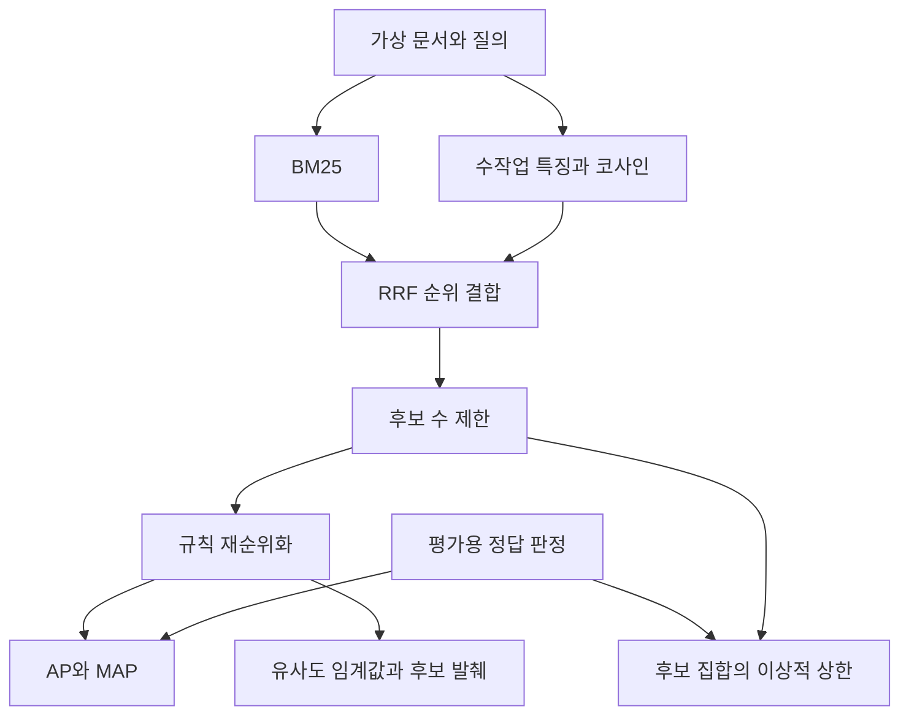

# 8장 검색과 RAG 개념 실습 안내

[전체 목차](../../README.md) · [학습 노트](study.md) · [강의안](lecture.md) · [강의 대본](lecture-script.md) · [시각 실험](visuals.html) · [실습](lab-guide.md) · [복습 문제](quiz.md)

## 무엇을 실행하는가

[lab.py](lab.py)는 표준 Python 라이브러리만 사용하는 작은 검색 실험이다. 가상 문서 8개와 질의 4개에 대해 BM25, 수작업 특징 벡터의 코사인 검색, 순위 결합, 규칙 기반 재순위화, AP·MAP 계산, 청킹을 수행한다. 계산 결과는 실제 실행한 [lab-output.txt](lab-output.txt)에 저장했다.

**실험의 경계**: 신경망 임베딩, cross-encoder, 생성 LLM, Cohere API, Ragas를 실행하지 않는다. 특징 사전은 사람이 설계했다. 마지막 출력도 문장 생성이 아니라 검색 후보의 원문 발췌다. 제품·영화·연도·금액은 모두 가상이다. 이 실험의 높은 점수는 실제 모델이나 서비스의 품질을 뜻하지 않는다. 원문에 해당하는 개념 범위는 PDF 물리 페이지 319–358이다.

## 실행하기

저장소 루트에서 다음을 실행한다. Python 3.10 이상을 기준으로 작성했으며 외부 패키지를 설치할 필요가 없다.

```bash
python3 chapters/ch08/lab.py
python3 chapters/ch08/lab.py --help
```

현재 폴더가 `chapters/ch08`이면 `python3 lab.py`로 실행할 수 있다. 프로그램은 네트워크에 접속하지 않고 입력 파일도 변경하지 않는다. 난수를 사용하지 않는 결정적 계산이어서 seed 설정이 필요 없다. 동점은 문서 ID의 오름차순으로 정렬해 실행 결과를 안정적으로 만든다.

주요 선택지는 다음과 같다.

| 옵션 | 기본값 | 의미 |
|---|---:|---|
| `--top-k` | 3 | 최종 순위 평가와 발췌에 사용할 최대 결과 수 |
| `--candidates` | 5 | 각 검색 결과에서 결합할 후보 수 및 재순위화 후보 상한 |
| `--threshold` | 0.55 | 후보 발췌의 수작업 코사인 최소값 |
| `--chunk-size` | 8 | 청킹에서 한 구간의 최대 공백 단어 수 |
| `--overlap` | 2 | 인접 구간에 겹칠 공백 단어 수 |

후보 수가 top-k보다 적으면 P@k의 분모는 여전히 k로 유지한다. 반환하지 못한 슬롯을 관련 문서로 세지 않는 평가 정책이다.

청킹의 단위는 **공백으로 나눈 단어**다. 특정 LLM의 토큰 수가 아니다. `0 <= overlap < chunk-size` 조건을 만족해야 한다. 후보 수와 top-k는 1–8 범위이고 임계값은 0–1 범위다.

## 1단계 자료와 정답 판정 읽기

Q1은 과학적 정확성을 묻고 정답 집합은 D2·D8이다. D2는 직접적인 평가 문장, D8은 물리학 자문이라는 관련 근거다. 두 문서의 관련성 강도 차이를 이 실습에서는 이진 라벨로 단순화했다. 이 선택 자체가 평가 정책임을 이해한다. 직접 답만 정답으로 보고 D8을 제외하면 점수는 달라진다.

Q2는 돈을 얼마나 벌었는지를 묻고 정답은 수익을 담은 D3이다. `money`라는 질문 단어가 원문에는 없고 `earned`, `credits`, `revenue`로 표현되어 있어 어휘 검색과 특징 검색의 차이가 나타난다.

Q3은 정확한 제품 코드 `AX-204`의 보안 업데이트를 묻는다. 정답은 D6이다. D7은 내용 형태가 매우 비슷하지만 `AX-240`이므로 다른 제품이다. 수작업 특징 벡터는 제품 코드 차원을 따로 만들지 않아 D6·D7에 같은 유사도를 준다. 이 한계를 의도적으로 관찰한다.

Q4는 달의 질량이다. 자료에 정답이 없다. 검색 순위는 존재하지만 정답이 있는 것으로 취급하면 안 된다. 이 질의는 AP·MAP 계산에서 제외하고 후보 발췌 단계의 무응답 동작을 확인한다.

**관찰 질문**: 정답 판정이 검색 결과를 본 뒤 임의로 바뀌면 공정한 비교가 가능한가? 왜 실험 전에 관련성 기준을 정해야 하는가?

## 2단계 BM25 계산 읽기

`tokens`는 영어 소문자·숫자와 하이픈 제품 코드를 토큰으로 인식하고 작은 불용어 집합을 제거한다. 한국어 형태소 분석이나 일반 문장 분할기를 구현한 것이 아니다. `AX-204`를 하나의 토큰으로 남기는 것이 코드 검색에 중요하다.

`bm25`는 문서별 단어 빈도, 문서 길이, 평균 길이, 문서 빈도를 구한다. 사용하는 IDF는 다음처럼 음수가 되지 않는 변형이다.

```text
idf(t) = log(1 + (N - df(t) + 0.5) / (df(t) + 0.5))
score(d,q) = Σ_t idf(t) × tf(t,d)(k1+1)
             / [tf(t,d) + k1(1-b+b|d|/avgdl)]
```

`N`은 문서 수, `df`는 해당 토큰이 등장하는 문서 수, `tf`는 해당 문서에서의 횟수, `|d|`는 문서 길이다. 여기서는 `k1=1.5`, `b=0.75`를 쓴다. 질의 단어는 중복을 제거한 집합으로 계산한다. BM25 구현마다 IDF와 질의 빈도 처리에 변형이 있으므로 다른 라이브러리와 숫자가 완전히 같을 필요는 없다.

Q1에서 D1이 높은 이유를 찾아보자. `science`가 직접 일치하지만 정확성 질문에 직접 답하지는 않는다. Q2에서 여러 영화 문서가 비슷한 점수를 얻는 이유도 `Aurora`라는 공통 단어 때문이다. 원문이 보여준 어휘 일치의 한계를 가상 데이터로 재구성했다.

## 3단계 특징 벡터와 의미 관계 관찰

`CONCEPTS`는 6개 축의 단어 사전이다. 과학 주제, 정확성·자문, 수익, 개봉, 출연진, 제품 지원을 각각 한 축으로 잡았다. 문서 안에 해당 단어가 몇 개 있는지 세고 벡터를 단위 길이로 정규화한다. `money`와 `revenue`가 같은 축에 속하기 때문에 표현이 달라도 가까워질 수 있다.

실제 임베딩 모델은 이렇게 사람이 읽을 수 있는 축을 고정해서 세는 방식과 다르다. 이 실습은 “표현을 바꾸면 검색 가능한 관계가 달라진다”를 보여준다. 사전에 없는 개념은 영벡터가 된다. `mass of the moon`은 그런 사례다. 실제 모델의 OOD·무응답 검출이 이처럼 단순하다고 결론 내리면 안 된다.

**관찰 질문**: Q3에서 D6·D7의 벡터가 같지만 텍스트는 왜 같지 않은가? 의미 표현이 보존하지 않은 정보가 무엇인가?

## 4단계 순위 결합과 재순위화

`reciprocal_rank_fusion`은 각 검색기의 상위 후보에 대해 `1/(60 + rank)`를 더한다. 문서가 여러 검색기의 상위에 반복 등장하면 점수가 올라간다. 이는 이 자료에서 추가한 보충 실습으로, 원문은 하이브리드를 권하지만 RRF 공식을 상세히 설명하지 않는다.

RRF는 BM25와 코사인 점수의 단위를 직접 섞지 않는다. 입력 점수가 전부 0이어도 순위에는 위치가 있으므로 RRF 점수는 양수가 된다. Q4의 양수 RRF 점수는 관련 근거가 있다는 증거가 아니다. 하지만 순위 결합이 언제나 좋은 것은 아니다. Q1과 Q2에서는 성능이 좋은 특징 검색의 순위가 어휘 검색과 섞이며 AP가 떨어지는 것을 볼 수 있다. 어떤 검색기의 오류가 다른 검색기로 보완되는지 평가해야 한다.

`rule_rerank`는 qrels를 읽지 않는다. 특징 유사도에 작은 어휘 일치 항을 더하고, 질의에 제품 코드가 있으면 정확히 같은 코드는 가산, 다른 코드는 감산한다. 규칙이 공개되어 있어 각 문서의 점수 변화를 설명할 수 있다. 이는 cross-encoder가 아니라 **재순위화 입출력을 보여주는 규칙 함수**다.

`oracle_ap_ceiling`만 정답 라벨을 읽는다. 이 함수는 실전 점수가 아니라 “주어진 후보를 완벽히 정렬하더라도 가능한 AP 상한”을 진단한다. 정답을 사용해 얻은 상한을 실제 모델 성능으로 보고하면 안 된다.

## 5단계 평가 수치 해석

기본 실행에서 실제 확인한 MAP@3은 다음과 같다. 전체 관련 문서 수를 분모로 사용하는 절단 AP를 질의별로 구하고, 정답이 있는 Q1–Q3 세 개를 평균했다.

| 방식 | MAP@3 | 해석 |
|---|---:|---|
| BM25 | 0.4167 | 바꿔 말한 수익 질의에서 정답이 상위 3개 밖으로 밀림 |
| 수작업 특징 벡터 | 1.0000 | 이 가상 평가 질의에 맞춘 사전이 좋은 순위를 만듦 |
| RRF | 0.6667 | 결합이 이 자료의 단독 특징 검색보다 낮음 |
| 규칙 재순위화 | 1.0000 | 제한된 가상 질의와 규칙에서 좋은 순위를 얻음 |

1.0을 일반화하면 안 된다. Q3에서는 D6·D7이 특징 검색에서 동점이고 문서 ID 순서로 D6이 먼저 나왔다. 자료 순서·ID·질문을 바꾸면 한계가 드러난다. qrels도 작고 수작업이며 학습용 사전이 질의 개념을 알고 있다. 따라서 이 표는 벤치마크가 아니라 계산 확인용이다.

후보 발췌는 유사도만으로 걸러 D7까지 남길 수 있다. 재순위화 점수의 제품 코드 감점을 그대로 필터로 쓰지 않았기 때문이다. 이것은 출력 해석의 중요한 함정이다. **순위가 좋아졌다고 후보의 모든 문장이 질문을 지원하는 것은 아니다.** 생성기로 넘길 때는 대상 일치 조건을 명시적으로 확인하거나 검증을 추가해야 한다.

## 6단계 변경 실험

### 실험 A 후보 수의 상한

```bash
python3 chapters/ch08/lab.py --candidates 1
```

질의마다 후보 목록과 이상적 AP 상한을 관찰한다. 이 설정의 실제 Q1 후보는 동점 정렬에 의해 D1 하나여서 AP 상한이 0이다. 전체 정답 두 개 중 하나가 후보에 포함된 경우에도 상한은 0.5다. 후보 수를 2, 3, 5로 바꾸며 정답 포함이 어떻게 달라지는지 적는다. 높은 후보 수의 계산 비용은 이 작은 실험에서는 미미하지만 실제 모델에서는 중요하다.

### 실험 B 최종 결과 수

```bash
python3 chapters/ch08/lab.py --top-k 1
python3 chapters/ch08/lab.py --top-k 5
```

P@k와 Recall@k가 같은 방향으로만 움직이는지 확인한다. 정답 수가 적을 때 결과 수를 늘리면 추가 결과가 무관하여 정밀도는 낮아질 수 있다. AP@k는 더 많은 정답을 찾을 때 증가할 수 있지만 관련 없는 결과만 뒤에 더하면 기존 기여는 변하지 않는다.

### 실험 C 임계값의 실패 사례

```bash
python3 chapters/ch08/lab.py --threshold 0.95
```

Q1의 D8 유사도는 약 0.9487이어서 사라진다. Q3의 D7은 유사도가 1이므로 여전히 남는다. 이 관찰은 임계값 하나가 모든 종류의 관련성 오류를 해결하지 못함을 보여준다. 정확한 제품 코드 제약을 후보 발췌 단계에 추가하는 개선안을 별도 함수로 설계해 보자.

### 실험 D 청킹 경계

```bash
python3 chapters/ch08/lab.py --chunk-size 5 --overlap 0
python3 chapters/ch08/lab.py --chunk-size 5 --overlap 2
```

국내 출시와 해외 인증 조건이 어느 청크에 들어가는지 비교한다. overlap이 경계의 단어를 보존해도 두 청크를 모두 검색해야 전체 조건이 모일 수 있다. 단순한 고정 길이 청킹과 의미 단위 청킹의 차이를 설명해 보자.

### 실험 E 동점의 우연한 성공

복사본에서 D6와 D7의 문서 ID를 서로 바꾸고 Q3의 정답 ID도 실제 AX-204 문서를 가리키도록 함께 수정한다. 특징 벡터의 동점 정렬이 AP를 바꿀 수 있는지 확인한다. 실제 내용은 같아도 우연한 tie-break가 점수를 바꾼다. 평가에서 동점을 어떻게 처리했는지 기록해야 하는 이유다.

## 코드 흐름 요약



정답 판정이 검색기·규칙 재순위화로 들어가지 않는다는 점을 확인한다. 평가 라벨과 실제 입력을 분리하는 습관은 큰 실험에서도 중요하다.

## 원문의 실제 모델 실습으로 확장하기

이 단계는 **수행하지 않은 확장 절차**다. 현재 API 호출을 검증한 실행 안내가 아니므로 각 구성 요소의 공식 문서와 설치 환경을 확인한 뒤 진행한다.

1. 가상 문서 대신 사용 권한이 있는 작은 실제 문서 집합을 준비한다. 문서 ID·날짜·위치·언어를 보존한다.
2. 검색용 임베딩 모델을 선택하고 문서·질의 역할, 입력 길이, 정규화, 차원을 확인한다. 전체 문서 벡터와 질의 벡터에 호환되는 모델을 쓴다.
3. 작은 자료에서는 정확 검색으로 기준 결과를 만든다. 규모가 커져 ANN을 추가할 때 정확 이웃 대비 회수율도 측정한다.
4. 관련성 판정이 있는 질의 집합을 준비한다. 정확 문자열·바꿔 말하기·여러 문장 근거·무응답 질의를 포함한다.
5. 실제 cross-encoder 또는 재순위화 API를 연결하고 후보 수별 검색 품질과 지연을 측정한다.
6. 생성 모델에 질문과 청크 ID가 붙은 근거를 전달한다. 출력 길이와 문맥 예산을 계산한다.
7. 답변을 원자적 주장으로 나누고 문맥 지원·질문 관련성·인용 지원을 확인한다. 자동 평가에는 사람 검토 표본을 함께 둔다.

원문의 로컬 예제는 Phi-3 GGUF, llama.cpp 계열, LangChain, FAISS, Hugging Face 임베딩을 연결한다. 실제 모델은 다운로드 용량·메모리·장치 지원이 필요하다. 책의 BGE 설명과 GTE 코드 식별자는 불일치하며 fp16 GGUF를 4비트로 간주하면 안 된다. 자세한 독해는 [학습 노트 9절](study.md#sec-09)을 참고한다.

## 제출할 학습 기록

설정 하나를 바꿔 “가설 → 실제 순위 → 지표 변화 → 실패 원인 → 다음 개선”을 적는다. 다음 세 질문에 답하면 실습을 이해한 것이다.

- 어떤 점수는 높지만 질문의 정확한 조건을 놓치는가?
- 검색 단계에서 없는 근거를 생성 단계가 새로 만들어도 되는가?
- 실습에서 실제 계산한 것과 수행하지 않은 신경망 기능은 각각 무엇인가?

[전체 목차](../../README.md) · [학습 노트](study.md) · [강의안](lecture.md) · [강의 대본](lecture-script.md) · [시각 실험](visuals.html) · [실습](lab-guide.md) · [복습 문제](quiz.md)
