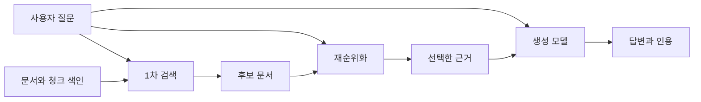
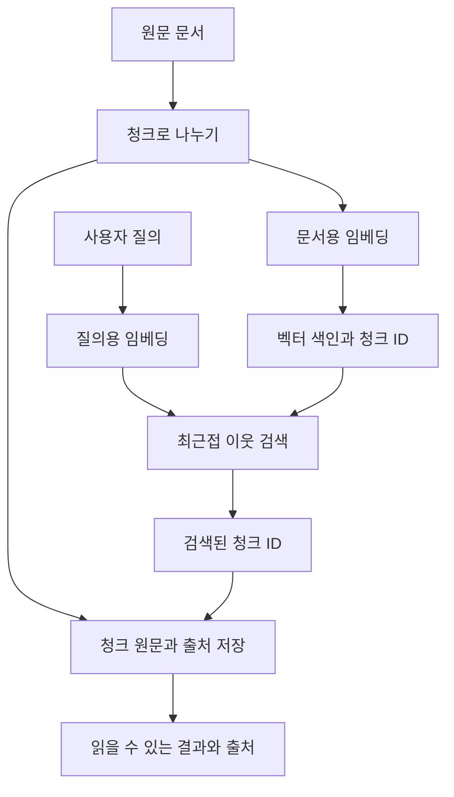
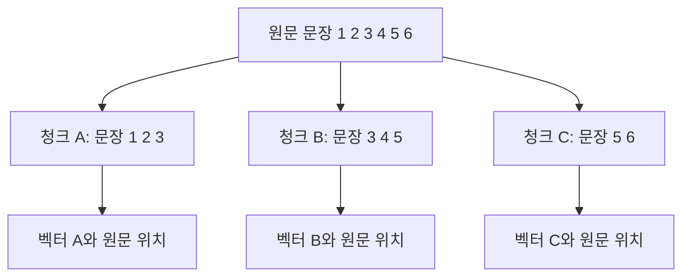
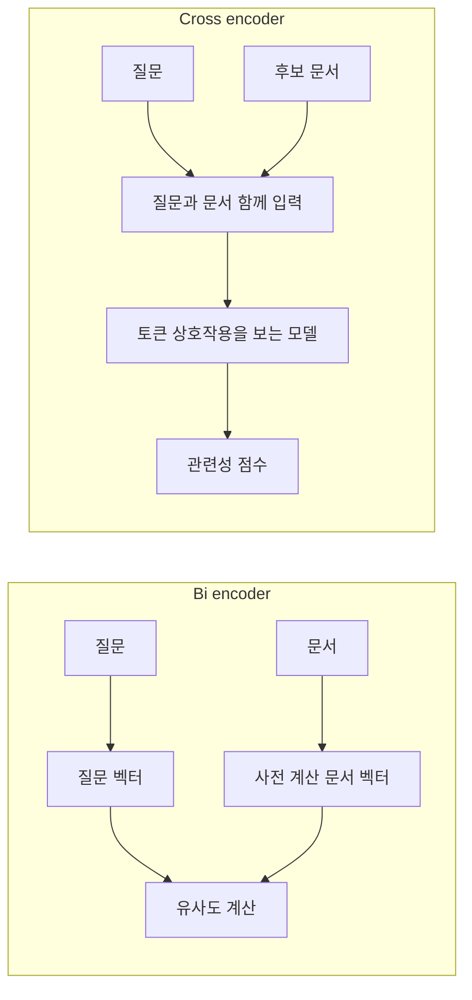
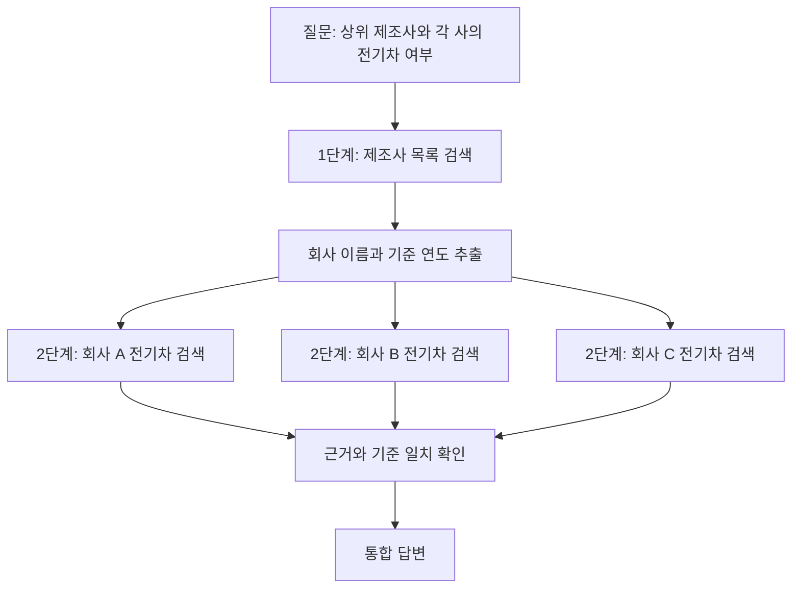

# 8장 시맨틱 검색과 RAG 학습 노트

[전체 목차](../../README.md) · [학습 노트](study.md) · [강의안](lecture.md) · [강의 대본](lecture-script.md) · [시각 실험](visuals.html) · [실습](lab-guide.md) · [복습 문제](quiz.md)

> **원문 범위**: Jay Alammar·Maarten Grootendorst, *Hands-On Large Language Models*, 2024, Chapter 8. 제공된 PDF의 **물리 페이지 316–359**를 기준으로 인용한다. 인쇄본 쪽수와 다를 수 있다. 원문 그림은 설명의 위치를 가리키며, 이 노트의 도식과 숫자 실습은 별도로 만든 교육용 자료다.

이 장의 중심 질문은 “모델이 잘 말하게 하려면 무엇을 해야 하는가?”보다 앞에 있다. **모델이 답할 때 필요한 정보를 어떻게 찾고, 찾은 정보가 실제 답을 뒷받침하는지 어떻게 확인할 것인가?** 검색은 정보를 고르는 과정이고 생성은 고른 정보를 바탕으로 문장을 만드는 과정이다. 둘을 연결한다고 각 과정의 오류가 사라지지는 않는다. 따라서 이 장은 검색기의 동작, 검색 품질 측정, 근거에 기반한 생성, 최종 답변 검증을 하나의 연결된 문제로 다룬다.

## 학습 목표와 준비

공부를 마치면 다음을 직접 설명하거나 계산할 수 있어야 한다.

- 밀집 검색, 키워드 검색, 재순위화, RAG의 입력과 출력을 구분한다.
- 문서 분할, 임베딩, 색인, 질의 임베딩, 최근접 이웃 검색의 전체 흐름을 설계한다.
- 거리와 유사도, top-k와 임계값, 관련성과 표면적 유사성의 차이를 설명한다.
- bi-encoder와 cross-encoder가 계산을 나누는 방식과 속도·품질의 교환관계를 설명한다.
- Precision@k, Recall@k, AP, MAP을 손으로 계산하고 지표가 놓치는 문제를 지적한다.
- 검색 문서와 질문을 프롬프트에 넣는 RAG를 구성하고 출처 연결을 보존한다.
- 질의 재작성, 다중 질의, 다단계 검색, 라우팅, 에이전트형 RAG를 구별한다.
- 유창성, 유용성, 인용 재현율·정밀도, 충실성, 답변 관련성을 독립적으로 평가한다.

필요한 선수지식은 2장의 임베딩과 벡터 유사도, 4장의 분류 점수, 6장의 프롬프트, 7장의 체인과 도구 사용이다. 행렬 계산을 잘하지 않아도 따라올 수 있다. 먼저 벡터를 “학습된 좌표”라고 생각하고, 실제 계산은 [실습](lab-guide.md)과 함께 확인하면 된다. 여기서 “관련 문서”는 질문과 같은 주제인 문서보다 좁은 의미다. **그 질문의 정보 요구를 충족하는 문서**라는 뜻으로 사용한다.

## 상세 목차

1. [시맨틱 검색과 RAG의 전체 그림](#sec-01)
2. [언어 모델을 이용한 검색의 관점](#sec-02)
3. [밀집 검색](#sec-03): 기하, 원문 예제, BM25, 한계, 청킹, 색인, 미세 조정
4. [재순위화](#sec-04): 후보 생성, cross-encoder, 코드와 실패 분석
5. [검색 평가](#sec-05): 평가셋, Precision, AP, MAP, nDCG
6. [RAG의 목적](#sec-06)
7. [검색에서 근거 기반 생성으로](#sec-07)
8. [관리형 API를 이용한 RAG 예제](#sec-08)
9. [로컬 모델을 이용한 RAG 예제](#sec-09)
10. [고급 RAG 기법](#sec-10)
11. [RAG 평가](#sec-11)
12. [통합 정리와 설계 연습](#sec-12)

<a id="sec-01" name="sec-01"></a>
## 1. 시맨틱 검색과 RAG의 전체 그림

**원문 대응: Overview of Semantic Search and RAG, PDF 317–319. 도입 배경은 316쪽.**

### 검색이 언어 모델의 중요한 응용인 이유

원문은 2018년 BERT 논문 발표 이후 Google Search와 Microsoft Bing이 언어 모델을 검색 개선에 활용한 사례로 시작한다. 핵심은 특정 기업의 홍보 문구가 아니라, 질문과 문서에 같은 단어가 없어도 관련성을 판단할 수 있다는 변화다. 사용자가 “과학적으로 얼마나 정확해?”라고 물었는데 문서에는 “천문학자들이 천체물리학 묘사를 높이 평가했다”라고 쓰여 있을 수 있다. 두 표현은 단어가 많이 겹치지 않지만 질문과 답의 관계를 가진다.

전통적인 어휘 기반 검색은 “무슨 단어가 등장했는가”를 강하게 이용한다. 의미 기반 검색은 학습된 언어 표현을 통해 동의어, 바꿔 말하기, 일부 문맥 관계를 활용한다. 다만 언어 모델이 의미를 사용한다고 해서 원하는 사실을 항상 찾는 것은 아니다. 특히 숫자, 제품 식별자, 부정 표현, 시간 조건을 잘 구분하는지 별도로 확인해야 한다.

생성 모델의 발전은 또 다른 요구를 만들었다. 사람은 검색 결과 목록을 읽는 대신 완성된 답을 원한다. 생성 모델은 매끄러운 답을 만들 수 있지만, 매끄러움은 사실성의 증거가 아니다. 내부 학습 지식은 오래되었거나 필요한 내부 문서를 포함하지 않을 수 있다. RAG는 질문과 관련된 외부 자료를 가져와 생성 모델의 입력에 추가하는 방식으로 이 문제에 접근한다.

### 세 가지 구성 요소의 계약

| 구성 요소 | 받는 입력 | 내놓는 출력 | 해결하려는 문제 | 해결하지 못하는 문제 |
|---|---|---|---|---|
| 밀집 검색 Dense retrieval | 질문, 사전 구축한 문서 임베딩 색인 | 가까운 문서나 청크와 거리·유사도 | 큰 자료 집합에서 관련 후보 찾기 | 후보의 사실성, 답변의 문장 생성 |
| 재순위화 Reranking | 질문, 이미 골라진 후보 문서 | 후보별 관련성 점수와 새 순서 | 제한된 후보를 더 정밀하게 비교 | 후보 집합에 아예 없는 문서 발견 |
| RAG | 질문, 검색할 자료, 생성 모델 | 근거를 활용한 답과 가능하면 인용 | 자료를 이용해 사람이 읽기 쉬운 답 만들기 | 자동으로 모든 환각·인용 오류 제거 |



이 도식은 원문 Figures 8-1–8-3의 역할 구분을 한 흐름으로 연결한 것이다. 모든 시스템이 반드시 세 단계를 다 가져야 하는 것은 아니다. 밀집 검색만으로 결과 목록을 제공할 수도 있고, BM25 검색 뒤에 재순위화만 붙일 수도 있다. RAG의 검색기가 꼭 벡터 검색일 필요도 없다. 데이터베이스 조회, 키워드 검색, 구조화된 문서 검색도 필요한 근거를 반환한다면 검색 단계가 될 수 있다. 마지막 설명은 원문의 구조를 확장해 이해하기 위한 보충이다.

“시맨틱 검색 = RAG”라고 외우면 설계가 흐려진다. 시맨틱 검색은 문서를 찾는 능력이고 RAG는 찾은 자료를 활용하는 생성 시스템이다. RAG를 디버깅할 때는 “모델이 틀렸다”라고 한 번에 말하지 말고, 문서가 저장되었는지, 후보로 검색되었는지, 최종 문맥에 들어갔는지, 생성 과정에서 올바르게 사용되었는지를 나누어 살펴보자.

<a id="sec-02" name="sec-02"></a>
## 2. 언어 모델을 이용한 검색의 관점

**원문 대응: Semantic Search with Language Models, PDF 319.**

검색은 일반적으로 두 시점으로 나뉜다. 문서가 들어올 때 하는 **오프라인 준비**와 사용자의 질문을 받을 때 하는 **온라인 처리**다. 문서는 자주 바뀌지 않지만 질문은 매번 달라진다는 비대칭성을 이용하면 계산을 절약할 수 있다. 밀집 검색은 이 비대칭성을 활용해 문서 임베딩을 미리 저장한다. 재순위화는 실제 질문을 알아야 문서와의 상호작용을 계산하므로 주로 온라인 단계에서 수행한다.

사용자가 체감하는 것은 최종 답 하나이지만 시스템 안에서는 서로 다른 최적화 목표가 존재한다. 1차 검색은 많은 문서 중에서 정답 후보를 놓치지 않는 것이 중요하다. 재순위화는 그 후보를 앞쪽에 정확히 배치해야 한다. 생성 단계는 근거를 충실하게 읽고 질문에 맞춰 표현해야 한다. 원문이 밀집 검색 다음에 재순위화, 그 다음 RAG를 설명하는 이유가 이 역할 분담에 있다.

실제 공부에서는 문서를 “벡터만 있는 물건”으로 생각하지 않는 것이 좋다. 벡터는 검색을 위한 표현이다. 사용자가 읽을 원문, 원문 위치, 문서 식별자와 청크 식별자 등도 함께 필요하다. 벡터만 남기고 출처 연결을 버리면 검색은 되어도 답변의 출처를 보여주기 어렵다. 아래 장 전체에서 데이터 흐름을 읽을 때 `문서 ID → 청크 ID → 임베딩 행 → 검색 결과 → 인용`의 연결을 유지하는지 확인한다.

<a id="sec-03" name="sec-03"></a>
## 3. 밀집 검색

**원문 대응: Dense Retrieval, PDF 319–336.**

### 3.1 임베딩 공간에서 검색하기

임베딩 모델은 텍스트를 고정 길이 숫자 벡터로 바꾼다. 문서 청크 `d_i`를 임베딩한 벡터를 `e_i`, 질문 `q`를 임베딩한 벡터를 `e_q`라고 쓰자. 같은 차원의 비교 가능한 표현 공간에서 가까운 벡터를 찾으면 관련 후보를 얻을 수 있다. 원문 Figures 8-4와 8-5는 이를 2차원 점들의 거리로 보여준다. 실제 임베딩이 수백·수천 차원이더라도 이 그림의 목적은 “텍스트를 점으로 바꾸어 검색한다”는 직관을 주는 것이다.

모든 축에 “천문학 정도”, “수익 정도” 같은 사람이 읽을 수 있는 이름이 붙는 것은 아니다. 이 장의 시각화와 실습은 계산을 관찰하기 위해 일부 축을 사람이 정한 **교육용 특징 공간**을 쓴다. 실제 신경망이 학습한 임베딩 성능을 재현했다는 뜻이 아니다. 2차원 투영 그림에서도 가까워 보이는 점이 원래 고차원 공간에서도 동일한 이웃이라는 보장은 없다.

거리를 재는 방법을 구별하자. 두 벡터 `u`, `v`가 `D`차원일 때 다음과 같다.

```text
제곱 L2 거리 = Σ_j (u_j - v_j)²                  작을수록 가까움
L2 거리      = sqrt(Σ_j (u_j - v_j)²)            작을수록 가까움
코사인 유사도 = (u · v) / (||u|| ||v||)           클수록 방향이 비슷함
```

`j`는 벡터의 축 번호다. 내적 `u · v`는 같은 축끼리 곱해 더한 값이고, `||u||`는 벡터 길이다. 코사인 유사도는 벡터의 크기보다 방향을 비교한다. 영벡터는 길이가 0이라 이 식을 그대로 적용할 수 없으므로 별도 처리해야 한다. 코사인이 0.8이라고 해서 “정답일 확률 80%”라는 뜻은 아니다. 학습 공간의 기하학적 비교값일 뿐이다.

**손계산 예제**: 질문 벡터가 `(1, 0)`, 문서 A가 `(0.8, 0.6)`, 문서 B가 `(0, 1)`이면 세 벡터는 모두 길이가 1이다. A의 코사인은 0.8, B는 0이다. 제곱 L2 거리는 각각 0.4와 2다. A가 두 기준에서 더 가깝다. 단위 길이로 정규화한 벡터 사이에서는 `||u-v||² = 2 - 2 cos(u,v)`이므로 코사인을 큰 순서로 정렬한 결과와 제곱 L2를 작은 순서로 정렬한 결과가 같다. 정규화를 하지 않은 벡터에서는 이 순위 동치가 자동으로 성립하지 않는다.



원문 Figure 8-6의 “외부 지식 → 청크 → 벡터 저장 → 검색”을 ID 연결까지 드러낸 도식이다. 질문과 문서가 서로 다른 역할을 가진다는 점도 중요하다. 질문 “언제 개봉했는가?”와 문서 “2014년에 개봉했다”는 같은 문장을 바꿔 쓴 관계가 아니다. **질문에 답하는 관계를 가깝게 만드는 학습**이 필요하다. 일반 문장 유사도 모델과 검색용 모델을 무조건 같다고 보면 안 되는 이유다.

### 3.2 원문 영화 예제를 단계별로 읽기

**원문 하위 내용: Dense retrieval example, PDF 322–328.** 원문은 영화 *Interstellar*의 소개 문단을 가져와 검색 대상으로 만든다. 실험 목적은 영화 지식을 외우는 것이 아니라, 정확히 같은 단어가 없는 문장도 의미를 이용해 찾을 수 있는지 확인하는 것이다.

첫째, 긴 문자열을 마침표로 나누고 공백과 줄바꿈을 제거한다. 결과적으로 문장 단위의 작은 검색 집합을 만든다. 원문의 단순 `split('.')`는 소개를 위한 처리다. 약어, 소수점, 문장부호가 없는 문서, 한국어 문장 등을 항상 잘 나누는 일반적인 청킹 방법은 아니다. 빈 문자열이 생기면 제거하고, 원래 문장 순서와 문서 ID를 보존해야 한다. “정리해서 텍스트 목록을 얻었다”는 사실과 “최적의 청킹을 했다”는 사실은 다르다.

둘째, Cohere 임베딩 API에 문장들을 전달한다. 원문에서는 문서 역할을 알리는 `input_type="search_document"`를 사용하고, 출력 형태를 `(15, 4096)`으로 보여준다. 이 표기는 문장 15개 각각에 4,096개 숫자가 있다는 뜻이다. 15는 문서 수, 4096은 한 임베딩의 차원이다. 4096개의 문서를 얻었다거나 문장 길이가 4096토큰이라는 뜻이 아니다. 그 값은 원문 실행 환경의 예시이며 모든 임베딩 모델의 고정 규격이 아니다.

셋째, FAISS의 `IndexFlatL2`를 만든다. 인덱스의 차원은 임베딩 배열의 두 번째 축에서 읽는다. 문서 벡터를 float32로 변환해 추가한다. 여기서 `Flat`은 단순한 전수 비교 형태이고 `L2`는 거리 종류다. FAISS라는 라이브러리를 썼다는 사실만으로 근사 검색을 했다고 말하면 안 된다. **이 예제의 `IndexFlatL2`는 정확 검색**이며 반환하는 거리값은 제곱 L2 거리다. 이 두 사항은 코드의 의미를 분명히 하기 위한 보충 설명이다.

넷째, 질문을 `input_type="search_query"`로 임베딩한다. 문서와 질문을 같은 검색 체계에서 호환되게 표현하되 역할을 구분한다. 검색 API에는 한 질의라도 `(1, D)` 형태의 2차원 배열로 전달한다. 반환값은 거리 배열과 문서 행 번호 배열이다. 문서 행 번호를 원래 텍스트 목록에 적용해 사람이 읽을 수 있는 결과를 만들고 거리를 함께 출력한다.

원문의 질문은 과학 묘사의 정확성을 묻는다. 밀집 검색은 천문학자들이 과학적 정확성을 높이 평가했다는 문장을 첫 번째 결과로 반환한다. 이 문장이 질문에 사용된 단어를 그대로 포함하지 않아도 답이 될 수 있다는 점이 실험의 핵심이다. 하지만 이 한 사례가 밀집 검색이 모든 질문에서 우월하다는 증거는 아니다. 영화를 잘못 이해한 질문, 정확한 배우 이름, 숫자 비교 같은 다른 질문에서는 결과가 달라질 수 있다.

**원문 수치 읽기 주의**: PDF 326쪽의 거리 표는 10,000대 값을 보이고 329쪽의 다른 질의 표는 1대 값을 보인다. 노트는 이 표들 사이에서 임계값을 추정하지 않는다. 같은 임베딩 모델, 정규화, 거리 함수와 색인 조건이 확인되어야 거리의 크기를 비교할 수 있다. “1보다 작으면 관련 문서” 같은 보편 규칙은 만들 수 없다.

### 3.3 BM25와 비교해서 의미를 이해하기

원문은 같은 검색을 키워드 검색 BM25로 수행한다. 전처리는 소문자 변환, 공백 분리, 구두점 정리, 영어 불용어 제거를 포함한다. 각 문서를 토큰 목록으로 만들어 색인을 구성하고 질의 토큰에 대한 점수를 계산한다. 이후 점수가 높은 후보를 모아 정렬한다. `argpartition`은 상위 후보 집합을 효율적으로 고르지만 그 결과가 이미 완전 정렬되었다고 가정하면 안 되므로 후속 정렬이 필요하다.

BM25의 중심 아이디어는 질의 단어가 문서에 얼마나 나타나는지, 그 단어가 전체 문서 집합에서 얼마나 희귀한지, 문서 길이가 얼마나 긴지를 함께 고려하는 것이다. 단어가 반복될수록 점수는 증가하지만 무한정 선형으로 증가하지 않도록 포화시킨다. 긴 문서가 단지 단어를 많이 담았다는 이유만으로 유리하지 않게 길이도 보정한다. 원문은 BM25 수식을 유도하지 않으므로 여기서는 그 역할을 이해하면 충분하다. [실습](lab-guide.md)에서는 한 가지 명시한 BM25 변형을 직접 계산한다.

원문에서 BM25는 질문의 `science`와 겹치는 “공상과학 영화” 소개를 높게 올린다. 반면 정작 과학적 정확성을 평가한 문장은 질의 단어와 표면적으로 덜 겹쳐 낮아질 수 있다. **단어 일치가 주제의 단서는 되지만 질문에 대한 답을 보장하지 않는다**는 예다. 반대로 문서 번호 `AB-204`, 함수명, 정확한 조항 번호는 의미가 비슷한 다른 항목보다 문자 자체가 중요할 수 있다. 이 경우 어휘 검색의 장점이 살아난다.

| 질문 유형 | 어휘 검색이 잘하는 이유 | 밀집 검색이 유용한 이유 | 주의점 |
|---|---|---|---|
| 정확한 상품 코드 | 같은 문자열을 직접 식별 | 설명 문구를 함께 찾음 | 비슷한 코드로 대체되면 실패 |
| “돈을 얼마나 벌었나?” | 수익이라는 단어가 있으면 찾음 | 매출·흥행 수입 같은 표현 연결 | 숫자의 범위·연도는 따로 확인 |
| 질문과 답의 표현이 다름 | 공통 키워드가 부족할 수 있음 | 학습한 질문-답 관련성을 활용 | 같은 주제의 오답도 가까울 수 있음 |
| 전문 분야 용어 | 전문 용어가 정확히 맞으면 강함 | 도메인 학습이 충분하면 표현 차이 완화 | 학습 분야가 다르면 품질 저하 |

원문의 권장 방향은 두 검색 방식을 함께 쓰는 하이브리드 검색이다. 보충적으로 두 결과의 점수를 무작정 더하면 안 된다는 점도 알아두자. BM25 점수와 코사인 유사도는 규모와 의미가 다르다. 점수 정규화나 학습된 결합을 설계하거나, 이 장의 실습처럼 **순위 기반 결합**을 명시적으로 사용할 수 있다. 하이브리드라는 이름만 붙였다고 좋은 결합이 완성되는 것은 아니다.

### 3.4 밀집 검색의 네 가지 한계

**원문 하위 내용: Caveats of dense retrieval, PDF 328–330.**

첫째, 자료에 정답이 없어도 최근접 이웃은 존재한다. 영화 소개 자료에 달의 질량을 물어도 시스템은 가장 가까운 영화 문장을 반환할 수 있다. “주어진 자료 중 가장 가깝다”는 상대적 비교와 “답하기에 충분히 관련 있다”는 절대적 판단을 분리해야 한다. top-k는 결과 개수를 정하는 규칙이지 정답 존재 여부를 판정하는 규칙이 아니다.

가능한 대응 중 하나는 임계값이다. 거리라면 최대 허용 거리 이하, 유사도라면 최소 허용 유사도 이상만 통과시킨다. 원문 앞부분의 표현을 읽을 때 거리와 유사도의 방향을 혼동하지 말자. 적절한 값은 검증 질의, 정답이 없는 질의, 오탐 비용을 고려해 정한다. 높은 임계값은 무관한 결과를 줄이지만 필요한 근거를 놓칠 수 있다. 낮은 임계값은 많은 문서를 통과시키지만 생성 모델에게 잡음을 늘릴 수 있다. 검색 품질 로그와 사용자 만족 신호는 개선의 단서지만 클릭 하나를 곧바로 정답 판정으로 취급하지 않는 것이 좋다.

둘째, 정확한 표현 일치가 중요한 질문이다. 제품 ID나 특정 구절을 찾을 때 임베딩 공간의 근접성만 보면 원하는 문자열을 놓칠 수 있다. 하이브리드 검색이나 명시적 필터가 대응 수단이 된다. 문서의 “이름이 비슷함”과 “동일한 대상을 가리킴”도 구분해야 한다.

셋째, 학습 도메인과 실제 도메인이 다를 수 있다. 인터넷 일반 문서로 학습한 표현이 전문 문서의 미세한 구분을 잘 반영하지 못할 수 있다. 원문은 법률 문서의 예를 든다. 이 노트는 법적 판단을 다루는 것이 아니라, 전문 분야에서 관련성 정의와 언어가 달라질 수 있다는 의미로 이 예를 사용한다. 데이터를 바꾸거나 미세 조정하더라도 평가셋이 실제 질의 분포를 반영해야 개선 여부를 확인할 수 있다.

넷째, 정답이 여러 문장에 흩어져 있다. “그 제품의 출시일과 후속 지원 종료일을 비교해 줘” 같은 질문에는 한 문장보다 넓은 문맥이 필요하다. 문장을 너무 작게 쪼개면 대명사와 조건을 잃고, 너무 크게 묶으면 한 벡터에 여러 주제가 섞인다. 이 문제는 생성 모델의 능력을 높이는 것만으로 해결되지 않는다. 검색되는 단위의 설계가 먼저다.

### 3.5 긴 문서를 어떻게 나눌 것인가

**원문 하위 내용: Chunking long texts, One vector per document, Multiple vectors per document, PDF 330–333. Figures 8-7–8-10.**

청킹이 필요한 첫 이유는 임베딩 모델의 입력 길이 한계다. 모델이 받지 못한 뒷부분은 검색용 표현에 들어가지 않는다. 둘째 이유는 표현의 해상도다. 긴 문서 전체를 벡터 하나로 압축하면 작은 세부 정보가 주요 주제에 묻힐 수 있다. “문서를 넣었다”와 “문서의 모든 질문 가능한 정보가 잘 검색된다”는 다른 말이다.

**문서당 벡터 하나**를 만드는 첫 방법은 제목이나 앞부분만 임베딩하는 것이다. 시작이 핵심 요약인 문서라면 빠른 시제품에 유용하지만 뒷부분의 세부 내용은 표현되지 않는다. 두 번째 방법은 여러 청크를 각각 임베딩한 뒤 평균을 내는 것이다. 적어도 전체 내용을 계산에는 사용하지만, 평균은 서로 다른 개념을 한 점으로 합치는 압축이다. 평균 벡터가 특정 세부 질문과 충분히 가까울 것이라는 보장은 없다.

**문서당 여러 벡터**를 만들면 각 청크가 개별 검색 단위가 된다. 색인이 더 커지고 출처 연결도 관리해야 하지만 세부 정보를 찾아가기 쉬워진다. 문장 단위는 세밀하지만 문맥이 부족할 수 있다. 단락 단위는 의미가 잘 묶인 문서에 적합하지만 단락 길이가 불규칙할 수 있다. 원문은 몇 개 문장씩 묶거나 제목을 덧붙이거나 앞뒤 문맥을 포함하는 선택을 소개한다. 원문에 나온 문장 수 범위는 시작점의 예시이지 모든 문서에 통하는 최적값이 아니다.



여기서 문장 3과 5가 중복되는 것은 실수가 아니라 overlap이다. 경계에서 문맥이 끊어지는 문제를 줄인다. 하지만 중복 비율이 높아지면 저장량과 임베딩 비용이 늘고, 비슷한 청크가 상위 결과를 채워 실제로 전달되는 정보의 다양성이 줄 수 있다. 보충 설계로 같은 원문 범위의 중복을 줄이고 인접 청크를 합치는 처리를 생각할 수 있다. 원문은 이러한 비용 최적화의 세부 구현을 다루지는 않는다.

**선생님과 함께 하는 사고 실험**: “이 장치는 2028년 출시된다. 단, 해외 판매는 인증 완료 후 시작한다.”를 문장별로 나누었다고 하자. “해외에서도 2028년에 살 수 있나?”라는 질문에 첫 문장만 검색하면 조건을 놓친다. 두 문장을 한 청크로 묶거나 주변 문맥을 포함하면 조건이 살아난다. 반대로 문서 50쪽 전체를 한 청크로 묶으면 이 짧은 조건이 긴 내용에 묻힐 수 있다. 좋은 청킹은 길이만 정하는 문제가 아니라 **질문에 필요한 의미 단위를 보존하는 문제**다.

제목을 청크에 추가할 때도 주의하자. “지원 기간”이라는 청크가 어떤 제품의 지원 기간인지 제목이 알려주면 검색이 좋아질 수 있다. 모든 청크에 같은 긴 제목을 반복하면 제목의 단어가 지나치게 강해질 수 있다. 문서 종류, 예상 질문, 임베딩 입력 한계, 생성 문맥 예산을 함께 고려하고 비교 실험을 해야 한다.

### 3.6 최근접 이웃 검색과 벡터 데이터베이스

**원문 하위 내용: Nearest neighbor search versus vector databases, PDF 333–334. Figure 8-11.**

벡터를 저장했으면 질문 벡터와 문서 벡터의 거리를 비교해야 한다. 전수 비교는 모든 `N`개 문서에 대해 `D`개 차원의 연산을 수행하므로 대략 `O(ND)` 규모다. 작은 자료 집합에서는 단순하고 검증하기 쉽다. 이 노트의 실습도 전체 후보를 비교하는 정확 검색을 사용한다. 따라서 결과가 이해하기 쉽고, 근사 알고리즘의 누락과 임베딩 자체의 오류를 혼동하지 않아도 된다.

규모가 커지면 모든 벡터를 매번 비교하는 비용이 커진다. 원문은 Annoy와 FAISS 같은 최근접 이웃 검색 라이브러리를 소개하며 근사 최근접 이웃 검색을 설명한다. ANN은 속도를 얻는 대신 실제로 가장 가까운 벡터 일부를 놓칠 수 있는 교환관계를 가진다. 특정 알고리즘·설정에 따라 정확도, 메모리, 색인 구축 비용이 다르다. 라이브러리 이름만으로 지연 시간을 보장할 수 없다. 원문의 큰 규모·빠른 검색 설명은 기술의 가능성을 보여주는 것으로 읽고 자신의 하드웨어에서 측정해야 한다.

벡터 데이터베이스는 거리 계산 이상의 저장·운영 기능을 제공하는 계층이다. 원문은 벡터 추가·삭제, 필터, 검색 조건의 커스터마이징을 강조한다. 기능의 구체적인 지원 범위는 제품과 인덱스 종류에 따라 다르므로 “모든 벡터 DB가 모든 방식의 갱신을 무료로 처리한다”로 일반화하지 말자. 검색 라이브러리도 일부 갱신 기능을 제공할 수 있다. 핵심 구분은 이름보다 **색인 알고리즘만 필요한가, 저장과 조회 운영까지 필요한가**다.

보충적으로 비용 규모를 계산해 보자. 100만 개의 768차원 float32 벡터 원소만 저장하면 `1,000,000 × 768 × 4 = 3,072,000,000`바이트, 약 3.07 GB다. 실제 시스템에는 색인 구조, 원문, 메타데이터, 런타임 메모리가 더해진다. 이 수치는 특정 제품의 요구량이 아니라 순수 배열의 하한 성격 계산이다. 차원·문서 수·정밀도와 저장 비용의 관계를 이해하는 데 사용한다.

### 3.7 검색에 맞게 임베딩 모델을 미세 조정하기

**원문 하위 내용: Fine-tuning embedding models for dense retrieval, PDF 334–336. Figures 8-12–8-13.**

같은 영화에 관한 문장이라도 개봉일 질문의 정답은 출연진 문장과 다르다. 주제가 비슷하다는 이유만으로 세 벡터가 모이면 검색에는 충분하지 않다. 원문은 개봉 날짜 문서에 대해 “개봉일”과 “언제 처음 공개되었는가”라는 질문을 양성 쌍으로, 출연진을 묻는 질문을 음성 쌍으로 구성한다.

학습 목표는 관련 질문과 문서의 표현을 가깝게, 무관한 질문과 문서의 표현을 멀게 만드는 것이다. 여기서 필요한 것은 모델의 각 토큰 표현을 막연히 바꾸는 일이 아니라 최종 **텍스트 임베딩이 검색 목적의 관련성**을 반영하게 하는 일이다. 구체적인 대조 학습과 손실 함수는 10장에서 다룬다. 8장에서는 학습 데이터가 어떤 관계를 규정하는지 이해하면 된다.

이 부분의 실무적 함의는 크다. “관련성”은 모델에 자연스럽게 완성된 하나의 보편 개념이 아니다. 고객지원에서는 문제 해결 문서가 관련 문서이고, 추천에서는 사용자의 관심에 맞는 문서가 관련 문서일 수 있다. 데이터 라벨을 잘못 만들면 모델은 잘못된 기준을 성실하게 학습한다. 출연진 문장을 음성으로 쓸 때도 실제 질문이 “개봉 당시 주연 배우”라면 그 문장은 일부 근거가 될 수 있다. 따라서 음성 데이터의 의미를 검토하는 과정이 필요하다.

<a id="sec-04" name="sec-04"></a>
## 4. 재순위화

**원문 대응: Reranking, PDF 336–341. Figures 8-14–8-15.**

### 4.1 왜 두 단계 검색을 하는가

대규모 자료 전체에 대해 가장 정교한 관련성 판단을 수행하면 비용이 크다. 먼저 빠른 검색기로 충분한 후보를 확보하고, 그중 일부만 더 비싼 모델로 평가하는 구조가 합리적이다. 1차 검색은 후보 생성, 2차 검색은 재순위화라고 생각하면 된다. 이미 키워드 검색 시스템이 있다면 전체를 교체하지 않고 마지막에 재순위화 모델을 추가하는 방법도 있다.

원문 Figure 8-14는 질문과 후보 문서가 재순위화 모델로 들어가고 관련성 순서가 바뀌는 과정을 보여준다. 이때 **후보 문서의 집합과 후보 문서의 순서**를 구별해야 한다. 재순위화는 보통 집합 안에서 순서를 바꾸는 작업이다. 정답 문서가 후보에 없으면 점수를 아무리 정확하게 계산해도 정답을 맨 위에 올릴 수 없다. 후보 개수 `K`를 늘리면 정답 포함 가능성이 높아질 수 있지만 처리 시간과 비용도 증가한다. 생성기에 실제로 넣을 최종 개수 `k`와 재순위화할 후보 개수 `K`를 같은 값으로 둘 필요는 없다.

예를 들어 원문 전체가 100만 청크라고 하자. 1차 검색이 100개를 반환하고 재순위화가 상위 5개를 고른다고 하면, 생성 모델은 100만 개를 모두 읽지 않는다. 1차 검색의 실패로 정답 청크가 101등이 되었다면 이후 단계는 그 청크를 보지 못한다. 반대로 정답이 후보에 들어 있었지만 다른 문서보다 낮게 배치되었다면 재순위화가 개선할 여지가 있다. 이 두 경우를 같은 “검색 품질이 낮다”라는 말로 합치면 다음 개선 작업을 잘못 선택한다.

### 4.2 bi-encoder와 cross-encoder

밀집 검색의 전형적인 bi-encoder는 질문과 문서를 **각각** 인코딩한 뒤 두 벡터의 유사도를 계산한다. 이름의 `bi`는 입력 두 종류를 각각 처리한다는 구조를 가리키며 반드시 서로 완전히 다른 가중치의 모델 두 개를 쓴다는 뜻은 아니다. 문서 임베딩을 미리 계산해 둘 수 있다는 것이 속도의 핵심이다.

cross-encoder는 질문과 문서를 **함께** 입력한다. 모델은 두 텍스트의 토큰 관계를 동시에 보면서 관련성 점수를 낸다. 질문의 특정 조건이 문서의 어느 구절과 맞는지 세밀하게 판단할 여지가 있지만, 질문이 바뀌면 질문-문서 쌍을 다시 처리해야 한다. 원문은 BERT 기반 monoBERT를 이러한 재순위화의 예로 설명한다.



원문 Figure 8-15의 중요한 세부는 여러 문서를 한 번에 배치로 계산하더라도 **각 후보를 질문과 독립적으로 평가**한다는 점이다. 이 구조는 문서 A와 B를 서로 비교해 한 번에 순위를 출력하는 방식과 다르다. 여러 입력 쌍을 배치로 묶었다는 이유만으로 후보 문서들 사이에 문맥이 공유되는 것은 아니다.

| 항목 | Bi-encoder 기반 밀집 검색 | Cross-encoder 기반 재순위화 |
|---|---|---|
| 질문과 문서의 만남 | 벡터를 만든 뒤 유사도에서 만남 | 모델 입력부터 함께 만남 |
| 문서 사전 계산 | 가능 | 전체 질문-문서 관련성은 사전 계산 불가 |
| 전형적 적용 범위 | 큰 문서 집합의 후보 생성 | 제한된 후보의 정밀 판단 |
| 표현상의 제약 | 문서를 고정 벡터로 요약 | 질문별로 문서의 다른 부분을 해석 가능 |
| 주요 실패 | 후보 누락, 표현의 정보 손실 | 후보 바깥 정답 복구 불가, 처리 비용 |

원문은 분류 문제와 연결해 0–1 관련성 점수를 설명한다. 일반적으로 출력 범위는 모델·변환 방식에 따라 달라질 수 있고, 범위가 0–1이라고 해도 통계적으로 보정된 확률이라는 보장은 없다. “0.16이면 정확할 확률이 16%라서 나쁜 검색이다”라고 해석하면 안 된다. 모델의 점수 분포와 같은 질의 안에서의 상대 순위, 검증셋에서의 임계값 성질을 봐야 한다.

### 4.3 원문 API 예제와 후보 집합의 효과

원문 첫 예제는 Cohere Rerank에 질문과 영화 문장 15개를 모두 넣고 상위 3개를 받는다. 가장 위 결과는 과학적 정확성에 관한 문장이다. 두 번째 예제는 BM25로 먼저 10개를 고르고 이 10개를 재순위화해 상위 3개를 반환한다. 수백만 문서에 재순위화 모델을 바로 적용하는 대신, 저렴한 1차 검색으로 범위를 좁히는 구조를 작은 자료로 보여준다.

주의 깊게 보면 두 번째 결과가 첫 번째와 동일하지 않다. 원문에서 BM25는 질의 단어와 겹치는 소수 문서에만 양수 점수를 주고 나머지는 동점이 될 수 있다. 그 동점 중 어떤 문서가 10개 후보에 포함되었는지에 따라 재순위화가 보는 정보가 달라진다. 원문의 출력은 “재순위화를 붙이면 언제나 첫 예제의 최고 정답을 얻는다”는 증거가 아니다. **상위 후보 선정과 동점 처리까지 전체 파이프라인의 일부**라는 학습 사례로 읽어야 한다.

원문에는 MIRACL 다국어 벤치마크에서 nDCG@10이 36.5에서 62.8로 개선된 사례가 소개된다. 이는 원문에 제시된 특정 비교의 결과다. 자신의 데이터에서도 같은 수치 폭으로 개선된다는 약속이 아니다. 평가 데이터, 모델, 1차 검색기, 후보 수를 통제한 뒤 측정해야 한다. 이 노트의 CPU 실습은 해당 모델이나 벤치마크를 실행하지 않으며, 그 수치를 재현했다고 주장하지 않는다.

로컬 환경에서는 Sentence Transformers의 검색·재순위화 구성을 사용할 수 있다고 원문은 안내한다. 학습할 때 중요한 것은 라이브러리 호출명을 외우는 것보다 문서 인코더와 재순위화 모델이 어떤 입력을 받는지 확인하는 것이다. 실제 구현으로 확장할 때는 모델별 입력 길이, 언어, 점수 반환 형식, 배치 크기를 확인해야 한다. 여기서는 2024년 책의 아키텍처를 설명하며 현재 API 사용법을 검증했다고 말하지 않는다.

<a id="sec-05" name="sec-05"></a>
## 5. 검색 품질 평가

**원문 대응: Retrieval Evaluation Metrics, PDF 341–348. Figures 8-16–8-23.**

### 5.1 평가에 필요한 세 가지 자료

검색을 평가하려면 문서 집합, 질의 집합, 질의별 관련성 판정이 필요하다. 문서 집합만 있고 질의가 없으면 어떤 정보를 찾아야 할지 정할 수 없다. 질의와 결과만 있고 관련성 정답이 없으면 순서의 좋고 나쁨을 체계적으로 채점하기 어렵다. 원문 Figure 8-16은 이 세 구성 요소를 보여준다.

작은 예로 문서가 A–F, 질문이 Q1과 Q2라고 하자. Q1에 관련 있는 문서가 `{A, D}`, Q2에 관련 있는 문서가 `{B}`라고 미리 정한다. 이 판정 집합을 흔히 qrels라고 부른다. 두 시스템이 같은 자료와 질의에서 반환한 순위를 비교해야 시스템 차이를 해석할 수 있다. 자료 버전이 달라지거나 정답 판정이 달라지면 그 사실을 기록해야 한다.

검색기가 반환한 문서만 보고 정답을 정의하면 안 된다. 시스템이 정답을 많이 놓쳤는데도 “반환한 문서 중에서는 모두 관련 있었다”는 이유로 완벽한 점수를 줄 수 있기 때문이다. 관련성 판정은 평가 범위에서 가능한 한 독립적으로 정의해야 한다. 현실의 큰 코퍼스에서는 판정이 불완전할 수 있으므로 미판정 문서를 어떻게 다룰지 정책도 필요하다. 이 내용은 원문의 평가셋 구성을 실험 설계로 확장한 보충이다.

### 5.2 Precision@k와 순위의 중요성

정밀도는 반환된 결과 중 관련 있는 결과의 비율이다. 상위 `k`개만 보면 다음과 같다.

```text
P@k = 상위 k개 중 관련 문서 수 / k
```

Q1의 정답이 A와 D이고 순위가 `[A, C, D]`라면 `P@1=1`, `P@2=1/2`, `P@3=2/3`이다. `P@2`에서 분모는 전체 정답 수 2가 아니라 **검사한 위치 수 2**다. 이 둘은 예제에서 우연히 같아 헷갈리기 쉽다.

원문 Figures 8-17–8-19는 관련 문서 개수를 세는 것만으로 충분하지 않음을 보여준다. `[A, C, F]`와 `[C, F, A]`는 둘 다 상위 3개에 정답 1개가 있어 P@3이 1/3이다. 하지만 사용자가 첫 번째 결과부터 읽는다면 A를 맨 앞에 둔 시스템이 더 좋다. 따라서 순위에 보상을 주는 지표가 필요하다.

보충 지표인 재현율은 “전체 관련 문서 중 얼마나 찾았는가”를 나타낸다.

```text
Recall@k = 상위 k개에서 찾은 관련 문서 수 / 전체 관련 문서 수 R
```

Q1에서 상위 결과가 `[A, C, F]`라면 P@3은 1/3, Recall@3은 1/2이다. 분모가 다르므로 다른 문제를 측정한다. 후보 생성 단계에서 Recall@K를 보면 재순위화가 활용할 근거가 얼마나 확보되었는지 알 수 있다. 최종 화면에서는 P@k나 순위 지표가 더 직접적일 수 있다. 하나의 수치만 최적화하면 다른 역할을 놓친다.

### 5.3 한 질문을 평가하는 Average Precision

AP는 **관련 문서가 등장한 위치에서의 정밀도만 더하고 전체 관련 문서 수로 나눈 값**이다. 평가셋에서 관련 문서가 `R`개이고 순위의 `i`번째 결과가 관련 있으면 `rel(i)=1`, 아니면 0이라고 쓰자.

```text
AP = (1/R) × Σ_i P@i × rel(i)
```

관련 문서가 한 개뿐인 경우가 가장 쉽다. 그 문서가 1등이면 AP는 1이다. 3등이면 AP는 1/3이다. 원문 Figure 8-21은 1/3을 약 0.3으로 단순화해서 보여준다. 계산을 할 때는 0.3333…이며 반올림 오차를 누적하지 않는 것이 좋다.

관련 문서가 두 개이고 순위가 `[A, C, D]`라면 1등과 3등 위치의 정밀도만 채점한다. AP는 `(1 + 2/3)/2 = 5/6 ≈ 0.8333`이다. 관련 없는 C의 위치에서 계산한 1/2는 합에 들어가지 않는다. 원문 Figure 8-22의 0.8은 이 개념을 단순하게 반올림한 표현이다. 모든 위치의 정밀도 평균인 `(1 + 1/2 + 2/3)/3`과 혼동하지 말자.

| 위치 i | 문서 | 관련 여부 rel(i) | 누적 관련 수 | P@i | AP 합에 더할 값 |
|---|---|---:|---:|---:|---:|
| 1 | A | 1 | 1 | 1 | 1 |
| 2 | C | 0 | 1 | 1/2 | 0 |
| 3 | D | 1 | 2 | 2/3 | 2/3 |

**놓친 정답의 처리**가 특히 중요하다. 전체 관련 문서가 A와 D 두 개인데 반환 결과가 `[A, C, F]`뿐이라면, 이 목록에서 계산한 AP 기여는 1/2이다. 찾은 정답 수인 1로 나누어 AP=1이라고 해서는 안 된다. 미검색 정답은 분모에 남아 기여 0을 갖는다. 상위 k까지만 계산하는 AP@k에는 정의의 변형이 있을 수 있으므로 이 자료와 실습은 **분모를 전체 관련 수 R로 고정하는 절단 AP**를 사용한다고 명시한다.

정답이 하나도 없는 질의는 R=0이라 식을 그대로 적용할 수 없다. 이 자료의 실습은 no-answer 질의를 MAP 평균에서 제외하고 별도의 무응답 평가 대상으로 보여준다. 다른 평가에서는 0으로 처리하는 정책을 쓸 수도 있지만, 정책을 기록하지 않고 결과를 섞으면 시스템을 공정하게 비교하기 어렵다. 정답 없는 질의는 중요하지 않아서 빼는 것이 아니라 AP로 측정하기 적절하지 않은 동작을 별도 지표로 측정하는 것이다.

### 5.4 여러 질문을 평가하는 Mean Average Precision

질문마다 AP를 얻었다면 질의 수 `Q`로 평균한다.

```text
MAP = (AP_1 + AP_2 + ... + AP_Q) / Q
```

Q1의 AP가 5/6, Q2의 AP가 1/3이면 MAP는 7/12, 약 0.5833이다. 모든 질문의 검색 결과를 길게 연결한 후 AP를 한 번 계산하는 것이 아니다. 각 질문이 하나의 정보 요구를 대표하며 질의별 AP를 평균한다. 원문 Figure 8-23이 보여주는 핵심이 이 집계 단계다.

MAP는 관련 문서를 앞에 놓는 시스템을 선호하고 여러 정답을 얼마나 잘 찾는지도 반영한다. 하지만 질의가 단 두 개뿐이라면 그 숫자의 일반화 능력은 작다. 질의 유형별 결과도 봐야 한다. 정확한 코드 검색은 개선되고 의미 질의는 악화되었는데 평균만 좋아질 수도 있다. 데이터가 중요한 결정에 쓰이면 사람이 실패 사례를 읽고, 자료의 최신성과 판정의 일관성도 확인해야 한다.

### 5.5 nDCG와 평가 해석의 한계

원문 마지막은 nDCG가 이진 관련성보다 세밀한 등급을 반영할 수 있다고 소개한다. 예를 들어 0은 무관, 1은 조금 도움, 2는 직접적인 답, 3은 가장 좋은 답이라고 둘 수 있다. 보충적으로 자주 쓰이는 계산 형태는 다음과 같다.

```text
DCG@k = Σ_(i=1..k) (2^grade_i - 1) / log2(i+1)
nDCG@k = DCG@k / 이상적으로 정렬했을 때의 DCG@k
```

이득을 `grade_i` 자체로 두는 변형도 있으므로 비교할 때 같은 정의를 써야 한다. 분모가 0인 질의의 처리도 정한다. 이 노트의 원문 핵심은 MAP이며, nDCG 수식은 원문의 짧은 소개를 이해하기 위한 보충이다.

지표가 높다고 검색 결과가 사실이라는 뜻은 아니다. 관련성 정답은 “질문에 도움이 되는가”를 판정한다. 오래된 문서나 틀린 문서가 질의와 매우 관련 있을 수도 있다. 또한 검색의 AP가 높다고 생성 답변이 근거를 올바르게 사용한다는 뜻도 아니다. 이 구분이 RAG 평가로 이어진다.

<a id="sec-06" name="sec-06"></a>
## 6. RAG의 목적과 범위

**원문 대응: Retrieval-Augmented Generation (RAG), PDF 349. Figure 8-24.**

RAG는 검색과 생성을 연결해 모델이 외부 정보를 참고하도록 만드는 구조다. 생성 모델은 학습 때 접한 지식과 입력 문맥을 이용해 답을 만든다. 그 입력 문맥에 검색된 문서를 넣으면, 미리 학습되지 않은 자료나 특정 조직의 자료를 이용할 수 있다. 원문은 책과 대화하기, 회사 내부 자료에 질문하기, 검색 결과 요약하기 같은 응용으로 설명한다. 생성형 검색의 제품 예로 Perplexity, Microsoft Bing AI, Google Gemini를 언급하는데, 이는 2024년 책의 사례 목록이며 현재 제품 명칭이나 내부 구현을 검증한 설명은 아니다.

RAG와 미세 조정을 구별하자. 검색된 내용을 매번 프롬프트에 넣는 일은 그 내용을 모델 가중치에 영구 저장하는 학습과 다르다. 자료를 바꾸면 검색 색인과 문서를 갱신해 다음 요청부터 새로운 근거를 줄 수 있지만, 생성 모델의 내재 지식 자체가 수정되는 것은 아니다. 반대로 모델을 미세 조정했다고 해서 필요한 최신 문서를 항상 정확히 인용하게 되는 것도 아니다. 두 방법은 해결하는 문제와 비용 구조가 다르며 함께 쓸 수도 있다. 이 비교는 원문의 구조를 이해하기 위한 보충이다.

검색은 환각을 줄일 **기회**를 만든다. 근거가 틀렸거나, 검색이 실패했거나, 생성 모델이 근거를 왜곡하면 RAG도 잘못된 답을 한다. 자료에 답이 없다는 사실을 말하는 동작도 설계해야 한다. 출처가 달렸다는 이유만으로 정답으로 인정하지 않는 습관이 중요하다. 출처가 실제로 그 문장의 주장을 지지하는지를 확인해야 한다.

<a id="sec-07" name="sec-07"></a>
## 7. 검색에서 근거 기반 생성으로

**원문 대응: From Search to RAG, PDF 349–351. Figures 8-25–8-26.**

검색 결과를 사람이 읽게 하는 대신 생성 모델에게 질문과 함께 전달하고, 그 정보로 답하도록 요청한다. 원문은 이 단계를 grounded generation이라고 부른다. 여기서 ground는 모델을 특정 자료에 근거하게 한다는 뜻이다. 검색된 문서를 모델에게 “기억해”라고 학습시키는 것이 아니라 현재 요청을 처리할 입력으로 주는 것이다.

프롬프트에는 적어도 질문과 문맥이 필요하다. 실용적으로는 각 근거에 식별자를 붙이고, 질문에 답할 정보가 부족하면 부족하다고 말하도록 규칙을 지정할 수 있다. 아래는 원문 코드의 복사가 아니라 교육용으로 새로 만든 예다.

```text
목표: 아래 자료가 뒷받침하는 내용으로 질문에 답한다.
규칙: 답에 필요한 근거가 없으면 확인할 수 없다고 말한다.
      각 사실 주장 뒤에 사용한 자료 ID를 표시한다.

자료 [D17]: 제품 A의 국내 출시일은 2028년 4월 1일이다.
자료 [D18]: 제품 A의 해외 판매 시작일은 아직 공지되지 않았다.

질문: 제품 A는 국내와 해외에서 언제 구매할 수 있는가?
```

좋은 답은 국내 일정과 해외 미정 상태를 나누어 말한다. “2028년 4월 1일부터 전 세계에서 판매된다”는 답은 문서 두 개를 읽었어도 잘못된 추론이다. 모델에게 지시를 줬다고 자동으로 모든 규칙이 지켜지는 것은 아니므로 결과 검사도 필요하다.

보충 설계 관점에서 문맥 예산을 계산하자. 입력 한도에는 시스템 지시, 대화 기록, 사용자 질문, 검색 문서, 출력에 남겨 둘 공간이 함께 영향을 준다. 청크 다섯 개라는 고정 개수만으로 충분하지 않다. 각 청크 길이가 달라 실제 토큰 양이 달라지기 때문이다. 문맥을 너무 많이 넣으면 무관한 정보가 늘고 필요한 부분이 묻힐 수 있다. 단순히 가장 긴 문맥을 채우는 것보다 질문에 필요한 근거를 고르고 출처 관계를 유지하는 것이 목표다.

검색 문서는 내용 자료다. 문서 속 “앞의 지시를 무시하라” 같은 문장을 시스템 지시로 승격시키면 안 된다. 이 원칙은 RAG 시스템을 읽기 전용 자료 검색으로 설계하든, 도구를 포함하는 구조로 확장하든 중요하다. 원문 자체가 이 보안 문제를 상세히 다루지는 않으므로 여기서는 보충 설계 원칙으로 구분한다.

<a id="sec-08" name="sec-08"></a>
## 8. 관리형 API를 이용한 RAG 예제

**원문 대응: Example: Grounded Generation with an LLM API, PDF 351–352.**

원문은 앞서 만든 검색 함수로 흥행 수입에 관한 문서를 찾고, 검색 결과를 문서 사전 목록으로 바꿔 Cohere의 채팅 API에 넘긴다. 흐름은 간단하다. `질문 → 검색 결과 표 → text 필드를 가진 문서 목록 → 질문과 documents를 받는 생성 API → 답변과 인용 정보`다. 이 단계에서 질문을 다시 검색하지 않거나, 검색된 문서를 실제 생성 호출에 전달하지 않으면 겉보기 코드가 비슷해도 RAG의 연결이 끊긴다.

원문의 예제 답은 당시 문서에 담긴 흥행 수입과 재개봉 포함 수입을 구분해 제시한다. 숫자는 책의 예제 문서를 기준으로 읽어야 하며 현재 최신 흥행 기록으로 사용할 자료가 아니다. 원문은 답변 문자열뿐 아니라 `citations`와 `documents` 구조도 보여준다. 각 인용은 답변의 시작·끝 위치, 해당 텍스트, 자료 ID 목록을 담는다. 이를 이용하면 답변의 어느 부분이 어떤 근거에서 왔는지 표시할 수 있다.

**중요한 데이터 연결**: 검색 결과 목록의 첫 번째 항목이라는 위치와 지속적인 문서 ID는 다르다. 목록을 정렬하거나 필터링하면 위치가 바뀐다. 답변의 `doc_0`이 어느 원문과 대응하는지 호출 단위에서 정확히 관리해야 한다. 실제 서비스를 설계할 때는 원본 문서 ID, 청크 ID, 제목, 위치를 보존하면 추적이 쉬워진다. 이 설명은 원문의 인용 구조를 실무적으로 확장한 것이다.

인용 API를 쓰면 구조화된 연결을 얻기 쉽지만 내용이 자동 검증되는 것은 아니다. 한 문장 안의 수치·비교·원인 설명이 모두 그 인용으로 지지되는지 확인해야 한다. “자료에 A가 적혀 있다”는 사실과 “자료 때문에 B가 발생했다”는 인과 주장은 다르다. 후자를 모델이 덧붙였다면 문서가 그 인과관계까지 말하는지 별도 확인한다.

원문의 계정 생성 안내, API 엔드포인트, 무료 사용에 관한 설명은 출판 당시 환경이다. 이 노트는 현재 가격·계정 조건을 확인한 사용 안내가 아니다. 실제 API 실습을 원하면 사용할 서비스의 현재 공식 문서에서 인증·모델·요금·요청 형식을 확인해야 한다. 이번 자료의 기본 실습은 계정과 외부 호출 없이 수행된다.

<a id="sec-09" name="sec-09"></a>
## 9. 로컬 모델을 이용한 RAG 예제

**원문 대응: Example: RAG with Local Models, PDF 352–355.**

### 9.1 생성 모델 준비

원문은 Phi-3 모델의 GGUF 파일을 내려받고 llama.cpp 계열 실행 도구와 LangChain을 연결한다. 코드에는 모델 파일 경로, GPU에 넘길 레이어 설정, 최대 생성 길이, 컨텍스트 길이, 난수 시드 등이 등장한다. `n_ctx=2048`은 예제의 문맥 설정이고 `max_tokens=500`은 생성 길이 상한이다. 모델 이름에 포함된 최대 길이와 실행 설정은 별개일 수 있으므로 자신의 입력이 실제 설정 범위에 들어오는지 확인해야 한다.

원문은 이를 양자화 모델 로딩이라고 소개하지만 제시된 파일 이름은 `fp16.gguf`다. **GGUF라는 파일 형식과 4비트·8비트 같은 양자화 수준은 같은 개념이 아니다.** fp16이라는 이름을 보고 4비트 압축 파일이라고 설명하면 안 된다. 코드가 가리키는 실제 가중치 형식과 정밀도를 확인하는 것이 맞다. 이 불일치는 원문 설명을 그대로 단정하지 않기 위한 독해 주의점이다.

또한 GPU 레이어 설정을 넣었다고 모든 컴퓨터에서 가속이 보장되는 것은 아니다. 실행 백엔드, 빌드 옵션, 메모리, 장치 지원이 맞아야 한다. 이 자료에서는 해당 모델을 내려받거나 GPU 추론을 실행하지 않았다. 표준 Python 개념 실습과 책의 실제 모델 실습을 구별한다.

### 9.2 임베딩 모델과 벡터 저장소 준비

생성 모델과 임베딩 모델의 역할은 다르다. 생성 모델은 문장을 만들고, 임베딩 모델은 검색용 벡터를 만든다. 하나를 로딩했다고 다른 기능이 자동으로 준비되는 것은 아니다. 원문은 Hugging Face 임베딩 래퍼와 FAISS 벡터 저장소를 연결해 문장 목록을 임베딩하고 검색 가능하게 만든다.

PDF 353쪽의 설명 문장은 `BAAI/bge-small-en-v1.5`를 말하지만 실제 코드의 `model_name`은 `thenlper/gte-small`이다. 이 둘은 서로 다른 모델 식별자다. 따라서 책을 재현할 때 “설명 문장의 모델”과 “코드가 실제 요청하는 모델”을 분리해 기록해야 한다. 이 학습 노트는 하나를 임의로 원문의 유일한 정답이라고 고치지 않고 **설명과 코드의 불일치**를 명시한다.

벡터 저장소를 만들 때 임베딩 모델의 종류, 차원, 전처리, 정규화를 일관되게 유지해야 한다. 기존 문서 색인이 A 모델로 만들어졌는데 질의만 B 모델로 바꾸면 차원이 같아도 공간의 의미가 달라 검색이 깨질 수 있다. 같은 차원이라는 사실은 같은 좌표계라는 뜻이 아니다. 모델을 교체하는 경우 문서 재임베딩과 평가가 필요할 수 있다.

### 9.3 프롬프트와 체인 연결

원문의 프롬프트 템플릿은 `context`와 `question` 변수를 가진다. 검색기가 반환한 텍스트는 문맥에, 사용자의 입력은 질문에 들어간다. Phi-3 대화 형식의 특수 토큰을 포함해 생성 모델이 답변을 시작할 위치도 지정한다. 모델의 채팅 템플릿을 임의의 문자열로 대체하면 품질이나 출력 형식에 영향을 줄 수 있다는 점을 기억하자.

원문의 `RetrievalQA`는 retriever와 생성 모델, 프롬프트를 묶는다. `chain_type='stuff'`는 가져온 문서를 한 프롬프트 문맥에 함께 넣는 방식이다. 이 이름을 데이터베이스 저장 방식으로 착각하지 말자. 문서가 너무 길면 단순히 모두 넣는 전략이 한도에 부딪힌다. 템플릿에 변수를 선언했지만 실제 체인에서 값이 들어오지 않는 경우도 연결 오류의 흔한 원인이다.

예제 출력은 책의 근거 문장을 이용하지만 불필요하게 길어지고, 상영 형식 변화가 수입 증가에 영향을 주었을 수 있다는 설명까지 덧붙인다. 이는 원문이 보여주는 모델 출력이지 검증된 인과 사실이 아니다. 특히 초기 수입과 재개봉 포함 수입의 범위를 설명하는 문장도 일관되게 읽어야 한다. **RAG가 실행되었다는 사실과 답변의 모든 주장이 근거를 충실히 반영했다는 사실은 다르다.** 이 예제는 답변 길이, 불필요한 추론, 출처 지원 여부를 점검하기에 좋다.

원문은 이 단순 로컬 구성에서 span 단위 인용을 잃는다고 설명한다. 이것을 모든 로컬 모델이 인용할 수 없다는 일반 법칙으로 받아들이면 안 된다. 해당 파이프라인이 인용 구조를 구현하지 않았다는 범위에서 읽는다. 보충적으로 로컬 구성에도 문서 ID를 프롬프트에 넣고 인용 형식을 요청하거나 별도 검증을 붙일 수 있지만, 단지 형식을 요청한다고 인용 정확도가 보장되지는 않는다.

<a id="sec-10" name="sec-10"></a>
## 10. 고급 RAG 기법

**원문 대응: Advanced RAG Techniques, PDF 355–357.**

### 10.1 질의 재작성 Query rewriting

사용자의 발화는 검색어와 다르다. 잡담, 배경, 대명사, 망설임이 섞일 수 있다. 원문은 여러 동물 이야기를 거쳐 마지막에 돌고래 서식지를 묻는 긴 발화를 짧은 검색 질의로 정리하는 예를 든다. 핵심은 장황함을 없애는 것 자체보다 **최종 정보 요구를 보존하는 것**이다.

대화에서 “그 제품은 지원이 언제 끝나?”라고 물으면 이전 대화에서 제품명을 찾아 질의에 포함해야 한다. 그러나 모델이 임의로 다른 제품을 넣거나 사용자가 지정하지 않은 연도를 가정하면 검색은 잘되더라도 틀린 질문에 답하게 된다. 보충 설계로 원래 질의와 재작성 질의를 로그에서 함께 비교하고, 고유명사·날짜·부정 조건이 보존되는지 확인한다. 질의 재작성의 품질은 문장이 짧아졌는지가 아니라 필요한 근거를 더 잘 찾는지로 판단해야 한다.

### 10.2 다중 질의 Multi-query RAG

한 질문이 독립적인 여러 정보 요구를 가지면 여러 검색어를 만들 수 있다. 원문은 한 회사의 서로 다른 연도 실적을 비교하는 질문을 연도별 검색으로 나눈다. 두 질의는 처음 질문만으로 만들 수 있고 서로의 검색 결과가 없어도 실행할 수 있다. 이 점에서 다단계 검색과 구분된다.

검색 결과를 합친 뒤에는 중복을 제거하고 각 하위 질문에 필요한 근거가 있는지 확인해야 한다. 한쪽 연도 자료만 풍부하고 다른 쪽이 없으면 비교를 완성했다고 말할 수 없다. 회계연도와 달력연도, 단위, 연결·별도 수치 같은 비교 조건을 맞추는 문제도 있다. 이는 여기서 실제 재무 판단을 하려는 예가 아니라 **비교 질문은 서로 대응되는 근거를 요구한다**는 구조적 설명이다.

원문은 검색이 불필요한 요청을 판단하는 선택도 소개한다. 다만 모델의 자신감이 사실성의 증거는 아니므로, 검색 생략 정책은 요청 유형과 근거 요구에 따라 설계해야 한다. “안녕하세요” 같은 응답과 최신 외부 사실을 묻는 질문은 다르게 다룰 수 있다.

### 10.3 다단계 검색 Multi-hop RAG

다단계 검색은 앞 단계의 결과가 다음 검색어를 결정한다. 원문은 특정 연도 상위 자동차 제조사를 먼저 찾고, 찾은 각 제조사의 전기차 생산 여부를 뒤이어 검색하는 예를 든다. 중요한 것은 회사 이름을 외우는 것이 아니라 **첫 결과 없이는 후속 질의를 완성할 수 없는 의존관계**다. 원문의 회사 목록은 예제이며 현재 순위로 사용하지 않는다.



첫 단계에서 상위의 정의를 판매량 대신 매출로 잘못 해석하면 모든 후속 검색이 그 오류를 따라간다. 다단계 구조는 더 복잡한 문제를 풀 수 있지만 오류 전파와 지연 시간이 늘어난다. 보충 설계로 중간 결과에 근거 ID를 남기고, 최대 단계 수와 중단 조건을 정하며, 하위 질문이 해결되지 않은 경우 이를 최종 답에 표시한다. 모든 경로를 무제한 탐색하는 것이 목표가 아니다.

### 10.4 질의 라우팅 Query routing

자료가 한 곳에만 있지 않을 때는 어디를 검색할지 결정해야 한다. 원문은 인사 질문은 인사 지식 시스템으로, 고객 질문은 CRM으로 보내는 예를 든다. 라우팅은 같은 자료 집합 안에서의 순위 결정과 다르다. **검색할 자료 집합이나 도구 자체를 고르는 단계**다.

잘못된 라우팅은 훌륭한 검색기를 엉뚱한 자료에 적용하게 만든다. 둘 이상의 자료가 필요한 질문도 있으므로 한 곳만 강제로 고르게 할지, 여러 곳을 허용할지 설계해야 한다. 보충적으로 접근 권한은 라우팅 모델의 제안과 독립적으로 확인해야 한다. 모델이 “고객 DB가 필요하다”고 말한 것은 사용자가 모든 고객 데이터에 접근할 권한이 있다는 증거가 아니다. 검색 필터와 자료 권한을 별도 계층에서 적용하는 것이 좋다.

### 10.5 에이전트형 RAG Agentic RAG

질의 재작성, 여러 검색어 생성, 다음 단계 선택, 자료원 선택을 모델에게 맡기면 시스템이 점점 행동 계획을 세우는 에이전트에 가까워진다. 원문은 자료원을 도구로 추상화하고 검색뿐 아니라 다른 작업에도 연결할 수 있음을 설명한다. 7장의 도구 사용과 8장의 검색이 만나는 지점이다.

다만 읽기 도구를 연결한 RAG와 외부 시스템에 쓰기까지 하는 에이전트는 동작의 결과가 다르다. 자료를 찾아 답하는 권한이 자료를 수정하거나 메시지를 전송하는 권한으로 자동 확장되지 않는다. 이 노트의 실습은 읽기와 계산만 수행한다. 고급 구조를 설계할 때는 어떤 작업을 자동으로 허용할지, 어떤 입력을 신뢰할지, 실패 시 어디서 멈출지 정의해야 한다.

원문은 출판 당시 특정 대형 모델과 Command R+의 능력을 언급한다. 모델 능력과 가용성은 시점에 따라 달라지므로 이 노트에서는 역사적 예시로 다룬다. 여기서 기억할 핵심은 제품 이름이 아니라 **정보 요구를 판단하고 검색 경로를 조정하는 능력은 별도의 평가 대상**이라는 점이다. 단순한 단일 검색으로 충분한 질문에 복잡한 에이전트를 붙이면 비용과 오류 지점만 늘 수도 있다.

| 기법 | 주로 바뀌는 것 | 구별 질문 | 대표 실패 |
|---|---|---|---|
| 질의 재작성 | 검색 질의의 표현 | 같은 정보 요구를 더 잘 표현했는가? | 조건·대상 누락 |
| 다중 질의 | 검색 질의의 수 | 처음부터 병렬로 만들 수 있는가? | 일부 하위 질문의 근거 누락 |
| 다단계 검색 | 검색 단계의 의존관계 | 앞 결과가 다음 질의를 결정하는가? | 앞 단계 오류 전파 |
| 라우팅 | 검색할 자료원 | 어느 도구·저장소를 찾아야 하는가? | 잘못된 자료원 선택 |
| 에이전트형 RAG | 흐름을 결정하는 주체 | 모델이 중간 결과에 따라 계획을 바꾸는가? | 반복, 도구 오용, 종료 실패 |

<a id="sec-11" name="sec-11"></a>
## 11. RAG 평가

**원문 대응: RAG Evaluation, PDF 357–358.**

### 11.1 좋은 검색과 좋은 답변은 같은 점수가 아니다

검색 평가의 입력은 질의, 순위, 관련성 판정이다. RAG 평가에서는 질문, 검색 문맥, 최종 답변, 인용 연결을 함께 봐야 한다. 검색기가 정답 문서를 찾았어도 생성기가 숫자를 바꾸면 최종 답이 틀린다. 반대로 검색이 엉망이어도 모델의 사전 지식으로 우연히 맞을 수 있다. 한 사례의 최종 정답률만 보면 이런 경로를 구별할 수 없다.

오류를 분해하면 개선 작업이 명확해진다. 정답 문서가 자료 집합에 없으면 수집·갱신 문제다. 자료에는 있지만 후보에 없으면 검색·청킹 문제다. 후보에는 있으나 최종 문맥에 없으면 재순위화·선택 문제다. 문맥에는 있는데 답이 틀리면 생성·지시·검증 문제다. 출처 번호가 틀리면 인용 연결 문제일 수 있다. 먼저 어느 단계의 실패인지 찾은 뒤 실험해야 한다.

### 11.2 원문이 소개한 네 가지 평가 축

원문은 2023년 *Evaluating verifiability in generative search engines*를 소개하며 다음 네 축을 설명한다. 여기서는 원문에 제시된 정의를 한국어로 풀어 설명한다.

**유창성 Fluency**는 답변이 문법적으로 자연스럽고 문장 사이 연결이 매끄러운지 보는 것이다. 말이 끊기거나 같은 문장을 반복하면 낮다. 그러나 가장 자연스러운 답도 거짓일 수 있으므로 유창성을 사실성의 대리 지표로 쓰지 않는다.

**인지된 유용성 Perceived utility**은 사용자가 보기에 답이 도움이 되고 필요한 정보를 제공하는지다. 질문을 회피하거나 너무 일반적인 답은 유용성이 낮다. 사용자가 유용하다고 느끼는 것과 실제 근거가 맞는 것은 다를 수 있다. 자신감 있는 오답이 유용해 보일 수도 있기 때문이다.

**인용 재현율 Citation recall**은 외부 세계에 관한 생성된 주장 중 인용으로 충분히 뒷받침되는 주장의 비율이다. 무엇을 분모의 “주장”으로 나누는지 먼저 정해야 한다. “A는 2028년 출시되며 해외 판매도 확정됐다”는 문장은 문법적으로 하나지만 검증할 사실은 둘이다. 한 부분만 지원되는 인용을 붙였다고 전체 주장이 지원되었다고 처리하면 안 된다.

**인용 정밀도 Citation precision**은 제시된 인용 중 연결된 주장을 실제로 지지하는 인용의 비율이다. 관련 있는 제목의 문서라고 해서 그 주장의 근거인 것은 아니다. “출시 계획” 문서가 존재해도 그 안에 가격이 없으면 가격 주장에 대한 인용으로는 부정확하다. 평가 방법에 따라 문장-인용 쌍이나 개별 인용 단위가 달라질 수 있으므로 단위를 명시한다.

### 11.3 인용 숫자 손계산

교육용으로 원자적 주장 4개가 있다고 하자. C1은 출시일, C2는 국내 가격, C3은 해외 판매 확정, C4는 보증 기간이다. C1·C2·C4에는 근거 인용이 있고 모두 지원된다. C3에는 인용이 없다. 그렇다면 이 단순 평가에서 인용 재현율은 3/4다.

이제 C1에 올바른 인용 하나와 무관한 인용 하나를 모두 붙였다고 하자. 전체 인용 연결은 4개, 그중 3개가 연결된 주장을 지원하므로 인용 정밀도는 3/4다. C1이 충분히 지원된다는 사실은 유지되어 주장 기반 재현율은 그대로 3/4다. 이처럼 인용을 많이 붙이는 것과 필요한 주장을 잘 뒷받침하는 것은 다른 문제다. 모든 주장에 문서 번호를 붙이면 재현율이 자동으로 1이 되는 것도 아니다. 그 문서가 실제로 주장을 지원해야 한다.

실제 평가에서는 여러 문서를 합쳐야 한 주장을 충분히 지원하는 경우, 인용의 일부가 중복되는 경우, 인용이 필요 없는 주관적 표현 등을 정책으로 정해야 한다. 이 노트의 숫자 예제는 개념을 명확히 하기 위한 단순화이며 원문 논문의 모든 세부 평가 규칙을 재현한 것은 아니다.

### 11.4 Ragas, 충실성, 답변 관련성

원문은 LLM을 평가자로 사용해 일부 평가를 자동화하는 접근과 Ragas 라이브러리를 소개한다. **충실성 Faithfulness**은 답변이 제공된 문맥과 일치하고 그 문맥으로 지원되는지를 본다. **답변 관련성 Answer relevance**은 답변이 질문에 얼마나 잘 대응하는지 본다. 둘은 독립적이다. 제공된 문서의 엉뚱한 부분을 정확히 요약하면 충실성은 높아도 답변 관련성은 낮을 수 있다.

또한 문맥 자체가 잘못되었다면 문맥에 충실한 답도 현실의 사실과 다를 수 있다. 따라서 충실성과 외부 사실의 정확성은 동의어가 아니다. 문서의 최신성·신뢰성을 관리하는 일과 모델이 문서를 제대로 쓰는지를 관리하는 일을 나누어 생각해야 한다. 답변이 사전 지식으로 사실을 맞혔더라도 주어진 문맥에 근거가 없다면 문맥 충실성 평가에서는 문제가 될 수 있다.

LLM-as-a-judge는 많은 사례를 빠르게 채점할 수 있지만 평가 모델의 오판과 편향이 있다. 보충 실험 원칙으로 평가 지시, 기준, 모델 버전, 예제와 사람 검토 표본을 기록한다. 평가자가 같은 문장 길이나 문체를 선호해 점수를 올리는지, 순서를 바꾸면 판단이 달라지는지 확인할 수 있다. 자동 점수 하나가 진실을 보증한다고 생각하지 않는다. 원문이 사람 평가를 중요하게 다루는 이유도 이 맥락에서 이해할 수 있다.

### 11.5 학습용 평가표

| 단계 | 확인할 증거 | 질문 | 조치의 예 |
|---|---|---|---|
| 자료 준비 | 원문·날짜·청크 ID | 필요한 사실이 원문에 있는가? | 자료 추가·갱신 |
| 후보 생성 | 상위 K 문서와 점수 | 정답 청크가 후보 안에 있는가? | 청킹·검색·하이브리드 조정 |
| 재순위화 | 변경 전후 순위 | 정답이 앞쪽으로 이동했는가? | 모델·후보 수 비교 |
| 문맥 구성 | 실제 모델 입력 | 필요한 조건·숫자가 잘리지 않았는가? | 문맥 선택·중복 제거 |
| 생성 | 답변의 원자적 주장 | 각 주장이 질문에 필요하고 근거가 있는가? | 프롬프트·모델·검증 개선 |
| 인용 | 주장-문서 연결 | 인용이 실제 주장을 뒷받침하는가? | 출처 ID와 인용 검증 수정 |

<a id="sec-12" name="sec-12"></a>
## 12. 통합 정리와 설계 연습

**원문 대응: Summary, PDF 358–359.**

밀집 검색은 텍스트를 임베딩 공간에 놓고 가까운 후보를 찾는다. 재순위화는 질문과 후보를 함께 평가해 순서를 개선한다. RAG는 검색된 근거와 질문을 생성 모델에 넣어 답을 작성한다. 이 세 단계는 서로를 보완하지만 각각 독립적인 실패 가능성을 가진다. 검색 성능은 질의와 관련성 판정이 있는 평가셋으로 비교하고, 최종 답변은 충실성과 관련성·인용 품질 등 여러 축으로 평가한다.

이 장에서 반드시 남길 문장은 다음과 같다. **가까운 문서는 답을 담은 문서와 같지 않으며, 답을 담은 문서를 줬다는 사실도 올바른 답변을 보장하지 않는다.** 그래서 검색의 기하학, 후보 집합의 한계, 평가의 분모, 근거와 주장 사이의 관계를 모두 이해해야 한다. 복잡한 에이전트 구조보다 먼저 이 기본 연결을 관찰할 수 있어야 한다.

### 12.1 설계 연습: 제품 안내 문서 챗봇

작은 제품 안내 문서 모음을 받았다고 하자. 사용자는 정확한 제품 코드, 출시 시점, 보증 조건을 질문한다. 다음 순서로 설계안을 작성해 보자.

1. 문서를 제품별·버전별로 구분하고 제목과 날짜를 보존한다. 청크가 제품명을 잃으면 다른 제품 조건과 혼동할 수 있다.
2. 질문 20개를 만든다. 표현이 다른 의미 질문, 정확한 코드 질문, 여러 조건을 합쳐야 하는 질문, 문서에 답이 없는 질문을 섞는다.
3. 정답 청크를 직접 판정하고 질의별 관련성 집합을 만든다. 코드 한 글자가 다른 문서가 관련 문서인지 엄격히 구별한다.
4. 어휘 검색과 밀집 검색을 각각 측정한 뒤 하이브리드를 비교한다. 같은 질의에서 어떤 오류가 바뀌었는지 기록한다.
5. 후보 K를 바꾸며 Recall@K와 처리 비용을 관찰한다. 재순위화 후 AP나 nDCG를 측정한다.
6. 생성기에 필요한 청크를 넣고 답변의 주장마다 출처를 대응시킨다. 정답이 없는 질문에 추측으로 답하는지 확인한다.
7. 오류 사례를 위의 평가표에 분류하고 가장 큰 실패 원인을 하나씩 개선한다.

이 연습의 정답은 특정 모델 이름이 아니다. 선택을 평가로 설명할 수 있는 설계가 좋은 답이다. 예를 들어 “벡터 DB를 사용했다”는 구현 설명이고, “제품 코드 질의의 정답 누락이 많아 키워드 후보를 함께 사용했더니 해당 유형의 Recall@20이 개선되었다”는 근거 있는 설계 설명이다. 이 자료의 작은 실습 결과를 실제 제품 전체의 성능으로 일반화하지 않는다.

### 12.2 자주 하는 오해를 바로잡기

| 오해 | 정확한 이해 |
|---|---|
| 벡터가 가까우면 사실도 맞다 | 가까움은 학습된 관련성의 단서이며 사실성 검증은 별도다 |
| top-5가 나오면 정답이 다섯 개다 | top-5는 상대 순위 다섯 개다. 모두 무관할 수 있다 |
| 재순위화는 빠진 정답도 찾아온다 | 주어진 후보 안에서 재평가하므로 후보 회수율이 상한을 만든다 |
| AP는 검색된 정답의 점수 평균이다 | 전체 관련 문서 수를 분모에 유지해 놓친 정답도 반영한다 |
| RAG는 외부 문서를 모델에 학습시킨다 | 기본 RAG는 검색 결과를 현재 입력 문맥에 넣는다 |
| 출처 번호가 있으면 인용이 정확하다 | 그 자료가 해당 주장 전체를 실제로 지원해야 한다 |
| 충실한 답은 언제나 현실의 사실이다 | 잘못된 문맥에 충실한 답도 가능하다 |
| 고급 RAG는 언제나 단순 RAG보다 좋다 | 추가 판단·호출이 필요한 질문에서 이득을 평가해야 한다 |

### 12.3 다음 장과의 연결

9장은 검색과 생성의 입력을 텍스트 밖으로 확장한다. 이미지와 텍스트를 비교할 수 있는 표현이 있으면 이 장의 임베딩 공간 검색 개념을 다른 모달리티에도 연결할 수 있다. 반면 “검색이 되었다”와 “이미지 내용을 올바르게 설명했다”를 나누어 평가해야 한다는 원칙은 그대로 남는다. 10장에서 임베딩 모델을 직접 학습할 때는 이 장에서 정의한 질문-문서 관련성과 평가셋이 학습 목표를 정하는 기준이 된다.

## 원문 그림별 읽기 안내

아래 표는 그림을 그대로 복제하지 않고 각 그림의 학습 논지를 이 노트에 연결한다. 모든 페이지는 PDF 물리 페이지다.

| 원문 그림 | PDF | 읽어야 할 논지 | 연결 |
|---|---:|---|---|
| 8-1 | 317 | 밀집 검색의 질의와 자료 집합 입력 | [전체 그림](#sec-01) |
| 8-2 | 318 | 재순위화는 후보 집합을 추가 입력으로 받음 | [전체 그림](#sec-01) |
| 8-3 | 319 | 검색 결과에서 출처 있는 답변으로 | [전체 그림](#sec-01) |
| 8-4 | 320 | 텍스트를 임베딩 공간의 점으로 표현 | [밀집 검색](#sec-03) |
| 8-5 | 321 | 질의 주변의 이웃을 결과로 선택 | [밀집 검색](#sec-03) |
| 8-6 | 322 | 외부 자료의 분할·임베딩·저장 | [밀집 검색](#sec-03) |
| 8-7 | 330 | 문서 하나의 벡터와 여러 청크 벡터 비교 | [청킹](#sec-03) |
| 8-8 | 332 | 청킹 방식에 따라 문맥 보존이 달라짐 | [청킹](#sec-03) |
| 8-9 | 332 | 다양한 문서 분할 선택지 | [청킹](#sec-03) |
| 8-10 | 333 | 겹치는 구간이 경계 문맥을 보존 | [청킹](#sec-03) |
| 8-11 | 334 | 질의 벡터와 문서 벡터 비교 | [색인](#sec-03) |
| 8-12 | 335 | 학습 전에는 주제만 비슷한 질문도 가까울 수 있음 | [미세 조정](#sec-03) |
| 8-13 | 336 | 관련 질문을 당기고 무관 질문을 멀리하는 학습 | [미세 조정](#sec-03) |
| 8-14 | 337 | 1차 후보 생성 뒤 2차 재순위화 | [재순위화](#sec-04) |
| 8-15 | 341 | 질문과 후보를 함께 읽어 관련성 점수 생성 | [Cross-encoder](#sec-04) |
| 8-16 | 342 | 자료·질의·관련성 판정의 평가셋 | [평가](#sec-05) |
| 8-17 | 343 | 같은 질문에 대한 시스템별 결과 | [평가](#sec-05) |
| 8-18 | 344 | 관련성 정답을 적용해 결과 비교 | [평가](#sec-05) |
| 8-19 | 345 | 같은 정답 수라도 위치에 따라 가치가 다름 | [평가](#sec-05) |
| 8-20 | 346 | 첫 위치의 정밀도 계산 | [AP](#sec-05) |
| 8-21 | 347 | 유일한 정답이 3등이면 AP는 1/3 | [AP](#sec-05) |
| 8-22 | 347 | 여러 관련 위치의 정밀도를 평균 | [AP](#sec-05) |
| 8-23 | 348 | 질의별 AP의 평균이 MAP | [MAP](#sec-05) |
| 8-24 | 349 | 검색 뒤 근거 기반 생성의 기본 구조 | [RAG](#sec-06) |
| 8-25 | 350 | 검색 결과를 답과 요약으로 변환 | [근거 기반 생성](#sec-07) |
| 8-26 | 351 | 관련 임베딩 검색 결과를 프롬프트에 추가 | [근거 기반 생성](#sec-07) |

## 원문이 연결한 후속 읽을거리

이 장은 Patrick Lewis 등의 2020년 논문 *Retrieval-Augmented Generation for Knowledge-Intensive NLP Tasks*를 RAG 설명의 연구 배경으로 제시한다. Cross-encoder 재순위화 부분에서는 *Multi-stage document ranking with BERT*와 BERT 이후 텍스트 순위화에 관한 개관을 연결한다. 검색 평가의 확장 학습으로는 Manning·Raghavan·Schütze의 *Introduction to Information Retrieval* 중 평가 장을 가리킨다. RAG 답변의 인용 검증은 Nelson F. Liu·Tianyi Zhang·Percy Liang의 2023년 *Evaluating verifiability in generative search engines*를 소개한다. 이 목록은 원문에 나타난 읽을거리를 안내한 것이며, 해당 논문 전체를 별도로 검토한 종합 문헌 리뷰는 아니다.

## 실행과 학습 확인

먼저 [시각 실험](visuals.html)에서 질의 위치와 검색 임계값을 바꾸고, 같은 순위의 AP가 어떻게 달라지는지 확인한다. 다음으로 [실습 안내](lab-guide.md)에 따라 `lab.py`를 실행해 키워드·교육용 밀집 표현·하이브리드·규칙 기반 재순위화를 비교한다. 마지막으로 [복습 문제](quiz.md)에서 후보 누락, AP 분모 오류, 잘못된 인용을 직접 고친다.

**실행 범위**: 이 자료의 Python 실습은 실제 수치 계산을 수행하는 교육용 시뮬레이션이다. Cohere API, Phi-3, 신경망 임베딩 모델, cross-encoder, Ragas 평가 모델은 실행하지 않았다. 실제 모델의 추론 결과나 품질 수치를 만들어 제시하지 않는다.

[전체 목차](../../README.md) · [학습 노트](study.md) · [강의안](lecture.md) · [강의 대본](lecture-script.md) · [시각 실험](visuals.html) · [실습](lab-guide.md) · [복습 문제](quiz.md)
