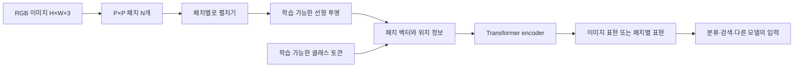
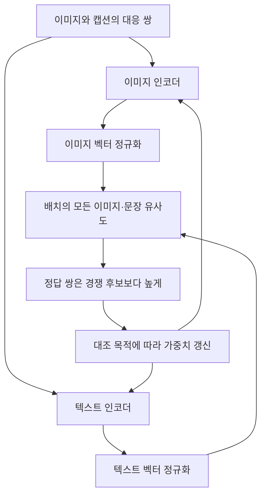
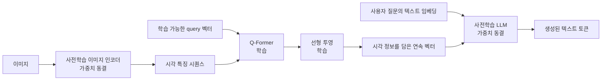
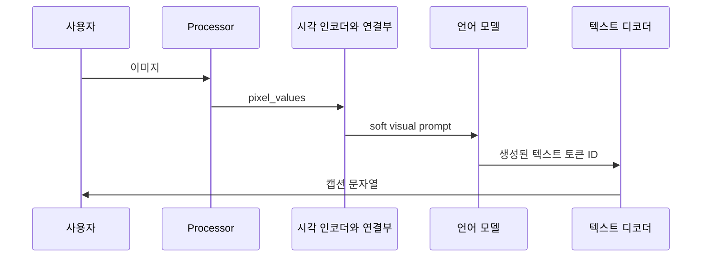
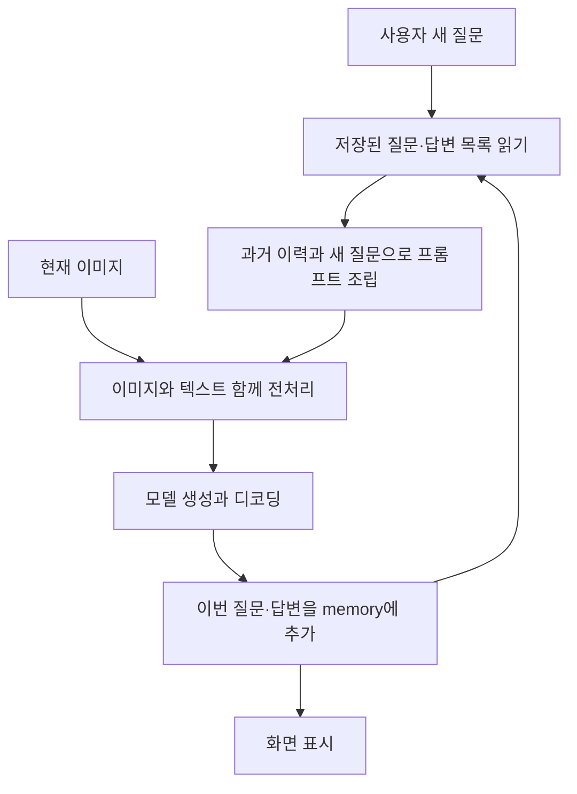

# 9장 멀티모달 언어 모델 학습 노트

[전체 목차](../../README.md) · [학습 노트](study.md) · [강의안](lecture.md) · [강의 대본](lecture-script.md) · [시각 실험](visuals.html) · [실습 안내](lab-guide.md) · [복습 문제](quiz.md)

이 장에서는 사진을 보고 관련 문장을 찾는 모델과, 사진에 관해 문장을 만들어 답하는 모델이 어떻게 다른지 배운다. 출발점은 **모든 데이터를 무조건 글자로 바꾸는 것**이 아니라 **각 데이터에 맞는 표현을 만든 뒤, 필요한 관계를 학습하는 것**이다. Vision Transformer는 이미지를 패치의 시퀀스로 표현하고, CLIP은 이미지와 텍스트의 의미를 비교할 수 있게 정렬하며, BLIP-2는 시각 정보를 언어 모델이 활용할 수 있는 연속 벡터 입력으로 바꾼다.

이 자료의 기본 출처는 Jay Alammar·Maarten Grootendorst, *Hands-On Large Language Models*, 2024년 초판, Chapter 9이다. **페이지는 제공된 PDF의 물리 페이지**로 표시한다. 본문은 PDF 360~396쪽, 참고문헌은 396~397쪽이며, 398쪽은 다음 부의 표지이다. 아래의 작은 수치 예제·실험·설계 문제는 이해를 돕기 위해 새로 만든 교육용 보충이다. 원문의 모델 실행 결과와 새 실습 결과를 섞지 않는다.

## 이 장을 마친 뒤 할 수 있어야 하는 것

1. 이미지 입력을 받는다는 사실과 이미지 출력을 생성한다는 사실을 구별한다.
2. 이미지 크기·패치 크기·채널 수로 패치 수와 펼친 벡터 길이를 계산한다.
3. CLIP의 두 인코더, 공동 임베딩 공간, 코사인 유사도, 대조 학습의 연결을 설명한다.
4. 이미지 검색과 제로샷 분류를 유사도 행렬의 행·열 선택으로 구현한다.
5. BLIP-2에서 동결된 부분과 학습되는 연결 부분을 구별하고 두 단계 학습을 설명한다.
6. 이미지 전처리, 텍스트 토큰화, 생성, 디코딩의 입출력 자료형을 추적한다.
7. 이미지 캡셔닝과 시각 질의응답의 차이를 설명하고, 이미지가 뒷받침하지 않는 답변을 찾아낸다.

**선수지식:** 2장의 토큰·임베딩, 3장의 attention과 텐서 차원, 4장의 분류, 7장의 대화 이력, 8장의 유사도 검색을 알고 있으면 좋다. 수식은 행렬 곱·내적·확률 합이 1이 되는 softmax까지 사용한다. 이 노트만 읽어도 따라갈 수 있도록 필요한 뜻을 다시 설명한다.

## 상세 목차

- [0. 멀티모달이라는 말의 범위](#sec-00)
- [1. 비전을 위한 트랜스포머](#sec-01)
- [2. 멀티모달 임베딩 모델](#sec-02)
- [3. CLIP으로 이미지와 텍스트 연결하기](#sec-03)
- [4. CLIP이 공동 임베딩을 학습하는 원리](#sec-04)
- [5. OpenCLIP 절의 코드 흐름과 결과 해석](#sec-05)
- [6. 텍스트 생성 모델에 시각 능력 연결하기](#sec-06)
- [7. BLIP-2와 Q-Former](#sec-07)
- [8. 멀티모달 입력 전처리](#sec-08)
- [9. 활용 1 이미지 캡셔닝](#sec-09)
- [10. 활용 2 이미지에 관해 대화하기](#sec-10)
- [11. 전체 연결과 학습 점검](#sec-11)
- [원문 그림 대응표](#figures)
- [용어 사전과 확장 읽기](#terms)

<a id="sec-00" name="sec-00"></a>
## 0. 멀티모달이라는 말의 범위

**원문 범위: PDF 360~361쪽. Figure 9-1.**

모달리티(modality)는 정보가 표현되는 종류를 뜻한다. 텍스트, 사진, 음성, 동영상, 센서 측정값은 서로 다른 모달리티다. “춥다”라는 말, 떨리는 목소리, 몸을 움츠린 모습은 모두 어떤 상황에 대한 정보를 주지만, 원시 데이터의 형태는 다르다. 문자열 처리기를 사진의 바이트에 그대로 적용한다고 해서 시각적 관계를 이해하게 되지는 않는다. 그 차이를 받아들이고 연결하는 것이 멀티모달 모델의 과제다.

입력과 출력은 따로 확인해야 한다. 사진과 질문을 받아 텍스트 답변을 내는 모델은 멀티모달 모델이다. 그러나 그것만으로 새 사진을 그릴 수 있는 모델은 아니다. 반대로 글을 받아 그림을 만드는 시스템도 입출력 모달리티가 다르다. 원문 Figure 9-1은 이 비대칭을 강조한다. 제품 설명에서 “멀티모달”이라는 단어를 보았을 때는 “어떤 입력을 받고 어떤 출력을 내는가?”를 먼저 묻자.

이 장의 두 중심 경로를 비교하면 이후 내용을 이해하기 쉽다.

| 질문 | 공동 임베딩 경로 | 시각 정보를 이용한 생성 경로 |
|---|---|---|
| 대표 예 | CLIP | BLIP-2 |
| 원하는 결과 | 벡터, 유사도, 순위 | 생성된 텍스트 |
| 입력 예 | 사진 한 장과 여러 후보 설명 | 사진 한 장과 질문 |
| 학습의 연결점 | 사진과 문장의 의미를 가까운 벡터로 맞춤 | 시각 특징을 LLM이 활용할 입력으로 바꿈 |
| 사용자가 보는 동작 | “이 설명에 맞는 사진을 찾아라” | “이 사진에는 무엇이 보이는가?” |
| 추가로 필요한 장치 | 검색 인덱스·후보 라벨·순위 결정 | 언어 생성기·프롬프트·출력 검증 |

원문은 시각 정보가 언어 모델의 응용 범위를 넓힐 가능성을 설명한다. 여기서 “정보가 더 들어오므로 모든 능력이 자동으로 향상된다”는 결론을 내리면 안 된다. 추가 모달리티의 품질, 학습에서 두 모달리티를 연결하는 방식, 평가 문제의 종류에 따라 효과가 달라진다. 이 장에서는 그 연결을 실제 구조 수준에서 살펴본다.

<a id="sec-01" name="sec-01"></a>
## 1. 비전을 위한 트랜스포머

**원문 절: Transformers for Vision. PDF 361~364쪽. Figures 9-2~9-5.**

### 1.1 언어에서 사용한 구조를 이미지에도 적용하려면

텍스트용 트랜스포머의 입력은 문장 그 자체가 아니라 벡터의 시퀀스다. “고양이가 잔다”를 토큰으로 나누고, 각 토큰을 벡터로 바꾼 뒤 인코더에 넣는다. 인코더 내부의 attention은 그 벡터들 사이의 관계를 계산한다. 이 구조에서 출발하면 중요한 질문이 생긴다. **이미지도 의미 있는 작은 단위로 나눈 뒤 벡터의 시퀀스로 만들 수 있지 않을까?**

Vision Transformer(ViT)는 이미지의 작은 사각형 영역인 패치(patch)를 그 단위로 사용한다. 한 픽셀만 보면 대체로 물체를 알 수 없지만, 주변 픽셀을 묶으면 색·경계·질감에 관한 단서를 얻을 수 있다. 패치를 읽는 attention 층은 서로 멀리 떨어진 영역의 관계도 다룰 수 있다. 예를 들어 귀가 있는 패치와 꼬리가 있는 패치가 같은 고양이에 속한다는 판단에는 국소 영역 사이의 관계가 중요하다.

여기서 패치를 “이미지의 단어”라고 부르는 것은 구조를 설명하기 위한 비유다. 패치 하나가 항상 의미 있는 물체 하나를 포함하지 않는다. 하나의 눈이 두 패치에 걸칠 수 있고, 한 패치에 배경과 물체 일부가 섞일 수도 있다. 단어처럼 고정된 의미 단위를 보장하지 않는다는 점을 기억하자.

### 1.2 패치 수와 벡터 차원을 직접 계산하기

높이 `H`, 너비 `W`, 채널 수 `C`인 이미지가 있고, 한 변이 `P`인 정사각형 패치를 만든다고 하자. 여기서는 `H`, `W`가 `P`로 나누어떨어지고, 패치가 겹치지 않는 경우를 가정한다.

$$N = \frac{H}{P}\frac{W}{P}, \qquad D_{patch}=P^2C$$

`N`은 패치의 개수, `D_patch`는 패치 한 개를 펼쳤을 때의 숫자 개수다. RGB 이미지는 `C=3`이다. `224×224` RGB 이미지를 `16×16` 픽셀 패치로 나누면 가로·세로 각각 14개이므로 패치는 196개이고, 각 패치는 `16×16×3=768`개의 값을 가진다. 이때 **16×16은 패치 하나의 픽셀 크기**이며 전체 패치 배열이 16행 16열이라는 뜻은 아니다. 원문의 제목에 등장하는 “16×16”을 읽을 때 특히 구별하자.

| 입력 이미지 | 패치 한 변 | 패치 배열 | 패치 수 `N` | 펼친 패치 길이 |
|---|---:|---:|---:|---:|
| 224×224 RGB | 16 | 14×14 | 196 | 768 |
| 224×224 RGB | 32 | 7×7 | 49 | 3072 |
| 512×512 RGB | 16 | 32×32 | 1024 | 768 |

패치 크기를 키우면 토큰 수는 줄지만 토큰 하나가 담는 영역은 커진다. 원본을 더 정밀하게 쪼갠다는 것과 모델의 입력 벡터 차원을 키운다는 것은 같은 일이 아니다. 토큰 수와 토큰 벡터 길이는 별개의 축이다.

### 1.3 왜 패치에는 단어처럼 정수 ID를 붙이지 않을까

텍스트 토큰화에서는 어휘 목록에 등록된 토큰에 정수 ID를 대응시킬 수 있다. 같은 토큰이면 같은 ID를 다시 사용한다. 반면 사진의 패치는 밝기나 위치가 조금만 달라져도 픽셀 값이 달라진다. 현실 이미지에서 가능한 패치의 조합은 매우 많으므로, 이 장의 ViT는 모든 패치 모양을 고정 사전에 넣는 방식을 사용하지 않는다.

대신 패치를 펼친 벡터에 학습 가능한 선형 변환을 적용한다. 패치 행렬을 `X ∈ R^(N×P²C)`, 투영 행렬을 `E ∈ R^(P²C×D)`라고 하면 `XE ∈ R^(N×D)`가 된다. 선택한 임베딩 차원 `D`에 맞춰 모든 패치가 같은 길이의 벡터로 표현된다. 선형 변환은 단순한 크기 변경 함수가 아니라 학습되는 가중치다. 어떤 픽셀 조합을 유용한 특징으로 다룰지를 훈련 과정에서 조정한다.

교육용으로 흑백 `2×2` 패치 `[1, 0, 0, 1]`에 두 출력 방향을 정한 행렬을 곱한다고 해 보자. 첫 출력이 네 값을 더하고, 둘째 출력이 첫째와 넷째 값을 더한 뒤 둘째와 셋째 값을 빼도록 하면 결과는 `[2, 2]`가 된다. 이것은 실제 ViT 가중치가 아니라, 선형 투영이 여러 픽셀을 서로 다른 관점으로 결합한다는 것을 보여 주는 작은 계산이다. 실습에서는 RGB 패치에 대해 같은 원리를 실행한다.

### 1.4 위치와 전체 이미지 표현

그림을 잘라 벡터만 나열하면, 어느 조각이 위쪽이고 어느 조각이 아래쪽인지 알려 줄 장치가 필요하다. **보충 설명:** ViT에서는 패치 임베딩에 위치 정보를 더한다. 인코더의 attention이 여러 패치를 함께 처리하더라도, 시퀀스 내 위치를 구분할 수 있어야 공간 배치를 학습할 수 있다. 또한 원문의 Figure 9-5에는 전체 이미지를 요약하는 용도로 사용할 클래스 토큰이 표시되어 있다. 클래스 토큰의 출력은 여러 패치에서 정보를 모으는 표현으로 사용할 수 있다.



원문의 Figures 9-2와 9-3은 텍스트와 이미지 모두 인코더 전에 적절한 입력 변환이 필요하다는 공통점을 보여 준다. Figure 9-4는 패치 분할, Figure 9-5는 분할부터 투영·인코더까지의 전체 흐름이다. 핵심은 “이미지가 텍스트로 번역된다”가 아니라 “다른 원시 데이터를 공통적인 벡터 시퀀스 연산으로 다룰 수 있다”이다.

### 1.5 해상도와 계산량의 관계

**교육용 보충:** 표준적인 완전 self-attention의 점수 행렬은 토큰 수가 `L`일 때 `L×L` 크기다. 패치 수가 49에서 196으로 네 배가 되면 패치끼리의 점수 개수는 2,401에서 38,416으로 16배가 된다. 클래스 토큰까지 세면 각각 50²와 197²이다. 이것은 전체 모델의 실행 시간이 정확히 16배라는 뜻이 아니라, attention의 중요한 한 부분이 제곱으로 커진다는 뜻이다. 실제 속도에는 다른 연산과 구현도 영향을 준다.

[시각 실험](visuals.html)의 첫 실험에서 해상도와 패치 크기를 바꿔 보자. 작은 패치가 시각 정보를 더 세밀하게 보존할 여지를 주는 동시에 긴 시퀀스를 만든다는 사실을 확인할 수 있다. 특정 사전학습 모델에 임의의 패치 크기를 넣어도 된다는 의미는 아니다. 실제 체크포인트의 패치 투영 가중치와 위치 표현은 해당 구조에 맞게 학습되어 있다.

<a id="sec-02" name="sec-02"></a>
## 2. 멀티모달 임베딩 모델

**원문 절: Multimodal Embedding Models. PDF 364~366쪽. Figures 9-6~9-7.**

### 2.1 벡터를 만든다는 것과 비교 가능하다는 것은 다르다

앞 장에서는 문서를 임베딩해서 비슷한 문서를 찾았다. 이 장에서는 사진도 임베딩할 수 있다. 그런데 문장 모델이 만든 512차원 벡터와 이미지 모델이 만든 512차원 벡터를 그대로 내적하면 의미 있는 유사도가 나올까? **차원이 같다는 사실만으로는 충분하지 않다.** 두 모델이 각 좌표를 서로 다른 방식으로 사용한다면 길이만 같은 숫자 목록일 뿐이다.

좌표계 비유를 사용해 보자. 한 지도는 북쪽을 위로, 다른 지도는 동쪽을 위로 그렸다. 두 지도 모두 2차원이라고 해도, 같은 장소의 좌표 숫자가 같지 않다. 서로 변환하거나 같은 기준에 맞춰야 비교할 수 있다. 멀티모달 임베딩 학습은 이미지와 문장이 같은 의미적 관계를 반영하도록 표현을 맞추는 과정이다. 다만 실제 임베딩의 각 좌표를 “위도·경도처럼 사람이 해석할 수 있는 개념”으로 생각해서는 안 된다. 비유의 목적은 정렬 필요성을 설명하는 데 있다.

공동 공간(shared space)에서는 강아지 사진이 그 강아지를 설명하는 문장과 가깝게, 관계없는 풍경 설명과는 상대적으로 멀게 표현되기를 기대한다. 두 인코더의 출력이 완전히 같은 벡터여야 한다는 요구는 아니다. 사진에는 문장이 말하지 않는 배경이나 색이 들어 있고, 문장에는 사진에서 확정할 수 없는 표현이 있을 수 있다. 학습은 그 차이 속에서 활용할 만한 의미 관계를 찾는다.

### 2.2 질의와 검색 대상의 조합

검색은 한 모달리티에서 다른 모달리티로 건너갈 수도 있고 같은 모달리티 안에서 수행할 수도 있다. 입력 질의와 저장된 자료를 어떤 인코더로 표현할지 먼저 결정하면 설계가 명확해진다.

| 질의 | 검색 대상 | 예시 | 비교할 표현 |
|---|---|---|---|
| 텍스트 | 이미지 | “눈밭의 작은 강아지”로 사진 검색 | 텍스트 벡터와 이미지 벡터 |
| 이미지 | 텍스트 | 사진에 맞는 설명 후보 검색 | 이미지 벡터와 문장 벡터 |
| 이미지 | 이미지 | 상품 사진과 비슷한 상품 찾기 | 이미지 벡터끼리 |
| 텍스트 | 텍스트 | 사진 설명 문장끼리 비교 | 텍스트 벡터끼리 |

같은 공간이 여러 비교를 허용하더라도 모든 종류의 검색에서 같은 품질을 보장하지는 않는다. 학습 데이터와 목표가 어떤 관계를 강조했는지에 따라 문서 검색 전문 모델이나 이미지 전문 모델이 더 적합할 수도 있다. 따라서 “멀티모달이므로 단일 모달 모델을 모두 대체한다”는 결론보다 실제 검색 질문으로 평가하는 것이 중요하다.

Figures 9-6과 9-7은 이 공동 공간을 설명한다. 2차원 그림은 높은 차원의 벡터 관계를 보여 주기 위한 시각적 비유이지 실제로 모델이 두 좌표만 사용한다는 뜻이 아니다. 그림에서 가까운 점은 “이 과제의 임베딩 공간에서 유사하다”는 뜻이며, 현실의 모든 의미에서 같다는 뜻은 아니다.

### 2.3 검색을 위한 실무적 사고 순서

먼저 “사용자가 무엇을 찾고 싶은가?”를 정의한다. 강아지의 품종 구분인지, 눈이라는 배경인지, 뛰는 동작인지에 따라 정답의 기준이 달라진다. 다음으로 정답 사례와 헷갈리는 오답 사례를 모은다. 마지막으로 그 후보들에 대한 순위가 실제 목적과 맞는지 확인한다. 임베딩 공간의 그림이 보기 좋다는 것만으로 검색이 잘된다고 결론 내릴 수는 없다.

예를 들어 “빨간 재킷을 입은 사람” 검색에서 사람만 찾고 재킷 색을 무시하면, 넓은 의미에서는 맞지만 사용자가 원하는 답은 아니다. 이미지와 문장의 연결은 사물 인식뿐 아니라 속성·관계·부정·수량까지 어느 정도 보존해야 한다. 이 장의 실습은 공동 공간의 계산 원리를 보여 주며, 실제 모델이 이런 모든 세부 의미를 정확하게 표현하는지를 증명하지는 않는다.

<a id="sec-03" name="sec-03"></a>
## 3. CLIP으로 이미지와 텍스트 연결하기

**원문 절: CLIP: Connecting Text and Images. PDF 366~367쪽.**

CLIP은 Contrastive Language-Image Pre-training의 약자다. 이미지와 텍스트를 각각 인코딩하고, 두 결과를 비교할 수 있도록 학습하는 모델이다. 사용자는 텍스트를 이미지 파일 형식으로 바꾸거나 사진을 먼저 캡션으로 바꿀 필요 없이, 각 입력에 맞는 인코더를 사용한다. 이 점이 이미지에서 캡션을 추출한 뒤 일반 텍스트 검색을 하는 방식과 다르다.

### 3.1 제로샷 분류

고정된 분류 헤드가 “고양이·개·자동차” 세 클래스를 직접 출력하게 만들 수도 있다. CLIP을 이용하는 방식은 후보 클래스의 이름이나 설명을 문장으로 만든 뒤 사진과 비교한다. 예를 들어 후보 문장이 “고양이 사진”, “강아지 사진”, “자동차 사진”이면, 사진 임베딩과 각 후보 텍스트 임베딩의 유사도를 계산해서 가장 높은 후보를 선택한다.

여기서 제로샷은 이 특정 분류 과제의 라벨 데이터로 추가 훈련하지 않는다는 뜻이다. 모델이 전혀 학습되지 않았다는 뜻이 아니며, 그 개념을 사전학습에서 한 번도 보지 않았음을 보장하지도 않는다. 또한 후보 집합 바깥의 정답은 선택할 수 없다. 꽃 사진에 고양이·강아지·자동차 세 후보만 주면 모델은 그중 하나를 고를 수 있다. 가장 높은 점수와 정답 여부를 분리해서 생각해야 한다.

후보 이름의 표현도 영향을 준다. “crane”처럼 여러 뜻을 가진 단어보다 “새인 두루미를 찍은 사진”과 “건설 현장의 기중기 사진”처럼 구체적인 설명을 사용하면 비교 의도를 더 명확하게 전달할 수 있다. 그러나 설명을 길게 쓴다고 항상 좋은 결과가 되는 것은 아니다. 실제 모델의 토큰 길이, 언어 지원, 학습 문체와 후보 간 공정한 비교 조건을 확인해야 한다.

### 3.2 군집화와 검색

이미지 벡터를 모아 군집화하면 비슷한 시각·의미 특성을 가진 자료를 묶을 수 있다. 같은 공동 공간에 있는 키워드나 설명 벡터를 이용하면 각 이미지 군집에 어떤 문구가 가까운지도 살펴볼 수 있다. 5장의 토픽 모델링에서 문서 군집을 설명하는 단어를 찾았던 것과 연결해서 생각할 수 있다. 다만 군집에 붙인 설명은 임베딩에 근거한 요약이며, 모든 구성원을 완벽하게 설명하는 진실이라고 볼 수는 없다.

검색에서는 자료의 임베딩을 미리 계산해 저장하고 질의의 임베딩만 새로 계산하는 구조가 유용하다. 8장의 검색 인덱스와 순위 평가 개념을 그대로 활용할 수 있다. “수십억 개의 자료에서도 찾을 수 있다”는 것은 임베딩을 검색 기술과 결합하는 활용 방향이며, 단순한 작은 행렬 곱 예제가 곧 대규모 시스템이라는 뜻은 아니다. 자료량이 커지면 저장 비용, 근사 검색, 필터링, 갱신 등이 별도 문제가 된다.

### 3.3 이미지 생성과의 관계

원문은 멀티모달 임베딩이 이미지 생성 시스템에도 쓰일 수 있다고 설명하며 Stable Diffusion을 예로 든다. 여기에서 CLIP 자체가 픽셀을 생성한다고 이해하면 안 된다. 임베딩 또는 관련 텍스트 인코더가 다른 생성 모델의 조건으로 쓰일 수 있다는 뜻이다. **의미 표현을 제공하는 부품**과 **이미지를 실제로 만들어 내는 생성 과정**의 역할을 구별하자.

이 네 가지 응용을 한 문장으로 묶으면 “사람이 말한 개념과 시각 자료를 비교 가능한 표현으로 연결하면 분류·군집화·검색·다른 생성 시스템의 조건화가 가능해진다”가 된다. 모델 선택은 최종 출력부터 시작하는 것이 좋다. 순위만 필요하면 매번 긴 문장을 생성할 필요가 없고, 자유로운 설명이 필요하면 유사도 점수만으로는 부족하다.

<a id="sec-04" name="sec-04"></a>
## 4. CLIP이 공동 임베딩을 학습하는 원리

**원문 절: How Can CLIP Generate Multimodal Embeddings? PDF 367~370쪽. Figures 9-8~9-11. 아래 손실 수식과 손계산은 교육용 보충이다.**

### 4.1 이미지와 캡션 쌍을 준비한다

사진과 그 사진을 설명하는 문장을 한 쌍으로 모은다. 예를 들어 강아지 사진에는 강아지를 설명하는 문장, 자동차 사진에는 자동차를 설명하는 문장이 붙어 있다. 원문의 Figure 9-8은 이런 학습 자료의 형태를 보여 준다. 이미지 인코더는 픽셀 입력을 이미지 벡터로 바꾸고, 텍스트 인코더는 토큰 입력을 텍스트 벡터로 바꾼다. Figure 9-9가 그 두 갈래를 보여 준다.

“쌍이 있다”는 것은 학습에 필요한 대응 정보가 있다는 뜻이다. 모든 사진에 완벽한 사전 정의 클래스 라벨을 붙여야 하는 것은 아니다. 그러나 자료가 공짜로 정확해지는 것도 아니다. 사진과 엉뚱한 캡션이 연결되거나, 캡션이 배경만 설명하고 주요 물체를 생략할 수 있다. 모델이 무엇을 유사하다고 배울지는 데이터의 관계에 영향을 받는다.

### 4.2 코사인 유사도를 구한다

벡터 `v`와 `t`의 코사인 유사도는 다음과 같다.

$$s(v,t)=\frac{v\cdot t}{\|v\|_2\|t\|_2}$$

내적은 같은 좌표끼리 곱한 값을 모두 더한 것이고, L2 노름은 각 좌표 제곱의 합에 제곱근을 취한 길이다. 두 벡터를 먼저 길이 1로 정규화하면 분모가 1이므로 내적만 계산해도 코사인 유사도가 된다. 일반적인 범위는 -1부터 1까지다. 길이가 0인 벡터에는 이 식을 그대로 사용할 수 없으므로 구현에서 예외를 확인해야 한다.

`v=(3,4)`, `t=(4,3)`이면 내적은 `24`, 두 노름은 각각 `5`이므로 유사도는 `24/25=0.96`이다. `v`의 크기를 두 배로 해도 코사인 유사도는 변하지 않는다. 이 계산은 벡터의 방향이 얼마나 비슷한지 본다는 뜻이다. 반대로 정규화 없이 내적만 사용하면 벡터 길이가 점수에 영향을 준다. 두 방식을 섞어 쓰면서 같은 기준이라고 생각하면 검색 결과가 달라질 수 있다.

### 4.3 한 쌍만 보지 말고 배치의 모든 조합을 본다

이미지 세 장 `I1, I2, I3`와 각각의 정답 캡션 `T1, T2, T3`가 있다고 하자. 모든 조합을 비교하면 다음과 같은 행렬이 나온다. 아래 값은 설명을 위해 만든 가상 코사인 점수다.

| 이미지 / 문장 | T1 강아지 | T2 자동차 | T3 풍경 |
|---|---:|---:|---:|
| I1 강아지 | 0.80 | 0.15 | 0.10 |
| I2 자동차 | 0.20 | 0.75 | 0.18 |
| I3 풍경 | 0.12 | 0.22 | 0.78 |

각 행에서는 해당 이미지와 맞는 문장이 다른 후보보다 높은 점수를 갖도록 하고, 각 열에서는 해당 문장과 맞는 이미지가 높아지도록 한다. 정답 쌍이 같은 순서로 놓였다면 대각선이 정답이다. 실제 데이터의 순서가 뒤섞였다면 정답 위치도 함께 바꿔야 한다. “대각선이 무조건 정답”이 아니라 데이터의 대응 관계를 대각선에 배치했기 때문에 그렇게 보이는 것이다.



Figures 9-10과 9-11은 유사도를 비교하고 그 결과로 표현을 개선하는 반복을 보여 준다. 부정 예제는 “관계없는 것을 알아야 관계있는 것도 구별한다”는 역할을 한다. 모든 표현을 동일한 벡터로 만들면 모든 양성 쌍의 유사도가 높아지겠지만 오답도 똑같이 높아진다. 대조 학습은 경쟁 후보를 함께 보므로 그런 붕괴가 좋은 해답이 되지 않도록 한다.

### 4.4 softmax와 온도를 사용한 작은 손계산

**보충 설명:** 유사도 `s_ij`를 온도 `τ>0`로 나눈 logit으로 쓰면 한 이미지가 후보 문장 `j`와 연결될 상대 가중치는 다음과 같이 표현할 수 있다.

$$p_{ij}=\frac{\exp(s_{ij}/\tau)}{\sum_k\exp(s_{ik}/\tau)}$$

정답 후보의 확률이 클수록 손실 `-log(p_correct)`는 작아진다. 이미지→텍스트 방향과 텍스트→이미지 방향의 손실을 평균하는 대칭적인 목적을 생각할 수 있다. 온도는 확률 분포의 날카로움을 바꾸며, 유사도 순서 자체를 바꾸지는 않는다. 실제 학습에서는 logit의 스케일을 학습하는 표현을 사용할 수 있다. 이 노트와 실습은 원리를 확인하기 위해 고정 온도를 사용한다.

두 후보의 코사인 점수가 `0.8`과 `0.2`라고 해 보자. `τ=1`이면 정답 후보의 softmax 값은 약 `0.646`이다. `τ=0.1`이면 점수 차이가 logit 공간에서 6이 되어 약 `0.9975`가 된다. 같은 유사도가 훨씬 확신하는 듯한 분포로 바뀐 것이다. 따라서 softmax에서 99%가 나왔다고 실제 정답률 99%라고 해석해서는 안 된다. 후보 집합과 온도에 의존하는 상대적인 값이다.

### 4.5 어려운 부정 예제와 모호한 대응

세 캡션이 모두 서로 전혀 다른 사물이라면 구별이 쉽다. “눈 위에 앉은 강아지”와 “눈 위에서 뛰는 강아지”는 훨씬 어렵다. 실제 사용자가 동작까지 묻는다면 이런 차이를 구별할 수 있어야 한다. 반대로 같은 강아지 사진에 여러 문장이 모두 타당할 수 있는데 이를 무조건 서로 부정 예제로 취급하면 학습 신호에 잡음이 생긴다. 배치 안의 다른 항목이 항상 완전히 무관한 것은 아니다.

이 점은 10장의 대조 학습과 연결된다. 좋은 모델은 단순히 “양성 쌍의 숫자를 높이는 기계”가 아니라, 유용한 유사성과 차이를 데이터에서 배우는 시스템이다. 무엇을 양성과 음성으로 정의할지, 평가에서는 어떤 관계를 요구할지가 중요한 설계 결정이다.

<a id="sec-05" name="sec-05"></a>
## 5. OpenCLIP 절의 코드 흐름과 결과 해석

**원문 절: OpenCLIP. PDF 370~377쪽. Figures 9-12~9-14 및 Sentence-Transformers 상자. 이 절의 모델명·형상·점수는 2024년 원문 예제의 설명이다. 이 자료 제작 과정에서 해당 가중치를 내려받아 실행하지 않았다.**

### 5.1 절 제목과 실제로 사용한 체크포인트를 구별하기

원문은 OpenCLIP이라는 공개 구현 계열을 소개하지만, 이어지는 구체적 코드는 Hugging Face Transformers의 `CLIPTokenizerFast`, `CLIPProcessor`, `CLIPModel`을 사용하고 모델 ID를 `openai/clip-vit-base-patch32`로 지정한다. 따라서 이 코드를 설명할 때는 “CLIP 계열을 사용하는 Transformers 예제”라고 읽는 것이 정확하다. `open_clip` 패키지의 직접 사용 예제와 동일하다고 생각해서는 안 된다. 구현 라이브러리, 모델 구조, 가중치 체크포인트는 서로 다른 정보다.

모델 이름의 `patch32`는 영상 인코더의 패치 크기와 연결된다. 원문 예제에서 입력 영상이 `224×224`라면 `32×32` 픽셀 패치 49개가 만들어진다. 최종 이미지 벡터의 길이 512는 패치 개수 49와 다른 축이다. 이미지의 패치 표현을 처리하고 요약·투영한 결과가 최종 비교용 벡터가 된다.

### 5.2 텍스트 경로

원문은 눈밭에서 노는 강아지의 이미지를 읽고, 그 내용을 설명하는 영어 문장을 함께 준비한다. 먼저 토크나이저를 사용하면 `input_ids`와 `attention_mask`가 반환된다. `input_ids`는 어휘 ID의 시퀀스이고, `attention_mask`는 실제 입력과 패딩 위치 등을 구분하는 데 사용한다. 이 ID 목록 자체가 512차원 의미 벡터는 아니다. 인코더가 토큰들의 문맥 관계를 처리한 뒤 비교용 임베딩을 만든다.

원문 예제의 토큰에는 시작·종료 기호와 `</w>` 표기가 나타난다. `</w>`는 해당 토큰화 방식의 단어 경계 표시로 이해하면 된다. 시작·종료 토큰을 “텍스트와 이미지가 하나의 문자열에 섞이지 않게 분리하는 문자”로 일반화할 필요는 없다. 여기서는 텍스트 경로의 특수 토큰이며, CLIP의 이미지와 텍스트는 별도 인코더에서 처리된다. 이미지 경로의 클래스 토큰과 텍스트 경로의 종료 토큰 기반 표현도 서로 다른 구조적 역할이다.

원문의 `get_text_features` 호출 결과는 `[1, 512]`다. 첫 번째 축의 1은 문장 한 개를 입력했다는 뜻이고, 두 번째 축의 512는 최종 특징 차원이다. 문장을 세 개 입력하면 개념적으로 `[3, 512]`의 텍스트 특징 행렬을 기대할 수 있다. 문자열 길이를 뜻하는 축이 최종 출력에 남아 있지 않다는 점에 주목하자.

### 5.3 이미지 경로

이미지 파일은 모델이 기대하는 색상 모드와 크기, 숫자 범위로 전처리해야 한다. 원문에서는 RGB로 읽은 `512×512` 이미지가 processor를 거쳐 `[1, 3, 224, 224]`의 텐서로 변한다. 네 축은 순서대로 배치, 채널, 높이, 너비다. “숫자 3이 이미지 세 장을 뜻한다”고 읽으면 안 된다. RGB 세 채널이며 이미지 수는 첫 축의 1이다.

Figure 9-13은 전처리된 입력을 시각화한다. 모델용 텐서는 표시용 사진과 같은 범위를 보장하지 않으므로 그대로 화면에 그리면 색이 이상하게 보일 수 있다. **보충 설명:** 정규화가 적용된 텐서를 표시할 때는 해당 전처리 설정에 맞는 역변환을 고려하고, 채널 우선 배열을 높이·너비·채널 순서로 바꿔야 한다. 시각화의 축 변환과 모델 입력의 축 변환을 혼동하지 말자.

이미지 특징을 얻는 호출의 출력도 `[1, 512]`다. 이제 텍스트 특징과 이미지 특징의 최종 차원이 같으므로 행렬 곱의 형상이 맞는다. 다만 앞서 배운 대로 비교가 의미 있는 이유는 같은 숫자 512 때문만이 아니라 학습으로 두 표현을 정렬했기 때문이다.

### 5.4 정규화, 행렬 곱, 점수 읽기

원문의 코드는 각 벡터를 마지막 차원의 L2 노름으로 나눈다. `keepdim=True`는 노름의 축을 유지해서 나눗셈이 행마다 올바르게 적용되도록 하는 형상 처리다. 정규화한 뒤 텍스트 행렬 `[M,D]`와 이미지 행렬의 전치 `[D,N]`를 곱하면 `[M,N]`의 점수 행렬을 얻는다. 반대로 이미지 행렬을 왼쪽에 두면 `[N,M]`가 된다. 행·열의 의미를 문서에 적어 놓아야 잘못된 축에서 최댓값을 고르는 실수를 피할 수 있다.

원문에서 강아지 사진과 관련 설명의 유사도는 약 `0.3315`로 제시된다. 이 숫자만 보고 낮은 정확도라고 판단하면 안 된다. 코사인 유사도 0.33은 정답 확률 33%가 아니다. 또한 다른 모델, 다른 전처리, 다른 자료 집합에서도 0.33이 같은 의미를 가진다고 할 수 없다. 원문 Figure 9-14는 다른 이미지·설명 후보와 함께 비교해서 상대적으로 얼마나 잘 맞는지 읽도록 한다.

손으로 작은 행렬을 읽어 보자. 강아지 이미지와 세 캡션의 점수가 `[0.33, 0.12, 0.09]`라면 첫 번째가 가장 높다. 그런데 후보를 “앉은 강아지”, “뛰는 강아지”, “젖은 강아지”로 바꾸면 상위 두 점수가 가까워질 수 있다. 후보 세트와 평가 목적이 바뀐 것이다. 실제 서비스의 임계값은 관련 없는 질의와 어려운 후보를 포함한 검증 자료로 정해야 한다.

### 5.5 원문 코드에서 데이터 흐름만 추려 보기

다음은 실행 라이브러리 버전에 의존하지 않도록 정리한 **의사 코드**다. 실제 객체와 API 이름은 선택한 환경에서 확인해야 한다.

```text
이미지 파일 → RGB 이미지 → 이미지 processor → pixel_values
문장 목록 → tokenizer → input_ids, attention_mask
pixel_values → 이미지 encoder와 projection → 이미지 특징 행렬
input_ids, attention_mask → 텍스트 encoder와 projection → 텍스트 특징 행렬
각 특징 행 정규화 → 이미지 특징 × 텍스트 특징의 전치 → 유사도 행렬
각 이미지 행에서 최대 점수의 문장 선택 → 제로샷 분류 또는 설명 후보 검색
```

원문에는 Sentence-Transformers를 이용하는 간결한 대안도 있다. `clip-ViT-B-32` 계열 모델로 이미지 목록과 문장 목록을 각각 `encode`한 뒤 `cos_sim`으로 비교한다. 이 인터페이스가 세부 처리를 감춰 준다고 해서 원리가 달라지는 것은 아니다. 간결한 도구를 쓰더라도 입력 전처리, 최종 특징 차원, 정규화 여부, 행렬 축의 의미를 확인할 수 있어야 디버깅이 가능하다.

### 5.6 재현할 때 기록해야 할 것

원문 점수와 조금 다르다고 곧바로 알고리즘이 틀렸다고 결론 내리면 안 된다. 입력 파일, RGB 변환, resize와 crop 방식, 모델 ID와 리비전, 라이브러리 버전, 평가 모드, 숫자 정밀도 등이 결과에 영향을 줄 수 있다. 반대로 거의 같은 숫자가 나왔다고 전체 모델을 이해한 것도 아니다. 유사도 행렬을 해석하고 입력을 바꾼 실험 결과를 설명하는 것이 공부의 목표다.

[실습 안내](lab-guide.md)는 다운로드 없이 벡터 정규화와 점수 행렬을 실제 계산한다. 원문의 CLIP 모델 추론을 재현한 것은 아니며, 이 절의 형상과 연산을 작은 수로 확인하는 대체 개념 실습이다.

<a id="sec-06" name="sec-06"></a>
## 6. 텍스트 생성 모델에 시각 능력 연결하기

**원문 절: Making Text Generation Models Multimodal. PDF 377~378쪽. Figure 9-15.**

CLIP의 출력이 “어떤 문장과 사진이 가깝다”라면, 다음 목표는 “사진을 보고 새 문장으로 답한다”이다. 음식 사진에서 재료를 설명하거나, 건축물 사진과 질문을 함께 받아 답하는 상황을 생각할 수 있다. 여기에는 그림의 내용을 표현하는 능력뿐 아니라 질문에 맞는 텍스트를 생성하는 능력이 필요하다.

텍스트 생성 LLM은 일반적으로 텍스트 토큰의 임베딩을 받아 다음 토큰을 예측하도록 학습된다. 이미지 파일 바이트를 그대로 붙여 넣으면 이미지를 이해할 것이라고 기대할 수 없다. 시각 인코더의 출력 벡터를 얻었다고 해도, 그 벡터가 LLM의 입력 규칙과 의미적 기대에 맞도록 연결해야 한다. 이 장에서 말하는 모달리티 간 간격(modality gap)은 원시 데이터 형식뿐 아니라 학습된 표현 방식의 차이를 포함한다.

전략은 크게 처음부터 하나의 큰 시스템을 학습하는 방향과, 이미 학습된 시각 인코더·언어 모델을 연결하는 방향으로 생각할 수 있다. 원문은 후자를 설명한다. 기존 모델의 능력을 활용하면 모든 부품을 처음부터 다시 훈련하는 비용을 줄일 수 있기 때문이다. 이 연결이 단순한 파일 변환 작업은 아니다. 어떤 시각 정보를 선택하고 어떤 벡터로 전달해야 언어 생성에 도움이 되는지를 학습해야 한다.

Figure 9-15는 이미지와 질문을 함께 처리하는 생성 모델의 사용자 경험을 보여 준다. 여기서도 “사진에서 읽어 낸 사실”과 “언어 모델의 사전지식”을 구분해야 한다. 유명한 건축물을 보고 건립 연도를 답하는 경우, 사진은 대상 식별에 기여하고 연도는 모델의 학습 지식이나 별도 검색에서 올 수 있다. 사진 자체에 연도가 적혀 있지 않다면 그 연도가 픽셀에서 직접 읽혔다고 설명할 수 없다.

이 절의 학습 질문은 다음과 같다. “LLM의 모든 가중치를 새로 학습하지 않고, 기존 입력 공간에 시각적 조건을 전달하려면 어떤 연결부가 필요할까?” 그 답의 한 형태가 BLIP-2의 Q-Former와 투영층이다.

<a id="sec-07" name="sec-07"></a>
## 7. BLIP-2와 Q-Former

**원문 절: BLIP-2: Bridging the Modality Gap. PDF 378~382쪽. Figures 9-16~9-20.**

### 7.1 큰 두 모델 사이에 학습 가능한 연결부를 둔다

BLIP-2는 사전학습된 이미지 인코더와 LLM을 활용한다. 이 장에서 설명하는 학습 과정에서는 이 두 큰 모델의 가중치를 동결(freeze)한다. 동결은 해당 가중치를 optimizer가 갱신하지 않는다는 뜻이다. 계산을 수행하지 않는다는 뜻도, 그 부품이 불필요해졌다는 뜻도 아니다. 시각 인코더는 여전히 이미지 특징을 계산하고, LLM은 여전히 문장을 생성한다.

두 모델 사이에 Querying Transformer, 줄여서 Q-Former를 넣는다. 이름의 query를 사용자의 자연어 질문과 동일시하지 말자. Q-Former의 학습 가능한 query 벡터는 이미지 특징에서 필요한 정보를 읽어 오는 통로다. 사용자 질문이 없어도 이미지 캡셔닝을 위해 이 query들은 작동한다. 사용자 질문은 별도로 언어 모델에 전달되는 텍스트 조건이다.

원문은 Q-Former를 이미지 쪽과 텍스트 쪽 모듈이 attention 층을 공유하는 구조로 설명한다. 이를 “독립된 거대 ViT와 거대 LLM을 Q-Former 안에 하나씩 다시 넣는다”는 의미로 해석하면 안 된다. 이미지 특징과 상호작용하는 경로와 텍스트를 다루는 경로가 학습 목적에 따라 관계를 맺는, 두 모델 사이의 상대적으로 작은 연결부로 이해하면 된다.



Figure 9-16은 이 큰 구조를 보여 준다. 원문의 “연결부를 학습한다”는 표현은 뒤의 선형 투영층까지 함께 생각해야 한다. 이미지 인코더와 LLM을 동결하더라도 그 사이의 Q-Former와 필요한 투영이 학습 가능하다. 학습되는 파라미터가 줄어드는 것이 비용 절감의 중요한 이유지만, 동결된 모델의 추론 메모리와 계산량까지 사라지는 것은 아니다.

### 7.2 시각 정보에서 필요한 부분을 읽는다는 뜻

**교육용 보충:** 이미지 인코더 출력에 패치 특징 네 개가 있다고 하자. 하나의 query가 각 특징과 얼마나 관련 있는지 점수를 계산하고 softmax를 취하면, 합이 1인 가중치 네 개를 얻을 수 있다. 이 가중치로 특징 벡터들을 가중합하면 특정 관점의 시각 요약 벡터 하나가 된다. 실제 Q-Former는 여러 층과 학습 가능한 파라미터를 사용하지만, 이 작은 계산은 query가 왜 이미지 특징을 “질의한다”고 표현하는지 보여 준다.

예를 들어 특징들이 왼쪽 위의 물체, 오른쪽의 물체, 아래 배경, 중앙의 글자에 관한 정보를 각각 담았다고 생각해 보자. 한 query는 물체 단서에, 다른 query는 배경 단서에 더 주의를 줄 수 있다. 그러나 실제 학습된 query 하나에 “항상 색상 담당” 같은 사람이 정한 이름이 붙어 있다고 보장할 수는 없다. 임의의 단순 그림은 기능을 이해하는 비유이며 모델 내부의 검증된 해석 결과가 아니다.

이 장의 [시각 실험](visuals.html)과 [Python 실습](lab.py)에서는 query와 특징의 내적, softmax, 가중합을 실제 계산한다. 이 실험은 BLIP-2의 학습된 Q-Former를 복제한 것이 아니다. **입력 특징 여러 개가 연속 벡터로 요약되는 계산**만 작은 차원에서 드러낸다.

### 7.3 첫 번째 학습 단계는 시각과 언어의 표현을 연결한다

원문 Figure 9-17은 두 단계 학습을 구분하고, Figure 9-18은 첫 단계를 자세히 보여 준다. 먼저 이미지·캡션 쌍을 준비한다. 이미지는 동결된 시각 인코더를 통과해서 시각 특징이 되고, 캡션은 텍스트 입력이 된다. Q-Former는 이 둘의 관계를 학습한다. 원문은 다음 세 목적을 함께 소개한다.

| 목적 | 모델이 맞혀야 하는 것 | 학생이 이해할 핵심 |
|---|---|---|
| Image-text contrastive learning | 어떤 이미지 표현과 텍스트 표현이 맞는 짝인가 | 공동 표현에서 양성 쌍을 경쟁 후보보다 가깝게 |
| Image-text matching | 주어진 이미지·문장 쌍이 일치하는가 | 쌍의 정합성을 더 직접적으로 판별 |
| Image-grounded text generation | 이미지 정보를 이용해 어떤 텍스트가 나오는가 | 시각 정보를 텍스트 생성에 쓸 수 있게 |

첫째와 둘째는 비슷하게 들리지만 목적의 형식이 다르다. 대조 학습은 여러 후보 간의 상대적인 대응을 이용해 표현을 정렬하는 데 초점을 두고, matching은 주어진 쌍의 일치 여부를 판별하는 과제로 설명할 수 있다. 셋째는 이미지와 관계있는 언어를 생성하도록 하여 시각 정보가 실제 언어 예측에 유용하도록 한다. 이 셋을 모두 “같은 코사인 유사도 공식 세 번”으로 읽으면 안 된다.

원문은 이 과정을 동결된 ViT의 표현에 언어적 정보를 연결하는 직관으로 설명한다. 엄밀히 말하면 동결된 ViT의 가중치가 이 단계에서 업데이트되는 것은 아니다. **그 출력에서 무엇을 추출하고 어떻게 표현할지를 Q-Former가 학습한다.** “시각 특징이 좋아진다”는 표현을 볼 때, 어느 모듈의 파라미터가 바뀌는지 함께 확인하자.

### 7.4 두 번째 단계는 언어 모델이 사용할 수 있는 입력을 학습한다

첫 단계에서 얻은 시각·언어 관련 표현이 있다고 해서 LLM의 입력 차원과 즉시 일치하는 것은 아니다. 따라서 원문 Figure 9-19는 Q-Former 출력과 LLM 사이의 fully connected 선형층을 보여 준다. 이 층은 Q-Former의 특징 차원을 언어 모델이 기대하는 임베딩 차원으로 변환한다.

교육용 차원 예제로 Q-Former 출력이 query 4개에 각각 8차원이라고 하자. 이를 12차원 LLM 임베딩으로 보내려면 `4×8` 행렬에 `8×12` 투영을 적용해 `4×12`를 얻는다. **query의 개수 4를 보존하면서 벡터 폭을 8에서 12로 바꾸는 것**이다. 그림 속 상자 수가 다르게 그려졌다는 이유로 query 개수가 반드시 변한다고 추론해서는 안 된다. 실제 구조는 텐서 형상으로 확인한다.

이 연속 벡터들을 soft visual prompt라고 부른다. 사람이 입력하는 “사진을 설명해 줘”라는 문자열은 토크나이저를 거치는 hard/discrete한 텍스트 조건이다. soft prompt는 이미 임베딩 형태의 연속적인 값으로 언어 모델을 조건화한다. 따라서 반드시 읽을 수 있는 단어 목록으로 되돌릴 수 있는 것이 아니다. “이미지를 자동으로 문장으로 번역한 다음 그 문장을 붙인다”는 방식과 구조적으로 다르다.

두 번째 단계에서는 동결된 LLM이 이미지와 연결된 텍스트를 잘 생성하도록 연결부를 학습한다. LLM의 가중치를 갱신하지 않아도 그 앞의 학습 가능한 부분에 손실 신호를 전달할 수 있다. 미분 경로가 필요한데 중간에서 아무 생각 없이 `detach`하거나 전체 생성 경로를 `no_grad`로 감싸면 연결부 학습에 필요한 신호가 사라질 수 있다. 다만 실제 훈련 그래프 구성은 사용한 구현과 목적에 맞춰 확인해야 한다. 이 설명은 “동결=전체 계산 그래프 제거”라는 오해를 막기 위한 보충이다.

### 7.5 전체 구조를 단계별로 다시 읽기

| 시점 | 입력 | 학습의 초점 | 큰 고정 부품 |
|---|---|---|---|
| 단계 1 | 이미지·캡션 쌍 | Q-Former가 시각·언어 관계를 추출 | 이미지 인코더 |
| 단계 2 | 이미지 특징과 목표 텍스트 | 연결 표현을 LLM의 생성에 맞추기 | 이미지 인코더와 LLM |
| 사용 시점 | 이미지, 필요하면 질문 | 이미 학습된 경로로 텍스트 생성 | 보통 추론만 수행 |

Figure 9-20은 두 단계를 한 구조 안에서 연결한다. 학습 그림과 실제 서비스의 추론 경로를 구분해서 읽는 것이 중요하다. 사용자가 사진 한 장을 올릴 때마다 세 목적 함수를 모두 계산해서 모델을 다시 학습하는 것은 아니다. 학습된 시각 인코더·Q-Former·투영·LLM의 경로를 사용한다.

원문은 LLaVA와 Idefics 2도 언급한다. 이들의 공통 주제는 사전학습 시각 인코더와 언어 모델을 연결하는 것이다. 그러나 모든 모델이 BLIP-2와 동일한 Q-Former, 동일한 두 단계 목적, 동일한 데이터 흐름을 쓴다고 일반화할 수 없다. 논문이나 구조 설명을 볼 때는 “시각 특징을 어떻게 압축하거나 투영하는가?”, “어떤 부품을 동결하는가?”, “어떤 데이터와 목적을 쓰는가?”라는 질문으로 비교하자.

### 7.6 세 모델의 경계를 선명하게 기억하기

ViT는 이미지의 패치를 처리하는 인코더 구조다. CLIP은 이미지·텍스트 두 경로를 정렬하는 학습 방식과 모델 계열이다. BLIP-2는 기존 시각 인코더와 언어 모델을 연결해서 생성 능력을 얻는 전략이다. 따라서 이 셋을 서로 배타적인 제품 이름처럼 놓기보다, 서로 다른 수준의 역할로 이해해야 한다. CLIP의 이미지 인코더로 ViT를 쓸 수 있고, BLIP-2는 시각 인코더의 출력에서 언어 생성에 필요한 정보를 추출한다.

<a id="sec-08" name="sec-08"></a>
## 8. 멀티모달 입력 전처리

**원문 절: Preprocessing Multimodal Inputs. PDF 383~387쪽. 하위 주제: 이미지 전처리와 텍스트 전처리.**

### 8.1 processor와 model의 역할

원문은 `Salesforce/blip2-opt-2.7b`를 예로 들어 processor와 생성 모델을 각각 불러온다. processor는 이미지와 텍스트를 모델이 받을 수 있는 텐서로 변환하는 역할을 한다. model은 그 텐서를 받아 학습된 연산을 수행한다. processor를 단순한 “이름이 다른 토크나이저”로만 생각하면 이미지 resize·정규화 등 중요한 처리를 놓치게 된다.

원문은 `model.vision_model`, `model.language_model`을 통해 시각 인코더와 언어 모델의 구성을 살펴볼 수 있다고 안내한다. 모델 이름만 외우기보다 어떤 부품이 실제로 연결되어 있는지 확인하는 좋은 습관이다. BLIP-2라는 계열 이름이 같아도 언어 모델의 종류나 크기가 달라질 수 있으므로 텍스트 토크나이저와 필요한 연산 자원이 같다고 가정하면 안 된다.

### 8.2 이미지 전처리에서 보는 네 가지 축

원문의 자동차 이미지는 `520×492` 픽셀이며, 전처리 뒤에는 `[1,3,224,224]`로 제시된다. 이는 해당 예제에서 이미지가 모델이 기대하는 고정 공간 크기로 맞춰졌음을 보여 준다. 원문은 매우 가로로 길거나 세로로 긴 이미지의 왜곡 가능성을 주의하라고 설명한다. 일반적인 processor가 모두 같은 방식으로 찌그러뜨린다고 일반화하지는 말자. 설정에 따라 resize, crop, padding의 조합이 다를 수 있다.

예를 들어 아주 넓은 영수증 사진에서 중앙 crop을 하면 양 끝의 글자가 사라질 수 있고, 종횡비를 무시한 resize를 하면 글자가 납작해질 수 있다. 긴 변을 맞춘 뒤 padding을 넣는 방식은 형태를 유지하지만 글자 자체가 작아질 수 있다. 최종 텐서 형상만 같아도 보존된 정보는 다를 수 있다. 그래서 사용 목적이 세밀한 글자 읽기인지 큰 물체 설명인지에 따라 전처리 결과를 직접 확인해야 한다.

| 축 또는 속성 | 예제 값 | 설명 | 흔한 오류 |
|---|---|---|---|
| 배치 | 1 | 한 번에 처리하는 이미지 수 | 채널 수와 혼동 |
| 채널 | 3 | RGB | 투명도 채널을 그대로 넣음 |
| 높이·너비 | 224·224 | 모델용 공간 크기 | 원본 해상도라고 생각 |
| 픽셀 dtype | 부동소수점 | 신경망 계산에 사용 | 정수 입력과 같은 취급 |
| 토큰 ID dtype | 정수 | 어휘 인덱스 | 이미지와 같이 float로 변환 |

원문의 코드에는 반정밀도 `float16`과 GPU 이동이 등장한다. 이 선택은 메모리와 계산 환경에 관련된다. GPU가 없다고 감지해 CPU로 바꾸는 한 줄만으로 동일한 half-precision 모델 실행이 모든 환경에서 안전하고 빠르다고 보장되지는 않는다. 실제 재현에서는 장치에 맞는 dtype과 지원 연산을 확인해야 한다. 이 자료의 기본 실습은 그런 의존성을 피하려고 작은 숫자 연산만 CPU에서 수행한다.

### 8.3 텍스트 토큰화

원문의 BLIP-2 예제에는 OPT 언어 모델과 연결된 `GPT2TokenizerFast` 계열 토크나이저가 표시된다. 이는 “모델이 GPT-2다”라는 뜻과 같지 않다. 토크나이저 구현 계열과 언어 모델 아키텍처의 이름은 별개다. 예시 문장은 일부 단어가 여러 subword로 나뉘고, 토큰 앞에 `Ġ` 기호가 나타난다.

`Ġ`는 해당 byte-level 토큰화 표시에서 공백을 나타내는 표기다. 원문은 이를 밑줄로 바꾸어 단어 경계를 눈으로 보기 쉽게 만든다. 이 변경은 **표시를 위한 변환**이다. 입력 문장에 공백 대신 밑줄을 집어넣어야 한다는 전처리 규칙이 아니다. 또한 모든 언어·토크나이저가 이 표기를 공유하지 않으므로, 2장에서 배운 토크나이저별 차이를 떠올리자.

원문 예제의 `vocalization`처럼 단어 하나가 여러 토큰으로 나뉘면 첫 조각에는 앞의 공백 표기가 있고, 이어지는 조각에는 없을 수 있다. 그러므로 토큰 수는 단어 수와 같지 않다. 이미지에 대해 대화할 때도 텍스트 질문과 누적 이력의 길이는 토큰 단위 제한을 받는다. “사진 한 장이니까 텍스트 길이를 신경 쓰지 않아도 된다”는 생각은 틀리다.

### 8.4 매우 큰 model_max_length 숫자를 해석하는 법

원문의 토크나이저 출력에는 비현실적으로 큰 `model_max_length` 숫자가 보인다. 이 숫자를 실제 모델이 그만큼 긴 대화를 처리할 수 있다는 뜻으로 읽으면 안 된다. **보충 설명:** 토크나이저 설정에 실제 한도가 지정되어 있지 않을 때 나타나는 표식일 수 있으므로, 언어 모델 구조·체크포인트·처리 규칙의 실제 한도를 별도로 확인해야 한다. 객체를 출력한 숫자 하나보다 사용 모델의 입출력 제약이 중요하다.

이미지에서 나온 연속 벡터 입력과 텍스트 프롬프트가 함께 언어 모델의 계산에 들어간다는 사실도 고려해야 한다. 정확한 길이 계산은 모델 구현마다 달라질 수 있지만, 적어도 “대화 이력은 무한히 붙일 수 없다”는 결론은 분명하다. 7장에서 다룬 대화 버퍼와 요약·윈도 방식이 여기서도 연결된다.

### 8.5 전처리 디버깅 순서

결과가 이상하면 생성 파라미터부터 바꾸기보다 입력을 먼저 확인한다. 원본 이미지가 올바른지, RGB인지, 모델에 전달된 이미지가 무엇을 남기고 무엇을 버렸는지, 질문 텍스트가 정확한지, 장치와 dtype이 맞는지 순서대로 확인한다. 그다음 모델 ID와 processor ID가 같은 구성을 가리키는지 확인한다. 서로 다른 체크포인트의 processor를 임의로 섞으면 형상이 맞더라도 모델이 기대한 분포와 달라질 수 있다.

학습자에게 권하는 기록은 “입력 파일·원본 크기·전처리 크기·토큰 수·모델명·생성 설정·출력”의 한 줄이다. 이런 기록이 있으면 결과가 달라졌을 때 이미지 때문인지 프롬프트 때문인지 환경 때문인지 분리해서 검토하기 쉽다.

<a id="sec-09" name="sec-09"></a>
## 9. 활용 1 이미지 캡셔닝

**원문 절: Use Case 1: Image Captioning. PDF 387~391쪽. Figure 9-21.**

### 9.1 입력에서 문장까지의 흐름

이미지 캡셔닝은 사진 내용을 텍스트로 설명하는 작업이다. 원문은 상품 설명이나 많은 사진에 설명을 붙이는 상황을 예로 든다. 사용자는 질문 없이 이미지만 제공할 수도 있고, 생성 모델은 시각 조건을 바탕으로 설명 문장을 만든다. 개념 흐름은 `이미지 → processor → 시각 특징 → Q-Former와 투영 → LLM → 텍스트 토큰 ID → 문자열`이다.



원문의 `model.generate` 호출은 `max_new_tokens`로 새로 생성할 토큰 수를 제한한다. 이 수는 단어 수나 문장 수와 같지 않다. 짧게 설정하면 문장이 중간에 끊길 수 있고, 길게 설정해도 모델이 종료 토큰을 내면 더 일찍 멈출 수 있다. 생성 길이는 결과 형식과 사용자 경험을 제어하는 한 요소이며 정확성 보증 장치가 아니다.

### 9.2 생성 결과와 디코딩의 차이

원문 코드의 주석 일부는 `generated_ids`를 이미지 ID처럼 표현하지만, 이 흐름에서 `generate`가 반환하는 것은 **생성된 텍스트의 토큰 ID**로 이해해야 한다. 이미지가 픽셀 ID 목록으로 바뀌어 텍스트 토크나이저에서 풀리는 것이 아니다. 이미지 특징은 연속 벡터로 언어 생성에 조건을 주고, 언어 모델은 자기 어휘의 토큰을 생성한다.

`batch_decode`는 생성된 토큰 ID를 사람이 읽는 문자열로 바꾼다. 이 디코딩은 토큰 표기를 문자열로 변환하는 단계이며, 이미지를 이해하는 신경망 추론이 새로 수행되는 단계가 아니다. `skip_special_tokens`는 종료 등 특수 기호를 표시하지 않도록 하고, `strip`은 앞뒤 공백을 정리한다. 텍스트 후처리가 모델의 사실 오류까지 수정한다고 생각하면 안 된다.

### 9.3 자동차 예제를 읽는 방법

원문은 자동차 사진에서 색·사물·도로·해질녘이라는 요소를 포함한 캡션을 보여 준다. 이 결과를 분석할 때는 명사를 맞혔다는 사실만 보지 말고, 각 표현이 실제 이미지에서 뒷받침되는지 확인해야 한다. “자동차”는 맞지만 사진 속 차량의 동작을 과도하게 추정했을 수도 있다. 정지 사진에서 “달리고 있다”는 표현은 도로와 차의 모습을 기반으로 추론한 것일 수 있다.

**교육용 보충:** 캡션을 세 범주로 나누어 표시해 보자. 첫째는 직접 보이는 특징, 둘째는 그럴듯하지만 확정하기 어려운 추정, 셋째는 이미지에서 판단할 수 없는 정보다. 이 구분은 모델에게 어떤 추가 정보를 요구해야 하는지 알려 준다. 예를 들어 차량의 정확한 연식이나 소유자는 보통 외부 정보가 필요하다.

### 9.4 분포 밖 이미지와 모호한 이미지

원문은 모델이 공개적인 일반 이미지와 다른 특정 캐릭터·상상 속 창작물 등의 이미지에서 어려움을 겪을 수 있다고 설명한다. 익숙하지 않은 대상을 가장 가까운 익숙한 이름으로 부를 수 있다. 자연스러운 문장이라는 이유만으로 정확한 식별이라고 믿지 말자. 문장의 유창성과 내용의 근거는 별개다.

Figure 9-21의 잉크 얼룩은 모호성을 보여 주는 예다. 원문 모델은 이를 박쥐처럼 보이는 흑백 그림으로 묘사한다. 이 실험의 학습적 의미는 모호한 시각 패턴을 모델도 특정 익숙한 개념으로 해석한다는 것이다. 이를 모델의 성격이나 심리 상태를 진단하는 근거로 사용하지 않는다. 자료가 애매할수록 여러 가능한 해석을 인정하고, 실제로 보이는 패턴과 붙인 이름을 구분하는 연습이 유익하다.

### 9.5 캡션 평가를 위한 작은 기준

원문 예제를 공부한 뒤 다음 네 축으로 스스로 결과를 평가할 수 있다. 이는 이 자료에서 추가한 학습용 기준이다.

| 평가 축 | 확인 질문 | 예시 오류 |
|---|---|---|
| 존재 | 말한 대상이 실제로 보이는가 | 없는 사람을 추가 |
| 속성 | 색·수량·형태가 맞는가 | 주황색을 빨간색으로 설명 |
| 관계 | 위치·행동·대상 관계가 맞는가 | 뒤의 물체를 앞이라고 설명 |
| 근거 범위 | 보이지 않는 정보를 단정했는가 | 사진만으로 가격·소유자 확정 |

정답 문장 하나와 문자열이 정확히 일치하는지만 보는 방식은 유효한 다른 표현을 놓칠 수 있다. 반대로 뜻이 비슷해 보인다는 이유로 수량 오류를 지나칠 수도 있다. 어떤 용도로 캡션을 사용할지에 맞춰 세부 평가를 정해야 한다. 쇼핑몰 상품 설명, 검색 태그, 접근성 대체 텍스트는 필요한 구체성과 검토 기준이 다를 수 있다.

<a id="sec-10" name="sec-10"></a>
## 10. 활용 2 이미지에 관해 대화하기

**원문 절: Use Case 2: Multimodal Chat-Based Prompting. PDF 391~395쪽.**

### 10.1 이미지와 질문을 동시에 조건으로 준다

시각 질의응답(visual question answering, VQA)은 이미지와 그 이미지에 관한 질문을 함께 제공한다. 캡셔닝이 “전반적으로 무엇이 보이는가?”에 답한다면, VQA는 “차는 어떤 색인가?”, “배경의 하늘은 밝은가?”처럼 질문이 요구하는 부분에 초점을 맞춘다. 이미지가 같아도 질문이 다르면 필요한 정보와 답변 형식이 달라진다.

원문은 `Question: ... Answer:` 형태로 질문과 답변 시작을 표시한다. 이는 사용한 언어 모델에 출력 형태를 유도하기 위한 텍스트 패턴이다. 모든 멀티모달 모델에 같은 문자열이 최선이라는 일반 규칙은 아니다. 실제 모델이 기대하는 chat template이나 프롬프트 형식이 있다면 그 규칙을 따라야 한다. 이 노트에서는 원문의 역사적 예제 구조를 이해하는 데 집중한다.

초기 질문이 “사진에 무엇이 보이는지 설명하라”라면 출력은 캡셔닝과 비슷할 수 있다. 그러나 색만 묻거나 물체 사이 관계를 묻는 질문으로 바꾸면 모델이 어떤 시각 단서를 이용하는지 더 분명하게 확인할 수 있다. 먼저 간단한 관찰 질문으로 모델의 입력 처리가 작동하는지 확인한 뒤 복잡한 추론 질문으로 넘어가는 것이 좋은 학습 순서다.

### 10.2 대화 이력은 프로그램이 다시 제공한다

원문은 첫 질문과 답변을 문자열로 묶고, 뒤에 후속 질문을 붙인다. 이때 모델은 앞선 대화를 이번 입력 안에서 읽을 수 있다. 사용자 입장에서는 대화가 이어지는 것처럼 보이지만, 예제의 기억은 `memory`라는 프로그램 자료구조에 저장되고 매 호출마다 프롬프트로 다시 구성된다. 질문을 여러 번 보냈다는 사실만으로 모델 가중치에 개인별 기억이 새로 학습되는 것이 아니다.



이미지를 바꾸었는데 이전 이미지의 대화 이력을 그대로 남겨 두면 무엇이 일어날까? “그 차” 같은 지시어의 대상이 흐려질 수 있다. 모델은 새 이미지와 옛 텍스트를 함께 받아 잘못 연결할 수 있다. 따라서 응용 프로그램은 이미지 세션과 대화 이력의 관계를 명시적으로 관리해야 한다. 새 이미지마다 이력을 비울지, 여러 이미지를 구분하는 이름을 붙일지 설계해야 한다.

### 10.3 구체적인 숫자와 믿을 만한 숫자를 구별하기

원문 후속 질문은 자동차를 운전하는 비용에 관한 것이다. 모델은 백만 달러라는 매우 구체적인 답을 보여 준다. 이 결과는 모델이 대화 형태로 반응한다는 예시이지 실제 차량 가격을 검증한 정보가 아니다. 사진만으로 모델명·연식·상태·거래 조건·지역을 모두 알 수 없고, “운전 비용”이 구매·대여·유지비 중 무엇인지도 명확하지 않다.

이 사례에서 배울 것은 숫자의 정밀함과 근거의 충분함이 다르다는 점이다. “1,000,000”처럼 반듯한 숫자가 나와도 근거가 없을 수 있다. 좋은 응용 시스템은 확정 가능한 시각 정보와 추가로 필요한 외부 정보를 구분한다. 가격 질문에는 차종을 확인하고 가격 자료를 조회해야 할 수 있다. 이 장은 가격 추정 서비스를 구현하거나 그 값을 검증하지 않는다.

학생에게 다음 질문을 던져 보자. “같은 사진에 대해 ‘차량 색상’을 묻는 것과 ‘차량 가격’을 묻는 것은 왜 다른가?” 기대 답은 전자는 픽셀에 직접적인 단서가 있을 가능성이 높고, 후자는 이미지 외의 조건과 지식이 필요하다는 것이다. 이 차이는 멀티모달 RAG나 도구 연결을 설계할 때 중요한 기준이 된다.

### 10.4 원문 ipywidgets 챗봇 코드의 역할별 해설

원문은 Jupyter의 `ipywidgets`를 이용해 입력 상자와 출력 영역을 만든다. 이 UI 라이브러리가 모델의 시각 이해력을 만드는 것은 아니다. 입력 이벤트를 받아 이미 배운 처리 흐름을 반복 호출하는 인터페이스다. 각 부분의 역할을 분리하면 코드가 길어도 어렵지 않다.

1. **입력 이벤트:** 사용자가 새 텍스트를 확정하면 handler가 호출된다. 빈 입력은 무시하고 입력 상자를 비운다.
2. **프롬프트 구성:** `memory`에 이전 대화가 있으면 질문·답변 쌍을 이어 붙이고 새 질문을 마지막에 넣는다.
3. **멀티모달 전처리:** 현재 이미지와 조립한 텍스트를 같은 processor에 전달한다.
4. **생성:** 토큰 길이 제한을 두고 모델의 `generate`를 호출한다.
5. **디코딩과 표시용 정리:** 생성 ID를 문자열로 바꾸고 필요 없는 뒤쪽 출력을 정리한다.
6. **상태 갱신:** 질문·답변 쌍을 `memory`에 추가하고 출력 영역에 표시한다.

원문의 `.split("Question")[0]` 같은 후처리는 예제의 대화 형식을 정리하기 위한 간단한 방법이다. 실제 답변에 그 문자열이 정상적으로 등장해도 잘릴 수 있으므로 보편적인 종료 판정으로 생각하면 안 된다. 가능한 경우 모델이 지원하는 종료 토큰·대화 템플릿 등을 이용하고, 출력 형태에 맞는 처리를 선택해야 한다.

또한 사용자가 쓴 질문이나 모델 출력에 HTML 태그가 포함될 수 있다. 텍스트를 화면에 보일 때 원문처럼 HTML 문자열과 직접 이어 붙이는 방식을 서비스에 확장한다면, 일반 텍스트 표시 또는 적절한 이스케이프를 사용해 표시 의미가 달라지지 않도록 해야 한다. 이는 원문의 학습용 UI를 응용 프로그램으로 확장할 때 추가로 고려할 구현 사항이다.

### 10.5 긴 대화와 이미지 근거의 유지

대화가 길어지면 토큰 수가 늘고, 오래된 오류가 후속 질문의 전제로 들어갈 수 있다. 처음에 차량 종류를 틀리게 말했는데 그 답을 계속 이력에 남기면, 이후 비용이나 성능 질문도 잘못된 전제에 기대게 된다. “이전에 모델이 말했다”는 사실을 “이미지에서 검증됐다”는 근거로 삼지 말아야 한다.

학습 활동으로 한 이미지에 대해 세 종류의 질문을 만들어 보자. 첫째는 직접 관찰 질문, 둘째는 이미지와 일반지식을 연결하는 질문, 셋째는 외부 자료 없이는 답하기 어려운 질문이다. 각 답변에 필요한 근거를 적은 다음 모델의 출력을 비교하면, 단순한 챗봇 시연을 넘어 시스템 평가를 할 수 있다. 이 장의 퀴즈와 강의안에 해당 활동이 준비되어 있다.

<a id="sec-11" name="sec-11"></a>
## 11. 전체 연결과 학습 점검

**원문 절: Summary. PDF 395~396쪽. 참고문헌 PDF 396~397쪽.**

이 장의 흐름은 세 단계로 연결된다. 첫째, 시각 인코더는 이미지를 패치 벡터 시퀀스로 처리한다. 둘째, CLIP은 이미지와 문장 표현을 대조 학습으로 정렬하여 서로 검색하고 비교할 수 있게 한다. 셋째, BLIP-2는 이미지에서 뽑은 정보를 연결부와 투영을 통해 언어 모델에 전달해서 캡션이나 답변을 생성한다. 단계마다 출력이 무엇인지 말할 수 있으면 구조를 제대로 이해한 것이다.

| 단계 | 입력 | 핵심 처리 | 출력 | 혼동하지 말 것 |
|---|---|---|---|---|
| ViT | 픽셀 | 패치·투영·위치·인코더 | 시각 특징 | 패치가 단어 ID는 아님 |
| CLIP | 이미지와 문장 | 각 인코더와 공동 공간 정렬 | 비교용 벡터·유사도 | 유사도가 정답 확률은 아님 |
| BLIP-2 연결부 | 시각 특징 | query로 추출·LLM 차원으로 투영 | 연속 시각 프롬프트 | 읽을 수 있는 캡션과 같지 않음 |
| BLIP-2 생성 | 시각 프롬프트와 텍스트 | 언어 모델의 조건부 생성 | 텍스트 토큰 ID | 이미지 토큰 ID를 디코딩하는 것이 아님 |
| 응용 대화 | 이미지와 이력·질문 | 상태 관리·추론·후처리 | 사용자 답변 | 기억과 사실 검증은 별도 설계 |

### 11.1 공부 순서

먼저 패치 수와 벡터 크기를 손으로 계산한다. 다음으로 세 이미지와 세 문장의 유사도 행렬을 읽는다. 이어서 BLIP-2 그림에서 동결된 부품에 표시하고, 학습되는 부품을 표시한다. 마지막으로 이미지→processor→모델→토큰 ID→문자열을 한 줄로 설명한다. 이 순서대로 하면 이름을 외우는 대신 데이터가 이동하는 경로로 모델을 이해할 수 있다.

[실습](lab-guide.md)은 패치 분할·선형 투영, 코사인 유사도, 대칭 대조 손실, 작은 query attention을 직접 계산한다. 실제 대규모 모델을 실행하지 않아도 데이터 구조와 수학을 확인할 수 있다. 그다음 원문의 체크포인트 실습을 별도의 모델 환경에서 수행하면, 무엇을 관찰해야 하는지 이미 알고 시작할 수 있다.

### 11.2 다음 장과의 연결

10장은 텍스트 임베딩 모델을 어떻게 학습하고 미세 조정하는지 다룬다. 9장에서 배운 “무엇을 양성으로 보고 어떤 후보와 비교하는가?”라는 질문이 중심 도구가 된다. 11장은 표현 모델을 분류 등 특정 과제에 맞추고, 12장은 생성 모델을 미세 조정한다. 따라서 이 장은 사전학습 모델을 사용하는 응용 파트의 마무리이면서, 모델의 표현을 어떻게 학습할지 생각하게 만드는 출발점이다.

### 11.3 스스로 설명해 보는 마지막 다섯 문장

아래 문장을 자기 말로 완성할 수 있어야 한다.

- 이미지와 문장 벡터의 차원이 같아도 비교가 의미 있으려면 __________가 필요하다.
- 패치 크기가 작아져 패치 수가 늘면 __________의 크기가 빠르게 증가한다.
- CLIP에서 최고 유사도 후보를 골랐다고 항상 정답인 것은 아닌데, 그 이유는 __________다.
- BLIP-2의 soft visual prompt는 사람이 읽는 문자열과 다르게 __________다.
- 사진에 대한 대화에서 프로그램이 저장하는 것은 __________이며, 이미지로 확인한 사실과 구분해야 한다.

해설은 각각 의미적 정렬 학습, attention 점수 행렬, 후보 집합·학습·분포의 한계, 연속 임베딩 벡터, 질문·답변 이력이다. 실제 답에서는 한 단어를 맞히는 것보다 예를 들어 이유를 설명하는 것이 더 중요하다.

<a id="figures" name="figures"></a>
## 원문 그림 대응표

원문의 그림을 그대로 복제하지 않고, 각 그림이 설명하는 논지를 해당 절에서 풀었다. 아래 페이지는 그림 캡션이 나타나는 PDF 물리 페이지다.

| 그림 | PDF 쪽 | 핵심 논지 | 이 노트의 대응 |
|---|---:|---|---|
| Figure 9-1 | 360 | 여러 입력·출력 모달리티와 비대칭 | [멀티모달 범위](#sec-00) |
| Figure 9-2 | 362 | 텍스트와 이미지에서 표현을 만든 뒤 과제 수행 | [ViT 출발점](#sec-01) |
| Figure 9-3 | 362 | 텍스트 인코더 앞의 토큰화 | [ViT 출발점](#sec-01) |
| Figure 9-4 | 363 | 이미지를 사각 패치로 분할 | [패치 수 계산](#sec-01) |
| Figure 9-5 | 364 | 패치 펼치기·선형 투영·클래스 토큰·인코더 | [ViT 전체 구조](#sec-01) |
| Figure 9-6 | 365 | 여러 모달리티의 공동 벡터 공간 | [멀티모달 임베딩](#sec-02) |
| Figure 9-7 | 366 | 의미가 가까운 이미지·문장 표현 | [멀티모달 임베딩](#sec-02) |
| Figure 9-8 | 367 | 이미지·캡션 학습 쌍 | [CLIP 학습](#sec-04) |
| Figure 9-9 | 368 | 이미지 인코더와 텍스트 인코더 | [CLIP 학습](#sec-04) |
| Figure 9-10 | 369 | 두 표현의 코사인 유사도 | [CLIP 학습](#sec-04) |
| Figure 9-11 | 369 | 대조 관계에 따른 표현 갱신 | [CLIP 학습](#sec-04) |
| Figure 9-12 | 371 | 강아지 예제의 원본 이미지 | [OpenCLIP 예제](#sec-05) |
| Figure 9-13 | 374 | 모델용 이미지 전처리 결과 | [OpenCLIP 예제](#sec-05) |
| Figure 9-14 | 376 | 여러 이미지·캡션의 유사도 행렬 | [점수 해석](#sec-05) |
| Figure 9-15 | 378 | 이미지에 관해 답하는 생성 모델 | [생성 모델 연결](#sec-06) |
| Figure 9-16 | 379 | 동결된 큰 모델 사이의 Q-Former | [BLIP-2 구조](#sec-07) |
| Figure 9-17 | 380 | 표현 학습과 생성 연결의 두 단계 | [BLIP-2 학습](#sec-07) |
| Figure 9-18 | 381 | 첫 단계의 세 가지 학습 목적 | [BLIP-2 학습](#sec-07) |
| Figure 9-19 | 381 | LLM 입력 폭에 맞추는 투영과 soft prompt | [BLIP-2 학습](#sec-07) |
| Figure 9-20 | 382 | BLIP-2 전체 절차 | [BLIP-2 전체 연결](#sec-07) |
| Figure 9-21 | 390 | 모호한 잉크 얼룩과 캡셔닝 해석 | [모호한 이미지](#sec-09) |

<a id="terms" name="terms"></a>
## 용어 사전과 확장 읽기

| 용어 | 이 장에서의 뜻 | 기억할 대비 |
|---|---|---|
| Modality | 데이터가 표현되는 종류 | 입력 종류와 출력 종류는 별도 |
| Patch | 이미지에서 잘라 낸 작은 영역 | 의미 단어 또는 물체 한 개와 동일하지 않음 |
| Projection | 학습된 행렬로 벡터 공간·폭을 변환 | 단순한 표시용 resize와 다름 |
| Shared embedding space | 모달리티 간 의미 비교가 가능하도록 정렬한 공간 | 같은 차원만으로 성립하지 않음 |
| Contrastive learning | 맞는 쌍과 경쟁 후보의 관계로 표현 학습 | 양성 유사도만 높이는 것과 다름 |
| Zero-shot classification | 해당 분류 과제의 추가 라벨 학습 없이 후보 설명과 비교 | 사전학습 자체가 없다는 뜻 아님 |
| Frozen model | 훈련 중 해당 가중치 갱신을 하지 않는 모델 | 계산이 없다는 뜻 아님 |
| Q-Former | 시각 특징을 추출해 언어 모델과 연결하는 학습 가능한 부품 | 사용자 자연어 질문 자체가 아님 |
| Soft visual prompt | 시각 정보를 담아 LLM을 조건화하는 연속 벡터 입력 | 읽을 수 있는 텍스트 캡션과 다름 |
| Processor | 이미지·텍스트를 모델 입력 형식으로 바꾸는 전처리 묶음 | 모델 추론과 별도 단계 |
| Captioning | 이미지 전반에 대한 텍스트 설명 생성 | 특정 질문을 함께 받는 VQA와 구별 |
| VQA | 이미지와 질문을 함께 받아 답변 | 답의 모든 내용이 픽셀에서 온다는 보장 없음 |

원문의 참고문헌에는 emergent abilities, ViT, CLIP, latent diffusion, BLIP-2, LLaVA, Idefics 2, 잉크 얼룩 실험에 관한 자료가 포함된다. 이 노트는 그중 시각 인코더·공동 임베딩·연결부라는 중심 구조를 집중해서 학습한다. 이미지 생성이나 심리검사의 세부 이론은 이 장의 구현 범위가 아니다.

추가로 읽을 1차 자료는 [ViT 논문](https://arxiv.org/abs/2010.11929), [CLIP 논문](https://arxiv.org/abs/2103.00020), [BLIP-2 논문](https://arxiv.org/abs/2301.12597)이다. ViT의 패치 시퀀스 접근, CLIP의 이미지·문장 대응을 이용한 표현 학습, BLIP-2의 동결 모델과 두 단계 연결 전략을 각각 원 저자의 설명과 비교할 수 있다. 논문 수식과 구현 세부는 책의 직관적 설명을 확장할 때 읽는다.

[전체 목차](../../README.md) · [학습 노트](study.md) · [강의안](lecture.md) · [강의 대본](lecture-script.md) · [시각 실험](visuals.html) · [실습 안내](lab-guide.md) · [복습 문제](quiz.md)
