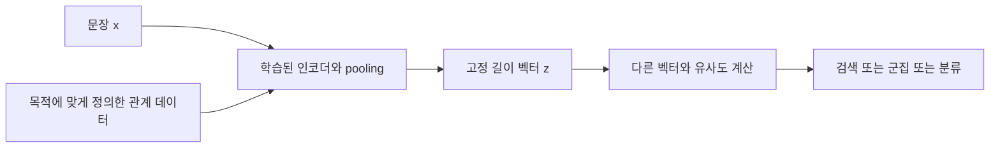
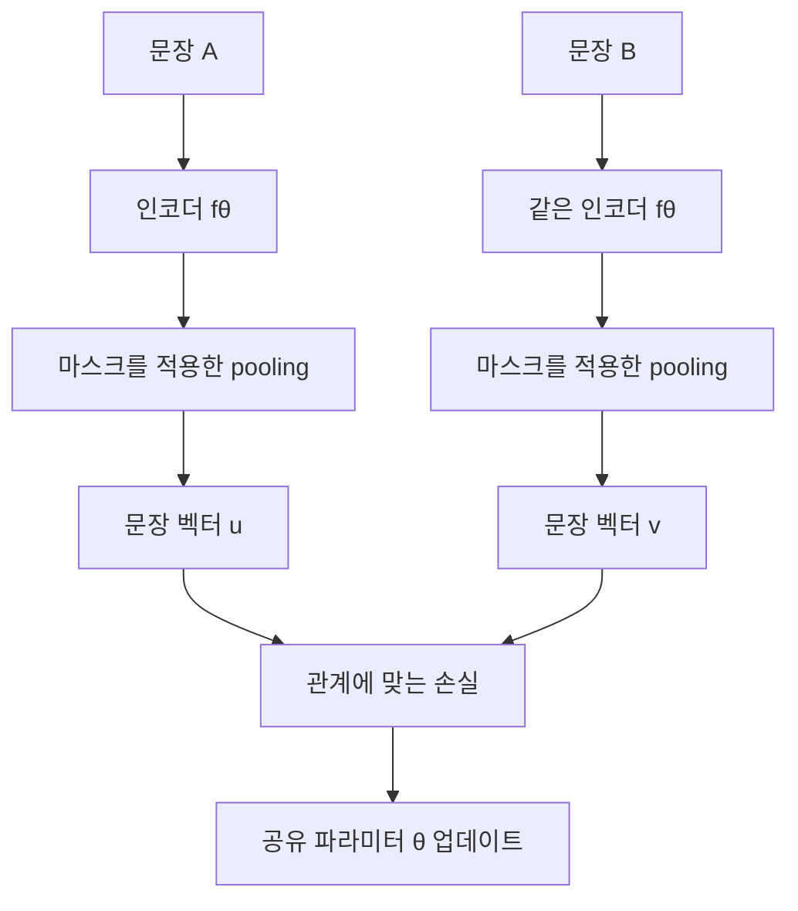
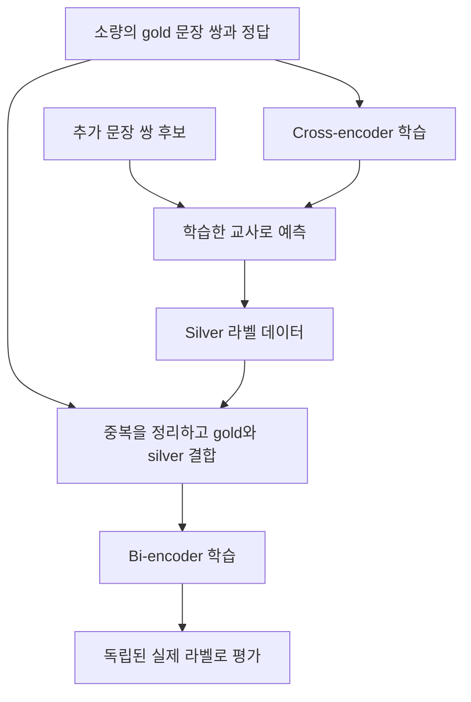
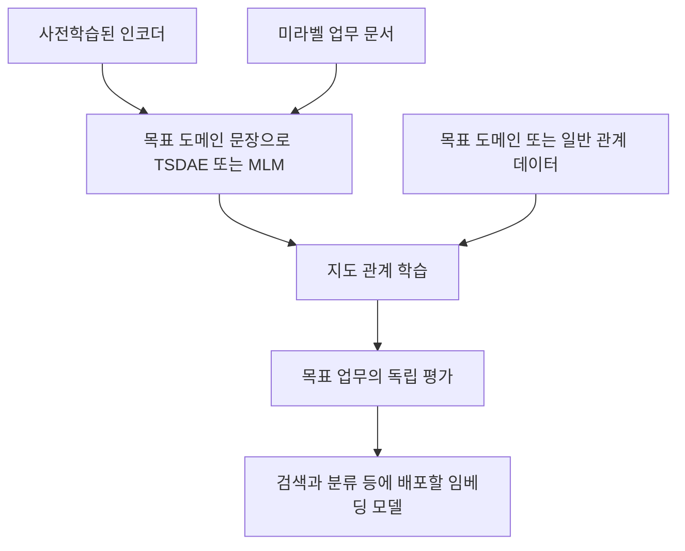

# 10장 텍스트 임베딩 모델 만들기

[전체 목차](../../README.md) · [학습 노트](study.md) · [강의안](lecture.md) · [강의 대본](lecture-script.md) · [시각화](visuals.html) · [실습 안내](lab-guide.md) · [복습 문제](quiz.md)

> **원문 범위**: Jay Alammar·Maarten Grootendorst, *Hands-On Large Language Models*, 2024, Chapter 10. PDF 물리 페이지 399–445. 아래 쪽수는 책에 인쇄된 쪽수가 아니라 제공된 PDF의 페이지 번호이다. 원문을 그대로 번역한 자료가 아니라, 각 절의 논지를 한국어 수업으로 재구성한 학습 노트다. **보충 설명**으로 표시한 수식·사례·검산은 이해를 위한 추가 자료다. 책에 제시된 학습 점수와 이 저장소에서 직접 실행한 작은 실습 결과를 구별한다.

## 이 장에서 답할 질문

문장을 벡터로 바꾸는 것 자체는 어렵지 않다. 어려운 일은 **우리가 원하는 관계가 벡터 사이의 관계로 나타나게 만드는 것**이다. 고객 문의에서 같은 업무를 묻는 표현을 가깝게 만들 것인지, 영화 평에서 같은 감정을 가진 문장을 가깝게 만들 것인지에 따라 좋은 임베딩의 기준은 달라진다. 이 장은 데이터의 관계를 정의하고, 그 관계에 맞는 손실을 선택하고, 실제 사용 목적에 맞게 검증하는 과정을 다룬다.

학습을 마치면 다음을 할 수 있어야 한다.

- cross-encoder와 bi-encoder가 무엇을 입력받고 무엇을 출력하는지, 계산량과 재사용 가능성이 어떻게 다른지 설명한다.
- NLI 라벨을 학습용 관계로 변환하되, 논리적 모순·의미적 유사성·검색 관련성을 같은 것으로 취급하지 않는다.
- Softmax, cosine similarity, multiple negatives ranking 손실의 입력 형식과 학습 목표를 구분한다.
- easy negative, hard negative, false negative의 차이를 실제 검색 사례에서 판단한다.
- 소량의 라벨 데이터로 Augmented SBERT 학습 절차를 설계한다.
- TSDAE의 문장 손상·고정 길이 병목·전체 문장 복원·인코더 재사용을 연결한다.
- STS-B 상관계수와 검색 성능을 구분하고, 데이터 중복과 평가 누수를 통제한다.

**선수지식**: 2장의 토큰 임베딩·문장 임베딩, 3장의 인코더·토큰별 출력, 8장의 벡터 검색·reranking. 벡터 내적, 평균, 확률을 알고 있으면 좋지만 필요한 수학은 아래에서 다시 설명한다. 이 장의 ‘학습’은 주로 이미 사전학습된 Transformer를 문장 임베딩 목적에 맞게 조정한다는 뜻이다.

## 상세 목차

1. [Embedding Models — 무엇을 가깝게 만들 것인가](#sec-01)
2. [What Is Contrastive Learning — 비교에서 배우기](#sec-02)
3. [SBERT — 효율적인 문장 표현](#sec-03)
4. [Creating an Embedding Model — 실험의 전체 구조](#sec-04)
5. [Generating Contrastive Examples — NLI를 관계 데이터로](#sec-05)
6. [Train Model — Softmax 기준 모델과 평가](#sec-06)
7. [In-Depth Evaluation — STS-B를 넘어 평가하기](#sec-07)
8. [Loss Functions — cosine과 MNR, negative 설계](#sec-08)
9. [Fine-Tuning an Embedding Model — 출발점을 바꾸기](#sec-09)
10. [Supervised — 이미 학습된 임베딩 모델 조정](#sec-10)
11. [Augmented SBERT — gold와 silver 데이터](#sec-11)
12. [Unsupervised Learning — 라벨 없이 학습 신호 만들기](#sec-12)
13. [TSDAE — 손상된 문장에서 원래 문장 복원](#sec-13)
14. [Using TSDAE for Domain Adaptation — 도메인 적응](#sec-14)
15. [Summary — 방법 선택과 연결](#sec-15)
16. [원문 코드·수치에서 주의할 점](#corrections)
17. [그림 대응표와 출처](#references)

## 1. Embedding Models — 무엇을 가깝게 만들 것인가

**원문: PDF 399–402쪽, Figure 10-1–10-3.**

텍스트는 길이가 다르고, 같은 뜻을 다양한 어휘로 표현하며, 동일한 단어도 문맥에 따라 다른 의미를 갖는다. 임베딩 모델은 이런 텍스트를 고정 길이 수치 벡터로 변환한다. 문장 `x`에 대해 모델을 `fθ`라 쓰면 `z = fθ(x) ∈ R^d`이다. `θ`는 모델의 학습 가능한 파라미터이며 `d`는 출력 차원이다. 입력이 다섯 단어인지 스무 단어인지와 상관없이 같은 모델의 출력 벡터 길이는 동일하다.

벡터가 고정 길이라는 사실만으로 유용한 것은 아니다. 아무 문장에나 임의의 숫자를 배정해도 고정 길이 벡터를 만들 수 있다. 중요한 조건은 **사용자가 관심 있는 관계를 벡터의 비교가 보존하는 것**이다. 의미 검색에서는 ‘비밀번호를 잊었어요’와 ‘로그인 암호를 다시 설정하고 싶어요’가 가깝기를 원한다. 감정 분류에서는 ‘배송은 빨랐지만 제품이 고장 났다’가 상품 주제보다 불만의 강도에 따라 배치되기를 원할 수도 있다.

원문의 Figure 10-1은 텍스트를 숫자로 바꾸는 입출력, Figure 10-2는 의미에 따른 근접성, Figure 10-3은 감정에 따른 근접성을 비교한다. 여기서 꼭 읽어야 할 메시지는 ‘가까움’이 자연에 하나만 존재하는 정답이 아니라는 것이다. 학습 데이터와 목적 함수가 무엇을 가깝게 볼지 정한다. 의미가 가까운 두 문장도 감정은 반대일 수 있으며, 주제가 다른 두 문장도 감정은 같을 수 있다.

| 비교할 문장 | 주제 관계 | 감정 관계 | 어떤 작업에 가까워야 하는가 |
|---|---|---|---|
| ‘노트북 화면이 선명하다’ / ‘노트북 화면이 흐리다’ | 매우 비슷함 | 반대 | 제품 기능 검색에서는 둘 다 관련, 감정 분류에서는 구별 |
| ‘화면이 선명하다’ / ‘직원이 친절하다’ | 다름 | 모두 긍정 | 범용 의미 검색보다 감정별 분석에서 가까울 수 있음 |
| ‘주문을 취소하고 싶다’ / ‘구매를 철회하려 한다’ | 비슷함 | 감정만으로 구분 어려움 | 고객 문의 의도 검색에서 가까워야 함 |

**보충 설명 — 코사인은 각도를 비교한다.** 두 벡터 `u`, `v`의 코사인 유사도는 다음과 같다.

$$s(u,v)=\frac{u^\top v}{\|u\|_2\|v\|_2}$$

분자는 같은 방향 성분이 얼마나 겹치는지를 측정하고, 분모는 벡터 길이의 영향을 제거한다. 영벡터에서는 정의되지 않으므로 실제 계산에서 이를 점검한다. 일반적인 코사인의 범위는 `[-1, 1]`이며, 데이터 라벨을 `[0,1]`로 정규화했다고 코사인 자체의 정의역이 바뀌지는 않는다. `u=(1,0)`, `v=(0.8,0.6)`이면 두 벡터의 길이가 모두 1이므로 유사도는 `0.8`이다. `v=(8,6)`으로 길이를 열 배 늘려도 코사인은 같다.

고차원 임베딩을 2차원 그림으로 그리면 ‘관련 문장끼리 모인다’는 직관을 얻는다. 하지만 축 하나를 언제나 ‘긍정성’, 다른 축 하나를 ‘주제’라고 해석할 수 있는 것은 아니다. 아래 시각화의 2차원 점은 원리를 설명하기 위해 만든 벡터이지 실제 BERT 표현을 투영한 결과가 아니다. 실제 임베딩의 차원은 여러 특성이 얽혀 있으며, 투영 그림의 거리와 원래 공간의 거리가 완전히 일치하지도 않는다.

**확인 질문**: 같은 모델을 감정 데이터로 강하게 미세 조정한 뒤 범용 검색이 나빠질 수 있는가? 가능하다. 모델이 오직 감정 구별에 필요한 정보에 더 큰 비중을 주면서, 검색에 필요한 주제·수치·개체 차이를 덜 보존할 수 있다. 그러므로 ‘훈련 손실이 낮아졌다’와 ‘모든 임베딩 작업이 좋아졌다’는 같은 말이 아니다.

## 2. What Is Contrastive Learning — 비교에서 배우기

**원문: PDF 402–404쪽, Figure 10-4–10-5.**

대조 학습은 대상을 단독으로 보여주는 대신 **비교할 대상과 관계를 함께 제시**한다. ‘이 문장은 무엇인가’라는 질문보다 ‘어떤 문장과 같고, 어떤 문장과 다른가’라는 질문을 반복함으로써 유용한 특성을 학습한다. 같은 입력도 어떤 대상을 대비시키느냐에 따라 배워야 할 구분이 달라진다.

예를 들어 ‘환불은 언제 입금되나요’를 가르친다고 하자. positive로 ‘취소한 금액이 돌아오는 날짜가 궁금해요’를 주고 negative로 ‘오늘의 날씨는 어떤가요’를 주면 금융 문의와 날씨를 구분하는 정도로도 문제를 풀 수 있다. negative를 ‘환불 요청은 어디에서 하나요’로 바꾸면 이제 환불이라는 공통 주제 안에서 **처리 기간**과 **요청 방법**을 구별해야 한다. 학습 신호는 문장 자체뿐 아니라 비교 집합에도 들어 있다.

원문은 대비를 포함한 설명이 개념의 구별점을 드러낸다고 설명한다. Figure 10-4는 유사·비유사 관계로 모델을 학습시키는 큰 구조이며, Figure 10-5는 서로 비교되는 예를 통해 특징의 경계를 배우는 직관을 보여준다. ‘개는 꼬리가 있고 다리가 네 개다’만 외우면 고양이도 포함된다. 개와 고양이를 대비시켜야 공통 특징과 구분 특징을 나눌 수 있다는 것이다. 언어 모델에 적용할 때에는 사람처럼 논리적 이유를 말로 이해했다는 뜻이 아니라, 목적 함수의 오차를 줄이는 표현을 학습했다는 뜻으로 읽는다.

대조 학습의 두 힘은 positive를 가깝게 하는 것과 negative를 상대적으로 멀리하는 것이다. positive만 무작정 가깝게 만들면 모든 문장을 동일한 벡터로 보내는 퇴화된 해답도 가능하다. 이런 현상을 표현 붕괴라고 부를 수 있다. 다른 문장을 구별하게 만드는 항이나 구조가 있어야 모든 입력이 하나의 점으로 모이는 것을 피한다. 반대로 negative만 멀리하면 같은 의미의 다른 표현을 묶을 이유가 약하다.

2장에서 살펴본 word2vec도 이런 관점과 이어진다. 주변 단어는 관찰된 양의 관계, 무작위 단어는 대비할 음의 관계로 삼는다. 다만 문장 임베딩의 positive가 반드시 ‘옆에 나온 텍스트’인 것은 아니다. 동의문, 질문과 정답, 제목과 초록 등 작업 목적에 맞는 관계를 정의할 수 있다. 질문과 답변은 문장 의미가 동일하지 않아도 검색에서는 서로 맞는 짝이다. 따라서 대조 학습을 항상 동의어 학습으로만 생각하면 적용 범위를 잘못 좁히게 된다.

**보충 설명 — 관계 정의가 먼저다.** ‘비슷하다’는 라벨링 지침을 최소한 세 질문으로 구체화하자. 두 문장이 같은 사실을 말하는가? 한 문장이 다른 문장의 질문에 답하는가? 같은 업무 의도를 표현하는가? 한 데이터셋에서 이 기준을 섞으면 학습자가 일관되지 않은 교사의 답을 보는 것과 같다. 학습 전에 판단 사례를 만들고 애매한 관계를 별도로 보류하는 편이 의미 있는 출발점이다.

## 3. SBERT — 효율적인 문장 표현

**원문: PDF 404–408쪽, Figure 10-6–10-7.**

### 두 문장을 함께 읽는 cross-encoder

cross-encoder는 두 문장을 하나의 입력으로 연결한 뒤 Transformer에 넣는다. 개념적으로 `[CLS] 문장 A [SEP] 문장 B [SEP]`와 같은 형태다. A의 토큰과 B의 토큰이 같은 네트워크 안에서 상호작용하므로, 특정 단어 조합·부정 표현·세부 대응을 직접 비교할 수 있다. 마지막에는 분류 또는 점수 헤드가 두 문장의 관계를 출력한다.

이 출력은 보통 **문장 쌍의 점수**다. A만의 벡터를 미리 저장하고 나중에 모든 B와 싸게 비교하는 방식과는 다르다. A와 B를 함께 처리한 결과는 B가 바뀌면 다시 계산해야 한다. Figure 10-6의 핵심은 ‘두 입력을 함께 처리한 뒤 하나의 관계를 판단한다’는 구조이다. cross-encoder 내부에도 은닉 벡터는 있지만, 일반적인 사용 목적은 독립적으로 재사용하는 문장 임베딩을 내보내는 것이 아니다.

원문은 문장 10,000개에서 모든 서로 다른 쌍을 비교하면 `n(n−1)/2 = 49,995,000`회의 쌍 추론이 필요하다고 설명한다. 순서 없는 쌍을 한 번씩 비교한다는 가정이다. 모든 쌍을 살펴보지 않는 검색 작업에는 이 횟수를 그대로 적용하면 안 된다. 질의 하나와 문서 10,000개만 비교한다면 쌍 추론은 10,000회다. 작업의 비교 범위를 먼저 정해야 계산량을 올바르게 설명할 수 있다.

### 각각 읽고 나중에 비교하는 bi-encoder

bi-encoder는 각 문장을 따로 인코딩한다. 문서 벡터를 미리 저장해 두면 새 질의가 들어왔을 때 질의만 인코딩하고 벡터 연산으로 후보를 찾을 수 있다. 10,000개의 문장을 모두 서로 비교하는 경우에도 비싼 Transformer 호출을 문장 수 정도로 줄일 수 있다. 다만 모든 쌍의 유사도까지 실제 계산하면 그 벡터 비교 자체는 여전히 이차적으로 늘어난다. ‘임베딩을 쓰면 모든 계산이 선형’이라는 뜻은 아니다. 검색에서는 인덱스를 이용해 후보 탐색도 줄일 수 있으며 이는 8장과 연결된다.

원문의 SBERT는 같은 가중치를 공유하는 두 경로로 문장 쌍을 처리한다. 그림에 BERT가 두 개 있어도 서로 독립적인 모델 두 개를 따로 학습시키는 것이 아니다. 같은 함수 `fθ`를 A와 B에 적용한다. 이처럼 구조와 파라미터를 공유하는 형태를 Siamese 구조라고 한다. 학습 시 두 입력으로부터 계산된 기울기가 같은 파라미터에 반영된다.

Transformer의 마지막 은닉 상태는 토큰별 벡터의 모음이다. 문장이 `L`개 토큰, 은닉 차원이 `d`라면 `H ∈ R^(L×d)`다. pooling은 이 여러 벡터를 하나로 줄인다. mean pooling의 기본 형태는 다음과 같다.

$$z=\frac{\sum_{t=1}^{L}m_t h_t}{\sum_{t=1}^{L}m_t}$$

`h_t`는 t번째 토큰의 문맥화된 벡터, `m_t`는 유효 토큰 여부를 나타내는 마스크다. 배치 길이를 맞추려고 넣은 padding을 평균에 포함하면 문장 의미와 무관하게 출력이 변한다. 예를 들어 유효 벡터 `(1,2)`, `(3,4)`의 평균은 `(2,3)`인데, padding `(0,0)` 두 개까지 포함하면 `(1,1.5)`로 바뀐다. 단순히 숫자의 길이만 줄인 것이 아니라 문장 길이와 배치 구성에 따른 잡음을 추가한 셈이다.

원문 Figure 10-7의 초기 SBERT 예에서는 문장 벡터 `u`, `v`와 성분별 절댓값 차이 `|u−v|`를 연결하여 분류기에 전달한다. 각 벡터가 `d`차원이면 결합 벡터는 `3d`차원이다. 차이 벡터는 두 문장의 표현이 얼마나 다른지를 분류기가 활용하도록 돕는다. 이 분류기는 학습 시 NLI 라벨을 맞히는 역할을 한다. 배포 시에는 문장 인코더와 pooling을 사용하여 임베딩을 생성할 수 있다.

단순 BERT의 마지막 출력을 평균낸다고 항상 좋은 문장 유사도 공간이 생기는 것은 아니다. 원문이 소개하는 초기 비교에서는 그런 단순 평균이 평균 단어 벡터보다도 좋지 않은 경우가 있었다. 핵심은 pooling 기법 자체가 마법이라서가 아니라, **그렇게 만든 벡터가 문장 관계에 맞도록 학습되어야 한다**는 점이다. 또한 원문의 특정 실험 결과를 모든 BERT 변형·모든 작업에 대한 보편 법칙으로 확대하지 않는다.

| 항목 | Cross-encoder | Bi-encoder / SBERT |
|---|---|---|
| 입력 처리 | 문장 쌍을 함께 | 문장을 각각 |
| 주요 출력 | 관계 점수 또는 라벨 | 재사용 가능한 문장 벡터 |
| 문서 사전 계산 | 쌍에 의존하여 제한됨 | 가능 |
| 토큰 간 세밀한 교차 비교 | 직접 가능 | 비교 단계에서는 압축된 벡터만 사용 |
| 주된 활용 | 후보 재정렬, 고정된 문장 쌍 평가 | 대규모 검색, 군집, 임베딩 기반 분류 |
| 절충 | 정교하지만 비싼 쌍 추론 | 빠르지만 세부 정보 압축에 따른 손실 가능 |

둘은 경쟁 관계만 있는 것이 아니다. bi-encoder로 수많은 후보에서 수십 개를 찾고, cross-encoder로 그 후보를 다시 정렬하는 구성이 자연스럽다. 또한 이 장 후반의 Augmented SBERT에서는 cross-encoder가 학습용 교사 역할을 하고 bi-encoder가 빠른 실행 모델 역할을 한다.

## 4. Creating an Embedding Model — 실험의 전체 구조

**원문: PDF 408쪽 및 408–426쪽의 실습 흐름.**

임베딩 모델을 만든다는 일을 ‘모델 이름 하나 선택하기’로 축소하면 안 된다. 원문 전체 실습은 데이터, 시작 모델, pooling, 손실 함수, 학습 설정, 평가기를 하나의 실험으로 결합한다. 이 중 어느 하나가 바뀌어도 결과 해석이 바뀐다. 예를 들어 성능이 좋아졌을 때 손실 함수를 바꾼 효과인지, 학습 데이터가 더 쉬워진 효과인지, 이미 좋은 체크포인트를 사용한 효과인지 구분해야 한다.

이 장에서 ‘from scratch’라는 표현은 언어 지식도 없는 랜덤 Transformer를 처음부터 사전학습한다는 뜻으로 읽으면 안 된다. 실제 예제는 이미 사전학습된 `bert-base-uncased`에서 시작한다. 새로 만드는 것은 문장 임베딩 목적에 맞춘 모델이다. 후반의 미세 조정은 문장 임베딩 목적까지 이미 학습된 모델에서 시작한다는 차이가 있다.

실험을 재구성할 때에는 다음 표의 질문에 먼저 답한다.

| 구성 요소 | 결정해야 할 질문 | 잘못 맞추었을 때 생기는 일 |
|---|---|---|
| 관계 데이터 | 어떤 두 문장이 왜 관련되는가? | 모순된 학습 신호 |
| 시작 모델 | 언어·도메인·문장 임베딩 학습 경험은? | 불필요하게 큰 학습 비용 또는 부적절한 출발점 |
| pooling | 토큰 출력을 어떻게 문장 벡터로 줄이는가? | padding·문장 길이 등의 영향 |
| 손실 | 라벨 점수 회귀인가, 정답 후보 순위인가? | 데이터 형식과 목적의 불일치 |
| batch | 누가 누구의 negative가 되는가? | 쉬운 문제만 학습하거나 false negative 증가 |
| 평가 | 배포에서 어떤 오류를 줄여야 하는가? | 좋은 점수지만 쓸모없는 모델 선택 |

이 저장소의 [실습](lab.py)은 Transformer 없이 작은 단어 벡터와 평균 pooling으로 위 연결 중 **손실과 관계 데이터가 벡터를 바꾸는 부분**을 직접 계산한다. 책의 대규모 모델 학습을 실행한 것처럼 꾸미지 않으며, 검색 성능의 일반화를 증명하는 실험도 아니다. 손실이 어떤 방향으로 파라미터를 움직이는지 확인하는 계산 실습이다.

## 5. Generating Contrastive Examples — NLI를 관계 데이터로

**원문: PDF 408–410쪽, Figure 10-8.**

NLI(Natural Language Inference)는 전제 `premise`가 주어졌을 때 가설 `hypothesis`와 어떤 논리 관계가 있는지 판단하는 작업이다. 원문은 GLUE 안의 MNLI를 사용하며 라벨을 `0=entailment`, `1=neutral`, `2=contradiction`으로 설명한다. 라벨 숫자는 단순한 클래스 식별자다. 2가 0보다 의미적으로 더 비슷하다는 수치 관계를 뜻하지 않는다.

| NLI 관계 | 전제 | 가설 | 판단 근거 |
|---|---|---|---|
| 함의 entailment | 민수는 실내 수영장에서 수영한다 | 민수는 물속에서 운동한다 | 전제가 참이면 가설도 참이라고 볼 수 있음 |
| 모순 contradiction | 민수는 지금 수영한다 | 민수는 지금 전혀 수영하지 않는다 | 같은 시점·대상에서 동시에 참일 수 없음 |
| 중립 neutral | 민수는 수영한다 | 민수는 국가대표 선수다 | 전제만으로 참·거짓을 결정할 수 없음 |

원문의 Figure 10-8은 함의 관계를 positive, 모순 관계를 negative의 재료로 사용할 수 있음을 보여준다. MNLI 전체 훈련 집합은 원문 기준 392,702쌍이며, 설명용 실험에서는 처음 50,000쌍을 선택한다. 이는 학습 시간과 자원 부담을 줄이려는 설정이다. 작은 데이터로도 학습 흐름을 볼 수 있지만, 그 결과를 전체 데이터 학습과 같은 수준으로 일반화하면 안 된다.

**보충 설명 — NLI와 유사도는 동일하지 않다.** ‘오늘 비가 온다’와 ‘오늘 비가 오지 않는다’는 단어·주제가 거의 같지만 모순이다. 의미 유사도 점수에서는 꽤 관련된 문장으로 평가될 수 있고, 사실 일치 여부 판단에서는 반대여야 한다. 또한 entailment는 방향이 있지만 코사인은 대칭이다. ‘강아지가 달린다’에서 ‘동물이 움직인다’는 이끌어낼 수 있어도 역방향은 항상 성립하지 않는다. 따라서 NLI를 임베딩 학습 신호로 쓰는 것은 유용한 설계 선택이지 세 작업이 수학적으로 같다는 주장이 아니다.

이 차이는 라벨 매핑에서 드러난다. 원문의 cosine 실험은 entailment를 1, neutral·contradiction을 0으로 바꾼다. 이진화는 ‘관련됨’의 기준을 단순화하지만 중립과 모순의 차이를 버린다. 모델이 배워야 할 업무에서 이 차이가 중요하면 그대로 따라 쓰지 말고 별도 라벨이나 다른 손실 구성을 고려해야 한다. MNR 실험에서는 함의 쌍만 남겨 positive로 쓰고, 다른 후보를 negative로 구성한다.

**데이터를 준비하는 사고 순서**는 원본 라벨 확인, 관계 기준 결정, 손실에 맞는 열 구성, 중복 점검, 학습·평가 분리이다. 같은 문장의 표현만 약간 바꾼 사례가 양쪽 집합에 들어가면 평가가 쉬워진다. 실제 업무에서 새 사용자·새 문서·새 시점을 처리해야 한다면 문장 행을 무작위로 섞는 것보다 해당 단위를 기준으로 나누는 평가가 더 맞을 수 있다.

## 6. Train Model — Softmax 기준 모델과 평가

**원문: PDF 410–414쪽.**

### 시작 모델과 Softmax 손실

원문은 `SentenceTransformer('bert-base-uncased')`를 시작점으로 삼고, 문장 임베딩 차원을 확인하여 3개 NLI 라벨을 구별하는 `SoftmaxLoss`를 만든다. 일반적인 학습 과정은 두 문장을 인코딩하고, 문장 벡터의 관계 특징을 만들고, 세 클래스의 확률을 계산하고, 정답 클래스 확률이 높아지도록 모델을 업데이트하는 것이다.

**보충 수식**: 분류기의 logit을 `a ∈ R^3`, 정답 클래스 인덱스를 `y`라 하면 `p_k = exp(a_k)/Σ_j exp(a_j)`, 손실은 `−log p_y`이다. 정답 확률이 0.8이면 손실은 약 0.223, 0.1이면 약 2.303이다. 확신 있게 틀린 예에 더 큰 페널티를 주는 구조다. 이 분류 손실이 잘 줄어들었다고 두 문장의 코사인 유사도가 특정 숫자를 갖도록 직접 강제한 것은 아니다. 문장 표현은 분류 작업을 통해 간접적으로 조정된다.

원문은 기본적으로 모든 Transformer 층이 학습 가능하다고 설명한다. 층을 동결하면 메모리·연산 부담을 줄일 수 있지만 모델의 적응 능력도 제한된다. 항상 동결이 나쁘다는 보편 법칙으로 외우기보다, 데이터 크기·도메인 차이·자원 제약에 맞게 검증해야 한다. 이 장의 기본 비교는 전체 층을 학습 가능하게 두는 흐름이다.

### STS-B 평가기를 먼저 만든다

학습 전에 평가기를 준비하는 이유는 ‘학습이 끝난 뒤 잘 나오는 지표를 고르는’ 실수를 피하기 위해서다. 원문은 STS-B의 validation 문장 쌍과 사람이 부여한 유사도 점수를 사용한다. 각 문장을 임베딩하고, 두 벡터의 코사인을 계산하고, 모델 점수 목록과 사람 점수 목록이 얼마나 함께 움직이는지 확인한다.

STS의 사람 점수는 0–5 척도이며, 원문의 코드처럼 5로 나누면 0–1로 정규화된다. 원문 411쪽의 1–5라는 서술보다 실제 척도를 기준으로 이해하자. [STS 공식 과제 설명](https://alt.qcri.org/semeval2017/task1/index.php)이 0과 5의 의미를 설명한다. 5로 나누는 양의 상수 배율은 Pearson 상관계수 자체를 바꾸지 않지만, 손실의 목표 값이나 결과 표시를 일관되게 만드는 데 유용하다.

여기서 `pearson_cosine`은 ‘각 임베딩 쌍의 코사인 그 자체’가 아니다. **모든 평가 쌍에 대해 계산한 코사인 점수 목록과 사람 라벨 목록 사이의 Pearson 상관계수**다. 예를 들어 모델이 네 문장 쌍에 `[0.1,0.3,0.7,0.9]`, 사람이 `[0.0,0.2,0.6,0.8]`을 주었다면 상수 0.1만큼 차이가 있어도 완벽한 선형 관계여서 Pearson은 1이다. 상관이 높다고 절댓값이 잘 보정되어 있다는 뜻은 아니다.

$$r=\frac{\sum_i (s_i-\bar{s})(y_i-\bar{y})}{\sqrt{\sum_i(s_i-\bar{s})^2}\sqrt{\sum_i(y_i-\bar{y})^2}}$$

`s_i`는 i번째 쌍의 모델 유사도, `y_i`는 사람 점수다. 평균을 뺀 **점수 목록**의 코사인으로 볼 수 있지만, 문장 임베딩의 각 차원에서 평균을 빼는 계산과 혼동하면 안 된다. 범위는 `[-1,1]`이며 한쪽 목록이 상수이면 분모가 0이 되어 정의되지 않는다. Spearman은 점수 자체 대신 순위의 관계를 본다. 점수 간 간격은 왜곡되었지만 순위가 모두 맞는 모델을 구분할 때 유용하다.

### 원문 학습 설정을 읽는 법

| 원문 설정 | 값 | 학습자가 이해해야 할 역할 |
|---|---:|---|
| `num_train_epochs` | 1 | 전체 훈련 데이터를 한 번 순회하는 설명용 설정 |
| `per_device_train_batch_size` | 32 | 장치당 한 학습 단계에 넣는 예 수 |
| `per_device_eval_batch_size` | 32 | 장치당 평가에서 처리하는 예 수 |
| `warmup_steps` | 100 | 시작 구간에 학습률을 점진적으로 올리는 단계 수 |
| `fp16` | True | 지원 장치에서 혼합 정밀도 학습을 쓰려는 설정 |
| `eval_steps`, `logging_steps` | 100 | 평가·기록 주기를 의도한 설정 |

배치 크기가 커지면 장치를 더 효율적으로 활용할 수 있지만 메모리가 더 필요하고, MNR에서는 문제에 포함되는 negative 수까지 달라진다. FP16이 모든 장치에서 항상 빠르거나 동작한다는 보장은 없으며 CPU 실습에 그대로 복사할 설정이 아니다. 또한 평가 간격만 적었다고 모든 버전의 Trainer가 단계별 평가를 자동으로 활성화하거나 최적 체크포인트를 자동 저장하는 것도 아니다. 평가 전략·저장 전략·최적 모델 기준을 명시적으로 확인해야 한다. 이 저장소에서는 해당 GPU 학습을 실행하지 않았다.

원문의 Softmax 기준 실험은 STS-B `pearson_cosine = 0.5982288…`을 보고한다. 이것은 정확도 59.8%라는 뜻이 아니다. 해당 데이터·모델·설정에서 얻은 상관계수다. 이후 실험과 비교할 수 있는 책 내부의 출발점으로 읽되, 실행 환경과 무작위성이 다른 자신의 실험에서 같은 숫자가 반드시 나와야 하는 합격선으로 쓰지 않는다.

## 7. In-Depth Evaluation — STS-B를 넘어 평가하기

**원문: PDF 414–416쪽.**

STS-B는 문장 유사도의 한 측면을 측정한다. 하지만 임베딩이 실제로 사용되는 작업은 분류, 군집, 검색, 재정렬 등으로 다양하다. 비슷한 문장을 잘 묶는 모델이 수많은 후보 중 정확한 답을 최상위에 올리는 작업까지 잘한다는 보장은 없다. ‘결제 취소 방법’과 ‘결제 취소 기간’의 문장 유사도가 높아도 사용자가 필요로 하는 정답 문서는 다르기 때문이다.

원문은 이를 보완하는 평가 체계로 MTEB를 소개한다. 책의 설명 시점에는 8개 임베딩 작업, 58개 데이터셋, 112개 언어를 다루는 체계로 소개된다. 이 숫자는 2024년 책의 설명이며 현재 서비스의 범위를 뜻하지 않는다. 원문 코드는 MTEB 전체가 아니라 `Banking77Classification` 하나를 선택해 실행한다. 출력 예의 accuracy 약 0.4926, F1 약 0.4908, 평가 시간 31.83초 역시 해당 책의 실행 결과이다.

다양한 작업을 평가하는 목적은 평균 점수만 높은 모델을 찾는 데 있지 않다. 자신이 배포할 작업과 닮은 조건에서 무엇이 좋아지고 무엇이 나빠졌는지 구분하려는 것이다. 예를 들어 고객 지원 검색용 모델이라면 정답 문서가 상위 k개 안에 들어오는 비율, 첫 관련 문서의 순위, 여러 관련 문서의 정렬 품질을 확인한다. 분류용 표현이라면 downstream 분류기의 accuracy·F1을 보고, 처리 비용이 중요하면 지연 시간과 메모리도 함께 본다.

**보충 설명 — 평가의 세 층**은 다음처럼 나눌 수 있다. 첫째, 학습 중 손실은 모델이 학습 예를 얼마나 잘 맞추는지 알려준다. 둘째, 독립된 유사도·검색 검증 집합은 목적에 맞는 표현이 생겼는지 알려준다. 셋째, 실제 서비스와 비슷한 입력 길이·후보 규모·언어·장치 조건에서의 평가가 실사용 가능성을 알려준다. 첫 번째가 좋아도 두 번째가 나빠질 수 있고, 두 번째가 좋아도 세 번째의 속도 요구를 못 맞출 수 있다.

평가 세트는 모델·손실·하이퍼파라미터를 고르는 데 쓰는 validation과 최종 보고용 test를 구분한다. 같은 STS-B validation을 여러 번 보고 선택하면 그 세트에 대한 선택 편향이 생길 수 있다. 책은 개념 비교를 위해 같은 평가기를 반복 사용하지만, 실제 모델을 만들 때에는 최종 test를 별도로 남겨야 한다. 또한 기본 체크포인트가 과거 어떤 데이터로 학습되었는지 확인해야 새로 얻은 성능을 온전히 자신의 학습 공로로 해석하지 않는다.

원문은 MTEB 전체 평가 비용을 고려해 장 내 실험에서는 STS-B만 사용한다고 설명한다. 이 선택은 교육 예제를 빠르게 진행하기 위한 범위 조정이다. 같은 절의 VRAM 정리 팁은 다음 실험 전에 노트북을 재시작하는 것이다. 재시작은 이전 모델과 옵티마이저 상태가 남아 발생하는 메모리 부족을 줄일 수 있지만, 저장하지 않은 결과나 변수도 사라지므로 모델 저장과 실험 기록을 먼저 마쳐야 한다.

### 보충 학습 거리와 상관계수를 한꺼번에 섞지 않기

원문의 평가기 출력에는 cosine, Manhattan, Euclidean, dot이라는 여러 이름이 함께 나온다. 이 이름은 먼저 **두 문장 벡터를 어떻게 비교했는가**를 나타낸다. Pearson과 Spearman은 그 비교값의 목록이 사람 라벨과 얼마나 일치하는지를 평가하는 **다음 단계**다. 예를 들어 `pearson_euclidean`을 보면 유클리드 거리로 얻은 문장 쌍 점수들을 사람의 관계 점수와 비교한 상관이라고 읽어야 한다. 거리의 부호나 유사도 변환 방식은 평가기의 정의를 확인한다. 이름이 많이 출력된다고 서로 다른 독립 실험을 열 번 한 것은 아니다.

단위 길이로 정규화한 벡터라면 코사인과 유클리드 거리는 특별한 관계가 있다. `‖u−v‖² = ‖u‖²+‖v‖²−2u·v = 2−2cos(u,v)`이다. 따라서 같은 정규화 벡터 집합에서는 코사인이 큰 후보일수록 유클리드 거리가 작다. 둘이 같은 순위를 줄 수 있다는 뜻이다. 반면 정규화하지 않으면 길이 차이도 거리에 들어가므로 같은 결론을 그대로 적용할 수 없다. 내적 역시 벡터 길이에 영향을 받는다.

여기서 또 한 가지를 구분하자. 후보의 순위가 같다고 Pearson 값이 반드시 같은 것은 아니다. 제곱근처럼 비선형 변환은 순서는 유지해도 값의 간격을 바꿀 수 있기 때문이다. Spearman은 순위에 초점을 맞추므로 동점 처리 등 조건이 같으면 이런 단조 변환에 더 직접적으로 대응한다. 모델 평가 결과를 읽을 때에는 ‘점수가 다르니 모델이 다르다’고 서둘러 결론 내리기보다, 동일한 벡터에 다른 비교 함수나 요약 통계를 적용했는지 확인한다.

원문 출력의 `pearson_max` 같은 항목도 개별 지표보다 큰 숫자라서 무조건 더 좋은 근거인 것은 아니다. 여러 비교 중 가장 큰 값을 고르는 기준으로만 모델을 선택하면 실제 서비스가 사용할 코사인 검색과 어긋날 수 있다. 학습 전에 주 지표를 정하고, 나머지는 진단용으로 읽는 편이 해석이 명확하다. 검색 엔진이 코사인으로 후보를 찾는다면 코사인 기반 목표 평가를 중심에 놓고 다른 지표는 원인 분석에 활용한다.

**작은 점검 활동**: 두 후보의 코사인이 각각 0.8과 0.2이고 모두 단위벡터라면 제곱 유클리드 거리는 각각 0.4와 1.6이다. 첫 후보가 더 가깝다는 순서는 일치한다. 여기서 0.8이라는 단일 문장 쌍의 코사인과, 평가 집합 전체에서 얻은 Pearson 0.8은 서로 다른 수치다. 하나는 대상 두 개를 비교한 값이고 다른 하나는 많은 비교 결과가 정답과 함께 움직이는 정도다. 논문 표나 실험 로그를 읽을 때 이 두 층을 말로 분리해 설명할 수 있어야 한다.

## 8. Loss Functions — cosine과 MNR, negative 설계

**원문: PDF 416–426쪽, Figure 10-9–10-11.**

손실 함수는 ‘틀렸다’를 숫자로 정의한다. 같은 문장 쌍을 주더라도 라벨 점수 자체에 맞출 것인지, 여러 후보 중 정답의 상대 순위를 올릴 것인지에 따라 서로 다른 학습 문제가 된다. 원문은 Softmax를 역사적·설명용 출발점으로 사용한 뒤 cosine similarity loss와 multiple negatives ranking(MNR) loss를 비교한다. 특정 손실이 모든 데이터와 작업에서 항상 우월하다고 읽지는 않는다.

### 8.1 Cosine similarity loss — 목표 유사도에 맞추기

문장 쌍 `(x_i, x'_i)`와 목표 점수 `y_i`가 있을 때, 두 임베딩의 코사인과 목표 점수의 차이를 줄인다. 기본적인 제곱오차 형태는 다음과 같다.

$$L_{cos}=\frac{1}{B}\sum_{i=1}^{B}\left(s(f_\theta(x_i),f_\theta(x'_i))-y_i\right)^2$$

`B`는 배치 내 문장 쌍 수다. 예를 들어 목표가 1이고 예측이 0.6이면 손실 기여는 `0.16`, 목표가 0인데 예측이 0.6이어도 `0.36`이다. 원문의 Figure 10-9는 관련된 문장을 더 가깝게, 무관한 문장을 덜 가깝게 만드는 방향을 보여준다. 엄밀히는 목표가 0인 경우 코사인을 음의 무한대로 계속 낮추는 것이 아니라 0에 맞추는 것이다. 코사인 0은 직교이며 코사인 −1인 정반대 방향과 다르다.

원문은 MNLI에서 entailment를 1, neutral과 contradiction을 0으로 매핑한 50,000쌍을 사용한다. 두 텍스트 열과 실수 점수 열을 만든 뒤, 시작 모델과 평가기는 기준 실험과 같게 두고 손실을 `CosineSimilarityLoss`로 바꾼다. 이 실험의 STS-B `pearson_cosine`은 `0.7222322…`로 보고된다. Softmax 실험의 약 0.598보다 높은 값이지만, 손실 목적뿐 아니라 원래 3개 클래스의 정보를 이진 관계로 바꾼 데이터 해석도 함께 달라졌다는 점을 기억한다.

이 방식은 사람이 부여한 연속적 유사도 점수를 직접 쓸 수 있다는 장점이 있다. 반면 점수를 얼마나 일관되게 매겼는지가 중요하며, 0과 1로 단순화한 라벨이 미세한 차이를 충분히 표현하지 못할 수 있다. 검색에서 ‘정답은 후보 중 가장 위여야 한다’라는 요구와 ‘정답 점수는 정확히 0.9여야 한다’라는 요구는 다르다. 후자의 정답 숫자를 만들기 어려운 경우 다음 방식이 자연스럽다.

### 8.2 MNR loss — 한 배치 안에서 자기 짝 찾기

MNR은 `(anchor, positive)` 쌍을 준비하고 같은 배치의 다른 positive를 그 anchor의 negative로 활용한다. 질의와 정답 문서, 질문과 답변, 논문 제목과 해당 초록 등이 가능한 양의 관계다. 한 배치가 `B`쌍이라면 anchor `a_i`는 자신의 positive `p_i`를 다른 `p_j`보다 높게 평가해야 한다. 원문 Figure 10-10의 핵심은 문장 쌍을 별도로 0/1 판정하는 것보다 **여러 후보 중 맞는 짝을 선택하는 문제**로 만든다는 점이다.

아래 행렬에서 행은 anchor, 열은 후보 positive다. 대각선이 정답이다.

| 코사인 예시 | p₁ | p₂ | p₃ |
|---|---:|---:|---:|
| a₁ | **0.8** | 0.6 | 0.1 |
| a₂ | 0.2 | **0.7** | 0.3 |
| a₃ | 0.0 | 0.4 | **0.9** |

**보충 수식**: 한 방향의 기본 MNR을 다음과 같이 쓸 수 있다.

$$\ell_i=-\log\frac{\exp(s(a_i,p_i)/\tau)}{\sum_{j=1}^{B}\exp(s(a_i,p_j)/\tau)},\qquad L=\frac{1}{B}\sum_i\ell_i$$

`τ > 0`는 temperature다. 코사인에 곱하는 scale은 `1/τ`로 해석할 수 있다. 분자는 정답 후보의 지수 점수, 분모는 모든 후보의 지수 점수 합이다. 정답 확률을 키우려면 정답을 올리거나 혼동되는 다른 후보를 낮춰야 한다. `τ`가 작으면 점수 차이를 더 날카롭게 강조한다. 작은 값이 무조건 좋은 것은 아니며, 높은 점수를 받는 잘못된 라벨에도 민감해질 수 있다.

첫 행에서 `τ=0.2`이면 logit은 `[4,3,0.5]`다. 가장 큰 값을 빼 `[0,−1,−3.5]`로 계산해도 softmax는 같다. 정답 확률은 `1/(1+e^(−1)+e^(−3.5)) ≈ 0.7153`, 손실은 약 `0.3351`이다. 두 번째 후보가 0.6에서 0.78로 가까워지면 정답과 경쟁하여 손실이 커진다. [시각화](visuals.html)에서 negative 유사도와 temperature를 바꾸면서 이 관계를 확인할 수 있다.

분모 안의 다른 후보들은 학습 시 별도로 negative 라벨을 쓰지 않아도 대비 역할을 한다. 그렇다고 데이터에 아무 관계가 없어도 되는 것은 아니다. **각 행의 첫 문장과 두 번째 문장이 참 positive라는 전제**가 필수다. 공식 [손실 개요](https://www.sbert.net/docs/sentence_transformer/loss_overview.html)도 MNR의 입력을 positive 쌍 또는 positive·negative가 구분된 튜플로 설명한다. 원문의 지도 미세 조정 코드 일부처럼 MNLI의 모순·중립 쌍까지 그대로 넣으면 학습 의도와 어긋난다.

### 8.3 원문의 MNR 데이터 만들기

원문은 처음 50,000개의 MNLI 행 중 label 0, 즉 entailment만 선택한다. 해당 실행에서는 16,875행이 남는다. 각 전제를 anchor, 해당 가설을 positive로 삼고, 섞은 가설 목록에서 추가 negative를 붙인다. 이 무작위 negative는 쉽게 얻을 수 있지만 실제로 unrelated인지 보장되지 않는다. 같은 문장을 다시 뽑을 수도 있고, 다른 행에 의미상 같은 정답이 있을 수도 있다.

MNR은 명시적인 negative 열 없이 positive 쌍만으로도 작동한다. 명시적 negative를 더하면 후보 집합을 확장할 수 있지만, 사용하는 손실 구현이 어떤 열 순서와 후보 구성을 기대하는지 확인해야 한다. 학습 데이터에 NLI 클래스 숫자를 그대로 남겨 ‘이게 자동으로 negative를 알려줄 것’이라고 기대하면 안 된다. 손실이 받는 관계 형식과 라벨 의미가 일치해야 한다.

원문 설정은 이전과 비슷하게 BERT 기반 모델, 1 epoch, 배치 32, warmup 100을 사용하며, 결과는 STS-B `pearson_cosine = 0.8093892…`이다. 여기서는 손실뿐 아니라 데이터가 50,000개의 3종 관계에서 16,875개의 양의 관계와 negative 구성으로 바뀌었다. 따라서 이 값은 교육 예제의 유용한 비교이지만 손실만을 완벽하게 통제한 인과 실험이라고 볼 수는 없다.

### 8.4 배치 크기와 false negative

같은 배치의 다른 후보를 negative로 쓴다면 배치를 키울수록 보통 더 많은 경쟁 후보가 생긴다. positive 쌍만 있고 한 방향을 계산할 때 anchor 하나는 `B−1`개의 다른 positive와 경쟁한다. `B=1`이면 다른 후보가 없어 정답 확률이 1, 손실이 0이 된다. 모델이 훌륭해서가 아니라 문제가 사라진 것이다. 단, 명시적인 negative가 추가된 손실 구성에는 이 단순 예외가 적용되지 않는다.

배치가 크면 더 어려운 구분을 배울 수 있지만 메모리와 연산 비용이 늘며, 참 positive를 negative로 오인할 가능성도 커진다. 이를 false negative라 한다. ‘암호 재설정’과 ‘비밀번호 다시 만들기’가 서로 다른 행에 들어 있다고 다른 의미인 것은 아니다. 중복 문자열 제거는 필요한 첫 단계지만 의미적 중복까지 해결하지는 못한다. 같은 업무에서 정답이 여러 개인 질의는 다중 positive 정책을 따로 세울 필요가 있다.

**검산 예**: 정답 문서가 배치에 똑같이 두 번 있고 그중 한 열만 정답으로 표시했다면, 두 열은 같은 입력이므로 점수도 같다. 나머지 후보를 완전히 낮춰도 지정된 정답 열의 확률은 최대 1/2다. 그러므로 한 행의 손실은 적어도 `ln 2 ≈ 0.6931`이다. 이 경우 계속 학습한다고 구조적 충돌이 사라지지 않는다. 이 결과는 정확히 같은 후보 두 개의 단일 정답 설정에 대한 것으로, 모든 의미상 유사 후보에서 동일한 수학적 하한이 성립한다는 뜻은 아니다.

### 8.5 Easy·semi-hard·hard negative

원문의 Figure 10-11은 negative의 난도를 설명한다. easy negative는 주제부터 다른 문장, semi-hard는 어느 정도 관련되지만 구분이 가능한 문장, hard negative는 주제와 표현이 매우 유사하지만 실제 정답은 아닌 문장이다. 여기서 hard는 ‘모델이 헷갈린다’는 의미이며, 거짓 정답이라는 판정이 정확해야 한다.

| 질문: ‘비밀번호 재설정 링크의 유효 시간은?’ | 유형 | 왜 그런가 |
|---|---|---|
| ‘링크는 발급 후 30분 동안 사용할 수 있다’ | Positive | 질문의 시간 조건에 답함 |
| ‘택배는 다음 날 출발한다’ | Easy negative | 다른 주제 |
| ‘로그인 보안을 위해 비밀번호를 주기적으로 변경하라’ | Semi-hard negative 예 | 로그인·비밀번호 주제지만 시간 질문에 답하지 않음 |
| ‘계정 인증 링크는 발급 후 24시간 유효하다’ | Hard negative 예 | 유효 시간 구조는 같지만 링크 종류가 다름 |
| ‘비밀번호 변경 링크는 30분 안에 눌러야 한다’ | False negative가 될 수 있음 | 표현만 달라 실제로 정답일 수 있음 |

‘semi-hard’와 ‘hard’의 정확한 경계는 작업과 mining 규칙에 따라 달라진다. 여기서는 원문의 직관적 구분을 사용한다. 무작위 샘플링은 easy negative를 쉽게 만든다. 기존 임베딩으로 가까운 후보를 찾으면 관련된 후보를 얻을 수 있다. 그중 실제 정답이 아닌 것을 사람 또는 검증된 절차로 판별해야 hard negative가 된다. 생성 모델로 후보를 만들거나 판정할 수도 있지만 생성된 라벨이 자동으로 정답이 되는 것은 아니다.

마지막으로 원문은 MarginMSE 등 다른 손실도 언급한다. 이 장은 전체 손실 목록을 다루는 장이 아니므로 핵심은 손실 이름을 많이 외우는 것이 아니라 **내 데이터가 점수 쌍인지, 양의 짝인지, 질의와 두 문서의 상대 차이인지**를 먼저 확인하는 것이다. 손실을 입력 형식·학습 목적과 함께 선택해야 한다.

## 9. Fine-Tuning an Embedding Model — 출발점을 바꾸기

**원문: PDF 426쪽.**

이전 실험은 사전학습된 언어 인코더에서 문장 임베딩 모델을 구성했다. 이제는 많은 문장 관계를 이미 학습한 임베딩 체크포인트에서 시작한다. 좋은 출발점은 더 적은 데이터와 시간으로 특정 도메인에 적응할 가능성을 제공한다. 기존 언어 지식뿐 아니라 유사한 문장을 배치하는 경험도 활용하기 때문이다.

그렇다고 미세 조정이 항상 이득은 아니다. 좁고 편향된 데이터만 반복하면 기존의 넓은 의미 구별 능력을 잃을 수 있다. 기존 모델이 이미 해당 도메인에 잘 맞는다면 변화를 주지 않은 모델이 더 나을 수도 있다. 그러므로 ‘학습 전 기본 모델’과 ‘학습 후 모델’을 같은 독립 평가 집합에서 반드시 비교한다. 학습 비용까지 들였다는 이유로 새 모델을 선택하지 않는다.

원문은 데이터 유무에 따라 지도 미세 조정과 Augmented SBERT를 소개하고, 이어 라벨 없는 학습으로 확장한다. 방법의 선택은 유행하는 체크포인트 이름보다 데이터의 품질과 관계 정의에 달려 있다. 정답 쌍이 풍부하면 직접 학습, 정확한 라벨이 적고 미라벨 후보가 많으면 교사 모델을 활용한 증강, 라벨은 없지만 도메인 문장은 많으면 TSDAE 같은 적응 경로를 검토한다.

## 10. Supervised — 이미 학습된 임베딩 모델 조정

**원문: PDF 426–429쪽.**

지도 미세 조정의 기본 흐름은 이전과 같다. 데이터와 관계를 준비하고, 모델을 불러오고, 손실·평가기·학습 설정을 결합한다. 원문은 시작점을 `sentence-transformers/all-MiniLM-L6-v2`로 바꾸고 MNR 손실을 사용한다. 작은 모델을 활용하는 실용적 예이며, 이것을 2026년의 모든 작업에 대한 최적 모델 추천으로 읽지 않는다.

원문의 의도는 앞의 MNR 실험과 같은 양의 관계 데이터를 사용하는 것이다. 그런데 427쪽 코드에는 MNLI 첫 50,000행을 불러오는 부분만 있고 entailment 필터와 열 재구성이 나타나지 않는다. 실행 시 이 부분을 스스로 보완해야 한다. `label == 0` 행만 positive 쌍으로 만들고, 잘못된 클래스 열을 제거하며, 필요하면 검증된 negative를 별도로 넣는다. 모순·중립을 양의 관계로 취급하도록 둔 상태에서 ‘MNR로 학습했다’고 해서 올바른 의미 공간이 만들어지는 것은 아니다.

해당 절의 보고 점수는 STS-B `pearson_cosine = 0.8509553…`이다. 그러나 원문은 시작 모델이 이미 전체 MNLI를 포함한 더 많은 데이터를 학습했다고 주의를 준다. 앞의 BERT 실험이 단지 50,000행에서 시작한 것과 직접 비교하여 자신의 미세 조정만으로 0.80에서 0.85로 올렸다고 말할 수 없다. 시작점의 차이와 사전 노출을 분리해야 한다. 특히 사전학습 모델을 평가할 때는 학습 데이터의 범위를 완전히 알 수 없는 경우도 있으므로 결과의 적용 범위를 조심스럽게 해석한다.

원문은 추가로 MLM을 사용한 도메인 적응을 제안한다. 전문 용어가 많은 문서를 사용해 BERT를 먼저 언어 모델링 목적에 적응시킨 뒤, 그 모델로 문장 임베딩 학습을 시작할 수 있다. 즉 언어·도메인 표현을 익히는 단계와 문장 관계를 익히는 단계를 나누는 것이다. 이 과정은 11장의 continued pretraining과 연결된다.

**보충 예제**: 고객 지원 데이터에서 ‘차지백’, ‘부분 취소’, ‘정산 보류’가 일반 모델에게 낯설다고 하자. 문서 본문을 많이 읽히는 단계는 용어가 등장하는 문맥을 익히게 도울 수 있다. 하지만 ‘부분 취소 처리 기간’ 질문의 정답 문서가 무엇인지까지 자동으로 정해지는 것은 아니다. 그 구분에는 실제 질문·정답 관계가 도움이 된다. 도메인 텍스트와 관계 라벨은 서로 다른 종류의 정보를 제공한다.

## 11. Augmented SBERT — gold와 silver 데이터

**원문: PDF 429–435쪽, Figure 10-12.**

문장 쌍을 사람이 대량으로 라벨링하는 일은 비싸다. 원문이 소개하는 Augmented SBERT는 적은 양의 믿을 수 있는 라벨로 cross-encoder를 학습하고, 그 모델로 더 많은 쌍을 라벨링한 뒤, 늘어난 데이터로 bi-encoder를 학습시키는 절차다. 실행 시 빠른 모델을 쓰기 위해 학습 준비 단계에서 비싼 교사를 활용한다.

**Gold 데이터**는 사람이 검증한 기준 라벨 데이터다. **Silver 데이터**는 교사 모델의 예측으로 라벨을 붙인 데이터다. 둘 다 라벨 열이 있다고 해서 신뢰도가 같아지는 것은 아니다. silver는 오답을 포함할 수 있으며 교사의 편향을 이어받을 수 있다. 증강의 목표는 데이터 행 수를 키우는 데 있지 않고, 유용한 학습 관계를 비용 효율적으로 늘리는 데 있다.

Figure 10-12와 대응하는 네 단계는 ① gold로 cross-encoder 학습, ② 새 쌍 준비, ③ 교사로 silver 라벨 생성, ④ gold+silver로 bi-encoder 학습이다. 원문은 기존 첫 50,000행 중 10,000행만 gold로 사용하여 라벨이 적은 상황을 모사한다. 이때 entailment는 1, 나머지는 0으로 바꾸고 두 클래스 cross-encoder를 1 epoch 학습한다. 데이터 적재에는 중복을 피하려는 `NoDuplicatesDataLoader`가 등장한다.

나머지 행은 `range(10_000, 50_000)`이므로 **40,000쌍**이다. 원문 서술의 ‘400,000’은 코드 범위와 맞지 않는다. 이 40,000행에 기존 정답이 있더라도 실험에서는 미라벨 데이터인 것처럼 취급하고 교사의 예측으로 라벨을 새로 만든다. 이렇게 해야 ‘사람 라벨을 20%만 썼을 때 얼마나 유용한가’를 모사할 수 있다.

원문 교사는 두 클래스 확률을 출력하고 `argmax`로 0 또는 1을 골라 silver 라벨을 만든다. 이는 확률 전체를 전달하는 방식이 아니라 **hard label**을 전달하는 방식이다. 0.51과 0.99가 둘 다 같은 라벨이 되는 정보 손실이 있다. 보충 설계로는 불확실한 쌍을 보류하거나 확률을 학습 목표로 사용하는 방식을 생각할 수 있지만, 그러면 손실과 평가도 그 목표에 맞게 설계해야 한다. 이것은 원문 실행과 구별되는 확장 아이디어다.

gold와 silver를 합친 뒤 원문은 `(sentence1, sentence2)` 조합의 중복을 제거한다. gold를 앞에 붙이고 첫 항목을 유지하므로 정확히 같은 쌍이 겹치면 gold가 우선한다. 방향을 뒤집은 `(B,A)`까지 중복으로 볼지는 작업에 따라 다르다. 의미 유사도는 대칭적으로 다룰 수 있지만 질문·답변이나 함의에서는 역할과 방향을 유지해야 한다.

그다음 BERT 기반 bi-encoder를 cosine similarity loss로 학습한다. 원문의 결과는 STS-B `pearson_cosine = 0.7101597…`이다. 모든 50,000쌍의 사람 라벨을 사용한 cosine 예제는 약 0.722였으므로, 이 설정에서는 사람 라벨을 10,000개만 쓰고 나머지를 예측해도 비슷한 점수를 얻었다. ‘총 데이터의 20%만 사용했다’는 말은 부정확하다. **사람 라벨은 20% 사용했지만 학습에는 silver를 포함한 더 큰 데이터가 사용**되었다.

### 새 쌍은 어떻게 만들 것인가

원문은 미라벨 쌍이 부족하면 기존 문장의 전제와 다른 행의 가설을 섞어 후보를 만들 수 있다고 설명한다. 하지만 무작위 조합은 대체로 무관한 쌍을 많이 만든다. 그러면 교사가 전부 0을 주는 쉬운 데이터가 불어나고, 유사한 문장의 미세한 차이를 학습할 기회가 부족해진다. 기존 임베딩으로 비슷한 문장을 찾아 top-k 후보를 만든 뒤 교사가 점수를 주는 방식은 유용한 후보를 더 잘 모을 수 있다.

이때 후보 생성 모델과 교사 모델의 오류가 다르다는 점도 중요하다. 후보 생성이 좋은 positive를 전혀 가져오지 못하면 교사는 그 정답을 라벨링할 기회가 없다. 교사가 계속 헷갈리는 특정 전문 용어 쌍을 무작정 많이 넣으면 학생 모델도 그 오류를 반복할 수 있다. silver의 크기, 양·음 비율, 신뢰도, 도메인 분포를 살펴야 한다.

**검증 설계**는 gold만 학습한 학생과 gold+silver를 학습한 학생을 같은 독립된 gold 평가 집합에서 비교하는 것이다. teacher 예측과 얼마나 일치하는지만 측정하면 교사를 잘 모방했다는 사실만 알게 된다. 실제 정답에 가까워졌는지를 알기 위해서는 사람 라벨이 필요하다. 라벨 예산이 적어도 평가용 라벨을 모두 학습에 써버리지 않는 이유가 여기에 있다.

## 12. Unsupervised Learning — 라벨 없이 학습 신호 만들기

**원문: PDF 435쪽.**

실제 데이터는 문장만 있고 정답 쌍이 없는 경우가 많다. 문서가 많다는 사실과 관계 라벨이 많다는 사실은 다르다. 비지도·자기지도 방법은 문장 자체에서 학습 문제를 구성한다. ‘라벨이 없다’는 것은 아무 목표도 없이 파라미터가 좋아진다는 뜻이 아니라, 사람이 별도로 관계를 지정하지 않아도 원래 데이터를 이용해 정답 신호를 만들 수 있다는 뜻이다.

원문은 SimCSE, Contrastive Tension(CT), TSDAE, Generative Pseudo-Labeling(GPL)을 후보로 언급하고 상세 예제는 TSDAE에 집중한다. 이 이름들을 모두 같은 알고리즘이라고 외우지 않는다. 중요한 대비는 관측한 문장으로 서로 다른 학습 관점을 만드는가, 원문을 손상시킨 뒤 복원하는가, 별도의 모델이 학습용 쌍이나 라벨을 만들어주는가이다. 각 방법의 전체 논문을 이 장에서 구현한 것은 아니다.

이 장에서 TSDAE가 차지하는 역할은 명확하다. 양의 문장 쌍조차 준비하기 어려워도 도메인 문장 자체를 활용할 수 있고, 이후 지도 학습과 연결할 수 있다. 다음 절에서는 입력·출력·손실을 살펴보며 ‘왜 복원 문제를 풀면 임베딩이 좋아질 가능성이 있는가’를 이해한다.

## 13. Transformer-Based Sequential Denoising Auto-Encoder

**원문: PDF 435–441쪽, Figure 10-13.**

### 손상시키고 압축하고 복원한다

TSDAE는 원래 문장에서 일부 단어를 삭제하여 손상된 문장을 만든다. 손상 문장을 인코더에 넣고 pooling으로 고정 길이 문장 벡터를 얻는다. 디코더는 그 벡터를 바탕으로 원래 문장 전체를 복원하도록 학습한다. Figure 10-13의 중심은 손상된 입력과 완전한 정답 사이에 **고정 길이 임베딩**이 놓여 있다는 점이다.

예를 들어 원문장이 ‘고객은 결제 취소 후 환불 일정을 확인했다’라면 손상 입력은 ‘고객은 취소 환불 확인했다’가 될 수 있다. 빠진 위치를 `[MASK]`로 모두 남겨두는 방식과는 다르다. 인코더는 남은 단서에서 문장 전체에 도움이 될 표현을 만들어야 하고, 디코더는 원래 토큰 순서를 복원하는 오차를 통해 학습 신호를 제공한다. 이 예시는 원리 설명용이며 실제 모델 출력이 아니다.

‘압축이 중요하다’는 말은 문장의 모든 토큰 벡터를 디코더가 자유롭게 읽는 구조와 구별하기 위한 것이다. 문장 전체를 대표하는 제한된 표현이 복원에 도움이 되도록 만들어야 임베딩 자체에 유용한 정보가 담기도록 압력을 줄 수 있다. 단순히 ‘좋은 디코더가 유창한 문장을 썼다’는 사실만으로 인코더가 좋은 검색 벡터를 만들었다고 결론 내릴 수는 없다. 최종 임베딩 작업의 평가가 여전히 필요하다.

**보충 수식**: 원문장을 `x=(x₁,…,x_T)`, 손상 문장을 `x̃`, 임베딩을 `z=fθ(x̃)`라 하면 복원 목적은 개념적으로 다음과 같다.

$$L_{recon}=-\sum_{t=1}^{T}\log p_\phi(x_t\mid x_{<t},z)$$

`φ`는 디코더 파라미터다. 학습 시 앞선 정답 토큰을 제공하는 방식으로 다음 원문 토큰의 확률을 높인다. 구현에 따라 토큰·배치 평균과 마스킹 방식이 더해질 수 있다. MNR처럼 배치에서 정답 문장 후보를 고르는 손실이 아니라, 원문 토큰을 복원하는 손실이라는 차이가 핵심이다.

### 원문 데이터 준비와 모델 설정

원문은 MNLI 첫 25,000쌍에서 premise와 hypothesis를 모두 꺼내 평평한 문장 목록을 만든다. 합치기 직후에는 최대 50,000개의 항목이지만 `set`으로 중복을 제거하므로 실제 고유 문장 수는 그보다 적을 수 있다. ‘정확히 50,000개의 서로 다른 문장을 학습한다’고 단정하지 않는다. 라벨은 버려 미라벨 상황을 모사하고, 문장을 손상시키는 도구로 삭제 버전과 원문 버전을 만든다.

책의 예제에는 NLTK의 `punkt` 토크나이저 자료를 내려받는 단계가 있다. 이것은 손상시키기 전에 단어 단위로 나누는 전처리 자원이다. Transformer 자체의 subword 토크나이저와 같은 역할이라고 혼동하지 않는다. NLTK의 자료 이름이나 설치 동작은 버전에 영향을 받을 수 있으므로 실제 확장 실습에서는 별도 환경에서 확인한다. 여기의 CPU 실습은 표준 라이브러리 문자열 분리만 사용하여 다운로드 없이 삭제 과정을 관찰한다.

원문은 TSDAE에서 mean pooling 대신 `[CLS]` pooling을 사용한다. 이는 해당 방법의 실험적 선택으로 이해한다. 원문의 ‘mean pooling이 위치 정보를 잃는다’는 설명을 ‘Transformer의 문맥화된 토큰 벡터에는 위치 정보가 전혀 없다’는 뜻으로 받아들이면 안 된다. 토큰 벡터에는 이미 문맥·위치의 영향이 들어 있을 수 있다. pooling 방식이 순서 정보를 어떻게 압축하는지와 특정 복원 목적에서 어떤 pooling이 잘 작동했는지는 별도로 다룬다.

그다음 `DenoisingAutoEncoderLoss`를 사용하고 `tie_encoder_decoder=True`로 호환되는 인코더·디코더 파라미터 공유를 요청한다. 가중치 공유는 그림상 두 모델을 완전히 독립적으로 키우는 것과 다르다. 업데이트가 공유된 파라미터에 함께 영향을 주어 파라미터 사용과 학습의 결합 방식이 달라진다. 구현에 따라 공유 가능한 모듈 범위가 정해지므로 모든 층이 무조건 동일하다고 가정하지 않는다.

복원용 디코더를 함께 사용하므로 원문은 배치를 32에서 16으로 낮춘다. 학습 설정은 1 epoch, warmup 100, FP16을 사용하고, 디코더를 CUDA로 보내는 코드가 있다. 이 줄은 NVIDIA GPU를 전제로 하는 원문 설정이며 CPU 환경에서 무조건 실행할 수 없다. 임베딩 생성만 할 때보다 학습용 디코더와 역전파에 추가 메모리가 필요하다는 이유를 이해하는 것이 중요하다.

원문의 STS-B `pearson_cosine`은 `0.6991809…`이다. 관계 라벨 없이 문장 복원에서 얻은 결과라는 점이 흥미롭지만, 다른 실험과 데이터 크기·목적·구조가 달라 엄밀한 우열의 단일 척도로 쓰면 안 된다. 학습 후 임베딩을 생성하는 데에는 **인코더와 pooling만 사용**하고 디코더는 제거할 수 있다. 디코더는 학습 신호를 만드는 도구였기 때문이다.

### 삭제율을 바꾸면 무엇이 달라지는가

삭제가 거의 없으면 원문을 복원하는 일이 쉬워져 넓은 의미 정보를 압축해야 할 압력이 약할 수 있다. 삭제가 지나치면 입력의 핵심 단서가 사라져 원문을 맞히기 어렵고, 디코더가 일반적인 문장 패턴에 기대게 될 수 있다. 어떤 삭제율이 좋은지는 데이터와 모델에 따라 평가해야 한다. 고정된 삭제율 하나를 모든 업무의 최적값으로 제시하지 않는다.

[시각화](visuals.html)에서는 같은 문장에서 삭제 기준을 바꾸어 남는 단어를 확인한다. 실제 디코더를 실행하지 않으므로 원문을 화면에 보여줄 때에는 ‘모델이 복원한 답’이 아니라 **학습용 정답**이라고 표시한다. 이 구분은 중요한 실험 습관이다. 눈에 그럴듯한 출력이 있다고 모델이 그 출력을 계산했다는 증거가 되는 것은 아니다.

## 14. Using TSDAE for Domain Adaptation — 도메인 적응

**원문: PDF 441–443쪽, Figure 10-14–10-15.**

도메인 적응은 기존 모델을 새로운 분야의 언어 사용에 맞추는 일이다. 일반 뉴스·백과사전 문장을 주로 본 모델에게 의료·금융·소프트웨어 장애 기록은 다른 어휘와 문장 관계를 제시한다. ‘양성’처럼 일반적 감정 표현과 전문 용례가 다르거나, ‘세션 만료’처럼 특정 기술 문맥에서만 의미가 분명해지는 표현이 있다. 단순히 새로운 단어가 포함되었는지뿐 아니라 같은 단어가 어떻게 사용되는지도 바뀐다.

Figure 10-14는 source domain과 target domain의 차이를 보여준다. ‘in-domain/out-of-domain’은 어떤 기준을 잡는지에 따라 바뀌는 표현이므로 이 노트에서는 혼동을 줄이기 위해 **원래 도메인**과 **목표 도메인**이라고 부른다. 모델이 적응해야 할 업무 문서가 목표 도메인이다.

원문의 adaptive pretraining 절차는 목표 도메인의 미라벨 텍스트로 TSDAE나 MLM을 수행하고, 이어 지도 관계 데이터로 문장 임베딩 학습을 진행하는 것이다. 두 번째 단계의 데이터는 목표 도메인이면 좋지만 라벨이 없으면 다른 도메인의 관계 데이터도 사용할 수 있다고 설명한다. 첫 번째 단계가 전문 어휘와 문맥을 익히는 역할, 두 번째가 문장 사이 관계를 정렬하는 역할을 한다는 직관이다.

Figure 10-15의 그림은 목표 도메인의 비지도 단계 다음에 비목표 도메인의 지도 단계를 잇는 예를 보여준다. 본문은 지도 단계에 목표 도메인 라벨도 사용할 수 있다고 설명한다. 그림의 한 예를 유일한 필수 순서로 과도하게 좁히지 말고, 이 장의 실습 흐름에서는 **목표 문장 적응 → 관계 학습 → 목표 평가**로 정리한다.

**보충 설계 사례**: 사내 장애 대응 검색을 만든다고 하자. 수천 개 장애 기록은 있지만 질의·정답 쌍은 수백 개뿐이다. 먼저 개인 식별 정보와 중복을 정리한 기록으로 도메인 적응을 진행한다. 그다음 소수의 정확한 질의·정답 쌍으로 관계 학습을 하거나, gold로 교사를 학습한 후 후보 쌍을 silver로 늘린다. 최종 평가는 날짜가 뒤인 장애 사례나 별도 제품군으로 나누어, 단순 문장 암기보다 새로운 상황의 관련 문서 검색을 측정한다.

비교군은 최소한 원래 모델, 목표 문장 적응만 한 모델, 관계 학습만 한 모델, 두 단계를 모두 거친 모델이다. 단순히 가장 많은 학습을 거친 모델이 가장 좋을 것이라고 가정하지 않는다. 도메인 적응으로 전문 용어는 잘 구별해도 일반 질의 해석이 나빠질 수 있고, 이후 지도 학습이 앞 단계의 일부 효과를 바꿀 수도 있다. 목표 평가와 일반 평가를 함께 보면 어떤 능력을 얻고 잃었는지 판단하기 쉽다.

이 장의 마지막 과제는 이미 배운 구성 요소를 결합하는 것이다. TSDAE로 목표 문장을 익히고, 직접 지도 학습이나 Augmented SBERT로 관계를 조정한다. 새 이름의 알고리즘 하나를 더 외우는 것보다 데이터의 종류에 맞춰 학습 단계를 연결하는 능력이 중요하다.

## 15. Summary — 방법 선택과 다음 장 연결

**원문: PDF 443–445쪽.**

이 장의 중심 연결은 `관계 정의 → 데이터 구성 → 표현 구조 → 손실 → 평가`이다. 임베딩은 텍스트를 숫자로 바꾸는 기능을 넘어, 목적에 맞는 비교를 가능하게 하는 표현이다. 대조 학습은 서로 다른 예를 대비시켜 그 비교 기준을 가르친다. SBERT는 문장을 독립적으로 인코딩하여 벡터를 재사용하면서, 문장 쌍의 관계를 통해 표현을 학습한다.

처음 시작할 때는 데이터가 어떤 형태인지부터 확인한다. 세 클래스 NLI는 Softmax 분류로 다룰 수 있고, 연속 유사도 점수는 cosine 회귀에 맞으며, 양의 짝이 있으면 MNR로 후보 사이의 상대 구별을 학습할 수 있다. 정확한 라벨이 적으면 교사 모델로 silver를 만들 수 있고, 라벨 없이 문장만 있으면 TSDAE로 복원 학습을 구성할 수 있다. 이때 어떤 방법도 데이터 품질·평가 문제를 대신 해결해 주지는 않는다.

| 가진 데이터와 목적 | 이 장에서 연결되는 출발점 | 반드시 확인할 것 |
|---|---|---|
| 문장 쌍과 유사도 점수 | Cosine similarity loss | 점수 기준·범위·일관성 |
| 질의와 정답 문서 쌍 | MNR loss | 실제 positive인지, 배치 안 false negative 여부 |
| 소량 gold와 많은 미라벨 쌍 | Augmented SBERT | 교사 오류·silver 편향·독립 gold 평가 |
| 목표 도메인 문장만 풍부 | TSDAE | 손상 강도·복원 목적과 최종 작업의 차이 |
| 이미 괜찮은 임베딩 모델 | 지도 미세 조정 또는 그대로 사용 | 기본 모델 대비 실제 개선 |
| 목표 도메인 문장과 약간의 관계 데이터 | 적응 후 관계 학습 | 단계별 기여와 일반 능력 유지 |

다음 11장은 좋은 문장 벡터 자체보다 분류 작업의 표현과 출력에 초점을 더 맞춘다. BERT 전체를 분류에 미세 조정하기, 일부 층 동결하기, SetFit으로 적은 예에서 배우기, MLM으로 이어 학습하기 등이 이어진다. 두 장을 연결하는 질문은 같다. ‘이 데이터가 알려주는 것은 무엇이며, 모델의 어느 부분을 어떤 목표로 바꿀 것인가?’

## 16. 원문 코드·수치를 읽을 때 주의할 점

아래는 제공된 PDF의 본문·코드·출력 사이를 대조하거나 계산 정의를 적용하여 정리한 학습용 보완 사항이다. 출판사가 발행한 공식 정오표를 대신하는 문서는 아니다.

| 위치 | 혼동하기 쉬운 내용 | 학습용 해석 또는 보완 |
|---|---|---|
| 410쪽 | `dataset[2]`라는 변수명 | 직전 생성 변수는 `train_dataset`이다. 독립 실행 시 변수 일관성을 확인한다. |
| 410쪽 | from scratch | 실제 출발점은 사전학습된 BERT이며 랜덤 초기화 언어 사전학습이 아니다. |
| 411쪽 | STS-B 1–5 점수 | 표준 척도는 0–5. `/5` 정규화와 함께 이해한다. |
| 412–413쪽 | train batch 설명에 evaluation 표현 | train batch는 학습 배치, eval batch는 평가 배치다. |
| 414쪽 | `pearson_cosine`을 0–1 코사인처럼 설명 | 모델 코사인 목록과 사람 라벨 목록의 Pearson 상관계수. 일반 범위는 −1–1이다. |
| 412–413쪽 | 평가기만으로 최적 모델 자동 저장을 기대 | 평가·저장 전략과 최적 모델 로드 설정을 사용하는 버전에서 확인한다. |
| 415쪽 | `evaluation.run(model)` | 앞서 사용한 임베딩 모델 변수와 이름을 일치시킨다. |
| 424쪽 | ‘Softmax 0.72’ 비교 문장 | 앞의 출력 기준 Softmax는 약 0.598, cosine은 약 0.722다. |
| 427–428쪽 | MNLI 전체 3종 관계를 MNR에 그대로 투입 | 본문 의도처럼 positive 관계만 선택하고 손실이 기대하는 열을 구성한다. |
| 432쪽 | silver 400,000쌍 | 코드 `range(10_000,50_000)`는 40,000쌍이다. |
| 435쪽 | 20% 데이터로 0.71 | 사람 라벨은 20%, 총 학습 데이터에는 silver가 더해진다. |
| 438쪽 | 25,000쌍에서 정확히 50,000문장 | 합친 뒤 `set`으로 중복 제거하므로 고유 문장 수는 최대 50,000이다. |
| 439쪽 | mean pooling이 위치 정보를 모두 잃는다는 해석 | 문맥화된 토큰 벡터에는 위치 영향이 있을 수 있다. TSDAE의 pooling 선택 결과로 좁혀 이해한다. |
| 440쪽 | `to('cuda')`, FP16 | 원문 GPU 환경을 전제한다. 이 저장소의 CPU 실습과 별도다. |

### 책의 점수 비교표

모두 **원문에 보고된 STS-B Pearson cosine 상관계수**이며, 이 저장소에서 재학습하여 얻은 수치가 아니다. 데이터 구성과 시작 모델이 서로 다르므로 단일 변수만 바꾼 공정한 실험으로 단정하지 않는다.

| 방법 | 원문 점수 | PDF | 해석에 필요한 조건 |
|---|---:|---:|---|
| BERT + Softmax | 0.598229 | 414 | MNLI 50,000쌍의 NLI 분류 목적 |
| BERT + cosine loss | 0.722232 | 419–420 | NLI를 0/1 유사도 관계로 매핑 |
| BERT + MNR | 0.809389 | 423–424 | entailment 16,875행과 negative 구성 |
| 사전학습 MiniLM 미세 조정 | 0.850955 | 428 | 시작 모델이 이미 더 많은 데이터를 학습 |
| Augmented SBERT | 0.710160 | 434–435 | gold 10,000쌍 + silver 40,000쌍, 중복 정리 |
| TSDAE | 0.699181 | 441 | 미라벨 문장을 이용한 복원 학습 |

## 17. 원문 그림 대응표와 출처

그림을 그대로 복제하지 않고 각 그림의 논지를 해당 절의 설명·자체 도식으로 연결했다. 원문에 이 장의 별도 번호표(Table 10-n)는 확인되지 않았으며, 위 표들은 학습을 위해 새로 구성한 것이다.

| 원문 그림 | PDF | 핵심 메시지 | 이 노트 |
|---|---:|---|---|
| Figure 10-1 | 400 | 텍스트를 수치 벡터로 변환 | [임베딩](#sec-01) |
| Figure 10-2 | 401 | 의미에 따른 고차원 근접성 | [임베딩](#sec-01) |
| Figure 10-3 | 402 | 감정에 따른 근접성으로 목적 변경 | [임베딩](#sec-01) |
| Figure 10-4 | 403 | 유사·비유사 사례로 대비 학습 | [대조 학습](#sec-02) |
| Figure 10-5 | 404 | 대비가 구별 특징을 드러냄 | [대조 학습](#sec-02) |
| Figure 10-6 | 405 | 두 문장을 함께 처리하는 cross-encoder | [SBERT](#sec-03) |
| Figure 10-7 | 407 | 가중치 공유·pooling·관계 분류 | [SBERT](#sec-03) |
| Figure 10-8 | 409 | NLI에서 양·음 관계 얻기 | [NLI 데이터](#sec-05) |
| Figure 10-9 | 417 | 목표 유사도에 맞추는 손실 | [손실](#sec-08) |
| Figure 10-10 | 421 | 관련 짝과 다른 후보를 대비 | [손실](#sec-08) |
| Figure 10-11 | 425 | negative 난도 구분 | [손실](#sec-08) |
| Figure 10-12 | 430 | gold 교사에서 silver 학생으로 | [Augmented SBERT](#sec-11) |
| Figure 10-13 | 437 | 삭제·임베딩 병목·문장 복원 | [TSDAE](#sec-13) |
| Figure 10-14 | 442 | 원래 도메인과 목표 도메인 | [도메인 적응](#sec-14) |
| Figure 10-15 | 443 | 목표 도메인 비지도 학습 후 지도 학습 | [도메인 적응](#sec-14) |

주 출처는 제공된 책의 10장 전체이다. 원문 각주의 연구 흐름은 대조적 설명(Garfinkel, Miller), Sentence-BERT(Reimers·Gurevych), GloVe(Pennington 외), MTEB(Muennighoff 외), 응답 추천의 다중 negative(Henderson 외), InfoNCE(van den Oord 외), SimCLR/NT-Xent(Chen 외), Augmented SBERT(Thakur 외), SimCSE(Gao 외), Contrastive Tension(Carlsson 외), TSDAE와 GPL(Wang 외)로 이어진다. 이들은 추가 독서의 연결이며 각 논문의 전체 내용을 이 장이 모두 다루는 것은 아니다.

보완 확인에 사용한 공식 자료는 [Sentence Transformers 손실 입력 개요](https://www.sbert.net/docs/sentence_transformer/loss_overview.html), [학습 구성 안내](https://www.sbert.net/docs/sentence_transformer/training_overview.html), [STS 과제 척도 설명](https://alt.qcri.org/semeval2017/task1/index.php)이다. 라이브러리 API는 변할 수 있으므로 원문 코드와 이 공식 안내의 버전 차이를 구분한다.

[전체 목차](../../README.md) · [강의안](lecture.md) · [강의 대본](lecture-script.md) · [시각화](visuals.html) · [실습 안내](lab-guide.md) · [복습 문제](quiz.md)
