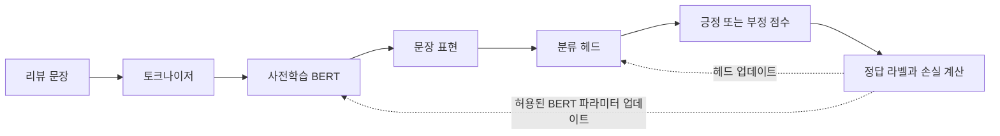
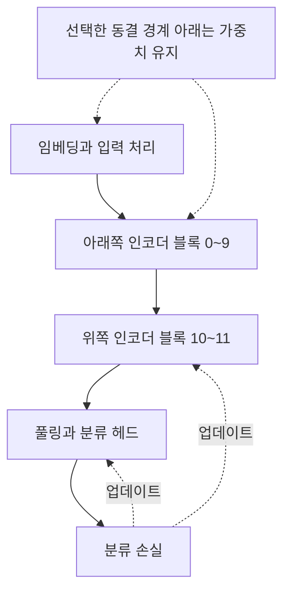
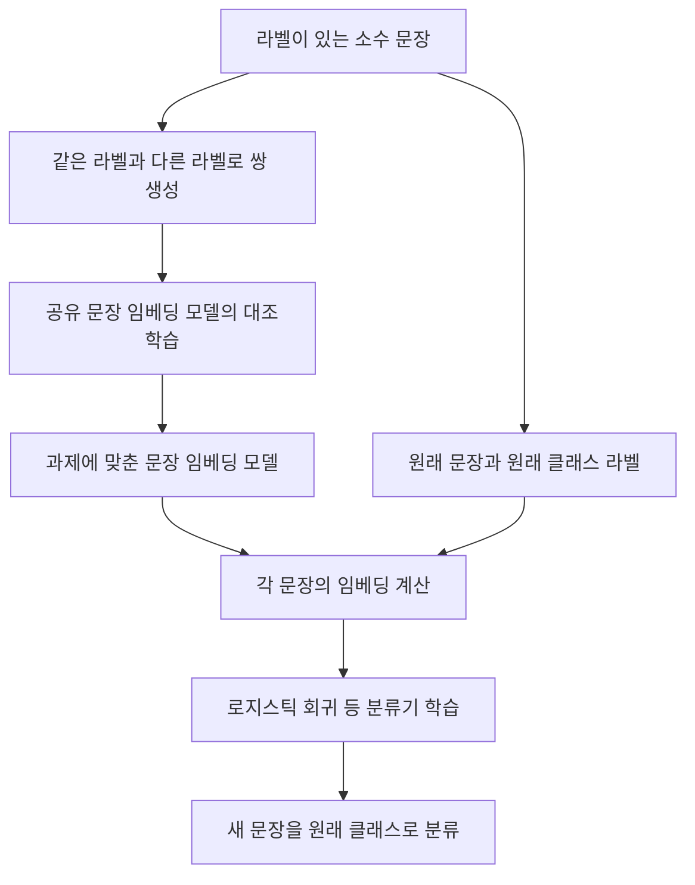

# 11장 표현 모델 미세 조정으로 분류하기

[전체 목차](../../README.md) · [학습 노트](study.md) · [강의안](lecture.md) · [강의 대본](lecture-script.md) · [시각화](visuals.html) · [실습](lab-guide.md) · [복습 문제](quiz.md)

이 장의 질문은 **“이미 언어를 배운 모델을, 내가 원하는 분류 기준에 맞게 어떻게 바꿀까?”**이다. 4장에서는 사전학습 모델의 표현을 그대로 사용했다. 이번에는 분류 오차를 표현 모델까지 전달하고, 라벨이 적을 때 문장 쌍을 만들며, 라벨 없는 도메인 문장으로 추가 사전학습을 수행하고, 마지막으로 문장이 아닌 개별 토큰을 분류한다. 네 방법은 서로 경쟁하는 하나의 순위표가 아니라, 데이터와 출력 형태에 따라 조합하는 도구다.

**원문 범위:** Jay Alammar·Maarten Grootendorst, *Hands-On Large Language Models* (2024), Chapter 11, 제공된 PDF의 물리 페이지 446–486. 이 자료의 쪽수는 인쇄 쪽수가 아니다. 책에 보고된 점수와 직접 실행한 교육용 실험은 구별한다. 설명에 덧붙인 수식·예제·설계 원칙은 ‘보충’이라고 표시했다. 실제 BERT·SetFit·GPU 학습을 실행한 결과는 이 자료에 없다.

## 학습 목표와 준비

이 장을 공부한 뒤에는 다음을 할 수 있어야 한다.

- 동결된 특징 추출기, 분류 헤드만 학습하는 모델, 전체 미세 조정을 계산 그래프 관점에서 구분한다.
- BERT 분류 파이프라인의 토큰화, 동적 패딩, 손실, 학습, 평가가 각각 무엇을 바꾸는지 설명한다.
- 데이터 32개를 여러 문장 쌍으로 만드는 SetFit의 이점과 한계를 함께 계산한다.
- 추가 MLM 학습과 지도 분류의 목표·데이터·출력 차이를 설명한다.
- 단어 라벨을 서브토큰 라벨에 정렬하고 BIO 경계를 유지하며, 문장 단위의 개체 평가를 구성한다.
- 책의 예제 수치를 보장된 성능으로 오해하지 않고 재현 실험을 설계한다.

선수지식은 토큰·임베딩(2장), 트랜스포머의 은닉 표현(3장), 분류와 F1(4장), 대조학습(10장)이다. 수식에서 `B`는 배치 크기, `T`는 패딩 후 토큰 길이, `d`는 은닉 차원, `C`는 분류 클래스 수, `V`는 어휘 크기다. 행렬 차원을 읽을 수 있으면 충분하며, 모든 미분을 직접 유도할 필요는 없다.

## 상세 목차

1. [지도 분류: 무엇을 학습할 것인가](#sec-01)
2. [사전학습 BERT의 미세 조정](#sec-02)
3. [레이어 동결과 비용·성능 균형](#sec-03)
4. [Few-shot 분류의 문제 설정](#sec-04)
5. [SetFit의 세 단계](#sec-05)
6. [32개 예제로 수행하는 SetFit 학습](#sec-06)
7. [MLM을 이용한 추가 사전학습](#sec-07)
8. [개체명 인식으로 출력 단위 바꾸기](#sec-08)
9. [NER 데이터·서브토큰·평가 정렬](#sec-09)
10. [NER 미세 조정과 추론](#sec-10)
11. [방법 선택과 전체 연결](#sec-11)
12. [원문을 읽을 때 확인할 교정 사항](#errata)
13. [그림·예제 대응표와 참고 자료](#source-index)

<a id="sec-01" name="sec-01"></a>
## 1. 지도 분류: 무엇을 학습할 것인가

**원문:** “Supervised Classification”, PDF 446–449쪽. 관련 그림 11-1, 11-2, 11-3.

### 1.1 같은 분류 작업도 학습 경로는 다르다

영화 리뷰를 긍정과 부정으로 나눈다고 하자. 이미 감성 분류에 맞추어 학습된 모델을 불러와 바로 예측하면, 이번 작업에서 모델의 가중치는 바뀌지 않는다. 반면 범용 문장 임베딩을 뽑아 그 위에 로지스틱 회귀를 학습하면 분류기는 새로 배워도, 임베딩을 만드는 모델은 그대로 둘 수 있다. 둘 다 ‘사전학습 모델을 활용한다’고 부르지만 바뀌는 부분이 다르다.

이번 장의 기본 방법은 사전학습 BERT 위에 분류 헤드를 붙이고 **두 부분을 하나의 계산 그래프로 연결해 함께 업데이트**하는 것이다. 헤드는 현재 표현으로 잘못 분류한 정도를 계산하고, 그 오차가 BERT 쪽으로 전달된다. 따라서 BERT는 이번 라벨을 구분하는 데 필요한 단서가 더 드러나도록 문맥 표현을 조정할 수 있다. 예컨대 리뷰의 주제가 영화인지보다, “지루할 줄 알았는데 끝까지 몰입했다”의 반전 구조를 구분하는 것이 중요해진다.

그림 11-1은 동결된 모델을 활용했던 이전 장의 구조를 상기시킨다. 그림 11-2의 핵심은 분류 헤드에서 BERT까지 이어지는 역전파 경로이고, 그림 11-3은 입력·표현 모델·분류 헤드를 하나의 작업별 모델로 묶는 구조다. 새 헤드를 붙였다는 사실만으로 미세 조정이 완료되는 것이 아니다. 손실로부터 어떤 파라미터까지 실제 업데이트가 이루어지는지가 핵심이다.



### 1.2 문장 표현에서 클래스 확률까지

**보충 수식:** 한 문장에 대한 은닉 표현을 `h ∈ R^d`, 선형 분류기의 가중치를 `W ∈ R^(C×d)`, 편향을 `b ∈ R^C`라고 하자. 분류기의 로짓은 `z = Wh + b`다. 로짓은 확률이 아니므로, 다중 클래스 단일 라벨 문제에서는 softmax로 정규화한다.

$$
p_c=\frac{\exp(z_c)}{\sum_{k=1}^{C}\exp(z_k)},\qquad
\mathcal{L}=-\log p_y
$$

`y`는 정답 클래스 번호다. 정답이 긍정인데 긍정 확률이 0.9라면 손실은 약 0.105, 0.1이라면 약 2.303이다. 확신 있게 틀릴 때 훨씬 큰 벌점을 주어 올바른 방향으로 업데이트하도록 한다. 실제 구현에서는 수치 안정성을 위해 softmax와 로그를 결합한 교차 엔트로피 연산을 사용한다. 로짓을 받는 손실에 미리 softmax한 값을 넣는 식으로 두 번 정규화하지 않도록 주의한다.

BERT의 마지막 은닉 상태는 일반적으로 `B×T×d` 형태다. 문장 분류 헤드는 이 중 문장 수준 정보를 대표하는 위치나 풀링된 표현을 이용해 `B×C` 로짓을 만든다. BERT 계열 구현에서 `[CLS]`와 pooler가 사용될 수 있지만, 모든 임베딩 모델의 문장 벡터가 `[CLS]`의 원시 출력이라는 뜻은 아니다. 평균 풀링을 쓰는 Sentence Transformer와도 구분하자.

### 1.3 “같이 학습한다”의 의미와 전이학습의 이점

분류 헤드는 무작위에 가까운 초기 상태로 시작할 수 있지만 BERT는 이미 풍부한 언어 표현을 가지고 있다. 그래서 라벨이 있는 데이터만으로 언어 전체를 처음부터 배울 필요가 없다. 사전학습에서 얻은 표현을 출발점으로 삼고 현재 과제에 필요한 방향으로 조금 이동한다. 이 점이 전이학습의 효율성이다.

학습률을 너무 크게 잡거나 좁은 데이터만 반복하면 기존 지식을 손상시키고 훈련 문구만 외울 수 있다. 전체 미세 조정은 모든 문제에서 자동으로 최선이라는 뜻이 아니다. 데이터가 작거나 라벨이 불안정하면 동결 모델보다 검증 성능이 나빠질 수 있다. 이 장에서 ‘잘 학습한다’는 말은 훈련 손실만 낮추는 것이 아니라 **보지 않은 예제에서 과제에 맞는 일반화를 얻는다**는 뜻이다.

| 방법 | 표현 모델 업데이트 | 분류기 업데이트 | 학습자가 확인할 점 |
|---|---:|---:|---|
| 완성된 감성 분류 모델 그대로 사용 | 없음 | 없음 | 내 데이터와 원래 과제의 일치 정도 |
| 고정 임베딩과 별도 분류기 | 없음 | 있음 | 기존 임베딩으로 라벨을 구분할 수 있는가 |
| BERT 헤드만 학습 | 없음 | 있음 | 문장 표현과 새 헤드의 적합성 |
| BERT 전체 미세 조정 | 있음 | 있음 | 검증 일반화, 메모리, 학습 안정성 |
| BERT 일부 레이어 미세 조정 | 일부 | 있음 | 동결 경계와 계산·성능의 균형 |

<a id="sec-02" name="sec-02"></a>
## 2. 사전학습 BERT의 미세 조정

**원문:** “Fine-Tuning a Pretrained BERT Model”, PDF 449–452쪽.

### 2.1 데이터와 모델의 역할을 분리해서 이해하기

책은 Rotten Tomatoes 영화 리뷰 데이터를 사용한다. 전체 데이터는 긍정 5,331개와 부정 5,331개로 설명되며, 학습·검증·테스트로 나뉜 자료 중 학습 예제는 약 8,500개다. 클래스 수가 2이므로 분류 헤드의 출력도 2개여야 한다. 모델은 `bert-base-cased`이며 대소문자를 구분하는 토크나이저와 모델을 함께 사용한다. 원문은 영어 Wikipedia와 책으로 사전학습된 모델이라는 배경도 소개한다.

`AutoModelForSequenceClassification`은 문장 분류에 필요한 헤드를 포함한 모델 클래스를 선택하는 역할이다. `num_labels=2`는 라벨 두 개가 무엇인지 가르치는 명령이 아니다. 출력 크기를 정해 줄 뿐이며, 어떤 출력 번호가 긍정인지 부정인지는 데이터와 라벨 매핑이 일관되게 정해야 한다. 임의로 0과 1을 바꿔 저장하면 점수는 정상처럼 보여도 추론에서 의미가 뒤집힐 수 있다.

**보충 설계:** 실제 비교 실험에서는 학습 데이터로 파라미터를 업데이트하고, 검증 데이터로 epoch·학습률·동결 개수를 선택한 뒤, 테스트 데이터는 최종 한 번의 평가에 남겨 둔다. 책은 간단한 예제에서 테스트 분할을 `eval_dataset`으로 사용하지만, 여러 설정을 비교하며 이 점수를 반복 확인하면 테스트 정보가 실험 선택에 스며든다. 함수 이름이 `evaluate`라고 해서 그 데이터가 자동으로 독립적인 최종 평가셋이 되는 것은 아니다.

### 2.2 토큰화와 동적 패딩

토큰화는 리뷰 문자열을 `input_ids` 등 모델 입력으로 바꾸는 과정이다. `truncation=True`는 길이가 지원 한도를 초과할 때 잘라내도록 한다. 자르기는 오류를 막지만, 리뷰 뒤쪽의 반전이나 최종 평가가 사라질 수도 있다. 긴 리뷰 성능을 확인하지 않고 전체 평균만 보아서는 이 문제를 발견하기 어렵다.

배치 내 문장 길이가 다르면 행렬로 묶기 어렵기 때문에 패딩을 추가한다. `DataCollatorWithPadding`은 **각 배치에서 가장 긴 문장 길이에 맞추어** 짧은 문장을 채운다. 모든 문장을 최대 길이로 미리 채우는 방식보다 불필요한 계산을 줄일 수 있다. 다만 길이 18, 22, 400인 문장을 함께 넣으면 모두 400에 맞춰지므로, 길이가 비슷한 예제를 묶는 것도 효율에 영향을 준다.

attention mask는 패딩을 의미 있는 내용처럼 참조하지 않도록 구분한다. 패딩 토큰 ID, attention mask, 정답 라벨은 각각 다른 역할이다. 문장 분류에서는 패딩이 여러 개 생겨도 정답 라벨은 문장당 하나다. 뒤에서 NER로 바뀌면 패딩 위치에 대한 라벨도 처리해야 하므로 이 차이를 기억하자.

### 2.3 손실, 지표, 학습 설정

책은 로짓의 마지막 축에서 가장 큰 값의 위치를 선택해 클래스 예측을 만들고 F1을 계산한다. 여기서 argmax는 softmax를 반드시 먼저 계산하지 않아도 결과가 같다. softmax가 로짓의 순서를 보존하기 때문이다. 확률 자체를 분석하거나 임계값을 바꾸려면 확률화가 필요하지만, 최고 점수 클래스만 선택할 때는 불필요한 단계다.

양성 클래스를 기준으로 `TP`는 올바르게 양성이라고 한 수, `FP`는 잘못 양성이라고 한 수, `FN`은 놓친 양성의 수다.

$$
P=\frac{TP}{TP+FP},\quad R=\frac{TP}{TP+FN},\quad
F1=\frac{2PR}{P+R}=\frac{2TP}{2TP+FP+FN}
$$

**보충 예제:** `TP=40, FP=10, FN=20`이면 정밀도는 0.8, 재현율은 약 0.667, F1은 약 0.727이다. 정확도만 보면 다수 클래스로 치우친 모델을 놓칠 수 있으므로 클래스별 결과와 혼동행렬도 함께 본다. 이진 F1, macro F1, micro F1은 다른 집계다. 책의 단일 이진 F1을 다른 논문의 macro F1과 숫자만 나란히 비교하지 않는다.

책의 BERT 학습 설정은 다음과 같다. 이것은 2024년 예제의 조건이며 모든 데이터에 적용할 최적 설정은 아니다.

| 설정 | 원문 값 | 이해할 의미 |
|---|---:|---|
| 학습률 | `2e-5` | 업데이트 한 번의 이동 크기 |
| 장치당 학습 배치 | `16` | 한 번에 처리할 예제 수 |
| 장치당 평가 배치 | `16` | 추론 시 처리 묶음 |
| 학습 epoch | `1` | 학습셋 한 바퀴 |
| weight decay | `0.01` | 가중치 크기에 대한 정규화 설정 |
| 저장 전략 | epoch | 한 바퀴마다 체크포인트 저장 |
| 외부 로그 보고 | 없음 | 외부 서비스로 기록하지 않는 예제 설정 |

`Trainer`는 모델, 학습 인자, 데이터, 토크나이저/처리기, collator, 평가 함수를 연결하고 학습 루프를 수행한다. **학습을 시작하는 호출과 평가하는 호출은 별개**다. 원문 451쪽에는 평가 호출만 보인 뒤 epoch 1.0의 결과가 나오므로, 재현할 때는 평가 전에 학습 호출을 명시적으로 수행해야 한다. 이미 학습된 체크포인트를 불러온 경우를 제외하면 평가만으로 파라미터가 학습되지는 않는다.

### 2.4 원문 결과를 어떻게 읽을까

전체 미세 조정 결과로 원문은 F1 `0.8492366412`, 대략 0.85를 보고한다. 이전 장의 작업별 모델 점수 약 0.80보다 높다는 비교를 통해 직접 미세 조정의 가능성을 보여 준다. 이것은 해당 데이터·초기 모델·설정에서 나온 사례이지 “항상 5% 좋아진다”는 법칙이 아니다. 절대 0.05 차이와 상대 향상률도 구분해야 한다.

학습 시간과 평가 처리량도 하드웨어·라이브러리·배치 길이에 따라 달라진다. 예제에서 몇 분이면 끝났다는 서술은 GPU 사양과 환경이 같은지 확인하지 않고 내 컴퓨터에 옮길 수 없다. 학습셋, 초기화 seed, 데이터 순서, 정밀도와 최적화 방식이 바뀌어도 결과가 달라질 수 있다. 따라서 재현 노트에는 모델 ID뿐 아니라 데이터 분할·seed·환경·라벨 매핑을 함께 기록한다.

<a id="sec-03" name="sec-03"></a>
## 3. 레이어 동결과 비용·성능 균형

**원문:** “Freezing Layers”, PDF 452–459쪽. 관련 그림 11-4–11-7.

### 3.1 동결은 무엇을 멈추는가

동결은 특정 파라미터를 학습 중 업데이트하지 않는 것이다. BERT는 임베딩 층, 12개의 인코더 블록(번호 0–11), pooler, 추가 분류 헤드 등으로 구성된다. 그림 11-4는 이러한 동결 후보를 보여 준다. 전체를 하나의 검은 상자로 생각하지 않고 어느 부분을 고정할지 선택할 수 있는 구조로 보는 것이 이 절의 목표다.

`requires_grad=False`로 설정하면 해당 파라미터에 대한 기울기를 추적하지 않도록 할 수 있다. 하지만 동결된 모델도 입력을 처리해 출력을 만들어야 하므로 **순전파가 사라지는 것은 아니다**. 역전파와 업데이트 관련 부담이 줄어드는 것이며, 감소 폭은 동결 위치와 계산 그래프 구성에 달려 있다. 총 파라미터 수가 작아지는 것도 아니다. 저장된 가중치는 그대로 존재하며 그중 일부만 학습하지 않는다.

또한 동결과 평가 모드는 다르다. 파라미터가 고정되어 있어도 `train()` 모드의 dropout은 출력을 무작위로 바꿀 수 있다. 고정 특징을 미리 저장하려면 평가 모드와 같은 재현 조건까지 고려해야 한다. 이 구분은 ‘동결했는데 임베딩이 매번 조금 다르다’는 질문의 원인이 된다.



이 그림은 원문 그림 11-6의 취지를 재구성한 것으로, 앞의 10개 블록을 동결하고 위쪽 두 블록과 헤드를 학습하는 설정이다. 그림 11-5는 이보다 강하게 모든 BERT 표현 부분을 동결하고 헤드만 학습하는 경우다.

### 3.2 헤드만 학습하는 대조 실험

책은 같은 사전학습 체크포인트를 새로 불러오고, 이름이 `classifier`로 시작하는 파라미터만 학습 가능하게 둔다. 다시 초기화하는 이유는 비교 조건을 맞추기 위해서다. 이미 전체 미세 조정한 BERT를 동결하면 ‘범용 BERT의 헤드만 학습’이 아니라 ‘과제에 적응한 표현을 고정하고 재학습’하는 다른 실험이 된다.

이 설정의 원문 F1은 약 0.6331이다. 전체 미세 조정의 약 0.8492보다 낮았고 학습은 빨라졌다고 보고한다. 고정된 표현에서 간단한 결정 경계만 배울 때 필요한 감성 단서가 충분히 드러나지 않았다는 해석이 가능하다. 그러나 이를 ‘모든 고정 임베딩은 성능이 낮다’고 일반화하면 안 된다. 범용 BERT의 풀링 표현과 문장 임베딩용으로 훈련된 모델은 다른 출발점을 갖기 때문이다.

### 3.3 일부 블록만 학습하기

헤드만 학습하는 것과 전체 미세 조정 사이에는 중간 선택지가 있다. 책은 앞의 10개 인코더 블록을 고정하고 뒤쪽 두 블록과 관련 상위 부분을 학습해 F1 약 0.80을 얻는다. 일반적인 설명으로는 아래쪽의 기본 표현을 유지하고 위쪽을 과제에 맞추는 것이다. 이것은 직관적 전략이며 모든 레이어가 동일하게 언어 역할을 나누어 맡는다는 엄밀한 법칙은 아니다.

원문은 `named_parameters()`에서 앞의 165개 항목을 고정하는 코드를 제시한다. 여기서 165는 파라미터 원소 개수도, 레이어 165개도 아니다. 특정 모델 구현에서 이름과 텐서가 나열되는 순서의 인덱스다. 순서가 달라지거나 다른 모델을 쓰면 의미가 바뀔 수 있다. 보충 구현에서는 `bert.encoder.layer.10`, `bert.encoder.layer.11` 같은 구조를 확인하거나 실제 레이어 모듈을 선택해 설정하는 편이 의도를 검토하기 쉽다.

**보충 의사코드**는 다음과 같다. 실제 실행 전 모델 구조를 확인해야 하며, 여기서는 학습 경계를 설명하기 위한 코드다.

```python
# BERT 전용 구조를 확인한 뒤 적용할 개념 예제
for param in model.bert.parameters():
    param.requires_grad = False
for layer in model.bert.encoder.layer[-2:]:
    for param in layer.parameters():
        param.requires_grad = True
# pooler와 classifier도 의도에 맞게 명시적으로 설정한다.
for param in model.bert.pooler.parameters():
    param.requires_grad = True
for param in model.classifier.parameters():
    param.requires_grad = True
```

### 3.4 그림 11-7의 읽기와 해석 한계

원문 그림 11-7은 학습 가능한 블록 범위를 늘릴 때 F1이 전반적으로 상승하다가 일찍 완만해지는 사례를 보여 준다. 그림의 가로축은 `None`, `0-1`, …, `0-4`, …, `all`로 표기되어 있고, 본문은 처음 다섯 블록을 학습하는 지점에서 성능이 거의 포화한다고 설명한다. 따라서 이 그래프를 바로 앞의 ‘아래쪽 동결, 위쪽 학습’ 설정과 동일한 레이어 선택 실험이라고 단정해서는 안 된다. **범위와 선택 방향이 다르게 읽히는 점을 분리해서 기록**하는 것이 정확하다.

그래프의 핵심 메시지는 일부 레이어만 조정해도 충분한 성능을 얻는 설정이 있을 수 있다는 것이다. ‘다섯 블록이면 항상 충분하다’거나 ‘학습 블록 수가 늘면 매번 성능이 오른다’는 결론은 아니다. 실제 곡선에도 작은 하락과 평탄 구간이 있다. 동결 수를 조절할 때에는 검증 F1뿐 아니라 시간, 최대 메모리, 여러 seed의 변동도 함께 비교한다.

| 원문 설정 | 보고 F1 | 올바른 사용법 |
|---|---:|---|
| 전체 미세 조정 | 약 0.8492 | 원문 기준선으로 이해 |
| 헤드만 학습 | 약 0.6331 | 같은 초기 모델의 동결 대조 사례 |
| 앞의 10개 블록 동결 | 0.80 | 계산과 적응 사이의 절충 사례 |

**스스로 설명하기:** “왜 미세 조정은 하지 않으면서 추론 계산은 해야 하나?”에 답할 수 있어야 한다. 동결된 가중치도 현재 입력을 표현하는 함수로 사용되기 때문이다.

<a id="sec-04" name="sec-04"></a>
## 4. Few-shot 분류의 문제 설정

**원문:** “Few-Shot Classification”, PDF 459–460쪽. 관련 그림 11-8.

Few-shot 분류는 각 클래스에 라벨이 붙은 예제가 매우 적은 상황에서 분류기를 학습하는 것이다. 몇 개부터 few-shot인지 보편적인 경계가 있는 것은 아니며, 이 장에서는 클래스당 16개를 사용하는 예제를 본다. 중요한 것은 전체 문서 수와 클래스당 문서 수를 혼동하지 않는 것이다. 이진 분류에서 클래스당 16개면 총 32개다.

6장의 few-shot prompting과 이름은 비슷하지만 작동 위치가 다르다. 프롬프트 안에 예시를 넣는 방식은 추론 시 문맥으로 조건을 주며, 일반적으로 그 호출에서 모델 파라미터를 업데이트하지 않는다. 여기서의 few-shot training은 소량의 라벨 데이터를 사용해 실제 파라미터나 분류기를 학습한다. 예시를 어디에 넣는지, 손실과 optimizer가 있는지 확인하면 구분할 수 있다.

라벨이 적으면 각 예제의 영향이 크다. 클래스당 16개 중 2개가 잘못 라벨링되어 있으면 12.5%가 잘못된 감독 신호다. 짧고 쉬운 문장만 고르면 모델은 긴 문장이나 모호한 문장에서 약해질 수 있다. 따라서 좋은 few-shot 데이터는 무조건 전형적인 문장만 모은 것이 아니라, 실제 입력 분포와 경계 사례를 적절히 반영해야 한다. 다만 테스트 결과를 보고 유리한 예제만 골라서는 안 된다.

그림 11-8은 적은 수의 라벨 예제만으로 학습한다는 설정을 보여 준다. 이는 “작은 데이터만 있으면 아무 사전 지식 없이 언어를 배운다”는 뜻이 아니다. SetFit은 이미 문장 의미를 잘 표현하도록 사전학습된 모델의 지식을 활용한다. 작은 라벨셋은 언어 전체를 새로 가르치기보다, 어떤 차이를 중요하게 봐야 하는지 방향을 알려 준다.

<a id="sec-05" name="sec-05"></a>
## 5. SetFit의 세 단계

**원문:** “SetFit: Efficient Fine-Tuning with Few Training Examples”, PDF 460–464쪽. 관련 그림 11-9–11-13.

### 5.1 라벨을 관계로 바꾸는 발상

SetFit은 문장 임베딩 모델과 분류기를 결합한다. 원래 데이터가 `(문장, 클래스)` 형태라고 하자. 같은 클래스에 속하는 두 문장을 묶으면 양성 쌍, 다른 클래스의 두 문장을 묶으면 음성 쌍을 만들 수 있다. 여기서 ‘양성 쌍’은 두 리뷰가 모두 긍정 감성이라는 뜻이 아니다. **분류 라벨이 같은 관계**라는 뜻이다. 부정 리뷰 두 개도 양성 쌍이다.

책의 그림 11-9는 프로그래밍 언어와 반려동물이라는 두 범주를 예로 들고, 그림 11-10은 범주 안과 범주 사이에서 문장 쌍을 만드는 과정을 보여 준다. 원래 라벨 정보를 버리는 것이 아니라, 라벨을 문장 간 유사 관계에 대한 감독 신호로 다시 표현하는 것이다.

**보충 예제:** “영화가 지루했다”와 “배우의 연기가 훌륭했다”는 둘 다 영화 리뷰라서 일반 의미 공간에서는 가까울 수 있다. 하지만 감성 분류에서는 서로 멀어져야 하는 음성 쌍이다. 반대로 “영화가 지루했다”와 “스토리가 너무 평범했다”는 같은 부정 라벨이므로 양성 쌍이다. SetFit의 목표는 모든 종류의 의미 유사성을 보존하는 것이 아니라, **현재 과제에서 구분해야 하는 기준을 임베딩에 더 잘 반영**하는 것이다.

### 5.2 쌍 개수는 어떻게 늘어나는가

클래스 `c`에 문장 `n_c`개가 있다면, 순서를 구분하지 않고 자기 자신과의 쌍을 제외한 양성 쌍 수는 다음과 같다.

$$
N_+=\sum_c {n_c\choose2}=\sum_c\frac{n_c(n_c-1)}2
$$

서로 다른 클래스 사이의 음성 쌍 수는 다음과 같다.

$$
N_-=\sum_{a<b}n_an_b
$$

클래스마다 16개, 총 두 클래스라면 각 클래스 안에 120개씩, 전체 양성은 240개다. 음성은 `16×16=256`개다. 합은 496개이며 `32×31/2=496`과 일치한다. 이는 가능한 **서로 다른 무순서 쌍의 수**다. 한 클래스의 120개만 계산한 뒤 전체 양성 수로 오해하지 않도록 주의한다.

쌍 수가 늘어난다고 독립적인 원문 496개를 새로 얻는 것은 아니다. 여러 쌍이 같은 문장을 공유한다. 원문 하나에 잘못된 라벨이 붙어 있으면 관련된 많은 쌍에 오류가 전파될 수 있다. 데이터를 나눌 때에도 먼저 원문 단위로 학습·검증을 나누고 각각 안에서 쌍을 생성해야 한다. 모든 쌍을 만든 뒤 무작위로 분할하면 같은 문장이 학습과 검증에 반복 등장해 성능이 부풀 수 있다.

### 5.3 임베딩 모델을 대조학습하기

두 번째 단계에서 생성한 쌍을 같은 문장 임베딩 모델에 통과시킨다. 그림 11-11의 핵심은 두 입력이 공유된 모델을 거쳐 임베딩이 되고, 같은 라벨의 쌍은 유사하게, 다른 라벨의 쌍은 구분되게 학습된다는 것이다. 서로 완전히 별개의 문장 모델 두 개를 각각 훈련시키는 구조로 이해하면 안 된다.

**보충 수식:** 임베딩 `u, v ∈ R^d`의 코사인 유사도는 다음과 같다.

$$
s(u,v)=\frac{u^\top v}{\|u\|\|v\|}
$$

한 가지 설명용 손실은 관계 라벨 `r∈{0,1}`에 대해 `(s(u,v)-r)^2`를 줄이는 것이다. 손실의 정확한 형태는 학습 설정에 따라 달라질 수 있으므로 이 수식이 모든 SetFit 버전의 유일한 공식이라고 암기하지 말자. 여기서는 ‘문장 라벨을 직접 맞히는 손실’과 ‘두 표현 사이의 관계를 맞히는 손실’의 차이를 이해하는 데 사용한다.

`u=(1,0)`, `v=(1,1)`이면 유사도는 약 0.707이다. 이 쌍이 같은 라벨이면 더 가깝게 조정할 이유가 있고, 다른 라벨이면 덜 유사해지도록 조정할 이유가 있다. 최종 목표가 클래스 분리이므로 양성 쌍과 음성 쌍을 함께 사용해야 한다. 양성만 끌어당기면 모든 문장이 같은 점으로 모이는 식의 퇴행을 막기 어렵다.

### 5.4 최종 분류기는 원래 라벨로 학습한다

세 번째 단계에서는 미세 조정된 임베딩 모델로 원래 문장을 벡터화하고, `(문장 임베딩, 원래 클래스 라벨)`을 사용해 분류기를 학습한다. 그림 11-12가 이 단계다. 첫 단계에서 만든 ‘쌍의 동일 클래스 여부’를 최종 분류 라벨로 사용하는 것이 아니다. 기본적으로 로지스틱 회귀를 쓸 수 있고, 별도의 미분 가능한 분류 헤드도 선택할 수 있다.

이 때문에 SetFit을 단순히 ‘BERT와 헤드를 한 손실로 동시에 학습’이라고만 설명하면 중요한 차이를 놓친다. 기본 흐름에는 임베딩을 관계 손실로 조정하는 단계와 분류기를 문장 라벨로 학습하는 단계가 구분된다. 원문 요약이 두 부분을 함께 미세 조정하는 체계라고 넓게 표현하더라도, 실제 데이터가 흐르는 단계를 분리해서 이해해야 한다.



이 흐름은 그림 11-13의 세 단계를 독자적으로 다시 그린 것이다. 데이터 32개를 32개의 독립 정보를 가진 출발점으로 유지하면서, 그 안에서 여러 관계를 감독 신호로 활용하는 것이 핵심이다.

<a id="sec-06" name="sec-06"></a>
## 6. 32개 예제로 수행하는 SetFit 학습

**원문:** “Fine-Tuning for Few-Shot Classification”, PDF 464–468쪽.

책은 약 8,500개 학습 리뷰 대신 클래스당 16개를 뽑아 총 32개로 학습한다. 임베딩 모델로 `sentence-transformers/all-mpnet-base-v2`를 사용한다. 원문이 당시 임베딩 벤치마크와 연결해 모델 선택을 설명하지만, 이를 현재의 최고 성능 모델이라는 주장으로 읽으면 안 된다. 우리 과제의 언어·문장 길이·도메인과 계산 조건에 맞는지를 검증해야 한다.

예제는 대조학습 epoch 3, `num_iterations=20`을 사용하고, 출력에 배치 16, 총 쌍 1,280, 최적화 240단계를 보여 준다. 책의 산술 서술에는 `20×32=680`이라는 오기가 있다. 올바른 값은 640이고, 각 문장에 양성 20개와 음성 20개를 샘플링한다는 계산에서는 `32×(20+20)=1,280`이다. 배치 16이면 한 epoch의 80배치, 3 epoch면 240단계로 출력과 일치한다.

이 1,280을 서로 다른 무순서 쌍의 개수라고 해석해서는 안 된다. 바로 앞에서 계산한 최대 496개와 모순되기 때문이다. 로그의 ‘unique’라는 문구보다 **샘플링된 학습 항목 수와 실제 고유 쌍 수를 구별**하는 것이 중요하다. 반복 샘플링이나 방향을 구분하는 표현 등에 따라 항목 수가 달라질 수 있으며, 이 예제의 숫자는 반복을 포함한 학습 신호로 이해해야 한다. 현재 SetFit 공식 샘플링 문서는 고유 쌍·중복 샘플링·이전 `num_iterations` 방식의 차이를 구분한다. [SetFit 샘플링 설명](https://huggingface.co/docs/setfit/conceptual_guides/sampling_strategies).

분류 헤드를 별도로 지정하지 않은 예제는 로지스틱 회귀를 사용한다. 원문은 `use_differentiable_head=True`와 클래스 수 설정을 통해 미분 가능한 헤드를 선택하는 방법도 소개한다. ‘미분 가능’은 헤드의 학습을 신경망 연산으로 연결할 수 있다는 뜻이지, 그 선택만으로 항상 더 정확하거나 모든 단계가 한 번에 최적화된다는 뜻은 아니다. 어떤 단계에서 body를 업데이트하고 어떤 단계에서 head를 업데이트하는지 확인해야 한다.

원문 코드 출력의 F1은 `0.8363988383`이다. 소수 둘째 자리로 반올림하면 0.84이며, 뒤의 설명에서 약 0.85라고 말한 부분과 차이가 있다. 이 노트는 출력값을 우선해 **약 0.8364**로 기록한다. 전체 BERT 미세 조정의 약 0.8492와 비슷한 수준의 결과가 적은 라벨로 나왔다는 사례지만, 두 모델은 초기 모델도 학습 방식도 다르므로 데이터 수만의 효과를 정밀하게 분리한 실험은 아니다.

few-shot 성능은 어떤 16개를 뽑았는지에 민감하다. 하나의 샘플링 seed에서 높은 점수가 나왔다고 그 설정의 안정성을 보장할 수 없다. 보충 실험에서는 여러 seed로 라벨 예제를 뽑아 평균과 변동을 기록하고, 전체 데이터로 학습한 분류기·고정 임베딩 분류기와 같은 테스트셋에서 비교한다. 특히 각 클래스가 여러 하위 유형을 포함한다면 16개가 실제 다양성을 얼마나 대표하는지 살펴본다.

원문 마지막 팁은 라벨 이름으로 합성 예문을 만들어 라벨 없는 설정에도 SetFit을 적용할 수 있다는 아이디어다. 예컨대 행복·슬픔이라는 클래스 이름을 문장화해 시작한다. 이것은 실제 고객 문장에 사람이 붙인 라벨을 얻은 것과 같지 않으며, 템플릿과 라벨 이름의 단서를 실제 과제 표현으로 일반화해야 하는 부담이 있다. ‘zero-shot’이라는 이름만 보고 학습 단계가 전혀 없다고 오해하지 말자. 이 경우에는 사람 라벨 문장 대신 합성 예문으로 학습하는 구조다.

<a id="sec-07" name="sec-07"></a>
## 7. MLM을 이용한 추가 사전학습

**원문:** “Continued Pretraining with Masked Language Modeling”, PDF 468–474쪽. 관련 그림 11-14–11-17.

### 7.1 일반 언어 지식과 도메인 지식 사이의 간격

일반적인 사전학습 모델은 많은 언어 현상을 배웠지만, 우리 조직의 약어·문서 관행·전문 문맥을 충분히 보지 못했을 수 있다. 예를 들어 같은 단어가 의료 문서, 법률 문서, 영화 리뷰에서 서로 다른 주변 단어와 함께 나타난다. 도메인 라벨이 적어도 그 도메인의 문서 자체는 많이 존재할 수 있다.

이때 사전학습과 최종 분류 사이에 **도메인 문서로 MLM을 더 학습하는 단계**를 넣는다. 그림 11-14는 사전학습 후 바로 작업별 미세 조정하는 두 단계, 그림 11-15는 중간에 추가 사전학습을 넣는 세 단계, 그림 11-16은 일반 모델에서 도메인 모델로, 다시 구체적 과제 모델로 분기하는 계보를 보여 준다.


도메인 적응은 새 단어를 토크나이저 어휘에 반드시 추가한다는 뜻이 아니다. 이 장의 예제는 토크나이저를 바꾸지 않고, 기존 서브토큰이 문맥을 표현하는 가중치를 조정한다. 모르는 전문 단어가 여러 조각으로 나뉘더라도 그 조각들이 해당 도메인에서 결합되는 패턴을 더 잘 배울 수 있다. 어휘 확장이나 토크나이저 재학습은 별개의 설계다.

### 7.2 MLM은 무엇을 예측하는가

Masked Language Modeling은 입력 일부를 가리고 원래 토큰을 맞히게 하는 자기지도 학습이다. 원문 라벨을 사람이 새로 붙이지 않아도 텍스트 자체에서 정답을 만들 수 있다. ‘비지도’라는 넓은 범주로 설명되기도 하지만, 계산 과정에는 명확한 목표 토큰과 손실이 존재하므로 ‘정답이 전혀 없는 학습’으로 이해하면 안 된다.

문장 분류의 출력은 `B×C`였지만 MLM 출력은 각 토큰 위치의 어휘 점수인 `B×T×V`로 생각할 수 있다. 손실은 선택된 예측 위치를 중심으로 계산하며, 나머지 위치를 평가 대상에서 제외하는 마스크가 필요하다. 예측할 대상이 클래스 둘이 아니라 어휘 전체라는 차이를 보자.

**보충 수식:** 예측 대상 위치 집합을 `M`, 정답 토큰을 `x_t`, 손상된 문맥을 `x̃`라고 하면 개념적으로 다음 목표를 줄인다.

$$
\mathcal{L}_{MLM}=-\frac1{|M|}\sum_{t\in M}\log P(x_t\mid\tilde{x})
$$

이 식은 MLM의 목표를 설명하기 위한 것이다. 구체적인 토큰 교체 방식이나 손실 평균 방식은 구현을 확인해야 한다. 마스킹 확률 15%는 각 문장마다 정확히 15%가 항상 선택된다는 뜻이 아니다. 무작위 선택의 기대 비율이므로 짧은 문장에서는 선택 개수가 크게 흔들릴 수 있다. 또한 선택된 모든 위치가 반드시 화면에 `[MASK]`로만 나타난다고 단순화하지 말고 해당 collator의 교체 정책을 확인해야 한다.

### 7.3 토큰 마스킹과 whole-word masking

단어가 여러 서브토큰으로 나뉘면 토큰 일부만 가려질 수 있다. 예를 들어 교육용 가상 분할 `play`와 `##ing` 중 뒤쪽만 가리면 남은 조각이 정답의 단서를 제공한다. Whole-word masking은 선택한 단어를 구성하는 여러 조각을 함께 가려 단어 전체를 복원하도록 한다. 그림 11-17은 두 방식의 차이를 비교한다.

책은 whole-word masking이 더 어려운 과제를 만들어 더 정교한 표현에 도움이 될 수 있지만 수렴에 시간이 더 걸릴 수 있다고 설명하며, 예제에서는 빠른 수렴을 위해 토큰 마스킹을 사용한다. 이것을 모든 모델과 코퍼스에서 whole-word 방식이 항상 더 낫다는 결론으로 확장하지 않는다. 단어 경계가 무엇인지, 토크나이저가 어떤 정보를 제공하는지, 언어와 도메인에 적합한지도 중요하다.

### 7.4 원문 학습 파이프라인

예제는 `AutoModelForMaskedLM`으로 `bert-base-cased`를 불러오고, 기존 영화 리뷰 데이터에서 감성 `label` 열을 제거한다. 리뷰의 텍스트는 그대로 사용하지만 **감성 라벨은 이번 목표와 관계없다**. 토큰화 후 `DataCollatorForLanguageModeling`이 배치를 구성하면서 MLM 입력과 목표를 만든다. `mlm_probability=0.15`가 원문의 설정이다.

학습률 `2e-5`, 배치 16, weight decay `0.01`은 앞의 예제와 같고, 코드의 epoch는 10이다. 다음 페이지 설명에서는 20 epoch라고 서술해 서로 맞지 않는다. 이 노트는 코드 기준 10으로 기록하며, 재현 실험에서는 자신이 실행한 값을 따로 명시하도록 한다. 이 차이를 조용히 한쪽으로 합쳐 “책이 20 epoch를 실행했다”고 단정하면 재현 기록이 왜곡된다.

토크나이저는 이 학습에서 업데이트되지 않으므로 학습 전에 저장해도 된다고 원문은 설명한다. 모델 가중치는 학습 후 저장한다. 둘을 같은 경로에 보관하는 이유는 모델이 기대하는 입력 ID와 토크나이저의 매핑을 다시 일치시켜 불러오기 위해서다. 모델만 저장하고 토크나이저는 다른 체크포인트에서 가져오는 습관은 조용한 입력 오류를 만들 수 있다.

### 7.5 도메인 적응의 관찰과 성능 검증은 다르다

원문은 마스크를 포함한 짧은 부정적 문장에 대해, 일반 모델은 생각·꿈·날 같은 일반 명사를 내놓고, 추가 학습 모델은 영화·필름·코미디·스토리처럼 영화 리뷰에 가까운 말을 내놓는 예를 보여 준다. 이는 도메인 문맥으로 예측 분포가 이동했다는 정성적 관찰이다.

그러나 ‘마스크에 영화라는 말을 넣었다’만으로 최종 감성 분류가 향상되었다고 증명할 수는 없다. 다음 단계에서는 저장한 MLM 체크포인트를 문장 분류 모델로 불러와 새 분류 헤드를 학습하고, 동일한 검증·테스트 기준으로 원래 BERT와 비교해야 한다. 추가 사전학습은 분류 헤드를 자동으로 만들어 주지 않는다.

**보충 실험 설계:** 일반 BERT→분류와 일반 BERT→도메인 MLM→분류의 두 경로에서 라벨 데이터, seed, 분류 학습 예산을 맞춘다. 도메인 문서가 평가 문서와 겹치는지도 확인한다. 라벨을 쓰지 않았더라도 최종 테스트 문장을 미리 보고 추가 사전학습했다면, 순수한 미관측 일반화 평가와 조건이 달라진다. 실무에서 허용하는 적응 범위를 먼저 정의하고 그 조건을 기록하자.

도메인 코퍼스가 지나치게 좁거나 한쪽 감성에 편중되면 특정 표현만 자주 예측하도록 치우칠 수 있다. 좋은 도메인 적응은 빈도 모방 자체가 아니라 필요한 문맥 이해를 강화하고 이후 과제를 돕는 것이다. 분류뿐 아니라 원래 필요한 일반 언어 능력이 크게 손상되지 않았는지도 사용 목적에 따라 점검한다.

<a id="sec-08" name="sec-08"></a>
## 8. 개체명 인식으로 출력 단위 바꾸기

**원문:** “Named-Entity Recognition”, PDF 475–476쪽. 관련 그림 11-18, 11-19.

개체명 인식(NER)은 문장 안에서 사람·조직·장소 등 특정 유형의 표현을 찾아 분류하는 작업이다. 감성 분류가 “이 리뷰 전체의 감성은 무엇인가?”라면, NER은 “이 문장의 어느 구간이 사람 이름인가?”를 묻는다. 이름뿐 아니라 과제에 따라 음식, 작품, 제품, 의학 용어 등으로 대상 범주를 정의할 수도 있다.

그림 11-18은 사람이나 장소가 있는 부분을 표시하는 결과를 보여 준다. 그림 11-19는 문장 하나를 하나의 벡터로 요약해 한 번 분류하는 대신, 각 토큰 표현에 분류기를 적용하는 구조를 강조한다. 문맥을 이용해 표현을 만드는 BERT 본체는 비슷하지만 출력의 단위가 달라진다.

| 작업 | 예측 단위 | 로짓 차원 | 정답 형태 |
|---|---|---|---|
| 문장 감성 분류 | 문장당 하나 | `B×C` | 문장당 클래스 번호 |
| MLM | 선택된 위치의 원래 토큰 | 개념적으로 `B×T×V` | 선택 위치의 어휘 ID |
| NER | 각 토큰 위치의 개체 태그 | `B×T×C` | 위치마다 BIO 태그 |

NER도 표현은 문맥을 본다. “Apple이 새 제품을 발표했다”와 “apple을 잘랐다”에서 같은 표면 단어가 다른 의미를 가질 수 있다. 입력 토큰마다 독립적인 사전만 조회하는 것이 아니라, 주변 문장과 함께 얻은 은닉 표현을 분류에 사용한다. 다만 마지막 선형 헤드를 각 위치에 적용한다고 해서 BIO 전이 규칙을 자동으로 엄격히 강제하는 것은 아니다. 허용되지 않는 태그 연결을 어떻게 처리할지는 후처리·평가 설계와 관련된다.

원문은 NER이 민감한 이름을 가리거나 비식별화할 때 유용하다고 소개한다. **보충:** 유용하다는 말과 모든 개인정보를 완벽히 탐지한다는 말은 다르다. 학습한 개체 범주 밖의 식별자, 오탈자, 별칭을 놓칠 수 있다. 비식별화 품질은 NER 전체 평균 F1뿐 아니라 실제로 가려야 하는 범주의 누락률과 후처리까지 확인해야 한다.

<a id="sec-09" name="sec-09"></a>
## 9. NER 데이터·서브토큰·평가 정렬

**원문:** “Preparing Data for Named-Entity Recognition”, PDF 476–483쪽. 관련 그림 11-20, 11-21.

### 9.1 CoNLL-2003의 구조와 BIO 라벨

책은 영어 CoNLL-2003 데이터의 약 14,000개 학습 문장을 사용한다. 데이터에는 `tokens`, `pos_tags`, `chunk_tags`, `ner_tags` 등이 있지만 이번 과제에서는 단어 목록과 개체 라벨이 핵심이다. 다른 열이 존재한다고 모두 모델의 목표로 사용하는 것은 아니다. 입력·목표·참고 메타데이터를 구분해야 한다.

원문 라벨 매핑은 다음과 같다.

| ID | 태그 | 뜻 |
|---:|---|---|
| 0 | `O` | 해당 개체 범주 밖 |
| 1 | `B-PER` | 사람 개체의 시작 |
| 2 | `I-PER` | 같은 사람 개체의 이어지는 부분 |
| 3 | `B-ORG` | 조직 개체의 시작 |
| 4 | `I-ORG` | 같은 조직 개체의 이어지는 부분 |
| 5 | `B-LOC` | 장소 개체의 시작 |
| 6 | `I-LOC` | 같은 장소 개체의 이어지는 부분 |
| 7 | `B-MISC` | 기타 개체의 시작 |
| 8 | `I-MISC` | 같은 기타 개체의 이어지는 부분 |

`B`는 begin, `I`는 inside, `O`는 outside로 이해하자. `I`는 개체의 끝을 뜻하는 특별한 종료 기호가 아니다. 뒤에 같은 유형의 `I`가 더 이어질 수 있고, 다음 `O`, 새 `B`, 유형 변화, 문장 끝이 경계를 결정한다. 두 사람이 연달아 나오면 각각 `B-PER`로 새 개체를 시작할 수 있으므로, 같은 유형이 연속된다는 이유만으로 모두 하나의 이름으로 합치면 안 된다.

원문 예에서 두 단어로 된 사람 이름은 첫 단어가 `B-PER`, 두 번째 단어가 `I-PER`다. 그림 11-20은 이 표기를 통해 두 독립 인물이 아니라 하나의 이름 구간으로 묶인다는 의미를 보여 준다. 라벨이 PER이라는 종류만 있으면 이름이 어디서 새로 시작하는지 구별하기 어렵기 때문에 BIO 경계 정보가 필요하다.

원문 팁은 드물고 새롭게 나타나는 개체를 다루는 `wnut_17`, 영화 관련 개체를 다루는 `tner/mit_movie_trivia`, 식당 관련 개체를 다루는 `tner/mit_restaurant`를 추가 예제로 소개한다. 데이터셋 선택은 단순히 크기보다 탐지할 개체 유형과 실제 도메인의 일치가 중요하다는 점을 생각하게 한다. 각 데이터의 배포·접근 조건은 실제 사용할 때 별도로 확인한다.

### 9.2 단어를 받는 데이터와 토큰을 받는 모델의 간격

데이터의 라벨은 단어마다 하나지만, BERT는 서브토큰 단위 입력을 받는다. 한 단어가 하나의 토큰일 수도 있고 여러 조각으로 나뉠 수도 있다. 원문 예에서 어떤 단어는 두 조각으로 나뉘고, 사람 이름 `Maarten`은 `Ma`, `##arte`, `##n`으로 나뉜다. 입력에는 `[CLS]`, `[SEP]` 같은 특수 토큰도 추가된다. 따라서 원래 단어 라벨 배열을 그대로 토큰 배열 옆에 붙이면 길이와 위치가 어긋난다.

이미 단어별로 나눈 입력을 전달할 때는 그 사실을 토크나이저에 알려야 한다. 원문은 `is_split_into_words=True`를 사용한다. 이 설정은 각 단어를 더 이상 서브토큰화하지 말라는 뜻이 아니다. 입력이 단어 목록이라는 구조를 보존하면서 내부적으로 필요한 분할을 수행하도록 하는 것이다.

핵심 도구는 각 토큰이 어느 원래 단어에서 나왔는지를 알려 주는 `word_ids`다. 특수 토큰은 보통 `None`, 같은 단어에서 나온 조각들은 같은 단어 인덱스를 가진다. 토큰 문자열에 `##`가 붙었는지만 보고 정렬하는 방식보다 이 대응 정보를 이용해야 여러 입력과 토크나이저 처리에 견고하게 대응할 수 있다.

**교육용 예제:** 실제 토크나이저를 실행한 결과가 아니라, 정렬 원리를 보여 주기 위해 다음 분할을 가정한다.

| 토큰 | `[CLS]` | `Min` | `##su` | `works` | `at` | `Nova` | `Labs` | `[SEP]` |
|---|---|---|---|---|---|---|---|---|
| `word_id` | None | 0 | 0 | 1 | 2 | 3 | 4 | None |
| 원래 단어 라벨 | 없음 | B-PER | B-PER | O | O | B-ORG | I-ORG | 없음 |
| 정렬 후 라벨 | -100 | B-PER | I-PER | O | O | B-ORG | I-ORG | -100 |

같은 단어의 두 번째 조각 `##su`를 다시 `B-PER`로 지정하면 새 사람 개체가 시작하는 것처럼 보인다. 그래서 첫 조각만 `B-PER`, 이어지는 조각은 `I-PER`로 바꾼다. 이것이 그림 11-21의 핵심이다. 원래 단어의 라벨이 `I-PER`이면 그 단어의 첫 조각부터 이미 이어지는 개체 부분이므로 `I-PER`를 유지한다. 원래 `O`인 단어의 모든 조각은 계속 `O`다.

### 9.3 정렬 알고리즘을 문장으로 읽어 보기

원문 함수는 배치의 각 문장에 대해 다음과 같이 처리한다.

1. 토크나이저 출력에서 문장의 `word_ids`를 얻는다.
2. 현재 토큰의 `word_id`가 `None`이면 정답을 `-100`으로 설정한다.
3. 이전 토큰과 다른 원래 단어에 속하면 그 단어의 원래 라벨을 사용한다.
4. 같은 단어의 추가 조각이면 원래 라벨이 `B-X`일 때 `I-X`로 바꾼다.
5. 정렬한 라벨 배열을 토큰화 결과의 `labels`에 넣는다.

원문의 `% 2 == 1`이면 1을 더하는 코드는 위 라벨표에서 모든 `B`가 홀수, 대응 `I`가 다음 짝수라는 규칙을 이용한다. **BIO의 보편적인 수학적 성질이 아니라 그 데이터의 ID 배치에 의존하는 지름길**이다. 다른 데이터에서 `B-PER=4`, `I-PER=2`처럼 지정되어 있으면 틀린 결과를 만든다. 이 학습 자료의 실습은 문자열 태그와 명시적 매핑으로 변환해 ID 순서 의존성을 제거한다.

`-100`은 새로운 개체 클래스가 아니다. 일반적으로 손실이 해당 위치를 무시하게 하기 위한 값이다. 정답을 `-100`으로 두는 것과 attention mask를 0으로 두는 것은 다르다. `[CLS]`처럼 입력의 문맥 처리에는 의미가 있지만 NER 목표 라벨을 부여하지 않는 위치가 있을 수 있다. 반대로 패딩은 입력 attention과 정답 손실 양쪽에서 적절히 제외해야 한다.

### 9.4 모든 조각에 라벨을 주는 방식과 첫 조각만 쓰는 방식

원문은 이어지는 모든 서브토큰에도 `I-X` 라벨을 부여해 학습한다. 또 다른 선택은 각 단어의 첫 서브토큰에만 정답을 주고 나머지를 `-100`으로 제외하는 것이다. 어떤 방식이든 모델 입력 길이와 라벨 길이는 일치해야 하며, 추론·평가에서 원래 단어/개체로 복원하는 정책도 맞춰야 한다.

모든 조각에 라벨을 주면 긴 단어가 여러 손실 항을 만든다. 예를 들어 세 조각으로 나뉜 이름과 한 토큰인 이름이 같은 한 개체라도, 토큰별 손실 합에서는 서로 다른 비중을 가질 수 있다. 첫 조각만 학습하면 단어당 한 목표를 유지하는 대신 나머지 위치의 직접 감독은 줄어든다. 이것은 단순한 코드 취향이 아니라 손실 가중과 평가 단위의 설계 문제다. 공식 토큰 분류 안내도 특수 토큰을 제외하고 단어·토큰 라벨을 정렬하는 구조를 설명한다. [Hugging Face 토큰 분류 안내](https://huggingface.co/docs/transformers/tasks/token_classification).

### 9.5 NER 평가에서 문장 경계를 지켜야 하는 이유

문장 분류는 문장당 하나의 예측이지만, NER 로짓은 `B×T×C`다. 클래스 축인 마지막 축에서 argmax하여 `B×T` 태그 배열을 얻는다. 이후 정답이 `-100`인 위치를 제외하고, 같은 문장에 속하는 태그들의 순서를 유지해야 한다.

원문 482쪽의 평가 코드는 내부 토큰 반복문에서 매번 `[태그]`를 목록에 추가한다. 그러면 원래 한 문장의 `['B-PER','I-PER','O']`가 `[['B-PER'],['I-PER'],['O']]`라는 세 개의 길이 1 시퀀스로 바뀐다. 개체가 두 토큰에 걸쳐 있다는 경계를 잃기 때문에, 이를 정상적인 문장 단위 개체 F1로 해석하면 안 된다. 평가 라이브러리가 태그 배열을 받아 준다고 평가 목적이 맞는 것은 아니다.

**보충 수정 개념 코드:** 아래는 새로 쓴 구조 예시다. `argmax`를 끝낸 예측과 라벨을 받아 문장 경계를 보존하는 방식이다.

```python
predicted_sequences, reference_sequences = [], []
for pred_row, gold_row in zip(predictions, labels):
    keep = [i for i, gold in enumerate(gold_row) if gold != -100]
    predicted_sequences.append([id2label[pred_row[i]] for i in keep])
    reference_sequences.append([id2label[gold_row[i]] for i in keep])
# 문장별 태그열을 seqeval 등의 평가 함수에 전달한다.
```

공식 Transformers의 NER 구현도 문장별 중첩 목록을 유지한다. [공식 NER 학습 예제](https://github.com/huggingface/transformers/blob/main/examples/pytorch/token-classification/run_ner.py). 원래 CoNLL 단어 단위 점수와 비교하려면 서브토큰 결과를 원래 단어로 복원하거나 첫 서브토큰 단위로 평가하는 기준도 맞춘다. 문장 경계 유지와 단어/서브토큰 평가 단위 일치는 서로 다른 두 가지 요구다.

### 9.6 토큰 정확도와 개체 F1은 다른 질문이다

정답이 `B-PER I-PER O O`, 예측이 `B-PER O O O`라고 하자. 토큰 네 개 중 세 개가 맞으므로 토큰 정확도는 75%다. 하지만 두 토큰 길이의 사람 이름 전체를 맞히지는 못했다. 엄격한 개체 평가에서 정답 구간은 `[0,2)`, 예측 구간은 `[0,1)`이라 경계가 달라 일치하지 않는다. 정확히 찾은 개체는 0개다.

개체 F1을 계산하려면 예측·정답에서 `(문장 ID, 시작, 끝, 유형)`을 추출해 비교한다. 위치뿐 아니라 유형까지 일치해야 정답 개체로 센다. 문장 ID를 빼면 여러 문장의 같은 토큰 인덱스를 같은 개체처럼 비교하는 버그가 생길 수 있다. 실제 평가 도구마다 BIO 해석과 잘못된 태그열 처리 정책이 다를 수 있으므로 strict 방식인지, 어떤 스킴을 쓰는지도 명시한다.

이 차이는 실무에서 중요하다. “김민수” 중 “김”만 가리면 토큰 몇 개는 맞았어도 사람 이름 전체를 감추는 목적에는 부족할 수 있다. 따라서 NER에서 높은 `O` 비율에 기대어 얻은 정확도보다 개체 경계와 유형 기준의 정밀도·재현율을 함께 보아야 한다. 실습과 시각화는 바로 이 차이를 작은 배열로 검산하게 한다.

<a id="sec-10" name="sec-10"></a>
## 10. NER 미세 조정과 추론

**원문:** “Fine-Tuning for Named-Entity Recognition”, PDF 483–485쪽.

모델은 `AutoModelForTokenClassification`을 사용하고, 라벨 수를 9로 지정하며 `id2label`과 `label2id`를 함께 설정한다. 매핑을 모델 설정에 넣으면 출력 번호를 사람이 이해하는 태그로 변환하는 데 도움이 된다. 학습 데이터에서 3번이 조직 시작인데 추론에서 3번을 장소 시작으로 해석하면 학습은 정상이어도 결과 설명이 틀어진다.

NER의 collator는 토큰 입력뿐 아니라 위치별 라벨 길이도 배치에 맞춰야 하므로 `DataCollatorForTokenClassification`을 사용한다. 길이가 다른 문장을 묶으면 입력은 패딩 토큰으로, 라벨은 손실에서 무시할 값으로 채우는 구조가 필요하다. 일반 문장 분류용 패딩과 이름이 비슷해 보여도, **목표 배열의 형태가 달라졌기 때문에 처리 대상도 달라진다**.

원문 학습 설정은 학습률 `2e-5`, 배치 16, 1 epoch, weight decay `0.01`이다. `Trainer`에 정렬된 학습·평가 데이터와 NER 평가 함수를 연결해 학습한다. 원문은 이 절에서 최종 NER F1의 숫자를 제시하지 않고 평가 호출을 보여 준다. 따라서 앞 절의 0.85를 NER 성능이라고 옮겨 적거나 별도의 점수를 만들어 넣어서는 안 된다.

학습 후 모델을 저장하고 토큰 분류 pipeline으로 새 문장을 입력한다. 원문 출력은 사람 이름의 세 서브토큰에 대해 `B-PER`, `I-PER`, `I-PER`가 나오는 예다. 각 항목에는 점수, 토큰 인덱스, 토큰 문자열, 원문 문자 오프셋 `start`, `end`가 있다. 오프셋을 이용하면 원문에서 실제 구간을 추출할 수 있다. 표시 문자열의 `##`를 단순히 지우는 것보다 원문 위치를 활용하는 것이 띄어쓰기·구두점 복원에 유리하다.

토큰 인덱스와 문자 오프셋은 다르다. 토큰 인덱스 4가 원문의 네 번째 문자를 뜻하지 않으며, `start=11`, `end=13` 같은 범위는 통상 끝을 포함하지 않는 문자 구간으로 다룬다. 여러 조각의 개체를 합칠 때에는 유형, 연속성, BIO 경계와 오프셋을 함께 확인한다. 토큰 수준의 높은 점수 세 개가 있다고 문장 전체 또는 개체 전체의 확률이 자동으로 그 평균과 같아지는 것도 아니다.

**보충 오류 분석 순서:** 먼저 라벨 매핑이 같은지, 단어·서브토큰 정렬이 맞는지, 특수 토큰과 패딩이 제외되는지, 문장 경계가 보존되는지 확인한다. 다음으로 모델의 실제 오류를 사람·조직·장소별, 한 단어·여러 단어별, 흔한·드문 이름별로 살핀다. 전처리 버그와 모델 능력 부족을 섞어 진단하면 더 큰 모델이나 더 긴 학습으로도 해결되지 않는다.

<a id="sec-11" name="sec-11"></a>
## 11. 방법 선택과 전체 연결

**원문:** “Summary”, PDF 485–486쪽. 아래 선택표와 프로젝트 설계는 학습을 위한 보충이다.

| 상황 | 먼저 검토할 경로 | 비교해야 할 기준선 |
|---|---|---|
| 라벨 데이터가 충분하고 분류 정확도가 중요 | BERT 전체 또는 부분 미세 조정 | 동결 임베딩+간단한 분류기 |
| 라벨이 클래스당 몇 개~수십 개 | SetFit 등 few-shot 학습 | 고정 임베딩 분류기, 여러 샘플링 seed |
| 도메인 문서는 많고 전문 문맥이 다름 | 도메인 MLM 후 작업별 미세 조정 | 추가 MLM 없는 동일 분류 실험 |
| 문장 안의 사람·조직·장소 구간이 필요 | 토큰 분류 기반 NER | 단어·개체 단위의 정해진 평가 기준 |
| 메모리나 학습 시간이 제한됨 | 동결 경계를 조정한 부분 학습 | 실제 시간·메모리·검증 성능 측정 |

이 선택들은 조합할 수 있다. 예를 들어 내부 문서로 MLM을 수행한 표현 모델을 가져와 일부 레이어만 학습하면서 NER 헤드를 붙일 수 있다. 반면 SetFit의 문장 라벨용 파이프라인을 그대로 적용한다고 토큰 단위 NER이 되는 것은 아니다. 출력 단위와 학습 목표를 먼저 정하고 그에 맞는 모델 구조를 고르는 순서가 중요하다.

### 11.1 한 장을 관통하는 네 가지 질문

첫째, **정답은 어디에 있는가?** 문장 라벨, 문장 쌍의 관계, 가린 토큰, 단어/토큰 태그는 서로 다른 목표다. 둘째, **무엇을 업데이트하는가?** 분류기만, BERT 전체, 일부 레이어, 임베딩 모델의 대조학습 단계 등을 구분한다. 셋째, **출력 차원은 무엇인가?** `B×C`, `B×T×V`, `B×T×C`를 그려 보면 많은 전처리 오류를 발견할 수 있다. 넷째, **무엇을 성능으로 측정하는가?** 문장 분류 F1과 개체 F1은 이름이 같아도 대상이 다르다.

### 11.2 작은 통합 과제

고객 문의를 배송·환불·제품 결함으로 나누고, 문의 안의 제품명과 조직명을 찾는 시스템을 생각해 보자. 문의 유형은 문장 분류, 제품명·조직명은 NER이다. 라벨 없는 문의가 많다면 MLM 도메인 적응을 검토할 수 있고, 유형 라벨이 클래스당 몇 개뿐이면 SetFit을 검토할 수 있다. 하지만 SetFit의 유형 라벨만으로 NER의 위치 정답이 생기지는 않는다. 목적별로 필요한 감독 신호를 구분해야 한다.

평가 문서를 먼저 고정한 뒤 학습 데이터만 사용해 이러한 방법들을 비교한다. 문의 종류의 macro F1, 특정 유형의 재현율, 개체의 strict span F1, 처리 시간 등을 사용 목적에 맞게 정한다. 소수 데이터에서는 seed별 변동도 보고한다. 최종 문서에는 사용한 데이터 분할과 학습 단계, 동결 범위, 라벨 매핑, 평가 단위를 남긴다. 이 기록이 있어야 다음 실험에서 개선 원인을 설명할 수 있다.

다음 12장은 생성 모델의 지시 따르기와 선호 정렬로 넘어간다. 이번 장에서 익힌 “사전학습된 지식에 과제별 목표를 더한다”는 관점은 이어지지만, 출력과 손실은 달라진다. 분류 헤드를 붙인 BERT와 다음 토큰을 생성하는 모델을 같은 종류의 작업으로 섞지 않는 것이 연결 학습의 출발점이다.

<a id="errata" name="errata"></a>
## 12. 원문을 읽을 때 확인할 교정 사항

다음은 제공된 PDF를 직접 확인하고, 산술·자료 구조·공식 구현과 대조해 정리한 학습용 주의점이다. 책 전체의 공식 정오표라는 뜻은 아니다.

| 위치 | 원문에서 보이는 내용 | 이 자료에서의 처리 |
|---|---|---|
| PDF 451–452 | 학습 결과 앞에 `trainer.evaluate()`만 제시 | 재현 흐름에 학습 호출이 별도로 필요함을 설명 |
| PDF 457–459 | 앞 10개 동결 예제 뒤, 그래프는 학습 범위 `0-4` 등을 표시 | 일부 학습의 일반 취지만 연결하고 같은 레이어 선택이라고 단정하지 않음 |
| PDF 466 | `20×32=680`, 이어서 1,280 | 올바른 계산 `640×2=1,280`; 496개의 최대 고유 무순서 쌍과 구별 |
| PDF 467 | 출력 F1 0.836398… 뒤 설명 0.85 | 출력 기준 약 0.8364, 둘째 자리 반올림 0.84로 기록 |
| PDF 472–473 | 코드 epoch 10, 설명 epoch 20 | 코드 기준 10이며 재현 설정을 명시하도록 안내 |
| PDF 478 | BIO 설명에서 끝을 뜻하는 듯한 표현 | `I`는 inside이며 종료 전용 태그가 아님을 설명 |
| PDF 481 | 홀수 라벨 ID이면 +1 | 해당 ID 매핑에만 성립하므로 명시적 B→I 변환 제시 |
| PDF 482–483 | 토큰마다 길이 1 목록으로 seqeval 입력 | 문장 경계를 유지하는 구조로 수정; 원래 단어 단위 평가도 별도 점검 |

원문은 2024년 API를 사용한다. `datasets.load_metric`, Trainer 인자 이름, SetFit 샘플링 설정, 데이터셋 로딩 방식 등은 설치 버전에 따라 달라질 수 있다. 이 노트는 원문 학습 원리를 설명하며, 원문 코드를 현재 환경에서 그대로 실행했다고 주장하지 않는다. 기본 실습은 외부 패키지·다운로드가 필요 없는 독립 Python 예제로 따로 제공한다.

<a id="source-index" name="source-index"></a>
## 13. 그림·예제 대응표와 참고 자료

| 원문 그림 | PDF 물리 쪽 | 이 노트에서 설명한 논지 |
|---|---:|---|
| 11-1 | 447 | 동결된 사전학습 모델과 별도 분류기 |
| 11-2, 11-3 | 448 | 공동 역전파와 작업별 분류 구조 |
| 11-4 | 453 | BERT의 임베딩·12개 블록·분류 헤드 |
| 11-5 | 455 | 헤드만 학습하는 동결 구조 |
| 11-6 | 457 | 앞의 10개 블록 동결 |
| 11-7 | 459 | 학습 가능한 범위와 점수의 사례 곡선 |
| 11-8 | 460 | 소수 라벨을 사용하는 문제 설정 |
| 11-9, 11-10 | 461 | 클래스 라벨에서 문장 쌍 생성 |
| 11-11 | 462 | 대조학습으로 임베딩 조정 |
| 11-12 | 463 | 원래 문장 라벨로 최종 분류기 학습 |
| 11-13 | 464 | SetFit 세 단계 전체 흐름 |
| 11-14 | 468 | 사전학습 후 작업별 미세 조정 |
| 11-15 | 469 | 중간 도메인 추가 학습 |
| 11-16 | 470 | 일반·도메인·과제 모델의 계보 |
| 11-17 | 471 | 토큰 마스킹과 단어 전체 마스킹 |
| 11-18 | 475 | 개체명 인식의 위치별 결과 |
| 11-19 | 476 | 토큰마다 분류하는 구조 |
| 11-20 | 478 | BIO로 여러 단어를 하나의 개체로 표시 |
| 11-21 | 480 | 원래 단어 라벨과 서브토큰의 정렬 |

원문 486쪽의 참고문헌은 BERT 사전학습, SetFit, BERT 분류 미세 조정, CoNLL-2003, 도메인 NER 데이터의 배경을 연결한다. 핵심 개념의 더 깊은 연구를 원하면 먼저 해당 논문을 읽고, 실행 API는 공식 문서를 별도로 확인하는 순서가 좋다. 다음 링크는 본문에서 교정과 추가 설명에 사용한 1차 자료다.

- [Transformers 공식 토큰 분류 안내](https://huggingface.co/docs/transformers/tasks/token_classification): 라벨 정렬과 평가 배열 구조.
- [Transformers 공식 NER 학습 예제](https://github.com/huggingface/transformers/blob/main/examples/pytorch/token-classification/run_ner.py): 문장별 태그열을 유지하는 평가 구현.
- [SetFit 공식 샘플링 설명](https://huggingface.co/docs/setfit/conceptual_guides/sampling_strategies): 고유 쌍과 반복 샘플링의 구분.

**권장 학습 순서:** [강의안](lecture.md)으로 흐름을 잡고, 이 노트를 읽으며 [시각화](visuals.html)를 조작한다. 그다음 [실습 안내](lab-guide.md)에 따라 직접 계산하고, [복습 문제](quiz.md)를 답을 열지 않은 상태에서 푼다. 자신의 말로 네 가지 목표와 세 가지 출력 차원을 설명할 수 있으면 다음 장으로 넘어갈 준비가 된 것이다.

[전체 목차](../../README.md) · [강의안](lecture.md) · [강의 대본](lecture-script.md) · [시각화](visuals.html) · [실습](lab-guide.md) · [복습 문제](quiz.md)
