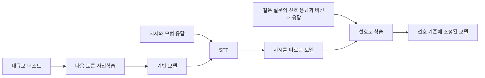
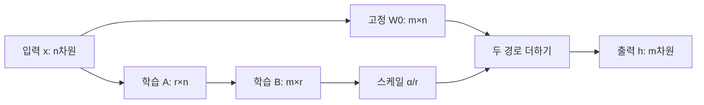
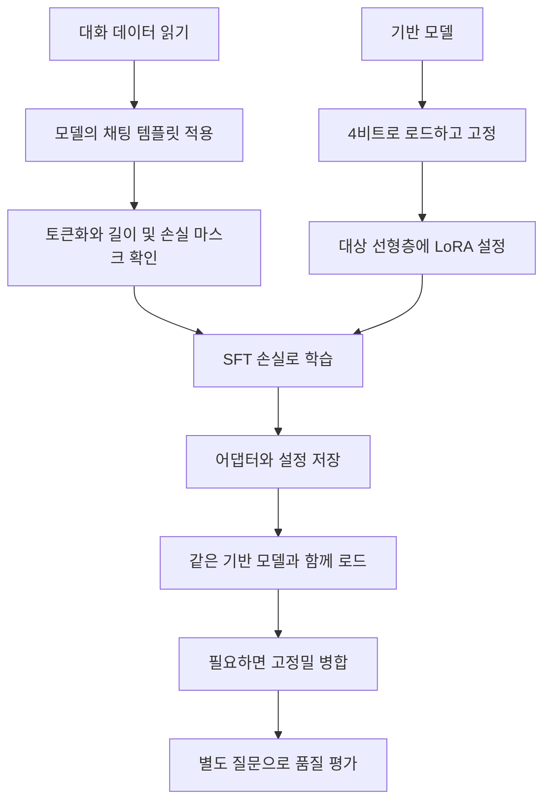
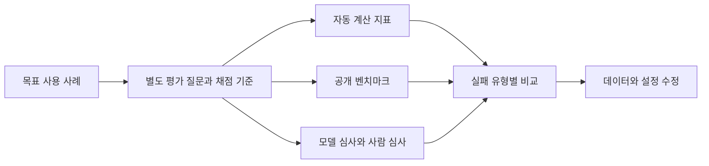
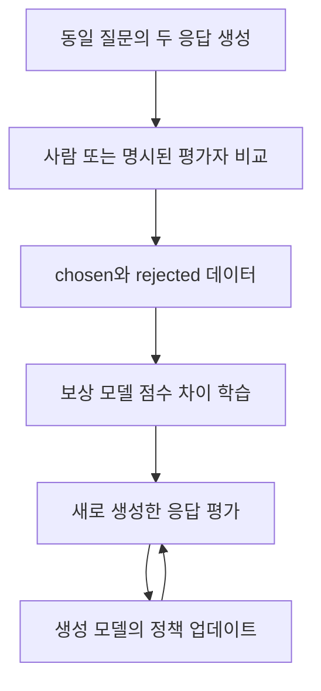

# 12장 생성 모델 미세 조정

[전체 목차](../../README.md) · [학습 노트](study.md) · [강의안](lecture.md) · [강의 대본](lecture-script.md) · [시각화](visuals.html) · [실습](lab-guide.md) · [복습 문제](quiz.md)

> 원문: Jay Alammar·Maarten Grootendorst, *Hands-On Large Language Models*, 2024, Chapter 12, **PDF 물리 페이지 487–535**. 아래 쪽수는 PDF 뷰어가 표시하는 물리 페이지다. 본문은 원문의 모든 절을 따라 재구성한 한국어 강의식 설명이다. **보충** 표시는 이해를 돕는 독립적인 계산·해설·주의점이다. 책의 모델·코드는 2024년 예제이며 현재 API의 실행 호환성을 뜻하지 않는다.

이 장의 질문은 “이미 언어를 배운 모델에게 내가 원하는 방식으로 답하게 하려면 무엇을 학습시켜야 하는가?”이다. 사전학습 모델은 문장을 이어 쓰는 능력을 갖지만, 사용자가 요구한 역할·출력 형식·답변 품질을 항상 만족하지는 않는다. 지도 미세 조정은 좋은 응답의 예를 보여 주고, 선호도 미세 조정은 같은 질문에 대한 두 응답 중 무엇을 더 선호하는지 알려 준다. LoRA와 QLoRA는 이 목표를 더 적은 학습 파라미터와 메모리로 달성하기 위한 방법이다. 평가까지 포함해야 “학습이 끝났다”와 “유용해졌다”를 구분할 수 있다.

## 학습 목표와 선수지식

이 자료를 마치면 다음을 설명하고 계산할 수 있어야 한다.

- 사전학습, SFT, 선호도 학습의 입력 데이터·목적·산출물을 비교한다.
- 전체 미세 조정과 PEFT의 비용 차이를 가중치·기울기·옵티마이저 상태·활성값으로 나누어 설명한다.
- LoRA의 행렬 차원, 학습 파라미터 수, 병합 결과를 손으로 검산한다.
- 4비트 저장과 16비트 계산을 구분하고 양자화 오차가 사라지지 않음을 이해한다.
- 채팅 템플릿, 응답 마스킹, 배치 누적, 길이 제한, 어댑터 저장·병합을 일관되게 설계한다.
- 퍼플렉서티·벤치마크·모델 심사·사람 평가가 무엇을 측정하고 놓치는지 판단한다.
- 보상 모델의 쌍별 학습과 DPO의 기준 모델 대비 로그확률 차이를 계산한다.
- 학습 손실 하락만으로 품질 향상을 단정하지 않고 별도 평가 자료로 검증한다.

3장의 다음 토큰 예측과 Transformer 블록, 6장의 생성 설정, 11장의 학습/검증 분리와 기울기 개념을 알고 있으면 좋다. 행렬 곱은 `(m×r)(r×n)=(m×n)`, 로그는 `log(ab)=log a+log b`, 미분은 “어느 방향으로 조금 바꾸면 손실이 줄어드는가” 정도부터 시작하면 된다.

## 상세 목차

1. [세 가지 학습 단계](#sec-01)
2. [SFT](#sec-02), [전체 미세 조정](#sec-03), [PEFT·어댑터·LoRA·QLoRA](#sec-04)
3. [QLoRA 지시 튜닝](#sec-05): [데이터 템플릿](#sec-06), [양자화](#sec-07), [LoRA 설정](#sec-08), [훈련 설정](#sec-09), [훈련](#sec-10), [병합](#sec-11)
4. [생성 모델 평가](#sec-12): [단어·토큰 지표](#sec-13), [벤치마크](#sec-14), [리더보드](#sec-15), [자동 평가](#sec-16), [사람 평가](#sec-17)
5. [선호도·정렬·RLHF](#sec-18), [보상 모델](#sec-19), [입출력](#sec-20), [보상 모델 학습](#sec-21), [보상 모델 없는 DPO](#sec-22)
6. [DPO 실습 흐름](#sec-23): [데이터](#sec-24), [양자화](#sec-25), [훈련 설정](#sec-26), [훈련·병합·ORPO](#sec-27)
7. [종합 정리](#sec-28), [원문 그림·표 안내](#figures), [학습 중 바로잡을 표현](#clarifications)

<a id="sec-01" name="sec-01"></a>
## 1. 세 가지 LLM 학습 단계

**원문 절:** The Three LLM Training Steps: Pretraining, Supervised Fine-Tuning, and Preference Tuning · **PDF 487–489**, Figures 12-1–12-3.

### 사전학습은 언어를 이어 쓰는 규칙을 배우는 단계다

문장 앞부분을 주고 다음 토큰을 맞히게 하면 데이터 자체에서 감독 신호를 만들 수 있다. 예를 들어 “비가 오면 우산을” 다음에 “쓴다”가 등장했다면 “쓴다”의 확률을 높이는 방향으로 가중치를 수정한다. 사람이 문장마다 정답을 별도로 붙이지 않았다는 뜻에서 자기지도 학습이라고 한다. “라벨이 없다”는 표현은 계산상 목표가 없다는 뜻이 아니다. 정답 토큰은 원문을 한 칸 이동시켜 얻는다.

많은 종류의 텍스트를 예측하려면 문법뿐 아니라 개체, 지식, 담화 구조 등의 규칙을 활용해야 한다. 그 결과가 기본 모델, 사전학습 모델, 기반 모델이라고 불리는 출발점이다. 그러나 “질문 다음에는 답을 해야 한다”라는 사용자 인터페이스까지 명시적으로 학습한 것은 아니다. 질문 목록을 많이 본 모델은 사용자의 질문 뒤에 또 다른 질문을 이어 쓸 수도 있다.

### SFT는 입력과 원하는 응답의 관계를 가르친다

지도 미세 조정에서는 `지시 → 좋은 응답` 형식의 데이터를 사용한다. 질문을 입력받으면 답변 형식을 출력하고, 요약 지시를 받으면 요약을 출력하는 사례를 반복한다. 학습의 기본 연산은 여전히 다음 토큰 예측이다. 달라지는 것은 데이터 구성과 손실을 적용할 위치다. 응답의 토큰은 사용자의 입력과 앞서 나온 응답 토큰에 조건부로 예측된다.

따라서 SFT가 새로운 모델 구조를 반드시 요구하는 것은 아니다. 같은 생성 모델을 지시 데이터로 계속 학습한다. 분류도 “리뷰를 보고 긍정 또는 부정을 출력하라”라는 생성 과제로 표현할 수 있다. 원문은 이 장에서 기반 모델을 대화 가능한 모델로 바꾸는 사례에 집중한다.

### 선호도 학습은 좋은 응답 사이의 선택 기준을 가르친다

두 답변이 모두 문법적으로 옳고 질문에 관련되어 있어도 하나는 더 도움이 될 수 있다. 초보자에게는 용어를 풀어 주는 답변이, 전문가에게는 중복을 줄인 답변이 좋을 수 있다. 선호도 학습은 이러한 상대적인 판단을 데이터에 담는다. 단순히 “맞는 문장을 더 많이 학습한다”보다 어떤 응답을 다른 응답보다 선호하는지에 초점을 둔다.

이 순서를 학교 교육에 비유하면 사전학습은 언어와 배경지식을 폭넓게 배우는 과정, SFT는 과제의 모범 답안을 따라 연습하는 과정, 선호도 학습은 여러 답안을 비교하며 품질 기준을 익히는 과정이다. 다만 모델은 사람처럼 의도나 도덕적 확신을 내면화한다고 가정할 수 없다. 실제로 바뀌는 것은 데이터에 따라 응답을 생성하는 확률 분포다.



| 단계 | 핵심 학습 자료 | 무엇을 개선하려는가 | 학습 후 확인할 것 |
|---|---|---|---|
| 사전학습 | 일반 텍스트와 그 다음 토큰 | 언어·지식의 통계적 표현 | 텍스트 예측과 기초 능력 |
| SFT | 지시 및 목표 응답 | 지시 준수, 출력 형식, 과제 행동 | 실제 요청을 수행하는가 |
| 선호도 학습 | 질문, chosen, rejected | 응답의 상대적 품질·선호 | 목표 사용자 기준으로 더 나은가 |

세 단계는 널리 쓰이는 설명 틀이며 모든 제품의 필수 고정 순서는 아니다. 이미 지시 튜닝된 모델을 가져와 도메인 SFT만 할 수도 있고, 이 장 말미의 ORPO처럼 목표를 결합하는 방법도 있다. 이 장의 학습 목적은 각 단계의 역할을 분리해서 이해하는 것이다.

<a id="sec-02" name="sec-02"></a>
## 2. 지도 미세 조정 SFT

**원문 절:** Supervised Fine-Tuning (SFT) · **PDF 489–490**, Figures 12-4–12-5.

기반 모델에 “대규모 언어 모델이란 무엇인가?”라고 입력했을 때 “어떤 특징이 있는가? 어디에 쓰는가?”라는 후속 질문을 생성했다고 생각해 보자. 문장 이어 쓰기 관점에서는 그럴듯하지만 사용자의 요청은 충족하지 않았다. SFT는 이런 상황에서 기대하는 출력이 정의·설명이라는 사실을 사례로 가르친다. 학습 데이터에 설명이 필요한 질문, 목록으로 답할 질문, 코드로 답할 질문 등이 포함되면 서로 다른 지시를 구별하는 데 도움을 준다.

**보충 수식:** 입력을 `x`, 목표 응답 토큰을 `y₁,…,yT`, 모델 파라미터를 `θ`라고 하면 응답 부분의 평균 손실은 다음과 같이 쓸 수 있다.

```text
L_SFT = -(1/T) Σ(t=1…T) log pθ(y_t | x, y_<t)
```

각 항은 정답 토큰에 부여한 확률의 음의 로그다. 정답 확률이 0.8이면 벌점은 약 0.223이고, 0.1이면 약 2.303이다. 정답 토큰을 매우 낮게 평가한 모델이 더 큰 벌점을 받는다. 훈련 때는 이전 응답 토큰으로 실제 정답을 제공한다. 이 방식과 추론 때 자신이 생성한 토큰을 다시 입력하는 방식은 구분해야 한다.

응답의 세 토큰에 대한 정답 확률이 `[0.8, 0.5, 0.25]`라면 응답 전체 확률은 `0.1`, 로그확률 합은 약 `-2.303`, 평균 손실은 약 `0.768`이다. 길이가 길수록 확률을 곱한 값은 작아지므로 확률 곱을 그대로 비교하거나 큰 배열에서 직접 곱하면 해석·수치 안정성 문제가 생긴다. 손실 계산은 로그확률을 사용한다.

사용자 입력도 언어 모델의 문맥에 들어간다. 하지만 응답만 잘 생성하도록 학습하려면 사용자 토큰의 손실을 마스킹할 수 있다. 여기서 마스킹은 토큰을 모델에 안 보여 준다는 뜻이 아니라 그 위치를 정답 손실의 평균에서 제외한다는 뜻이다. 전체 대화에 손실을 적용하는 설정도 존재하므로 자신이 사용하는 데이터 처리기의 실제 동작을 확인해야 한다. “SFT”라는 이름만 보고 자동으로 응답만 학습한다고 믿으면 안 된다.

<a id="sec-03" name="sec-03"></a>
## 3. 전체 미세 조정

**원문 절:** Full Fine-Tuning · **PDF 490–492**, Figures 12-6–12-7.

전체 미세 조정은 대상 모델의 모든 학습 가능한 가중치를 업데이트하는 방식이다. 사전학습과 같은 모델 전체를 조정하지만, 이미 배운 표현을 출발점으로 더 작고 목적에 맞는 데이터를 사용한다. 지시 수행뿐 아니라 특정 도메인의 언어 표현이나 특정 작업의 출력 패턴을 학습시키는 데도 사용할 수 있다.

“전체”라는 말은 새로 모든 지식을 처음부터 배우는다는 뜻이 아니다. 초기 가중치는 사전학습 모델에서 가져오며, 이후 기울기가 흐르는 범위가 모델 전체라는 뜻이다. 데이터가 작을수록 모델은 훈련 사례를 빠르게 외울 수 있으므로 작은 손실을 얻는 것보다 별도 질문에서 일반화하는지가 중요하다.

훈련 메모리는 모델 파일 크기와 같지 않다. 가중치를 보관하는 공간 외에 기울기, Adam과 같은 옵티마이저의 상태, 역전파를 위한 활성값, 임시 버퍼 등이 필요하다. 예를 들어 가중치만 16비트로 저장해도 10억 파라미터는 십진 기준 약 2GB이지만, 그 수치만으로 훈련에 필요한 GPU 메모리를 결정할 수 없다. 시퀀스 길이와 배치 크기를 늘리면 활성값 비용이 크게 늘 수 있다.

여러 고객용 모델을 각각 전체 미세 조정하면 각 버전의 전체 가중치를 저장하고 관리해야 한다. 반면 공통 기반 모델 하나와 작은 작업별 변경분을 관리할 수 있다면 저장·교체가 쉬워진다. 이것이 PEFT의 동기다. 다만 저장 비용이 줄었다고 모든 상황에서 추론 속도까지 같은 비율로 빨라지는 것은 아니다. 기반 모델의 대부분 연산은 여전히 수행한다.

**실무 보충:** 먼저 학습 없이 할 수 있는 프롬프트 개선이나 검색 증강으로 해결되는 문제인지 구분하면 좋다. 답변 스타일·고정 출력 형식·반복되는 작업 행동은 미세 조정 후보가 되기 쉽다. 자주 바뀌는 사실을 외워야 하는 문제라면 최신 자료를 검색해 제공하는 접근도 따로 고려한다. 이 구분은 미세 조정의 원리를 바꾸는 규칙이 아니라 실험 비용을 줄이는 출발점이다.

<a id="sec-04" name="sec-04"></a>
## 4. PEFT와 어댑터, LoRA, QLoRA

**원문 절:** Parameter-Efficient Fine-Tuning (PEFT) · **PDF 492–503**, Figures 12-8–12-18.

### 4.1 어댑터는 작은 추가 구성요소를 학습한다

PEFT는 사전학습 모델의 대부분을 고정하고 적은 수의 파라미터만 학습하는 방법들의 묶음이다. 원문은 먼저 어댑터를 소개한다. Transformer의 attention 뒤나 feedforward 뒤 같은 위치에 작은 모듈을 넣어 작업별 변화를 배우게 한다. 이 작은 모듈이 여러 블록에 걸쳐 존재하며, 이들을 한데 묶은 것이 하나의 작업별 어댑터다.

Figures 12-8과 12-9의 핵심은 어댑터가 출력층 하나에만 붙는 것이 아니라 모델 내부의 여러 블록에 배치된다는 점이다. Figure 12-10은 같은 기반 모델을 공유하면서 서로 다른 작업용 어댑터를 바꿔 끼우는 모습을 보여 준다. 형태가 같다는 이유만으로 임의의 모델에 어댑터를 결합할 수는 없다. 학습할 때 사용한 기반 가중치와 구조, 대상 층 이름·차원이 일치해야 한다.

원문이 소개한 초기 BERT 어댑터 연구에서는 전체 중 3.6%의 파라미터를 튜닝하고 GLUE에서 전체 튜닝에 근접한 성능을 보고했다. 이는 해당 연구 설정의 결과이지 모든 생성 모델에서 보장되는 수치가 아니다. AdapterHub는 이런 모듈을 공유하는 틀로 소개되며, LLaMA-Adapter는 생성 모델로 확장된 사례다. 저장 형식과 범용성은 구체적 방법에 따라 다르므로 “어댑터”라는 단어만으로 모든 세부 구현을 같다고 생각하지 않는다.

### 4.2 LoRA는 가중치의 변화량을 저랭크로 표현한다

LoRA의 핵심은 큰 가중치 행렬 `W₀` 자체를 작은 행렬로 바꾸는 것이 아니다. **고정된 `W₀`에 더할 변화량 `ΔW`를 작은 두 행렬의 곱으로 제한한다.** 원문의 압축 비유를 이 관점으로 읽어야 모델 구조를 정확히 이해할 수 있다.

입력 차원이 `n`, 출력 차원이 `m`인 선형층을 생각하자. 열벡터 입력 `x∈Rⁿ`에 대해 `W₀∈R^(m×n)`이고 출력은 `W₀x∈Rᵐ`이다. LoRA에서는 `A∈R^(r×n)`, `B∈R^(m×r)`를 학습하며 보통 `r`은 `m,n`보다 훨씬 작다.

```text
ΔW = (α/r) BA
h = W₀x + (α/r) B(Ax)
학습 파라미터 수 = r×n + m×r = r(m+n)
전체 행렬 파라미터 수 = mn
```

`A`는 입력을 작은 `r`차원 공간으로 투영하고, `B`는 그 표현을 출력 차원으로 옮긴다. `BA`는 원래 가중치와 같은 차원이라 더할 수 있다. `α/r`은 변화량의 크기를 조절하는 계수다. 이 식은 일반적인 원래 LoRA의 스케일 표기이며 변형 기법의 스케일 규칙까지 포괄하지는 않는다.



10×10 가중치라면 전체는 100개다. rank 1 변화량은 `(10×1)(1×10)`이므로 20개, rank 2는 40개가 된다. 그렇다고 rank 1 행렬이 임의의 10×10 행렬을 정확히 표현할 수 있는 것은 아니다. 행·열의 변화 방향에 제약이 있다. 중요한 가정은 특정 작업으로 적응하는 데 필요한 변화의 유효 차원이 충분히 작을 수 있다는 것이다.

**보충 손계산:** `B=[[1],[2]]`, `A=[[3,4,5]]`이면 `BA=[[3,4,5],[6,8,10]]`이다. 두 번째 행이 첫 번째 행의 두 배이므로 독립적인 변화 방향은 하나다. 이 구조에서는 두 번째 행을 `[6,8,11]`로만 바꾸는 임의의 수정은 할 수 없다. rank를 늘리는 것은 이런 표현의 자유도를 늘리는 선택이다.

원문 PDF 499의 큰 예시는 `12,288×12,288=150,994,944`개 가중치를 말한다. rank 8 변화량은 `12,288×8`과 `8×12,288`로 **196,608개**다. 본문에 “두 개의 12,288×2”라고 쓰인 부분은 이 숫자와 일치하지 않는다. rank 8 기준 차원으로 고쳐 읽어야 한다. 약 197K라는 결과는 rank 8 계산과 맞는다.

작은 rank가 항상 품질 손실을 일으킨다고 단정할 수도 없다. 충분한 표현력을 갖는 rank와 적절한 데이터를 선택하면 전체 미세 조정과 비슷하거나 일부 실험에서 더 좋은 결과를 낼 수도 있다. 핵심은 파라미터 수 자체가 품질을 보장하지 않는다는 점이다. 이 정의와 가중치 고정 원리는 [LoRA 원 논문](https://arxiv.org/abs/2106.09685)에서도 확인할 수 있다.

### 4.3 어떤 층을 대상으로 할 것인가

attention의 Q와 V 투영만 조정할 수도 있고, K·O와 feedforward의 여러 선형층까지 넓힐 수도 있다. 대상을 늘리면 배우는 변화의 위치가 늘어나지만 학습 파라미터와 비용도 증가한다. 이 선택은 rank와 별개의 축이다. “rank를 두 배로 늘리기”와 “대상 층의 종류를 늘리기”가 같은 모델 변화는 아니다.

LoRA는 여러 기반 층을 통과하는 계산을 없애지 않는다. 고정된 층이라도 그 층 앞의 학습 파라미터로 기울기를 전달해야 하는 경로에서는 역전파에 필요한 계산이 남는다. 따라서 학습 파라미터 수가 100분의 1이 되었다고 훈련 시간이 정확히 100분의 1이 되는 것은 아니다. 큰 장점은 기울기와 옵티마이저 상태의 학습 대상이 줄고, 작업별 저장 파일이 작아진다는 것이다.

### 4.4 양자화는 숫자의 저장 정밀도를 낮춘다

32비트·16비트 부동소수점은 표현 가능한 수의 범위와 촘촘함이 다르다. 같은 수를 낮은 정밀도로 표현하면 반올림 오차가 생길 수 있다. Figure 12-15의 원주율 예시는 표현 비용과 정확도의 교환 관계를 강조한다. 신경망 가중치에서도 작은 수치 오차가 생기지만, 전체 출력 품질에 미치는 영향은 모델과 방법에 따라 달라진다.

양자화에서는 연속적인 많은 값을 제한된 대표값에 대응시킨다. b비트는 최대 `2^b`개의 코드 조합을 갖는다. 4비트라면 16개의 코드다. 대표값 사이의 간격보다 가까운 원래 값은 같은 코드가 될 수 있다. Figures 12-16–12-18을 읽을 때 더 좋은 방법이 정보 손실을 **줄인다**고 이해해야지, 제한된 코드로 모든 실수의 차이를 완벽하게 보존한다고 이해하면 안 된다.

**보충 예제:** 범위가 `-1…1`이고 균일한 4단계만 쓴다면 대표값은 `-1,-1/3,1/3,1`처럼 배치할 수 있다. `0.10`과 `0.20`은 둘 다 `1/3`으로 반올림될 수 있다. 여기에 큰 이상값 8이 섞이면 하나의 전역 범위로 작은 값까지 표현하는 해상도가 더 나빠질 수 있다. 블록별로 범위를 정하면 이상값의 영향을 해당 블록에 제한할 수 있다. 다만 블록마다 스케일을 저장하는 추가 비용이 생긴다.

### 4.5 QLoRA에서 4비트인 것과 학습되는 것을 구분한다

QLoRA는 기반 가중치를 4비트로 양자화하여 고정하고, 그 경로를 이용한 계산을 통해 LoRA 파라미터를 학습한다. 학습 가능한 LoRA 파라미터까지 모두 4비트 정수로 업데이트한다는 뜻이 아니다. 저장 정밀도와 행렬 연산의 계산 dtype은 다를 수 있다. 원문 예제는 `nf4` 저장과 float16 계산을 함께 사용한다.

NF4는 정규분포를 가정한 가중치의 밀도를 고려하여 4비트 대표값을 배치한다. 자주 나오는 값 근처에 해상도를 더 배분하는 직관이다. 신경망의 모든 가중치가 원래부터 정확히 `-1…1`에 속한다는 뜻은 아니다. 블록의 스케일로 정규화한 값과 원래 가중치를 구분해야 한다. 블록별 양자화·NF4도 비가역 오차를 남기며, 오차의 영향은 평가로 확인한다.

원문 말미의 double quantization은 가중치를 두 번 무조건 반올림한다는 뜻보다 **양자화에 사용하는 상수도 양자화하여 저장 비용을 줄이는 방법**으로 이해하는 것이 정확하다. paged optimizer는 메모리 사용량이 튀는 상황을 관리하는 별개의 메모리 기법이다. 세 장치는 역할이 다르다. [QLoRA 원 논문](https://arxiv.org/abs/2305.14314)은 NF4, double quantization, paged optimizer를 구분하고, 고정된 4비트 기반 모델을 통해 저랭크 어댑터로 기울기를 전달한다고 설명한다.

| 방법 | 기반 가중치 | 학습 대상 | 주된 비용 절감 | 혼동하지 말 것 |
|---|---|---|---|---|
| 전체 미세 조정 | 업데이트 | 모델 전체 | 별도 절감 없음 | 처음부터 학습하는 것은 아님 |
| 일반 어댑터 | 대부분 고정 | 삽입한 모듈 | 학습 상태·작업별 저장 | 아무 기반 모델과 교환 불가 |
| LoRA | 고정 | 저랭크 A·B | 학습 파라미터·상태 | 기반 모델을 삭제하지 않음 |
| QLoRA | 양자화 후 고정 | 보통 더 높은 정밀도의 LoRA | 기반 가중치 저장까지 절감 | 전체 훈련이 4비트 연산은 아님 |

<a id="sec-05" name="sec-05"></a>
## 5. QLoRA로 지시 튜닝하기

**원문 절:** Instruction Tuning with QLoRA · **PDF 503–511**.

원문은 TinyLlama 기반 모델에 지시 데이터를 학습시켜 대화 형식에 더 적합한 모델로 조정한다. 전체 흐름은 데이터 형식 통일, 기반 모델 양자화 로드, LoRA 추가, 학습 설정, SFT 실행, 저장과 병합이다. 각 단계는 독립적인 설정처럼 보이지만 서로 일치해야 한다. 예컨대 학습 템플릿의 역할 구분자를 추론 때 생략하면 학습한 조건과 다른 입력을 주는 셈이다.

여기서는 원문의 실행 의도와 설정을 설명한다. 제공한 `lab.py`는 이 원리를 작은 행렬과 확률로 직접 계산하는 CPU 실습이며 TinyLlama 훈련을 수행하지 않는다. 원문의 GPU 훈련 시간·메모리 수치는 당시 환경의 예시다. 같은 수치를 자신의 장비에서 보장받는다고 생각해서는 안 된다.



<a id="sec-06" name="sec-06"></a>
## 6. 지시 데이터의 채팅 템플릿

**원문 절:** Templating Instruction Data · **PDF 503–505**, Figure 12-19.

사람에게는 “사용자:”와 “도우미:”라는 표시가 자연스럽지만 모델에게는 일정한 토큰 패턴이다. 채팅 템플릿은 시스템·사용자·어시스턴트 역할, 메시지 경계, 응답 시작 위치를 직렬화한다. 같은 대화라도 모델이 기대한 형식으로 배열해야 다음 출력의 역할이 분명해진다. Figure 12-19는 이런 경계가 대화 내용을 어떻게 분리하는지 보여 준다.

원문은 TinyLlama의 채팅 토크나이저가 가진 `apply_chat_template`를 이용한다. 학습 모델은 기반 모델이지만, 대화 형식은 채팅 모델에서 가져와 지시 수행을 가르치는 구성이다. 원문 데이터는 `HuggingFaceH4/ultrachat_200k`의 `test_sft` 분할에서 seed 42로 섞은 3,000개 사례다. 이는 책의 빠른 실습을 위한 선택이며, 분할 이름이 `test`여도 이를 실제로 훈련에 썼다면 더 이상 독립 평가용으로 사용할 수 없다.

다음은 원문의 역할 경계를 설명하기 위한 별도 예다.

```text
<|user|>
다음 문장을 한 줄로 요약해 주세요: 회의에서는 일정과 담당자를 확정했다.</s>
<|assistant|>
회의에서 일정과 담당자를 확정했습니다.</s>
```

여기서 종료 토큰과 역할 토큰은 장식이 아니다. 여러 턴을 이어 붙일 때 누가 말하고 있는지와 어디서 멈춰야 하는지를 알려 준다. 추론 때 사용자 메시지와 어시스턴트 시작 표식을 넣고, 모델이 응답을 생성하도록 해야 한다. 학습 때 종료 토큰을 누락하면 응답 뒤에 또 다른 사용자 대화를 만들어 내는 경향이 생길 수 있으므로 출력 종료 동작도 평가한다.

**보충 데이터 점검:** 서로 모순되는 응답, 요청을 따르지 않는 응답, 반복적인 형식 오류가 많으면 그 패턴도 학습될 수 있다. 긴 대화가 길이 제한에 잘려 응답이 사라진 사례는 특히 확인해야 한다. 학습 전에 몇 개의 문자열만 보는 대신, 토큰화 후 역할 토큰·정답 마스크·종료 위치를 함께 출력하면 형식 오류를 빨리 발견할 수 있다.

원문의 토크나이저 모델명은 PDF에 `TinyLlama/TinyLlama-1.1BChat-v1.0`으로 인쇄되어 있다. 이름은 복사만 해서 맞다고 가정하지 말고 실제 사용하려는 모델의 저장소 식별자와 템플릿을 확인한다. 이 자료는 해당 원문 문자열의 현재 다운로드 성공 여부를 주장하지 않는다.

<a id="sec-07" name="sec-07"></a>
## 7. 기반 모델 양자화 설정

**원문 절:** Model Quantization · **PDF 505–506**.

원문 기반 체크포인트는 `TinyLlama/TinyLlama-1.1B-intermediate-step-1431k-3T`이다. `BitsAndBytesConfig`는 어떤 압축 형식으로 모델을 불러올지를 묶어 전달하는 설정 객체로 사용된다. 실행 버전에 따라 인터페이스는 바뀔 수 있지만 다음 네 설정의 의미는 구분해서 이해할 수 있다.

| 원문 설정 | 원문 값 | 학습할 의미 |
|---|---|---|
| `load_in_4bit` | `True` | 기반 가중치를 4비트 양자화 형식으로 로드 |
| `bnb_4bit_quant_type` | `nf4` | 분포를 고려한 4비트 코드 형식 |
| `bnb_4bit_compute_dtype` | float16 | 계산에 사용하는 dtype의 선택 |
| `bnb_4bit_use_double_quant` | `True` | 양자화 상수 저장 비용도 줄임 |

책은 양자화 후 모델 로드에 약 1GB, 양자화하지 않은 경우 약 4GB VRAM을 언급한다. 이는 원문의 예시이며 가중치 비트수만으로 계산한 이론 하한과도 다르다. 런타임 버퍼, 양자화 메타데이터, 다른 정밀도를 유지하는 층 등에 따라 달라질 수 있다. 특히 훈련 때는 활성값과 학습 상태가 더해지므로 “1GB로 로드됐다”에서 “1GB로 훈련 가능하다”로 넘어가면 안 된다.

원문은 `use_cache=False`를 지정한다. 생성 시 다음 토큰을 빠르게 처리하기 위한 KV 캐시와 훈련 중 역전파 메모리 전략은 목적이 다르다. 학습에서는 불필요한 캐시를 끄는 설정을 사용한다. `device_map="auto"` 역시 장치 배치 지시이며, 여러 장치 학습을 자동으로 항상 올바르게 구성한다는 보장은 아니다. 학습 환경에서는 프레임워크가 지원하는 배치 전략을 따로 확인한다.

토크나이저의 패딩도 데이터와 함께 검증한다. 원문은 `pad_token="<PAD>"`와 왼쪽 패딩을 사용한다. 임의 문자열을 pad token으로 지정하는 것과 그 토큰이 실제 vocabulary의 독립적인 ID로 존재하는 것은 다르다. 새 토큰을 추가했다면 임베딩 크기의 일치가 필요할 수 있다. 패딩 위치는 attention mask와 손실 마스크로 제외해야 하며, 그렇지 않으면 모델이 의미 없는 패딩까지 정답으로 학습한다.

<a id="sec-08" name="sec-08"></a>
## 8. LoRA 구성

**원문 절:** LoRA Configuration · **PDF 506–508**.

원문 설정은 rank 64, alpha 32, dropout 0.1, bias 학습 없음, causal language modeling 작업이다. 대상 모듈은 `q_proj`, `k_proj`, `v_proj`, `o_proj`와 `gate_proj`, `up_proj`, `down_proj`다. 전자는 attention의 투영, 후자는 feedforward의 투영에 해당한다. 실제 모델에서 같은 이름을 쓰는지와 차원이 맞는지는 모델 구조를 보고 확인한다.

`r`을 키우면 `r(m+n)`에 비례하여 파라미터 수가 늘고, 허용되는 변화량의 최대 rank도 커진다. 하지만 과제 데이터가 적거나 단순하면 그 자유도가 꼭 필요한 것은 아니다. rank만 높이고 결과를 보지 않으면 더 많은 계산으로 과적합을 키울 수 있다. 반대로 학습이 충분히 진행되어도 목표 행동을 표현하지 못한다면 대상 층이나 rank가 너무 제한적인지 실험할 수 있다.

`lora_alpha`는 위 식의 `α/r`을 통해 변화량의 스케일에 관여한다. 원문은 alpha를 rank의 두 배로 두는 경험칙을 설명하지만 실제 코드에서는 `α=32`, `r=64`를 사용한다. 따라서 경험칙을 필수 규칙으로 읽지 않는다. 이 코드의 스케일은 `0.5`다. rank 실험을 할 때 alpha를 고정할지 `α/r`을 고정할지 정해야 두 효과가 섞이지 않는다.

dropout은 LoRA 경로에서 일부 활성값을 훈련 중 무작위로 생략하여 특정 패턴에 과도하게 의존하지 않도록 하는 설정이다. 학습 시의 무작위 동작과 평가 모드의 동작을 구분한다. bias를 학습하지 않는 설정은 작은 행렬 외의 추가 학습 범위를 제한한다.

`prepare_model_for_kbit_training`은 저비트 기반 모델을 학습에 맞게 준비하고, `get_peft_model`은 대상 모듈에 PEFT 구성을 적용하는 역할로 등장한다. 이름만 믿기보다 출력된 학습 가능 파라미터의 개수와 이름을 점검해야 한다. 원하는 것은 “모델 전체가 고정되어 학습이 전혀 안 되는 상태”도, “실수로 모든 가중치가 업데이트되는 상태”도 아니다. LoRA 경로만 의도대로 학습되는지 확인한다.

<a id="sec-09" name="sec-09"></a>
## 9. SFT 훈련 설정

**원문 절:** Training Configuration · **PDF 508–509**.

원문은 장치별 배치 2, gradient accumulation 4, 한 epoch, 학습률 `2e-4`, cosine scheduler, `paged_adamw_32bit`, float16, gradient checkpointing을 사용한다. 하나씩 외우기보다 각각이 품질·메모리·업데이트 횟수 중 어디에 작용하는지 이해한다.

한 장치에서 마이크로 배치가 2이고 누적이 4라면 일반적인 완전한 누적 단계의 유효 배치는 `2×4=8` 사례다. 4번의 작은 forward/backward를 거친 기울기를 모아 한 번 optimizer step을 수행한다. 여러 장치에서 동일하게 병렬 학습하면 장치 수까지 곱하지만, 마지막 불완전 배치와 샘플링·패킹 설정은 따로 고려해야 한다.

gradient checkpointing은 역전파를 위해 모든 중간 활성값을 저장하는 대신 일부를 나중에 재계산하여 메모리를 줄인다. 메모리 절약과 추가 연산을 교환하는 방식이다. gradient accumulation은 한 번에 처리할 사례 수를 줄이는 방식이므로 서로 대체어가 아니다. 두 방법을 함께 쓸 수 있다.

학습률은 한 번의 업데이트가 얼마나 큰지에 영향을 준다. 너무 크면 이미 배운 표현이 흔들리거나 손실이 불안정해질 수 있고, 너무 작으면 제한된 시간 동안 충분히 적응하지 못한다. epoch 수도 고정된 정답이 없다. 원문의 낮은 epoch 권고는 작은 지시 데이터에서 과도한 학습을 경계하는 맥락이며 모든 데이터셋에서 여러 epoch가 나쁘다는 법칙은 아니다.

cosine scheduler는 학습률을 코사인 모양으로 줄이는 일정이다. **보충:** warmup은 별도 설정이 있어야 한다. 원문 설명은 초기 선형 증가를 언급하지만 앞의 SFT 코드에는 `warmup_steps`나 `warmup_ratio`가 없다. 단순히 `cosine`이라는 문자열만으로 초기 warmup이 항상 활성화된다고 해석하지 않는다. 뒤의 DPO 예제는 `warmup_ratio=0.1`을 명시한다.

훈련의 관찰 단위도 중요하다. `logging_steps=10`은 기록 주기이며 평가 주기와 같지 않다. 로그가 자주 나온다고 별도 검증 데이터를 사용하고 있다는 뜻은 아니다. 손실, 메모리, 처리량을 관찰하되 최종 모델 선택은 별도 질문·지표로 수행한다.

<a id="sec-10" name="sec-10"></a>
## 10. SFT 실행과 저장

**원문 절:** Training · **PDF 509–510**.

원문에서는 TRL의 `SFTTrainer`에 모델, 데이터, 텍스트 열, 토크나이저, 학습 인수, 최대 길이 512, PEFT 구성을 전달하고 `train()`을 실행한다. 이 호출 뒤에서 배치 생성, 토큰화, 손실 계산, 역전파, optimizer step 등이 반복된다. 간단한 한 줄이 학습을 대신해 주지만 데이터와 마스크를 검증해야 하는 책임까지 사라지지는 않는다.

길이 제한 512는 원문을 문자 512개로 자른다는 뜻이 아니라 토큰 기준의 길이 설정이다. 한국어와 영어는 같은 글자 수에서도 토큰 수가 다를 수 있다. 대화의 앞부분을 남기고 뒷부분을 자르는지, 응답을 어떻게 보존하는지는 데이터 처리 동작을 확인한다. 학습 텍스트에 응답이 거의 남지 않는다면 모델은 원하는 응답 행동을 배울 기회가 부족하다.

저장 호출은 `TinyLlama-1.1B-qlora`에 학습된 QLoRA 어댑터를 보관하는 흐름이다. 이 작은 파일만으로 기반 모델 없이 답변할 수 있는 것은 아니다. 어댑터는 무엇을 얼마나 바꾸는지를 담으므로 원래 가중치와 구성도 필요하다. 학습 데이터 버전, 기반 체크포인트, 토크나이저·템플릿, LoRA 대상 층, rank를 함께 기록해야 결과를 재현할 수 있다.

책은 당시 Colab의 T4에서 약 한 시간 정도가 걸릴 수 있다고 설명한다. 이 자료에서는 GPU 훈련을 실행하지 않았으므로 그 시간을 실측 결과처럼 제시하지 않는다. 실제 훈련 전에 짧은 샘플로 한두 업데이트를 돌려 loss가 유한하고 저장·재로드가 되는지 확인한 후 전체 실험을 진행하는 편이 오류 비용을 줄인다.

<a id="sec-11" name="sec-11"></a>
## 11. 가중치 병합

**원문 절:** Merge Weights · **PDF 510–511**.

LoRA 경로와 기반 경로를 따로 계산할 수도 있고, 학습을 마친 뒤 `Wmerged=W₀+(α/r)BA`를 계산해 한 가중치로 합칠 수도 있다. 두 경로는 같은 정밀도와 평가 설정에서 대수적으로 같은 선형 변환을 표현한다. 별도 LoRA dropout이 훈련 모드에서 활성화된 경우에는 이 단순한 추론 등가성을 그대로 적용하지 않는다.

원문은 어댑터를 불러와 `merge_and_unload()`로 병합하고 텍스트 생성 파이프라인에 넣는다. 텍스트에서는 16비트 재로드를 설명하지만 제시된 코드에는 dtype을 명시하지 않는다. 실행 환경의 기본값에 맡기지 말고 실제 dtype을 확인해야 한다. 양자화 상태에서 병합하거나 다시 양자화하면 추가 반올림 오차가 생길 수 있다.

병합은 사용의 유일한 방법이 아니다. 기반 모델과 어댑터를 함께 로드하여 동적으로 사용하는 것도 가능하다. 하나의 작업만 배포한다면 병합 모델이 단순할 수 있고, 여러 작업의 어댑터를 교체해야 한다면 분리해 관리하는 편이 목적에 맞을 수 있다. 병합 여부를 결정할 때 저장 크기, 교체 필요성, 지원되는 런타임을 함께 고려한다.

추론 입력은 학습과 같은 채팅 템플릿으로 만들고 어시스턴트 응답 시작점을 넣는다. 책은 LLM을 설명하라는 요청에 응답하는 예를 보여 준다. 그 한 사례는 지시 준수의 가능성을 보여 주지만 모든 질문에서 성공한다는 증거는 아니다. 학습 전후를 같은 질문·생성 설정에서 비교하고, 훈련에 없던 질문을 사용해야 한다.

<a id="sec-12" name="sec-12"></a>
## 12. 생성 모델 평가의 전체 그림

**원문 절:** Evaluating Generative Models · **PDF 511–512**.

생성 모델은 정답이 하나인 분류기보다 평가가 복잡하다. 같은 내용을 정확하게 답해도 표현, 길이, 근거, 형식 준수, 사용자 수준에 맞는 정도가 다르다. 수학 성적이 높은 모델이 코드 생성에서도 높다고 보장할 수 없으며, 하나의 종합 점수가 모든 실제 요청을 대표하지도 않는다.

따라서 학습 목표를 평가 항목으로 먼저 바꾸어야 한다. 예를 들어 “고객 문의에 친절히 답한다”를 학습한다면 사실성, 요청 해결 여부, 불필요한 장황함, 정해진 형식, 모르는 사항의 처리 등을 분리해서 판단한다. 손실이 내려가도 이런 항목이 나빠질 수 있다. 같은 분포의 훈련 문장을 더 잘 외운 것과 사용자에게 더 좋은 답변을 주는 것은 다른 관찰이다.



<a id="sec-13" name="sec-13"></a>
## 13. 단어·토큰 수준 지표

**원문 절:** Word-Level Metrics · **PDF 512**, Figure 12-20.

퍼플렉서티는 정답 텍스트의 다음 토큰을 얼마나 예상하기 쉬워하는지 측정한다. 평균 음의 로그우도 `L`이 자연로그 기준이라면 `PPL=exp(L)`이다. 세 정답 토큰의 확률이 `[0.8,0.5,0.25]`라면 앞서 계산한 `L≈0.7675`에서 `PPL≈2.1544`다. 정답 확률의 기하평균이 커지면 PPL은 작아진다. Figure 12-20의 다음 단어 예측 그림은 이 평가가 생성 모델의 기본 확률 출력을 활용한다는 점을 강조한다.

PPL을 “항상 몇 개의 후보 중 고민하는가”라는 정확한 행동 횟수로 해석하면 안 된다. 확률분포의 불확실성을 이해하기 위한 직관적 비유일 뿐이다. 서로 다른 토크나이저·평가 텍스트·마스킹 규칙을 쓰는 모델의 수치를 직접 나열하는 것도 조심해야 한다. 평가 단위와 데이터가 같아야 비교가 의미 있다.

ROUGE는 참조 답안과의 겹침을 특히 재현율 관점에서 살피는 지표군이고, BLEU는 n-gram 겹침과 길이 페널티 등을 사용하는 대표적인 번역 평가 지표다. 문구가 겹치는지는 자동으로 빠르게 확인할 수 있지만 같은 뜻을 다른 말로 쓴 답변이 불리할 수 있다. 반대로 참조와 단어가 비슷하더라도 핵심 부정어 하나가 바뀌면 사실상 틀린 답일 수 있다.

원문은 BERTScore도 이 범주에서 함께 소개한다. 다만 BERTScore는 단순한 문자열 일치가 아니라 문맥 임베딩의 유사성을 활용한다는 점을 구분한다. 임베딩 유사도가 사실성이나 요구 조건 충족을 완전히 보장하는 것도 아니다. 각 지표가 세는 것이 무엇인지 알아야 결과를 과장하지 않는다.

<a id="sec-14" name="sec-14"></a>
## 14. 벤치마크

**원문 절:** Benchmarks · **PDF 512–515**, Table 12-1.

벤치마크는 정해진 문제와 평가 절차를 통해 모델을 비교하게 해 준다. 직접 만든 질문 몇 개보다 넓은 범위를 다룰 수 있고, 다른 연구와 결과를 비교하는 공통 언어가 된다. 하지만 학습 데이터에 평가 문제나 유사한 해설이 들어가면 실제 일반화 능력보다 높은 점수를 얻을 수 있다. 공개된 문제를 반복적으로 최적화하는 것도 평가의 독립성을 약화한다.

| 원문 벤치마크 | 주로 보는 능력 | 이 점수만으로 알 수 없는 것 |
|---|---|---|
| MMLU | 57개 과목에 걸친 폭넓은 지식과 문제 해결 | 특정 회사 업무의 신뢰성 |
| GLUE | 여러 언어 이해 과제 | 긴 대화의 품질 전체 |
| TruthfulQA | 그럴듯한 잘못된 답변에 대한 진실성 | 모든 최신 사실의 정확성 |
| GSM8K | 초등학교 수준의 수학 문장제 | 모든 종류의 수학·코딩 능력 |
| HellaSwag | 문맥에 맞는 상식적 후속 상황 선택 | 자유 형식 설명의 품질 |
| HumanEval | 원문의 164개 프로그래밍 과제에서 코드 평가 | 실제 대규모 저장소 유지보수 |

이 표는 원문 Table 12-1의 목적을 풀어 설명한 것이며 현재 리더보드의 구성이나 순위를 말하지 않는다. 숫자가 높은 모델을 찾는 것보다 목표 과제와 가까운 벤치마크를 선택하는 것이 먼저다. 코드 작업이라면 수학 점수만 보는 것보다 코드 실행에 기반한 평가가 더 직접적이다. 한국어 고객 문의 시스템이라면 한국어 실제 질문과 출력 제약을 포함한 별도 평가도 필요하다.

벤치마크를 돌리는 비용도 실험 설계에 들어간다. 많은 문제에 긴 출력을 생성하면 평가 자체에 상당한 시간과 메모리가 들 수 있다. 매 업데이트마다 모든 벤치마크를 수행하는 대신 작은 개발 평가와 최종의 넓은 평가를 분리할 수 있다. 이때 개발 평가에 반복 적응했다면 마지막 평가용 데이터는 계속 분리해 둬야 한다.

<a id="sec-15" name="sec-15"></a>
## 15. 리더보드

**원문 절:** Leaderboards · **PDF 515–516**.

리더보드는 여러 벤치마크 결과를 한곳에서 비교하게 해 준다. 원문은 당시의 Open LLM Leaderboard를 예로 들며 여러 평가에서 상위인 모델을 쉽게 찾을 수 있다는 장점을 설명한다. 하지만 표의 순위가 자신의 응용에서의 순위와 같다는 보장은 없다. 각 벤치마크의 가중치, 출력 길이, 테스트 조건, 데이터 오염 여부가 결과 해석에 영향을 준다.

평균 점수는 서로 다른 능력을 합친다. 가령 모델 A는 수학에서 우수하고 한국어 요약에서 약하며, 모델 B는 반대라면 단일 평균만으로 어느 쪽이 좋은지 결정하기 어렵다. 사용 목적에 가까운 하위 지표를 먼저 보고, 실제 입력과 비슷한 질문으로 확인하는 것이 타당하다.

리더보드를 목표로 최적화하면 공개된 평가에만 적응할 위험이 있다. 모델 선택의 후보를 줄이는 출발 자료로 쓰되, 독립적인 최종 검증을 대체하지 않는다. 이 장은 2024년 출간 시점의 사례를 설명하므로 리더보드의 현재 구성과 최고 모델은 여기서 단정하지 않는다.

<a id="sec-16" name="sec-16"></a>
## 16. 자동 평가와 LLM 심사

**원문 절:** Automated Evaluation · **PDF 516**.

LLM-as-a-judge는 다른 언어 모델에게 답변의 품질을 평가하도록 하는 방식이다. 점수를 매길 수도 있고, 같은 질문에 대한 A와 B 중 더 나은 응답을 선택하게 할 수도 있다. 정답 문자열이 하나로 고정되지 않는 요약·설명·대화에서 유용한 접근이다. 평가 기준을 자연어로 기술할 수 있다는 점도 장점이다.

그러나 심사 모델의 선택은 사실 확인의 자동 보증이 아니다. 더 긴 답변을 좋아하거나 표현이 매끄러운 오답을 높게 평가할 수 있으며, 답변 제시 순서가 결과에 영향을 줄 수도 있다. **보충 실험 설계:** 모델 이름을 가리고, A/B 순서를 뒤집어 반복하고, “사실성·질문 해결·형식·간결성”을 별도 기준으로 제공하면 일부 편향을 관찰할 수 있다. 그래도 사람의 검토 표본과 비교해 어느 유형의 실수를 하는지 확인한다.

쌍별 비교에서 A가 B보다 낫다는 결과와 A가 실서비스 기준을 통과한다는 판단은 다르다. 둘 다 틀렸지만 A가 조금 덜 틀릴 수도 있다. 따라서 상대 평가 외에 최소 기준 위반 여부도 따로 측정하면 품질을 더 정확히 이해할 수 있다.

<a id="sec-17" name="sec-17"></a>
## 17. 사람 평가와 Goodhart의 법칙

**원문 절:** Human Evaluation · **PDF 516–517**.

사람 평가는 실제 사용 목적과 선호를 직접 반영할 수 있다는 점에서 중요하다. 원문은 익명 두 모델의 응답을 비교해 선호를 투표하는 Chatbot Arena 사례를 소개한다. 모델 이름을 숨기면 브랜드나 기대에 의한 편향 일부를 줄일 수 있다. 여러 쌍의 승패를 종합하면 상대적인 순위를 만들 수 있다.

원문의 투표 수와 순위 설명은 당시의 예시이며 현재 규모를 의미하지 않는다. Elo와 같은 상대 평가의 직관은 강한 상대를 이기면 더 많은 정보가 생긴다는 것이다. 그러나 참여 사용자의 질문·언어·선호가 자신의 업무 사용자와 다르면 같은 순위가 나오지 않을 수 있다. 군중의 평균 취향과 특정 도메인의 평가 기준은 다른 자료다.

사람도 일관되지 않을 수 있으므로 평가표가 필요하다. “좋은 답변인가?” 하나만 묻기보다 핵심 사실 포함, 근거 없는 주장, 요구 형식, 설명 수준 등을 나누고 예시 기준을 제공한다. 서로 다른 평가자가 같은 응답을 평가했을 때 어디에서 의견이 갈리는지 보면 기준 자체의 모호함을 찾을 수 있다.

원문은 Goodhart의 법칙을 통해 측정값을 목표로 삼을 때 측정의 의미가 약해질 수 있다고 경고한다. 문법 정확도만 최적화하면 언제나 매우 단순한 한 문장만 출력하는 모델이 그 지표에서는 좋아 보일 수 있다. 문법, 정보성, 요청 해결을 함께 보아야 한다. 자신의 시스템에 맞는 평가를 설계한다는 것은 단일 점수를 최대화하는 것보다 여러 실패 유형을 발견하는 일에 가깝다.

<a id="sec-18" name="sec-18"></a>
## 18. 선호도 튜닝, 정렬, RLHF

**원문 절:** Preference-Tuning / Alignment / RLHF · **PDF 518–519**, Figures 12-21–12-23.

SFT로 질문에 답하는 형식을 배워도 모든 응답이 같은 정도로 유용하지는 않다. “LLM이 무엇인가?”라는 질문에 약자를 풀어 주는 한 문장만 출력할 수도 있고, 원리와 용도를 적절히 설명할 수도 있다. 어느 쪽을 원하는지는 사용자와 상황에 따라 달라진다. 선호도 데이터는 이런 구체적인 선택 기준을 반영한다.

원문 그림은 프롬프트에서 응답을 생성하고, 평가자가 점수를 매기고, 그 점수를 이용해 모델을 바꾸는 순서를 보여 준다. 높은 평가를 받은 유형의 응답을 더 자주 생성하도록 하고, 낮은 평가의 유형은 덜 생성하도록 조정한다는 직관이다. 다만 실제 학습 알고리즘은 단순히 점수만큼 모든 토큰을 올리거나 내리는 수동 규칙이 아니다. 응답 확률과 목적함수를 통해 파라미터에 기울기를 계산한다.

정렬은 모델의 행동을 특정 선호 기준에 맞추는 넓은 표현이고, RLHF는 인간 피드백을 활용하는 강화학습 접근을 가리킨다. 둘을 완전히 같은 단어로 쓰면 DPO처럼 전통적인 강화학습 루프를 사용하지 않는 선호 최적화를 설명하기 어려워진다. 이 장에서는 선호도 학습이라는 상위 문제 아래 보상 모델을 이용한 방법과 DPO를 비교한다.

**보충:** 데이터가 “더 길면 더 좋다”만 반복해서 가르치면 장황한 답변이 선호될 수 있다. “짧을수록 좋다”만 가르치면 필요한 설명이 사라질 수 있다. 원하는 기준을 추상적인 구호로 정하는 대신 같은 질문의 구체적인 응답 쌍으로 표현하면 상충하는 목표가 드러난다. 평가자 간 의견이 다른 사례를 무조건 버리기보다 질문의 목적이 충분히 명확했는지 검토하는 것도 도움이 된다.

<a id="sec-19" name="sec-19"></a>
## 19. 보상 모델로 선호 평가 자동화하기

**원문 절:** Automating Preference Evaluation Using Reward Models · **PDF 519–520**, Figures 12-24–12-25.

모델이 생성할 때마다 사람이 읽고 점수를 줄 수는 있지만 많은 학습 예제에서 이를 반복하면 비용이 크다. 보상 모델은 사람의 비교 판단을 학습하여 새 응답의 상대적인 품질 점수를 계산한다. 생성 모델과 평가 모델이 서로 다른 역할을 맡는 구조다. 생성 모델은 응답을 만들고, 보상 모델은 질문과 응답을 함께 보고 점수를 낸다.

원문은 지시 튜닝된 모델의 언어 모델링 헤드를 점수를 출력하는 헤드로 바꾸는 직관을 제시한다. 언어 모델 헤드가 vocabulary에 대한 확률을 만들었다면, 점수 헤드는 입력 전체를 대표하는 스칼라를 출력하도록 설계된다. 그림의 “classification head”라는 표현 때문에 반드시 여러 고정 클래스 중 하나만 예측한다고 생각하지 말자. 여기서 필요한 출력은 선호를 비교하기 위한 단일 값이다.

기존 언어 모델을 복사해 헤드를 바꾸었다고 곧바로 좋은 심사자가 되지는 않는다. 새 점수 출력이 사람의 판단과 일치하도록 추가 학습이 필요하다. 학습 데이터가 편향되어 있으면 보상 모델도 그 편향을 배울 수 있다. 또한 보상 모델이 경험하지 않은 종류의 답변을 생성 모델이 만들 때 점수의 신뢰성이 떨어질 수 있다.

<a id="sec-20" name="sec-20"></a>
## 20. 보상 모델의 입력과 출력

**원문 절:** The Inputs and Outputs of a Reward Model · **PDF 520–521**, Figure 12-26.

보상 모델의 입력은 응답만이 아니라 `질문 x + 응답 y`다. 같은 응답도 질문에 따라 유용성이 달라지기 때문이다. “한 문장으로 정의하라”라는 요청에는 짧은 설명이 좋을 수 있지만 “단계별로 상세히 설명하라”라는 요청에는 부족할 수 있다. 질문을 제외하고 문장 자체만 평가하면 지시 준수 여부를 판단하기 어렵다.

출력은 보통 `rφ(x,y)`와 같은 하나의 수다. 여기서 `φ`는 보상 모델의 파라미터다. 이 숫자가 7이라고 해서 정답률 70%나 사람 만족도 7/10을 직접 의미하는 것은 아니다. 학습에서 어떤 의미로 정의했는지에 따라 다르며, 쌍별 선호 학습에서는 점수의 차이가 핵심이다.

**보충 예제:** 같은 질문에서 답변 A의 점수가 2, B의 점수가 0이라면 A를 더 선호하도록 배운 것이다. 두 점수에 모두 100을 더해 102와 100으로 만들어도 차이는 같다. 쌍별 확률이 점수 차이의 함수라면 판단도 같다. 따라서 절대 숫자를 다른 질문·다른 보상 모델 사이에서 그대로 비교하는 데는 주의해야 한다.

<a id="sec-21" name="sec-21"></a>
## 21. 보상 모델을 학습하는 과정

**원문 절:** Training a Reward Model · **PDF 521–526**, Figures 12-27–12-31. 원문의 내부 소제목 Reward model training dataset, Reward model training step도 포함한다.

### 21.1 선호 데이터의 기본 단위

가장 기본적인 한 행은 `(prompt, chosen, rejected)`다. 동일한 질문에 대해 선택된 응답과 선택되지 않은 응답이 함께 있어야 한다. chosen이 완벽한 답이고 rejected가 완전히 나쁜 답일 필요는 없다. 둘 다 좋은데 하나가 더 정확하거나 사용자 요구를 더 잘 충족했을 수 있다. 이것이 일반적인 정답/오답 분류와 구분되는 부분이다.

원문은 한 모델에서 두 응답을 생성한 뒤 사람이 더 나은 쪽을 고르는 수집 방식을 보여 준다. 여러 모델의 응답을 비교하거나 전문가가 수정한 답변을 활용하는 등 다른 수집 방식도 가능하지만, 무엇을 기준으로 고른 데이터인지 기록해야 한다. 선호 라벨의 출처가 사람이든 모델이든 그 판단의 질은 학습 상한에 영향을 준다.

### 21.2 점수 차이를 크게 만드는 학습

동일한 보상 모델에 chosen과 rejected를 각각 넣어 `r+`와 `r-`를 구한다. chosen 쪽이 높도록 학습하는 간단한 쌍별 목적함수는 다음과 같다. 이 수식은 원문 그림의 목적을 정량화한 보충 설명이다.

```text
σ(z) = 1 / (1 + exp(-z))
P(chosen이 더 선호됨) = σ(r+ - r-)
L_reward = -log σ(r+ - r-)
```

두 점수가 같으면 차이가 0이고 선호 확률은 0.5, 손실은 약 0.693이다. 차이가 2이면 확률은 약 0.881, 손실은 약 0.127이다. 차이가 -2이면 선택된 응답을 거꾸로 평가했으므로 손실이 약 2.127로 커진다. 이 수식은 선택된 쪽이 상대적으로 높아지도록 점수를 조정한다.

점수 차이만 키우면 훈련 쌍은 잘 맞힐 수 있지만, 새로운 질문에서도 올바른 선호를 예측하는지가 중요하다. 따라서 보상 모델 역시 별도의 검증 쌍이 필요하다. 길이가 긴 chosen만 모여 있으면 보상 모델이 내용 대신 길이를 이용해 높은 정확도를 낼 수도 있다. 같은 질문에서 내용과 길이의 영향을 분리할 수 있는 평가 사례를 만들어 본다.



### 21.3 보상 모델을 이용한 생성 모델 학습

Figure 12-30은 선호 데이터 수집, 보상 모델 훈련, 보상 모델을 사용한 생성 모델 훈련의 세 단계를 한 그림으로 묶는다. 보상 모델은 평가를 반복해도 같은 사람에게 매번 묻지 않도록 해 준다. 그러나 점수기를 잘 속이는 응답을 생성하는 방향으로 모델이 바뀔 위험이 있으므로 사람이 보기에 좋은지 다시 평가해야 한다.

원문은 PPO를 대표적인 강화학습 방법으로 소개한다. 언어 모델을 응답을 생성하는 정책으로 보고, 얻은 보상을 개선하되 큰 폭의 불안정한 업데이트를 제한하는 방식의 직관을 익히면 된다. RLHF 시스템에서는 초기 정책에서 너무 멀어지지 않도록 기준 모델과의 차이를 제어하는 장치도 함께 사용한다. “보상 숫자에서 벗어나지 않는다”는 표현보다 보상 개선과 정책 변화 제어를 구분하는 것이 정확하다.

Figure 12-31은 도움됨과 안전성처럼 다른 기준을 담당하는 보상 모델 여러 개를 사용할 수 있음을 보여 준다. 여러 점수가 있다고 자동으로 좋은 절충이 생기는 것은 아니다. 어떤 기준을 우선할지, 충돌할 때 어떻게 다룰지 시스템의 설계가 필요하다. 이 장에서는 그 구현 세부보다 평가자 역할을 모듈화할 수 있다는 점을 이해한다.

<a id="sec-22" name="sec-22"></a>
## 22. 별도 보상 모델 없이 학습하는 DPO

**원문 절:** Training No Reward Model · **PDF 526–527**, Figures 12-32–12-33.

DPO는 선호 쌍을 사용하되 별도의 보상 모델을 훈련하고 그 점수로 온라인 강화학습을 반복하는 절차를 생략한다. 학습할 모델과 고정된 기준 모델이 chosen·rejected에 부여하는 로그확률을 비교한다. 여기서 기준 모델이 자연어로 “이 응답이 좋다”고 심사하는 것은 아니다. 같은 토큰열의 확률을 제공하는 비교 기준이다.

질문을 `x`, 선택된 응답을 `y+`, 비선호 응답을 `y-`, 학습 모델을 `πθ`, 기준 모델을 `πref`라고 하자. 한 응답의 조건부 로그확률은 응답 토큰의 로그확률을 합하여 계산한다. 앞선 사용자 프롬프트는 조건으로 사용하며 이 응답 점수의 토큰 합에서는 제외한다.

```text
log πθ(y|x) = Σ_t log πθ(y_t | x, y_<t)

Δ = [log πθ(y+|x) - log πref(y+|x)]
  - [log πθ(y-|x) - log πref(y-|x)]

L_DPO = -log σ(β Δ)
```

이 식은 [DPO 원 논문의 목적함수와 구현](https://arxiv.org/html/2305.18290v3)을 확인한 보충 수식이다. 학습 모델에서 chosen의 확률이 단순히 rejected보다 큰지만 보지 않는다. **기준 모델에 비해 chosen 쪽으로 상대적인 확률 비율이 얼마나 이동했는지**를 본다. 기준 모델과 학습 모델이 같으면 네 로그확률이 상쇄되어 `Δ=0`, 손실은 `log 2≈0.693`이다.

### 22.1 숫자로 한 번 계산해 보기

교육용 예로 기준 모델의 로그확률이 chosen -4, rejected -5라고 하자. 학습 모델이 각각 -3, -5.5를 주면 chosen의 기준 대비 변화는 +1이고 rejected의 변화는 -0.5다. 따라서 `Δ=1-(-0.5)=1.5`다. `β=0.1`이면 `βΔ=0.15`, 선호 확률은 약 0.5374, 손실은 약 0.6210이다. 이 수치는 가상의 전체 응답 확률이며 실제 모델의 실측 결과가 아니다.

반대로 chosen의 확률만 보고 이미 좋다고 생각하면 오류가 생길 수 있다. 기준 모델이 chosen을 매우 강하게 선호했는데 학습 모델이 그 선호를 약화했다면, 학습 모델에서도 chosen이 더 높더라도 `Δ`가 음수일 수 있다. 기준점의 역할을 지우면 DPO를 단순 분류나 SFT와 혼동하게 된다.

### 22.2 β와 기준 모델을 올바르게 해석하기

β는 원래의 기준 정책에 대한 KL 제약 해석과 연결되는 계수다. 고정된 로그확률 차이에 대해 β를 바꾸면 sigmoid 안의 값과 손실·기울기 규모가 달라진다. 그러나 “β를 높이면 무조건 선호 응답의 생성 확률이 더 높아진다”는 식의 결론은 성립하지 않는다. 최적 정책의 제약 해석과 특정 한 단계의 손실 곡선은 다른 관찰이다. 실제 학습의 결과는 데이터, 학습률, 업데이트 수와 함께 평가한다.

기준 모델은 보통 선호 학습 출발점인 SFT 모델을 고정한 것이다. 두 모델의 구조가 같아도 가중치 업데이트 여부가 다르다. 기준 모델까지 함께 업데이트하면 출발점이 계속 이동하므로 여기서 설명한 고정 기준 목적이 달라진다. PEFT 환경에서는 기준 계산을 구현하는 방법이 여러 가지일 수 있으므로 실제로 어떤 가중치에서 확률을 계산하는지 확인한다.

### 22.3 DPO를 적용할 때 놓치기 쉬운 점

토큰 확률을 합산한다는 문구는 확률 자체를 단순히 더한다는 뜻이 아니다. 응답 확률은 조건부 확률의 곱, 로그확률은 로그들의 합이다. Figure 12-33에서 프롬프트와 응답 토큰의 구분, 두 모델에서 동일 응답을 평가하는 흐름을 따라 읽으면 이 점을 확인할 수 있다.

원래 DPO는 응답 로그확률 합을 사용하므로 길이와 토큰화가 계산에 영향을 준다. 임의로 토큰 수로 나누면 다른 목적함수가 될 수 있다. 길이 편향과 데이터 구성을 평가해야 하지만 구현을 몰래 바꾼 뒤 같은 DPO라고 부르면 실험 비교가 어려워진다.

선호 응답 확률을 상대적으로 올리는 목적이 데이터의 절대적 사실성을 증명하지는 않는다. chosen에 오류가 있으면 그 오류를 더 선호하도록 배울 수 있다. 또한 “DPO는 PPO보다 항상 우수하다”도 원문에서 소개한 연구 결과를 벗어나는 주장이다. 책은 구현과 안정성 측면의 장점 때문에 이 실습에 DPO를 선택한다.

<a id="sec-23" name="sec-23"></a>
## 23. DPO를 이용한 선호도 튜닝의 전체 흐름

**원문 절:** Preference Tuning with DPO · **PDF 528–532**.

원문의 두 번째 실습은 SFT로 지시를 따르게 된 모델에 선호 쌍을 추가로 학습시키는 것이다. 도구 구성은 SFT와 비슷하지만 데이터가 하나의 텍스트에서 질문·chosen·rejected 세 필드로 바뀌고, 학습 손실이 응답 모방에서 상대적인 선호로 바뀐다. 같은 QLoRA 효율화 방법을 학습 목표와 별개로 사용할 수 있다.

본문 도입은 더 큰 데이터로 훈련된 지시 모델을 언급하지만 뒤 코드에서는 앞서 저장한 `TinyLlama-1.1B-qlora`를 로드한다. 재현할 때는 서술만으로 체크포인트를 추정하지 말고 **어떤 가중치에서 DPO가 시작되는지 하나로 확정**해야 한다. 여기서는 단계 연결을 이해하기 위해 “기반 모델 + SFT 변경분 = DPO의 출발 모델”로 설명한다.

<a id="sec-24" name="sec-24"></a>
## 24. 선호 데이터의 템플릿

**원문 절:** Templating Alignment Data · **PDF 528–529**.

원문 데이터는 `argilla/distilabel-intel-orca-dpo-pairs`다. 일부 선호 평가가 모델을 통해 만들어졌다는 점을 기억해야 한다. 선호도 데이터라고 모두 사람이 직접 비교한 자료는 아니다. 라벨의 출처와 평가 기준을 확인하면 모델이 누구의 선호를 배우는지 알 수 있다.

한 행에는 system, input, chosen, rejected 등을 활용하여 prompt와 두 completion을 만든다. prompt는 시스템·사용자 메시지와 어시스턴트 시작 표식을 포함하고, chosen과 rejected는 각각 응답 문자열과 종료 표식을 포함한다. 응답 쌍에 프롬프트가 다시 들어가 중복되지 않도록 해야 한다. 두 응답이 서로 다른 질문에 대응한다면 상대 비교가 성립하지 않는다.

원문은 동점 제외, chosen score 8 이상, GSM8K 훈련 데이터로 표시된 사례 제외라는 필터를 적용한다. 원래 약 13,000개에서 약 6,000개로 줄이는 예다. 이 조건이 데이터의 모든 품질 문제나 모든 평가 데이터 오염을 제거하는 것은 아니다. 동점을 제외하면 선호가 분명한 사례에 집중할 수 있지만, 남은 데이터의 난이도와 주제 분포도 달라질 수 있다.

코드 주석에서는 짧은 답변을 선택한다는 취지를 언급하지만 보이는 필터에는 길이 조건이 없다. 실제 길이 제한은 토크나이저와 훈련기 설정을 통해 따로 점검해야 한다. “주석에 쓰여 있다”와 “그 코드가 실제로 수행한다”를 분리하는 습관은 학습 코드 검토에서 매우 중요하다.

**보충 실습 질문:** chosen과 rejected가 같은 문자열인 행, 빈 응답, 길이 제한으로 두 답변 모두 앞의 동일한 부분만 남은 행은 어떤 학습 신호를 줄까? 비교할 차이가 사라지면 의미 있는 선호를 학습하기 어렵다. 학습 전 중복·빈값·잘림을 검사하는 이유가 여기에 있다.

<a id="sec-25" name="sec-25"></a>
## 25. DPO 모델의 양자화와 출발점

**원문 절:** Model Quantization · **PDF 529–530**.

DPO에서도 기반 모델을 저비트로 로드하고 새로운 LoRA 파라미터를 학습하면 메모리를 줄일 수 있다. 그러나 계산 효율화보다 먼저 모델 계보를 분명히 해야 한다. SFT 어댑터가 원래 기반 모델에 적용된 상태인지, 병합된 상태인지, DPO용 새 어댑터가 무엇을 기준으로 만들어지는지 추적한다.

원문의 코드는 SFT 어댑터를 로드하여 `merged_model`을 만들지만 뒤 준비 함수는 다시 `model` 변수에 적용한다. 이 자료에서는 이 코드를 현재 환경에서 검증된 레시피로 복사하지 않는다. 목적에 맞는 개념 흐름은 다음과 같다.

```text
base_checkpoint
  + SFT_adapter
  = sft_checkpoint (DPO 시작점)

sft_checkpoint를 기준 모델로 고정
sft_checkpoint의 학습 경로에 DPO용 새 어댑터 추가
선호 데이터로 DPO 어댑터만 학습
```

병합 전에 어떤 모델 객체가 실제로 업데이트되고 있는지 확인하지 않으면, 저장한 어댑터를 나중에 잘못된 기반 모델에 얹을 수 있다. 같은 이름의 디렉터리를 덮어 쓰거나 SFT 어댑터와 DPO 어댑터를 구별하지 않는 것도 결과 재현을 어렵게 한다. 모델 경로뿐 아니라 기반 체크포인트 식별자와 부모 가중치의 관계를 기록한다.

4비트 상태에서 병합·재양자화하는 흐름은 라이브러리와 모델 형식에 따라 지원 및 정밀도가 다를 수 있다. 설명용 그림의 덧셈과 실제 저장 파일 변환을 같은 것으로 취급하지 않는다. 고정밀 병합 결과와 분리 로드 결과를 동일 입력에서 비교하는 검증이 필요하다.

<a id="sec-26" name="sec-26"></a>
## 26. DPO 훈련 설정

**원문 절:** Training Configuration · **PDF 530–531**.

원문 DPO 설정은 장치별 배치 2, 누적 4를 유지하며 학습률을 `1e-5`로 낮추고, 한 epoch 대신 최대 200 optimizer step을 사용한다. `warmup_ratio=0.1`은 전체 200 step 중 초기 20 step을 warmup으로 배정하는 해석이다. 시작부터 큰 업데이트를 적용하지 않고 점진적으로 학습률을 올린 뒤 cosine 감소를 적용하는 설계다.

한 epoch와 200 step은 다른 기준이다. epoch는 훈련 데이터 전체를 한 번 지나는 단위이고, step은 optimizer가 한 번 가중치를 업데이트하는 단위다. 단일 장치에서 배치 2, 누적 4이면 200개의 완전한 업데이트에 약 1,600개의 쌍을 처리한 셈이지만, 샘플링 반복과 마지막 배치 설정 등에 따라 고유 데이터의 수와 동일하다고 볼 수는 없다.

DPO에서는 한 쌍당 chosen과 rejected를 모두 평가하고 기준 모델의 점수도 필요하다. 그래서 SFT와 배치 수가 같더라도 계산·메모리 부담이 같다고 단정할 수 없다. 기준 점수의 미리 계산 가능성, 어댑터를 이용한 기준 경로 구현 등은 구체적인 도구에 따라 달라진다. 여기서는 고정된 기준 비교가 필요하다는 원리를 우선한다.

`max_prompt_length=512`, `max_length=512` 설정도 단순하게 외우면 안 된다. 프롬프트가 전체 길이를 거의 다 차지하면 응답을 비교할 공간이 부족하다. 실제 토큰 길이 분포를 보고 프롬프트와 응답이 모두 의미 있게 남는지 확인해야 한다. 특히 두 응답의 차이가 뒷부분에만 있으면 잘림 때문에 선호 신호가 사라질 수 있다.

<a id="sec-27" name="sec-27"></a>
## 27. DPO 실행과 병합, ORPO의 위치

**원문 절:** Training · **PDF 531–532**.

원문은 `DPOTrainer`에 모델·데이터·학습 인수·토크나이저·PEFT 설정을 넣고 `beta=0.1`로 학습한다. 저장 경로는 `TinyLlama-1.1B-dpo-qlora`로 SFT 어댑터와 구분한다. 이 이름은 어떤 과정에서 얻은 변경분인지 알려 주는 예이며, 이름이 같다고 실제 기반 모델의 관계가 자동으로 보장되지는 않는다.

이후 기반 모델에 SFT 어댑터를 먼저 병합하고, 그 결과에 DPO 어댑터를 적용·병합하는 순서를 보여 준다. 두 번째 어댑터는 첫 번째가 반영된 모델을 대상으로 학습했다는 전제가 중요하다. DPO 어댑터를 원래 base에 바로 붙이면 학습 때와 다른 가중치에서 동작하게 된다. 행렬 덧셈이 교환 가능하다는 대수적 성질과 “어떤 가중치에서 두 번째 변화량을 학습했는가”라는 학습 과정의 의존성을 혼동하지 않는다.


SFT와 DPO를 분리하면 각 단계의 목적이 명확하지만 두 번의 데이터 처리·훈련·튜닝이 필요하다. 원문은 이 흐름을 단순화하는 후속 방법으로 ORPO를 소개한다. ORPO는 선호 응답의 모방과 odds ratio 기반의 비선호 억제를 하나의 학습 흐름에 결합하고 별도 기준 모델을 두지 않는 접근이다. **SFT 손실에 DPO 손실을 그대로 더한 것이라고 이해하면 안 된다.** 이 차이는 [ORPO 원 논문](https://arxiv.org/abs/2403.07691)의 목적과 일치한다.

이 장의 중심 실습은 SFT와 DPO이며 ORPO는 확장 방향을 알려 주는 소개다. ORPO를 언급했다는 이유로 여기서 제공한 CPU 실습이 ORPO 훈련까지 구현했다고 주장하지 않는다. 새로운 방법을 볼 때도 데이터의 형태, 학습되는 가중치, 기준 모델의 존재, 손실함수, 평가 기준의 다섯 질문을 적용하면 구조를 비교할 수 있다.

<a id="sec-28" name="sec-28"></a>
## 28. 장 전체를 연결하는 정리

**원문 절:** Summary · **PDF 533**, 참고문헌 **PDF 533–535**.

이 장에서 바꾸는 것은 생성 모델이 응답에 부여하는 확률이다. SFT는 좋은 응답의 토큰을 더 잘 예측하도록 하고, DPO는 기준 모델 대비 선호 응답의 상대적 확률을 높이도록 한다. LoRA·QLoRA는 어떤 목표로 학습하는지와 별개로 “어느 파라미터를 어떤 정밀도로 저장·업데이트할 것인가”를 정한다. 학습 목표와 효율화 방법을 분리해서 생각하면 조합을 이해하기 쉽다.

실제 프로젝트에서는 데이터 설계, 모델의 출발점, 학습 설정, 평가 질문이 한 묶음이다. 지시 데이터 형식이 틀리면 좋은 학습 알고리즘도 원하는 행동을 배우기 어렵다. 선호 라벨이 잘못되면 선호 학습은 그 잘못을 확대할 수 있다. 병합 계보가 틀리면 학습한 모델과 배포한 모델이 다를 수 있다. 평가가 훈련 자료와 겹치면 개선된 것처럼 보이기 쉽다.

장 전체를 자기 말로 설명할 때는 “SFT는 정답 예시, DPO는 비교 선호, LoRA는 작은 변화량, QLoRA는 기반 가중치의 양자화, 평가는 별도 문제”라는 다섯 축에서 시작해 보자. 그다음 각 축에서 데이터·수식·실행 설정을 하나씩 연결하면 단순한 용어 암기를 넘어설 수 있다.

### 작은 프로젝트로 적용해 보는 사고 실험

**보충 프로젝트:** 한국어 학습 도우미가 항상 “정의 → 예시 → 확인 질문” 순서로 설명하게 만들고 싶다고 하자. 먼저 동일한 템플릿으로 양질의 질문·응답 사례를 만든다. SFT의 목표는 형식과 과제 수행을 학습하는 것이다. 그다음 같은 질문에 대해 정확하지만 너무 어려운 설명과 정확하고 학습자 수준에 맞는 설명을 쌍으로 만든다. 선호 기준은 단순 길이가 아니라 용어 설명·예시의 적절성·오해 방지다.

평가 질문은 학습 예시와 분리하고, 새 주제에서도 세 부분의 형식을 따르는지, 틀린 전제를 지적하는지, 모르는 사실을 지어내지 않는지 확인한다. rank를 바꾸거나 SFT epoch를 늘릴 때마다 이 질문들의 결과를 비교한다. 숫자 지표와 사람의 판단이 충돌하면 어떤 실패 유형을 반영하는지 분석한다. 이 과정이 끝나야 훈련 손실의 하락이 실제 목적의 향상으로 이어졌다고 말할 근거가 생긴다.

### 혼자 설명할 수 있어야 하는 핵심 질문

1. 기반 모델과 지시 모델은 데이터와 행동에서 어떻게 다른가?
2. LoRA에서 큰 행렬은 어디에 남아 있고 무엇이 학습되는가?
3. 양자화된 가중치 저장 크기와 실제 훈련 메모리는 왜 다른가?
4. SFT의 목표 응답과 DPO의 chosen 응답은 어떻게 다르게 사용되는가?
5. DPO 기준 모델이 고정되어야 하는 이유는 무엇인가?
6. 벤치마크 점수가 올라도 내 서비스가 나빠질 수 있는 이유는 무엇인가?

<a id="figures" name="figures"></a>
## 원문 그림과 표를 읽는 안내

원문 도식을 그대로 복제하지 않고 각 그림의 논지를 위 설명과 새 도식에 연결했다. 아래는 실제 캡션이 있는 PDF 페이지 기준이다.

| 원문 자료 | PDF | 이해할 핵심 | 관련 설명 |
|---|---:|---|---|
| Figure 12-1 | 488 | 사전학습의 다음 토큰 예측 | [세 단계](#sec-01) |
| Figure 12-2 | 488 | 사용자 입력을 조건으로 한 SFT | [세 단계](#sec-01) |
| Figure 12-3 | 489 | 사전학습 → SFT → 선호도 학습 | [세 단계](#sec-01) |
| Figure 12-4 | 490 | 기반 모델의 문장 완성 | [SFT](#sec-02) |
| Figure 12-5 | 490 | 질문을 이어 쓸 수 있는 기반 모델 | [SFT](#sec-02) |
| Figure 12-6 | 491 | 전체 가중치를 작은 목적 데이터로 조정 | [전체 미세 조정](#sec-03) |
| Figure 12-7 | 492 | 지시와 응답의 학습 쌍 | [전체 미세 조정](#sec-03) |
| Figure 12-8 | 494 | 블록 내부 어댑터 배치 | [PEFT](#sec-04) |
| Figure 12-9 | 495 | 여러 블록에 걸친 어댑터 | [PEFT](#sec-04) |
| Figure 12-10 | 496 | 같은 기반 모델의 작업별 어댑터 | [PEFT](#sec-04) |
| Figure 12-11 | 497 | 작은 변경 파라미터만 학습 | [LoRA](#sec-04) |
| Figure 12-12 | 498 | 큰 가중치 행렬의 비용 | [LoRA](#sec-04) |
| Figure 12-13 | 498 | 저랭크 인수의 파라미터 수 | [LoRA](#sec-04) |
| Figure 12-14 | 499 | 고정 가중치 경로와 변경 경로 합산 | [LoRA](#sec-04) |
| Figure 12-15 | 500 | 정밀도를 낮출 때 생기는 오차 | [양자화](#sec-04) |
| Figure 12-16 | 501 | 여러 원래 값의 같은 코드 대응 | [양자화](#sec-04) |
| Figure 12-17 | 501 | 블록별 양자화의 직관 | [QLoRA](#sec-04) |
| Figure 12-18 | 502 | 분포에 맞춘 대표값 배치 | [QLoRA](#sec-04) |
| Figure 12-19 | 503 | 역할과 메시지 경계를 나타내는 템플릿 | [템플릿](#sec-06) |
| Figure 12-20 | 512 | 다음 토큰 확률을 이용한 평가 | [토큰 지표](#sec-13) |
| Table 12-1 | 514–515 | 공개 벤치마크와 평가 범위 | [벤치마크](#sec-14) |
| Figure 12-21 | 518 | 질문을 받아 응답 생성 | [선호도](#sec-18) |
| Figure 12-22 | 518 | 평가자가 응답에 점수 부여 | [선호도](#sec-18) |
| Figure 12-23 | 519 | 평가를 활용해 생성 모델 조정 | [선호도](#sec-18) |
| Figure 12-24 | 520 | 선호 학습 앞에 보상 모델 학습 배치 | [보상 모델](#sec-19) |
| Figure 12-25 | 520 | 텍스트 출력 헤드를 점수 헤드로 변경 | [보상 모델](#sec-19) |
| Figure 12-26 | 521 | 질문과 응답을 받아 단일 점수 출력 | [입출력](#sec-20) |
| Figure 12-27 | 522 | chosen·rejected 데이터 구조 | [보상 모델 학습](#sec-21) |
| Figure 12-28 | 523 | 두 응답에 대한 사람 비교 | [보상 모델 학습](#sec-21) |
| Figure 12-29 | 524 | chosen의 점수를 더 높이는 목적 | [보상 모델 학습](#sec-21) |
| Figure 12-30 | 525 | 수집·보상 학습·정책 학습의 세 단계 | [보상 모델 학습](#sec-21) |
| Figure 12-31 | 525 | 도움됨·안전성 등 여러 보상 모델 | [보상 모델 학습](#sec-21) |
| Figure 12-32 | 526 | 고정 기준과 학습 모델 비교 | [DPO](#sec-22) |
| Figure 12-33 | 527 | 응답 토큰 로그확률의 기준 대비 변화 | [DPO](#sec-22) |

<a id="clarifications" name="clarifications"></a>
## 원문을 공부하면서 바로잡아 읽을 표현

아래는 원문을 비판 없이 복사하지 않기 위한 계산·구현상의 보충이다. 현재 라이브러리에서 원문 코드 전체가 실행된다는 의미는 아니다.

| 위치 | 혼동할 수 있는 표현 | 이 자료의 해석 |
|---|---|---|
| PDF 488 | 사전학습에는 라벨이 없다 | 사람의 별도 라벨이 없으며 목표 토큰은 존재한다 |
| PDF 497–499 | 큰 원래 행렬을 작은 행렬로 대체 | 고정 가중치는 남고 **변화량**을 저랭크로 학습한다 |
| PDF 499 | rank 8인데 두 12,288×2 행렬 | 12,288×8과 8×12,288, 합계 196,608개 |
| PDF 499 | 작은 rank이면 성능이 반드시 떨어짐 | 품질은 데이터와 설정에 따르며 항상 하락하는 법칙이 아니다 |
| PDF 502 | 가중치는 -1…1의 정규분포 | 블록 정규화 범위와 원래 분포를 구분한다 |
| PDF 502 | 가까운 값을 다르게 모두 보존 | 양자화 손실을 줄일 수 있으나 제한된 코드의 충돌은 남는다 |
| PDF 507 | alpha는 rank의 두 배 | 경험칙이며 원문 코드는 alpha 32, rank 64다 |
| PDF 509 | cosine이면 초기 선형 증가 | warmup 설정의 존재를 별도로 확인한다 |
| PDF 510 | 병합해야 사용할 수 있음 | 분리한 기반 모델과 어댑터로도 사용할 수 있다 |
| PDF 510 | 텍스트는 16비트 재로드 | 제시 코드의 dtype 생략과 실제 dtype을 구분한다 |
| PDF 527 | 토큰 확률을 결합 | 응답 확률은 곱, 응답 로그확률은 합이다 |
| PDF 528–530 | DPO 시작 모델 및 객체 변수 | 실제 사용 체크포인트와 병합된 모델 객체를 일치시킨다 |
| PDF 529 | 짧은 답변 선택 주석 | 보이는 필터에는 길이 조건이 없으므로 실제 길이를 확인한다 |
| PDF 532 | ORPO가 SFT와 DPO를 결합 | 목적 통합의 직관이며 DPO 손실을 그대로 합하는 동일 알고리즘은 아니다 |

## 참고와 다음 학습

주된 범위는 제공된 책 12장 전체다. 원문의 23개 참고문헌은 PDF 533–535에 수록되어 있으며 어댑터, LoRA, QLoRA, 평가 지표·벤치마크, PPO, DPO, ORPO의 배경으로 연결된다. 이 자료의 수식 보충에 확인한 1차 자료는 [LoRA](https://arxiv.org/abs/2106.09685), [QLoRA](https://arxiv.org/abs/2305.14314), [DPO](https://arxiv.org/html/2305.18290v3), [ORPO](https://arxiv.org/abs/2403.07691)다.

먼저 [시각화](visuals.html)에서 rank·양자화 비트수·선호 확률을 바꾼 뒤 [실습](lab-guide.md)의 손계산과 비교하자. 마지막으로 [복습 문제](quiz.md)를 풀어 “모델을 어떻게 훈련하는가”뿐 아니라 “그 결과가 좋아졌음을 어떻게 확인하는가”까지 설명해 보자.

[전체 목차](../../README.md) · [학습 노트](study.md) · [강의안](lecture.md) · [강의 대본](lecture-script.md) · [시각화](visuals.html) · [실습](lab-guide.md) · [복습 문제](quiz.md)
